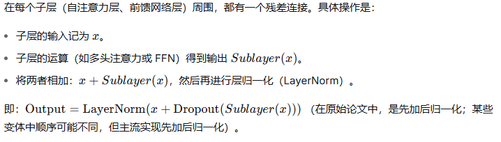
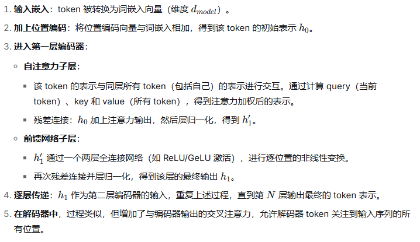
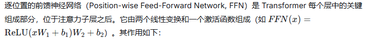
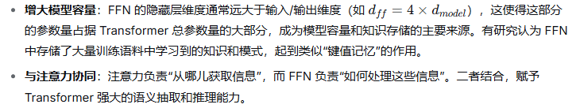

# 1. 大模型（LLMs）Transformer 整体结构

#### 画出标准 Transformer 的宏观结构图，并标注编码器和解码器的核心模块。

> （由于纯文本无法真正绘图，这里用文字描述标准 Transformer 的结构，并标注核心模块，读者可据此绘制。）
>

**宏观结构描述：**

**编码器（左侧）：**

- 由 $N$ 个完全相同的层堆叠而成。

- 每一层包含两个子层：
  1. 多头自注意力（Multi-Head Self-Attention）
  2. 逐位置的前馈神经网络（Position-wise Feed-Forward Network）

- 每个子层后都接有 残差连接（Add） 和 层归一化（Layer Normalization, Norm），即“Add & Norm”。

解码器（右侧）：

- 同样由 $N$ 个完全相同的层堆叠而成。

- 每一层包含三个子层：
  1. 掩码多头自注意力（Masked Multi-Head Self-Attention）：确保对位置 $i$ 的预测只能依赖小于 $i$ 的位置的已知输出。
  2. 多头交叉注意力（Multi-Head Cross-Attention）：对编码器的输出进行注意力计算，将编码器表示融入解码器。
  3. 逐位置的前馈神经网络（Position-wise Feed-Forward Network）

- 每个子层后同样接有残差连接和层归一化。

输入和输出：

- 编码器输入：源序列的嵌入加上位置编码（Positional Encoding）。

- 解码器输入：目标序列的嵌入加上位置编码（训练时整体右移一位，推理时自回归）。

- 解码器最后通过线性层和 softmax 得到输出概率。

---

#### Transformer 中的残差连接是如何添加的？为什么它很重要？

添加方式：

在每个子层（自注意力层、前馈网络层）周围，都有一个残差连接。具体操作是：

在每个子层（自注意力层、前馈网络层）周围，都有一个残差连接。具体操作是：

- 子层的输入记为 $x$。
- 子层的运算（如多头注意力或 FFN）得到输出 $\mathrm{Sublayer}(x)$。
- 将两者相加：$x + \mathrm{Sublayer}(x)$，然后再进行层归一化（LayerNorm）。

即：$\mathrm{Output} = \mathrm{LayerNorm}(x + \mathrm{Dropout}(\mathrm{Sublayer}(x)))$（在原始论文中，是先加后归一化；某些变体中顺序可能不同，但主流实现先加后归一化）。

{.ocr-src}

重要性：

- 解决深层网络的退化问题：残差连接允许梯度直接通过跳跃连接流向浅层，有效缓解了深层网络中的梯度消失问题，使得堆叠非常深的 Transformer（如几十层）成为可能。

- 提供恒等映射能力：网络可以将注意力或 FFN 层的权重学习得非常小，从而“跳过”该层，即网络至少不会比浅层网络差，保证了深层训练的稳定性。

- 加速收敛：优化深层网络时，残差结构使得损失面更平滑，模型更容易训练。

---

#### 解释 Transformer 如何处理变长序列输入。

Transformer 本身通过自注意力机制，理论上可以处理任意长度的序列，但在批处理训练时，需要处理一个 batch 内不同长度的序列。处理方法如下：

- 填充（Padding）：将同一批次中的所有序列填充到相同的长度（通常为该批次最长序列的长度）。使用特殊的 `<PAD>` token，其嵌入向量为零或专门学习。

- 注意力掩码（Attention Masking）：在计算自注意力时，对填充位置进行遮蔽，防止它们对真实 token 的表示产生影响。
  - 对于编码器的自注意力，掩码会屏蔽掉所有填充位置的注意力权重（设置为一个很大的负数，经过 softmax 后概率接近 0）。
  - 对于解码器的自注意力，除了填充掩码外，还需要因果掩码（Causal Mask），确保每个位置只能注意到它之前的位置，防止看到未来的信息。

- 位置编码：位置编码只加到真实 token 上，填充 token 的位置通常也被掩蔽掉（或者在实现中一并加上位置编码但通过掩码忽略）。

- 动态计算：注意力机制本身没有序列长度限制，只是计算注意力矩阵的维度会随序列长度变化。因此，只要内存允许，可以处理任意长度序列。

这种机制使得 Transformer 能够高效地在一个批次中并行处理不同长度的句子。

---

#### 在 Transformer 中，一个 token 的表示是如何通过层间传递的？

以一个 token 为例，描述其在编码器中的传递过程：

1. **输入嵌入**：token 被转换为词嵌入向量（维度 $d_{model}$）。
2. **加上位置编码**：将位置编码向量与词嵌入相加，得到该 token 的初始表示 $h_0$。
3. **进入第一层编码器**：
   - **自注意力子层**：
     - 该 token 的表示与同层所有 token（包括自己）的表示进行交互。通过计算 query（当前 token）、key 和 value（所有 token），得到注意力加权后的表示。
     - 残差连接：$h_0$ 加上注意力输出，然后层归一化，得到 $h_1'$。
   - **前馈网络子层**：
     - $h_1'$ 通过一个两层全连接网络（如 ReLU/GeLU 激活），进行逐位置的非线性变换。
     - 再次残差连接并层归一化，得到该层的最终输出 $h_1$。
4. **逐层传递**：$h_1$ 作为第二层编码器的输入，重复上述过程，直到第 $N$ 层输出最终的 token 表示。
5. **在解码器中**，过程类似，但增加了与编码器输出的交叉注意力，允许解码器 token 关注到输入序列的所有位置。

{.ocr-src}

每个 token 的表示在每一层都通过与序列中其他 token 的交互（自注意力）以及独立的全连接变换（FFN）得到不断更新，最终形成富含上下文的表示。

---

#### 为什么 Transformer 相比 RNN 更容易并行化？

根本原因在于计算依赖关系的不同。

- RNN（循环神经网络）：处理序列时，计算当前时间步 $t$ 的隐藏状态必须等待前一时间步 $t$−1 的隐藏状态计算完毕。这是一种严格的时序串行依赖。因此，RNN 无法在时间维度上并行计算，序列中的每个 token 必须依次处理，严重限制了训练和推理的速度。

- Transformer：使用自注意力机制，计算每个位置的输出时，可以同时利用整个序列所有位置的信息。在计算注意力分数矩阵时，所有 query 和所有 key 的点积可以一次性通过矩阵乘法完成，没有时序上的递推依赖。这意味着在训练时，一个句子中所有 token 的表示可以完全并行地计算。只是在解码器的自回归推理阶段需要逐 token 生成，但每一轮内的自注意力计算仍然是并行的（且可以借助 KV 缓存避免重复计算）。

> 因此，Transformer 摆脱了序列计算的束缚，充分利用了现代 GPU/TPU 的大规模并行计算能力，极大提升了训练效率，这也是它能够扩展到超大规模的核心原因之一。
>

---

#### 如何理解 Transformer 中的“自注意力”和“交叉注意力”的区别？

这两种注意力机制在计算方式上完全相同（都是基于 query、key、value 的缩放点积注意力），关键区别在于 Q、K、V 的来源以及它们在模型中所处的位置。

- 自注意力（Self-Attention）：
  - 位置：编码器的自注意力，以及解码器的掩码自注意力。
  - 来源：Q、K、V 都来自同一个序列的表示（编码器中来自源输入，解码器中来自目标序列）。
  - 作用：计算同一个序列内部各个位置之间的依赖关系。编码器自注意力捕捉输入句子中词与词之间的语法和语义关联；解码器自注意力（掩码）确保在预测下一个词时只能看到已经生成的词，捕捉目标语言内部的序列依赖。

- 交叉注意力（Cross-Attention）：
  - 位置：仅存在于解码器的每个层中，连接编码器和解码器。
  - 来源：Q 来自解码器的自注意力子层的输出（即目标序列的表示），而 K 和 V 来自编码器的最终输出（即源输入序列的最终表示）。
  - 作用：将源语言（输入）的信息融入到目标语言（输出）的生成过程中。解码器在生成每个词时，通过交叉注意力“查阅”输入序列，找到最相关的部分，从而实现输入到输出的对齐。它是序列到序列模型中进行信息转换的核心机制。

简单总结：自注意力是“看自己”，交叉注意力是“看外部”。自注意力建模单序列内部依赖，交叉注意力建模双序列间依赖。

---

#### 在推理阶段，Transformer 的解码器是如何实现自回归生成的？

自回归生成是指逐个 token 产生输出序列，并将已生成的 token 作为下一步的输入。在 Transformer 解码器中，具体过程如下：

1. 初始输入：解码器的初始输入通常是一个特殊的起始符号（如 `<SOS>` 或 `<BOS>`），以及编码器的输出（源序列的表示）。

2. 第一步生成：
  - 解码器处理初始输入（一个 token），通过掩码自注意力（只看自己）、交叉注意力（看编码器输出）和 FFN，得到第一个位置的输出表示。
  - 该表示通过线性层和 softmax 得到词汇表的概率分布，采样或贪心选择出第一个生成的 token（如 `w1`）。

3. 后续步生成：
  - 将已生成的序列（`<SOS>, w1`）作为解码器的新输入，重复上述过程。此时掩码自注意力让 `w1` 可以看到 `<SOS>`，但看不到未来的 token。
  - 输出第二个 token `w2`。

4. 自回归循环：每次将最新生成的 token 附加到已有序列末尾，作为新的输入，预测下一个 token，直到生成结束符号（如 `<EOS>`）或达到最大长度限制。

5. KV 缓存（Key-Value Caching）：为加速推理，解码器在生成新 token 时，无需为之前已生成的 token 重新计算 key 和 value。这些 key 和 value 可以被缓存下来，新 token 只需要计算自己的 query，并与缓存的 key、value 进行注意力计算。这避免了重复计算，极大提升了推理速度。

通过这种方式，解码器实现了从左到右逐个生成序列，完全符合自回归语言模型的定义。

---

#### Transformer 的 Feed-Forward 层在整个架构中的作用是什么？

逐位置的前馈神经网络（Position-wise Feed-Forward Network, FFN）是 Transformer 每个层中的关键组成部分，位于注意力子层之后。它由两个线性变换和一个激活函数组成（如 $FFN(x) = \mathrm{ReLU}(xW_1 + b_1)W_2 + b_2$）。其作用如下：

{.ocr-src}

- 引入非线性：注意力机制本质上是加权求和，是一种线性变换（在聚合 value 时）。如果没有 FFN，多层注意力堆叠仍然可以视为线性变换（或能力有限）。FFN 中的非线性激活函数（ReLU, GeLU 等）为模型提供了强大的非线性表达能力，使模型能够学习更复杂的函数映射。

- 逐位置独立处理：FFN 对每个位置（token）的表示独立且相同地应用，即不同位置共享同一套参数 $W_1, W_2$。这可以看作是对每个 token 的表示进行“特征变换”或“记忆提取”。它让每个 token 在吸收了全局上下文信息（通过自注意力）后，再独立地进行信息的整合与深化。

- **增大模型容量**：FFN 的隐藏层维度通常远大于输入/输出维度（如 $d_{ff} = 4 \times d_{model}$），这使得这部分的参数量占据 Transformer 总参数量的大部分，成为模型容量和知识存储的主要来源。有研究认为 FFN 中存储了大量训练语料中学习到的知识和模式，起到类似“键值记忆”的作用。
- **与注意力协同**：注意力负责“从哪儿获取信息”，而 FFN 负责“如何处理这些信息”。二者结合，赋予 Transformer 强大的语义抽取和推理能力。

{.ocr-src}

---

#### 简述 Transformer 的训练和推理在计算上的主要不同点。

| 维度 | 训练阶段 | 推理阶段（尤其是解码器） |
| --- | --- | --- |
| 并行性 | 完全并行：输入和目标序列已知，整个序列一次性送入模型，自注意力和 FFN 在所有时间步上同时计算。 | 自回归串行：解码器逐个生成 token，必须等待上一个 token 生成完毕才能计算下一个。但单步内的计算可并行。 |
| 掩码注意力 | 解码器使用因果掩码，保证每个位置只看前文，但不影响一次性计算所有位置的输出。 | 同样使用因果掩码。由于只计算当前 token，掩码退化为一个简单的前缀，无需掩盖“未来”。 |
| 计算量 | 一次前向-后向传播计算整个序列的损失，并更新所有参数。 | 每个 token 生成需要一次前向传播，计算量随生成序列长度线性增加。 |
| KV 缓存 | 不需要。因为所有 token 都可见，每个位置的 key/value 在每一层仅计算一次即可。 | 必需。为每个已生成的 token 缓存其 key 和 value 向量，避免每步重复计算，以空间换时间。 |
| 输入来源 | 解码器输入是真实目标序列（右移一位，教师强制）。 | 解码器输入是模型自己之前生成的 token 序列，存在错误累积的风险（曝光偏差）。 |

总结：训练时，Transformer 通过教师强制和掩码实现高效并行；推理时，受自回归限制变为串行，但借助 KV 缓存尽可能复用计算结果，二者的核心计算瓶颈和优化策略因此截然不同。

---

#### 如果移除 Transformer 中的位置编码，会发生什么？

会发生模型完全丧失对序列顺序的感知能力，退化成一个“词袋”模型。

具体表现为：

- 自注意力变为无序集合操作：注意力机制本身是对 value 的加权求和，计算过程中不包含任何关于 token 位置的信息。如果没有位置编码，同一个词在不同位置的表示在自注意力计算中完全等价。句子“我爱你”和“你爱我”在经过自注意力后，每个 token 的表示将完全相同，模型无法区分词序。

- 无法捕捉序列依赖：自然语言中，顺序对句法和语义至关重要。没有了位置信息，模型无法学习到诸如“形容词通常在名词前”、“动词的时态标记位置”等语法规则，也无法理解因果、时间顺序等逻辑关系。

- 对许多任务致命打击：对于机器翻译、文本摘要等序列到序列任务，模型的输出将变成一堆无序的词汇；对于语言建模，模型将无法根据前文预测下文，生成的文本将毫无语法和逻辑。

- 理论上个别情况可能无关紧要：对于极少数不依赖词序的任务（如某些主题分类），移除位置编码可能影响不大，但这只是少数例外。绝大多数 NLP 任务都依赖于序列顺序。

因此，位置编码是 Transformer 架构中不可或缺的关键组件，它赋予了模型感知序列结构的能力。

---

#### 为什么原始 Transformer 使用正弦/余弦位置编码，而不是其他方式？

原始 Transformer 论文（Attention Is All You Need）选择正弦/余弦位置编码，是基于其无需额外参数、能外推到更长序列、且编码相对位置信息的独特优势。

- 无参数，不增加模型容量：正弦/余弦编码是确定的函数，不需要学习。这避免了在训练集较小时学习位置编码可能导致的过拟合，也省去了额外的参数。它可以方便地应用于任意长度的序列，无需担心超出训练时见到的最大长度。

- 具备外推能力：由于是确定性函数，理论上可以处理比训练时更长的序列，尽管效果会有所下降，但比学习的位置编码更具外推性。后来的 ALiBi、RoPE 等方法更好地解决了外推问题，但正余弦编码是早期的一种自然选择。

- 编码相对位置信息：论文声称正弦/余弦编码能够使模型轻松学习相对位置。原因在于对于任意固定的偏移量 k，位置 i+k 的编码可以表示为位置 i 编码的线性函数。这种线性关系可能有助于自注意力学习到“两个词相距多远”的相对模式。尽管后续研究表明，实际模型学习相对位置的能力并不如理论期望的那么强，但这在提出时是一种合理的假设。

- 连续性假设：正弦/余弦函数是平滑的，位置接近的词其编码也接近，这符合语言的直觉：相邻的词在语义和语法上往往关联更密切。这种平滑的归纳偏置有助于模型捕捉局部依赖。

- 与词嵌入维度匹配：位置编码的维度与词嵌入维度 d_model 一致，直接相加即可，不会破坏模型结构。

其他方式（如可学习的位置嵌入）虽然更灵活，可能在下游任务中表现更好，但需要更多参数，且无法外推。后来的研究如 RoPE（旋转位置编码）通过复数旋转巧妙地融合了绝对和相对位置信息，成为当前主流，但在原始论文的历史节点上，正余弦编码因其优雅性、无参数性和理论上的相对位置能力成为了开创性的选择。

---

#### Transformer 中 Dropout 通常加在哪些位置？为什么？

Dropout 在 Transformer 中被广泛用于防止过拟合，尤其是当训练数据不是特别庞大时。标准的加 dropout 位置包括：

- 嵌入层之后：在词嵌入与位置编码相加之后，进入第一个编码器/解码器层之前，施加 dropout。这相当于对输入表示进行随机的“词丢弃”，迫使模型不依赖于单个词的特定嵌入，提升泛化能力。

- 每个子层的输出上（在残差连接之前）：具体来说，在每个自注意力、交叉注意力、以及前馈网络的输出上，先进行 dropout，然后再与输入相加（即 `x + Dropout(Sublayer(x))`）。这是 Transformer 中最核心的 dropout 位置。它随机丢弃子层输出的某些维度，防止不同子层之间产生复杂的协同适应，强制每个子层都能独立提取有用特征。

- 注意力权重上：在计算 softmax 之后的注意力权重矩阵上施加 dropout。这随机丢弃一些注意力连接，相当于让模型在训练时不能依赖单一的注意力头或特定的 token 关系，促使模型学习更鲁棒的上下文表示。

- ReLU/激活函数之后（在一些实现中）：前馈网络的激活函数之后、第二个线性层之前，有时也加 dropout，但较早期和标准的做法主要加在两个线性层之间（原始论文中）。

- 不推荐的位置：通常不在残差连接的主干道上加 dropout，也不在层归一化之后直接加。

这些 dropout 位置共同作用，使得 Transformer 虽然参数巨大，但在适中的训练集上依然能取得很好的泛化性。现代大规模预训练（如 GPT-3、LLaMA）因数据量极大，往往减少甚至完全去除 dropout，改而依赖数据本身的多样性来防止过拟合。

---

#### 如何计算一个 Transformer 层的总参数量？

一个标准的 Transformer 编码器层由多头自注意力和前馈网络组成。设模型维度为 d_model，头数为 h，每个头的维度为 d_k = d_model / h，前馈网络隐藏层维度为 d_ff。

1. 多头自注意力部分：

- Q、K、V 投影矩阵各一个，尺寸均为 (d_model × d_model)，因此参数量为 3 × d_model²。

- 此外，每个投影矩阵通常带有偏置（bias），参数量各为 d_model，因此 3 个偏置共 3×d_model。

- 输出投影矩阵：将多头输出拼接后投影回 d_model，尺寸为 (d_model × d_model)，参数量为 d_model²，偏置为 d_model。

- 注意力部分总参数量 ≈ 4 × d_model² + 4 × d_model。

2. 前馈网络部分：

- 两个线性层：第一层将 d_model 映射到 d_ff，第二层从 d_ff 映射回 d_model。

- 第一层权重：d_model × d_ff，偏置 d_ff。

- 第二层权重：d_ff × d_model，偏置 d_model。

- 总参数量 ≈ 2 × d_model × d_ff + d_ff + d_model。

3. 层归一化：

- 每层有 2 个 LayerNorm（在注意力和 FFN 后各一个），每个 LayerNorm 包含两个可学习参数（缩放因子和偏移），每个参数尺寸为 d_model。

- 因此 LN 参数量 = 2 × 2 × d_model = 4 × d_model。

汇总：

- 一个 Transformer 编码器层的总参数量 ≈ 4×d_model² + 2×d_model×d_ff + 若干线性项（偏置+LN）。当 d_model 和 d_ff 较大时，占主导的是 4×d_model² + 2×d_model×d_ff。

- 通常 d_ff = 4×d_model，代入可得：注意力部分 4×d_model²，FFN 部分 2×d_model×4×d_model = 8×d_model²，合计约 12×d_model²。

- 举例：d_model=512, d_ff=2048，不计偏置和LN，注意力约 4×512²=1,048,576，FFN约 2×512×2048=2,097,152，总共约 3.1M 参数。解码器层因有额外的交叉注意力，参数量约为编码器层的 1.5 倍（多了 Q 投影和输出投影，K、V 来自编码器输出，通常也需投影）。

---

#### 为什么说 Transformer 是一种“集合到集合”的模型？

“集合到集合”模型是指模型将输入视为一个无序集合或带有位置标记的集合，并输出另一个集合，而不是依赖于严格的序列递推关系。Transformer 正是如此：

- 输入是带位置信息的集合：Transformer 将输入序列中的每个 token 转化为嵌入向量，并加上位置编码。如果没有位置编码，自注意力机制对输入序列的排列是完全等变的（置换输入 token 顺序，输出将按相同方式置换）。因此，它天然将输入视为一个“元素包”，位置编码赋予了顺序，但核心处理机制（自注意力）仍然在集合上进行运算。

- 自注意力机制的特性：在自注意力计算中，每个位置的输出是其所有输入位置 value 的加权和。这个操作本质上是集合上的特征聚合，对所有位置同时进行，没有前后依赖。与 RNN 必须按顺序处理不同，Transformer 一次性处理整个集合。

- 输出也是一个集合：编码器输出的是与输入等长的表示集合，解码器输出的是另一个集合（目标序列的表示）。整个转换过程可以看作是从源集合到目标集合的映射。

因此，Transformer 打破了 RNN/LSTM 的时间步依赖，通过集合级别的操作实现序列到序列的转换，这也是其大规模并行化的理论基础。

---

#### 比较 Pre-Norm 和 Post-Norm Transformer 的差异和训练表现。

Pre-Norm 和 Post-Norm 是指层归一化（Layer Normalization）在子层（自注意力、FFN）中的相对位置。

- Post-Norm（原始 Transformer）：`x + Dropout(Sublayer(LayerNorm(x)))` 的变体？不对，原始论文是先做 Sublayer，然后 `LayerNorm(x + Dropout(Sublayer(x)))`。即 LN 在残差连接之后。这是最原始的设计。

- Pre-Norm：`x + Dropout(Sublayer(LayerNorm(x)))`？也不准确。Pre-Norm 的做法是 先对输入进行 LayerNorm，然后进入 Sublayer，最后再残差连接：即 `x + Sublayer(LayerNorm(x))`。这成为现代 Transformer 的主流。

差异与训练表现：

- 训练稳定性：
  - Post-Norm 容易出现训练不稳定，尤其是深层模型。由于残差分支上无归一化，梯度在反向传播时容易累积爆炸，需要小心地使用学习率预热、较小的初始化等技巧才能稳定训练。这在训练很深（如 100 层以上）的 Transformer 时尤其困难。
  - Pre-Norm 极其稳定。因为每个子层的输入都经过 LayerNorm，输出值范围受控，残差分支上的梯度受到约束。它允许使用更大的学习率，且往往不需要复杂的学习率预热。这使得训练更简单、更快收敛。

- 性能：在浅层或中等深度（如 6 层），两者性能差异不大。在深层模型中，Pre-Norm 往往更易训练且最终性能更好。一些研究指出，Post-Norm 可能比 Pre-Norm 泛化稍好（在相同条件下），但由于 Pre-Norm 的稳定性和易调优性，现代 LLM 几乎都采用 Pre-Norm 或类似变体（如 RMSNorm + Pre-Norm 结构）。

- 梯度流动：Pre-Norm 让梯度通过残差连接可以更直接地流向底层，而 Post-Norm 由于 LN 在残差路径末端，对梯度有一定阻隔效应。

因此，Pre-Norm 因“稳”而胜出，成为训练千亿参数模型的标准选择。

---

#### 在 Transformer 解码器中，交叉注意力层的 Q、K、V 分别来自哪里？

在 Transformer 解码器的交叉注意力（Cross-Attention）层中：

- Q（Query） 来自解码器前一子层的输出。具体来说，是解码器中掩码自注意力子层经过残差连接和层归一化后的输出。它包含了目标序列当前位置的上下文表示，相当于“我想要查找什么”。

- K（Key）和 V（Value） 均来自编码器的最终输出。这是源语言序列经过 N 层编码器处理后的表示，包含了源序列的完整上下文信息，是我们要去“查阅”的外部信息源。

交叉注意力的本质就是让解码器在每个生成步骤，用自己的 Query 去匹配编码器输出的 Key，从而找到最相关的源信息，再将对应的 Value 加权聚合，融入目标序列的生成过程。

---

#### 为什么 Transformer 的层数 n 和头数 h 通常需要一起调整？

层数（深度）和多头注意力的头数都是决定模型容量和表达能力的关键超参数。它们需要协同调整，基于以下理由：

- 计算预算的平衡：在固定计算预算下，增加层数和增加头数会争夺参数和 FLOPs。如果层数很少，即使头数很多，模型也没有足够的深度来对信息进行高阶抽象；反之，层数极深但头数极少，可能无法充分捕捉序列中多样的关系模式。因此需要在深度和宽度（头数）之间找到平衡，以最大化性能。

- 表示子空间的维度：每个头的维度 d_k = d_model / h。如果头数增加，每个头的维度变小。当 d_model 固定时，h 不宜过大，否则每个头的维度太小，可能无法捕获足够的特征。通常 d_k 保持在 64 左右，这是一个经验上的良好设定。因此若增大 d_model，为了保持合理的 d_k，也需相应增加 h。

- 梯度流和训练稳定性：层数过深，需考虑残差和归一化的有效性；头数过多，注意力输出的拼接维度虽不变，但每个头的表达能力可能下降。两者需要配合以维持稳定的训练动态。

- 任务复杂度匹配：对于需要复杂多步推理的任务（如数学、逻辑），深度比多头更重要；对于需要同时关注多种关系的任务（如丰富的视觉场景），多头数可能更需要增加。但通常实践中，如 LLaMA 等模型在扩大规模时，会系统性地同时增加层数和头数（或保持 d_k 稳定），以达到帕累托最优。

---

#### 如果让你设计一个轻量级 Transformer，你会从哪些模块开刀？

设计轻量级 Transformer 的核心是在维持足够性能的前提下，大幅减少参数量和计算量。我会从以下模块入手：

- 大幅降低前馈网络的隐藏层维度（d_ff）：FFN 占据总参数的约 2/3（d_ff 通常为 4×d_model）。将其缩减为 2×d_model 甚至更小，可立即砍掉大量参数。也可采用轻量级 FFN 变体，如使用深度可分离卷积代替部分线性层（如 MobileViT 的做法）。

- 减少模型深度和宽度：直接使用更浅的层数 N 和更小的 d_model。这是最直接的压缩，但需在性能损失和效率之间权衡。

- 引入参数共享：让所有层共享权重（Universal Transformer），或者共享部分层的注意力/FFN 参数，大幅减少总参数。

- 优化注意力机制：标准自注意力复杂度为 O(n²)。可替换为稀疏注意力（如 Sparse Transformer）、低秩近似（如 Linformer）、核方法（如 Performer）等，将复杂度降至 O(n) 或 O(n log n)，在长序列上极大提升推理速度。在轻量级场景可选用轻量级的全局注意力。

- 采用量化和蒸馏：首先训练一个小而强的教师模型，然后通过知识蒸馏训练一个更小的学生 Transformer。并结合 INT8/INT4 量化进一步压缩。这是工程上最有效的轻量化路线之一。

- 调整嵌入层：词嵌入矩阵通常很大（词表大小 × d_model），可与输出层共享权重（weight tying）以减少参数。对于多语言模型，可缩减词表。

- 使用轻量级归一化和激活函数：如将 LayerNorm 替换为更高效的 RMSNorm，将 FFN 中的激活函数（如 GeLU）替换为计算更快的 ReLU 或 Swish。

综合来看，蒸馏+量化+缩减FFN的组合可以在保持性能的前提下极大缩小模型尺寸。

---

#### 解释“Transformer 不具有时间/序列归纳偏置”这句话的含义。

这句话指 Transformer 的自注意力机制本身对序列的“顺序”没有任何先验的假设或偏好。这与 RNN、CNN 形成鲜明对比：

- RNN 的归纳偏置是 “时间递推性”：当前状态由前一个状态和当前输入决定，顺序自然地沿时间步传递，赋予了模型强烈的序列顺序先验。

- CNN 的归纳偏置是 “局部性和平移等变性”：卷积核在局部窗口内操作，天然认为邻近位置的元素关系更密切，且模式可平移到任何位置。

- Transformer 的自注意力机制，在没有位置编码的情况下，对于输入序列的任意排列都是等变的，它把序列视为一个无序的集合，不认为靠近的 token 一定有更紧密的关系，也不认为存在从左到右的时间流。

这种缺乏归纳偏置既是缺点也是优点：

- 缺点：必须依赖位置编码显式注入顺序信息，且对于局部性、时序因果等模式需要从大量数据中自己学习，在小数据下可能不如 RNN/CNN。

- 优点：没有强加的人为先验，意味着模型可以更加灵活地从数据中学习任意复杂的依赖关系（包括长距离依赖），不受局部假设的限制。这也是为什么在大数据规模下，Transformer 的表现能够超越传统序列模型的原因之一。它是一张“白纸”，能拟合各种序列模式，但也更需要海量数据来“绘制”这张纸。

---

#### 有哪些经典的 Transformer 变体是针对长序列优化的？

针对自注意力 O(n²) 复杂度在长序列上的瓶颈，涌现了许多经典变体：

- Sparse Transformer：通过稀疏的注意力模式（如固定步长、局部窗口）只计算部分 token 对的注意力，将复杂度降至 O(n√n) 或更低，极大支持了长序列生成（如原始 GPT-3 之前的重要工作）。

- Longformer：结合滑动窗口注意力、扩张窗口注意力和全局注意力（针对任务特定 token），既捕捉局部上下文又允许全局信息流动，在长文档 NLP 任务上表现优异。

- Reformer：使用局部敏感哈希（LSH）将 Q 和 K 分桶，只计算同桶内的注意力，复杂度降至 O(n log n)。同时采用可逆残差层减少内存。

- Linformer：从理论上证明自注意力矩阵是低秩的，通过投影将 key 和 value 的序列长度维度压缩到固定小尺寸 k，从而将复杂度降为 O(nk)，实现线性时间。

- Performer：使用随机正交特征映射来近似 softmax 注意力，将 O(n²) 的点积注意力转化为可在 O(n) 时间内计算的核函数乘积，实现线性复杂度，且精度损失小。

- BigBird：结合随机注意力、局部注意力和全局注意力，将复杂度降至 O(n)，并在长文本摘要、问答等任务上达到与标准 Transformer 相当的性能。

- FlashAttention（优化算法而非架构变体）：通过精心设计 GPU 内存读写（IO-aware），极大加速了自注意力的计算，允许在相同硬件上处理更长序列，已成为现代 LLM 标配。

- 状态空间模型（如 Mamba）：虽然不是 Transformer，但其动机正是解决长序列瓶颈，并在某些任务上挑战 Transformer。

这些变体使 Transformer 及类 Transformer 模型能够有效处理成千上万 token 的超长序列。

---

#### 在视觉 Transformer (ViT) 中，Transformer 的输入和 NLP 有什么不同？

在 NLP 中，Transformer 的输入是一维的离散 token 序列，如一个句子中的单词或子词。而在 ViT 中，输入是二维的连续图像。将图像转换为 Transformer 可接受的输入，需要进行“序列化”处理：

- 图像分块（Patch Embedding）：将输入图像切分成固定大小（如 16×16）的非重叠块（patches）。每个块被视为一个“视觉词元”。

- 线性投影：将每个图像块展平为一个一维向量，然后通过一个可学习的线性层投影到模型维度 d_model，得到块嵌入。

- 添加位置编码：与 NLP 类似，为了保留块的空间位置信息，需要为每个块嵌入添加位置编码（可学习的或正弦/余弦）。这告诉模型哪个块在图像的哪个位置（二维坐标），从而能够学习空间关系。

- 额外的类别 token：ViT 借鉴 BERT，在序列开头添加一个专门的可学习 `[CLS]` token，其最终输出将用于图像分类。这是 NLP 中没有对应物的设计（虽然可类比 BERT 的 `[CLS]`，但 NLP 中常用于句子级别任务）。

- 输入是连续的而非离散：NLP 的词嵌入来自查找表；ViT 的块嵌入来自连续像素值的线性投影，因此输入信息更加连续、密集。

- 序列长度固定：在固定输入图像分辨率下，块数量是固定的，因此序列长度固定（不像文本句子长度多变）。

- 缺少语言的结构化归纳偏置：图像没有语法、词序等强一维结构，其空间关系是二维且具有平移等变性。标准 Transformer 的一维位置编码需要适应这种二维空间关系（如使用二维位置编码或学习到编码）。

这些不同使得 ViT 在训练时需要大量的数据或更强的数据增强来学习视觉中的局部性和空间关系，但在大数据量下能超越传统 CNN。

---

#### 为什么标准 Transformer 不适合直接处理超长文本？

标准 Transformer 的自注意力机制在长文本上面临两大瓶颈：

- 计算复杂度平方增长：自注意力需要计算序列中每一对 token 的注意力分数，导致计算和内存开销随序列长度 N 呈 O(N²) 增长。当 N 达到数万或数十万时，这变得不可接受，即使最高端的 GPU 也无法一次性处理。

- 内存占用巨大：除了注意力矩阵的存储，反向传播需要保存每层的激活值，长序列直接导致显存爆炸。

- 位置编码的局限：原始正弦/余弦位置编码在学习或外推到过长序列时，位置表示可能失效，模型无法准确区分远距离的位置差异。可学习的位置嵌入有最大长度限制。

- 注意力分散与稀释：随着序列变长，每个 token 要将有限的注意力权重分配给更多 token，导致对关键信息的注意力强度被稀释，模型可能出现“迷失在上下文中间”的现象，难以精确捕获长距离依赖。

- 缺乏序列压缩机制：标准 Transformer 没有对历史信息进行选择性遗忘或压缩，随着序列增长，旧信息一直保留，增加了后续计算的负担，也缺乏高效的长期记忆结构。

因此，处理长文本需要专门的技巧，如滑动窗口、稀疏注意力、记忆压缩、分块处理，以及更优的位置编码（如 RoPE 结合线性插值）。

---

#### 什么是“上下文窗口”？它对 Transformer 意味着什么？

上下文窗口是指 Transformer 模型在一次前向传播中能够处理的最大 token 数量，也就是模型单次输入能“看到”的上下文长度上限。它由模型训练时的序列长度上限（如 2048、4096、8192、32768 等）决定。

对 Transformer 而言，上下文窗口意味着：

- 工作记忆的边界：任何超过窗口长度的信息都会在输入时被截断或无法纳入单次处理。模型无法直接利用窗口外的任何信息进行推理。这类似于人类的短时记忆容量限制。

- 长程依赖的天花板：如果答案需要综合两个相距超过窗口长度的信息点，模型在单次推理中无法完成，需要借助外部记忆或分段处理。这正是“大海捞针”（Needle in a Haystack）测试所评估的能力。

- 计算资源与性能的权衡：更大的窗口允许处理更长上下文，但会带来 O(N²) 计算和内存的急剧增长。因此，扩展上下文窗口是昂贵的，并可能导致注意力稀释问题。

- 模型的“视野”限制：在多轮对话中，模型只能记住最近几轮落在窗口内的内容，更早的对话历史会“淡出”窗口，导致遗忘。这是为什么长上下文模型（如支持128K的GPT-4-Turbo）具有重大应用价值的原因。

- 位置编码的挑战：增大窗口需要位置编码能够有效外推，否则窗口边界的 token 位置表示会失效。RoPE 及其变体是目前扩窗的主流支撑技术。

因此，上下文窗口是衡量模型理解和记忆能力的一个核心硬件指标，是现代 LLM 竞争的关键维度之一。

---

#### 简述从原始 Transformer 到 GPT-1 在架构上的主要变化。

GPT-1（Improving Language Understanding by Generative Pre-Training）直接采用了原始 Transformer 的解码器部分，并做了以下关键变化：

- 仅保留解码器：GPT-1 完全丢弃了编码器部分，只使用 Transformer 的解码器。这使得它成为一个单向（自回归）语言模型，而非序列到序列模型。

- 移除交叉注意力层：由于没有编码器，解码器中的交叉注意力子层被全部移除。每一层仅包含掩码自注意力和前馈网络。

- 无监督预训练：原始 Transformer 是为有监督机器翻译训练的。GPT-1 采用大规模无标注文本进行语言建模预训练，学习通用的文本表示。

- 任务特定微调：GPT-1 在预训练后，会针对下游任务（如分类、蕴含、相似度）进行微调。它将不同格式的任务输入统一处理，并添加一个额外的线性分类头。这与原始 Transformer 的有监督序列生成直接不同。

- 输入表示：GPT-1 的输入是单一文本序列，而非源-目标对。使用字节对编码（BPE）处理文本，词表构建不同于原始 Transformer。

- 位置编码：GPT-1 使用可学习的位置嵌入，而非正弦/余弦编码，与原始 Transformer 不同。

总的来说，GPT-1 将 Transformer 从 seq2seq 架构转变为仅解码器架构，并通过预训练+微调范式开启了大规模语言模型的时代。其核心贡献在于验证了 Transformer 解码器在语言生成和通用表征学习上的巨大潜力。

---

#### 为什么现代 LLM 大多只使用 Transformer 的解码器部分？

现代大语言模型（如 GPT 系列、LLaMA、PaLM、BLOOM 等）几乎都是仅解码器架构。它们抛弃编码器-解码器结构，只保留解码器部分，原因包括：

- 自回归生成的天然统一性：仅解码器模型将一切任务（语言生成、翻译、问答、摘要等）都统一为“根据前文预测下一个 token”的自回归建模问题。这提供了一个极其简洁且统一的训练目标，无需针对不同任务设计不同的架构或目标函数。这是迈向通用智能的关键一步。

- 零样本/少样本泛化能力：当仅解码器模型在足够大的数据上预训练后，它们展现出了强大的上下文学习能力，可以仅通过提示词（prompt）和少样本示例来执行新任务，而无需微调。这种能力在编码器-解码器架构中也能实现，但仅解码器模型以更纯粹的形式展现了缩放法则（scaling law）的威力。

- 参数量和计算效率：在给定同样参数量的情况下，仅解码器模型的全部参数都用于自回归预测。而编码器-解码器模型需要将参数分给两个部分，对于纯文本生成任务，解码器部分已经足够。而且仅解码器架构的结构更简单，易于堆叠和扩展。

- KV 缓存与高效推理：在自回归推理时，仅解码器模型可以无缝利用 KV 缓存加速。编码器-解码器在推理时需要编码器完整处理输入（可缓存），但仅解码器模型将输入和输出统一处理，KV 缓存机制天然匹配，工程实现更成熟。

- 预训练数据的规模优势：网络上的文本天然是连续的单语料流，可以直接用“下一词预测”目标训练。要训练编码器-解码器模型，通常需要成对的平行语料（如翻译），或者将数据构造成“输入-输出”对，预处理成本更高。

- Scaling Law 的经验验证：大量的实验表明，将算力投入仅解码器的扩大，能持续、可预测地提升性能。这种可预测性使得仅解码器架构成为了工业界和学术界的主流选择。

因此，仅解码器架构以其简洁性、统一性、可扩展性和卓越的涌现能力，成为了现代 LLM 的事实标准。

