# 10.大模型（LLMs）层归一化（LayerNorm、RMSNorm）

#### LayerNorm 的计算公式是什么？它在哪个维度进行归一化？

LayerNorm（层归一化）对单个样本的特征维度进行归一化，即对每个 token 的嵌入向量单独归一化。假设输入为 $x \in \mathbb{R}^d$（一个 token 的向量，维度为 $d$），LayerNorm 计算如下：

$$
\mu = \frac{1}{d}\sum_{i=1}^{d} x_i, \quad \sigma^2 = \frac{1}{d}\sum_{i=1}^{d}(x_i - \mu)^2
$$

$$
\hat{x}_i = \frac{x_i - \mu}{\sqrt{\sigma^2 + \epsilon}}
$$

$$
y_i = \gamma_i \hat{x}_i + \beta_i
$$

其中 $\mu$ 和 $\sigma^2$ 是沿**特征维度**（即整个向量的所有元素）计算的均值与方差，$\epsilon$ 是防止除零的小常数。$\gamma$ 和 $\beta$ 是与输入同维度的可学习参数，用于恢复变换的表达能力。

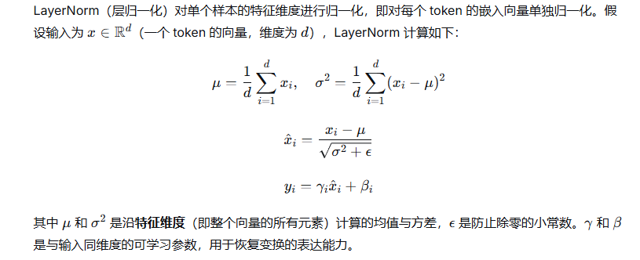{.ocr-src}

在 Transformer 中，输入通常是形状为 ($B$,$N$,$d$) 的张量（B为批次，N为序列长度，d为特征维度）。LayerNorm 沿最后一个维度 $d$ 独立对每个 token（每个 ($B$,$N$) 位置）计算均值和方差，即对每个 token 的特征向量归一化，不跨 token 或 batch。

---

#### 为什么 NLP 中常用 LayerNorm，而不是 BatchNorm？

BatchNorm 在 CV 中成功的原因是图像特征在空间上具有统计平稳性，跨 batch 的统计量较稳定。但在 NLP（尤其是 Transformer）中，LayerNorm 更受青睐，原因如下：

- 序列长度变化：NLP 的句子长度不一，padding 使得 batch 内各序列的有效 token 数不同。BatchNorm 跨 batch 统计均值和方差时，padding 会严重污染统计量。LayerNorm 逐 token 计算，天然不受序列长度影响。

- 序列内依赖：每个 token 的表示依赖于上下文，不同 token 的分布差异较大。BatchNorm 强加跨 token 的一致性会破坏这种精细的上下文特征，而 LayerNorm 保留每个 token 独立的统计特性。

- 小 batch 甚至 batch size=1 的训练稳定性：NLP 模型往往序列很长，单卡只能训练很小的 batch。BatchNorm 在极小 batch 下统计量极不稳定，训练易崩溃。LayerNorm 即使 batch=1 也能正常工作。

- 训练与推理一致性：LayerNorm 在训练和推理时的计算方式完全相同（无需像 BatchNorm 那样维护全局移动平均），简化了流程并避免了长度变化时的不匹配。

---

#### LayerNorm 中的可学习参数 γ 和 β 的作用是什么？

归一化步骤 $\hat{x} = (x - \mu)/\sigma$ 会将输入强制缩放为均值为 0、方差为 1 的分布，这可能破坏网络原有的表示能力。例如，模型可能希望某个特征的尺度较大以引起注意，或者需要一个非零均值来与后续的激活函数协同。

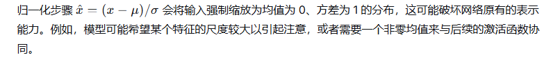{.ocr-src}

可学习参数 $γ$（缩放因子）和 $β$（偏移因子）的作用正是恢复这种被归一化剥夺的表达自由度。最终输出：

$$
y = \gamma \odot \hat{x} + \beta
$$

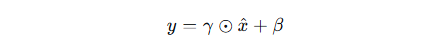{.ocr-src}

- $γ$ 控制每个特征维度的标准差（尺度）。

- $β$ 控制每个特征维度的均值（偏移）。

如果网络认为某层不需要归一化，理论上可以学习 $γ$=$σ$,$β$=$μ$ 来还原原始激活值。因此，$γ$,$β$ 使得归一化层成为一个恒等变换的超集，在不引入额外约束的前提下稳定训练。

---

#### 在 Transformer 中，LayerNorm 通常加在哪些位置？

原始 Transformer（Post-Norm）将 LayerNorm 放在残差连接之后：

$$
\mathrm{Output} = \mathrm{LayerNorm}(x + \mathrm{Sublayer}(x))
$$

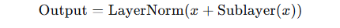{.ocr-src}

即每个注意力子层或 FFN 子层的输出先与输入相加，再经过 LayerNorm。

现代 Transformer（Pre-Norm）则将其放在子层之前：

$$
\mathrm{Output} = x + \mathrm{Sublayer}(\mathrm{LayerNorm}(x))
$$

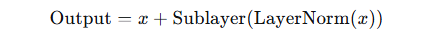{.ocr-src}

即先对输入归一化，再进入注意力或 FFN，最后残差相加。Pre-Norm 训练更稳定，成为 LLM 主流。

所以，LayerNorm 出现在每个子层（注意力前/后、FFN 前/后），通常每层有两个 LayerNorm（注意力一个、FFN 一个），外加最终输出前的 LayerNorm（某些模型有）。

---

#### RMSNorm 与 LayerNorm 的核心区别是什么？为什么它更高效？

核心区别：LayerNorm 同时进行均值中心化（减去均值）和方差缩放（除以标准差）。RMSNorm 省略了均值中心化，仅使用均方根（Root Mean Square）进行缩放，并去掉了偏置参数 $β$（通常只保留 $γ$）。

RMSNorm 公式：

$$
\mathrm{RMS}(x) = \sqrt{\frac{1}{d}\sum_{i=1}^{d} x_i^2}
$$

$$
y_i = \frac{x_i}{\mathrm{RMS}(x)} \cdot \gamma_i
$$

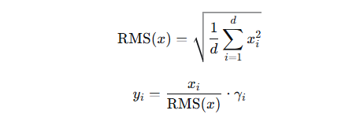{.ocr-src}

更高效的原因：

- 省去了计算均值、减均值、计算方差（均方差的平方）等操作，直接计算均方根，减少了约 30% 的逐元素运算。

- 在 GPU 上，内存读写往往比计算更耗时，减少操作数也意味着更少的内存访问。

- 效果上，大量实验表明去掉均值中心化对深层 Transformer 的训练影响极小，甚至由于减少了约束可能轻微提升性能。

---

#### 写出 RMSNorm 的公式，并说明它为何省略了均值中心化。

RMSNorm 公式：

$$
\mathrm{RMS}(x) = \sqrt{\frac{1}{d}\sum_{i=1}^{d} x_i^2}, \quad y_i = \frac{x_i}{\mathrm{RMS}(x)} \cdot \gamma_i
$$

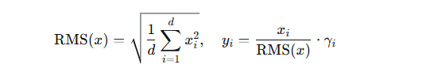{.ocr-src}

省略均值中心化的原因：

1. 残差网络的结构特性：在 Pre-Norm 架构中，归一化后的输出会经过线性层（如注意力投影）并与残差分支相加。线性层本身可以学习到必要的平移（相当于一个偏置），因此显式的均值中心化可能是冗余的。

2. 保持梯度对称性：一些研究表明，均值中心化有时会引入不必要的梯度噪声，去掉它可以简化优化景观。

3. 经验验证：在 LLaMA 等模型中的消融实验表明，RMSNorm 与 LayerNorm 在最终性能上持平甚至更好，却带来了可观的训练加速。

---

#### RMSNorm 之所以被 LLaMA、T5 等广泛采用，除了速度快，还有什么原因？

- 与 SwiGLU 等激活函数的协同：现代 FFN 使用门控激活（SwiGLU），其门控机制本身就能动态调制信息流，部分承担了特征重新分布的功能，降低了对精确归一化的依赖。RMSNorm 的轻量特性与这些复杂激活搭配良好。

- 更好的训练稳定性：RMSNorm 仅依赖二次统计量（均方根），避免了均值估计在深层网络中的累积偏差，在某些超深模型中表现出更稳定的训练动态。

- 参数更少：通常去掉了 $β$ 偏置参数（LLaMA 中 RMSNorm 只有 $γ$），进一步减少了存储和计算。

- 简化实现，方便硬件优化：无需同步计算均值和方差，指令流更简洁，更易融合到高效的 GPU 算子中。

---

#### 为什么说 RMSNorm 减少了计算量，但依然能保持归一化的效果？

归一化的核心目的是控制激活的尺度，防止数值爆炸或消失，从而稳定训练。均值中心化并非必需，原因：

- 深度学习中层间已经存在线性变换，可以补偿均值偏移。例如，紧接在归一化后的全连接层或注意力投影可以通过调整偏置（若有）和权重来吸收任何恒定的均值平移。

- 残差连接的存在使得特征均值在深度网络中自然趋近于零（由于每层将输入和变换后的输出相加，相当于隐式地对输出进行了“去均值”）。因此显式减均值变得不那么关键。

- RMSNorm 依然强制执行了尺度一致性（输出向量的均方根为 $γ$ 控制的值），这已足以使梯度在深层传播时保持稳定，避免了激活值的指数级增长或衰减。

因此，RMSNorm 用更低的成本抓主要矛盾（尺度控制），而将均值调整留给模型的其他部分自行处理，达到了效率与效果的平衡。

---

#### 在 Pre-Norm 结构中，LayerNorm 放在子层之前，它的输入和输出分布会有什么特点？

Pre-Norm 结构：`Output = x + Sublayer(LayerNorm(x))`

- 输入分布：LayerNorm 的输入是上一层的残差输出（或初始嵌入 + 位置编码）。由于残差连接不断累加，如果没有归一化，信号的均值和方差可能逐渐漂移。Pre-Norm 直接对残差流进行归一化，使其在进入子层前始终保持均值为 0、标准差为 1（或经 γ, β 调整后稳定）。

- 输出分布：子层的输出（如注意力或 FFN）分布可能较广或存在偏移，但它直接与原始残差分支 `x` 相加，相加结果又会作为下一层的输入。因此，最终的残差流虽然经过变换，但由于主路径 `x` 的方差相对稳定，整体残差流仍能保持可控。

- 梯度流：Pre-Norm 结构下，梯度可以通过残差连接几乎无损地反向传播到浅层，因为归一化层位于残差分支上，主信息通路是恒等映射。这使得深层网络极易训练，是现代 LLM 普遍采用 Pre-Norm 的原因。

---

#### 解释“归一化层的梯度”如何影响反向传播。

归一化层在反向传播时参与梯度计算，其特殊性质会直接影响梯度的缩放和方向。

以 LayerNorm 为例，对于输入 $x$，输出 $y = \gamma \hat{x} + \beta$，反向传播的梯度 $\frac{\partial L}{\partial x}$ 可以分解为多个部分。归一化层的梯度具有以下关键特性：

- **梯度去相关效应**：由于 $\hat{x} = (x - \mu)/\sigma$，该变换引入了与其他输入维度的依赖（通过 $\mu$ 和 $\sigma$）。因此，$\frac{\partial y}{\partial x}$ 不是对角矩阵，这意味着梯度在通过 LayerNorm 后会被“重新分配”，减小了不同维度梯度之间的相关性，有利于加速收敛（类似于白化效应）。

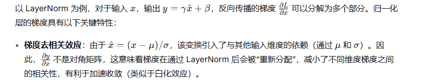{.ocr-src}

- 梯度缩放不变性：LayerNorm 保证了相对于尺度的梯度不变性。若对输入乘以常数 $c$，由于 $μ$ 和 $σ$ 也成比例缩放，x^ 保持不变，因此梯度流在通过 LayerNorm 后不受输入尺度的缩放影响，有效防止了因权重矩阵增大而导致的梯度爆炸或消失。

- 稳定梯度的方差：通过归一化，LayerNorm 确保后续层接收的激活方差稳定，从而反向传播到此层的梯度也有相对稳定的范数，避免深层网络中梯度的指数增长或衰减。

- RMSNorm 的情形：RMSNorm 省略了均值中心化，梯度计算更简单，但保留了关键的方差缩放不变性，依然能有效控制梯度的尺度。

总之，归一化层通过重塑梯度结构（降低相关性）和稳定梯度尺度，使得深层网络的优化地貌更平滑，训练更快、更稳定。这正是为什么归一化层是 Transformer 不可或缺的组件。

---

#### 如果去掉 LayerNorm，使用残差连接和仔细的初始化，模型能训练吗？

理论上可以，但实践中极难训练，且通常无法达到可接受的性能。

原始 Transformer 的初稿在去除 LayerNorm 后几乎无法收敛。残差连接虽能缓解梯度消失，但无法约束前向传播中激活值的分布。深层网络中，即使初始化非常小心（如 T-Fixup 等方法专门调整初始权重来替代归一化），每一层的输出尺度仍可能逐渐漂移，导致梯度爆炸或消失。

在较浅的网络（如 6 层）或特定的初始化策略下，或许能勉强训练，但性能会大幅下降。对于现代 LLM（数十甚至上百层），没有归一化层几乎不可能稳定训练，更不用说取得有竞争力的性能。归一化层通过强制每层输入保持稳定的分布，已成为训练超深 Transformer 的必需品，其作用远超仔细初始化可替代的范围。

---

#### 对比 DeepNorm 和普通 LayerNorm，DeepNorm 如何改进训练稳定性？

DeepNorm 是为极深 Transformer（数百至上千层）设计的一种改进归一化方案，基于 Post-Norm 但引入了两个关键变化：

- **残差分支缩放**：在残差连接中加入一个固定的小缩放参数 $\alpha$（如 $\alpha = (2N)^{-1/2}$，其中 $N$ 为层数），公式变为：

$$
\mathrm{Output} = \mathrm{LayerNorm}(x + \alpha \cdot \mathrm{Sublayer}(x))
$$

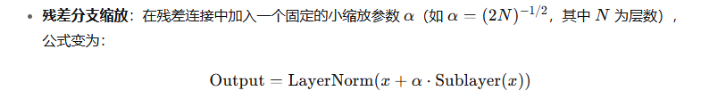{.ocr-src}

- 初始化调整：根据 $α$ 对子层的权重进行特殊初始化，以保证前向传播早期残差流保持稳定。

改进稳定性的原理：普通 Post-Norm（`LayerNorm(x + Sublayer(x))`）中，子层输出直接与残差相加，幅度可能较大，层数一多，累积效果使深层难以训练。DeepNorm 通过大幅缩小子层的初始贡献，确保网络在初始化阶段整体行为接近恒等映射。这样，深层模型可以从一个非常接近恒等的起点开始优化，允许使用更大的学习率，且不会出现发散。DeepNorm 成功让 1000 层的 Transformer 稳定训练，并达到与浅层网络竞争的性能。

对比而言，普通 LayerNorm（无论 Pre-Norm 还是 Post-Norm）在 100 层以内表现良好，但更深时仍需 DeepNorm 等特殊设计。

---

#### LayerNorm 在推理时是否可以与前面的线性层融合？如何做？

可以融合，这是推理优化中常用的技巧，称为“归一化融合”（LayerNorm Fusion）。

原理：LayerNorm 的核心运算是仿射变换：`LN(y) = γ * (y - μ)/σ + β`，其中 μ 和 σ 是 y 的均值和标准差。如果 LayerNorm 紧接在一个线性层之后（`y = Wx + b`），整个模块可以重新参数化为一个新的线性层。

融合方法：

1. 设线性层输出 `y = Wx + b`。

2. LayerNorm 对 y 进行归一化：`LN(y) = (y - μ)/σ * γ + β`。

3. 将线性部分代入：

```plain text
LN(Wx + b) = (Wx + b - μ)/σ * γ + β
           = (γ/σ)W x + (γ/σ)(b - μ) + β
           = W' x + b'
```

1. 其中 `W' = (γ/σ) * W`，`b' = (γ/σ) * (b - μ) + β`。

前提：在推理时，μ 和 σ 需要是确定的值。LayerNorm 在推理时的 μ 和 σ 通常直接由当前输入计算（无全局统计量），因此 μ 和 σ 是输入相关的。这意味着融合并非简单的静态常量替换，而是可以在计算线性层输出的同时动态应用缩放和偏移。现代推理框架（如 TensorRT、ONNX Runtime）常将这两个操作合并为一个 GPU 内核，减少内存读写和内核启动开销，即使 μ 和 σ 是动态计算的，融合依然能显著加速。

---

#### 为什么 LayerNorm 对 batch size 不敏感？

LayerNorm 的归一化统计量（均值和方差）是在每个样本的特征维度上独立计算的，完全不需要跨样本（batch 维度）的信息。对于输入张量 `(B, N, d)`，LayerNorm 对每个 `(b, n)` 位置的特征向量 `[d]` 分别计算 μ 和 σ，与其他样本无关。

无论 batch size 是 1 还是 1000，每一个 token 的归一化过程都完全相同，统计量的稳定性和准确性只依赖于特征维度 d 的大小（d 通常较大，如 768 或 4096，统计量足够稳定）。因此，LayerNorm 天然对 batch size 免疫，非常适合 NLP 中 batch 较小、序列长度变化大的场景。而 BatchNorm 在小 batch 下统计量噪声极大，训练容易崩溃。

---

#### 在长序列情况下，LayerNorm 的计算会不会成为瓶颈？

几乎不会。

LayerNorm 的计算复杂度为 $O(n \cdot d)$，其中 n 是序列长度，d 是特征维度。而 Transformer 中的自注意力计算复杂度为 $O(n^2 \cdot d)$。当序列长度增加时，注意力的计算量呈平方增长，远超 LayerNorm 的线性增长。因此，LayerNorm 在整个推理耗时中的占比极小（通常 <1%），不会成为瓶颈。

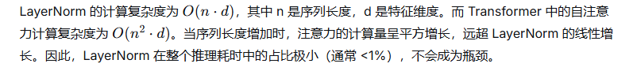{.ocr-src}

即使在极长序列（如百万 token）下，任何线性复杂度的操作都可能被关注，但在此规模下，注意力本身已成为主要矛盾（通常需借助稀疏注意力或线性注意力），LayerNorm 依然不是首要优化对象。此外，使用高效归一化变体（如 RMSNorm）可进一步降低常数因子。

---

#### LayerNorm 和 RMSNorm 在极深网络（100+ 层）中的表现如何？

在极深网络中，Pre-Norm + RMSNorm 的组合是主流且表现优异的方案，而普通 Post-Norm + LayerNorm 往往难以训练。

- LayerNorm：在 Post-Norm 结构中，层数越深，残差分支上的梯度越容易因归一化操作而被削弱，导致训练不稳定。即使使用 Pre-Norm 的 LayerNorm，100+ 层仍可训练，但 RMSNorm 以更低的计算开销获得同等或更好的稳定性。

- RMSNorm：去除了均值中心化，简化了梯度计算，与 Pre-Norm 搭配在千层规模下仍能稳定训练（配合适当的初始化和学习率）。许多极深 Transformer（如 DeepNet）就采用 RMSNorm 作为基础归一化。

对于超深网络（如 200 层以上），单纯堆叠 Pre-Norm + RMSNorm 可能仍会遭遇微妙的数值不稳定，此时可引入 DeepNorm 的残差缩放技巧。总体而言，RMSNorm 在极深网络中表现略优于 LayerNorm，且效率更高，是当前大模型的首选。

---

#### 解释为什么 Pre-Norm 中，归一化层的输入通常不是标准高斯分布。

Pre-Norm 的结构为：

$$
\mathrm{Output} = x + \mathrm{Sublayer}(\mathrm{LayerNorm}(x))
$$

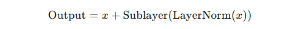{.ocr-src}

其中 `LayerNorm(x)` 的输出经过 γ 和 β 变换后通常不是标准高斯（但大致是均值为 β、标准差为 γ 的分布）。关键在于，`x` 是上一层的残差输出，它由最初的嵌入和所有先前子层的输出累加而成。

随着深度增加，残差流 `x` 的分布会逐渐偏离标准高斯，因为：

- 每一层的子层输出（如 FFN 的非线性变换）都会在残差流上叠加一个信号，这个信号分布通常不是高斯。

- 尽管每一层的输入 `x` 在进入子层前被 LayerNorm 重新归一化，但子层输出与原始 `x` 相加后，得到的新的 `x` 已经是被“污染”过的分布。

- 在浅层，`x` 接近初始嵌入的分布；在深层，`x` 已经累积了大量子层的贡献，呈现重尾、偏斜或更复杂的形态。

因此，尽管 LayerNorm 努力在每一层将子层输入进行归一化，残差流本身作为下一层的输入时，其分布已不再是标准高斯。这也是为何深层网络的归一化层输入分布会逐渐偏离理想高斯的原因。

---

#### 如果对 Q、K 分别进行 LayerNorm，会有什么效果？

对 Query 和 Key 分别进行 LayerNorm（通常称为 QK Norm 或 QKNorm）是一种稳定注意力计算的技巧。

效果：

- 降低注意力 logits 的方差：Q 和 K 向量的值经过 LayerNorm 后范数被控制，点积 `q·k` 的方差大幅降低。这防止了 softmax 之前 logits 的值过大导致梯度饱和（softmax 输出接近 one-hot），使注意力分布更加平滑，梯度流动更稳定。

- 对学习率更鲁棒：在训练初期或使用较大学习率时，未经归一化的 QK 点积极易爆炸。QK Norm 能显著缓解这一问题，减少 loss spike 和训练发散的风险。

- 轻微的性能提升：在一些实验中被观察到能带来微小的困惑度下降或下游任务提升，尤其是在大模型训练不稳定时作为一种“保险”手段。

缺点：

- 增加了计算开销（每层需额外两次 LayerNorm），对于极致追求训练吞吐的大规模预训练来说，性能增益未必能抵消成本，因此在主流 LLM（如 LLaMA、GPT-4）中并未普遍采用，更多见于稳定性要求极高的定制训练中。

---

#### 能否将 RMSNorm 替换为一个简单的缩放因子？效果会变差吗？

效果会严重变差，模型将无法正常训练。

RMSNorm 的核心并不仅仅是“缩放”。它是一个逐 token 动态的归一化操作：对每个 token 的特征向量，计算其均方根（RMS），然后用该值对该向量的所有维度进行缩放。这意味着，不同 token（即使在同一序列中）会根据自身激活的强度被不同地缩放。

如果只使用一个固定的或可学习的缩放因子（即所有 token、所有维度共享同一个乘数），就完全丧失了这种自适应尺度控制能力。后果是：

- 激活范数较大的 token 会直接以高幅值进入后续层，导致注意力分数爆炸或 softmax 饱和。

- 激活范数较小的 token 信号被淹没。

- 深层网络前向传播的数值规模会迅速失控，梯度爆炸或消失随之而来。

一个简单的缩放因子无法应对 token 间、层间动态变化的激活规模，这是 RMSNorm 之所以不可或缺的根本原因。没有它，现代 LLM 的稳定训练无从谈起。

---

#### 为什么 LN 的 γ 和 β 不能初始化为 0 和 1，而是 1 和 0？

LayerNorm 的可学习参数 γ（缩放因子）通常初始化为 1，β（偏移因子）初始化为 0。如果反过来（γ=0, β=1）会导致严重问题：

- γ=0 的后果：归一化后的输出被强制置为零向量，然后加上 β=1，所有 token 的输出变成相同的常数向量。信息彻底丢失，后续层无法提取任何有用特征，网络完全瘫痪。

- γ=1, β=0 的合理性：在训练初期，LayerNorm 将输入归一化为近似均值为 0、方差为 1 的分布，γ=1, β=0 正好保持了这种分布，使网络从一个“平稳”的起点开始学习。随着训练推进，模型可以根据需要调整 γ 和 β 来改变输出的尺度和偏移，从而恢复被归一化压缩的表达空间。

如果初始化为 γ=1, β=0，网络初始状态等价于恒等变换（对于归一化部分而言），这是最自然、最安全的初始化选择。

---

#### 在 Post-Norm 中，层归一化的位置导致残差分支的方差如何累积？

**Post-Norm** 的结构为：

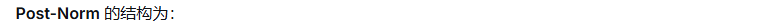{.ocr-src}

$$
\mathrm{Output} = \mathrm{LayerNorm}(x + \mathrm{Sublayer}(x))
$$

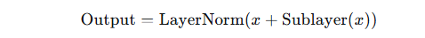{.ocr-src}

方差累积效应：

- 在 Post-Norm 中，残差分支上的输出 `x + Sublayer(x)` 先进行归一化，然后才送入下一层。层归一化会强制使输出的方差保持在一个稳定范围（由 γ 控制）。但残差分支本身（`x`）在通过多个层时，如果不加约束，其方差会随着层数线性增长或缩减。

- 具体而言，假设每层的子层输出 `Sublayer(x)` 的方差大致为常数，那么 `x` 不断累加这些输出，方差会随层数线性增长（因为方差的可加性假设独立）。到了深层，`x` 的方差会变得很大，导致 `x + Sublayer(x)` 的方差也非常大。虽然 LayerNorm 在每一层都会重新缩放到单位方差，但这个过程会在深层引起 梯度消失：因为 LayerNorm 的梯度与输入方差成反比，输入方差越大，通过 LayerNorm 回传的梯度越小。因此，Post-Norm 在深层网络中的浅层梯度极易消失，导致训练困难。

- 相反，Pre-Norm 将 LayerNorm 放在子层之前：`x + Sublayer(LayerNorm(x))`。此时 `x` 不会受到后续子层输出的“污染”，残差流保持干净，梯度可以通过残差连接无损传播，因此 Pre-Norm 更适合极深网络。

总结：Post-Norm 中残差流方差随层数累积，导致深层网络浅层梯度消失；Pre-Norm 则有效规避了这一问题。

---

#### 一些研究在注意力矩阵上使用 QK-Norm，这和 LayerNorm 有何不同？

QK-Norm 是指在计算注意力之前，对 Query 和 Key 向量分别施加 LayerNorm（或 RMSNorm），其目的是稳定注意力分数的尺度。

与标准 LayerNorm 的不同：

- 作用位置：标准 Transformer 中的 LayerNorm 放在子层（注意力、FFN）的前后，归一化的是每个 token 的完整表示向量。QK-Norm 则专门作用于注意力计算中的 Q 和 K 向量，是在线性投影之后、点积之前。

- 归一化对象：标准 LayerNorm 归一化的是整个 `d_model` 维度的向量。QK-Norm 归一化的也是投影后的 Q、K 向量（维度 `d_k`），但目的在于控制点积 `QK^T` 的方差。

- 影响机制：QK-Norm 通过确保 Q 和 K 的范数和分布稳定，避免了点积值过大导致 softmax 饱和，从而减少了梯度消失和训练不稳定的风险。这可以被视为一种注意力特有的归一化，与子层级归一化互补。

- 额外计算成本：每层需要额外计算两次归一化（一次对 Q，一次对 K），增加了少量开销。而标准 LayerNorm 每层只有两次（注意力前和 FFN 前）。

尽管 QK-Norm 能提升训练稳定性，但在大规模模型中由于其额外开销，且 Pre-Norm 已足够稳定，故未成为标配。它更多出现在对稳定性要求极高的特定场景中。

---

#### 当使用混合精度训练时，LayerNorm 的实现需要注意什么？

混合精度训练（如 FP16 权重和激活，FP32 主权重）带来了数值范围挑战，LayerNorm 实现需特别处理：

- FP16 的数值范围有限：FP16 最大约 65504，最小正数约 6e-8。LayerNorm 需要计算均值、方差（涉及平方和），在 FP16 下容易溢出（平方后超出最大值）或下溢（极小值变为 0）。

- 在 FP32 下计算统计量：标准做法是，即使输入和输出是 FP16，LayerNorm 内部的均值、方差计算以及归一化运算全部提升到 FP32 精度进行。即：将 FP16 输入转为 FP32，计算 μ, σ，执行归一化，再转回 FP16。这避免了溢出和精度损失。

- 使用更高精度的累加器：在计算平方和时使用 FP32 累加器，防止 FP16 累加时丢失大量小值。

- 自定义 CUDA 内核：许多框架（如 PyTorch、NVIDIA Apex）提供了混合精度安全的 LayerNorm 实现，自动处理精度提升和转换。

- 参数存储：γ 和 β 通常存储在 FP32 中（如果是 FP16 混合精度，主参数是 FP32），在推理时可根据需要进行转换。

总之，关键是将统计计算保持在 FP32，否则训练极易因数值不稳定而失败。

---

#### 谈谈你对“归一化是为了让网络输入保持零均值和单位方差，从而加速训练”这一说法的理解。

这一说法源自 Batch Normalization 的原始动机：缓解 Internal Covariate Shift（ICS）。虽然 ICS 是否真的是核心问题后来受到质疑，但归一化加速训练的效果是确凿的，原因可归结为：

1. 平滑优化景观：归一化使每层输入的分布稳定，避免了参数更新时层间分布的剧烈变化，从而允许使用更大的学习率而不发散。损失函数的曲面变得更平滑，梯度下降可以更直接地走向极小值。

2. 梯度尺度控制：归一化后的激活具有单位方差，导致反向传播时各层的梯度尺度保持稳定，减少了梯度消失/爆炸的风险。这使得深层网络可以高效训练。

3. 允许更宽泛的初始化：有了归一化，网络对初始权重的敏感度降低，因为无论初始值如何，激活的尺度都会被修正。

4. 隐式的正则化：归一化过程中引入的 mini-batch 统计量（BatchNorm）或逐样本计算（LayerNorm）带来轻微噪声，起到一定的正则化作用。

因此，归一化并非仅仅为了“零均值单位方差”，而是通过对激活值的分布进行动态约束，重塑了优化问题的几何性质，从而让深层网络的训练变得切实可行。

---

#### RMSNorm 是否会影响模型的表达能力？如何弥补可能的损失？

RMSNorm 去掉了均值中心化，理论上减少了自由度，但在实践中对表达能力影响极小，通常可通过现有架构组件自然弥补。

- 均值中心化的作用有限：均值中心化（减去 μ）在统计上使得输出关于零对称，这有助于激活函数（如 ReLU 之前更平衡）和避免偏置漂移。然而，在 Transformer 中，紧随其后的线性层（权重矩阵）可以学习到任意所需的平移，因为 `W(x - μ) + b = Wx + (b - Wμ)`。线性层的偏置可以吸收均值中心化的效果，因此显式减去均值并非必需。

- 门控激活的配合：现代 LLM 普遍采用 SwiGLU 等门控激活，其门控机制本身具备动态调制信息流的能力，可以过滤不需要的偏移，对输入分布的对称性要求更低。

- 残差连接的补偿：残差连接允许网络在需要时保留原始信号，避免了因缺少均值中心化而可能导致的信息损失。如果某个特征维度需要非零均值，后续层可以通过残差流和线性变换轻松恢复。

- 性能和效率的权衡：大量实验表明，RMSNorm 在困惑度和下游任务上持平甚至略优于 LayerNorm，同时带来约 30% 的计算加速和更少的参数（去除了 β）。这表明它用更低的成本实现了相同水平的表达能力。

因此，RMSNorm 所损失的“均值自由度”在现代 Transformer 架构中完全可被其他组件弥补，其对表达能力的实际影响几乎为零。这也是它被 LLaMA、Mistral 等模型广泛采用的深层原因。

