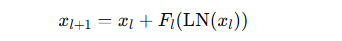
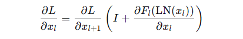
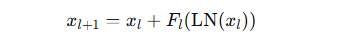

# 11.大模型（LLMs）Pre-Norm 与 Post-Norm

#### 画出 Pre-Norm 和 Post-Norm 的残差结构图，标出归一化层的位置。

Post-Norm（原始 Transformer）\
结构顺序：\
`x → [Sublayer] → (+) → [LayerNorm] → 输出`\
展开：

```plain text
输入 x
  ├──→ Sublayer(x) （注意力或FFN）
  └──→ x（残差连接）
相加得到 x + Sublayer(x)
然后通过 LayerNorm： y = LayerNorm(x + Sublayer(x))
```

归一化层位于残差加法之后。这种设计使得残差分支的输出直接叠加到主路径，然后整个结果被归一化。

Pre-Norm（现代主流）\
结构顺序：\
`x → [LayerNorm] → [Sublayer] → (+) → 输出`\
展开：

```plain text
输入 x
  ├──→ Sublayer(LayerNorm(x))
  └──→ x（残差连接）
相加得到 y = x + Sublayer(LayerNorm(x))
```

归一化层位于子层之前，且只作用于子层的输入，残差分支上的 `x` 原样传递。

这两种结构对训练稳定性和梯度流动有根本性影响。

---

#### 为什么 Pre-Norm 比 Post-Norm 训练更稳定？

Pre-Norm 更稳定的核心原因在于残差流（residual stream）始终保持“干净”，不受后续层归一化的干扰，从而梯度能够通过残差连接无损传播。

具体来说：

- Post-Norm 对 `x + Sublayer(x)` 进行 LayerNorm。随着层数增加，残差流 `x` 不断累加各子层的输出，方差逐渐增大。LayerNorm 在归一化时会将大幅度的信号强行缩放到单位方差，这会导致通过 LayerNorm 回传的梯度与输入方差成反比。深层时，`x` 的方差巨大，LayerNorm 的梯度极度减小，造成浅层梯度消失，训练困难甚至发散。

- Pre-Norm 中，残差连接完全绕过归一化层：`y = x + Sublayer(LayerNorm(x))`。主路径 `x` 不经过任何归一化，梯度可以从深层直接“流过”残差连接到达浅层。归一化仅作用于子层的输入，对主路径的梯度没有衰减效应。因此，深层网络的浅层梯度依然充足，训练稳定。

另外，Pre-Norm 结构在初始化时就接近恒等映射（子层输出相对较小），优化起点更好，进一步增强了稳定性。

---

#### 从梯度传播的角度，分析 Pre-Norm 的残差分支梯度如何流动。

考虑 Pre-Norm 的第 `l` 层：

$$
x_{l+1} = x_l + F_l(\mathrm{LN}(x_l))
$$

{.ocr-src}

反向传播时，损失对 `x_l` 的梯度为：

$$
\frac{\partial L}{\partial x_l} = \frac{\partial L}{\partial x_{l+1}}\left(I + \frac{\partial F_l(\mathrm{LN}(x_l))}{\partial x_l}\right)
$$

{.ocr-src}

其中 `I` 来自残差连接的直接拷贝。关键点：

- 残差路径贡献了一个恒等项 $∂L/∂x_{l+1}$，确保梯度至少可以原样传递到浅层，不会因为 `F_l` 的梯度消失而完全阻断。

- `F_l` 的梯度经过 `LN` 后再作用于 `x_l`。因为 `LN(x_l)` 已将 `x_l` 归一化到稳定分布，`F_l` 的梯度被有效控制，不会出现爆炸或消失。同时，`LN` 本身的梯度也因其输入是 `x_l`（而非残差累加后的巨量信号）而保持合理大小。

- 因此，Pre-Norm 实现了梯度高速公路：残差连接提供无损的梯度通路，归一化则确保支路梯度稳定不失控。整体梯度在数百层内依然可以有效传播。

---

#### Post-Norm 在训练深层 Transformer 时容易发散，其根本原因是什么？

根本原因是残差流方差的累积与 LayerNorm 的相互作用导致的梯度消失。

在 Post-Norm 中，$x_{l+1} = \text{LN}(x_l + F_l(x_l))$。初始时 `x_0` 方差正常，但每经过一层，残差分支会加上 `F_l` 的输出。虽然 `F_l` 的输出通常被设计得较小（初始化），但多层累加后，`x_l` 的范数随层数 `l` 线性增长（假设每层贡献独立且方差可加）。到了深层，`x_l` 的方差远大于 `F_l` 的输出。

LayerNorm 会将其输入 `x_l + F_l(x_l)` 强制归一化到单位方差。然而，反向传播通过 LayerNorm 时，其梯度会乘以 `1/σ`（σ 是输入标准差）。当 `σ` 随层数增大时，梯度被大幅缩小。深层网络中，浅层的 `σ` 已经累积得非常大，导致梯度极小，训练停滞或发散。Post-Norm 天然不具备防止这种方差累积的机制，因此深层 Transformer 使用 Post-Norm 极难训练。

---

#### LLaMA 系列使用 Pre-Norm 还是 Post-Norm？如何验证？

LLaMA 系列使用 Pre-Norm，并且归一化层采用 RMSNorm。

验证方法：

- 查看模型代码或配置文件：在 HuggingFace 的 LLaMA 实现中，每一层为 `LlamaDecoderLayer`，其 `forward` 函数结构为：

```plain text
residual = hidden_states
hidden_states = self.input_layernorm(hidden_states)  # Pre-Norm
hidden_states = self.self_attn(hidden_states)
hidden_states = residual + hidden_states
residual = hidden_states
hidden_states = self.post_attention_layernorm(hidden_states)  # Pre-Norm
hidden_states = self.mlp(hidden_states)
hidden_states = residual + hidden_states
```

- 归一化层明确放置在子层之前，这是典型的 Pre-Norm。

- 此外，LLaMA 的官方技术报告和论文中均描述其使用 Pre-Norm 架构，且采用 RMSNorm 而非 LayerNorm。

---

#### 在 Pre-Norm 中，最后一层输出的方差和第一层输入相比有什么特点？

在 Pre-Norm 中，$x_{l+1} = x_l + F_l(\text{LN}(x_l))$。假设初始输入 `x_0` 的方差为 `σ²`。每一层子层的输出 `F_l` 经过 LN 后分布可控（近似均值为 0，方差由网络设计和初始化决定）。由于 `x_l` 不断累加这些输出，其方差会随层数增加而大致线性增长（各层输出视为近似不相关的增量）。

具体地，经过 `L` 层后，`x_L` 的方差约为初始方差 `σ²` 加上各层增量方差的总和：$Var(x_L) ≈ σ² + Σ_{l=1}^L Var(F_l)$。在标准初始化下，每个 `F_l` 的输出方差被控制在较小量级（通常小于初始嵌入方差），因此总方差增长有限且可控。

特点：

- 浅层方差较小，接近初始分布；深层方差逐渐增大，但增长速率远低于 Post-Norm 中由于 LayerNorm 反作用导致的爆炸/消失。

- 由于没有归一化强制压缩，深层信号的绝对尺度可以自然增长，但残差连接保证梯度仍能通畅回传。

- 在最后一层输出之前，通常会有一个额外的最终 LayerNorm（LLaMA 的 `norm`），将输出再次归一化到稳定分布，用于下游任务。

---

#### Pre-Norm 是否削弱了残差连接的作用？为什么？

没有削弱，反而是强化了残差连接的核心功能。

残差连接的根本目的是提供一条恒等映射路径，使梯度可以无障碍地从深层流向浅层。在 Pre-Norm 中，`y = x + Sublayer(LN(x))`，残差分支 `x` 原封不动地传递，没有经过任何变换（包括归一化）。这使得：

- 前向传播：信息可以不加衰减地跨层传输，深层网络容易保留早期特征。

- 反向传播：梯度可以直接通过残差连接传回，不会因为 LayerNorm 的缩放而衰减。

相比之下，Post-Norm 的残差连接后接有 LayerNorm，归一化操作改变了主路径上的信号，使得恒等映射不再“恒等”，梯度被 LayerNorm 的导数缩放，削弱了残差连接的本意。

因此，Pre-Norm 更好地发挥了残差连接的优势，让极深网络的训练成为可能。

---

#### 如果将 Pre-Norm 改为 Post-Norm，模型训练时需要调整哪些超参数？

将 Pre-Norm 改为 Post-Norm 后，训练动态发生显著变化，通常需要调整以下超参数：

- 学习率：Post-Norm 对学习率更敏感，往往需要更小的学习率以避免发散。Pre-Norm 可用的较大学习率（如 1e-3）在 Post-Norm 下可能直接导致损失爆炸。

- 学习率预热（Warmup）：Post-Norm 通常需要更长的预热步数以及更温和的预热策略，以在训练初期稳定梯度。

- 初始化：可能需要调整权重初始化的标准差，使得各层输出的方差更小，减缓 Post-Norm 中的方差累积问题。例如使用更小的初始化标准差，或采用针对 Post-Norm 优化的初始化方案。

- 归一化层 ε：LayerNorm 中的 epsilon 可能需要调整，以防止在较大输入方差下数值不稳定。

- 梯度裁剪：Post-Norm 更容易出现梯度尖峰，最大梯度范数阈值可能需要设置得更低。

- 优化器：可能需要更保守的 Adam β 参数或权重衰减系数，以维持训练稳定。

- 是否需要 DeepNorm 等辅助技术：对于深层 Post-Norm 模型，可能需要引入 DeepNorm（残差缩放）才能成功训练。

总之，从 Pre-Norm 切回 Post-Norm 是一场稳定性挑战，需要全方位的超参数重调。

---

#### 解释“Pre-Norm 使得通过残差路径的信号几乎不衰减”。

这句话指的是在 Pre-Norm 架构中，主残差流 `x` 在逐层传递时没有经历任何乘法性衰减操作。

具体来说，每一层的运算为：

$$
x_{l+1} = x_l + F_l(\mathrm{LN}(x_l))
$$

{.ocr-src}

- 残差连接将上一层的输出 `x_l` 原样复制并加到本层输出上。这个复制是精确的恒等映射，系数为 1。

- 归一化操作仅作用于支路 `F_l` 的输入，完全不影响主路径 `x_l` 的幅度。

- 因此，信号 `x` 在整个深层网络的传递过程中，每经过一层只是叠加了子层的输出，而没有乘以任何小于 1 的因子（如归一化的缩放）。早期信息可以无衰减地穿越数十上百层。

相反，在 Post-Norm 中，$x_{l+1} = \text{LN}(x_l + F_l(x_l))$，主路径上的信号在每一层都被 LayerNorm 重新缩放，当深层方差变大时，有效信号实际上被压缩，导致早期信息衰减。因此，Pre-Norm 的设计本质上是将归一化从“信息高速公路”上移开，保证了信号和梯度的近乎无损传输。

---

#### 有没有介于 Pre-Norm 和 Post-Norm 之间的归一化方案？

有。介于两者之间的方案旨在结合 Pre-Norm 的稳定性和 Post-Norm 的表达能力。

常见中间方案：

- Sandwich Norm（三明治归一化）：在子层前、后各加一个归一化，即 `LN(x + Sublayer(LN(x)))`。这相当于 Pre-Norm 和 Post-Norm 的组合。它能进一步稳定训练，但计算开销增加，未被广泛采用。

- ResiDual Normalization：将残差分支和主路径的归一化分离，例如：主路径使用 Pre-Norm，但残差分支额外引入一个可学习的缩放因子或小型归一化。这试图在稳定性和表达力之间取得平衡。

- DeepNorm：虽然基于 Post-Norm，但通过大幅缩小子层输出（残差分支乘以极小的 α）并调整初始化，有效控制了方差累积，使极深网络可训。它本质上是改良的 Post-Norm，靠近 Pre-Norm 的稳定特性。

- Hybrid Norm：浅层用 Pre-Norm 保证梯度流动，深层切换为 Post-Norm 以增强非线性表达能力（或反之）。这种策略在一些极端深度实验中有所探索。

总的来说，Pre-Norm 的简洁性和稳定性使其成为主流，中间方案大多处于研究阶段，尚未获得广泛落地。

---

#### 为什么早期的 Transformer 和 BERT 使用的是 Post-Norm？

早期 Transformer（原始论文，2017）和 BERT（2018）均使用 Post-Norm。主要原因：

- 历史路径依赖：残差网络中的“加法后归一化”（Add then Normalize）最早由残差块的变体提出。Transformer 在提出时继承了这一模式，自然采用了 Post-Norm，且当时并未预见到极深网络的需求。

- 当时网络较浅：原始 Transformer 的编码器和解码器各仅 6 层，BERT-base 12 层、BERT-large 24 层。在这样的浅层网络中，Post-Norm 的方差累积和梯度消失问题尚不致命，能够正常训练，因而没有立即暴露其深层缺陷。

- Pre-Norm 的潜力尚未被发掘：虽然 Pre-Norm 在计算机视觉的一些残差网络中有过探索，但在 NLP Transformer 中，其稳定性优势是在后来训练更深模型（如 GPT-2 48 层、大规模预训练）时才被充分认识和普及。BERT 时代之后，随着模型规模爆炸，Pre-Norm 迅速取代了 Post-Norm。

总结来说，早期采用 Post-Norm 是“够用且自然”的选择，随着模型加深，Pre-Norm 的优势才成为刚需。

---

#### 在 MoE 模型中，通常使用 Pre-Norm 还是 Post-Norm？为什么？

现代 MoE（混合专家）模型几乎全部采用 Pre-Norm。

原因与稠密 Transformer 相似，但在 MoE 中被进一步放大：

- 训练稳定性：MoE 中存在门控路由，不同 token 被分配给不同专家，这引入了额外的离散性和负载不均衡。Pre-Norm 的强稳定性能够容忍这种额外的不确定性，而 Post-Norm 在 MoE 中更容易因梯度不稳定而发散。

- 深层与大规模：MoE 往往拥有极多专家和较深架构（如 Mixtral 8x7B、DeepSeek-V2）。Pre-Norm 是训练这类极深且带有动态路由网络的基石。

- 专家切换时的梯度一致性：Pre-Norm 保证每个 token 在进入专家网络前都被归一化到相似分布，这使得不同专家之间的输入分布更加一致，有利于门控网络公平学习和负载均衡。

- 实际案例：所有主流 MoE 模型（Switch Transformer、GShard、Mixtral、Qwen-MoE）均采用 Pre-Norm + RMSNorm 组合。

因此，Pre-Norm 是当前 MoE 架构的事实标准。

---

#### Post-Norm 在浅层网络中是否可行？为什么大家更关注深层？

完全可行。BERT（12/24 层）和原始 Transformer（6 层）的成功已证明，Post-Norm 在浅层网络中表现良好且训练稳定。

原因：

- 浅层网络中方差累积有限，LayerNorm 能够有效控制每层的输入分布，梯度消失/爆炸问题不严重。

- Post-Norm 甚至在某些浅层任务中可能略优于 Pre-Norm，因为它对残差流的归一化更彻底，每层输出被强制缩放到单位方差，有助于保持训练的严格正则。

为何大家更关注深层？

- 现代 LLM 的层数动辄数十甚至上百，必须采用 Pre-Norm 才能训练。浅层网络（<20 层）的研究已相对成熟，社区焦点自然转移到解决深层训练的挑战上。

- 大模型的涌现能力与深度密切相关，深层网络是规模扩展的核心。因此，针对深层网络有效的 Pre-Norm 成为主流。

---

#### Pre-Norm 是否会导致模型对初始化的敏感度降低？

是的，Pre-Norm 显著降低了对初始化的敏感度。

原因：

- Pre-Norm 结构中，每个子层的输入先被归一化到（近似）均值为 0、方差为 1 的分布，然后才进入注意力或 FFN。无论前一层输出的分布如何漂移，子层看到的输入分布始终稳定。

- 这意味着，即使权重初始化偏差较大或不够理想，归一化也会立刻将其修正为规范分布，网络能够正常开始训练。这比 Post-Norm 更宽容，后者在初始化不当（如权重大幅放大残差流）时，可能导致深层输入方差迅速失控，训练失败。

因此，Pre-Norm 为研究者提供了更宽的初始化超参选择范围，降低了对精密初始化技巧的依赖。这也是它适合大规模训练的原因之一。

---

#### 如何理解“Pre-Norm 降低了残差分支的方差，使得网络接近于一个恒等映射”？

这句话概括了 Pre-Norm 在初始化阶段的动力学特性。

- 残差分支的方差降低：在 Pre-Norm 中，子层 `F(LN(x))` 的输入 `LN(x)` 已经被归一化，方差受控。加上子层内部通常有良好的初始化（如小标准差权重、残差 dropout 等），`F` 输出的方差在训练初期通常很小。因此，$x_{l+1} = x_l + F(LN(x_l))$ 中，新增项 `F` 的幅度远小于主路径 `x_l`，网络整体行为主要受恒等映射主导。

- 接近于恒等映射：由于支路输出的方差非常小，每一层的输出 $x_{l+1}$ 非常接近输入 `x_l`。整个深度网络在初始化时近似于一个恒等函数。这提供了一个极其良好的优化起点：模型一开始几乎不做任何变换，随着训练推进，支路的贡献逐渐增大，网络平滑地从“恒等”演化到“复杂函数”。

- 意义：这种性质使得深层网络的优化地貌极其平滑，梯度可以无损传播，训练几乎不会出现剧烈的损失波动。这也是 Pre-Norm 能够轻松训练数百层模型的根本原因。

---

#### 能否让归一化层的 β、γ 参数根据不同层学习不同的归一化策略？

可以，且这正是它们被设计为可学习参数的初衷。

每一层的 γ 和 β 是独立学习的，因此不同层可以（且会）学到不同的缩放和偏移策略。实际上：

- 浅层可能学到 γ 接近 1、β 接近 0，保持归一化后的标准分布，将输入稳定地传递给后续层。

- 深层可能根据任务需要，学到不同的 γ 和 β 值，以放大或抑制某些特征维度的信息，甚至恢复被归一化压缩的表达空间。

这赋予网络极大的灵活性：每层可以根据自己的角色和位置自适应地调整归一化强度，从“几乎不做归一化”（γ 学习到接近输入的 std，β 接近 mean）到“强归一化”均可。

---

#### 在微调时，如果基座模型是 Pre-Norm，我们能否改成 Post-Norm 继续训练？

技术上可以强行修改，但极不推荐，效果大概率很差。

- 预训练期间，模型所有参数已经深度适配了 Pre-Norm 的训练动态：残差流方差可控，深层梯度通畅。若突然切换为 Post-Norm，每一层的输入将不再经过子层前的归一化，而是直接与残差相加后再归一化，整个激活分布和梯度流会发生剧变。

- 原有权重将不再适应新的分布，模型性能会立即崩溃，需要大量数据重新训练（相当于从零开始大部分训练），失去微调的意义。

- 如果是想利用 Post-Norm 的某些特性，更合理的做法是从头预训练一个 Post-Norm 模型，或者探索混合方案。

结论：微调时归一化架构应保持不变，否则会破坏预训练学到的全部表示。

---

#### 分析 Pre-Norm 对模型最终微调性能的影响。

Pre-Norm 对微调性能的影响总体上是中性到正面的，但也有一些需要注意的特性：

- 正面影响：
  - 训练稳定，易于微调：由于 Pre-Norm 在深层依然梯度通畅，微调时可以使用较大的学习率，收敛更快，且不易出现过拟合或训练崩溃。这在下游任务数据规模小、多样性高时尤为重要。
  - 泛化能力较好：Pre-Norm 模型的平滑优化地貌有助于找到更平坦的极小值，通常泛化到下游任务时性能稳健。
  - 适配长文本微调：由于残差流干净，Pre-Norm 模型在微调时扩展上下文长度（如通过位置插值）往往更平滑。

- 需注意的特性：
  - 在微调后期，深层残差流的方差累积可能导致非常深的表示幅值偏大，此时最终输出前的 LayerNorm 会强缩放。若直接在下游任务头使用未归一化的特征，可能带来轻微的不稳定。现代模型通常在最终输出后加一个 LayerNorm，已解决此问题。
  - 在极低资源微调时，由于 Pre-Norm 的强稳定性，模型可能不易充分拟合极少量数据，此时适度降低学习率并增加训练步数通常可弥补。

总体而言，Pre-Norm 的微调性能已被广泛验证，所有主流 LLM（LLaMA、Mistral、Qwen 等）均基于 Pre-Norm 进行下游任务适配，表现卓越。

---

#### 为什么 Pre-Norm 模型更容易进行混合精度训练？

Pre-Norm 的结构天然契合混合精度训练的需求，原因如下：

- 数值范围可控：在 Pre-Norm 中，每个子层的输入都经过归一化，激活值分布集中在均值 0、方差 1 附近（受 γ 调整）。这避免了激活值的幅度在深层网络中发散，使得 FP16 所限的较窄数值范围（最大约 65504）足以容纳这些值，不易溢出。

- 梯度范围稳定：由于前向信号受控，反向传播的梯度同样保持稳定，FP16 的梯度表示范围不会轻易下溢（变为 0）或上溢（变为 Inf）。这大幅减少了混合精度训练中的损失尖峰和发散风险。

- 对损失缩放（Loss Scaling）依赖降低：混合精度训练通常需要动态损失缩放来将小梯度拉升到 FP16 可表示范围。Pre-Norm 下梯度规模本身较稳定，损失缩放的调整频率和幅度可以更小，训练更高效。

相比之下，Post-Norm 的深层激活值方差可能极大，FP16 极易溢出，需要更精细的数值管理。因此，现代大模型普遍结合 Pre-Norm 和混合精度训练（如 BF16/FP16），两者相辅相成。

---

#### Pre-Norm 结构下，如何设计学习率 warm-up？

Pre-Norm 结构对学习率 warm-up 的依赖远小于 Post-Norm，但仍有其设计原则：

- warm-up 可以较短：由于 Pre-Norm 初始化时网络接近恒等映射，初始梯度规模小且稳定，模型可以承受较快的学习率提升。通常 warm-up 步数设为总训练步数的 1%~5% 即可，甚至在一些大 batch 场景下可以完全省略（zero warm-up）。

- 线性或余弦 warm-up 均可：线性增长是标准选择，从 0 线性增加到目标学习率。余弦 warm-up 更平滑但实践中差异不大。

- warm-up 与 batch size 的关系：当使用极大的 batch size（如数万 token）时，即使 Pre-Norm，初始阶段梯度噪声也可能较大，此时适当延长 warm-up（如 5%~10%）有助于避免训练早期的震荡。

- 监控指标：在 warm-up 期间，应密切监控梯度的范数和损失曲线的平滑性。若出现异常尖峰，可能是初始学习率过高或 warm-up 不足。

总体而言，Pre-Norm 的 warm-up 策略可以更为宽松，这降低了调参负担，是大模型训练的一项隐性优势。

---

#### 你对“Pre-Norm 可能限制了模型深层表达”这一观点的看法。

这一观点有一定理论依据，但在实践中影响被过度夸大了，且可通过其他设计弥补。

理论依据：Pre-Norm 的残差分支输出较小，网络初始接近恒等映射。这意味着在训练初期，深层网络的有效非线性程度可能被削弱，因为每一层只对主路径施加微小的扰动。如果这些扰动始终很小，深层的表达可能确实受限，无法充分利用深度优势。

为何实践中不是问题：

- 随着训练进行，支路输出 `F` 的幅度会逐渐增大，网络能够远离恒等映射，学习到强非线性函数。初始的“限制”只是训练动力学的一个起点，而非终点。

- 深层 Pre-Norm 网络在足够训练后，其最终表达能力与 Post-Norm 相比并不逊色，大量基准和实际任务已经证明 Pre-Norm 模型可以达到顶尖性能。

- 事实上，极深 Pre-Norm 网络（100+ 层）通过残差流累积仍可建立高度非线性的表示，因为虽然每一层扰动小，但层数极多，总体累加效果可以构建任意复杂的映射。

如果担心深层表达不足，可采取补充手段：

- 适当增大初始化时权重方差或减少 LN 的 γ 初始值，让早期支路输出略大。

- 在深层引入额外的非线性或门控机制（如 SwiGLU）。

- 采用 Sandwich Norm 或 ResiDual 等改良方案。

总结：Pre-Norm 的“限制表达”更像是一个平滑的训练动力学特征，而非能力上限。它用初始时略微保守的表达能力换取了极佳的深层训练稳定性，而后通过充分训练同样能解锁深层网络的全部潜力。这一取舍在当前大模型时代被证明是极为成功的。

