# 12.大模型（LLMs）残差连接

#### 残差连接在 Transformer 中是如何实现的？写出公式。

在 Transformer 中，每个子层（自注意力、交叉注意力、前馈网络）都使用残差连接。设子层函数为 Sublayer(x)，则残差连接将子层的输入直接加到其输出上：

$$
y = x + \mathrm{Sublayer}(x)
$$

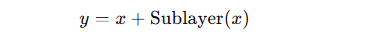{.ocr-src}

随后，通常会经过层归一化（LayerNorm）或之前进行归一化，取决于 Pre-Norm 还是 Post-Norm 结构。

- Post-Norm（原始 Transformer）：

$$
y = \mathrm{LayerNorm}(x + \mathrm{Sublayer}(x))
$$

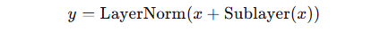{.ocr-src}

Pre-Norm（现代主流）：

$$
y = x + \mathrm{Sublayer}(\mathrm{LayerNorm}(x))
$$

两种形式中，核心都是 `x + Sublayer(...)`，即残差加法。该加法是逐元素的，要求输入和输出的维度一致（均为 $d_{model}$），这由子层内部的投影保证。

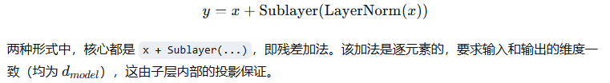{.ocr-src}

---

#### 如果去掉残差连接，一个 12 层的 Transformer 会面临什么问题？

去掉残差连接后，12 层的 Transformer 将遭遇严重的训练困难和性能退化：

- 梯度消失：深层网络中的梯度必须通过每一层非线性的连乘才能传回浅层。没有残差连接的“高速公路”，梯度会指数级衰减，浅层参数几乎无法更新。

- 退化问题：即使梯度能够传播，深层网络也会出现性能反而低于浅层网络的现象（并非过拟合，而是优化困难导致）。残差连接通过提供恒等映射捷径，使深层网络至少不会比浅层网络差。

- 训练不稳定甚至发散：12 层对于没有残差的纯 Transformer 已相当深，前向传播时激活值的分布可能逐渐漂移、消失或爆炸，导致损失剧烈震荡。

- 无法有效训练：实际上，几乎所有成功的深层 Transformer 都依赖残差连接。去掉它，12 层模型基本无法收敛到一个有竞争力的解。

因此，残差连接是深层 Transformer 能够工作的关键组件，而非可选优化。

---

#### 为什么残差连接能有效缓解梯度消失？

残差连接为梯度提供了一条直接相加的“高速通道”。在反向传播时，损失 $L$ 对浅层输入 $x_l$ 的梯度可以分解为：

$$
\frac{\partial L}{\partial x_l} = \frac{\partial L}{\partial x_L}\left(I + \sum_{i=l}^{L-1}\frac{\partial F_i}{\partial x_l}\right)
$$

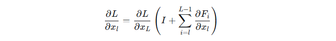{.ocr-src}

其中最关键的是**恒等项** $I$（单位矩阵）。这一项保证了即使所有支路梯度 $\frac{\partial F_i}{\partial x_l}$ 都很小（甚至为零），梯度仍可通过 $I$ 无损地从深层传回浅层。因此，梯度不会因为连乘而指数衰减，缓解了梯度消失问题。

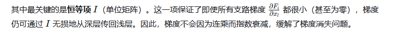{.ocr-src}

此外，残差连接使得每层只需要学习输入与输出之间的残差（差异），这个残差往往较小，其梯度也更容易控制，进一步平滑了优化景观。

---

#### 残差连接对反向传播的梯度有什么影响？

残差连接改变了梯度的流动方式，带来了两个关键影响：

- 梯度至少为 1：由于存在从输出直接连接到输入的恒等映射路径，反向传播时，深层梯度在通过该层时会加上一个来自残差分支的梯度，但主路径上的梯度原样保留（乘以恒等矩阵）。这意味着梯度不会因为该层的变换而被缩小或消失，最小梯度幅度得到保证。

- 梯度的可加性：整体的梯度是直接传递的梯度与经过子层变换的梯度之和。这防止了梯度在反向传播中陷入某一特定变换的“陷阱”，允许不同路径的梯度信息互补。

简而言之，残差连接使得深度网络的梯度流动更像是在一个集成模型中，每个浅层都能直接接收来自最终损失的监督信号，极大改善了深层网络的可训练性。

---

#### 在 Transformer 中，残差连接是加在 LayerNorm 之前还是之后？这与 Pre/Post-Norm 有关。

残差连接的本质是 `x + Sublayer(...)`，而 LayerNorm 的位置决定了 Pre-Norm 还是 Post-Norm。

- Post-Norm：先进行残差加法，然后对结果归一化：

$$
y = \mathrm{LayerNorm}(x + \mathrm{Sublayer}(x))
$$

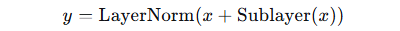{.ocr-src}

Pre-Norm：先对输入归一化，再经过子层，然后残差加法：

$$
y = x + \mathrm{Sublayer}(\mathrm{LayerNorm}(x))
$$

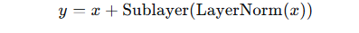{.ocr-src}

无论哪种，残差连接始终是加在子层的输出与原始输入之间，即“加法”永远在归一化之前（Post-Norm）或之后（Pre-Norm）的某个位置，但残差连接的操作本身不变。区别只在于归一化是作用于加法后的结果（Post），还是仅作用于子层的输入（Pre）。

---

#### 残差连接允许网络学习恒等映射，这为什么对深层网络有利？

当网络加深时，如果某些层对当前任务帮助不大，最理想的情况是这些层能“什么都不做”，即实现恒等映射，直接将输入传递给后续层。残差连接使得这一点极易实现：只需将子层的权重驱向零，输出 Sublayer(x)≈0Sublayer($x$)≈0，则 `y ≈ x`。

这对深层网络极其有利：

- 避免强制变换：没有残差连接时，每一层都必须学习一个非恒等的映射，否则会造成信息丢失。深层网络难以保证每一层都学到有用的变换，容易累积误差。

- 按需分配容量：网络可以自主决定哪些层做大量变换，哪些层几乎透明。这相当于动态调整了有效深度。

- 训练初期稳定性：初始化时权重通常很小，残差连接使网络自然接近恒等映射，优化起点良好，远离发散区域。

因此，残差连接赋予了深层网络“惰性”能力，使深度不再成为负担，而是可灵活利用的资源。

---

#### 解释“残差连接的直通路径”使模型在初期接近于一个浅层网络。

在训练刚开始时，子层（注意力、FFN）的权重通常被初始化为较小的随机值。因此，子层输出 Sublayer(x)Sublayer($x$) 的幅度很小。在残差公式 `y = x + Sublayer(x)` 中，`y` 主要由 `x`（恒等映射）贡献。这意味着信号几乎可以不加改变地穿过所有层。

对于整个深度网络，输入信号可以沿着残差连接的“直通路径”一路传递到输出层，几乎不受中间层的影响。因此，模型在训练初期的行为非常类似于一个极浅的网络（甚至接近线性模型），因为大部分非线性层尚未开始显著改变数据流。随着训练进行，子层的贡献逐渐增大，网络才逐步利用其深度进行复杂的非线性建模。

这种性质使得模型可以从简单的函数开始学习，然后平滑地增加复杂度，极大降低了优化难度。

---

#### 是否存在一种可以学习的残差权重？比如给残差分支乘上一个可学习标量。

存在，这种技术称为 可学习残差缩放（Learnable Residual Scaling） 或 ResScale。具体做法是将残差连接改为：

$$
y = x + \alpha \cdot \mathrm{Sublayer}(x)
$$

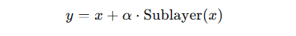{.ocr-src}

其中 $α$ 是一个可学习的标量（或逐通道的向量），初始化为一个很小的值（如 0 或接近 0）。一些变体：

- ReZero：将所有残差分支的初始权重设为 0，让网络从恒等映射开始学习，逐步增大 $α$。

- SkipInit：类似思路，用可学习的缩放因子替换归一化层。

- **DeepNorm**：虽然主要基于 Post-Norm，但引入了固定的极小缩放因子（如 $(2N)^{-1/2}$），虽然不是可学习的，但也是残差缩放思想的体现。

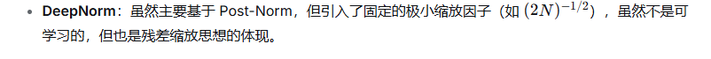{.ocr-src}

优点：可学习的残差权重允许网络自动调节各层子层的贡献程度，可能加速收敛或提升性能。\
缺点：引入了额外参数，且可能破坏残差连接的“梯度高速公路”性质（如果 $α$ 过小，梯度被压缩；过大则可能放大噪声）。因此，在现代大模型中，固定残差连接依然是主流，可学习权重更多见于特定研究或轻量化网络。

---

#### 当模型宽度（d_model）非常大时，残差连接是否会引入方差问题？

**会**，当模型宽度（$d_{model}$）非常大时，残差连接会加剧**方差累积**问题。

在 Pre-Norm 中，每层输出为 $x_{l+1} = x_l + F_l(\mathrm{LN}(x_l))$。假设每层支路输出 $F_l$ 的各个分量独立且方差为 $\sigma^2$，则经过 $L$ 层后，残差流 $x_L$ 的方差将增长为：

$$
\mathrm{Var}(x_L) \approx \mathrm{Var}(x_0) + L \cdot \sigma^2
$$

方差随层数线性增长。当 $d_{model}$ 很大时，方差增长更显著，因为每个维度的独立增量叠加。最终深层残差流的绝对值可能变得非常大。

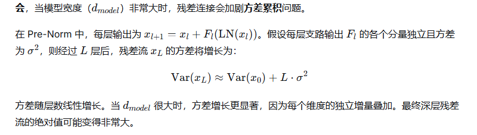{.ocr-src}

引发的问题：

- 前向传播：过大的激活值可能导致注意力 logits 过大，softmax 输出趋于 one-hot，丢失梯度信号；FFN 的激活函数也可能饱和。

- 反向传播：虽然梯度可通过残差连接无损传播，但残差流自身的巨大方差会使 LayerNorm（如果存在）在深层承受极大输入，其梯度可能受影响。

- 数值稳定性：在混合精度训练中，大方差容易导致 FP16 溢出。

解决方案：

- 使用 Pre-Norm 并在子层之前归一化，确保支路输出的方差受控。

- 在初始化时采用较小的权重标准差（如 $1/\sqrt{d_{model}}$），使得支路输出方差足够小，减缓累积。

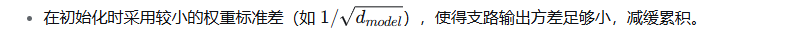{.ocr-src}

- 引入 DeepNorm 式的残差缩放，用极小因子乘子层输出。

- 最终输出前额外加一层 LayerNorm，将残差流重新归一化到标准分布，供下游使用。

因此，虽然残差连接本身会引起方差累积，但配合归一化层和精心设计的初始化，这一问题是完全可控的。现代大模型正是靠着 Pre-Norm + RMSNorm + 小初始化来同时享受残差连接的好处并控制方差。

---

#### 在多头注意力中，残差连接加在拼接投影之后，这个顺序重要吗？

非常重要，这是由维度匹配、信息完整性和梯度流共同决定的。

多头注意力的标准流程为：

1. 输入 `x` 通过线性投影得到各头的 Q、K、V。

2. 各头独立计算注意力并输出 `head_i`。

3. 将所有头的输出在特征维度上拼接：`Concat(head_1, ..., head_h)`。

4. 经过输出投影矩阵 `W_O`，恢复为 `d_model` 维。

5. 残差连接：`y = x + Concat(head_1,...,head_h) W_O`。

为什么残差连接必须加在投影之后？

- 维度匹配：残差加法要求 `x` 和 `Sublayer(x)` 维度严格一致（均为 `d_model`）。拼接后的维度是 `h * d_k = d_model`，但这是未经投影的混合多头信息，其语义空间可能与 `x` 不同。`W_O` 的作用正是将拼接后的多头特征映射回原始的残差空间，使其与 `x` 可加。如果跳过 `W_O` 直接相加，相当于在拼接空间做加法，而该空间的维度虽然相同，但每个维度的含义已经改变（混入了多个头的信息），残差连接的效果会大打折扣。

- 保持恒等路径的纯净：残差连接的主路径是 `x`，我们希望它原封不动地传递到下一层。如果残差加在没有 `W_O` 的拼接结果上，那么支路输出的分布与 `x` 差异会更大，破坏了 Pre-Norm 中“支路输出应是对主路径的微小扰动”的理想状态，可能导致训练初期不稳定。

- 梯度流的对称性：反向传播时，梯度通过两条路径流向 `x`：一条直接（恒等），另一条通过 `W_O` 和注意力计算。`W_O` 的存在为梯度提供了额外的调节能力，有助于平衡两条路径的贡献。

若将残差放在投影之前会怎样？\
可以先拼接，然后加上残差，再投影：`y = (x + Concat(heads)) W_O`。这种结构改变了恒等路径的纯粹性，因为 `x` 也必须经过 `W_O` 才能与支路结合，不再是真正的“残差连接”，而是一种“门控”或“融合”形式。实验表明，标准做法（先投影再加残差）的性能和稳定性最优。

---

#### 为什么很多模型在残差加法后立即使用 Dropout？

准确地说，Dropout 是施加在残差分支（子层输出）上，而非残差加法之后。 原始 Transformer 的做法是：

$$
y = x + \mathrm{Dropout}(\mathrm{Sublayer}(x))
$$

或更完整地（Post-Norm）：

$$
y = \mathrm{LayerNorm}(x + \mathrm{Dropout}(\mathrm{Sublayer}(x)))
$$

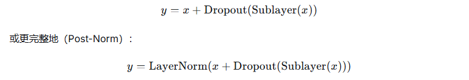{.ocr-src}

为什么 Dropout 放在残差分支上？

- 保护恒等路径：Dropout 会随机丢弃部分信息，如果放在加法之后（即 `Dropout(x + Sublayer(x))`），会直接破坏主路径 `x` 的完整性，导致恒等映射被破坏，浅层梯度受到污染，训练极不稳定。将 Dropout 仅施加于支路，则主路径信号保持无损，只有支路贡献受到随机抑制。

- 正则化效果聚焦：残差支路通常负责学习“修正”或“新特征”，对其施加 Dropout 相当于鼓励网络不过度依赖某一特定的支路变换，增强鲁棒性。这类似于对网络的新增部分进行正则化，而保留核心信息流。

- 与残差思想的契合：残差网络的初衷是让支路学习残差（通常较小），Dropout 可以看作是一种噪声注入，使残差学习更鲁棒，防止过拟合。

现代预训练大模型（如 LLaMA）由于数据规模巨大，往往完全移除 Dropout，仅依赖数据本身的多样性。但若需使用 Dropout，放在残差支路上是唯一合理的做法。

---

#### 残差连接是否会影响 LayerNorm 的归一化效果？

会，且这种影响在 Post-Norm 和 Pre-Norm 中截然不同。

在 Post-Norm 中：\
LayerNorm 接收的是 `x + Sublayer(x)`。随着网络加深，残差流 `x` 的方差不断累积，`x + Sublayer(x)` 的方差也随之增大。LayerNorm 会将其强行缩放到单位方差，这个过程虽然控制了前向分布的稳定，但在反向传播时，LayerNorm 的梯度与输入标准差成反比。因此，深层的残差方差越大，通过 LayerNorm 回传的梯度就越小，严重削弱了残差连接本应带来的梯度增强效果。可以说，Post-Norm 的归一化效果与残差连接产生了冲突，导致深层网络训练困难。

在 Pre-Norm 中：\
LayerNorm 仅作用于支路输入：`y = x + Sublayer(LayerNorm(x))`。残差流 `x` 完全不经过 LayerNorm，因此残差连接的梯度不受归一化的衰减。同时，LayerNorm 将支路的输入归一化，使支路输出的方差受控，从而减缓了残差流方差的累积速度。这里，残差连接和 LayerNorm 协同工作，相互增益：残差连接提供梯度高速路，LayerNorm 确保支路稳定。

因此，Pre-Norm 的设计巧妙地避开了残差连接对归一化效果的负面影响，实现了两者的双赢。

---

#### 如果没有残差连接，Post-Norm 结构还能工作吗？

不能。 去掉残差连接后，Post-Norm 结构退化为 `y = LayerNorm(Sublayer(x))`，这已经不是 Post-Norm 的定义了，而是单纯的“归一化-变换”堆叠。

后果：

- 网络完全丧失了恒等路径，每层必须学习一个非恒等的映射，并且输出直接进入下一层，没有任何捷径。

- 梯度必须通过每一层的归一化和非线性的反向传播才能到达浅层，多层连乘后梯度极易消失，12 层以上几乎无法训练。

- 即使勉强训练，也会遭遇严重的退化问题：深层网络性能反而不如浅层。

因此，Post-Norm 之所以能在浅层网络（如 BERT 12/24 层）中工作，恰恰是因为有残差连接，它为梯度提供了额外的流动通道，部分抵消了 Post-Norm 本身带来的梯度衰减。可以说，残差连接是 Post-Norm 能训练深层网络的“呼吸机”，没有它，Post-Norm 在深层下即刻窒息。

---

#### 从信息流的角度，残差连接为模型提供了两条路径，分别是什么？

残差连接公式 `y = x + F(x)` 将信息流分为两条路径：

1. 恒等路径（Identity Path）：\
   `x` 直接复制到输出，不经过任何变换。这条路径具有以下功能：

- 保留原始信息：确保上一层的输出完整传递给下一层，网络不会“遗忘”已经学到的特征。

- 梯度高速公路：反向传播时，梯度可以通过这条路径无损地流向浅层，避免梯度消失。

- 允许网络跳过不需要的变换：如果某一层的变换对任务无益，网络可以将 `F(x)` 学习得很小，使该层近似透明。

2. 变换路径（Residual Path）：\
   `F(x)` 代表子层（注意力或 FFN）对输入进行的处理。这条路径负责：

- 提取新特征：对输入进行上下文聚合（注意力）或非线性映射（FFN），生成新的表示。

- 学习残差：网络只需学习 `y - x`，即输入到输出的差异，这通常是一个更小的量，更容易优化。

二者的关系：最终输出是两条路径的叠加。在训练初期，变换路径贡献很小，网络以恒等路径为主导，表现为浅层线性模型；随着训练进行，变换路径逐渐增强，网络深度被有效利用。这种动态平衡是残差网络易于优化的根本原因。

---

#### 讨论“DenseNet 密集连接”和 Transformer 残差连接的区别与联系。

联系：

- 两者都通过跳跃连接（skip connections）促进特征复用和梯度流动，使得深层网络更易训练。

- 都通过建立从浅层到深层的直接通路，缓解了梯度消失和退化问题。

- 思想上都属于“让信息在网络中自由流动”的设计哲学。

核心区别：

| 特性 | DenseNet | Transformer 残差连接 |
| --- | --- | --- |
| 连接方式 | 每一层的输入是所有前面层输出的拼接（或加权和） | 每一层的输入只来自直接上一层的加法（x_l + F(x_l)） |
| 特征维度 | 随层数线性增长（拼接），需用1x1卷积或过渡层降维 | 恒定不变（d_model），始终为残差加法 |
| 跳跃范围 | 跨越任意距离，任意两层间直接相连 | 仅相邻层之间，但通过层叠间接实现远距离信息传输 |
| 参数效率 | 特征重用度高，但需额外参数管理拼接后的维度 | 参数效率适中，恒等映射不引入额外参数 |
| 梯度流 | 梯度可以通过极短路径从深层直达浅层（因为直接连接） | 梯度通过逐层恒等项累积传递，路径稍长但仍高效 |
| 典型应用 | 计算机视觉，轻量级图像分类 | 自然语言处理，大语言模型 |

联系与启发：

Transformer 可以视为 DenseNet 的一种极端稀疏形式——只保留逐层连接。DenseNet 的密集连接在视觉任务中极大提升了特征复用，但在 NLP 的 Transformer 中，由于序列长度和自注意力的存在，密集连接会带来难以承受的计算和内存开销。尽管如此，两者的设计精神一脉相承，都源于对“深度网络中信息流动”的深刻理解。

---

#### 为什么在 ResNet 中，残差是加在卷积前后，而在 Transformer 中是加在归一化层前后？

这主要是由归一化层（BN vs LN）的特性和架构演化历史决定的。

ResNet（计算机视觉）的典型结构：

- 原始 ResNet 采用 Post-Norm 风格：`conv -> BN -> ReLU -> conv -> BN`，然后将原始输入 `x` 加在经过第二个 BN 之后（有时加在 ReLU 之前），最后通过 ReLU。

- 后来提出的 Pre-activation ResNet 将 BN 和 ReLU 移到卷积之前：`BN -> ReLU -> conv -> BN -> ReLU -> conv`，残差加法加在第二个 conv 之后、最后 ReLU 之前。这与 Transformer 的 Pre-Norm 思想高度一致：都希望主路径（恒等映射）不受归一化和激活的干扰。

- 为什么卷积网络通常把残差加在卷积前后？因为 BN 依赖于批统计量，如果残差加法放在 BN 之后，BN 的输入分布是逐层累积的，不稳定。将 BN 放在卷积之前（Pre-activation）改善了这一点，与 Pre-LN 的动机相同。

Transformer 的独特之处：

- Transformer 使用 LayerNorm，它不跨 batch，因此对残差流方差的敏感性与 BN 不同。早期的 Post-Norm Transformer 将残差加在子层输出和 LN 之间，后来发现 Pre-Norm 更稳定。

- Transformer 中没有“激活函数”处于残差路径上（除了 FFN 内部的激活），因此残差加法直接加在 `x` 和 `Sublayer` 输出之间。归一化层的位置是主要区别。

本质相同：两者最终都趋向于 “归一化+变换”在残差分支上，主路径保持纯净 的设计。Transformer 的 Pre-Norm 和 ResNet 的 Pre-activation 殊途同归，都是为了让恒等映射的梯度高速公路不被阻塞。

---

#### 在极深的 LLM 中，残差连接会导致激活内存占用过高吗？如何解决？

会导致，这是训练大模型的核心显存挑战之一。

残差连接要求在前向传播时保留每一层的输入激活，以便在反向传播时计算支路的梯度。对于 LLM，输入激活的维度为 `(batch, seq_len, d_model)`。一个 100 层、d_model=8192、序列长度 4096 的模型，单层激活占用 `batch * 4096 * 8196 * 4 bytes ≈ batch * 128 MB`（FP32）。若 batch=1，仅一层的激活就超过 100 MB，100 层则需数十 GB 显存，根本无法训练。

解决方案：

- 激活重计算（Activation Checkpointing）：只保存部分层的输入激活（通常每隔 1~2 层保存一个检查点），在反向传播时，对于未保存的层，从最近的检查点重新进行前向计算来恢复激活。这样以计算换内存，可将激活显存降低到约 `O(sqrt(L))` 级别。这是训练 LLM 的标准做法。

- FlashAttention：对注意力部分，使用分块计算并在线更新 softmax，无需保存完整的注意力矩阵，极大减少了注意力层的激活内存。

- 梯度累积与微批次（Micro-batching）：将大 batch 切分成多个微批次，逐一前向、反向并累积梯度，进一步降低峰值显存。

- 混合精度训练（FP16/BF16）：将激活存储为 FP16 或 BF16，减小每元素字节数。

- 模型并行（张量并行、流水线并行）：将模型切分到多个 GPU，每张卡只存储部分层的激活。

综合运用上述技术，才能在有限显存下训练数千亿参数的 LLM。

---

#### 如果对残差分支进行量化，会带来什么挑战？

对残差分支（即子层输出 `F(x)`）进行量化（如 INT8/INT4）会引入显著的精度和稳定性挑战：

- 破坏恒等路径的精度：残差连接的主路径 `x` 通常需要保持高精度（如 FP16/FP32）以确保恒等映射的准确性。如果支路输出被量化，加法 `x + Q(F(x))` 中的量化误差将直接污染主路径，且会逐层累积，导致深层信号严重失真。

- 误差放大效应：在 Pre-Norm 中，支路输出往往幅度较小（因为 `F(x)` 学习的是残差），量化噪声与信号的比例可能很大，支路信息可能被完全淹没。

- 量化参数的校准困难：不同层、不同 token 的支路输出分布差异巨大，难以用一套静态量化参数（scale, zero point）覆盖整个网络。动态量化虽可缓解，但带来额外计算开销。

- 训练时量化的复杂性：若在训练中模拟量化（QAT），残差分支的梯度经过量化器时会引入额外的噪声，可能影响收敛。需要进行精细的梯度估计（如 Straight-Through Estimator）。

缓解措施：

- 仅对 FFN 和注意力投影的权重进行量化（权重量化），保持激活为高精度，残差分支不量化。

- 使用混合精度，主路径保持 FP16，支路可量化到 INT8 但采用逐张量或逐 token 的动态缩放。

- 将量化应用于推理而非训练，并在校准时充分考虑残差连接的影响。

实际中，为了保持模型质量，大模型推理常采用权重量化（W8A8 或 W4A16），而残差流的激活仍保持较高精度。

---

#### 有没有替代残差连接的方法来训练深层网络？举例。

有，但残差连接凭借其简单高效，至今仍是主流。 替代方法大多通过其他机制实现信息直通或改进初始化，以减轻深度训练的难度。

1. 门控机制（Highway Networks）\
   在残差连接之前，Highway Networks 就提出了“信息高速公路”概念：`y = T(x) * H(x) + (1 - T(x)) * x`，其中 `T` 是可学习的门控向量（sigmoid），控制变换和恒等部分的混合。它允许网络自适应地决定保留多少原始信息。但由于门控引入了额外参数和复杂度，并未取代简单的残差加法。

2. 可逆残差网络（RevNet）

RevNet 通过设计可逆的残差块，使得每一层的输入可以从输出精确恢复，从而无需存储中间激活。这解决了残差连接的内存问题，但网络结构必须满足可逆性约束，灵活性受限。它在某些视觉任务中有效，但在大语言模型中应用较少。

3. 状态空间模型（SSMs，如 Mamba）

Mamba 等模型完全抛弃了注意力，也抛弃了显式的残差连接。它们通过内在的循环状态对序列建模，信息沿时间步自然传递，天生具有“恒等”特性（如果状态不更新）。这种架构从根本上避免了残差连接带来的激活内存问题，并具备线性复杂度。它代表了替代残差连接的一种全新路径。

4. 初始化技巧（Fixup、SkipInit）

一些工作尝试通过调整初始化，让标准网络在去掉残差连接后也能训练。例如，Fixup 初始化通过缩放某些层的初始权重，使网络在初始时近似于恒等映射，从而允许训练十层左右的纯网络。但这些方法难以扩展到数百层，且性能通常不如带残差的网络。

5. 递归网络的门控（LSTM/GRU）\
   LSTM 通过遗忘门和输入门动态控制信息的累积，其细胞状态 $C_t = f_t * C_{t-1} + i_t * \tilde{C}_t$ 本身就具有类似残差连接的特性（可选择性保留旧信息）。这种门控记忆是早期序列模型的成功要素，但在并行性上不如 Transformer。

总结：残差连接因其极简的加法操作、无需额外参数、完美的恒等映射特性，在深度学习中仍不可替代。新的替代方案多从架构层面重新设计信息流，以期在特定场景下超越残差连接，但通用的、可与残差连接匹敌的替代方法尚未出现。

---

#### 残差连接是否会影响模型的可解释性？

残差连接显著提升了 Transformer 的可解释性，而不是削弱它。 这主要得益于它为信息流提供了清晰可追踪的路径。

- 线性可加性带来的分解便利：残差网络可以展开为一条条路径的和。每层的输出是所有浅层变换的累加。这让研究人员可以将模型预测分解为不同层、不同注意力头的贡献，从而理解模型如何逐步构建表示。例如，可以通过消融某条残差路径，观察输出变化来量化该路径的重要性。

- 梯度作为归因：在 Pre-Norm 残差结构中，梯度几乎可以无损地从输出层流向输入层。因此，输入对输出的梯度（如显著性图）更加直接和稳定，更适合作为解释模型决策的依据。相比无残差的网络，梯度信号更少被噪声或消失梯度污染。

- 残差流作为“记忆总线”：许多研究将 Transformer 的残差流视为一条总线，各层通过残差连接向其中写入信息，也从其中读取信息。这种总线视角高度可解释：我们可以可视化每一层“写入”的信息类型（例如语法特征、实体知识），从而理解网络内部的计算分工。

- 头的重要性评估：由于残差连接的存在，剪枝或掩码某个注意力头的影响可以精确测量（因为它只是从总和中移除一项），这为分析每个头的功能提供了极大便利。

因此，残差连接使 Transformer 的内部运作更透明、更易于分析，是现代模型可解释性研究的基础。

---

#### 为什么“Pre-Norm + 残差连接”的组合如此成功？

这一组合的精妙之处在于两者各司其职又完美互补，共同解决了深层网络训练的三大核心难题：梯度消失、表示崩坏和优化困难。

- 残差连接负责“高速公路”：它保证了一条从输出到输入的、几乎无损耗的梯度传播路径和恒等映射路径。这解决了深层网络的梯度消失问题，并允许网络在必要时选择“不做任何变换”，避免了强制变换带来的性能退化。

- Pre-Norm 负责“交通管制”：它将归一化层放置于残差支路（子层）的入口，即 `y = x + Sublayer(LN(x))`。这样：
  - 主路径 `x` 完全不被归一化，恒等映射保持纯净。
  - 支路输入被归一化到稳定分布，使得支路输出 `Sublayer` 的方差从一开始就受到控制，即使网络极深，残差流方差的累积也十分缓慢。
  - 反向传播时，支路梯度经过 `LN` 时不会因为主路径方差的增大而被压缩（因为 `LN` 的输入是稳定的 `x`，而非方差放大的 `x + Sublayer`），进一步保护了支路的梯度。

- 协同效应：残差连接确保主干通畅，Pre-Norm 确保支路输入稳定，两者共同维持了整个深层网络的前向和反向信号的健康流动。正因如此，现代 LLM（如 LLaMA、GPT-3、Chinchilla）几乎无一例外地采用了这一组合，从而能稳定训练数百甚至上千层。

---

#### 在训练初期，残差连接使梯度更易流传，这对优化器有什么好处？

训练初期，所有子层的权重都是随机初始化，其输出几乎为噪声。此时残差连接将网络行为拉近恒等映射，使得梯度的规模和方向都更加良性，为优化器创造了理想的工作环境。

- 允许使用更大的学习率：由于梯度能够稳定、无损地流向所有层，优化器（如 AdamW）可以采用更激进的初始学习率，而不会引发梯度爆炸或损失尖峰。这加速了训练初期从随机状态逃逸的过程。

- 提高了优化器的自适应能力：Adam 等优化器利用梯度的一阶矩和二阶矩来调整每个参数的学习率。稳定且持续的梯度流让这些统计估计更加准确可靠，避免了因梯度消失导致的估计偏差。优化器可以更精确地调整更新步长，使训练更为平稳。

- 减少了对学习率预热（warmup）的依赖：在 Post-Norm 结构中，初期梯度极不稳定，必须通过逐渐增加学习率来热身。而 Pre-Norm + 残差连接让初始梯度保持在一个合理范围，大大缩短甚至允许取消 warmup 阶段，简化了训练流程。

- 更好的损失景观探索：恒等映射主导的初期模型相当于一个性能尚可的浅层网络。优化器从这个不错的起点出发，平滑地增加网络复杂度，更容易找到损失较低且平坦的极小值，这类极小值泛化能力通常更好。

可以说，残差连接为优化器提供了“平坦、开阔、有直接路径”的损失景观，这是现代大模型能够高效训练的关键原因之一。

---

#### 如何诊断一个深层 Transformer 中的梯度消失是由残差连接失败引起的？

当怀疑梯度消失与残差连接有关时，可以通过以下系统性的诊断步骤来定位：

- 检查残差主路径的梯度范数：逐层计算损失对残差流 `x_l` 的梯度范数 `||∂L/∂x_l||`。在健康的 Pre-Norm 网络中，这个范数应在各层之间保持相对稳定（可能在深层略增）。如果发现该范数从浅层到深层急剧衰减（例如呈指数下降），则表明残差连接未能有效传递梯度，可能主路径被破坏（例如 Post-Norm 的结构性缺陷、未正确实现加法等）。

- 比较支路梯度与总梯度：分别计算恒等路径的梯度（即 $∂L/∂x_{l+1}$）和支路梯度（`∂L/∂F_l`）。如果恒等路径的梯度本身已经很小，说明问题在更浅层，残差连接可能整体失效；如果恒等路径梯度正常但支路梯度消失，则可能是 `LN` 位置不当或子层内部梯度消失。

- 检查残差加法前后的激活范数：监测 `x_l`、`F_l(x_l)` 和 $x_{l+1}$ 的范数。如果 `F_l` 的范数远大于 `x_l`，可能造成主路径被支路“淹没”，导致信息流失。反之，如果 `F_l` 的范数极小（例如接近机器零），支路完全不工作，梯度将只能依赖恒等路径，网络的容量被浪费。

- 梯度比值分析：计算 `||∂L/∂F_l|| / ||∂L/∂x_{l+1}||`。这个比值可以反映支路相对于主路径的梯度贡献。在较深层若该比值趋近于零，意味着支路几乎不接收学习信号，可能存在梯度消失。

- 检查 LayerNorm 的梯度：在 Post-Norm 结构中，`LN` 的梯度缩放因子 `1/σ` 可能会极大衰减梯度。监测 `σ` 随层数的变化，如果深层输入标准差 σ 极大，则可确诊为 Post-Norm 引发的残差失效。

- 简化为浅层对照：构建一个同样架构但只有少量层（如 6 层）的模型，观察其梯度范数是否正常。如果浅层正常而深层消失，基本可断定是深度累加效应导致残差连接失效。

通过这些手段，能够精准判断梯度消失是否源于残差连接设计的缺陷，并指导架构调整。

---

#### 在推理时，残差连接需要额外的计算吗？

几乎不需要额外的计算开销，且可通过编译器优化完全融入计算图。

- 加法操作本身极轻量：残差连接仅仅是两个张量的逐元素加法 `x + Sublayer(x)`，其计算复杂度为 `O(n·d)`，与现代 GPU 的算力相比微乎其微。它不涉及任何权重乘法，也不引入新的参数。

- 可与前序操作融合：推理引擎（如 TensorRT、ONNX Runtime、PyTorch 2.0 的 `torch.compile`）通常会将残差加法与前面的矩阵乘法或注意力计算合并为一个融合内核。这样，加法运算的内存读写可以与矩阵乘法的结果写回合并，完全隐藏延迟。

- 带宽不是瓶颈：与注意力机制的 `O(n²·d)` 或 FFN 的矩阵乘加相比，残差加法的带宽需求极小。在典型的 Transformer 推理中，主要瓶颈在于权重加载和注意力计算，残差加法的开销可忽略不计。

- 对并行没有影响：残差连接不引入跨 token 或跨层的依赖，因此不会破坏任何并行策略。无论是张量并行、流水线并行还是序列并行，残差加法的实现都保持简单高效。

因此，残差连接在推理时的额外计算量几乎为零，却带来了模型质量和训练稳定性的巨大提升，是极其划算的设计。

---

#### 谈谈你对“残差连接是 Transformer 成功的基石之一”的理解。

这句话精准概括了残差连接在 Transformer 中的核心地位。没有残差连接，Transformer 根本不可能成长为我们今天所见的庞大而强大的模型。

- 从训练的角度：残差连接通过提供恒等映射路径，使得梯度能够穿越数十甚至数百层而无衰减，彻底解决了深层网络的梯度消失难题。这让研究人员可以大胆地堆叠层数，将模型规模推向千亿、万亿参数级别，从而解锁涌现能力。

- 从架构的角度：残差连接允许网络“按需使用深度”。浅层特征可以通过恒等路径无阻碍地直达深层，深层网络既可以从浅层细节中获益，又可以添加自身的抽象表示。这种灵活性是 Transformer 能够同时胜任底层语法解析和高层语义推理的结构基础。

- 从优化的角度：它将深层网络的优化起点拉近一个性能不错的浅层网络，使得损失景观更为平坦，优化器能够高效工作。这让训练大模型不再是一项碰运气的黑魔法，而成为遵循 Scaling Law 的工程实践。

- 从信息流动的角度：残差连接构建了著名的“残差流”，它像一条贯穿整个模型的高速数据总线。各子层（注意力、FFN）通过从总线读取信息，并将计算结果写回总线。这一优雅的设计让模型内部的信息处理分工明确、便于分析。

- 从与其他技术协同的角度：残差连接与 LayerNorm（尤其是 Pre-Norm）的结合，与 SwiGLU 等高级激活的兼容，与混合精度训练、模型并行的无冲突配合，都使它成为整个 Transformer 技术栈中衔接各方的中枢。

可以说，注意力机制赋予了 Transformer “推理”的能力，而残差连接赋予了它“深度”和“可扩展”的生命力。如果没有残差连接，Transformer 可能只是又一个在浅层奏效但无法深化的小众架构，正是残差连接让它成长为今天人工智能的基石。

