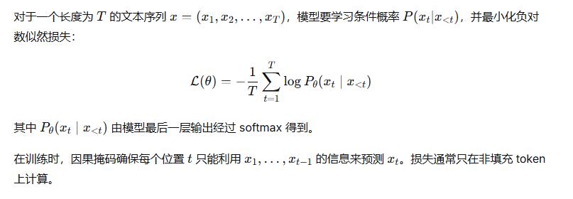

# 13.大模型（LLMs）Decoder-Only 架构（GPT 系列）

#### 画出 GPT 系列模型的 Decoder-Only 结构，说明核心组件。

GPT 系列采用仅解码器（Decoder-Only）架构，由以下核心组件堆叠而成：

```plain text
输入文本 → Token Embedding + Position Embedding
       ↓
   [Transformer Decoder Block] × N 层
       ↓
   最终 LayerNorm
       ↓
   线性层 (LM Head) → softmax → 词表概率分布
```

每个 Decoder Block 包含：

1. 掩码多头自注意力 —— 带因果掩码，确保每个 token 只能看到自身及之前的内容。

2. 前馈网络（FFN） —— 两个线性层 + 激活函数（GPT-1/2 用 GELU，GPT-3/4 未公开细节，LLaMA 等现代模型用 SwiGLU）。

3. 残差连接 包裹以上两个子层。

4. 层归一化 —— GPT-1/2 使用 Post-Norm（在残差加法之后），GPT-3 及之后普遍转向 Pre-Norm（在子层之前）。

核心组件功能：

- 输入嵌入：将 token 转换为稠密向量；位置嵌入（可学习或 RoPE）注入位置信息。

- 掩码自注意力：实现自回归的因果约束，是生成能力的关键。

- FFN：提供模型容量和知识存储，参数量约占 2/3。

- 残差连接+归一化：保障深层网络训练稳定，防止梯度消失。

---

#### 为什么 GPT 使用因果掩码，而不使用编码器-解码器结构？

因果掩码 是 Decoder-Only 模型的根基，它强制每个 token 只能看到其左侧的历史信息，这与自回归生成的目标完全一致：根据过去预测未来。

GPT 不采用编码器-解码器结构，原因包括：

- 统一生成任务：GPT 将所有 NLP 任务统一为“给定前文，预测下一个词”。不需要单独的编码器去理解输入，只需将整个文本（无论是翻译、问答还是对话）视为一个序列，模型从中学习一切。这使得训练语料可以完全来自无标签文本，规模极大。

- 模型结构极简：只有一种 Transformer 块，没有交叉注意力，没有编码器输出，架构简洁，便于扩展和优化。所有的参数都服务于自回归预测，参数利用效率极高。

- 上下文学习能力：因果掩码让模型天然适应 few-shot 提示——只需将示例和指令拼成前缀，模型就能根据历史预测答案，无需任何微调。这种涌现能力与纯解码器结构高度相关。

- 生成质量与灵活性：解码器结构生成的文本在连贯性和流畅性上表现出色，且能轻易适配各种生成场景（续写、对话、代码等）。

本质上，GPT 的哲学是 “把一切都当作续写” ，因果掩码是实现这一哲学的完美技术载体。

---

#### Decoder-Only 模型的训练目标是什么？写出损失函数。

训练目标：自回归语言建模——最大化训练语料中整个序列的联合概率。

对于一个长度为 $T$ 的文本序列 $x = (x_1, x_2, \ldots, x_T)$，模型要学习条件概率 $P(x_t | x_{<t})$，并最小化负对数似然损失：

$$
\mathcal{L}(\theta) = -\frac{1}{T}\sum_{t=1}^{T}\log P_\theta(x_t \mid x_{<t})
$$

其中 $P_\theta(x_t \mid x_{<t})$ 由模型最后一层输出经过 softmax 得到。

在训练时，因果掩码确保每个位置 $t$ 只能利用 $x_1, \ldots, x_{t-1}$ 的信息来预测 $x_t$。损失通常只在非填充 token 上计算。

{.ocr-src}

---

#### GPT 系列从 GPT-1 到 GPT-4 在架构上主要发生了哪些变化？

| 组件 | GPT-1 | GPT-2 | GPT-3 | GPT-4（推测及已知信息） |
| --- | --- | --- | --- | --- |
| 层数 | 组件 | GPT-1 | GPT-2 | 未公开（可能 >100） |
| 嵌入维度 | GPT-3 | GPT-4（推测及已知信息） | 层数 | 未公开 |
| 头数 | 组件 | 未公开（可能 >100） | GPT-2 | 未公开 |
| 归一化 | Post-Norm (LayerNorm) | Post-Norm | Pre-Norm (LayerNorm) | Pre-Norm (推测) |
| 激活函数 | GELU | GELU | GELU | 未公开（SwiGLU 成为主流） |
| 位置编码 | 可学习 | 可学习 | 可学习（推测，后改进为 RoPE-like） | 可能为 RoPE 等 |
| 注意力 | 标准 MHA | 标准 MHA | 稀疏注意力（部分版本） | 未公开，可能包含 GQA/MQA |
| 上下文窗口 | 嵌入维度 | 未公开 | 头数 | 8K ~ 128K |
| MoE | 否 | 否 | 否 | 传闻使用 MoE（Mixture of Experts） |
| 训练数据规模 | BooksCorpus (~5GB) | WebText (~40GB) | 570GB+ 过滤数据 | 数 TB 级多模态数据 |
| 核心创新 | 开创预训练+微调范式 | 强调零样本迁移 | 规模扩展，涌现能力 | 多模态，推理，更长上下文 |

趋势总结：从 GPT-1 到 GPT-4，架构从标准的 Post-Norm MHA 向 Pre-Norm、高效注意力、更优位置编码和多模态方向演进；规模和数据量爆炸式增长，同时引入了 MoE 和稀疏性来平衡计算成本。

---

#### 为什么说 Decoder-Only 架构天然适合自回归文本生成？

因为它的结构设计就是完美匹配自回归生成过程的：

- 因果掩码使模型在训练和推理时的行为完全一致：两者都是根据过去已生成的 token 预测下一个 token。这种一致性避免了“曝光偏差”（训练时看双向，推理时被迫单向）的问题。

- 单向注意力让模型能够自然地按从左到右的顺序构建文本，符合人类写作的物理流程。生成时无需任何额外编码步骤，只需不断将新 token 追加到序列末尾并继续预测。

- 无缝的长度扩展：解码器可以一次生成一个 token，并利用 KV 缓存高效地处理越来越长的上下文，而不需要重新编码。这使得生成任意长度文本成为可能。

- 所有参数服务于生成：没有编码器，没有交叉注意力，所有参数都直接参与“根据前文生成下一个词”这一核心任务，参数利用效率最大化。

简而言之，Decoder-Only 架构就是为自回归生成量身定制的，它的每一个设计决策都服务于这一目标。

---

#### Decoder-Only 模型如何处理“翻译”这种需要输入序列的任务？

Decoder-Only 模型将输入和输出拼接成同一个序列，把翻译问题转化为“给定源语言句子和翻译前缀，预测目标语言句子”的自回归续写任务。

具体做法：

```plain text
[源语言句子] <SEP> [目标语言句子前缀]
```

模型在 `<SEP>` 之后开始生成目标语言，直到生成结束符。训练时，损失只在目标语言部分计算。

这种方式的好处是：

- 不需要特殊的编码器-解码器结构，完全复用自回归框架。

- 通过 few-shot 示例，模型就能高效地学习翻译模式。

- 上下文越长，模型能吸收的源语言信息就越多，翻译质量随之提升。

事实上，GPT 系列已经证明了这种“续写式翻译”的有效性，尤其在大规模多语种训练后，翻译能力甚至可以媲美专用翻译模型。

---

#### 对比 Decoder-Only 和 Encoder-Decoder 在上下文利用上的差异。

| 维度 | Decoder-Only | Encoder-Decoder |
| --- | --- | --- |
| 对源序列的处理 | 仅通过因果自注意力，源序列中每个 token 只能看到其左侧。早期源 token 看不到右侧的后续源信息。 | 编码器对源序列进行双向自注意力，每个源 token 都能看到整个源序列的上下文。 |
| 源-目标交互 | 通过拼接，目标 token 可以直接关注所有源 token（因为源在其左侧），但源 token 不能关注目标 token。 | 交叉注意力让目标 token 在生成时关注编码器的所有输出，且编码器对源的处理是双向的。 |
| 上下文深度 | 源序列信息被浅层单向编码，随后被目标序列的各层单向利用。缺乏对源序列的深度双向理解。 | 编码器可多层双向处理源序列，提取更丰富的表示，然后解码器利用这些表示。 |
| 长距离依赖 | 对于非常长的源序列，由于单向编码，早期源 token 的信息可能被稀释。 | 双向编码能更有效地利用长距离依赖，每个 token 都能直接看到全局。 |
| 灵活性与通用性 | 极其灵活，无需区分源和目标，所有任务都是续写。 | 需要明确的输入-输出对，结构更复杂但可能在某些需要精细理解的任务上更优。 |

总结：Decoder-Only 牺牲了双向编码的深度理解能力，换取了极致的统一性和灵活性；Encoder-Decoder 在需要精细控制和对齐的任务（如翻译、摘要）上仍有优势，但通用性不如前者。

---

#### 解释为什么 Decoder-Only 成为目前 LLM 的主流架构。

1. 统一的任务框架

一切都被归结为“预测下一个 token”。无论是对话、翻译、代码生成还是推理，都可以用相同的方式训练和推理，不需要任何任务特定的结构。这极大地简化了训练流程，也使得在超大规模多任务数据上训练成为可能。

2. 极佳的扩展性（Scalability）

Decoder-Only 架构简单，没有编码器-解码器之间的复杂交互。在 Scaling Law 的指导下，将全部参数和计算都投入到同一个解码器上，被反复证明能够持续、可预测地提升性能。工程上，它的并行和优化也更加直接。

3. 涌现的上下文学习能力

纯解码器模型在超大规模训练后，展现出了强大的 in-context learning 能力——只需在 prompt 中给出几个示例，就能完成新任务。这种能力与 Decoder-Only 的因果注意力结构高度相关，成为 LLM 最具革命性的特性之一。

4. 高效的推理

自回归推理 + KV 缓存 + 现代优化（FlashAttention, GQA）使得 Decoder-Only 的生成速度和显存效率不断提升。相比编码器-解码器，其推理流程更统一，更易部署。

5. 生态与数据

互联网上天然存在的文本序列都可以直接用作训练数据（“下一个词预测”）。这为 Decoder-Only 模型提供了几乎无限的训练语料，而无需人工构建“输入-输出”对。

因此，Decoder-Only 以其无与伦比的通用性、可扩展性和涌现能力，成为了当前 LLM 的主流范式。

---

#### 在 Decoder-Only 模型中，所有的 token 都是单向可见的，这会带来什么局限性？

1. 上下文理解可能不充分

在需要精细理解输入文本的任务（如抽取式问答、细粒度事实核查）中，输入中的每个 token 只能看到其左侧的内容，右侧的关键信息无法直接辅助左侧的理解。虽然多层堆叠能间接传递一些信息，但效率远不如双向编码器。这可能限制模型对复杂上下文的深度把握。

2. 长序列的“注意力稀释”

序列越长，早期 token 对后续 token 的注意力权重可能被稀释，导致模型“忘记”开头的指令或信息（尤其是在长对话或长文档处理中）。虽然位置编码（如 RoPE）和长上下文微调可以缓解，但无法根除。

3. 对“纠正”和“重规划”的局限

人类在写作时会回头修改前文。但 Decoder-Only 生成是单向的，一旦某个 token 生成错误，后续生成可能被带偏，而模型无法主动“回退”修正。这要求模型具备极高的单步准确率。

4. 推理能力的结构性限制

某些复杂的多步推理需要前后文自由交互。虽然思维链（CoT）可以在生成过程中模拟双向推理，但本质上仍是单向的线性链。对于需要全局优化或回溯的推理任务，其效率和准确性可能受限。

尽管存在这些局限，Decoder-Only 架构通过规模扩展、位置编码改进、长上下文训练和提示工程技术，不断突破这些天花板，其实际表现已经远远超出了最初的预期。

---

#### 有没有办法让 Decoder-Only 模型获得双向上下文信息？

有，但通常是通过变通手段，而非改变其自回归本质。 常见方法包括：

- 双向上下文学习（In-Context Learning）：通过将整个上下文（包括左右文）放入 prompt 前缀，让模型在生成时看到全部信息。例如，对于完形填空，可将句子左右部分拼接为“左文 [MASK] 右文”，模型虽单向生成，但能利用左右两侧的前缀信息。

- Fill-in-the-Middle (FIM) 训练：在预训练时，将文档的中间部分移到末尾，构造“前缀 + 后缀 + 中间”的序列，训练模型根据前后文生成中间部分。这样，模型学会了利用双向线索进行补全。CodeLLaMA 等代码模型就采用了 FIM 来增强对上下文的感知。

- 双向解码器变体：一些研究模型（如 GLM）通过混合掩码，在某些层允许特定 token 看到双向上下文，同时保留自回归生成能力。但这不是纯 Decoder-Only。

- 外部工具：结合检索增强（RAG），从外部知识库检索相关信息作为前缀，间接提供了超出单向窗口的“背景知识”。

纯 Decoder-Only 的核心是保持单向生成的一致性，因此双向信息始终是作为“历史”引入，而非结构上的真正双向注意力。

---

#### 为什么 GPT 的输入是 token 序列，不需要额外的句子向量？

因为 Transformer 的自注意力机制天然能处理变长序列，且 GPT 通过特殊 token 来隐式地标记句子边界和任务类型，无需像传统模型那样需要单独的句子向量。

- 序列统一性：GPT 将一切——指令、示例、输入、输出——全部拼接为一个连续的 token 序列。模型通过训练学会从上下文中区分不同部分，无需显式的句子分割。

- 特殊标记的作用：通过 `<SEP>`、`<EOS>`、换行符、角色标记（如 `User:`、`Assistant:`）等，模型可以自然地区分不同句子或对话轮次。这些标记的嵌入被模型学习为“句子边界”的表示。

- 位置编码：位置嵌入区分了不同位置的 token，使得模型能够感知序列中的顺序，而不需要将句子作为独立单元输入。

- 灵活性与扩展性：这种设计让模型能处理任意数量的句子，不受固定句子向量维度的限制，极大提升了通用性和易用性。

因此，GPT 的输入是纯粹的 token 流，句子结构被隐藏在序列之中，由模型自行理解。

---

#### 在微调 GPT 时，如何构造 prompt 来适配下游任务？

微调时，需要将下游任务数据转化为统一的续写格式，通常遵循 `[提示] [输入] [输出]` 的结构，并使用特殊分隔符。

通用模板：

```plain text
[System/Instruction] + [User Input] + [Assistant Response]
```

例如，对话任务：

```plain text
<|im_start|>system
You are a helpful assistant.<|im_end|>
<|im_start|>user
翻译：Hello<|im_end|>
<|im_start|>assistant
你好<|im_end|>
```

训练时，loss 只计算在 `assistant` 部分，系统提示和用户输入部分被 mask 掉。这种方式保证了模型只学习如何生成期望的回复，而不会去“预测”用户的提问。

对于分类任务，可构造为“输入文本 → 类别标签”的形式，例如：

```plain text
Review: This movie is great. Sentiment: positive
```

模型在 `Sentiment:` 之后生成类别，损失同样只加在生成的部分。

---

#### 解释“因果语言模型”为什么又叫做“标准语言模型”。

因果语言模型（Causal LM）的目标是对序列的联合概率进行自回归分解：

$$
P(x_1, \ldots, x_T) = \prod_{t=1}^{T} P(x_t \mid x_{<t})
$$

{.ocr-src}

这个分解直接源于概率论的链式法则，是统计学中“语言模型”最经典、最标准的定义。它严格遵循时序因果关系：过去影响未来，未来不影响过去。

因此，因果语言模型就是按照自然语言的生成顺序进行建模的语言模型，是语言模型定义的直接实现，故被称为“标准语言模型”。

---

#### Decoder-Only 模型在推理时，能否利用前缀缓存 (Prefix Caching)？

可以，且前缀缓存是提升推理效率的关键技术之一。

原理：

- 在自回归生成中，输入前缀（如 system prompt、few-shot 示例、对话历史）在很多请求中是共享的。如果为每个请求都重新计算这些前缀的 Key 和 Value，会造成大量冗余计算。

- 前缀缓存就是将这些共享前缀的 KV 向量缓存起来，后续请求只需计算不同的后缀部分，极大节省了计算和显存带宽。

实现方式：

- 推理引擎（如 vLLM、SGLang）通过哈希前缀 token 序列来识别和复用缓存的 KV，实现自动前缀匹配。

- 对于长对话，只缓存公共前缀（如系统指令），而用户特定的后续对话部分则单独计算。

收益：在批量服务场景中，前缀缓存可以将首 token 延迟降低数倍，同时提高吞吐，尤其对于长 system prompt 的场景效果显著。

---

#### 如何评估一个 Decoder-Only 模型的生成质量？

生成质量的评估是多维度的，通常结合自动指标、模型裁判和人工评估：

1. 自动指标：

- 困惑度（Perplexity）：衡量模型对测试集的压缩效率，越低表示语言建模能力越强，但不直接反映生成文本的实际可用性。

- BLEU / ROUGE / METEOR：用于翻译、摘要等有参考文本的任务，衡量 n-gram 重叠。对开放生成任务不适用。

- BERTScore / BLEURT：基于上下文嵌入的语义相似度，更贴近人类判断。

- 多样性指标：Distinct-n、Self-BLEU，评估生成文本的词汇和语义多样性。

2. 模型裁判（LLM-as-Judge）：

- 使用强大的模型（如 GPT-4）对生成结果从帮助性、安全性、事实性等维度进行评分或成对比较。如 MT-Bench、AlpacaEval。

3. 人类评估：

- 从流畅度、连贯性、创意性、忠实性、安全性等角度进行专家或众包评分，是最终的黄金标准。

4. 任务特定评估：

- 代码生成：Pass@k（单元测试通过率）

- 数学推理：最终答案准确率（GSM8K, MATH）

- 知识问答：F1、精确匹配（MMLU, Natural Questions）

综合来看，没有单一指标能全面衡量生成质量，实际中通常构建一个包含自动指标和人类评估的混合体系。

---

#### 在缩放定律指导下，Decoder-Only 模型为什么展现出涌现能力？

涌现能力指的是模型规模超过某个阈值后，突然获得的、在小型模型中没有明显迹象的能力（如复杂推理、上下文学习、代码生成等）。在缩放定律框架下，Decoder-Only 模型展现出涌现能力的原因可归结为：

- 统一的预测目标让所有能力“同源”：模型的一切能力都来自“预测下一个词”。这个单一目标迫使模型必须内化语法、知识、推理、对齐等多种能力，因为它们都是准确预测所必需的。当参数和数据量足够大时，这些能力在优化过程中被联合学习，产生质的飞跃。

- 参数与数据的平滑扩展带来相变：缩放定律指出，损失与模型大小、数据量、计算量之间遵循幂律关系。在这个平滑下降的曲线上，某些能力可能在损失低于某个阈值时突然可用，就像物理学中的相变。Decoder-Only 因为架构极简，更容易让这种相变清晰展现。

- 深度与宽度的协同：更大的 Decoder-Only 模型不仅记忆更多知识，其深层的抽象能力也非线性增强。这使得模型能够进行多步推理、理解隐含意图，这些正是涌现能力的体现。

- 上下文窗口的扩大：随着规模扩展，模型的上下文窗口也从 512 扩大到数万甚至数十万。更长的上下文使得模型能够进行更复杂的 in-context learning，这是涌现能力的重要表现。

因此，Decoder-Only 的简洁性使其成为观察和利用缩放定律的理想载体，涌现能力是其规模扩展的必然产物。

---

#### 如果给 Decoder-Only 加上编码器，它可能获得哪些能力？

加上编码器后，模型变成 Encoder-Decoder 架构，可能获得以下能力提升：

- 更强的源文本理解能力：编码器使用双向自注意力，能更全面、更精细地理解输入文本的全局结构和局部细节。这对于翻译、摘要、信息抽取等需要精确理解源文的任务尤其有利。

- 更好的长文本处理：双向编码器能缓解 Decoder-Only 长序列中单向注意力带来的信息稀释问题，在处理长文档时更有效地捕获关键信息。

- 更灵活的输入表示：编码器可以专门设计来处理多模态输入（图像、语音），然后解码器基于这些编码后的表示生成文本。这种分离设计比纯 Decoder-Only 的多模态版本（如将图像 token 化后拼入序列）更模块化。

- 改进的推理与对齐能力：编码器可以将复杂的提示、规则、知识库进行深度双向编码，形成紧凑的“任务表示”，然后解码器专注于生成。这可能在需要严格遵循指令的任务中更可靠。

然而，代价是增加了模型复杂度、参数量和训练难度，且破坏了 Decoder-Only 的统一性。目前的主流趋势仍是继续探索纯解码器的上限，但在某些专用领域，Encoder-Decoder 仍有一席之地。

---

#### 为什么现代 LLM 中，Decoder-Only 模型通常不采用 Cross-Attention？

Cross-Attention（交叉注意力） 是 Encoder-Decoder 架构的标志，需要编码器输出的参与。纯 Decoder-Only 模型没有编码器，因此自然没有 Cross-Attention。

更深层的原因：

- 统一序列的哲学：Decoder-Only 将一切信息都放入同一个自注意力序列中，源和目标不分家。Cross-Attention 需要明确的源（编码器输出）和目标（解码器输入）分离，这违背了其“万物皆序列”的简洁设计。

- 参数利用效率：在 Decoder-Only 中，所有层的注意力都同时服务于理解和生成。加入 Cross-Attention 会引入额外的参数层，且这些参数在纯生成任务中可能被闲置。

- 工程与扩展的简洁性：Decoder-Only 架构极其规整，每一层结构相同，易于实现张量并行、流水线并行和高效推理优化（如 FlashAttention、KV 缓存）。Cross-Attention 会增加架构的异构性，提高工程复杂度。

- 生成能力已足够强大：通过将“理解”和“生成”统一在因果注意力下，并通过缩放定律将模型推向极大规模，纯解码器已经展现出惊人的理解和生成能力。这使得额外的 Cross-Attention 带来的边际收益显得不那么必要。

因此，Decoder-Only 舍弃 Cross-Attention 是一种刻意的架构简化，它用极致的统一性换取了可扩展性和涌现能力，这正是现代 LLM 成功的关键之一。

---

#### 分析 LLaMA 作为典型 Decoder-Only 模型，其架构中缺少了什么？

LLaMA 系列作为现代 Decoder-Only 的代表，相比原始 Transformer 解码器，刻意缺少了多个组件，以达到极致的效率和性能：

- 缺少编码器和交叉注意力：这是 Decoder-Only 的根本特征。LLaMA 只有统一的因果自注意力，没有专门编码外部信息的编码器模块，也没有交叉注意力子层。一切信息都通过拼接融入同一个序列。

- 缺少偏置项（Bias）：LLaMA 的所有线性层（包括注意力投影、FFN 各层）都不设置偏置参数。这减少了参数量和计算量，同时在大规模训练中偏置项的作用可以被权重补偿，不影响性能。

- 缺少标准的 LayerNorm：LLaMA 使用 RMSNorm 而非 LayerNorm。RMSNorm 去掉了均值中心化，仅进行均方根缩放，计算更高效且性能相当。

- 缺少 GELU 激活：LLaMA 的 FFN 采用 SwiGLU 激活，替代了传统的 GELU 或 ReLU。SwiGLU 引入门控机制，表达能力更强，训练效率更高。

- 缺少绝对位置嵌入：LLaMA 没有使用可学习的绝对位置嵌入，而是采用 RoPE（旋转位置编码），在每一层的注意力中注入相对位置信息，便于外推。

- 缺少 Dropout：LLaMA 在预训练时完全不使用 Dropout。由于训练数据规模庞大，模型主要通过数据多样性防止过拟合，不再需要随机失活的正则化。

- 缺少 Encoder-Decoder 结构中的其他组件：如没有编码器输出的存储，没有源序列和目标序列的分离。

这些“缺失”并非缺陷，而是经过精心权衡后的优化，使得 LLaMA 在保持强大能力的同时，训练和推理效率远超传统 Transformer。

---

#### 对比 GPT-2 和 GPT-3 的架构差异，说明 GPT-3 的稀疏注意力。

GPT-2 与 GPT-3 的核心架构相似，但 GPT-3 规模更大，并引入了稀疏注意力机制来降低长序列的计算复杂度。

相同点：

- 都是 Decoder-Only 架构，使用因果掩码自注意力。

- 均使用 LayerNorm（GPT-2 为 Post-Norm，GPT-3 未明确，但主流推测仍为 Pre-Norm 变体）、GELU 激活、可学习的位置嵌入。

- 每一层由掩码多头自注意力 + FFN 组成，并通过残差连接和归一化。

主要差异：

- 规模：GPT-2 最大 1.5B 参数，48 层；GPT-3 最大 175B 参数，96 层，嵌入维度 12288，头数 96。

- 注意力机制：GPT-2 在所有层使用标准的密集注意力，每个 token 关注所有前文。GPT-3 则交替使用密集注意力和稀疏带状注意力（Sparse Banded Attention）。具体来说，在部分层（如每隔一层）采用稀疏注意力，每个 token 只关注其前文的一个滑动窗口，而非全部历史。这显著降低了长序列下的计算和显存开销，使得 2048 长度的上下文窗口成为可能。

- 训练数据规模和质量：GPT-3 使用了比 GPT-2 大两个数量级的过滤数据集（Common Crawl 等），数据多样性极大提升。

- 上下文窗口：GPT-2 最大 1024，GPT-3 扩展到 2048。

因此，GPT-3 通过在架构中引入稀疏注意力，在保持生成质量的同时突破了计算瓶颈，为后续更长的上下文窗口模型奠定了基础。

---

#### Decoder-Only 模型训练时，如何高效处理填充 (Padding)？

填充 (Padding) 是由于批次内序列长度不一，需用特殊 `<PAD>` token 补齐到统一长度。高效处理填充的方法包括：

- 注意力掩码：在自注意力计算时，为每个填充位置施加负无穷大的掩码（`-∞`），使其注意力权重归零。这是最基本的手段，确保模型不会关注填充内容。

- 动态批处理 (Dynamic Batching / Bucketing)：将长度相近的序列分组到同一个批次，最大限度减少批次内的最大长度与各序列长度的差距，从而降低填充比例。这是训练框架（如 Megatron、DeepSpeed）的标准做法。

- 序列打包 (Sequence Packing)：将多个短序列拼接成一个长序列，并用特殊的注意力掩码阻止不同序列之间的注意力交互（通过块对角掩码）。这样几乎完全消除了填充开销，极大提升了 GPU 利用率。现代 LLM 预训练普遍采用此方法。

- Loss Masking：计算损失时，忽略填充 token 的位置，只对真实 token 求损失，避免填充位置污染梯度。

- FlashAttention 的兼容：高效的 FlashAttention 内核原生支持变长序列，无需显式填充即可处理不等长序列，直接跳过了填充计算的浪费。

通过这些技术，Decoder-Only 模型可以在几乎不损失计算效率的前提下处理变长序列。

---

#### 为什么 Decoder-Only 模型在预训练时能够学习到如此广泛的知识？

主要原因在于其自回归训练目标、海量多样的数据、以及庞大的模型容量。

- 无损的预测目标：自回归语言建模要求模型准确预测序列中的每一个 token。从语法、词汇到事实知识、推理逻辑，任何类型的知识都是准确预测所必需的。因此，模型被迫学习语料中包含的一切信息。

- 数据规模与多样性：现代 LLM 预训练使用的文本量达数万亿 token，覆盖书籍、网页、代码、论文、对话等几乎所有人类文字表达。这种海量多样性确保了知识的广度。

- 参数记忆与泛化：数十亿到数千亿的参数为模型提供了巨大的记忆容量。知识被分布式地存储在 FFN 的权重中，而注意力机制则负责从上下文中检索相关信息。参数越多，可存储的知识量越大。

- 涌现的关联与推理：随着规模扩大，模型不仅记忆孤立事实，还能建立概念间的复杂关联，进行多跳推理，甚至产生未曾显式存在于数据中的新关联（涌现能力）。

- 上下文学习作为知识补充：预训练后，模型能通过上下文示例迅速学习新知识或任务，这进一步增强了对长尾知识和专项任务的覆盖。

总之，Decoder-Only 模型通过一个看似简单的“猜下一个词”任务，在海量数据的驱动下，成长为人类知识的密集压缩体。

---

#### 如何处理 Decoder-Only 模型的“重复生成”问题？

模型生成重复内容（陷入循环）是自回归生成中的常见问题，原因包括模型陷入高频短语的局部最优、解码策略的缺陷等。解决方案可从训练和解码两个层面入手。

解码策略调整：

- 温度 (Temperature)：适当提高温度（如 0.8~1.0），使概率分布更平滑，避免模型只选择最高概率的 token。

- Top-k / Top-p 采样：限制候选 token 集合，排除极低概率的噪声 token，同时保持足够的多样性。

- 重复惩罚 (Repetition Penalty)：在生成过程中，降低已经出现过的 token 的 logits，使模型倾向于使用新的词汇。通常设置为 1.1~1.2。

- 频率惩罚 / 存在惩罚：对出现频率高的 token 施加更重的惩罚，直接抑制重复。

- 对比解码 (Contrastive Decoding)：利用较弱的模型（如较小版本）作为参照，强化大模型输出中不同于弱模型的部分，提升多样性和信息量。

训练层面：

- 数据去重：去除训练语料中的重复段落，避免模型学习到机械重复的模式。

- 反重复训练目标：如 Unlikelihood Training，在损失函数中惩罚那些在上下文中已经出现过的 token 的生成概率。

- 覆盖惩罚：在序列到序列的训练中加入覆盖机制，已被验证对减少重复有效，但 Decoder-Only 较少使用。

推理后处理：

- 检测并截断循环部分，或设置最大重复 n-gram 限制。

综合使用温度采样 + Top-p + 重复惩罚通常能显著缓解重复生成问题。

---

#### 有没有 Decoder-Only 模型也使用了双向注意力的特例？

有，但通常不是纯 Decoder-Only 模型，而是通过特殊设计让部分 token 获得双向上下文。 纯 Decoder-Only 的定义是始终使用因果掩码，但存在一些边界特例：

- Prefix Language Model (Prefix LM)：例如 T5 的预训练目标之一、GLM 模型。它们将序列分为前缀和后缀：前缀部分使用双向注意力，后缀部分（通常为生成目标）使用因果注意力。整体模型不是纯 Decoder-Only，但只有一个 Transformer 堆栈，同时包含双向和单向注意力。

- Fill-in-the-Middle (FIM) 训练：在训练中，模型被要求根据前后文补全中间缺失的部分。虽然模型本身仍是因果解码器，但通过构造特殊的输入格式（前缀 + 后缀 + 中间），使得生成“中间”部分时，其“历史”包含了左右两侧的信息，实现了类似双向注意力的效果。CodeLLaMA 等代码模型采用了此方法，在程序补全任务上表现大幅提升。

- UniLM：统一预训练语言模型，使用不同的注意力掩码在同一个模型上进行双向、单向和 seq2seq 任务的训练，但不是专一的 Decoder-Only。

在这些特例中，模型通过掩码的灵活设计，让部分序列位置可以访问全局信息，从而在保留自回归生成能力的同时，获得了双向理解的优势。

---

#### 谈谈你认为 Decoder-Only 架构未来会不会被其他架构取代。

我认为 Decoder-Only 架构在短期内不会被完全取代，但会与其他架构长期共存并相互融合。

Decoder-Only 的护城河：

- 极致的统一性：将所有任务都视为“续写”，使得训练数据可以无缝利用全部互联网文本，规模扩展无阻碍。

- 验证过的 Scaling Law：过去数年的实践证明，扩大纯解码器模型能够稳定、可预测地提升智能水平，涌现出惊人的推理和创造能力。这种工程可预测性是其他架构尚未完全证明的。

- 庞大而成熟的生态：从训练框架、推理优化到微调工具，整个 AI 产业围绕着 Decoder-Only 构建了完整的技术栈和人才储备，迁移成本极高。

可能的挑战者：

- 状态空间模型（如 Mamba）：实现了线性复杂度的长序列建模，在推理效率上具有巨大优势，且在某些基准上已逼近甚至超越同等规模的 Transformer。它们可能首先在长上下文、实时交互等特定场景中取代 Transformer。

- 混合架构：将 Decoder-Only 与检索增强、记忆模块、工具调用等结合，形成“增强型 LLM”。这并非取代，而是功能上的扩展。

- 全新范式的诞生：如果出现一种在根本原理上更优的模型（例如更接近人脑工作方式的架构），并能证明其 Scaling Law 更高效，可能引发颠覆性变化。但目前这仍属远期可能。

未来图景：Decoder-Only 将继续作为通用基座模型的首选，用于需要广泛知识和强大生成能力的场景。而状态空间模型等高效架构将统治对延迟和资源敏感的端侧和实时应用。多种架构将互相借鉴，例如将 SSM 用作 Transformer 内部的注意力替代品，形成新的混合体。因此，取代不是瞬间发生，而是一个逐步融合和演进的过程。Decoder-Only 的时代还远未结束。

