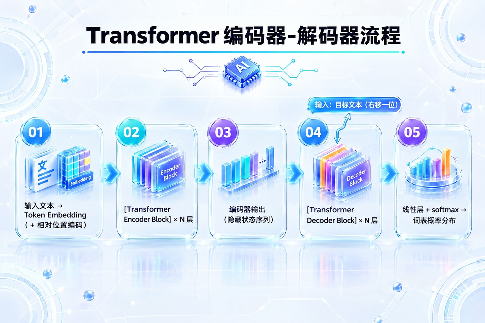
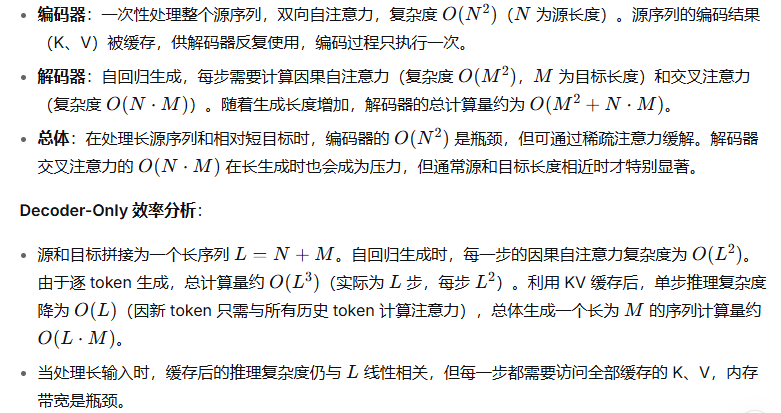
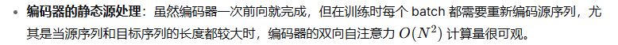

#  15.大模型（LLMs）Encoder-Decoder 架构（T5、BART）

## 大模型（LLMs）面

#### 画出 T5 的 Encoder-Decoder 架构，说明各组件。

> T5（**Text-to-Text Transfer Transformer**）采用标准的 Encoder-Decoder Transformer 架构，**结构如下：**
>



**各组件详解：**

- **编码器：**与 BERT 类似，由多个 Transformer 块堆叠而成，每个块包含双向自注意力（**无因果掩码，每个 token 可看到全部输入**）、前馈网络（**FFN，使用 ReLU 或近似激活**）、残差连接和层归一化（Pre-Norm 风格）。编码器将输入文本编码为上下文相关的隐藏状态序列。

- 解码器：与 GPT 类似，但多了一个交叉注意力（Cross-Attention）子层。每个解码器块依次为：掩码自注意力（因果掩码，只看已生成的目标 token）、交叉注意力（Q 来自解码器，K、V 来自编码器输出）、前馈网络。解码器自回归地生成目标文本。

- 位置编码：T5 使用相对位置编码（相对偏置），将 token 间的相对距离分桶，每个桶对应一个可学习的标量偏置，加到注意力 logits 上。这不同于原始 Transformer 的正弦绝对位置或可学习绝对位置嵌入。

- 输入/输出嵌入共享：T5 的编码器和解码器的输入嵌入矩阵以及解码器的输出投影矩阵共享权重，减少了参数量并提升了泛化能力。

---

#### Encoder-Decoder 模型与纯 Decoder 模型相比，在结构上的主要差异是什么？

| 组件 | Encoder-Decoder (T5, BART) | Decoder-Only (GPT, LLaMA) |
| --- | --- | --- |
| 编码器 | 有独立的双向自注意力编码器，处理输入序列 | 无独立编码器，所有 token 统一处理 |
| 交叉注意力 | 解码器包含交叉注意力子层，Q 来自解码器，K、V 来自编码器 | 无交叉注意力，只有自注意力 |
| 注意力掩码 | 编码器：全可见（双向）；解码器：因果掩码 | 全部使用因果掩码（单向） |
| 输入处理 | 源序列和目标序列分离，分别处理 | 源和目标拼接为一个序列 |
| 参数分配 | 编码器和解码器通常大小对称，总参数多 | 所有参数统一服务于自回归预测 |
| 预训练任务 | 通常为去噪自编码（如 Span Corruption） | 下一个词预测（自回归） |

本质区别：Encoder-Decoder 有专门的“理解模块”（编码器）和“生成模块”（解码器），源和目标的表示空间分离；Decoder-Only 将所有信息混在同一个序列中，通过单向注意力同时完成理解和生成。

---

#### T5 如何将所有 NLP 任务统一为 Text-to-Text 格式？

T5 提出“万物皆可 Text-to-Text”的哲学，通过在输入文本前添加任务前缀，将所有任务转化为“输入文本 → 输出文本”的格式。

- 翻译：`"translate English to German: Hello"` → `"Hallo"`

- 情感分析：`"sst2 sentence: This movie is great."` → `"positive"`

- 摘要：`"summarize: The quick brown fox..."` → `"a fox jumped"`

- 问答：`"question: What is the capital of France? context: France is a country in Europe..."` → `"Paris"`

训练过程：

1. 为每个任务设计一个独特的文本前缀。

2. 将带前缀的输入送入编码器，目标文本送入解码器。

3. 使用标准的交叉熵损失训练，解码器自回归生成目标文本。

4. 所有任务共享同一个模型，没有任何任务特定的层或损失函数。

这种统一格式让 T5 能够利用多任务学习，在不同类型的数据上混合训练，实现了一个模型解决几乎所有 NLP 问题。

---

#### BART 的预训练目标是什么？它如何结合了 BERT 和 GPT 的思想？

BART（Bidirectional and Auto-Regressive Transformer）的预训练目标是去噪自编码：将输入文本用多种噪声函数破坏，然后训练一个 Encoder-Decoder 模型重建原始文本。

噪声函数包括：

- 随机掩盖 token（类似 BERT 的 MLM）

- 删除随机 token

- 文本填充（将多个连续 token 替换为一个 `[MASK]`）

- 句子顺序打乱

- 文档旋转

结合 BERT 和 GPT 的思想：

- BERT 的影响：BART 的编码器是双向自注意力的，能够看到被破坏文本的全部上下文（包括未来 token），这与 BERT 的编码器完全一致，从而获得深层的双向理解能力。

- GPT 的影响：BART 的解码器是自回归的因果模型，从左到右生成干净文本，这与 GPT 的生成方式相同。它根据编码器提供的“噪声版本”的上下文，逐步重建原始序列。

- 融合：BERT 只能理解但不能生成；GPT 只能生成但理解时缺乏双向上下文。BART 将二者结合：编码器双向理解噪声输入，解码器自回归生成干净输出。这使它既擅长理解（如分类，取编码器输出），也擅长生成（如摘要、翻译）。

因此，BART 是一个“用 BERT 的编码器理解，用 GPT 的解码器生成”的混合模型，在文本生成和理解任务上都表现出色。

---

#### 为什么 Encoder-Decoder 架构在机器翻译、摘要生成等任务中依然广泛使用？

Encoder-Decoder 架构在这些任务中具有固有的结构优势：

- 双向编码器提供更优的源文本理解：翻译和摘要需要精确理解源文本的全部内容。双向注意力使编码器能够同时融合左右文信息，生成更丰富的源表示，这对于捕捉长句的复杂语义、指代、否定等至关重要。纯 Decoder 模型的单向理解在长输入上可能稀释关键信息。

- 交叉注意力实现了精准的源-目标对齐：解码器在生成每个目标词时，通过交叉注意力直接“查阅”编码器的所有输出，动态地选择最相关的源信息。这种精细的对齐机制对翻译和摘要至关重要，能确保生成内容忠实于原文。

- 分离源和目标的处理：源序列和目标序列在长度、语言、风格上可能差异巨大。Encoder-Decoder 分别为它们设计独立模块，避免了将两者强行混合在单一序列中可能带来的干扰。

- 训练和推理的高效性：编码器对源序列的一次性编码结果可以被解码器在生成多个候选时复用，不需要为每个生成序列重新编码，这在束搜索和多个候选生成时更高效。

- 经过验证的强性能：在 WMT 翻译、CNN/DailyMail 摘要等基准上，Encoder-Decoder 模型（如 BART、T5、M2M-100）长期占据排行榜前列，证明了其在这些任务上的卓越能力。

尽管 Decoder-Only 模型在多任务统一性上更优，但在需要极度忠实和精确的任务上，Encoder-Decoder 的分工明确的结构仍是首选。

---

#### 在推理时，Encoder-Decoder 模型的编码器输出如何使用？需要 KV Cache 吗？

编码器输出的使用：

- 推理时，首先将源文本一次性输入编码器，经过双向自注意力处理后，得到整个源序列的隐藏状态。

- 这组隐藏状态（编码器输出的 K 和 V）被缓存起来，供解码器的交叉注意力子层在所有生成步骤中使用。编码器只需要运行一次。

KV Cache 的需求：

- 编码器不需要 KV Cache：因为它是一次性处理整个输入，没有自回归过程。

- 解码器需要 KV Cache：解码器的掩码自注意力需要缓存已生成 token 的 K 和 V，以避免每步重复计算历史 token。这称为解码器的“自注意力 KV 缓存”。

- 交叉注意力的 K、V 缓存：解码器的交叉注意力层中的 K 和 V 来自编码器的输出。由于编码器的输出在整个生成过程中不变，这些 K 和 V 在第一步计算后就可以被缓存，并在后续步骤中直接使用，无需重复计算。这实际上也是一种缓存，但不同于自回归的 KV 缓存，因为它是静态的。

因此，Encoder-Decoder 推理需要两组缓存：解码器自注意力的动态 KV 缓存（随生成增长），以及交叉注意力的静态 K、V 缓存（编码器输出）。

---

#### 为什么 T5 使用了相对位置编码，而不是绝对位置？

T5 采用相对位置编码（相对偏置）的原因：

- 更好的长度外推能力：绝对位置编码（尤其是可学习的）受限于训练时的最大长度。相对位置只关心 token 之间的距离，不受绝对位置索引限制，天然支持比训练时更长的序列。这对文本到文本框架中可能的长输出很有帮助。

- 更符合注意力机制的本质：自注意力本质上是捕捉 token 间的相对关系。相对位置编码直接在注意力分数上加入相对距离的偏置，使模型更容易学习到“距离越近越相关”的模式，这是一种有用的归纳偏置。

- 参数效率：T5 将相对距离离散化为若干个桶，每个桶对应一个可学习的标量参数。这比维护一个完整的可学习绝对位置嵌入矩阵要小得多（尤其当最大长度很大时），参数更少且更灵活。

- 实验证明有效：T5 的消融实验表明，使用相对位置偏置的性能与绝对位置相当或更好，同时具备外推优势。因此 T5 选择了这种简单有效的方案。

---

#### Encoder-Decoder 架构能否扩展为 100B+ 参数？有什么挑战？

可以，但面临显著的工程和训练挑战，且性价比可能不如 Decoder-Only。

已存在的超大规模 Encoder-Decoder 模型：

- 如 Google 的 mT5-XXL（13B）和 T5-XXL（11B）是 Encoder-Decoder 结构。更大规模的工作也在进行中，但目前还没有像 GPT-4 那样公开的数百亿参数级纯 Encoder-Decoder 模型。

挑战：

- 参数冗余：Encoder 和 Decoder 都需要大量参数来保证性能，总参数约为同等能力的 Decoder-Only 的两倍（在相同总参数下，Decoder-Only 可能深度更大）。对于 100B 参数，意味着编码器和解码器各约 50B，这可能不如一个 100B 的 Decoder-Only 模型经济。

- 训练数据构造：Encoder-Decoder 通常需要成对的“输入-输出”格式数据，而 Decoder-Only 可无缝使用海量无标签续写文本。为 Encoder-Decoder 准备充足而多样的训练数据更具挑战。

- 工程复杂度：需要同时优化编码器和解码器的分布式训练、流水线并行，以及两者之间的交互，增加了通信和调度的难度。

- 推理效率：在批量服务时，编码器需要为每个输入单独运行，而不同请求的源序列长度差异可能导致计算负载不均。解码器端的 KV 缓存包含自注意力和交叉注意力两部分，显存占用更高。

- 缩放定律表现：目前观察到的涌现能力（如上下文学习）更集中在 Decoder-Only 模型上。Encoder-Decoder 在此方面的缩放收益尚不明确，投资回报率可能较低。

尽管如此，在某些需要极致源理解能力的任务上，100B+ 的 Encoder-Decoder 若能有效训练，仍有望提供无与伦比的性能。未来可能通过稀疏专家（MoE）等技术降低有效成本。

---

#### 如果将 Decoder-Only 模型看作 Encoder-Decoder 的特例，它们之间有什么对应关系？

Decoder-Only 可以视为 Encoder-Decoder 的一种退化形式，其中源序列和目标序列被拼接并完全通过一个因果解码器处理。具体对应关系如下：

- 编码器的退化：在 Decoder-Only 中，没有显式的编码器。源序列（如用户问题）被直接放在目标序列（模型回答）的前面，构成一个长的单一序列。模型对这个前缀（源）的处理是通过因果自注意力完成的，这相当于一个没有双向注意力的退化编码器。它只能看到左侧的上下文，无法利用右侧的未来信息。

- 交叉注意力的退化：Encoder-Decoder 中解码器的交叉注意力，允许目标 token 看到所有源 token。在 Decoder-Only 中，由于源序列已经位于目标序列的左侧（历史中），目标 token 通过因果自注意力自然就能看到所有源 token。这相当于交叉注意力被自注意力取代，且源 token 对目标 token 的可见性由因果掩码保证（源 token 在目标 token 的位置是历史的一部分）。

- 权重共享的极端形式：Encoder-Decoder 可以拥有编码器和解码器两套参数（或共享部分）。Decoder-Only 则只有一个 Transformer 堆栈，所有参数同时服务于源（作为历史）和目标（作为生成），相当于完全共享参数的极端情况。

对应关系总结：

- Encoder-Decoder 中的编码器双向注意力 → Decoder-Only 中丢失了，源序列中的每个 token 看不到其右侧的源上下文。

- Encoder-Decoder 中的交叉注意力 → Decoder-Only 中被源-目标拼接后的因果自注意力所替代。

- Encoder-Decoder 的分离参数 → Decoder-Only 的统一参数。

因此，Decoder-Only 牺牲了双向源理解和显式对齐，换取了架构的极致统一和简洁，以及由此带来的规模化收益和涌现能力。这种牺牲在超大规模下被证明是值得的。

---

#### 在 T5 中，编码器和解码器的参数是共享的吗？为什么？

T5 的编码器和解码器不完全共享参数，但共享了嵌入层和输出投影层。

具体来说：

- 输入嵌入共享：编码器和解码器的 token 嵌入矩阵是共享的。这减少了参数量，并有助于在源语言和目标语言（或任务）之间建立共同的词汇空间。

- 输出投影共享：解码器最后一层的线性投影（将隐藏状态映射到词表概率）与输入嵌入矩阵共享权重。这种“权重绑定”在语言模型中常见，能提升泛化能力并减少参数。

- 主体 Transformer 层不共享：编码器和解码器各自拥有独立的 Transformer 层。编码器的自注意力是双向的，解码器则包含因果自注意力和交叉注意力，两者功能不同，需要独立的参数来专门化。如果强制共享这些层，会迫使双向编码和单向解码在同一套参数中折中，极大损害性能。

为什么这样设计：共享嵌入和输出投影减少了大量参数（尤其是词表通常很大，如 T5 的词表达 32K），同时利用独立的主体层保证了编码和解码各自的表示能力。这种部分共享策略在参数效率和模型能力间取得了平衡。

---

#### 对比 Encoder-Decoder 和 Decoder-Only 在长序列输入时的效率。

在长序列输入时，两种架构的效率差异显著，主要受注意力机制复杂度影响。

Encoder-Decoder 效率分析：

- **编码器**：一次性处理整个源序列，双向自注意力，复杂度 $O(N^2)$（$N$ 为源长度）。源序列的编码结果（K、V）被缓存，供解码器反复使用，编码过程只执行一次。
- **解码器**：自回归生成，每步需要计算因果自注意力（复杂度 $O(M^2)$，$M$ 为目标长度）和交叉注意力（复杂度 $O(N \cdot M)$）。随着生成长度增加，解码器的总计算量约为 $O(M^2 + N \cdot M)$。
- **总体**：在处理长源序列和相对短目标时，编码器的 $O(N^2)$ 是瓶颈，但可通过稀疏注意力缓解。解码器交叉注意力的 $O(N \cdot M)$ 在长生成时也会成为压力，但通常源和目标长度相近时才特别显著。

**Decoder-Only 效率分析**：

- 源和目标拼接为一个长序列 $L = N + M$。自回归生成时，每一步的因果自注意力复杂度为 $O(L^2)$。由于逐 token 生成，总计算量约 $O(L^3)$（实际为 $L$ 步，每步 $L^2$）。利用 KV 缓存后，单步推理复杂度降为 $O(L)$（因新 token 只需与所有历史 token 计算注意力），总体生成一个长为 $M$ 的序列计算量约 $O(L \cdot M)$。
- 当处理长输入时，缓存后的推理复杂度仍与 $L$ 线性相关，但每一步都需要访问全部缓存的 K、V，内存带宽是瓶颈。

{.ocr-src}

对比：

- 对于非常长的输入，Decoder-Only 需要将全部输入加载到 KV 缓存中，且在生成过程中每一步都要扫描整个历史，内存和带宽压力大。

- Encoder-Decoder 通过编码器一次性双向处理源序列，然后解码器仅需处理相对短的目标和交叉注意力，尤其当目标序列较短时，总计算量可能更优。

- 此外，Encoder-Decoder 的源编码可以跨多个候选回复复用（如束搜索），进一步提高效率。

总体而言，当输入极长而输出相对较短时，Encoder-Decoder 可能更有优势；当输入和输出都较长且规模极大时，两者都需要稀疏或线性注意力技术，Decoder-Only 的统一架构在工程优化和扩展性上更占优。

---

#### 为什么目前 LLM 以 Decoder-Only 为主，而 Encoder-Decoder 仍有其价值？

LLM 以 Decoder-Only 为主的原因（详见前文）：

- 极致统一性：一切任务都是续写，数据和任务格式高度一致。

- 优越的规模扩展性：缩放定律表现突出，涌现出上下文学习等强大能力。

- 工程高效：单一堆栈易于优化、并行和部署，社区生态庞大。

- 自然语言生成能力强：自回归解码天然适合流畅长文本的生成。

Encoder-Decoder 仍有其价值的原因：

- 源理解深度：双向编码器能提供更精准的源文本全局理解，对于翻译、事实性摘要等需要忠实重现源内容的任务至关重要。

- 显式对齐机制：交叉注意力提供可解释的源-目标对齐，便于分析和控制生成，适合要求高度可控的场合。

- 效率优势场景：如 11 题所述，在长输入短输出的任务中可能更高效。

- 特定领域的最优性能：在机器翻译、文本摘要等标杆任务上，Encoder-Decoder 仍常居首位。

- 研究与模块化：分离的编码器和解码器使得迁移学习更灵活（可独立替换或微调某一模块），适合模块化研究。

因此，Decoder-Only 统治了通用大模型，但 Encoder-Decoder 在特定任务和需要精细控制的工业应用中依然不可替代。两者将在未来长期共存，并可能在多模态、检索增强等方向相互融合。

---

#### BART 的 denoising 目标是如何设计的？举例说明。

BART 的预训练目标是对输入施加多种噪声，然后训练一个 seq2seq 模型还原出原始干净文本。这种“去噪自编码”目标非常灵活。

噪声类型（可任意组合）：

1. Token 掩码（Token Masking）：类似 BERT 的 MLM，随机将 token 替换为 `[MASK]`。

2. Token 删除（Token Deletion）：随机删除部分 token。模型必须学习恢复缺失的词及其位置。

3. 文本填充（Text Infilling）：随机选择多个连续 token 的 span，用一个 `[MASK]` 标记代替。模型需学会生成多个缺失的 token。

4. 句子排序（Sentence Permutation）：将文档的句子顺序随机打乱。模型必须理解句子间的逻辑关系并重建顺序。

5. 文档旋转（Document Rotation）：随机选择文档中的一个位置，将其之前的文本移到文档末尾。模型需找出原始的开头。

举例：

原始文本：

> The quick brown fox jumps over the lazy dog.
>

施加噪声（删除 + 填充 + 排序）后输入：

> brown fox [MASK] dog. The quick lazy jumps over the
>

BART 需要生成原始的完整句子。通过这种极端的去噪训练，BART 学会了强大的语言理解和生成能力。

---

#### T5 的 span corruption 任务与 BERT 的 MLM 有何不同？

| 维度 | BERT 的 MLM | T5 的 Span Corruption |
| --- | --- | --- |
| 掩码粒度 | 随机独立的单个 token 或子词 | 随机选择连续的 token 片段（span），将其整体替换为一个特殊的哨兵 token |
| 目标 | 预测每个被掩码的 token 分别是什么 | 输出原始片段中的所有 token，但顺序和格式由哨兵 token 标记 |
| 输出形式 | 每个掩码位置独立预测一个词 | 在解码器中，目标序列由哨兵 token 分隔，每个哨兵后跟对应 span 的原始文本 |
| 例子 | 输入：The [MASK] fox [MASK] over the [MASK] dog<br>输出：quick, jumps, lazy | 输入：The <X> fox <Y> the <Z> dog<br>输出：<X> quick brown <Y> jumps over <Z> lazy |
| 双向性 | MLM 利用双向上下文 | 编码器双向处理受损输入，解码器自回归生成目标文本 |
| 目的 | 学习单词级的上下文表示 | 训练 seq2seq 模型同时理解和生成连贯文本 |

Span corruption 更贴合 seq2seq 的生成特性，迫使模型理解并生成完整的短语或句子，而不仅仅是单个词填空。这使得 T5 天然擅长摘要、翻译等需要连贯生成的任务。

---

#### 如果让你用 T5 做开放式对话生成，你会如何设计 prompt？

将 T5 用于开放式对话，需要将对话转化为 text-to-text 格式。设计 prompt 的关键是构造合适的任务前缀和分隔符，并使用特殊 token 来区分多轮对话。

示例 prompt 模板：

```plain text
chat: [User] Hello, how are you? [System] I'm fine, thank you. [User] What's the weather today? [System]
```

T5 随后会生成系统的回答。

设计要点：

- 使用明确的任务前缀，如 `"chat:"` 或 `"dialog:"`，帮助模型识别当前任务。

- 用特殊 token 区分说话者，如 `[User]` 和 `[System]`（或 `[A]`、`[B]`），并且这些 token 应被加入词表或使用已有特殊 token。

- 训练时，对整个对话历史进行序列化，损失仅加在 `[System]` 后的生成部分。

- 对于多轮对话，将历史轮次全部拼接到输入中，保证上下文连续性。

- 可加入系统级指令，如 `"chat persona: friendly assistant"`，作为前缀的一部分。

完整微调数据示例：\
输入：`"chat persona: helpful bot [User] Recommend a movie. [System]"`\
目标：`"I suggest 'The Shawshank Redemption'."`

通过这种格式化，T5 可以从预训练的通用能力快速适应对话生成。

---

#### Encoder-Decoder 模型在训练时，解码器是否能看完整目标序列？掩码如何设置？

能，且必须看完整的目标序列，但通过因果掩码防止信息泄露。

- 训练时的输入：解码器的输入是完整的目标序列右移一位（即在开头添加一个起始 token，如 `<BOS>`）。例如，目标序列为 `"I am happy"`，解码器输入为 `"<BOS> I am happy"`，预测目标为 `"I am happy <EOS>"`。

- 因果掩码：解码器的自注意力层使用下三角掩码（因果掩码），保证在预测位置 $t$ 的 token 时，只能关注到目标序列中的位置 1 到 $t$−1（以及已生成的 token）。模型永远看不到未来 token。

- 交叉注意力：解码器的交叉注意力层没有因果掩码，可以关注编码器的全部输出（因为编码器输出在训练时已经完整可用）。因此，解码器在生成每一步时，都能利用源端的全部信息。

- Teacher Forcing：在训练时，解码器每一步的输入都是正确的目标 token，而不是上一步预测出的 token。这极大加速了收敛，保证了训练稳定性。

因此，Encoder-Decoder 模型在训练时利用因果掩码实现了高效的 Teacher Forcing 并行训练，同时通过交叉注意力获取完整的源信息。

---

#### 为什么 Encoder-Decoder 模型通常需要更长的训练时间？

相对于纯 Decoder 模型，Encoder-Decoder 的训练时间更长，原因包括：

- 双模块架构：需要同时训练编码器和解码器，总参数量通常更大（即使同参数量，也需在两个模块间协调），前向和反向传播的计算图更复杂。

- 教师强制的序列依赖性：尽管训练是并行的，但解码器的输入仍然依赖于整个目标序列的嵌入和位置编码，且需要计算自注意力和交叉注意力两个注意力矩阵，计算密度更高。

- **编码器的静态源处理**：虽然编码器一次前向就完成，但在训练时每个 batch 都需要重新编码源序列，尤其是当源序列和目标序列的长度都较大时，编码器的双向自注意力 $O(N^2)$ 计算量很可观。

{.ocr-src}

- 额外模块的梯度流：解码器的梯度需要通过交叉注意力层回传到编码器，增加了反向传播的通信和计算。

- 数据处理与格式：训练数据通常需要构造为源-目标对，预处理和动态批处理（bucketing）更复杂，增加了数据加载时间。

然而，在大规模训练时，通过优化框架（如 Mesh TensorFlow、JAX、DeepSpeed）可以显著缓解这些开销。但结构上的双模块特性使得 Encoder-Decoder 在相同硬件和参数规模下，单步训练时间通常长于纯 Decoder 模型。

---

#### 分析 mT5 在多语言任务中的架构调整。

mT5（multilingual T5）是 T5 的多语言版本，在架构上没有根本性改变，但针对多语言场景做了一些关键调整：

- 庞大的多语言词表：mT5 使用 SentencePiece 在 101 种语言的 CommonCrawl 数据上训练了一个共享的多语言词表，包含 25 万个子词单元。这使得不同语言的文字可以共享大部分 token，并跨语言迁移。

- 无语言标识嵌入：与一些模型显式加入语言 ID 不同，mT5 没有使用语言嵌入。它完全依靠词表中各语言的子词和上下文来隐式地识别语言。这简化了结构，但也要求模型从文本中自行推断语言属性。

- 数据混合与采样策略：为防止低资源语言被高资源语言淹没，mT5 在预训练时采用了温度采样，提升低资源语言的出现概率。这是数据层面而非架构层面的关键决策。

- 相同的 Text-to-Text 框架：mT5 完全继承了 T5 的 span corruption 预训练目标和 Text-to-Text 格式，使得多语言任务（翻译、跨语言问答等）也能自然地融入统一框架。

- 参数完全共享：所有语言共享同一个编码器-解码器参数，没有任何语言特定的模块。这迫使模型学习语言无关的表示，促进了零样本跨语言迁移。

- 训练规模：mT5 的参数量从 300M 到 13B 不等，通过增加深度和宽度直接扩展，未使用 MoE 等稀疏结构（后来的版本如 mT0 进行了指令微调）。

这些调整使得 mT5 成为一个强大的多语言基座，在跨语言自然语言理解任务上表现突出，展示了 Encoder-Decoder 架构在多语言场景的有效性。

---

#### 有没有将 Encoder-Decoder 用于指令微调的成功案例？效果如何？

有，且效果显著。 最典型的例子是 T0 和 Flan-T5。

T0（T5-based Zero-shot Task Transfer）

- 基座模型为 T5 的 Encoder-Decoder 架构。

- 在大规模、多样化的指令数据上进行微调，涵盖了数百个 NLP 任务，每个任务都通过多个自然语言指令模板描述。

- 效果：T0 在未见过的任务上展现了强大的零样本泛化能力，在某些基准上甚至超过了当时的 GPT-3（虽然 GPT-3 参数量远大于 T0）。这证明了 Encoder-Decoder 架构同样能够通过指令微调获得通用任务执行能力。

Flan-T5

- 基于 T5，但使用了更广泛、更精细的指令数据（Flan 2022）进行微调。

- 效果：Flan-T5 在多个推理基准上大幅超越原始 T5，并且指令跟随能力显著增强。Flan-T5-XXL（11B）在许多任务上的表现超越了更大的 Decoder-Only 模型，展现了 Encoder-Decoder 在指令微调下的强大潜力。

为何有效：

- Encoder-Decoder 的分离结构天然适合“指令+输入”的格式（编码器处理指令和输入，解码器生成回复）。双向编码器可以深入理解复杂的指令和长输入，这是纯 Decoder 模型在单向注意下较弱的地方。

- 通过指令微调，模型学会了将任何任务都视为 text-to-text 的映射，发挥其架构优势。

结论：Encoder-Decoder 完全可以成功进行指令微调，并且在需要深度理解和精确生成的任务中，其性能上限极高。

---

#### Encoder-Decoder 模型如何应对序列到序列的长度不一致？

序列到序列任务（如翻译、摘要）中，源序列和目标序列的长度往往差异很大。Encoder-Decoder 架构天然支持这种不一致，无需任何特殊适配。

- 独立的编码器：编码器处理变长的源序列，输出一个变长的隐藏状态序列（长度等于源序列长度）。编码器内部没有对输出长度做任何限制，所有源 token 的信息都被保留。

- 自回归解码器：解码器根据编码器的输出（通过交叉注意力）和已生成的目标序列，逐步生成任意长度的目标序列。生成过程由起始 token 开始，直到输出结束 token `[EOS]`，因此目标长度完全由模型根据任务动态决定。

- 交叉注意力的灵活性：交叉注意力允许解码器的每个 token 关注编码器的全部输出，不受长度差异的影响。即使源序列有上千 token，目标序列只有几个 token，交叉注意力也能从长源序列中精准抽取关键信息。

- 训练时的 Teacher Forcing：训练时，解码器的输入是完整目标序列（右移一位），其长度自然决定了该样本的损失步数。不同长度的样本通过填充在一个 batch 内处理，填充掩码保证长度差异不影响训练。

因此，Encoder-Decoder 的架构设计使其能够优雅地处理任意源-目标长度组合，这是其核心优势之一。

---

#### 在 Encoder-Decoder 中，交叉注意力的 Q、K、V 分别来源于哪里？

- Q（Query）：来自解码器的前一子层输出（通常是解码器的掩码自注意力层的输出，经过残差连接和层归一化）。它表示当前目标位置的“我需要查找什么”。

- K（Key）和 V（Value）：均来自编码器的最终输出。编码器处理完整个源序列后，其所有层的输出（或者最后一层的输出）被作为记忆库，K 用于与 Q 匹配计算注意力权重，V 包含要被聚合的源信息。

换句话说，解码器通过交叉注意力，以自己的状态（Q）去“查询”编码器提供的上下文（K、V），从而在生成每一步时动态地聚焦到源序列的相关部分。

---

#### 如果去掉编码器，直接将源序列拼接到解码器，会损失什么？

这等价于将 Encoder-Decoder 退化为 Decoder-Only 模型（类似于 GPT 的处理方式）。主要损失包括：

- 双向源理解能力：纯解码器只能通过因果自注意力处理源序列，每个源 token 只能看到其左侧的源 token，无法利用右侧的未来信息。这削弱了对源序列全局结构（如句子后部的关键否定、指代）的把握，可能影响翻译忠实度和摘要覆盖。

- 显式的源-目标对齐：Encoder-Decoder 的交叉注意力提供了清晰的对齐路径——目标 token 可直接“看到”所有源 token 并分配注意力权重。在拼接模式下，目标 token 对源 token 的访问被埋没在长长的历史序列中，注意力可能被离得近的目标 token 或无关历史稀释，对齐变得间接且不精准。

- 专用的源表示学习：编码器专门为源序列设计，可以堆叠多层双向注意力，提取出高度抽象的源表示。解码器拼接则强迫一个模型同时完成源理解和生成，两种功能可能互相干扰，降低各自效率。

- 参数效率与专业化：分离的编码器参数让源理解和生成各司其职，通常比同等参数量的纯解码器在需要深度理解的任务上性能更优。去掉编码器后，这些专业参数被强制用于单一堆栈，可能损失能力。

不过，这种“损失”在超大规模下，通过海量训练，Decoder-Only 模型仍能凭借强大的上下文学习能力部分弥补，因此现代 LLM 选择了统一性。但对于许多专业任务，这些损失仍是不可忽视的。

---

#### 你对“T5 是统一框架”的理解，以及它的局限性。

理解：

T5 的“统一框架”体现在 “万物皆可 Text-to-Text”。它通过一个核心思想将所有的 NLP 任务都映射为同一个模式：给定一段输入文本，模型生成一段输出文本。这带来了：

- 架构统一：所有任务共享同一个 Encoder-Decoder 模型，没有任何任务特定的层或损失。

- 训练统一：所有任务的数据都可以混合在一起，使用相同的交叉熵损失进行多任务训练。

- 接口统一：模型输入永远是一个文本字符串（可加任务前缀），输出永远是另一个文本字符串。

这种统一极大地简化了模型设计、训练流程和部署，并且便于知识在不同任务间迁移。

局限性：

- 对非生成任务的效率问题：对于分类、回归等任务，生成文本标签（如“positive”）比直接输出一个标量 logit 效率低且可能不稳定（例如生成错误的标签词）。虽然可以解决，但并非最优形式。

- 输入长度限制与冗余：所有信息（包括结构化数据、图像等）都必须强行序列化为文本，可能损失结构信息且增加序列长度。对于多模态任务支持不自然。

- 缺乏交互性：纯 Text-to-Text 是一次性的，难以原生支持多轮对话、工具调用等需要动态状态的交互。虽可通过拼接历史模拟，但效率不如专门的对话架构。

- 对输出格式的依赖：生成任务的输出必须严格符合格式，否则下游解析会失败。模型需要大量数据来学习格式遵循。

- 规模扩展性：与 Decoder-Only 相比，T5 的 Encoder-Decoder 在扩展到超大规模时遇到的工程挑战更多，且涌现能力表现不如 Decoder-Only 突出。

尽管如此，T5 的思想深刻影响了后续研究，其统一范式的精神被后来的指令微调、多任务学习等广泛继承。

---

#### 目前有哪些模型沿袭了 T5 的架构思想？

许多后续模型继承或发扬了 T5 的 Encoder-Decoder 和 Text-to-Text 框架：

- BART：虽然去噪自编码目标与 T5 不同，但其 Encoder-Decoder 架构和预训练+微调范式与 T5 一脉相承。

- mT5 / ByT5 / Flan-T5：直接基于 T5 架构，分别针对多语言、字节级处理、指令微调进行改进。

- UL2：提出了混合去噪目标，在 T5 的基础上统一了多种预训练任务，使模型能灵活地在不同注意力掩码下工作。

- PaLM-2 的预训练（部分）：谷歌的 PaLM-2 虽然最终以 Decoder-Only 为主，但其预训练过程中使用了 UL2 的混合目标，这继承了 T5 的任务统一思想。

- 多模态 T5 变体：如 Flamingo-T5、FROMAGe 等，将 T5 的 Encoder-Decoder 扩展到视觉-语言任务，编码器处理图像，解码器生成文本。

- LLaMA 并非 T5 直系，但：许多现代的指令微调和多任务训练策略（如将各种任务数据转为对话格式）都受到了 T5 “一切皆文本”思想的启发。

这些模型展示了 T5 架构在多个方向的持久生命力。

---

#### 展望未来，Encoder-Decoder 架构在 LLM 领域是否还有一席之地？

肯定有，但它将更多地以专用或混合形式存在，而非与 Decoder-Only 全面竞争通用基座。

Encoder-Decoder 的长期价值领域：

- 极致忠实与精确生成的任务：如高质量机器翻译、法律/金融文档摘要、学术论文摘要等，对源文本的精准理解和零幻觉要求极高。Encoder-Decoder 的双向编码和交叉对齐是难以替代的优势。

- 多模态融合：处理图像、语音、视频等多模态信息时，一个独立的感知编码器（类似 Encoder）与一个生成解码器（Decoder）的组合是最自然的设计。未来多模态大模型几乎必然采用 Encoder-Decoder 或其变体。

- 检索增强生成（RAG）：RAG 系统天然就是 Encoder-Decoder 模式——检索器提供编码后的知识，生成器（解码器）基于此生成。这种架构的分离设计有利于系统解释和模块优化。

- 可控与可解释 AI：在需要严格审计和控制的领域，Encoder-Decoder 的交叉注意力可以提供清晰的证据溯源，比纯解码器的隐式记忆更符合监管要求。

不会取代 Decoder-Only 的原因：

- Decoder-Only 的通用性、扩展性和涌现能力已被反复验证，是目前通往 AGI 的最可行技术路径之一。它将在对话、推理、开放创作等通用领域继续主导。

- 未来可能出现的融合趋势是：以 Decoder-Only 为骨架，动态地接入外部 Encoder（如视觉、音频）作为信息源，形成非对称的混合架构。这既能享受 Decoder-Only 的规模红利，又能获得 Encoder 的感知优势。

因此，Encoder-Decoder 不会消亡，它将演化为 LLM 生态中解决特定高端需求的专业模块，与 Decoder-Only 长期共存并相互借鉴。

