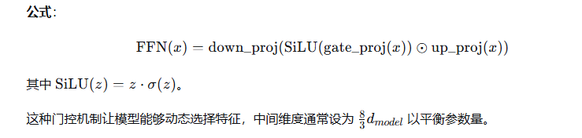
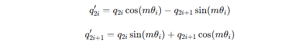
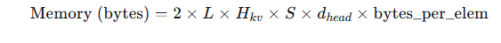

# 16.大模型（LLMs）LLaMA 架构细节

#### LLaMA 相对于标准 Transformer 做了哪些关键改动？

LLaMA 以原始 Transformer 解码器为蓝本，吸收了近几年大模型训练的实践经验，做了以下核心改动：

- Pre-Norm 结构：将 LayerNorm（实际为 RMSNorm）移至每个子层之前，即 `x + Sublayer(Norm(x))`，提升深层训练稳定性。

- RMSNorm 替代 LayerNorm：仅使用均方根归一化，去除了均值中心化和偏置，减少计算量。

- RoPE 旋转位置编码：替代绝对位置编码，在每层注意力中对 Q 和 K 施加旋转，使模型能自然捕获相对位置并便于长度外推。

- SwiGLU 激活函数：FFN 采用门控机制（SwiGLU），由 `gate_proj`、`up_proj` 和 `down_proj` 三个线性层组成，增强表达能力。

- 无偏置项：所有线性层均不设置偏置参数，减少参数量，简化训练。

- 无 Dropout：预训练时完全不使用 Dropout，依靠海量数据防止过拟合。

- 高效实现：配合 FlashAttention、xformers 等内存优化技术，支持更长上下文。

这些改动使 LLaMA 在相同参数预算下，训练更稳定、效率更高、性能更强。

---

#### LLaMA 使用了什么归一化方式？为什么不用 LayerNorm？

LLaMA 使用 RMSNorm（Root Mean Square Layer Normalization）而非标准 LayerNorm。

原因：

- 计算更快：RMSNorm 仅需计算均方根并缩放，省去了均值计算和减均值步骤，减少了约 20-30% 的计算开销。

- 效果相当甚至更优：大量实验表明，在深层 Transformer 中，移除均值中心化对性能几乎无影响，有时因减少过约束还能轻微提升。

- 更少的参数：LLaMA 的 RMSNorm 通常只保留可学习的缩放参数 `γ`，去除了偏移参数 `β`，进一步减少参数量。

- 适合 Pre-Norm：在 Pre-Norm 结构中，RMSNorm 的轻量特性与残差连接完美配合，训练更稳定。

因此，RMSNorm 是兼顾效率与效果的更优选择。

---

#### LLaMA 中的 FFN 使用了哪种激活函数？写出结构。

LLaMA 的 FFN 使用 SwiGLU 门控激活函数。

结构：FFN 包含三个线性层（无偏置）：

- `gate_proj`：将输入 `x` 投影到中间维度 `d_ff`，然后通过 SiLU（Swish）激活。

- `up_proj`：将输入 `x` 投影到相同中间维度，不经过激活。

- 将 `SiLU(gate_proj(x))` 与 `up_proj(x)` 逐元素相乘。

- `down_proj`：将相乘结果投影回原始维度 `d_model`。

**公式**：

$$
\mathrm{FFN}(x) = \mathrm{down\_proj}(\mathrm{SiLU}(\mathrm{gate\_proj}(x)) \odot \mathrm{up\_proj}(x))
$$

其中 $\mathrm{SiLU}(z) = z \cdot \sigma(z)$。

这种门控机制让模型能够动态选择特征，中间维度通常设为 $\frac{8}{3}d_{model}$ 以平衡参数量。

{.ocr-src}

这种门控机制让模型能够动态选择特征，中间维度通常设为 $\frac{8}{3}d_{model}$ 以平衡参数量。

---

#### LLaMA 采用 RoPE，它是如何集成到注意力计算中的？

LLaMA 在每一层自注意力的 Q 和 K 投影之后 施加 RoPE。

集成步骤：

1. 输入 `x` 通过线性投影得到 `Q`、`K`、`V`。

2. 对 `Q` 和 `K` 的每个 token 位置 `m`，根据预设的频率 $θ_i = 10000^{-2i/d}$ 计算旋转角度。

3. 将 `Q` 和 `K` 的向量维度两两成对，在每个二维子空间施加旋转：

$$
q'_{2i} = q_{2i}\cos(m\theta_i) - q_{2i+1}\sin(m\theta_i)
$$

$$
q'_{2i+1} = q_{2i}\sin(m\theta_i) + q_{2i+1}\cos(m\theta_i)
$$

{.ocr-src}

1. 对 `K` 做同样操作。

2. 然后计算旋转后的 `QK^T`，后续步骤与标准注意力相同。

RoPE 的旋转是逐层应用的，位置信息融入了注意力分数，而 `V` 不施加旋转。

---

#### LLaMA-2 引入了 GQA，具体是如何实现的？组数是多少？

LLaMA-2 在较大模型（如 70B）中引入了 分组查询注意力 (GQA)，以压缩 KV 缓存，提升推理效率。

实现方式：

- 标准多头注意力有 `h` 个查询头，每个头有独立的 Q、K、V 投影。

- GQA 将 `h` 个查询头分为 `g` 组（`g < h`）。同一组内的所有查询头共享相同的 K 和 V 投影，但 Q 投影保持独立。

- 这样，KV 缓存的大小从原来的 `h` 份减少为 `g` 份，显著降低显存占用和内存带宽。

LLaMA-2 的组数：

- LLaMA-2 70B：总头数 `h = 64`，组数 `g = 8`，即每 8 个查询头共享一组 KV。

- 较小的 LLaMA-2 7B/13B 仍使用标准多头注意力（`g = h`）。

GQA 在推理速度上接近多查询注意力 (MQA)，但在质量上接近标准多头注意力，实现了速度与效果的平衡。

---

#### LLaMA 的 Pre-Norm 具体是如何放置的？画出示意图。

LLaMA 采用 Pre-Norm 结构，归一化层放置在每个子层（注意力、FFN）之前，而非之后。

单层结构示意：

```plain text
输入 x
  ├──→ RMSNorm → 掩码多头自注意力 → 输出 attn_out
  └──→ 恒等映射 x
相加：x' = x + attn_out

x'
  ├──→ RMSNorm → SwiGLU FFN → 输出 ffn_out
  └──→ 恒等映射 x'
相加：output = x' + ffn_out
```

示意图（文字描述）：

```plain text
    x
    |-----------|
    |           |
 RMSNorm    (identity)
    |           |
 Multi-Head     |
 Attention      |
    |           |
    +-----------+
        |
       (+) -----> x'
        |
        |-----------|
        |           |
     RMSNorm    (identity)
        |           |
     SwiGLU FFN    |
        |           |
        +-----------+
            |
           (+) -----> output
```

归一化层（RMSNorm）位于残差分支的入口，主残差路径始终保持纯净恒等映射，这是 Pre-Norm 的核心特征。

---

#### 为什么 LLaMA 选择在 7B/13B/70B 等规模上训练？遵循了什么规律？

LLaMA 的规模选择遵循了 计算最优的缩放定律 和 推理部署的实际需求。

- Chinchilla 缩放定律：DeepMind 的 Chinchilla 论文指出，对于给定的计算预算，模型参数量和训练 token 数应等比增长才能达到最优性能。LLaMA 系列在设计时充分考虑了在可用算力下，让模型充分训练（而非欠训练）。例如，LLaMA-7B 在 1T token 上训练，远超以往同规模模型的数据量，从而获得了更强的性能。

- 部署友好：7B、13B、70B 等规模考虑到单卡或多卡推理的可行性。7B 模型可在消费级 GPU（如 RTX 3090）上运行，13B 需稍多资源，70B 则面向高端服务器。这种阶梯式规模覆盖了从研究到生产的不同需求。

- 硬件对齐：模型维度（`d_model`）、头数等通常为 2 的幂或 256 的倍数，以充分利用 GPU 的张量核心和内存对齐。

- 涌现能力观察：这些规模恰好覆盖了从小模型到涌现出高级推理能力的过渡区间，有助于研究能力随规模的变化。

总之，LLaMA 的规模选择是计算最优、硬件效率和社区可用性的综合权衡结果。

---

#### LLaMA 的训练数据来源和规模有何特点？

LLaMA 的训练数据强调质量、多样性和大规模公开数据，而非单纯追求爬取量。

数据来源：

- CommonCrawl（经过严格过滤和去重）

- C4（Colossal Clean Crawled Corpus）

- GitHub（代码）

- Wikipedia（多语言）

- Books（Gutenberg 等）

- ArXiv（科学论文）

- Stack Exchange（问答）

数据处理特点：

- 严格过滤：使用 fastText 进行语言识别，过滤低质量、短文本和重复内容。

- 去重：文档级和段落级去重，减少记忆化。

- 高质量来源上采样：对 Wikipedia、Books 等高质量来源赋予更高采样权重。

训练规模：

- LLaMA-1：7B 模型训练 1T token，13B 训练 1T token，33B 训练 1.4T token，65B 训练 1.4T token。

- LLaMA-2：翻倍训练 token 数（7B/13B 达 2T token），70B 达 2T token。

- LLaMA-3：更长的训练（数万亿 token），并加入了更多多语言和代码数据。

这种对数据质量的严格把控，使得 LLaMA 在相对较小的参数下达到了超越更大模型的性能。

---

#### LLaMA 的上下文长度在几个版本中是如何演变的？

LLaMA 系列在不同版本中逐步扩展了上下文窗口：

- LLaMA-1：原生训练长度为 2048 token。所有规模（7B/13B/33B/65B）均为 2048。

- LLaMA-2：原生训练长度提升至 4096 token。所有规模（7B/13B/70B）均支持 4K 上下文。同时，LLaMA-2 在预训练后期使用了更长序列的数据（如文档拼接）以帮助长度泛化。

- LLaMA-3：原生训练长度进一步提升至 8192 token（8B 和 70B 模型均为 8K）。Meta 同时发布了通过继续训练扩展上下文到 128K 的 LLaMA-3 版本（如 LLaMA-3.1 8B/70B/405B 支持 128K 上下文）。

- 衍生版本：社区和官方后续版本（如 CodeLLaMA、LLaMA-2-Chat-32K 等）通过位置插值（PI）、NTK-aware 缩放、YaRN 等技术，将 4K 模型扩展到 32K 甚至 128K。

演变趋势是从 2K → 4K → 8K 原生，并通过外推技术支持数十万 token 的长上下文，满足长文档、多轮对话和代码库理解等需求。

---

#### 如果想将 LLaMA-2 的 4K 上下文扩展到 32K，你会怎么做？

将 LLaMA-2 4K 模型扩展到 32K，无需重训所有参数，可采用以下步骤：

1. 选择扩展方法：优先使用 YaRN 或 动态 NTK-aware 缩放。YaRN 结合了频率缩放与注意力温度调节，效果稳健。

2. 调整 RoPE 频率：计算缩放因子 $s=32K/4K=8$。使用 YaRN 方法时，将 RoPE 基频 `10000` 替换为一个更大的值（如 `10000 * s` 或根据 NTK 公式计算），并对注意力 logits 施加温度缩放（如 `t=0.1` 或动态调节）。

3. 少量长文本微调（可选但推荐）：准备 32K 长度的指令数据（如长文档问答、多轮对话），对模型进行少量步数的微调（几百到几千步）。这有助于模型适应新的位置分布并恢复局部短距离性能。

4. 工程优化：启用 FlashAttention-2 或 FlashAttention-3 以高效处理长序列。将 `max_position_embeddings` 修改为 32768，并调整 RoPE 频率缓存。

5. 评测验证：使用“大海捞针”（Needle-in-a-Haystack）测试和长文本基准（如 LongBench）验证扩展效果。检查短上下文性能是否退化，必要时微调时混入短数据。

通过这种方式，可以在数小时内将 LLaMA-2 4K 模型扩展到 32K，且保持较强性能。

---

#### LLaMA-3 可能引入了哪些架构上的改进？请根据公开信息讨论。

根据 Meta 发布的 LLaMA-3 技术报告和社区分析，相较于 LLaMA-2，LLaMA-3 的架构改进主要包括：

- 更大规模与更高效的训练：LLaMA-3 8B 和 70B 模型在数万亿 token 上训练，远超前代，遵循计算最优的缩放定律。

- 扩展的上下文长度：原生上下文窗口从 4K 提升至 8K，并通过继续训练支持 128K。

- 分组查询注意力 (GQA) 的扩大：LLaMA-3 在所有规模（包括 8B）都使用了 GQA，进一步优化推理效率。8B 模型头数 32，KV 头数 8（4:1 比例），70B 模型头数 64，KV 头数 8（8:1 比例）。

- 词汇表大幅扩充：词表大小从 LLaMA-2 的 32K 增加到 128K，使用基于 tiktoken 的 BPE 分词器。这提升了多语言和代码的编码效率，减少了 token 序列长度。

- RoPE 基频调整：将 RoPE 的基频从 10000 增加到 500000，这有助于在更长序列上保持位置区分度，为原生 8K 和未来外推奠定基础。

- 训练策略优化：采用了更先进的数据混合、课程学习、以及可能动态调整 RoPE 频率的技术。

- 架构细节微调：仍然保持 Pre-Norm + RMSNorm + SwiGLU，无偏置，但某些层配置（如 FFN 维度）可能随规模调整。

总的来说，LLaMA-3 在架构上未做革命性改变，而是对 LLaMA-2 的成熟设计进行了规模扩展、词汇量优化和长上下文适配，延续了其在开源领域的领先地位。

---

#### LLaMA 中的词表大小是多少？使用了哪种分词器？

- LLaMA-1：词表大小为 32000，使用基于字节对编码（BPE）的 SentencePiece 分词器。字符覆盖率在 diverse 语料上训练得到。

- LLaMA-2：沿用相同的 32K 词表和 SentencePiece BPE 分词器，词汇不变。

- LLaMA-3：词表大小扩大至 128256（约 128K），分词器改用基于 tiktoken 的 BPE 实现（与 OpenAI 的 GPT-4 分词器类似），显著提高了多语言和代码文本的压缩率，减少了序列长度。

这种扩充使得 LLaMA-3 在处理多语言任务时更高效，同时降低了推理时的 token 生成步数。

---

#### LLaMA 的权重初始化方案是怎样的？

LLaMA 采用较简单的初始化策略，所有线性层的权重使用截断正态分布（Truncated Normal） 初始化，均值为 0，标准差为 0.02（或 `1/sqrt(d_model)` 缩放）。偏置项已被移除。

对于 RMSNorm 的可学习缩放参数 $γ$，初始化为 1（保持初始输出为单位方差）。嵌入矩阵通常也使用类似的正态分布初始化。没有使用更复杂的 Xavier/Kaiming 初始化变体，因为 Pre-Norm 结构显著降低了对初始化的敏感度。

---

#### 与 GPT-3 相比，LLaMA 在架构上的主要优势是什么？

LLaMA 相较于 GPT-3（175B）在设计哲学上更追求效率与性能的平衡，主要优势如下：

- 更高效的归一化与激活：LLaMA 使用 RMSNorm 和 SwiGLU，相比 GPT-3 的 LayerNorm 和 GELU，训练更快，性能相当或更优。

- 更优的位置编码：LLaMA 的 RoPE 具有内建的相对位置感知和良好的外推能力，而 GPT-3 使用可学习的绝对位置嵌入，长度外推受限。

- 无偏置设计：LLaMA 去除了所有线性层的偏置，减少了参数量和计算，大模型下收益明显。

- Pre-Norm 稳定性：LLaMA 的 Pre-Norm 结构在深层训练时比 GPT-3 的 Post-Norm（早期 GPT-3 可能混合使用，但早期 GPT 为 Post-Norm）更稳定，允许更高效的训练。

- 更长的上下文潜力：结合 RoPE 和后续扩展技术，LLaMA 可轻松扩展至 32K 甚至更长，而 GPT-3 的上下文窗口仅为 2048。

- 计算最优训练：LLaMA 遵循 Chinchilla 定律，在更少的参数下训练更多数据，达到比 GPT-3 更高的性价比。

简而言之，LLaMA 用更小的参数量（65B vs 175B）在多项基准上超越 GPT-3，展现了架构效率和训练策略的进步。

---

#### 为什么 LLaMA 没有使用偏置（bias）？在哪些层中去掉了 bias？

LLaMA 在所有线性层（包括注意力投影 Q、K、V、O，以及 FFN 的 gate、up、down 层）中均去除了偏置项，仅 RMSNorm 中可学习的缩放参数 $γ$ 不视为偏置。

原因：

- 减少参数量：虽然偏置项参数量占比极小（每层数个 d_model 维向量），但在极大规模下累积起来仍可观。去除后模型更轻量。

- 配合归一化层：Pre-Norm 的 RMSNorm 已经将输入归一化到均值为 0 的分布，随后的线性层无需偏置来调节均值，权重本身足以学习所需的偏移。

- 简化训练：去除偏置可简化优化，无需管理偏置的独立学习率和衰减，且与权重衰减策略兼容。

- 历史实验证明：在 Transformer 中去偏置不会损害性能，有时反而能轻微提升训练稳定性。

因此，LLaMA 系列全部采用无偏置设计，成为现代大模型的标准做法之一。

---

#### LLaMA 的残差连接如何与 RMSNorm 配合？是否还有额外的 Dropout？

LLaMA 采用 Pre-Norm 结构，残差连接与 RMSNorm 配合如下：

```plain text
x_{l+1} = x_l + Attn(RMSNorm(x_l))
x_{l+1} = x_{l+1} + FFN(RMSNorm(x_{l+1}))
```

RMSNorm 仅作用于子层（注意力、FFN）的输入，残差连接的主路径 `x` 原样传递，不经过归一化。这使得梯度可通过恒等映射无损回传，深层网络训练稳定。

关于 Dropout：LLaMA 在预训练时完全不使用 Dropout。无论是注意力权重、残差分支还是 FFN 内部，都没有随机失活。这是因为 LLaMA 的训练数据规模极大（万亿 token），模型通过数据多样性即可有效防止过拟合，不再需要 Dropout 正则化。移除 Dropout 还简化了训练和推理，减少了不确定性。

---

#### 在 LLaMA 模型中，如何实现高效的变长批处理？

LLaMA 训练和推理时采用多种技术高效处理变长序列：

- 动态批处理（Dynamic Batching）：将长度相近的序列分组到同一批次，减少填充比例，提高 GPU 利用率。训练框架通常使用 `bucketing` 策略预分组。

- 序列打包（Sequence Packing）：将多个短序列拼接为一个长序列，使用注意力掩码（块对角掩码）防止跨序列注意力。这几乎消除了填充开销，是现代 LLM 预训练的标准做法。

- FlashAttention：使用 IO-aware 的精确注意力算法，原生支持变长序列，无需显式填充即可处理不等长输入。FlashAttention 能动态跳过填充 token 的计算。

- 变长序列的损失计算：通过 `label mask` 忽略填充位置的损失，仅对真实 token 计算梯度。

- 推理时的连续批处理：如 vLLM 的 continuous batching，允许在生成过程中动态插入新请求，充分利用 GPU 算力，减少空闲时间。

这些方法共同确保了 LLaMA 在处理大量变长文本时，计算资源和显存利用效率接近极限。

---

#### 分析 LLaMA 中不同层的注意力头维度 d_head 的设定。

LLaMA 的所有层使用统一的头维度（`d_head`），而不是不同层使用不同维度。具体设定如下：

- 对于 LLaMA 的所有变体，模型隐藏维度 `d_model` 和头数 `h` 满足 `d_head = d_model / h`。

- 标准配置：
  - LLaMA-7B: `d_model = 4096`, `h = 32`, `d_head = 128`
  - LLaMA-13B: `d_model = 5120`, `h = 40`, `d_head = 128`
  - LLaMA-33B: `d_model = 6656`, `h = 52`, `d_head = 128`
  - LLaMA-65B/70B: `d_model = 8192`, `h = 64`, `d_head = 128`（LLaMA-2 70B，头数64，d_head=128）
  - LLaMA-3 8B: `d_model = 4096`, `h = 32`, `d_head = 128`（kv_heads=8）
  - LLaMA-3 70B: `d_model = 8192`, `h = 64`, `d_head = 128`（kv_heads=8）

关键点：LLaMA 始终保持 `d_head = 128`，因此不同规模模型通过调整 `d_model` 和头数 `h` 来保持头维度恒定。128 是一个经验上的甜区，既能保证每个注意力头的表达能力（不至于太窄），又能使多头机制发挥优势（不至于太宽导致头数过少）。这种设计简化了架构搜索，并在各种规模下都表现良好。

---

#### 如果要将 LLaMA 作为基座进行 MoE 改造，你会如何设计？

将 LLaMA 改造为 MoE（混合专家）模型，核心是用多个专家 FFN 替换原始的密集 FFN，并加入路由机制。步骤如下：

1. 专家 FFN 设计：保留 LLaMA 的 SwiGLU FFN 结构作为每个专家的计算单元。每个专家拥有独立的 `gate_proj`、`up_proj`、`down_proj` 权重。可以缩小单个专家的中间维度（如从 `8/3 d` 缩小到 `2d` 或 `d`），通过专家数量 `E` 控制总参数量。

2. 路由机制：在每层添加一个轻量级路由器（线性层），将每个 token 的输入 `x` 映射到 `E` 个 logits，经过 softmax 选择 Top-`k` 个专家（通常 `k=1` 或 `k=2`）。使用辅助损失（Load Balancing Loss）鼓励专家均衡使用。

3. 参数量控制：若要保持与原始 LLaMA 相似的推理计算量（每个 token 的 FLOPs），可使 `k * d_ff_expert ≈ d_ff_original`，从而总参数量约为原来的 `E/k` 倍。例如，`E=8, k=2`，单个专家维度减半，总参数量约为原来的 4 倍。

4. 训练策略：基于已经预训练好的 LLaMA 密集检查点，将 FFN 权重复制到所有专家作为初始化（或加以扰动），然后继续训练。这样可以利用预训练知识，加速 MoE 收敛。

5. 推理优化：利用专家并行（Expert Parallelism）将专家分布到不同设备，同时用高速互联进行 token 路由。结合 vLLM 等推理框架对 MoE 的支持。

典型例子：Mixtral 8x7B 就是基于类似思想，将 LLaMA 架构改造为 MoE，总参数 46.7B，但每个 token 仅激活约 12.9B 参数，在多数基准上超越 LLaMA-2 70B。

---

#### LLaMA 训练时使用的优化器、学习率调度是怎样的？

LLaMA 使用以下优化器和调度策略：

- 优化器：AdamW，其中 `β1 = 0.9`, `β2 = 0.95`（LLaMA-1/2）或 `β2 = 0.95`（常用设置）。权重衰减 `λ = 0.1`（对偏置和归一化参数不施加衰减，LLaMA 无偏置）。梯度裁剪阈值通常为 `1.0`。

- 学习率调度：余弦退火（Cosine Annealing），从峰值学习率（如 LLaMA-1 7B 的 `3e-4`，LLaMA-2 70B 的 `1.5e-4`）衰减到峰值的 10%（`min_lr_ratio = 0.1`）。训练初期有线性预热（Warmup）阶段，通常占总步数的 1%~5%（如 2000 步）。

- 批次大小：全局批次大小很大（如 4M token），通过梯度累积实现。LLaMA-1 的 65B 模型使用约 1.4T token 训练，批次大小约 4M token。

- 混合精度：使用 BF16 或 FP16 混合精度训练，损失缩放等技术保证数值稳定。

这些设置与 Chinchilla 最优训练策略一致，确保大规模训练的稳定和高效。

---

#### LLaMA 在推理时，KV Cache 的显存占用如何估算？

KV Cache 的显存占用由层数、头数（或 KV 头数）、序列长度、头维度及精度决定。

公式：

$$
\mathrm{Memory\ (bytes)} = 2 \times L \times H_{kv} \times S \times d_{head} \times \mathrm{bytes\_per\_elem}
$$

{.ocr-src}

- `L`：层数

- $H_{kv}$：每个 token 需要缓存的 KV 头数（MHA 时 $H_{kv} = h$；GQA 时 $H_{kv} = g$）

- `S`：序列长度（当前已生成的总 token 数）

- $d_{head}$：每个头的维度（LLaMA 通常为 128）

- 系数 2：因为需要缓存 K 和 V 两个张量

- `bytes_per_elem`：精度（FP16 为 2 字节）

LLaMA-2 70B 示例（GQA，`L=80`, $H_{kv}=8$, $d_{head}=128$, FP16）：\
单 token 的 KV 缓存 = `2 * 80 * 8 * 128 * 2 = 327,680` 字节 ≈ 320 KB。\
若上下文长度为 4096 token，总缓存 ≈ `4096 * 320 KB ≈ 1.28 GB`。\
若扩展到 32K，则约 10 GB，加上模型权重（70B FP16 约 140GB），总显存需求极大，因此 GQA 和量化对长序列推理至关重要。

---

#### 为什么 LLaMA 在很多基准上超越了更大的模型？

LLaMA 在相对较小的参数下超越更大模型（如 GPT-3 175B、PaLM 540B），主要归功于：

- 计算最优训练：遵循 Chinchilla 定律，在给定的计算预算下，使用更多训练 token 而非单纯追求参数规模。LLaMA 的 65B 模型训练了 1.4T token，而 GPT-3 175B 仅训练约 300B token，导致 GPT-3 欠训练。充分训练让 LLaMA 的参数利用效率极高。

- 高质量数据：LLaMA 精心过滤和采样训练数据，去除低质内容，增加高质量来源（书籍、百科、代码）的权重。干净的数据让模型学到更准确的知识和更强的推理能力。

- 架构优化：RoPE、SwiGLU、RMSNorm、Pre-Norm 等改进提升了训练效率和模型收敛后的性能上限。

- 无偏置和简化设计：减少了参数冗余，使模型更专注于表达能力的核心部分。

- 更强的长度和生成能力：结合 RoPE 和高效注意力，LLaMA 在长上下文和代码生成上优于许多同期模型。

因此，LLaMA 证明了“小模型 + 多数据 + 良好架构”可以击败“大模型 + 少数据”。

---

#### LLaMA 架构是否适合多模态扩展？如何对接视觉编码器？

非常适合。LLaMA 的 Decoder-Only 结构是当前多模态大模型的主流基座。

对接视觉编码器的方法：

1. 视觉编码器选择：通常使用预训练的 ViT（如 CLIP-ViT-L/14、SigLIP、DINOv2 等）将图像转换为视觉 token（patch 序列）。

2. 跨模态连接器（Adapter）：在视觉 token 和 LLaMA 嵌入空间之间插入一个可学习的投影层（线性层或 Q-Former、Resampler），将视觉特征映射到 LLaMA 的词嵌入维度。

3. 输入构造：将投影后的视觉 token 与文本 token 拼接，形成 `[vision_tokens, text_tokens]` 的序列，送入 LLaMA 的自注意力层。视觉 token 之间可以双向注意力（通常无因果掩码或特殊掩码），文本部分仍保持因果掩码。

4. 训练策略：通常分两阶段：第一阶段冻结 LLaMA 和视觉编码器，只训练连接器（对齐图文特征）；第二阶段解冻 LLaMA（或使用 LoRA）进行指令微调，让模型学习多模态对话和推理。

经典案例：LLaVA 就是基于 LLaMA（或 Vicuna）对接 CLIP 视觉编码器，成为领先的开源多模态模型。LLaMA 的开源生态已涌现大量多模态变体，充分证明其多模态扩展性。

---

#### 谈谈你对 LLaMA 系列开源对 LLM 生态影响的看法。

LLaMA 系列的开源是 LLM 发展史上的分水岭，对生态系统产生了深远影响：

- 打破闭源垄断：在 LLaMA 之前，SOTA 大模型几乎全部闭源（GPT-3、PaLM 等）。LLaMA 以可复现的性能和完全开放的权重，让学术界和中小企业也能基于顶尖基座进行研究和创新。

- 催生庞大的衍生模型生态：Alpaca、Vicuna、Mistral、Mixtral、CodeLLaMA、LLaVA 等无数衍生工作都是基于 LLaMA 架构或权重。这极大加速了指令微调、RLHF、多模态、代码生成等方向的进步。

- 促进对齐与安全研究：开源使研究者能深入分析模型内部表征、偏见、幻觉，并开展红队测试和防御研究，推动了可信 AI 的发展。

- 推动推理优化与硬件适配：社区围绕 LLaMA 开发了 llama.cpp、Ollama、vLLM、量化工具等，使大模型能在消费级硬件上运行，普及了 AI 应用。

- 建立开放科学的标准：LLaMA 的论文详细公开了训练细节、数据配方和超参数，促使更多团队遵循透明、可复现的研究范式，形成良性竞争。

- 商业与开源双赢：Meta 通过 LLaMA 开源建立了强大的技术品牌和生态护城河，同时推动了整个行业的技术民主化。

可以说，没有 LLaMA 的开源，就不会有今天如此繁荣的 LLM 创新和应用生态。

---

#### 如果你要设计 LLaMA 的下一个版本，你会优化架构的哪一部分？

我会聚焦于 效率、长度扩展和模态融合 三方面的架构优化：

1. 统一长上下文与高效推理：进一步优化 GQA 比例（甚至引入动态 GQA），并结合 Slot Attention 或 记忆压缩 技术，在保持长上下文能力的同时减少 KV 缓存。探索将 Mamba/SSM 的线性复杂度优势与 Transformer 的注意力结合起来，形成混合层（例如部分层用注意力，部分层用状态空间模型）。

2. 动态专家混合（MoE）的深度整合：在现有 LLaMA 架构上融入稀疏 MoE，但更智能的路由策略（如根据 token 难度分配不同数量的专家，而非固定 `k`），并在推理时支持专家动态加载与卸载。同时，加入负载均衡损失和学习率调度，使训练稳定。

3. 原生多模态扩展：直接在预训练阶段就融入视觉、音频编码器，而不是后期适配。设计 模态特定的注意力掩码，让视觉 token 间双向交互，与文本 token 交叉注意力，但保持文本的自回归特性。使用统一的嵌入空间和跨模态对比学习目标。

4. 更高效的位置编码：在 RoPE 基础上引入 可学习的频率缩放参数，让模型在预训练过程中自动调节不同长度的位置敏感度，实现从短到超长的平滑外推，无需人工设定扩展参数。

5. 训练效率优化：引入 异步流水线并行 和 激活压缩 技术，减少通信和显存开销。探索使用 蒸馏+剪枝 在保持性能的前提下发布更轻量的变体。

这些优化将使 LLaMA 在超长上下文、多模态和推理效率上达到新的高度，同时保持开源生态的易用性。

