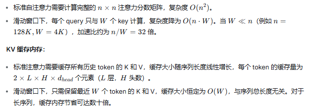
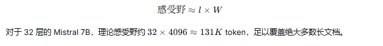
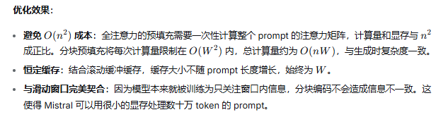
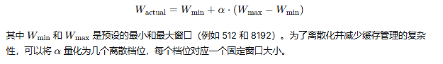

# 17.大模型（LLMs）Mistral 架构（滑动窗口注意力）

#### Mistral 7B 的滑动窗口注意力是如何工作的？窗口大小是多少？

Mistral 7B 使用滑动窗口注意力（Sliding Window Attention, SWA），窗口大小 W = 4096 token。

工作原理：

- 在每一层，对于位置为 $i$ 的 token，其注意力只能看到范围在 [$i$−$W$+1,$i$] 内的过去 token（及自身），而不能关注更早的 token。

- 这相当于在标准因果掩码的基础上，进一步屏蔽距离超过窗口大小的历史 token。

- 注意力计算变为：

$$
\mathrm{Attention}(Q_i, K, V) = \mathrm{softmax}\left(\frac{Q_i K_{i-W+1:i}^T}{\sqrt{d_k}}\right)V_{i-W+1:i}
$$

- 这种局部自注意力将复杂度从 $O(n^2)$ 降至 $O(n \cdot W)$，并极大压缩了 KV 缓存。

{.ocr-src}

Mistral 7B 共有 32 层，因此理论最大感受野为 32×4096≈131K token，信息可通过多层传递覆盖超长上下文。

---

#### 画出滑动窗口注意力的掩码模式，并与标准因果掩码对比。

标准因果掩码（$n=8$ 示例）：

```plain text
      K0 K1 K2 K3 K4 K5 K6 K7
Q0 [  1, 0, 0, 0, 0, 0, 0, 0]
Q1 [  1, 1, 0, 0, 0, 0, 0, 0]
Q2 [  1, 1, 1, 0, 0, 0, 0, 0]
Q3 [  1, 1, 1, 1, 0, 0, 0, 0]
Q4 [  1, 1, 1, 1, 1, 0, 0, 0]
Q5 [  1, 1, 1, 1, 1, 1, 0, 0]
Q6 [  1, 1, 1, 1, 1, 1, 1, 0]
Q7 [  1, 1, 1, 1, 1, 1, 1, 1]
```

（1 表示可见，0 表示被掩码屏蔽）

滑动窗口因果掩码（$W=3$ 示例）：

```plain text
      K0 K1 K2 K3 K4 K5 K6 K7
Q0 [  1, 0, 0, 0, 0, 0, 0, 0]
Q1 [  1, 1, 0, 0, 0, 0, 0, 0]
Q2 [  1, 1, 1, 0, 0, 0, 0, 0]
Q3 [  0, 1, 1, 1, 0, 0, 0, 0]
Q4 [  0, 0, 1, 1, 1, 0, 0, 0]
Q5 [  0, 0, 0, 1, 1, 1, 0, 0]
Q6 [  0, 0, 0, 0, 1, 1, 1, 0]
Q7 [  0, 0, 0, 0, 0, 1, 1, 1]
```

每个 query 只能看到最近的 $W$ 个 key（包含自身）。

核心区别：滑动窗口掩码将注意力限制在固定宽度的带状区域内，而标准因果掩码让每个 token 看到所有历史。

---

#### 滑动窗口注意力如何显著减少缓存内存和计算量？

计算量：

- 标准注意力需要计算完整的 $n \times n$ 注意力分数矩阵，复杂度 $O(n^2)$。
- 滑动窗口下，每个 query 只与 $W$ 个 key 计算，复杂度降为 $O(n \cdot W)$。当 $W \ll n$（例如 $n = 128K, W = 4K$），加速比约为 $n/W = 32$ 倍。

**KV 缓存内存**：

- 标准注意力需要缓存所有历史 token 的 K 和 V，缓存大小随序列长度线性增长，每个 token 的缓存量为 $2 \times L \times H \times d_{head}$ 个元素（$L$ 层，$H$ 头数）。
- 滑动窗口下，只需保留最近 $W$ 个 token 的 K 和 V，缓存大小恒定为 $O(W)$，与序列总长度无关。对于长序列，缓存内存节省可达数十倍。

{.ocr-src}

以 Mistral 7B 为例：头数 32，层数 32，d_head=128，W=4096。标准因果注意力在 128K 长度时 KV 缓存约 32GB（FP16），而滑动窗口只需约 1GB，显著降低显存压力。

---

#### 在滑动窗口中，远处的信息如何传递？是否会有信息丢失？

信息传递机制：\
滑动窗口注意力虽然每层只能直接看到最近 $W$ 个 token，但通过多层堆叠，信息可以逐层向前传播。第 $l$ 层的输出可以携带前一层从更早 token 聚合的信息。因此，随着层数增加，每个 token 的有效感受野线性扩大：

$$
\text{感受野} \approx l \times W
$$

对于 32 层的 Mistral 7B，理论感受野约 $32 \times 4096 \approx 131K$ token，足以覆盖绝大多数长文档。

{.ocr-src}

是否会有信息丢失：

理论上，通过足够深的网络，任意远的信息都可以传递过来。但与密集全注意力相比，滑动窗口确实可能丢失一些需要直接跳跃连接的细粒度远程依赖，尤其是需要在单层内立即建立跨长距离关联的任务。不过，Mistral 通过以下方式缓解：

- 将 RoPE 与滑动窗口结合，保留相对位置感知。

- 在某些任务上，利用模型的全局知识或外部检索来弥补。

- 实验表明，在常见的长上下文基准（如 Long Range Arena）上，滑动窗口的表现与全注意力相当或更优，说明大多数远程依赖可以通过逐层传递有效捕捉。

---

#### Mistral 的滚动缓冲缓存 (Rolling Buffer Cache) 是什么？它如何与滑动窗口配合？

滚动缓冲缓存 是一种固定大小的 KV 缓存实现，专为滑动窗口注意力设计。

- 结构：在显存中分配一个大小为 $W$ 的循环缓冲区，用于存储每一层的 K 和 V 向量。

- 写入与覆盖：当生成一个新 token 时，其 K 和 V 被写入缓冲区的下一个位置。一旦缓冲区填满，新值会覆盖最旧的条目（因为最旧的 token 已超出窗口范围，不再被任何后续 query 关注）。

- 读取：计算注意力时，当前 query 只需从缓冲区读取最近的 $W$ 个 K 和 V。由于缓冲区始终是最新的 $W$ 个 token 的缓存，查询范围和缓冲内容天然对齐。

配合滑动窗口的优势：

- 内存占用恒定，不随序列长度增长。

- 不需要显式维护“删除”旧缓存的操作，滚动覆盖自动实现了窗口滑动。

- 极大简化了推理框架的实现，提升了内存局部性和访问效率。

---

#### Mistral 是否也使用了 GQA？分组设置是怎样的？

Mistral 7B 并未使用 GQA，它采用的是标准多头注意力（MHA）。其头数 `n_heads = 32`，`d_head = 128`，每个头都有独立的 Q、K、V 投影，无分组共享。

然而，Mistral 的后续 MoE 版本 Mixtral 8x7B 引入了分组查询注意力（GQA），其设置如下：

- 查询头数 `n_heads = 32`

- 键值头数 `n_kv_heads = 8`（即 4 个查询头共享一对 K、V）

- 这显著压缩了 KV 缓存，降低了推理时的显存占用。

因此，在讨论“Mistral”时需明确区分：原始 Mistral 7B 是 MHA，而 Mixtral 及之后的 Mistral 变体通常采用 GQA，以更好地平衡效率与性能。

---

#### Mistral 架构与 LLaMA 架构有哪些异同？

相同点：

- 均采用 Decoder-Only 架构，Pre-Norm 结构。

- 使用 RMSNorm 而非 LayerNorm。

- FFN 采用 SwiGLU 激活函数。

- 使用 RoPE 旋转位置编码。

- 线性层均无偏置（bias）。

- 相同规模的模型，头维度 `d_head` 均为 128。

核心区别：

| 特性 | LLaMA-2 7B | Mistral 7B |
| --- | --- | --- |
| 注意力机制 | 标准因果全注意力（无滑动窗口） | 滑动窗口注意力（W=4096），此外支持全注意力（可配置） |
| GQA | LLaMA-2 7B/13B 用 MHA，70B 用 GQA (8 KV 头) | Mistral 7B 用 MHA（无 GQA）；Mixtral 8x7B 用 GQA (8 KV 头) |
| 上下文长度 | 原生 4K | 训练时 4K（使用滑动窗口），可直接外推到任意长度推理 |
| 推理长度外推 | 需借助 PI/NTK/YaRN 等技术扩展 | 原生支持任意长序列推理，无需额外插值 |
| 词表大小 | 32K (SentencePiece) | 32K (SentencePiece) 相同 |

Mistral 的核心创新在于滑动窗口注意力，这使得它在长文本推理上具有天然优势，无需复杂的长度扩展技术。

---

#### 为什么 Mistral 可以在较短的上下文训练后，推理时外推到很长的序列？

Mistral 的长文本外推能力源于其滑动窗口注意力的固有特性，而非依赖于可泛化的位置编码（尽管 RoPE 也提供了辅助）。

- 固定窗口大小：无论是在训练还是推理时，每个 token 的注意力范围都被硬性限制在最近的 4096 个 token。训练期间，模型只见过最多 4096 长度的序列，但从未需要关注超过该窗口的历史。

- 推理时等变性：当推理长度从 4K 扩展到 100K 时，模型每个 token 仍然只处理最近的 4096 个 token，计算图完全一致。没有任何新的位置索引或注意力模式出现。因此，模型可以无缝外推，行为与训练时完全一致。

- 与位置编码无关：虽然 Mistral 使用了 RoPE，但 RoPE 的外推限制在此并非瓶颈，因为有效注意力距离从未超过 4096。RoPE 只需在 4096 以内准确编码相对位置，这在其训练长度内已经满足。

- 滚动缓冲实现：利用固定大小的 Rolling Buffer Cache，推理框架可以高效管理任意总长度的 KV 缓存，而不增加显存。

对比 LLaMA：LLaMA 采用全注意力，训练时每个 token 需要关注全部历史（如 4K），推理时若扩到 32K，模型会遇到未曾见过的远距离注意力和位置编码，因此必须通过插值等外推技术来“伪造”未见过的位置。Mistral 则完全避开了这个问题。

---

#### 滑动窗口注意力是否会导致模型在长程依赖任务上表现下降？如何弥补？

可能下降的场景：

- 对于需要直接跨越多层窗口的细粒度依赖（例如，精确检索 130K 之外的一个特定数字），仅靠逐层传递可能因信息稀释或遗忘而失效。全注意力可以直接将两个远距离 token 连接起来，而滑动窗口需要经过多个“中转站”，增加了信息丢失的风险。

- 在一些严格需要全局上下文建模的任务（如全文摘要、长文档关系抽取）中，滑动窗口的性能可能略低于全注意力（在窗口特别小的情况下）。但 4096 的窗口已足够大，多数研究显示差异很小。

弥补措施：

- 增大窗口大小：平衡效率与覆盖，4096 已捕捉大部分依赖。

- 结合全局 token：类似于 Longformer，可引入少数全局 token（如 `[CLS]`），它们可以关注整个序列，并与滑动窗口融合。

- 混合注意力：在部分层使用全注意力，其他层使用滑动窗口，兼顾全局交互和效率（类似于 GPT-3 的稀疏注意力）。

- 检索增强（RAG）：对于极长文档，先检索相关块，再用窗口内注意力精读，避免依赖超长窗口。

- 有效的预训练：Mistral 在预训练时也会使用一定的长序列数据（通过文档拼接），让模型学会利用多层窗口传递重要信息，优化信息压缩和转发能力。

实际评估中，Mistral 7B 在长上下文基准（如 LRA、LongBench）上表现优异，甚至超过许多全注意力模型，证明滑动窗口注意力设计成功平衡了效率与长程建模。

---

#### 在 Mistral 中，前几层和后几层是否可以使用不同的窗口大小？

可以，且这是一种自然的扩展方向，但原始 Mistral 7B 并未采用不同窗口大小。\
Mistral 所有层统一使用窗口大小 W=4096。使用不同窗口大小是可行的，具有以下考量：

- 底层使用较小窗口，强化局部特征提取；顶层使用较大窗口（甚至全注意力），直接捕捉全局依赖。这模仿了 CNN 中感受野逐层扩大的思想。

- 优势：平衡效率与表达能力。底层小窗口降低计算量，顶层大窗口确保关键远程信息不丢失。

- 实践：类似设计在 Longformer 等模型中出现过，但 Mistral 为了架构简洁和实现统一，未采用分层窗口。如果定制，可通过在代码中为每层设置不同的 `window_size` 参数实现，但需注意 KV 缓存管理的复杂性会增加。

---

#### 解释 Mistral 的“分块预填充并缓存”在长文本推理时的优化。

分块预填充（Chunked Prefill） 是一种处理长 prompt 的推理优化策略，与滑动窗口注意力结合使用效果显著。

工作流程：

1. 将长 prompt 切分为若干小块（chunk），每个块大小为窗口大小 $W$ 或更小。

2. 逐块进行编码：第一个块正常前向传播，生成并缓存其 K、V。第二个块编码时，由于其注意力范围只覆盖最近的 $W$ 个 token，它不需要访问第一个块中超出窗口的部分，因此可以直接使用当前缓存（此时缓存包含第一个块的后部 token）进行注意力计算。

3. 每编码完一个块，更新滚动缓存（旧 token 被覆盖），然后处理下一个块。

4. 所有块编码完成后，最后一个块的隐藏状态作为生成起点的上下文。

**优化效果**：

- **避免 $O(n^2)$ 成本**：全注意力的预填充需要一次性计算整个 prompt 的注意力矩阵，计算量和显存与 $n^2$ 成正比。分块预填充将每次计算量限制在 $O(W^2)$ 内，总计算量约为 $O(nW)$，与生成时复杂度一致。
- **恒定缓存**：结合滚动缓冲缓存，缓存大小不随 prompt 长度增长，始终为 $W$。
- **与滑动窗口完美契合**：因为模型本来就被训练为只关注窗口内信息，分块编码不会造成信息不一致。这使得 Mistral 可以用很小的显存处理数十万 token 的 prompt。

{.ocr-src}

---

#### 混合使用滑动窗口和全局注意力是否可行？会带来什么好处？

完全可行，且能显著提升长程依赖捕捉能力，Longformer、BigBird 等工作已验证这一思路。

混合方式：

- 在部分层（如每隔几层）或部分位置（如 `[CLS]` token、指定的全局 token）使用全局注意力，这些 token 可以关注整个序列，同时被所有 token 关注。

- 其余 token 和层继续使用滑动窗口注意力。

- 全局 token 可以是额外添加的可学习向量，也可以是从输入中动态选择的（如摘要任务中的关键 token）。

好处：

- 弥补远程信息丢失：全局 token 作为“信息中转站”，将远处的重要信息直接携带到当前窗口，避免了单纯依赖逐层传递可能造成的信息衰减。

- 灵活性：对于需要精确全局上下文的任务（如长文档问答、全文摘要），性能可以逼近甚至超越全注意力，同时保持窗口注意力带来的效率优势。

- 训练成本可控：只需少量全局注意力连接，总计算量仍远低于全注意力。

在滑动窗口基础上增加全局注意力，只需修改注意力掩码，赋予全局 token 特殊权限，实现简单且有效。不过 Mistral 原始设计为纯粹滑动窗口，以保持极简架构；若追求极致长程任务性能，引入全局注意力是直接且有效的升级途径。

---

#### Mixtral 是如何在 Mistral 基础上引入 MoE 的？

Mixtral 8x7B 以 Mistral 7B 的架构为基座，将 FFN 层替换为混合专家（MoE）模块，具体实现如下：

- 专家结构：保留 Mistral 的 SwiGLU FFN 设计作为每个专家的基本计算单元。Mixtral 有 8 个专家，每个专家的 FFN 维度与原始 Mistral 7B 相同（`intermediate_size = 14336`）。

- 路由机制：添加一个轻量的门控路由器（线性层），对于每个 token，输出 8 个专家的 logits，通过 softmax 选择 Top-2 专家。两个专家各自处理 token，输出按门控权重加权求和。

- 稀疏激活：每个 token 仅激活 2 个专家，因此实际计算量约为原始密集模型的 2/8（加上路由开销），而总参数量增至约 46.7B（约 7B 的 8 倍减去共享部分）。

- 负载均衡：训练时添加辅助损失，鼓励路由器均匀选择专家，避免少数专家过载。

- 继承 Mistral 其他特性：滑动窗口注意力（窗口大小仍为 4096）、RoPE、RMSNorm、GQA（Mixtral 使用了 8 个 KV 头）等架构要素保持不变。

结果：Mixtral 8x7B 在大多数基准上超越了 LLaMA-2 70B 等更大密集模型，同时推理速度更快（因稀疏激活）。它开创了高效 MoE 语言模型的范例，证明了在 Mistral 架构上引入 MoE 的巨大潜力。

---

#### 滑动窗口注意力的实现能否利用 FlashAttention？有哪些优化点？

可以，且高度兼容。FlashAttention 的核心理念（分块计算、IO 优化）天然适合滑动窗口注意力。

利用方式：

- FlashAttention 原生的 `causal` 模式计算因果掩码下的注意力。要支持滑动窗口，只需在计算每个分块时，将 key 的序列维度截断到窗口范围内。这可以通过传递一个自定义的 `window_size` 参数，在 FlashAttention 内核中只加载和计算近期的 K、V 块，从而跳过窗口外的元素。

- 实际上，FlashAttention-2 和 vLLM 等框架已经通过 `sliding_window` 参数原生支持滑动窗口注意力。它们会自动生成稀疏的块调度，避免读取和计算不需要的 K、V。

额外优化点：

- 缓存精简：与滚动缓冲缓存协同，FlashAttention 仅加载固定窗口内的 K、V 到 SRAM，数据量恒定，极大减少 HBM 读写。

- 分块预填充：利用 FlashAttention 的分块机制，将长 prompt 按窗口大小分块编码，避免一次性计算全注意力。

- 自动混合精度：在 FP16/BF16 下，滑动窗口减少了需要存储和计算的注意力矩阵元素，进一步降低显存压力。

- 内核融合：将 RoPE 旋转、滑动窗口掩码、softmax 和 dropout 融合到同一个 GPU 内核中，避免中间结果写回显存。

因此，滑动窗口注意力在工程上可以借助成熟的 FlashAttention 生态，获得接近理论峰值的计算效率。

---

#### 如果训练一个基于滑动窗口的大模型，数据顺序是否重要？

非常重要，数据顺序直接影响模型利用窗口传递信息的能力。

- 局部依赖训练：滑动窗口模型在训练时只能通过逐层传递来捕获长程依赖。如果训练数据中相关的信息（如问题与答案、指代与先行词）经常相距较远，模型需要学习有效的跨层转发机制。若数据顺序不当（如随机打乱文档），会导致远距离依赖被切断，模型无法学到有效的信息传递。

- 预训练中的序列构造：为了教会模型处理长程依赖，通常需要在预训练中包含连续的长文档，而不是仅用随机拼接的短片段。Mistral 的训练数据使用文档级连续文本，并通过拼接达到较长序列长度（如 4096），这样模型可以在一个序列内遇到跨越窗口的依赖关系，从而学习如何利用多层窗口传递信息。

- 位置编码的适应：RoPE 的相对位置性质使得模型对绝对位置不敏感，但窗口注意力模型仍需在训练中经历足够的相对位置范围（至少窗口大小内），以便 RoPE 有效工作。数据顺序不会改变 RoPE 的数学性质，但多样化的序列长度和结构有助于模型泛化。

- 课程学习：一种有效策略是先用较短的序列训练，让模型先学好局部模式，再逐步引入长序列，迫使模型发展远程转发能力。

总之，虽然滑动窗口注意力的局部机制对数据顺序的敏感度可能低于全注意力（因为全注意力直接依赖远距离位置编码），但数据顺序和序列长度分布仍然对模型最终的长程性能至关重要。

---

#### 对比 Mistral 的滑动窗口和 Longformer 的局部+全局注意力。

| 特性 | Mistral 滑动窗口 | Longformer |
| --- | --- | --- |
| 注意力模式 | 每一层、所有 token 都使用固定大小的局部窗口（因果/双向） | 局部窗口 + 少数全局 token（如 [CLS]）使用全注意力 |
| 全局信息 | 通过多层堆叠，信息在窗口间逐层传递。无显式全局 token。 | 全局 token 直接关注所有 token，并被所有 token 关注，提供全局信息通道 |
| 复杂度 | O(n⋅W)，极简 | O(n⋅W+n⋅g)（g 为全局 token 数），全局部分增加少量计算 |
| 长程依赖 | 依赖网络深度，可能有信息稀释风险，但 32 层 4096 窗口下感受野可达 131K | 全局 token 提供直接远程连接，长程依赖捕捉更强，尤其适合分类/抽取任务 |
| 实现复杂度 | 极简，仅需修改注意力掩码为带状 | 需要混合掩码，全局 token 需要特殊处理 |
| 典型应用 | 自回归语言模型（Mistral），高效长文本生成 | 主要用于编码器（BERT 类），文本理解与分类 |
| 缓存机制 | 滚动缓冲缓存，固定大小 W | 可缓存，但全局 token 需保留全序列缓存 |

对比总结：Mistral 的滑动窗口是追求极致效率和简洁性的设计，适合自回归生成，通过深度换取长程覆盖；Longformer 的混合注意力通过全局 token 提供更稳健的远程交互，适合需要强全局理解的任务。两者可互补，Mistral 的生成能力若融合 Longformer 的全局 token，将进一步提升长程性能。

---

#### 在流式应用中，滑动窗口注意力有什么天然优势？

1. 恒定延迟与内存\
   滑动窗口注意力的缓存大小固定为 $W$，不随序列增长。在流式处理（如无限长对话、实时语音转文字）中，显存占用始终恒定，不会因为对话变长而 OOM。每步计算量也稳定在 $O$($W$)，延迟可预测。

2. 自动遗忘，无需显式管理

滚动缓冲缓存自动覆盖最早的历史，天然实现了“遗忘”机制，无需额外逻辑去裁剪或丢弃旧信息。对于流式场景中常见的只依赖近期上下文的任务（如实时翻译、直播弹幕分析），这恰好匹配。

3. 快速适应新信息

由于窗口只覆盖最近的 token，模型对最新输入更敏感，历史信息迅速衰减，适合需要快速转向的动态环境。

4. 高效预填充

分块预填充允许以极低的计算和内存开销处理流式输入的初始上下文，避免了全注意力的 $O(n^2)$ 成本，使得系统可以快速启动。

{.ocr-src}

这些优势使滑动窗口模型成为实时、低延迟、资源受限的流式 AI 应用的理想选择。

---

#### Mistral 模型为何能在 7B 规模下展现强大的能力？架构起到了什么作用？

Mistral 7B 在多项基准上超越了同期的 LLaMA-2 13B 等更大模型，其卓越性能源于架构创新与高效训练的结合。

架构贡献：

- 滑动窗口注意力：在训练和推理时用局部窗口取代全注意力，降低了计算和缓存成本，使得模型可以在有限算力下处理更长序列，从而在预训练中接触更丰富的上下文结构。

- 高效的位置编码（RoPE）：与滑动窗口配合，外推到长文本无需额外调整，使模型能够从更大规模的长文档数据中学习，知识密度更高。

- 精简组件（RMSNorm、SwiGLU、无偏置）：减少了冗余参数和计算，让同等参数量下模型能拥有更多的层或更大的维度（相对其他 7B 模型），提高了容量利用率。

- 深度与窗口的乘积：32 层 × 4096 窗口 = 131K 理论感受野，保证了即使在局部注意力下也能捕获极长依赖，这让模型在长文本理解任务上不输全注意力。

训练数据与策略：

- 大规模高质量数据（推测达数万亿 token），严格过滤，保证了知识覆盖。

- 高效的训练优化（可能利用 Megatron、FlashAttention 等），使得 7B 模型可以在充分训练后达到高性能。

综合结果：Mistral 7B 以更少的参数，通过更优的架构实现了比 13B 模型更好的性能和更低的推理成本，证明了“小而精”的设计哲学在 LLM 领域的成功。架构上的滑动窗口是点睛之笔，它不仅在推理时节省资源，更在训练时允许模型看到更长、更丰富的上下文，从而学习到更强的语言能力。

---

#### 如果要实现一个可以自适应调整窗口大小的 Mistral 变体，你会如何设计？

设计自适应窗口大小的 Mistral 变体，核心是让模型根据输入内容和计算预算动态调整每个 token 或每层的注意力窗口大小。我会采用以下分层设计：

1. 可学习的窗口调节器\
   在每层注意力模块中加入一个轻量级的门控网络（例如一个小的 MLP 或线性层），它以当前 token 的输入表示 $x$ 为输入，输出一个标量 $α$∈[0,1]，用于调节窗口大小：

$$
W_{\mathrm{actual}} = W_{\min} + \alpha \cdot (W_{\max} - W_{\min})
$$

其中 $W_{\min}$ 和 $W_{\max}$ 是预设的最小和最大窗口（例如 512 和 8192）。为了离散化并减少缓存管理的复杂性，可以将 $\alpha$ 量化为几个离散档位，每个档位对应一个固定窗口大小。

{.ocr-src}

2. 动态缓存管理

为了支持可变窗口，需要放弃固定大小的滚动缓冲缓存，改用一种可变大小滑动窗口缓存。可以借鉴 vLLM 的 PagedAttention 思想，将 KV 缓存切分为固定大小的块，每个 token 记录其所属的块。当某 token 的窗口缩小时，可以释放不再需要的旧块；窗口扩大时，则保留更多历史块。这样既能灵活调整窗口，又保持内存效率。

3. 训练策略

- 联合训练：在预训练或微调中，让门控网络与主模型一起学习。为鼓励窗口大小的多样性并避免退化为最大窗口，可以加入窗口成本正则项，例如 $λ$⋅mean($α$)，促使模型在不需要长距离时使用小窗口。

- 课程学习：先训练模型使用固定大窗口，然后逐渐引入门控和正则项，让模型学会自适应压缩。

- 门控初始化：初始时让门控偏向选择较大的窗口，以保证信息不丢失，随后通过正则化逐步调整。

4. 推理时的自适应

在推理时，对于每个 token，门控网络根据当前上下文决定窗口大小。这可以带来显著的计算节省：对于明显只需局部依赖的位置（如生成常见短语），使用小窗口；对于可能需要远距离指代消解或全局推理的位置，自动扩大窗口。

此外，还可以根据系统负载动态调整：当 GPU 内存紧张或延迟要求苛刻时，可以通过外部约束强制使用较小窗口，实现优雅降级。

5. 潜在的挑战

- 可变窗口使计算图变得不规则，不利于硬件优化；但利用分块和掩码仍可高效实现。

- 训练时门控网络可能学到平凡解（如总是选最大窗口），需要仔细设计正则化和初始化。

- 需要额外的超参数来平衡性能与效率。

这种自适应机制将使滑动窗口注意力更加智能，兼顾效率与长程能力。

---

#### 滑动窗口注意力对模型的知识存储能力有影响吗？

滑动窗口注意力主要影响上下文信息流动，对模型的参数化知识存储（存储在 FFN 权重中的事实和常识）几乎没有直接影响。知识存储主要依赖于 FFN 的容量和训练数据，而注意力机制负责从上下文中动态检索信息。因此：

- 无直接影响：滑动窗口注意力并不会改变 FFN 的参数量或训练目标，模型仍然可以在 FFN 中存储相同的海量知识。事实性知识（如“巴黎是法国首都”）在预训练中通过 MLM 或 next-token prediction 被编码到 FFN 中，与注意力窗口无关。

- 间接影响可能存在：滑动窗口限制了上下文信息的传递路径，在某些任务（如长文档问答、多跳推理）中，如果模型需要从远距离上下文中提取信息来回答知识密集型问题，滑动窗口可能导致相关信息无法有效传递到当前 token，从而暴露知识存储的不足。但这不是知识存储本身受损，而是信息获取受限。这迫使模型更依赖内部知识，在内部知识不足时可能产生幻觉。

- 训练数据的多样性：滑动窗口模型在训练时同样需要学习长程依赖，这会促使 FFN 部分更加强大，补偿上下文传递的损失。因此，最终的知识存储能力取决于整体训练。

总结：滑动窗口不会降低模型存储知识的容量，但可能影响利用远距离上下文信息的效率，而这可以通过加深网络、增大窗口或混合全局注意力来缓解。

---

#### 如何分析 Mistral 模型中的注意力分布，以验证滑动窗口的有效性？

验证滑动窗口有效性的关键在于确认：(1) 模型确实在窗口范围内有效地分配注意力，而不是浪费在窗口外；(2) 长程信息通过多层传递被成功捕获；(3) 窗口大小选择合理。

1. 注意力模式可视化

- 对于选定样本，提取每层、每头的注意力权重矩阵。绘制注意力热力图，观察权重是否集中在窗口内的对角线附近（局部依赖），以及是否在窗口边界附近出现衰减。对比不同层的模式：底层可能更局部，高层可能出现更分散的注意力。

- 检查是否存在某些头专门负责“信息转发”——即它们的注意力权重沿着相对位置偏移，将远距离信息逐层向前传递。

2. 有效感受野分析

- 计算每个 token 在前向传播中对最终输出贡献的梯度或注意力 rollout（例如使用 Attention Rollout 或 Grad-CAM），量化不同距离的输入对当前 token 的影响。绘制影响随距离的变化曲线，验证有效感受野是否随着层数增加而扩大，并最终覆盖整个上下文窗口（例如 >100K）。

- 对比滑动窗口模型与全注意力模型的感受野，评估信息传递效率。

3. 长程依赖任务评估

- 设计探测任务：在长序列的特定位置插入关键信息（如“大海捞针”测试），测量模型在不同深度下正确检索该信息的准确率。观察随着层数增加，准确率是否提升，验证多层窗口传递是否有效。

- 对比不同窗口大小设置下的性能，找到收益递减点，证明所选窗口的合理性。

4. 缓存效率验证

- 测量在超长序列下，KV 缓存的内存占用和计算时间，确认窗口限制确实将资源消耗控制在可预测的范围。

5. 与全注意力的对比

- 在相同长上下文任务上，对比 Mistral 与同等规模的全注意力模型（如 LLaMA-2 7B 扩展上下文后）的性能和效率，若 Mistral 以更低成本达到相近或更好性能，则间接证明窗口设计有效。

通过这些分析，可以全面验证滑动窗口注意力不仅理论上可行，而且在实践中达到了设计目标。

---

#### 是否可以将滑动窗口注意力与 RoPE 长上下文扩展结合使用？

可以，且这种结合能进一步发挥各自优势，但并非必需。

- 滑动窗口本身已提供外推：Mistral 的外推主要依赖窗口限制，使得推理时的有效距离不超过训练时的窗口大小，因此 RoPE 的长度外推特性在 Mistral 中并不关键。RoPE 只需在窗口大小内正常工作即可。

- 结合的动机：如果希望模型在推理时使用更大的窗口（例如从 4K 扩展到 32K 窗口），那么就需要 RoPE 支持更长的相对距离编码。此时可以应用 RoPE 的扩展技术（如 YaRN、NTK-aware 缩放），让模型在更大窗口下仍能区分位置，同时保持滑动窗口机制。

- 实现方式：在扩展 RoPE 基频或应用 YaRN 后，模型可以直接将滑动窗口大小从 4K 改为 32K，并配合微调（或零样本外推）来适应。由于窗口变大，单层感受野增大，所需层数传递减少，可能提升长程性能。但代价是缓存和计算量增大。

- 性能权衡：滑动窗口与 RoPE 扩展结合可以构建一个非常灵活的长度适配方案：当资源充裕时，增大窗口并扩展 RoPE；当资源紧张时，缩小窗口并使用原始 RoPE。这为实现“弹性长上下文”提供了可能。

总结：两者可以结合，但 Mistral 的原生设计已通过固定窗口避开了 RoPE 外推问题。如果出于性能需求要增大窗口，RoPE 扩展技术是必要的补充。

---

#### 在训练 Mixtral 时，滑动窗口与 MoE 的路由如何相互作用？

Mixtral 将 Mistral 的滑动窗口注意力与 MoE 的稀疏专家混合在同一架构中，它们的交互主要体现在计算分配和信息传递上。

- 路由基于每 token 状态：门控路由器根据每个 token 的当前表示（包含滑动窗口带来的局部历史信息）来决定将其分配给哪两个专家。由于滑动窗口限制了上下文，路由决策主要依赖于近期上下文和内部知识，可能无法利用极远距离的信息来选择专家。但这通常不是问题，因为专家选择更多基于 token 的语义内容和局部语法角色。

- 负载均衡与窗口的独立性：辅助负载均衡损失在 MoE 中确保专家均匀使用，与注意力窗口大小无关。无论窗口多大，负载均衡机制都正常工作。

- 信息传递与专家专业化：由于窗口注意力限制了 token 间的直接交互，不同专家可能会逐渐专业化于处理某些局部模式或特定类型的上下文。浅层专家可能擅长局部短语，深层专家可能通过多层传递处理更长程的依赖。MoE 的稀疏性使得每个 token 只激活少数专家，这意味着模型可以拥有大量“长程依赖专家”，它们被专门训练来处理需要远距离信息的 token，而这些 token 的特征可能已通过多层窗口传递被隐式编码。

- 训练稳定性：滑动窗口的局部性可能使梯度的传播路径变长，但 Mixtral 的深度和 MoE 的稀疏性共同工作，通过适当的初始化和辅助损失，依然可以稳定训练。

总的来说，滑动窗口与 MoE 在 Mixtral 中协同工作：窗口提供高效的局部+长程信息流，MoE 利用这些信息进行条件计算。两者没有直接冲突，设计上是正交的。

---

#### 除了 Mistral，还有哪些模型使用了窗口注意力？举例说明。

窗口注意力（局部注意力）在许多模型中被用来降低长序列的计算成本：

- Longformer：引入了滑动窗口注意力与全局注意力（如 `[CLS]` token）相结合，用于编码长文档，在 NLP 理解任务中表现优异。

- Sparse Transformer（OpenAI）：使用了固定的稀疏注意力模式，包括局部带状窗口和跨步注意力，以生成高分辨率图像和长文本。

- BigBird：结合了随机注意力、窗口注意力和全局注意力，实现了线性复杂度，可用于更长序列。

- Reformer：使用局部敏感哈希（LSH）将注意力限制在相似 token 的局部桶内，类似于动态窗口。

- GPT-3 的稀疏注意力变体：在 GPT-3 的某些层使用了稀疏带状注意力（类似于窗口），以减少计算。

- CodeLLaMA：虽然基于 LLaMA，但它可能通过特殊的微调或注意力模式支持长上下文，但并非原生的滑动窗口注意力；不过社区衍生版本有时会引入窗口注意力以加速。

- Gemini 1.5：虽然没有详细披露，但其超长上下文（百万 token）可能包含某种形式的稀疏或窗口注意力。

这些模型都利用了局部窗口注意力的高效性，通常结合其他机制（如全局 token、记忆压缩）来弥补远程依赖。

---

#### 你认为滑动窗口注意力会是长上下文 LLM 的未来方向吗？

滑动窗口注意力将继续是长上下文 LLM 工具箱中的重要组成部分，但不会是唯一的未来方向。它将与其他技术融合，共同解决效率与长程能力的平衡问题。

优势使它不可忽视：

- 极简高效：恒定缓存、O(n·W) 复杂度，易于实现和部署，特别适合流式和实时应用。

- 自然外推：无需复杂的位置插值即可处理任意长度，这对生产环境极具吸引力。

- 已验证的性能：Mistral/Mixtral 的成功证明，精心设计的滑动窗口模型可以在多数长上下文任务中与全注意力匹敌。

局限性促使融合：

- 极远距离的单步依赖可能丢失。某些需要精确全局交互的任务（如长文档逻辑推理、多跳问答）可能仍需全注意力或外部记忆。

- 窗口大小成为超参：需要为每个模型/任务选择合适窗口，自适应窗口可能是下一步演进方向。

未来趋势：

滑动窗口将更多地作为基本构建块，与其他注意力模式（全局、随机、基于检索）混合使用，形成可配置的稀疏注意力策略。我们可能会看到：

- 动态路由的混合注意力：根据输入特征自动决定每个 token 使用窗口还是全局注意力。

- 与状态空间模型（如 Mamba）的结合：滑动窗口注意力处理精细局部上下文，而 SSM 提供高效长程记忆，取长补短。

- 层次化窗口：在不同层使用不同窗口，甚至与压缩记忆结合，形成多尺度表示。

因此，滑动窗口注意力不会统治所有，但它凭借极佳的实用性和可扩展性，必将在未来的长上下文架构中占据核心地位。其设计哲学——通过局部性换取效率，通过深度扩大感受野——将深刻影响下一代 LLM。

