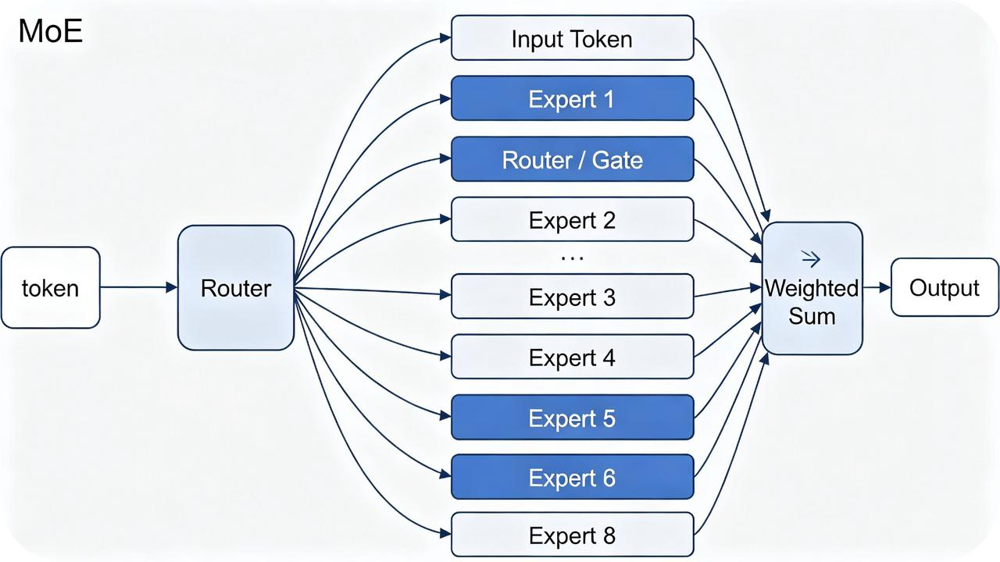
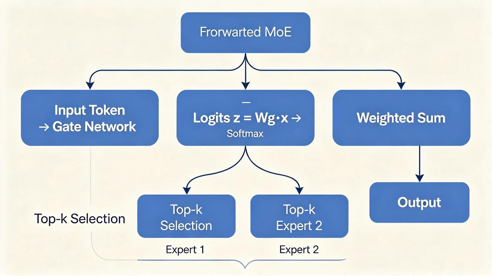
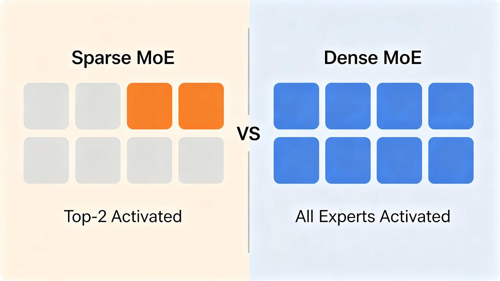
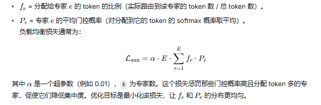
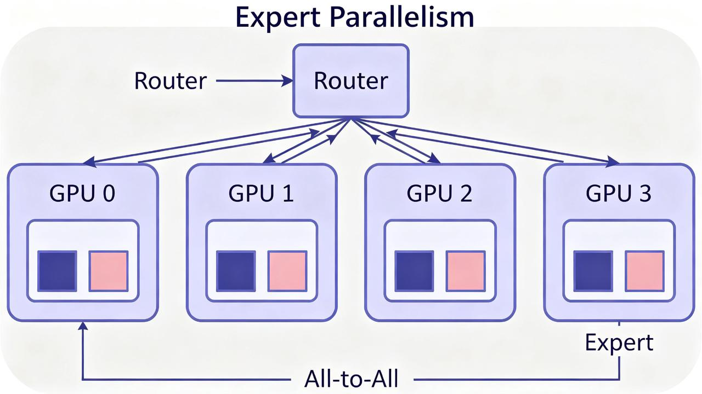
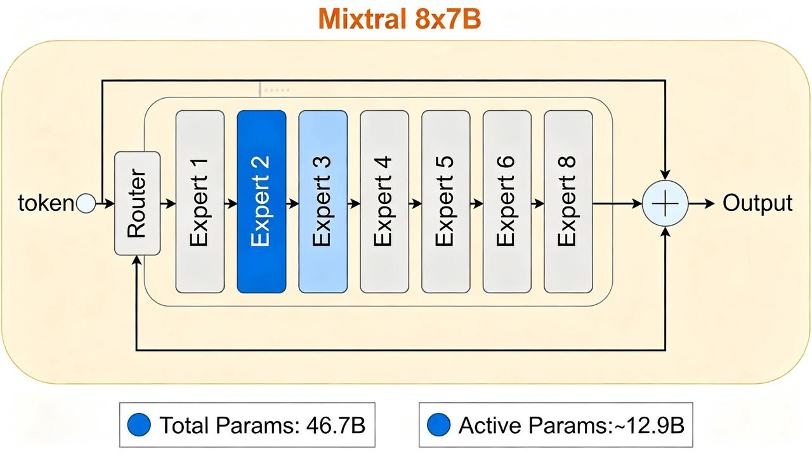
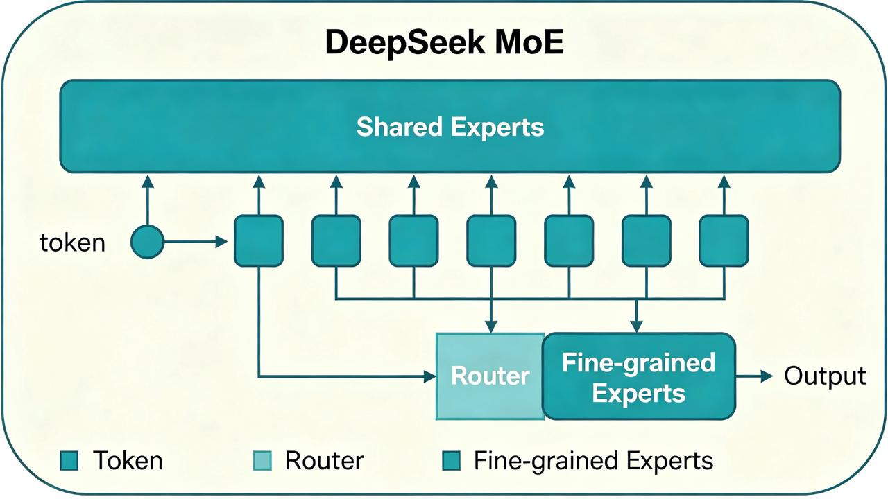

# 18.大模型（LLMs）混合专家（MoE）

#### 什么是混合专家（MoE）？它在 Transformer 中通常替换哪个模块？

混合专家（Mixture of Experts, MoE） 是一种神经网络架构模式，它将模型的一部分（通常是前馈网络层）替换为多个并行的“专家”子网络，并通过一个门控网络（router/gate） 动态地决定每个输入 token 应该由哪些专家处理。

在 Transformer 架构中，MoE 通常替换标准的逐位置前馈网络（Position-wise FFN）。具体来说，原来每层中单一的 FFN 被替换为：

- 一组（例如 8 个或 16 个）结构相同但参数独立的 FFN 模块，称为专家（Experts）。

- 一个门控路由器，对每个 token 输出一个专家选择概率分布，并选取 top-k 专家进行计算。

MoE 并不改变注意力层，仅改造 FFN 层。这使得模型的总参数量可以成倍增加（因为增加了多个专家的参数），但每个 token 的实际计算量（FLOPs）仅增加约 $k$ 倍（因为仅激活少数专家），从而在控制计算成本的同时大幅提升模型容量。



---

#### 画出 MoE 层的前向计算流程图，说明门控网络和专家的作用。

流程图（文本描述）：

```plain text
输入 token x (shape: [d_model])
       |
       v
   门控网络 G (通常为一个线性层)
       |
       v
   路由器输出 logits: z = W_g x  (shape: [num_experts])
       |
       v
   Softmax 得到专家概率分布 p = softmax(z)
       |
       v
   根据 p 选择 Top-k 个专家（如 k=1 或 2）
   并获取对应的门控权重 g_i
       |
       +---> 专家 1 (FFN_1) ---> 输出 y1，乘以门控权重 g1
       |
       +---> 专家 k (FFN_k) ---> 输出 yk，乘以门控权重 gk
       |
       v
   将 k 个专家输出加权求和： y = Σ g_i * FFN_i(x)
       |
       v
   输出 y (shape: [d_model])
```



门控网络的作用：

- 它是一个小型可学习的路由决策模块。对于每个 token，门控网络评估其内容特征，输出每个专家的“相关度分数”。它负责将不同的 token 动态分配给最合适的专家，是实现条件计算的核心。

专家的作用：

- 每个专家是一个完整的 FFN（例如 SwiGLU 结构），拥有独立权重。不同的专家在训练中会自然分化为处理不同类型输入（如不同领域、不同语言、不同语法模式）的专门模块。它们共同构成了一个庞大的参数池，而每个 token 只使用其中极少数，从而实现了巨大的模型容量和适中的计算开销。

---

#### 为什么 MoE 能实现“用更少的计算达到更大模型的效果”？

MoE 通过稀疏激活机制实现了这一目标：

- 参数量的爆炸增长：通过增加专家数量 E，模型的总参数量（主要来自 FFN 层）可以放大接近 $E$/$k$ 倍（与相同计算量的密集模型相比）。例如，Mixtral 8x7B 总参数 46.7B，但每个 token 仅激活约 12.9B 参数。

- 计算量的控制：每个 token 只被路由到 top-k 专家（通常 k=1 或 2）。因此，对每个 token 而言，实际执行的 FFN 计算量仅为密集模型的 k 倍（而非 E 倍）。总计算量 ≈ 密集模型计算量 × $k$（加上轻量的路由开销）。

- 表达能力的提升：庞大的专家池提供了海量的参数空间来存储知识、学习复杂的输入模式。不同专家可以专精于不同领域、风格或语法结构，模型整体对数据的拟合能力远超同等计算预算的密集模型。

- 稀疏性的规模化收益：随着专家数量 $E$ 增加，模型容量线性增长，而单 token 计算量几乎不变（仅路由开销略微增加）。这打破了传统密集模型必须同步增加参数量和计算量的约束，使得在有限计算预算下，模型可以拥有远大于密集模型的“有效知识容量”。

简言之，MoE 把参数容量和计算量解耦了：容量靠专家数，计算量靠激活数，实现了计算资源的高杠杆利用。

---

#### 稀疏 MoE 与稠密 MoE 的区别是什么？

- 稀疏 MoE（Sparse MoE）：每个输入 token 仅激活一个或极少数专家（top-k，k ≪ E）。这是目前主流 MoE 实现（如 Switch Transformer、Mixtral）。稀疏 MoE 大幅减少了每个 token 的计算量，但需要复杂的路由和负载均衡机制来保证专家有效利用。

- 稠密 MoE（Dense MoE）：每个 token 会经过所有专家的计算，然后对所有专家输出进行加权平均（权重由门控输出）。稠密 MoE 没有稀疏性带来的计算节省，其计算量随专家数线性增长，因此在现代大模型中基本不被采用。历史上，MoE 的早期工作（如 1991 年的原始 MoE 概念）多指稠密版本，但如今的“MoE”几乎总是指稀疏版本。

稀疏 MoE 的优势：计算量与专家总数无关，仅与激活专家数有关，能够极大幅度地扩展模型容量而不增加推理成本。



---

#### 门控网络通常输出什么？如何选择 top-k 专家？

门控网络输出：

- 一个形状为 `[batch_size, seq_len, E]` 的 logits 张量（`E` 为专家总数），通过一个简单的线性层 `W_g x` 得到（通常无偏置，`W_g` 尺寸 `[d_model, E]`）。

- 对 logits 应用 softmax 得到每个 token 对于每个专家的概率分布 `p_i`。

选择 top-k 专家的过程：

1. 将 logits 或概率值作为每个专家的“得分”。

2. 根据得分大小，为每个 token 独立地选取得分最高的 `k` 个专家索引（通常 `k=1` 或 `k=2`）。

3. 获取这 `k` 个专家对应的门控权重（即它们的 softmax 概率值），通常会重新归一化（只在这 k 个专家之间重新计算概率分布，使其和为 1）。

4. 将该 token 分别发送给这 `k` 个专家，每个专家对其输入进行计算并输出；最终的输出是这 k 个专家输出的加权和（权重为归一化后的门控值）。

5. 未被选中的专家在该 token 上不进行计算，不产生激活。

对于 `k=1` 的情况（如 Switch Transformer），只选最高专家，计算最简；对于 `k=2`（如 Mixtral），两个专家共同贡献，表达更平滑。

---

#### 什么是负载均衡损失？为什么 MoE 中需要它？

负载均衡损失（Load Balancing Loss） 是一种辅助损失函数，旨在鼓励路由器将 token 均匀地分配给所有专家，防止出现专家负载极度不均衡的情况。

定义（常见形式）：\
设对于一批 token，门控网络输出的概率分布为 $p_i$（对每个 token），定义：

- $f_e$ = 分配给专家 $e$ 的 token 的比例（实际路由到该专家的 token 数 / 总 token 数）。
- $P_e$ = 专家 $e$ 的平均门控概率（对分配到它的 token 的 softmax 概率取平均）。

负载均衡损失通常为：

$$
\mathcal{L}_{\mathrm{aux}} = \alpha \cdot E \cdot \sum_{e=1}^{E} f_e \cdot P_e
$$

其中 $\alpha$ 是一个超参数（例如 0.01），$E$ 为专家数。这个损失惩罚那些门控概率高且分配 token 多的专家，促使它们降低集中度。优化目标是最小化该损失，让 $f_e$ 和 $P_e$ 的分布更均匀。

{.ocr-src}

为什么需要：

- 如果没有负载均衡，训练初期路由器很容易陷入“懒惰”状态，将所有 token 分配给少数几个专家，导致其他专家几乎从未被训练（“专家坍塌”）。被选中的专家可能过载，而其他专家完全浪费。

- 负载均衡损失保证了所有专家都能接收到足够的训练信号，从而能分化并专业化，充分利用全容量。

---

#### 如果不施加负载均衡，MoE 训练中会出现什么“专家坍塌”问题？

专家坍塌（Expert Collapse）或路由坍塌：指只有极少部分专家被频繁使用，而绝大多数专家几乎接收不到 token，其参数难以得到有效更新，最终退化为无效容量。

具体表现：

- 在训练初期，路由器可能发现某几个专家的输出对于降低损失有利（可能是随机波动），于是不断将 token 分配给它们。由于这些专家获得更多的梯度更新，它们变得更强，形成马太效应，其他专家越来越得不到训练信号。

- 最终，整个模型的有效专家数实际上大大减少，模型容量无法充分利用，性能显著低于应有水平。

- 有时甚至所有 token 都被路由到一个专家，模型退化为密集模型，完全丧失了 MoE 的优势。

负载均衡损失的作用正是通过对这种集中分配行为进行惩罚，强制路由器探索并利用所有专家，从而防止坍塌。

---

#### 解释专家容量（capacity）的概念，以及如何处理 token 溢出。

专家容量（Expert Capacity） 是指每个专家在一个批次中能够处理的最大 token 数量。由于硬件约束（固定大小的缓冲区），每个专家的输入必须被限制在一定数量内，否则会导致内存溢出和无法并行。

计算公式：

$$
\mathrm{capacity} = \mathrm{round}\left(\frac{\text{total tokens} \times k}{E} \times \gamma\right)
$$

{.ocr-src}

其中 `total tokens` 是批次中的 token 总数，`k` 是 top-k 值，`E` 是专家数，`γ` 是容量因子（capacity factor，通常为 1.0 到 1.5）。`γ=1.0` 表示容量刚好满足平均分配；大于 1 则留有余量。

token 溢出的处理：

当某个专家的实际分配 token 数超过其容量时，多出的 token 会被丢弃。被丢弃的 token 不经过该专家处理，而是直接通过残差连接传递到下一层（即该 token 在该层的 MoE 输出为零向量，仅保留原始输入）。这可能会导致信息损失，但通过设置合适的容量因子和辅助损失，通常可以将溢出率控制得很低（如 <1%）。

一些实现也可能动态增大容量或者将溢出 token 重新路由，但为了计算效率，大多采用丢弃策略，并在训练时容忍少量溢出。

---

#### 在 MoE 中，如何进行分布式训练？专家并行是什么？

MoE 模型通常非常庞大，需要分布式训练。除了数据并行、模型并行外，专家并行（Expert Parallelism） 是 MoE 特有的高效并行策略。

专家并行的核心思想：将不同的专家分布到不同的设备（GPU）上。每个设备持有部分专家的参数，负责计算分配给自己专家的 token。由于每个 token 只激活少数专家，设备间只需要交换被路由的 token 及其结果，而非整个模型或全部数据。

具体流程：

1. All-to-All 通信：门控网络计算出每个 token 的专家选择后，通过 All-to-All 通信，将每个 token 发送到它被分配到的专家所在的设备上。

2. 本地计算：各设备独立计算自己持有的专家的前向和反向传播。

3. All-to-All 反向：计算完成后，将 token 的输出（或梯度）通过 All-to-All 通信传回原始设备，确保每个 token 沿其原始路径继续往下或往上一层流动。

与数据并行/模型并行的结合：

- 可以在专家内部使用数据并行（对同一个专家复制到多个设备）来处理超大 token 量。

- 非 MoE 层（如注意力层）可以使用传统的模型并行或数据并行。

- 实际上，训练大规模 MoE 时常采用 3D 并行：数据并行 + 张量并行（注意力）+ 专家并行（FFN）。

专家并行使 MoE 的训练能够线性扩展：增加设备即可容纳更多专家或更大专家，通信量仅与每个 token 激活的专家数相关，与总专家数无关。



---

#### Mixtral 8x7B 是如何设计 MoE 的？激活参数量是多少？

Mixtral 8x7B 是 Mistral AI 推出的基于 MoE 的 Decoder-Only 语言模型，其 MoE 设计如下：

- 基座架构：继承 Mistral 7B，使用滑动窗口注意力、RoPE、RMSNorm、SwiGLU FFN，但将每层的密集 FFN 替换为 MoE 模块。

- 专家配置：共有 8 个专家，每个专家的结构与 Mistral 7B 的 FFN 相同（中间维度 14336）。

- 路由机制：对于每个 token，门控网络从 8 个专家中选择 Top-2（k=2）专家。两个专家各自计算输出，按门控权重加权求和。

- 稀疏性：每个 token 仅激活 2 个专家，因此每个 token 的实际计算量约为密集 Mistral 7B 的 2/8（但加上路由开销，实际计算量大致与密集模型相当，因为专家的中间维度相同）。

- 总参数量：约 46.7B（8 个专家各约 5.8B 参数，加上共享的注意力层等，总数为 46.7B）。

- 激活参数量：在推理时，每个 token 激活的参数量包括所有共享层（注意力、归一化等）加上 2 个激活的专家。由于注意力等共享层参数约 0.5B，每个专家 FFN 约 5.8B，因此激活参数 ≈ 0.5+2×5.8=12.1B（通常报告为约 12.9B，可能包含了其他共享参数）。所以 Mixtral 是一个总参数 46.7B、但仅激活约 12.9B 参数的模型，具有极高的参数效率。

性能：Mixtral 8x7B 在众多基准上超越了 LLaMA-2 70B 等更大密集模型，同时推理速度因稀疏激活而更快，成为 MoE 在大语言模型中成功应用的标志性工作。



---

#### DeepSeek-V2/V3 的 MoE 与 Mixtral 有什么不同？细粒度专家和共享专家解决了什么？

DeepSeek-V2/V3 在 Mixtral 的基础上进行了两项核心创新：细粒度专家分割 和 共享专家隔离，旨在进一步提升参数效率和专家专业化水平。

与 Mixtral 的主要不同：

- 细粒度专家（Fine-grained Experts）：Mixtral 的每个专家是一个完整尺寸的 FFN。DeepSeek 将每个专家的 FFN 中间层维度进一步切分，使每个专家的参数量更小，但专家总数更多。例如，DeepSeek-V2 拥有 160 个细粒度专家，每次激活其中 6 个。通过小而多的专家，路由组合更灵活，表达能力更强，同时便于更精细的负载均衡。

- 共享专家（Shared Experts）：DeepSeek 在每层 MoE 中除了可路由的细粒度专家外，还设计了少量始终激活的共享专家。所有 token 都会经过共享专家的处理，其输出与路由专家输出相加。共享专家用于捕捉通用、跨领域的知识（如基础语法、常见词汇），减轻路由专家的压力，使路由专家可以更专注于特定领域模式，减少知识冗余和路由崩溃风险。

细粒度专家解决的问题：

- 更大的组合灵活性：更多但更小的专家意味着模型可以对不同输入进行更精细的“搭配”，提高总容量利用率。

- 更好的负载均衡：由于专家更多、每个专家更轻，负载均衡损失更容易促使 token 均匀分配，缓解专家过载和闲置。

共享专家解决的问题：

- 通用知识冗余：如果没有共享专家，所有通用特征也需要路由专家去学习，导致各专家内部都包含大量重复的通用参数，浪费容量。共享专家将这些公共知识抽取出来，路由专家只需学习差异化特征。

- 路由压力与坍塌风险：共享专家保证了每个 token 至少有一定的基础处理，即使路由发生波动或部分专家未被充分训练，模型的基本能力也不至于崩溃。这增强了训练稳定性和泛化能力。

DeepSeek 的这种设计在极大规模（如 236B 参数，仅激活约 21B）下取得了卓越的性能和效率。



---

#### MoE 模型在推理部署时面临哪些挑战？如何优化？

MoE 推理面临的主要挑战源于其庞大的总参数量和稀疏激活特性：

挑战：

- 巨大的总模型大小：所有专家的参数总量远超密集模型，需要大量的显存来存储。例如 Mixtral 8x7B 约 47B 参数，需要约 94GB 显存（FP16）。这对部署硬件提出了高要求。

- 专家负载不均衡与通信开销：在批量服务时，不同专家的 token 分配可能不均，导致某些设备过载而其他设备空闲（负载倾斜），降低吞吐。此外，token 路由涉及的 All-to-All 通信在跨节点时可能成为瓶颈。

- 显存碎片与 KV 缓存：长序列生成时，注意力层的 KV 缓存占用巨大（尤其在多用户并发时），加上专家权重的庞大显存，容易出现显存不足。传统自回归模型的 KV 缓存策略不完全适配 MoE 的动态稀疏性。

- 专家激活的不可预测性：在连续批处理中，不同请求对不同专家的需求动态变化，难以预先优化资源分配。

优化方法：

- 专家量化：对专家权重进行 INT8 或 INT4 量化，大幅减少显存占用。但需注意专家数量多且每个专家参数量相对较小，可能对量化误差更敏感，需精细校准。

- 专家卸载（Expert Offloading）：将不活跃的专家权重卸载到 CPU 内存或 NVMe，仅保留活跃专家在 GPU 显存。当需要时再异步加载。这可以降低峰值显存，但延迟可能增加。

- 专家并行与资源调度：利用多 GPU 专家并行，将专家分布到不同设备。通过智能调度器（如 vLLM 的 MoE 支持）动态聚合请求，平衡各专家负载，减少 All-to-All 通信次数和等待时间。

- 分页注意力与 KV 缓存共享：采用 vLLM 的 PagedAttention 管理 KV 缓存，并使其与 MoE 路由器协同，优化内存分配。对于长序列，使用滑动窗口注意力（如 Mistral）或 GQA 压缩 KV 缓存。

- 专家缓存（Expert Cache）：在推理中，一定时间窗口内 token 的专家选择通常具有局部性，可以缓存最近使用的专家参数，减少加载延迟。

- 模型剪枝与蒸馏：对贡献极低的专家进行剪枝，或使用蒸馏技术将 MoE 模型压缩为更小的密集模型，用于实际部署。

通过这些方法，现代 MoE 推理引擎可以在有限硬件上实现接近密集模型的高吞吐低延迟服务。

---

#### 为什么 MoE 模型容易在微调后出现路由崩溃？

微调后路由崩溃主要表现为：大部分 token 被分配到极少数（甚至一个）专家，其他专家闲置，模型退化为密集模型。

原因：

- 微调数据分布偏移：微调数据通常远小于预训练数据，且可能集中在某些窄领域。如果这些数据只激活特定专家的特征，路由器会迅速偏向这些专家，忽略其他专家。由于微调学习率通常较小，这种偏向不易被纠正，导致多数专家梯度稀疏，参数难以更新，逐渐“死亡”。

- 负载均衡损失失效或减弱：微调时往往降低辅助损失权重甚至移除（因为它可能轻微损害任务性能），或者辅助损失无法抗衡新的强数据偏好。没有均衡压力，路由就趋向单峰。

- 专家能力的马太效应：被选中的专家获得更多梯度，变得更适配任务，从而更频繁被选；未被选的专家则停滞不前，形成恶性循环。

- 初始化偏差：预训练模型的路由器本身可能已带有一定偏向，微调放大之。

缓解措施：

- 保留适当的负载均衡损失权重（或使用自适应的负载均衡）。

- 在微调数据中加入多样性保持的通用样本，避免数据过于窄化。

- 采用较小的微调学习率并监控专家利用率，一旦出现严重倾斜即停止或调整。

- 使用容错机制，如 DeepSeek 的共享专家，保证基础能力不崩溃。

---

#### 什么是软路由和硬路由？各有什么优缺点。

硬路由（Hard Routing）：离散地选择 top-k 专家，只有选中的专家参与计算，其余专家被完全忽略。通常使用 `argmax` 或 top-k 选择，梯度通过 Straight-Through Estimator 回传。\
软路由（Soft Routing）：对每个 token，所有专家的输出都参与计算，最终结果是所有专家输出的加权平均（权重由门控 softmax 概率决定）。这本质上是稠密 MoE。

优缺点对比：

| 特性 | 硬路由（稀疏） | 软路由（稠密） |
| --- | --- | --- |
| 计算量 | 极低（只算 k 个专家），利于扩展 | 很高（算全部专家），与专家数成正比 |
| 模型容量利用 | 稀疏激活，参数利用率高，但需要负载均衡 | 稠密使用，参数利用率低，难以大规模扩展 |
| 训练稳定性 | 离散选择带来梯度方差大，需要辅助损失 | 梯度平滑，训练自然稳定 |
| 推理效率 | 极高，适合部署 | 很低，通常不用于大模型推理 |
| 表达能力 | 由于组合稀疏，专家可高度专精 | 专家间没有明确分工，易冗余 |
| 路由灵活性 | 受限于 top-k，可能丢弃有用专家 | 所有专家都有贡献，但无选择性的缺点明显 |

现代大模型普遍采用硬路由，通过负载均衡等技术解决其稳定性问题，以获得稀疏化的巨大计算优势。

---

#### 能否对 MoE 中的专家进行剪枝或量化？要注意什么？

可以，且这是压缩 MoE 模型的重要技术。

专家剪枝：

- 移除整个专家或专家内部的神经元。判断标准可以是专家的使用频率（闲置专家剪掉）、对输出的影响（通过梯度或mask评估重要性）。

- 注意：MoE 专家的功能通常是互补的，剪枝可能导致特定领域能力丧失。需要评估整体性能，并可能需要微调恢复。由于 MoE 原本就有冗余（部分专家分工不明确），适度的剪枝往往可行。

专家量化：

- 对专家权重使用 INT8 或 INT4，显著减少显存。

- 注意：
  - 量化误差敏感性：MoE 专家数量多，每个专家参数量相对小，其权重分布可能较分散，需要更精细的逐组或逐专家校准。
  - 路由稳定性：量化可能轻微改变门控网络的输出分布，影响路由决策，导致性能下降。可对门控网络保持高精度，仅量化专家。
  - 激活量化：FFN 中的激活值可能在专家间差异大，需要动态范围量化。
  - 混合精度：可对不同专家采用不同精度（常用专家高精度，冷门专家低精度）。

关键原则：剪枝和量化后需进行充分的校准和可能的微调，并监控专家利用率和任务性能，防止某类输入性能崩溃。

---

#### 解释 DeepSpeed-MoE 的改进，以及它对 MoE 训练的加速效果。

DeepSpeed-MoE 是微软 DeepSpeed 框架中针对 MoE 的专门优化，主要改进包括：

- 专家并行与数据并行的深度融合：通过在专家内部再使用数据并行，解决了专家过大或过多时的负载不均衡和通信问题。它允许将专家切分到多个设备，同时在这些设备上复制专家（类似数据并行），使得超大专家也能高效训练。

- 层次化 All-to-All 通信：设计了多级通信策略，减少跨节点 All-to-All 的通信量。对于跨节点的专家，使用分层聚合，先在本节点内聚合再跨节点交换，减少带宽压力。

- 动态负载均衡策略：除了辅助损失，还引入了基于 token 丢弃的机制来控制溢出，并智能调整容量因子，提升训练吞吐。

- 与 ZeRO 3 结合：将 MoE 的参数和优化器状态也纳入 ZeRO 分区，进一步降低每张卡的显存占用，使得千亿级 MoE 模型训练成为可能。

加速效果：DeepSpeed-MoE 可以实现接近线性的扩展效率，在数百 GPU 上训练万亿参数 MoE 时，计算吞吐接近密集模型同期的理论峰值，显著减少了空闲等待和通信开销。

---

#### MoE 模型是否所有层都使用 MoE？通常如何安排间隔？

不是所有层都使用 MoE，通常采用隔层替换或交替使用的策略。

常见安排：

- 每隔一层替换：例如 Mixtral 中，所有 FFN 层都被 MoE 替换（全 MoE），但并非绝对。许多设计中，只在每隔一个 Transformer 层的 FFN 处使用 MoE，其他层保持密集 FFN（或轻量共享 FFN）。这可以减少总参数量和通信开销，同时保留密集层对基础特征的稳定提取。

- 前几层和最后几层密集：浅层和深层可能保持密集，因为浅层提取通用低级特征，深层汇聚全局信息，这些层使用 MoE 可能增益不大且增加不稳定性。中间层使用 MoE，承载大部分知识存储和领域分化。

- MoE 与密集层的比例：这通常是超参，通过实验确定。总体原则是在计算成本和模型容量间平衡，且密集层可以作为“锚点”稳定训练。

---

#### MoE 模型在长序列生成时，显存占用主要是什么？如何处理？

长序列生成时，显存占用主要由以下几部分组成：

- KV 缓存：注意力层需要存储所有历史 token 的键值对，随序列长度线性增长，在多用户时成为最大瓶颈。

- 专家权重存储：所有专家的参数需常驻显存，总参数量庞大。

- 激活内存：当前批次的 token 中间激活，长度增加也会增大。

处理方法：

- 压缩 KV 缓存：使用 GQA（减少 KV 头）、滑动窗口注意力（限制窗口大小，如 Mistral）、或 KV 缓存量化（INT8/FP8）来大幅降低缓存占用。

- 专家卸载与稀疏加载：将不常用专家权重卸载到 CPU 内存，动态加载活跃专家。对于长序列，通常只有部分专家被持续使用，可以预测并预取。

- 分页注意力（PagedAttention）：提高缓存内存利用率，减少碎片。

- 序列并行：将超长序列切分到多个设备，每个设备处理一段，降低单卡序列长度和缓存。

现代推理引擎（如 vLLM、TensorRT-LLM）已集成这些技术，使得 MoE 模型可在长上下文下高效运行。

---

#### 门控网络是否也可以是多头的？有什么好处？

可以，即多头门控（Multi-Head Routing）。将门控网络设计为多个独立的“头”，每个头负责将 token 路由到不同的专家子集，或者每个头产生一个路由决策维度。

好处：

- 更丰富的路由策略：不同头可以捕捉不同的路由依据（例如，一个头根据主题路由，另一个根据语法），从而组合出更精细的专家选择。

- 增加路由容量：单头门控网络输出维度等于专家数 $E$，参数量有限。多头可以扩大路由器的表达能力，更好地处理复杂输入。

- 专家子集划分：可以将专家分组，每个头负责在一组专家内选择，实现层次化路由，降低 top-k 选择的组合复杂度。

- 改善负载均衡：多头可以让某些头专注于均衡负载，而另一些头专注于精度。

实例：一些研究（如 BASE Layers）使用多头门控来解耦路由中的不同特征。不过，简单的单头门控在实践中已足够有效，多头可能引入额外的复杂度和不稳定性，目前工业界主流仍为单头。

---

#### 如何评估一个 MoE 模型的专家利用率？

专家利用率反映了路由均衡性和模型容量的实际使用程度。评估方法包括：

- 专家激活频率统计：在验证集上运行模型，计算每个专家被选为 top-k 的 token 的比例。绘制分布图，理想情况下应接近均匀分布（1/E）。计算熵或基尼系数来衡量均衡程度。

- 负载平衡系数：计算所有专家 token 分配比例与理想均匀比例的 KL 散度，或直接使用专家激活比例的标准差。

- 专家重要性与贡献度：通过消融实验（mask掉某个专家）观察损失变化，如果某个专家去掉后性能骤降，则该专家重要，反之则可能冗余。绘制专家重要性分布。

- 专家输出的幅度与方差：分析各专家对最终输出的贡献（加权输出的范数）。如果一个专家长期输出极小值，可能“搭便车”。

- 路由熵：每个 token 的路由概率分布的熵，平均路由熵过低说明路由过于确定（单峰），可能不利于探索所有专家。

监控这些指标有助于诊断训练是否健康、容量是否过配或不足。

---

#### 在 MoE 中，如果让专家之间共享部分参数，会带来什么影响？

参数共享是在专家 FFN 之间共享一部分权重（例如共享第一个线性层或门控投影），而保留另一部分专家特定。

影响：

- 减少总参数量和显存：共享基础层降低存储和通信成本，使模型更紧凑。

- 加速训练收敛：共享参数可以学习通用特征提取，专家只需关注特异化部分，训练初期更稳定。

- 增强通用知识表示：共享部分充当“公共知识库”，避免各专家重复学习相同的基础能力，提升参数效率。这类似于 DeepSeek 的共享专家，但粒度更细。

- 可能的表达力损失：过度共享可能限制专家的差异化能力，导致专家间同质化，减弱 MoE 的优势。需要在共享与专用之间平衡。

这种思想在 MoE 的早期研究以及一些多任务学习中已有应用，现代 MoE 中多通过独立的专家保证容量，共享通常通过少数专门的共享专家实现。

---

#### 有没有基于 LoRA 的 MoE 变体？举例说明。

有，即 LoRA-MoE 或 MoE-LoRA 方法，将 LoRA 的低秩适配与 MoE 的稀疏激活结合，实现参数高效的微调。

例子：

- MoLA (Mixture of Low-rank Adapters)：为每个专家配置多个 LoRA 专家（低秩适配器），通过门控选择 top-k LoRA 来微调不同任务的基座模型。基座模型冻结，仅训练 LoRA 专家和路由器，极大降低微调参数量。

- LoRAMoE：在 Transformer 层中，用多个 LoRA 模块作为专家，门控网络决定当前 token 使用哪几个 LoRA。可以缓解传统 LoRA 微调时的灾难性遗忘，并同时学习多个子任务。

- PESC (Parameter-Efficient Sparsely-Controlled)：将 MoE 的路由思想用于选择和组合多个轻量适配器（如 LoRA、Prompt），实现稀疏的条件计算。

这些变体特别适用于多任务学习、持续学习和资源受限的微调，能在保持基座模型不变的前提下，通过稀疏激活的少量额外参数大幅扩展模型能力。

