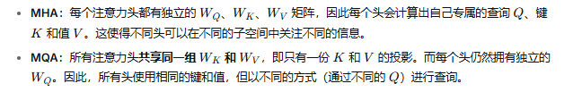
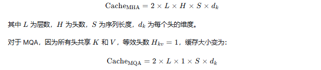
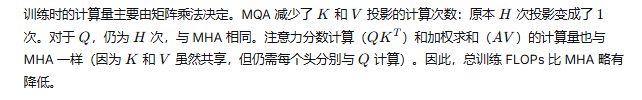
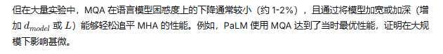
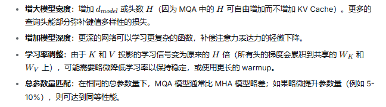
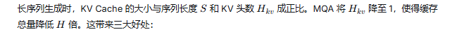
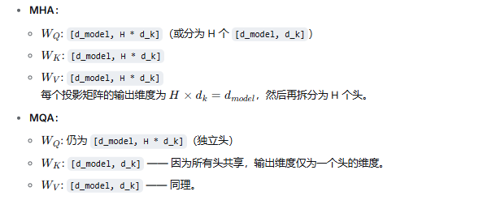
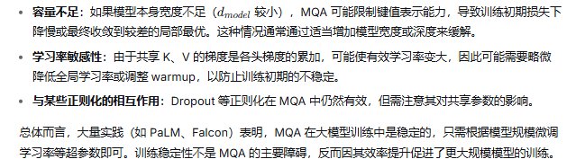

# 19.大模型（LLMs）多查询注意力（MQA）

#### 多查询注意力 (MQA) 与标准多头注意力 (MHA) 的核心区别是什么？

多查询注意力（Multi-Query Attention, MQA）与标准多头注意力（Multi-Head Attention, MHA）的核心区别在于 K（键）和 V（值）的投影方式：

- **MHA**：每个注意力头都有独立的 $W_Q$、$W_K$、$W_V$ 矩阵，因此每个头会计算出自己专属的查询 $Q$、键 $K$ 和值 $V$。这使得不同头可以在不同的子空间中关注不同的信息。
- **MQA**：所有注意力头共享同一组 $W_K$ 和 $W_V$，即只有一份 $K$ 和 $V$ 的投影。而每个头仍然拥有独立的 $W_Q$。因此，所有头使用相同的键和值，但以不同的方式（通过不同的 $Q$）进行查询。

{.ocr-src}

这一改变极大地减少了自回归解码时键和值缓存（KV Cache）的大小，因为无论有多少个头，每层都只需缓存一份 K 和 $V$。

---

#### MQA 如何减少推理时的 KV Cache 大小？请计算缩减比例。

在自回归生成中，为避免每步重复计算历史 token 的 $K$ 和 $V$，需要将这些向量缓存起来。对于标准 MHA，KV Cache 的总大小（元素个数）为：

$$
\mathrm{Cache}_{\mathrm{MHA}} = 2 \times L \times H \times S \times d_k
$$

其中 $L$ 为层数，$H$ 为头数，$S$ 为序列长度，$d_k$ 为每个头的维度。

对于 MQA，因为所有头共享 $K$ 和 $V$，等效头数 $H_{kv} = 1$，缓存大小变为：

$$
\mathrm{Cache}_{\mathrm{MQA}} = 2 \times L \times 1 \times S \times d_k
$$

{.ocr-src}

缩减比例：MQA 的 KV Cache 是 MHA 的 1/$H$。例如，若 $H$=8，则缓存大小减少为原来的 1/8。这带来了显存和内存带宽的巨幅节省，对于长序列或大批量推理至关重要。

---

#### 画出 MQA 的注意力计算图，展示 Q、K、V 的关系。

计算流程（文字描述）：

```plain text
输入 X  (shape: [seq_len, d_model])
    |
    |--- 投影 Q (h 组): Q_i = X W_{Q,i} ,  i = 1..h   (各头独立)
    |--- 投影 K (共享):  K = X W_K                     (所有头共享)
    |--- 投影 V (共享):  V = X W_V                     (所有头共享)
    
对于每个头 i:
    scores_i = Q_i K^T / sqrt(d_k)
    attn_i = softmax(scores_i)
    head_i = attn_i V

拼接所有 head_i (或求和，但通常是拼接后再经输出投影)
    MultiHead_output = Concat(head_1, ..., head_h) W_O
```

与 MHA 不同的是，`K` 和 `V` 只计算一次，每个头都使用相同的 `K` 和 `V`，仅 `Q` 不同。这相当于每个头用不同的视角去“查阅”同一份资料。

---

#### MQA 在训练时是否会增加计算量？为什么？

不会增加计算量，反而略有减少。

训练时的计算量主要由矩阵乘法决定。MQA 减少了 $K$ 和 $V$ 投影的计算次数：原本 $H$ 次投影变成了 1 次。对于 $Q$，仍为 $H$ 次，与 MHA 相同。注意力分数计算（$QK^T$）和加权求和（$AV$）的计算量也与 MHA 一样（因为 $K$ 和 $V$ 虽然共享，但仍需每个头分别与 $Q$ 计算）。因此，总训练 FLOPs 比 MHA 略有降低。

{.ocr-src}

此外，由于 $K$ 和 $V$ 投影参数量减少，训练时的显存占用也会稍降。所以 MQA 在训练效率上也是有优势的，并非以增加训练成本为代价换取推理效率。

---

#### MQA 对模型质量有负面影响吗？哪些任务上可能更明显？

有轻微的负面影响，但通常可通过适当增加模型规模来弥补。

所有头共享 K 和 $V$ 意味着注意力机制失去了部分多样性：不同头无法通过不同的 $K$ 和 V 投影去捕获不同子空间的特征，只能依靠不同的 $Q$ 去解读相同的键值信息。这在需要非常丰富的多头交互的任务中可能略有损失，例如：

- 细粒度的上下文理解（如代词消解、多跳推理）

- 需要多种注意力模式的复杂生成

但在大量实验中，MQA 在语言模型困惑度上的下降通常较小（约 1-2%），且通过将模型加宽或加深（增加 $d_{model}$ 或 $L$）能够轻松追平 MHA 的性能。例如，PaLM 使用 MQA 达到了当时最优性能，证明在大规模下影响甚微。

{.ocr-src}

---

#### 为什么 GPT-3 没有使用 MQA，而后来的 PaLM 等模型使用了？

时间和研究进展不同。GPT-3 发布时（2020 年），MQA 的概念刚刚提出（2019 年），尚未被广泛验证和大规模采用。当时模型优化的重点还在扩展参数和训练数据上，推理时 KV Cache 的瓶颈尚未成为最突出的问题（GPT-3 最大序列长度仅为 2048）。而到了 PaLM（2022 年），随着模型规模达到 540B，长序列生成和推理效率变得极为关键，MQA 已在小规模实验中被证明能够大幅压缩缓存且性能损失可控，因此被 PaLM 等新一代大模型采用，以实现高效的超长文本处理和部署。

---

#### MQA 是否要求所有的头共享同一组 K 和 V？可以部分共享吗？

严格 MQA 是所有头共享同一组 K 和 V。部分共享则是 GQA（分组查询注意力）。

GQA 是 MHA 和 MQA 的折中方案：将头分为 $g$ 组，组内共享 K 和 $V$，不同组之间独立。当 $g$=$H$ 时为 MHA，当 $g$=1 时为 MQA。GQA 既能显著减少 KV Cache（减少为原来的 $g$/$H$），又能保留多头在键值表示上的部分多样性，性能损失比 MQA 更小，已成为现代 LLM（如 LLaMA-2 70B、Mixtral）的主流选择。

---

#### 如果使用 MQA，如何调整训练超参数来保持性能？

通常可采用以下调整：

- **增大模型宽度**：增加 $d_{model}$ 或头数 $H$（因为 MQA 中的 $H$ 可自由增加而不增加 KV Cache）。更多的查询头能部分弥补键值多样性的损失。
- **增加模型深度**：更深的网络可以学习更复杂的函数，补偿注意力表达力的轻微下降。
- **学习率调整**：由于 $K$ 和 $V$ 投影的学习信号变为原来的 $H$ 倍（所有头的梯度会累积到共享的 $W_K$ 和 $W_V$ 上），可能需要略微降低学习率以保持稳定，或使用更长的 warmup。
- **总参数量匹配**：在相同的总参数量下，MQA 模型通常比 MHA 模型略差；如果略微提升参数量（例如 5-10%），则可达到同等性能。

{.ocr-src}

实践中，PaLM 等模型直接使用 MQA 且未大幅调整超参数，仍取得了优异效果，说明 MQA 的质量损失在可接受范围内。

---

#### 解释 MQA 为什么有助于长序列生成。

长序列生成时，KV Cache 的大小与序列长度 $S$ 和 KV 头数 $H_{kv}$ 成正比。MQA 将 $H_{kv}$ 降至 1，使得缓存总量降低 $H$ 倍。这带来三大好处：

{.ocr-src}

- 显存占用大幅降低：允许在相同硬件上生成更长的序列，或处理更大的批处理，显著提升吞吐量。

- 内存带宽压力减小：每次解码步骤需要从显存读取整个 KV Cache，更小的缓存意味着更低的带宽需求，直接提升推理速度（尤其受限于带宽的场景）。

- 可扩展至超长上下文：例如，若 H=8，MQA 的缓存需求仅为 MHA 的 1/8，使模型可以轻松处理数万甚至数十万 token 的上下文，而不会 OOM。

因此，MQA 是实现长文本对话、文档级生成等应用的关键技术之一。

---

#### MQA 是否适合用于 Encoder-Decoder 模型？

非常适合，尤其是在解码器的交叉注意力中。

- 解码器自注意力：与 Decoder-Only 模型相同，MQA 可以显著减少自回归生成时的自注意力 KV Cache。

- 交叉注意力：编码器输出的 $K$ 和 V 是所有解码器头共用的。若使用 MQA，编码器只需产生一份 $K$ 和 $V$ 表征，无需为每个头生成独立的键值。这不仅节省了编码器的计算，也让解码器在束搜索（beam search）或并行生成多个候选序列时，不需要为每个头复制编码器缓存，极大节省显存和通信开销。

- 编码器自注意力：可以使用 MQA 也可以不用。由于编码器通常一次性处理输入，且序列长度可能很长，使用 MQA 可以降低编码器内部的缓存需求，但对整体效率影响不如解码器明显。

因此，MQA 在机器翻译、文本摘要等 Encoder-Decoder 任务中具有明显优势，能够支持更长的输入和输出序列。

---

#### 在推理时，MQA 的 KV Cache 内存布局是怎样的？

MQA 的 KV Cache 内存布局与 MHA 有显著不同，核心在于所有注意力头共享一份 K 和 V 缓存，这使得缓存的总元素数量大幅减少。具体来说：

- 形状：对于一层 Transformer，MQA 的 K 缓存形状为 `[batch_size, seq_len, d_k]`（或 `[seq_len, batch_size, d_k]` 取决于实现），V 缓存形状相同。与之对比，MHA 的 K 缓存为 `[batch_size, seq_len, H, d_k]` 或 `[batch_size, H, seq_len, d_k]`。

- 内存分配：因为 K 和 V 在每个 token 生成时只需存储一份，而非 H 份，因此 KV Cache 占用的总显存大幅缩小。在物理存储上，K 和 V 通常是连续的张量，按 token 顺序存放。随着序列长度增加，新的 K、V 向量被追加到缓存末尾，类似于标准 MHA，但维度更小。

- 访问模式：在解码步骤中，每个注意力头都会去读取这同一份 K 和 V。所有头的 Q 各自独立，但共享相同的 K、V 张量。这意味着内存带宽需求骤降：原本需要为每个头读取不同的 K、V，现在只需读取一次，然后广播给所有头。这种复用极大减少了对高带宽内存（HBM）的读取压力。

- 多头如何复用：在计算时，Q 的形状通常是 `[batch_size, H, 1, d_k]`，而 K 缓存为 `[batch_size, 1, seq_len, d_k]`（通过 unsqueeze 添加头维度），利用广播机制实现所有头与同一 K 进行点积。这种布局在 GPU 上高效，且无需复制 K 和 V。

因此，MQA 的 KV Cache 内存布局以单头维度存储，所有头共享，在推理时显著节省显存和带宽。

---

#### 你能用代码实现一个简单的 MQA 吗？

以下是用 PyTorch 实现的一个简化版 MQA 模块，展示了多查询注意力的核心计算。

```plain text
import torch
import torch.nn as nn
import math

class MultiQueryAttention(nn.Module):
    def __init__(self, d_model, num_heads, dropout=0.0):
        super().__init__()
        assert d_model % num_heads == 0
        self.d_model = d_model
        self.num_heads = num_heads
        self.d_k = d_model // num_heads

        # Q投影：每个头独立，输出维度 d_model
        self.W_Q = nn.Linear(d_model, d_model, bias=False)
        # K、V投影：所有头共享，输出维度 d_k（而非 d_model）
        self.W_K = nn.Linear(d_model, self.d_k, bias=False)
        self.W_V = nn.Linear(d_model, self.d_k, bias=False)
        # 输出投影
        self.W_O = nn.Linear(d_model, d_model, bias=False)
        self.dropout = nn.Dropout(dropout)

    def forward(self, x, mask=None):
        batch_size, seq_len, _ = x.shape

        # 1. 线性投影
        Q = self.W_Q(x).view(batch_size, seq_len, self.num_heads, self.d_k)
        Q = Q.permute(0, 2, 1, 3)  # (B, H, L, d_k)
        K = self.W_K(x)  # (B, L, d_k) -> 所有头共享
        V = self.W_V(x)  # (B, L, d_k)

        # 扩展 K, V 的头维度，以便与 Q 进行广播计算
        K = K.unsqueeze(1)  # (B, 1, L, d_k)
        V = V.unsqueeze(1)  # (B, 1, L, d_k)

        # 2. 计算注意力分数
        scores = torch.matmul(Q, K.transpose(-2, -1)) / math.sqrt(self.d_k)
        if mask is not None:
            scores = scores.masked_fill(mask == 0, float('-inf'))
        attn_weights = torch.softmax(scores, dim=-1)
        attn_weights = self.dropout(attn_weights)

        # 3. 加权求和
        output = torch.matmul(attn_weights, V)  # (B, H, L, d_k)
        output = output.permute(0, 2, 1, 3).contiguous().view(batch_size, seq_len, -1)
        return self.W_O(output)
```

关键点：`W_K` 和 `W_V` 的输出维度为 `d_k`（而非 `d_model`），只产生一份 K 和 V，然后通过广播被所有头共享。这模拟了 MQA 的行为。

---

#### 对比 MQA 和 GQA，哪种方案更平衡？依据是什么？

GQA（分组查询注意力）比 MQA 更平衡，它在模型质量和推理效率之间提供了更精细的调节旋钮。

- MQA：所有头共享 K 和 V，极致压缩 KV Cache（减少为 1/H），但完全损失了多头键值的多样性，在某些任务上性能下降相对明显（尽管可通过增大模型弥补）。

- GQA：将 H 个头分成 G 组，组内共享 K、V。当 G = H 时等同于 MHA，当 G = 1 时等同于 MQA。通常选取适中的 G（如 2, 4, 8），可将缓存压缩至原来的 G/H，同时保留部分多头键值表达能力。实验表明，即使 G 较小（如 H/8），性能损失也非常小，甚至可忽略，但缓存压缩率仍非常可观。

平衡的依据：

- 性能-效率曲线：大量实验（如 LLaMA-2、Mixtral）显示，GQA 在大部分基准上可以接近 MHA 的性能，同时推理速度大幅提升。MQA 虽然更快，但性能差距在同等模型大小时更显著；要追平 MHA，MQA 通常需要额外增加模型容量。

- 硬件友好性：GQA 的缓存大小和内存带宽需求与 MQA 在同一量级（如 G=4 vs H=32，缓存减少 8 倍，而 MQA 减少 32 倍）。当缓存压缩比达到一定程度后，内存带宽不再是主要瓶颈，进一步压缩的边际收益降低，此时保留少量多头多样性更明智。

- 实际部署选择：LLaMA-2 70B 采用 G=8, H=64（减少 8 倍），Mixtral 8x7B 同样使用 GQA。MQA 则被 PaLM、Falcon 等模型采用，但部分后续模型也转向了 GQA。这种趋势表明，工业界倾向于 GQA 在效率和性能间的更优帕累托前沿。

因此，GQA 以稍多的缓存换取明显更好的模型质量，是当前更平衡的方案。

---

#### 使用 MQA 的模型，其注意力模式是否仍然具有多样性？

是的，注意力模式仍然具有多样性，但多样性来源从“键值投影多样性”转变为“查询投影多样性”。

- Q 的多样性：每个头仍然有自己独立的 Q 投影，因此各个头可以学习关注输入的不同方面。例如，一个头可能更关注局部语法，另一个关注远距离指代，这些差异通过 Q 的不同参数实现。只要 Q 不同，即使面对相同的 K 和 V，每个头计算出的注意力权重分布也会不同，从而形成多样化的注意力模式。

- 实验观察：对 MQA 模型的注意力权重可视化发现，不同头的注意力模式确实存在明显分化，并未坍塌为一种模式。例如，在 PaLM 的分析中，MQA 的注意力头仍然展现出丰富的局部、全局和特定句法模式。

- 多样性程度：相比 MHA，MQA 的注意力多样性可能略低，因为 K 和 V 的投影无法对信息进行特定于头的筛选。这可能导致某些需要多种键值视角的精细任务（如多义词消歧）性能轻微下降。但这种损失通常可通过增加头数或模型深度来弥补，因为更多的 Q 头可以部分补偿键值多样性的不足。

所以，MQA 的注意力仍然是多样化的，只是多样性由 Q 的差异驱动，而非 K、V 的差异。

---

#### MQA 是否可以与 RoPE 结合使用？

完全可以，且两者结合是常见的强大组合。

RoPE 通过在 Q 和 K 向量上施加旋转来注入位置信息。在 MQA 中，RoPE 的应用方式如下：

- 对每个头的 Q 分别应用 RoPE（因为 Q 是头特定的）。

- 对共享的 K 应用一次 RoPE，然后所有头使用这个旋转后的 K。

由于 RoPE 只依赖相对位置，并且旋转变换是线性的，它与 MQA 的共享 K 完全兼容。在实现中，只需在计算注意力前，对 K 张量（形状 `[batch, 1, seq, d_k]`）和每个头的 Q 张量（形状 `[batch, H, seq, d_k]`）分别施加旋转。RoPE 的运算量很小，不会影响 MQA 的效率优势。

事实上，许多使用 MQA 的模型（如 PaLM）和 GQA 的模型（如 LLaMA-2、Mixtral）都同时使用了 RoPE，证明两者的结合能同时提供位置感知和高效推理。

---

#### 在 MQA 中，K 和 V 的投影矩阵形状有什么变化？

与标准 MHA 相比，MQA 中 K 和 V 的投影矩阵形状发生了显著改变：

- **MHA**：
  - $W_Q$：`[d_model, H * d_k]`（或分为 H 个 `[d_model, d_k]`）
  - $W_K$：`[d_model, H * d_k]`
  - $W_V$：`[d_model, H * d_k]`

  每个投影矩阵的输出维度为 $H \times d_k = d_{model}$，然后再拆分为 H 个头。
- **MQA**：
  - $W_Q$：仍为 `[d_model, H * d_k]`（独立头）
  - $W_K$：`[d_model, d_k]` —— 因为所有头共享，输出维度仅为一个头的维度。
  - $W_V$：同理。

{.ocr-src}

因此，`W_K` 和 `W_V` 的列数从 `H * d_k` 缩小为 `d_k`，参数数量减少为原来的 1/H1/$H$。例如，若 H=8, d_model=512, d_k=64，则 MHA 的 K 投影矩阵大小为 512×512，MQA 为 512×64，参数量减少 87.5%。这是 MQA 能降低训练和推理内存的另一个来源。

---

#### 为什么 MQA 能缓解内存带宽瓶颈？

在自回归生成中，每次解码步骤的主要计算是注意力操作，但内存带宽常常成为瓶颈。MQA 通过以下方式缓解：

- 大幅减少 KV Cache 的读取量：每次计算注意力，需要从显存读取整个 K 和 V 缓存。MQA 的缓存大小仅为 MHA 的 1/H，因此读取的数据量锐减。例如，H=32 时，MQA 的缓存读取量减少 32 倍。这使得模型可以更充分地利用计算单元，避免因等待数据而空闲（内存带宽 bound 转为计算 bound）。

- 更高的计算强度：计算强度定义为 FLOPs / byte。MQA 在注意力计算上的 FLOPs 与 MHA 相当（因为 QK 点积等仍需每个头独立进行），但需要读取的 K、V 字节数减少了 H 倍，因此计算强度提高了约 H 倍。这能更好地发挥 GPU 的计算能力。

- 更适合批处理：在批处理或长序列情况下，KV Cache 的带宽需求通常是主要瓶颈。MQA 使得相同的带宽可以支持更大的 batch 或更长的序列，提升吞吐量。

因此，MQA 是从内存带宽角度对 Transformer 推理的重要优化，尤其适合大模型和长上下文场景。

---

#### 如果将 MQA 扩展到多模态模型，会面临哪些挑战？

将 MQA 应用于多模态大模型（如视觉-语言模型）时，除了纯文本场景的考虑外，还会面临以下挑战：

- 不同模态的键值差异：多模态模型通常同时处理文本和图像 token。图像 token 数量庞大，且其信息密度和模式与文本 token 不同。共享 K、V 投影可能导致模型无法为不同模态提取适配的键值表示，从而影响跨模态理解和对齐。可能需要为不同模态设计独立的 K、V 投影，或者采用 GQA 以保留更多多样性。

- 长序列压力：多模态输入通常使序列长度急剧增加（例如高分辨率图像产生上千个 token）。尽管 MQA 的缓存压缩对此有利，但图像 token 的局部性可能与文本不同，固定的窗口注意力或全局注意力机制需要重新设计，以保持效率同时不丢失关键视觉细节。

- 训练时的梯度冲突：文本和图像 token 共享 K、V 投影，可能导致梯度信号相互冲突（因为两个模态对键值的最优表示可能不同），使训练更难收敛或降低性能。可能需要模态特定的层归一化或额外的适配模块。

- 位置编码整合：多模态模型常使用不同的位置编码策略（如二维空间位置编码用于图像，一维 RoPE 用于文本）。共享 K 时，如何在施加位置编码后保持兼容性需要仔细设计。

总的来说，MQA 在多模态中的直接应用可能受限，改进方案如为不同模态使用不同的 K、V 头（类似 GQA 的分组思想）或引入模态感知的键值适配器，可能更有效。

---

#### 有没有可能在推理时动态地在 MHA 和 MQA 之间切换？

可能性存在，但实际实现复杂且收益有限。 动态切换指在推理过程中根据序列长度或资源情况，改变模型使用 MHA 或 MQA 模式。因为 MHA 和 MQA 的核心区别在于 K、V 投影矩阵的形状和数量，切换本质上需要改变权重矩阵。

- 方案一：训练时同时支持两种模式。可以在训练期间，随机决定某些层或某些步使用 MHA 或 MQA，让模型学习适应。推理时则可配置。但这会大幅增加训练复杂性和不稳定性，且需要维护两套权重或动态重组权重。

- 方案二：后期转换。已经训练好的 MHA 模型无法直接变为 MQA，除非通过知识蒸馏或权重合并（如将多个头的 K、V 投影取平均或学习一个映射），但这会严重损失性能，通常不可行。

- 更实际的动态策略：不是切换 MHA/MQA，而是使用 GQA 并动态调整分组数 G。但这仍需要训练时支持变组数或推理时对权重进行插值，同样极具挑战。

由于 MQA 主要是为了推理效率，而训练时已固定架构，通常的做法是直接选择 GQA 在训练中设定好，而不进行动态切换。未来若出现高度模块化的模型设计，或许可以实现这种灵活性，但目前并非主流。

---

#### 分析 MQA 对模型训练稳定性的影响。

MQA 通常不会对训练稳定性产生明显负面影响，反而在某些方面可能略有改善，但也有一些潜在问题。

积极影响：

- 减少参数冗余：由于去除了多个 K、V 投影矩阵，参数总量下降，优化的参数空间更紧凑，可能使梯度协方差矩阵更良性，训练更平稳。

- 梯度聚合：所有头共享 K、V，反向传播时，损失对 K、V 的梯度是各头梯度之和。这可以视为一种隐式的梯度平均，有助于稳定更新方向，减少各头独立更新导致的震荡。

潜在问题：

- **容量不足**：如果模型本身宽度不足（$d_{model}$ 较小），MQA 可能限制键值表示能力，导致训练初期损失下降缓慢或最终收敛到较差的局部最优。这种情况通常可通过适当增加模型宽度或深度来缓解。
- **学习率敏感：** 由于共享 K、V 的梯度是各头梯度的累加，可能使有效学习率变大，因此可能需要略微降低全局学习率或调整 warmup，以防止训练初期的不稳定。
- **与某些正则化的相互作用**：Dropout 等正则化在 MQA 中仍然有效，但需注意其对共享参数的影响。

总体而言，大量实践（如 PaLM、Falcon）表明，MQA 在大模型训练中是稳定的，只需根据模型规模调整学习率等超参数即可。训练稳定性不是 MQA 的主要障碍，反而因其效率提升促进了更大规模模型的训练。

{.ocr-src}

