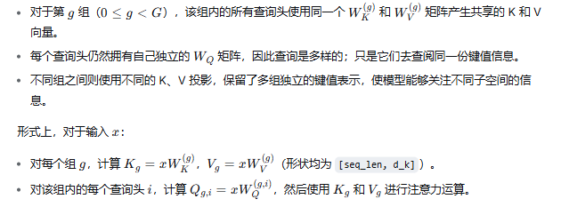
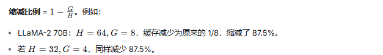
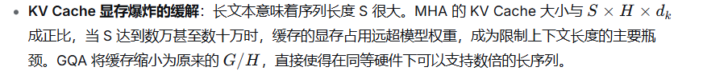
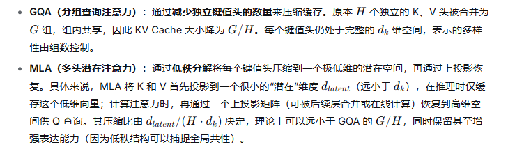
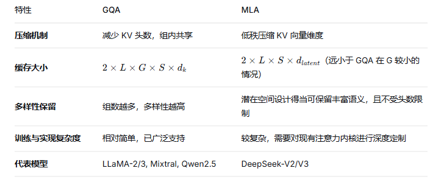
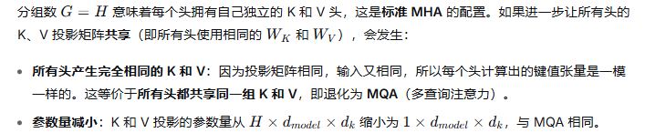
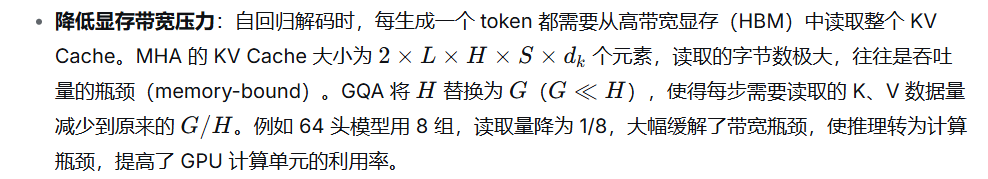

# 20.大模型（LLMs）分组查询注意力（GQA）

#### GQA 是如何在 MHA 和 MQA 之间进行折中的？

分组查询注意力（Grouped-Query Attention, GQA）在多头注意力（MHA） 和多查询注意力（MQA） 之间引入了一个灵活的中间地带。其折中思路是：

- MHA：每个查询头（共 $H$ 个）都拥有自己专属的键头（K head）和值头（V head），因此键值表示的多样性最丰富，但推理时的键值缓存（KV Cache）最大（与 $H$ 成正比）。

- MQA：所有 H 个查询头共享唯一的 K 头和 V 头，KV Cache 最小（压缩为 MHA 的 1/$H$），但键值表示的多样性完全丧失，模型质量可能轻微下降。

- GQA：将 $H$ 个查询头划分为 $G$ 个组（1≤$G$≤$H$）。同一组内的所有查询头共享同一个 K 头和 V 头，不同组之间则拥有独立的 K、V 头。这样，KV 头的总数从 $H$（MHA）降为 $G$（GQA），KV Cache 大小随之降为原来的 $G$/$H$。通过选择 $G$ 的值，可以在 MHA（$G$=$H$） 和 MQA（$G$=1） 之间平滑地权衡键值表示多样性和推理效率。

因此，GQA 既不牺牲过多的模型表达力，又大幅降低了推理时的内存和带宽需求，是目前最广泛采用的平衡方案。

---

#### 描述 GQA 中“组”的定义，以及 K、V 头的分配方式。

在 GQA 中，组（group） 指的是共享同一对 K 和 V 投影矩阵的查询头的集合。

具体分配方式如下：

- 设总查询头数为 $H$，组数为 $G$（需满足 $H$ 能被 $G$ 整除）。

- 将查询头按顺序分为 $G$ 组，每组包含 $H$/$G$ 个连续的查询头。

- 对于第 $g$ 组（$0 \le g < G$），该组内的所有查询头使用同一个 $W_K^{(g)}$ 和 $W_V^{(g)}$ 矩阵产生共享的 K 和 V 向量。
- 每个查询头仍然拥有自己独立的 $W_Q$ 矩阵，因此查询是多样的；只是它们去查阅同一份键值信息。
- 不同组之间则使用不同的 K、V 投影，保留了多组独立的键值表示，使模型能够关注不同子空间的信息。

形式上，对于输入 $x$：

- 对每个组 $g$，计算 $K_g = xW_K^{(g)}$，$V_g = xW_V^{(g)}$（形状均为 `[seq_len, d_k]`）。
- 对该组内的每个查询头 $i$，计算 $Q_{g,i} = xW_Q^{(g,i)}$，然后使用 $K_g$ 和 $V_g$ 进行注意力运算。

{.ocr-src}

因此，GQA 通过组内共享、组间独立的策略，实现了参数和缓存的压缩。

---

#### LLaMA-2 中使用了多少个键值头？分组数是多少？

LLaMA-2 在不同规模的模型中采用了不同的注意力机制：

- LLaMA-2 7B 和 13B：使用标准多头注意力（MHA），即 $G$=$H$，没有共享 K、V 头。

- LLaMA-2 70B：采用分组查询注意力（GQA），具体配置为：
  - 总查询头数 $H$=64
  - 键值头数（即组数）G=8
  - 因此，每 64/8=8 个查询头共享一对 K、V 头。

70B 模型使用 GQA 的主要目的是在保持模型质量的同时，大幅降低长序列推理时的 KV Cache 显存占用和内存带宽需求，使 70B 大模型在现实部署中更加可行。

---

#### GQA 相比 MHA 能减少多少 KV Cache 内存？

KV Cache 需要存储每一层的 K 和 V 张量。在相同序列长度、精度和层数下，缓存大小与键值头数（即 GQA 中的组数 $G$）成正比。

- MHA 的 KV 头数 = $H$

- GQA 的 KV 头数 = $G$

- 因此，GQA 的 KV Cache 大小是 MHA 的 $G$/$H$。

**缩减比例** $= 1 - \frac{G}{H}$。例如：

- LLaMA-2 70B：$H = 64, G = 8$，缓存减少为原来的 1/8，缩减了 87.5%。
- 若 $H = 32, G = 4$，同样减少 87.5%。

{.ocr-src}

以实际数字为例，假设模型有 80 层，序列长度为 4096，头维度 128，FP16 精度。MHA 的 KV Cache 约为 `2 × 80 × 64 × 4096 × 128 × 2 字节 ≈ 8 GB`。使用 GQA（8 组）后，仅约 `8 GB / 8 = 1 GB`，节省了约 7 GB 显存。对于长序列（如 32K），节省量更为巨大。

---

#### 如果分组数 G=1，GQA 退化成什么？如果 G=h 呢？

- G = 1：所有查询头属于同一组，全部共享唯一的 K、V 头。这正是多查询注意力（MQA） 的定义。此时键值多样性降至最低，KV Cache 最小。

- G = H：每个查询头自己是一组，即每组只有 1 个头，每个头拥有独立的 K、V 头。这退化为标准多头注意力（MHA）。此时没有共享，键值多样性最丰富，但缓存最大。

因此，GQA 通过调节 $G$ 从 1 到 H，实现了从 MQA 到 MHA 的连续过渡，为在不同效率-性能需求下选择合适的配置提供了灵活度。

---

#### GQA 对推理速度和吞吐量的影响有哪些？

GQA 对推理效率的提升主要体现在内存带宽的释放和显存占用的降低。

- 减少 KV Cache 读取量：自回归解码的每一步都需要从显存中读取整个 KV Cache。GQA 使缓存大小成倍缩减，因此每步读取的数据量大幅下降（与 $G$/$H$ 成正比）。在长序列或大批量推理中，这能显著缓解内存带宽瓶颈，使计算单元利用率更高。

- 提升批处理能力：更小的 KV Cache 意味着在相同显存容量下可以容纳更大的 batch size 或更长的上下文，从而提高整体吞吐量（每秒处理的 token 数）。

- 降低延迟：虽然单步计算量几乎没有变化（注意力 FLOPs 不变），但数据加载更快，通常能带来端到端延迟的降低，特别是对于长序列。

- 支持更长的上下文：节省的显存可以直接用于扩展序列长度，使模型能够处理更长的输入，而不受限于 KV Cache 的爆炸。

定量来看，LLaMA-2 70B 在 8 路 GQA 下，相比 MHA 推理速度提升可达 30-50%（因序列长度和硬件而异），同时支持更大的并发用户数。

---

#### 训练 GQA 模型时，是将 MHA 模型转换而来，还是从零开始训练？

两种方式均可行，但主流做法是从零开始训练，或者基于 MHA 检查点进行继续训练（而非简单转换）。

- 从零开始训练：直接按照 GQA 架构初始化模型并从头预训练。这是最直接的方法，如 LLaMA-2 70B 即从头训练为 GQA。它能保证所有权重完全适配 GQA 结构。

- 从 MHA 转换：可以在已经训练好的 MHA 模型基础上，通过将多个 K、V 头的权重合并（例如平均池化或选择其中一个）来初始化 GQA 模型，然后进行少量继续训练以恢复性能。但这需要仔细的重参数化，且通常会有性能损失，尤其是当 MHA 各头 K、V 多样性较高时。因此，这种方法主要用于研究或资源受限的场景。

- 更常见的实践：在大规模训练中，团队通常会在预训练早期就确定注意力架构（MHA、GQA 或 MQA），并从头训练，以确保模型充分适应。对于像 LLaMA-2 70B 这样的新模型，GQA 是其原生设计。

总之，GQA 模型最好是从头预训练以完全发挥架构优势，除非有不得已的资源限制。

---

#### 如何选择合适的分组数？需要平衡哪些因素？

选择 $G$（或等效地，每个 KV 头对应的查询头数）需要在以下因素之间权衡：

- 模型质量/性能：$G$ 越大，键值表示越多样，模型在下游任务上的性能（如困惑度、生成质量）通常越好。实验表明，在相同总参数量下，$G$ 太小（如 1）可能导致轻微的质量下降。当 $G$ 增大到某个阈值后，收益递减。

- 推理效率：G 越小，KV Cache 越小，内存带宽节省越多，推理速度和吞吐提升越显著。因此，追求极致推理效率时应选择较小的 $G$。

- 硬件特性：推理硬件的显存带宽和容量是关键限制。如果模型部署在显存充足的 GPU 上，可以容忍较大的 $G$；若要在边缘设备或长上下文场景下运行，则需较小的 $G$。

- 模型规模：对于大模型，因参数量巨大，推理成本高昂，往往倾向于较小的 $G$ 以换取更经济的部署（如 70B 模型使用 G=8）。小模型则可使用较大的 $G$ 或直接 MHA。

- 训练数据和任务：需要多样键值交互的复杂任务（如多语言、多模态）可能更受益于较大的 $G$。

实践中的选择：LLaMA-2 70B 使用 G=8,H=64（每个 KV 头覆盖 8 个查询头）。这被证明在各类基准上性能与 MHA 几乎持平，同时获得极大的推理收益。一个典型的经验法则是：对于大模型，从 G=H/8 或 H/4 开始探索，通过小规模消融实验确定最佳点。

---

#### 在 GQA 中，是否所有层使用相同的分组配置？

通常情况下，所有层使用相同的分组配置，以简化架构和实现。但并非强制，可以设计混合配置。

- 统一配置：LLaMA-2、Mixtral 等主流 GQA 模型在所有 Transformer 层都采用相同的分组数（例如所有层都是 8 组）。这保持了代码和并行策略的简单性，也使得 KV Cache 大小可预测。

- 混合配置的可能性：某些研究探索了在不同层使用不同的注意力模式。例如，在底层使用较小的 $G$（更高效的窗口或 MQA），在高层使用较大的 $G$ 或 MHA（以捕捉全局复杂依赖）；或者仅仅在解码器交叉注意力中使用 MQA，而自注意力保持 MHA。不过，这会增加实现的复杂性，并且需要更精细的超参数搜索。

- 为什么统一是主流？ 统一配置在训练期间便于负载均衡（尤其在 MoE 中），在推理时便于优化（如内存分配、内核融合）。目前没有强有力的证据表明混合配置能带来一致的显著提升，因此出于工程考虑，绝大多数 GQA 模型采用全层一致的 $G$。

---

#### GQA 是否影响模型的生成质量？与 MHA 对比实验表明什么？

GQA 在设计上可能轻微影响模型的表达能力，但大量实验表明，在合理选择分组数的情况下，GQA 的生成质量几乎与 MHA 持平，甚至在某些任务上无明显差异。

- LLaMA-2 论文的实验：Meta 在训练 LLaMA-2 70B 时，对比了 MHA（64 头）和 GQA（64 查询头，8 个键值头）的性能。在 150B token 的预训练后，两者在语言建模困惑度（PPL）上的差距小于 1%。在下游任务如 MMLU、HellaSwag、ARC 等基准上，GQA 模型的得分与 MHA 模型几乎相同。同时，GQA 的推理速度显著提升。

- 谷歌 PaLM 与 MQA：PaLM 使用极端的 MQA（即 G=1），其性能在 540B 规模下依然达到了当时最优，表明即使键值共享极大，通过增大模型容量也能够弥补潜在的多样性损失。GQA 作为中间方案，损失更小。

- 实验结论：当每组的查询头数（H/G）在 4 到 8 之间时，质量损失通常可以忽略。GQA 在保持生成多样性、事实准确性和上下文相关性方面表现稳健。即使对于需要细致理解的任务（如多跳推理、代码生成），GQA 的退化也微乎其微。

- 影响因素：分组数越小，潜在损失越大；模型越大，对键值多样性的敏感度越低。因此，GQA 已成为当前大模型在质量与效率之间最成功的平衡方案之一。

---

#### 解释 GQA 中 K 和 V 的“广播”机制。

在 GQA 中，K 和 V 的“广播”机制是指在计算注意力时，通过张量维度扩展，让多个查询头能够共享同一组 K 和 V。

具体过程：

1. 投影后的形状：
  - 查询 Q：经过 `W_Q` 投影后，形状为 `[batch_size, seq_len, H, d_k]`，然后 transpose 为 `[batch_size, H, seq_len, d_k]`。
  - 键 K：经过共享的 `W_K` 投影，形状为 `[batch_size, seq_len, d_k]`，每个组只有一份 K（即 KV 头总数 = G）。
  - 值 V：同理。

2. 为广播做准备：
  - 为了将 K 和 V 与 Q 对齐，需要将 K 和 V 的维度扩展，使得每个 KV 头能够被其对应的组内所有查询头使用。常见的做法是：
    - 将 K 视为 `[batch_size, G, seq_len, d_k]`（每个组一份），然后在组内复制 `H/G` 次，得到 `[batch_size, G, H/G, seq_len, d_k]`，再 reshape 为 `[batch_size, H, seq_len, d_k]`。但这会增加内存。
  - 更高效的方法是使用广播：不显式复制，而是利用 PyTorch 的广播语义。将 K 的维度设置为 `[batch_size, 1, seq_len, d_k]`（如果只有一组，即 MQA），或 `[batch_size, G, 1, seq_len, d_k]` 并在组内查询头维度上视为 1。这样，当 Q（形状 `[batch_size, H, seq_len, d_k]`）与 K 进行点积时，K 在头维度上自动广播，从而每个查询头与其所属组的 K 进行匹配。

3. 实际实现：
  - 在 PyTorch 中，可以先将 K 和 V 重组为 `[batch_size, G, seq_len, d_k]`，然后对 Q 也进行分组，例如 Q 的形状变为 `[batch_size, G, H_per_group, seq_len, d_k]`。那么直接对这两个张量在 `seq_len` 和 `d_k` 维度上进行矩阵乘法，K 和 V 在组内的头维度上会被自动广播（因为 K 没有那个维度，需要 unsqueeze）。通常做法是：
    - Q: `(B, H, L, d)` -> 分为 `(B, G, H/G, L, d)`
    - K: `(B, G, L, d)` -> `(B, G, 1, L, d)` （便于广播）
    - scores = `Q @ K.transpose(-2, -1)` 将自动广播。

广播避免了显式复制 K 和 V，节省了显存和计算开销，使得 GQA 能够高效实施。

---

#### 如何在 PyTorch 中高效实现 GQA 的注意力计算？

高效实现 GQA 的核心在于利用张量重塑和广播，避免在显存中复制 K 和 V。以下是一种典型的 PyTorch 实现思路：

```python
import torch
import torch.nn.functional as F
import math

def grouped_query_attention(Q, K, V, num_kv_heads, mask=None):
    """
    Q: [batch, seq_len, total_heads * d_k] 或经过投影
    我们假设输入已是投影后的形状。
    更常见的形式：直接传入已投影的 Q, K, V 张量。
    Q: [batch, seq_len, H, d_k]
    K: [batch, seq_len, G, d_k]
    V: [batch, seq_len, G, d_k]
    """
    batch, seq_len, H, d_k = Q.shape
    G = K.shape[2]  # num_kv_heads
    # 计算每个查询头对应的组索引
    heads_per_group = H // G

    # 重塑 Q: (batch, seq_len, G, heads_per_group, d_k) -> (batch, G, heads_per_group, seq_len, d_k)
    Q = Q.view(batch, seq_len, G, heads_per_group, d_k).permute(0, 2, 3, 1, 4)
    # K, V: (batch, seq_len, G, d_k) -> (batch, G, 1, seq_len, d_k)
    K = K.unsqueeze(2)  # 在头维度上增加一个大小为1的维度用于广播
    V = V.unsqueeze(2)

    # 注意力分数: (batch, G, heads_per_group, seq_len, seq_len)
    scale = d_k ** 0.5
    scores = torch.matmul(Q, K.transpose(-2, -1)) / scale
    if mask is not None:
        scores = scores.masked_fill(mask == 0, float('-inf'))
    attn = F.softmax(scores, dim=-1)

    # 输出: (batch, G, heads_per_group, seq_len, d_k)
    out = torch.matmul(attn, V)

    # 恢复形状: (batch, seq_len, H, d_k)
    out = out.permute(0, 3, 1, 2, 4).contiguous().view(batch, seq_len, H * d_k)
    return out
```

关键点：

- Q 被重塑并分组，使得其形状为 `(batch, G, heads_per_group, seq_len, d_k)`。

- K 和 V 在组维度后插入一个尺寸为 1 的维度，变为 `(batch, G, 1, seq_len, d_k)`，这样在 `matmul` 时会自动广播到每个查询头。

- 这样既实现了逻辑上的“每个组内头共享 K、V”，又避免了任何显式的复制。

在实际项目中，为了充分发挥硬件效率，通常会使用针对 GQA 优化的 CUDA 内核（如 FlashAttention 的 GQA 模式），但上述代码清晰地展示了 GQA 的原理。

---

#### GQA 能否与 FlashAttention 等加速库兼容？

完全兼容，且 FlashAttention 等库已原生支持 GQA。

- FlashAttention-2/3 支持：FlashAttention 内核在计算注意力时，可以接收不同头数的 Q 和 K、V。只需在调用时指定 `num_key_value_heads` 参数，内核内部会自动处理广播。例如，在 HuggingFace Transformers 中，当模型配置中设置 `num_key_value_heads` 小于 `num_attention_heads` 时，就会使用 FlashAttention 的 GQA 模式。

- 工作方式：FlashAttention 通过分块（tiling）计算注意力，在处理 GQA 时，会在每个块内将 Q 的多个头与同一组 K、V 进行计算。这避免了需要显式扩展 K、V 张量，从而节省了大量的高带宽内存（HBM）读写。其 IO 优化策略使得 GQA 的加速效果更加明显。

- 其他库：xFormers、vLLM、TensorRT-LLM 等推理加速库均提供了对 GQA 的优化支持。例如，vLLM 在管理 KV Cache 时，根据 GQA 配置分配更小的缓存，并结合 PagedAttention 实现高效推理。

- 训练时的兼容性：PyTorch 的 `scaled_dot_product_attention` 函数从 2.0 版本开始也支持 GQA，当传入的 K、V 的 batch 和头维度与 Q 不同时，会自动进行广播计算，并可选择使用 FlashAttention 内核。

因此，GQA 与现有加速生态无缝集成，是它被工业界迅速采纳的重要原因之一。

---

#### 分析 GQA 在减少内存碎片化方面的作用。

内存碎片化是指显存中存在大量难以利用的小空闲块，导致即使总空闲足够也无法分配连续大块显存。GQA 通过以下方式显著减少 KV Cache 带来的碎片化：

- 缓存块更小、更规整：MHA 的 KV Cache 每个 token 需要存储 `2 * H * d_k` 个元素，GQA 则只需 `2 * G * d_k`。当使用分页注意力（PagedAttention）时，每个缓存块的大小是固定的（例如 16 个 token 的 K、V）。GQA 使得每个块的总字节数成倍缩小，因此块的数量减少，内存分配与释放更简单，碎片化自然减轻。

- 减少内部碎片：如果缓存块大小固定，MHA 的每个块很大，即使只使用部分也可能占满一个块，造成内部碎片。GQA 减小了块大小，使得实际使用的内存与分配内存更接近，减少内部浪费。

- 更好的内存对齐：较小的缓存块更容易与 GPU 内存页和缓存行对齐，分配器可以更高效地管理，减少碎片。

- 长序列下的稳定性：长序列产生大量缓存块，碎片化问题更为突出。GQA 成倍降低了块数量，推迟了碎片化导致的 Out-of-Memory 风险，提高了推理系统的鲁棒性。

因此，GQA 不仅减少了 KV Cache 的总量，还通过降低内存管理的粒度，间接改善了内存碎片化，这对于长时间运行、多请求并发的生产环境至关重要。

---

#### 如果一个模型已经用 MHA 训练好，能否通过微调转为 GQA？

可以尝试，但有一定挑战，并非简单无损转换。 主要方法包括：

- 权重合并转换（无需微调）：将 MHA 中多个 K、V 头的权重矩阵进行平均（或选择其中一个），得到共享的 K、V 投影。这种方法不需要微调，但会立即造成性能下降，因为原本独立的键值投影被强制平均，破坏了各头的专长。通常需要后续微调来恢复。

- 微调恢复：将转换后的 GQA 模型在原始训练数据或下游任务数据上继续进行少量微调（例如数千步）。这能够让新的共享 K、V 投影重新学习适应，同时各查询头也会调整。实验表明，经过适当微调，可以恢复大部分性能，但可能与从头训练的 GQA 仍有微小差距。

- 知识蒸馏：使用原始 MHA 模型作为教师，GQA 版本作为学生，进行蒸馏训练。教师模型的输出作为软标签指导 GQA 模型，有助于更好地保留原始能力。这是更稳健但成本更高的方法。

- 挑战与注意事项：
  - 分组数 G 的选择：如果 G 太小，信息压缩过猛，微调恢复的难度增大。
  - 微调数据规模：需要足够的数据覆盖模型的广泛能力，否则容易遗忘通用知识。
  - 训练稳定性：共享的 K、V 梯度是各头梯度的累加，可能需要调整学习率。

虽然技术上可行，但大多数情况下，为了避免性能损失和复杂的转换流程，从头预训练 GQA 模型或使用官方发布的 GQA 变体是更常见的选择。只有在无法获取原始训练资源且已有高质量 MHA 模型时，转换并微调才是一种实用的折中方案。

---

#### GQA 对长文本推理的优势是什么？

GQA 对长文本推理的优势极为显著，主要体现在以下几个方面：

- **KV Cache 显存爆炸的缓解**：长文本意味着序列长度 S 很大。MHA 的 KV Cache 大小与 $S \times H \times d_k$ 成正比，当 S 达到数万甚至数十万时，缓存的显存占用远超模型权重，成为限制上下文长度的主要瓶颈。GQA 将缓存缩小为原来的 $G/H$，直接使得在同等硬件下可以支持数倍的长序列。

{.ocr-src}

- 内存带宽瓶颈的打破：自回归解码的每一步都需要读取整个 KV Cache。长序列下，读取量极大，使得推理变为内存带宽受限。GQA 减少了需要读取的数据量，将瓶颈从带宽转向计算，提高了硬件利用率，加快了每个 token 的生成速度。

- 更高的批处理效率：长文本推理时，单请求的 KV Cache 已经很大，导致并发处理多请求时显存更易耗尽。GQA 缩小了单请求缓存，允许更大的并发 batch，从而提升整体吞吐量。

- 支持流式与无限长对话：对于需要持续累积历史记录的对话应用，GQA 使得缓存增长放缓，系统可以保持更长时间的流畅对话而无需裁剪历史。

- 与长上下文扩展技术的协同：GQA 与 RoPE 扩展（如 YaRN、NTK）结合使用时，长序列的位置编码和缓存问题同时得到优化，使得模型可以经济高效地处理极长上下文（如 128K、1M token）。

因此，GQA 是实现 LLM 长文本能力的核心使能技术之一，没有它，大模型的长上下文应用将因显存和带宽限制而难以落地。

---

#### 在分布式推理中，GQA 如何帮助负载均衡？

在分布式推理（如多 GPU、多节点）中，GQA 通过减轻 KV Cache 的存储和通信压力，间接帮助负载均衡：

- 减少显存负载，允许更均匀的模型分布：在使用流水线并行或张量并行时，每张 GPU 需要存储其负责的层的 KV Cache。GQA 使得每张 GPU 的缓存需求成比例下降，减少了因缓存过大导致的单卡 OOM 风险，使负载能够更均匀地分配。例如，原本某些卡可能因为缓存太多而成为瓶颈，GQA 缓解了这一点。

- 降低 All-to-All 或广播通信量：在专家并行（MoE）或张量并行中，如果 K、V 需要在设备间通信，GQA 减少了通信量（因为 K、V 的维度变小）。虽然查询头 Q 仍需通信，但键值部分是共享的，整体通信包大小减小，有助于网络负载均衡。

- 提升请求调度灵活性：在集中式推理服务中（如 vLLM），调度器根据可用的 GPU 显存动态分配请求。GQA 的缓存占用小，使得调度器更容易找到可用空间，减少因显存碎片导致的资源闲置，使各 GPU 的负载更加均衡。

- 便于 KV Cache 的卸载与共享：如果使用 KV Cache 卸载到主机内存，GQA 减少了传输数据量，使得卸载和预取对带宽的冲击更小，系统可以更平稳地处理动态负载。

总体而言，GQA 虽不直接做负载均衡，但通过从根本上降低 KV Cache 的资源消耗，使得分布式推理系统更容易实现高效、均衡的资源利用，从而提升整体的服务质量和硬件利用率。

---

#### 是否可以将分组配置为可学习的，让模型自己决定头如何共享？

可以，但实现复杂且并非当前主流。 让模型自主学习分组配置属于动态结构搜索或软路由范畴，主要有以下路径：

- 软分组（Soft Grouping）：不强制头的硬性分组，而是为每个查询头学习一个对所有键值头的注意力权重，相当于让每个查询头可以自主地聚合来自不同键值头的信息。这可以通过一个轻量的路由网络实现，输出一组归一化的系数，对各键值头的输出进行加权混合。这种方法避免了离散分组的不可微问题，但引入了额外的计算和参数，且可能丧失GQA的缓存压缩优势（因为每个查询头仍可能需要访问多个键值头）。

- 可微分结构搜索：在训练时学习每个查询头与键值头之间的连接关系，例如使用Gumbel-Softmax或强化学习来决定分组。收敛后，可将软连接硬化为固定的分组。但搜索过程开销大，且最终性能提升往往有限。

- 基于相似性的分组合并：先训练一个MHA模型，然后分析各头的K、V投影矩阵或输出模式的相似性，将高度冗余的头合并，再用少量微调恢复性能。这是离线自动化分组，而非训练时学习。

- 挑战：学习分组本质上是一个离散组合优化问题，与连续梯度优化不易兼容。硬分组需要处理负载均衡、缓存分配等问题。目前主流仍是基于经验和消融实验手动选择分组数，因为它简单可靠且已足够好。

因此，虽然可学习分组在学术研究中有探索，但工业界更倾向于使用经过验证的固定GQA配置。

---

#### GQA 与滑动窗口注意力一起使用时，需要注意什么？

GQA 和滑动窗口注意力是两种正交的优化技术：GQA 压缩 KV Cache 的“宽度”（头数），滑动窗口限制注意力的“长度”（序列范围）。 两者结合能极大提升长序列推理效率，但需注意以下几点：

- 缓存管理要同时适配：滑动窗口注意力本身就要求只缓存最近的 $W$ 个 token 的 K、V。使用 GQA 后，每份缓存的尺寸进一步缩小。因此，推理框架的 KV Cache 实现需同时支持“固定窗口”和“分组”，例如采用 Rolling Buffer Cache 并按照分组维度分配。

- 窗口大小与分组数的交互：如果滑动窗口非常小（如 512），那么每个查询头可以关注的上下文范围已经很有限。此时键值头的多样性需求可能降低，GQA 的信息损失会更小，甚至可以更激进地使用更小的分组（乃至 MQA）。反之，大窗口（如 128K）更需要键值多样性，GQA 的分组数不宜过小。

- 预填充和分块计算：结合 FlashAttention 等加速库时，需要确保滑动窗口掩码和 GQA 的广播机制正确融合。这通常在现代推理引擎中已得到支持（例如 FlashAttention 的 `sliding_window` 和 `num_kv_heads` 参数可同时设置）。

- 训练时的长度配置：如果在滑动窗口注意力下训练，由于感受野受到限制，模型会更加依赖局部信息。GQA 的轻微多样性损失在此场景下几乎无影响，反而因效率提升允许训练更长的序列。

总之，两者结合能实现“短缓存、窄缓存”的极简 KV 存储，是当前长上下文 LLM 的高效配置。

---

#### 为什么很多新模型（如 Qwen2.5）都选择了 GQA？

以 Qwen2.5 为代表的新一代大模型普遍采用 GQA，原因在于它以极小的性能代价换取了巨大的推理效率提升，完美适配当前大模型部署的核心需求：

- 长上下文时代的迫切需求：现代 LLM 动辄支持 32K、128K 甚至百万 token 的上下文。标准 MHA 的 KV Cache 显存占用随序列长度线性爆炸，成为限制上下文长度和并发量的最大瓶颈。GQA 将缓存大小成倍压缩，使得长上下文推理变得经济可行。

- 已验证的帕累托最优性：自 LLaMA-2 70B 成功使用 GQA（8 组）并在各类基准上与 MHA 持平以来，工业界已形成共识：在模型规模达到数十亿参数时，GQA 是效率与质量的理想平衡点。后续 Mixtral、Falcon、Qwen 等纷纷跟进，形成了成熟的工程实践。

- 与 FlashAttention 等生态的无缝集成：GQA 的实现已被主流加速库原生支持，从训练到推理的流水线无需大量额外开发。这种生态就绪性极大降低了采用门槛。

- 灵活的扩展性：分组数 $G$ 可以根据模型规模和部署场景灵活调整，在更小模型上可保持 MHA，更大模型上逐渐降低 G，实现“一策多用”。

- 为 MoE 等稀疏模型铺路：在 MoE 模型中，显存压力同样巨大。GQA 能进一步压缩共享层的 KV Cache，使更多显存留给专家参数，提升总吞吐。

因此，GQA 不仅仅是一种注意力变体，更已成为当前大模型架构设计的标准组件之一。

---

#### 比较 GQA 和 MLA 在压缩 KV Cache 思路上的不同。

MLA（Multi-Head Latent Attention） 是 DeepSeek-V2 提出的一种新型注意力机制，其压缩 KV Cache 的思路与 GQA 截然不同：

- **GQA（分组查询注意力）**：通过**减少独立键值头的数量**来压缩缓存。原本 $H$ 个独立的 K、V 头被合并为 $G$ 组，组内共享，因此 KV Cache 大小降为 $G/H$。每个键值头仍处于完整的 $d_k$ 维空间，表示的多样性由组数控制。
- **MLA（多头潜在注意力）**：通过**低秩分解**将每个键值头压缩到一个极低维的潜在空间，再通过上投影恢复。具体来说，MLA 将 K 和 V 首先投影到一个很小的“潜在”维度 $d_{latent}$（远小于 $d_k$），在推理时仅缓存这个低维向量；计算注意力时，再通过一个上投影矩阵（可被后续层合并或在线计算）恢复到高维空间供 Q 查询。其压缩比由 $d_{latent}/(H \cdot d_k)$ 决定，理论上可以远小于 GQA 的 $G/H$，同时保留甚至增强表达能力（因为低秩结构可以捕捉全局共性）。

{.ocr-src}

对比：

| 特性 | GQA | MLA |
| --- | --- | --- |
| **压缩机制** | 减少 KV 头数，组内共享 | 低秩压缩 KV 向量维度 |
| **缓存大小** | $2 \times L \times G \times S \times d_k$ | $2 \times L \times S \times d_{latent}$（远小于 GQA 在 G 较小的情况） |
| **多样性保留** | 组数越多，多样性越高 | 潜在空间设计得当可保留丰富语义，且不受头数限制 |
| **训练与实现复杂度** | 相对简单，已广泛支持 | 较复杂，需要对现有注意力内核进行深度定制 |
| **代表模型** | LLaMA-2/3, Mixtral, Qwen2.5 | DeepSeek-V2/V3 |

{.ocr-src}

简言之，GQA 压缩的是 KV 的头数，MLA 压缩的是 KV 的维度。MLA 在极致压缩率上更有潜力，但工程实现更复杂；GQA 则以其简洁有效成为当前主流。

---

#### 对于不同的下游任务，GQA 的性能是否稳定？

是的，GQA 在广泛的下游任务上表现非常稳定，性能波动极小。

大量评估（如 LLaMA-2 论文及其后续研究）表明，在合理的分组数（如 8 组，64 查询头）下，GQA 模型在以下各类任务上的得分与同等规模的 MHA 模型几乎完全一致：

- 知识密集型任务（MMLU, TriviaQA）

- 常识推理（HellaSwag, ARC, PIQA）

- 阅读理解（SQuAD, RACE）

- 代码生成（HumanEval, MBPP）

- 多语言任务（FLORES, MGSM）

- 开放式对话生成（人类偏好评估）

即使是在需要精细多跳推理或长文本理解的任务中，GQA 也未表现出明显的脆弱性。这一稳定性源于：当前大模型通常具有足够大的总参数量，键值多样性的一小部分损失可以通过更大的网络容量补偿；同时，查询头的独立多样性依然强大，足以应对复杂的注意力模式。

因此，GQA 对下游任务是普适且鲁棒的，已完全具备替代 MHA 的资格。

---

#### 如果分组数等于头数，但让 K 和 V 共享参数，会有什么影响？

分组数 $G = H$ 意味着每个头拥有自己独立的 K 和 V 头，这是**标准 MHA** 的配置。如果进一步让所有头的 K、V 投影矩阵共享（即所有头使用相同的 $W_K$ 和 $W_V$），会发生：

- **所有头产生完全相同的 K 和 V**：因为投影矩阵相同，输入又相同，所以每个头计算出的键值张量是一模一样的。这等价于所有头都共享同一组 K 和 V，即退化为 **MQA（多查询注意力）**。
- **参数量减小**：K 和 V 投影的参数量从 $H \times d_{model} \times d_k$ 缩小为 $1 \times d_{model} \times d_k$，与 MQA 相同。

{.ocr-src}

- 表达力受损：虽然形式上每个头仍有自己的“K 头”和“V 头”，但它们都是同一个张量的副本，没有提供任何额外的多样性。模型的注意力多样性完全依赖于 Q 投影的差异。性能将与 MQA 相当，而显著低于 MHA。

- 冗余的结构：既然 K、V 完全相同，那么分头就失去了意义，反而在代码实现和并行计算上保留了不必要的复杂性。实际上，应该直接使用 MQA 的架构，去除冗余的 K、V 投影，更简洁高效。

因此，这种配置本质上就是 MQA，只不过是一种低效的实现方式。真正有效的折中方案是 GQA，即组数介于 1 和 H 之间，兼顾效率与多样性。

---

#### 从硬件效率角度，GQA 对计算和显存带宽的利用有何改善？

GQA 从以下关键方面显著改善了硬件效率：

- **降低显存带宽压力**：自回归解码时，每生成一个 token 都需要从高带宽显存（HBM）中读取整个 KV Cache。MHA 的 KV Cache 大小为 $2 \times L \times H \times S \times d_k$ 个元素，读取的字节数极大，往往是吞吐量的瓶颈（memory-bound）。GQA 将 $H$ 替换为 $G$（$G \ll H$），使得每步需要读取的 K、V 数据量减少到原来的 $G/H$。例如 64 头模型用 8 组，读取量降为 1/8，大幅缓解了带宽瓶颈，使推理转为计算瓶颈，提高了 GPU 计算单元的利用率。

{.ocr-src}

- 提高算术强度（Arithmetic Intensity）：算术强度 = FLOPs / 字节读取量。注意力计算的 FLOPs 主要来自 QK 点积和 AV 加权求和。GQA 下，FLOPs 几乎不变（因为每个查询头仍需与对应的 K、V 进行运算），但 K、V 的字节读取量剧降，算术强度提升了约 $H$/$G$ 倍。更高的算术强度意味着每次数据加载能做更多计算，更好发挥 GPU 的算力。

- 减少显存占用：KV Cache 变小，使得更多显存可用于增大 batch size 或支持更长的上下文，从而提升吞吐和并发能力。对于云推理服务，直接转化为成本降低。

- 缓存局部性改善：更小的缓存更容易驻留在 L2 或更近的存储层级，减少 HBM 的访问次数和延迟。

因此，GQA 从硬件层面非常精准地击中了 Transformer 推理的痛点，是软硬协同设计的典范。

---

#### 你认为 GQA 会是未来 LLM 的标配吗？为什么？

GQA 极大概率会成为未来 LLM 的标配，至少在很长一段时间内是主流选择，但可能会与其他更先进的压缩技术并存或融合。

成为标配的理由：

- 无法回避的长上下文需求：随着 LLM 向数万、数十万甚至百万 token 上下文发展，标准 MHA 的 KV Cache 已不可承受。GQA 提供了一条简单、有效、已被广泛验证的路径来突破这一瓶颈。

- 性能和效率的完美平衡：大量实验表明，合理的 GQA 配置（如每 4-8 个查询头共享一个键值头）几乎不牺牲模型质量，却能带来数倍的推理加速和显存节省。这种“免费午餐”效应注定它会被普遍采用。

- 生态成熟：FlashAttention、vLLM、HuggingFace 等所有主流框架均原生支持 GQA，新模型采用 GQA 无需额外工程成本，这为其普及扫清了障碍。

- 普适性强：无论是密集模型还是 MoE，无论是纯文本还是多模态，GQA 均适用。它不依赖于特定的任务或数据分布。

未来可能的演进：

- MLA 等低秩压缩方案的竞争：MLA 展现出更极致的压缩潜力，可能在追求极致效率的场景（如移动端、超长上下文）中取代 GQA。但 MLA 的复杂性是其推广的障碍。

- 动态或混合 GQA：不同层可以使用不同的分组数，甚至根据输入动态调整，以追求更优的效率-性能前沿。

- 与量化、蒸馏结合：GQA 可以与 KV Cache 量化（如 INT4/INT8 缓存）叠加，进一步压缩。

结论：GQA 以其卓越的平衡性成为当前 LLM 架构的事实标准。未来即便出现更先进的机制，GQA 的简洁思想——“分组共享以压缩冗余”——也将深刻影响下一代注意力设计。在可预见的未来，GQA 将继续是 LLM 推理效率的核心支柱。

