# 21.大模型（LLMs）FlashAttention

#### FlashAttention 解决了什么问题？它的核心创新是什么？

解决的问题：标准自注意力机制在处理长序列时，其注意力矩阵的存储和读写成为严重的瓶颈。具体来说，对于一个长度为 $n$ 的序列，注意力得分矩阵的大小为 $n$×$n$，这导致显存占用随序列长度呈二次方增长，并且在训练和推理时需要频繁地在高带宽内存（HBM）和片上存储（SRAM）之间搬运数据，使得计算单元大量时间闲置，形成 IO-bound 困境。尤其是在长序列（如数千甚至上万个 token）时，显存容量和内存带宽成为限制模型能力的主要因素。

**核心创新**：FlashAttention 的核心创新在于**利用分块（tiling）和重计算（recomputation），将注意力计算从 IO-bound 转变为 compute-bound**，同时将显存复杂度从 $O(n^2)$ 降低到 $O(n)$，并且实现了精确的注意力（非近似）。它通过以下方式实现：

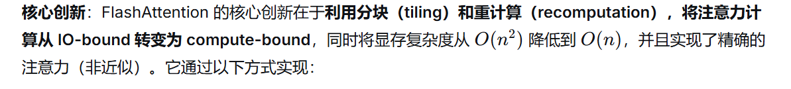{.ocr-src}

- 分块（Tiling）：将输入的 Q、K、V 矩阵沿序列维度切分成小块，每次将一个块加载到片上 SRAM 中，在片上完成该块的注意力计算，从而避免将完整的中间注意力矩阵写入 HBM。

- 重计算（Recomputation）：在反向传播时，不存储前向过程中产生的庞大注意力矩阵和 softmax 归一化统计量，而是在反向时重新计算这些中间结果。这避免了大量显存占用，且由于重新计算的开销远小于从 HBM 读取的开销，整体训练速度反而更快。

- IO 感知（IO-awareness）：通过精心编排数据的加载、计算和写回，最大限度地减少 HBM 与 SRAM 之间的数据传输量，使得 GPU 的计算能力得到充分发挥。

因此，FlashAttention 使得在相同硬件上可以训练更长序列的模型，同时显著加快了训练和推理速度。

---

#### 为什么标准注意力计算是 IO-bound 的？解释 HBM 和 SRAM。

标准注意力的计算步骤：

1. 从 HBM 加载 Q、K 矩阵到片上，计算得分矩阵 $S = QK^T$（大小 $n \times n$），写回 HBM。
2. 从 HBM 加载 $S$，计算 softmax 得到注意力权重 $P$（大小 $n \times n$），写回 HBM。
3. 从 HBM 加载 $P$ 和 $V$，计算输出 $O = PV$，写回 HBM。

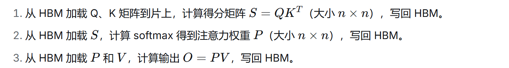{.ocr-src}

在这个过程中，中间矩阵 $S$ 和 $P$ 的大小均为 $n$×$n$。对于长序列（例如 n=2048 或更大），这些矩阵的读写操作非常耗时。现代 GPU 拥有大量的计算核心，但 HBM 的带宽相对有限。当数据传输时间远超计算时间时，计算单元不得不等待数据，从而形成 IO-bound 状态。

HBM 和 SRAM：

- HBM（High Bandwidth Memory）：即显存，容量大（数十 GB），但带宽相对较低（例如 1-2 TB/s），且访问延迟高。模型权重、激活、中间结果通常存储在 HBM 中。

- SRAM（Static Random-Access Memory）：位于 GPU 流式多处理器（SM）内部，容量极小（例如每 SM 几十到几百 KB，总容量几 MB），但带宽极高（可达数十 TB/s）且延迟极低。它是计算核心直接高速访问的存储器。

标准注意力中，n×n 的中间矩阵必须写到 HBM 再从 HBM 读出，这个过程会迅速填满 HBM 带宽，导致计算核心空转。FlashAttention 的目标就是让尽可能多的计算在 SRAM 中完成，仅将必要的最终结果写回 HBM，从而打破 IO 瓶颈。

---

#### FlashAttention 中的“分块 (Tiling)”是如何进行的？

分块是 FlashAttention 降低 IO 的核心技术。它将输入的 Q、K、V 矩阵沿序列维度（或批次维度）分割成若干个小块（blocks），使得每个块可以完全放入 SRAM 中。

具体步骤：

1. 将 Q 矩阵分成 $T_r$ 个块，每个块大小为 $B_r \times d$，其中 $B_r$ 是块的行数（序列长度的一部分），$d$ 是头维度。
2. 将 K 和 V 矩阵分成 $T_c$ 个块，每个块大小为 $B_c \times d$。
3. 对于每个 Q 块，依次加载每个 K 块和对应的 V 块到 SRAM，计算该 Q 块与当前 K 块的局部得分矩阵 $S_{ij} = Q_i K_j^T$，大小 $B_r \times B_c$。

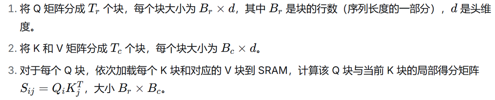{.ocr-src}

1. 在 SRAM 中对 $S_{ij}$ 进行 softmax。由于 softmax 具有可结合的性质（可通过保存每个位置当前的最大值和归一化分母来逐块更新），FlashAttention 在遍历 K 块时，动态地维护该行 Q 块的 softmax 统计量（rowmax 和 rowsum），逐块计算出正确的 softmax 结果，而无需一次性将整个 $n$×$n$ 矩阵放入 SRAM。

2. 利用当前的 softmax 权重，立即将对应的 V 块加权求和并累加到输出累加器中。这样，每个 Q 块在遍历完所有 K、V 块后，就在 SRAM 中完整地计算出了该块的注意力输出，此时再将结果写回 HBM。

通过这种方式，FlashAttention 在整个前向过程中只需要在 HBM 中存储 Q、K、V 和最终的输出 O，从未将完整的注意力矩阵 S 或 P 写入 HBM。

---

#### FlashAttention 为什么需要重计算 (Recomputation)？它避免了什么存储？

在训练的反向传播中，传统方法需要保存前向过程中的中间激活（如注意力得分矩阵 $S$、softmax 后的权重矩阵 P 等），以便计算梯度。对于长序列，这些矩阵的存储量（$n$×$n$）极其庞大。

FlashAttention 选择不存储这些大的中间矩阵，而是在反向传播时重新计算它们。具体来说：

- 前向时，只将 Q、K、V 和输出 O 存入 HBM，同时额外保存少量的 softmax 归一化统计量（rowmax 和 rowsum）以及随机数生成器的状态（如果使用了 dropout）。

- 反向时，从 HBM 加载 Q、K、V、O 和统计量，并按照前向分块的相同顺序重新计算注意力矩阵和 softmax 权重，再利用这些重计算的值和梯度 $d_O$ 来计算 dQ,dK,dV。

它避免了什么存储？

避免了将 $n \times n$ 的注意力矩阵（得分和权重）存储到 HBM。这直接使得显存复杂度从 $O(n^2)$ 降为 $O(n)$。同时，由于重计算过程也是在分块下进行的，其 IO 量同样极小，而且重计算的计算量（矩阵乘法）在现代 GPU 上非常快，远快于从 HBM 读取这些矩阵。因此，整体训练速度不减反增。

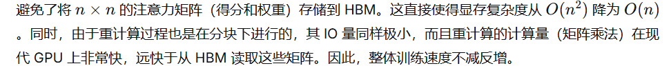{.ocr-src}

---

#### FlashAttention 能节省多少显存？推导其显存复杂度从 O(n^2) 降到 O(n)。

标准注意力的显存复杂度：

- 存储 Q、K、V、输出 O：$O(n \cdot d)$（通常 d 远小于 n，在分析中常被忽略或视为常数）。
- 存储注意力得分矩阵 $S$ 和权重矩阵 $P$：每个大小 $n \times n$，使用浮点数存储，因此占用 $O(n^2)$ 显存。
- 因此标准注意力的显存复杂度为 $O(n^2)$。

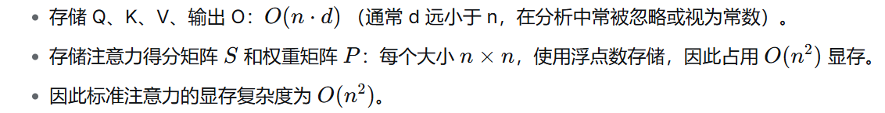{.ocr-src}

FlashAttention 的显存复杂度：

- 存储 Q、K、V、输出 O：O(n⋅d)。

- 不存储 $S$ 和 $P$，而是存储 softmax 的归一化统计量（每行一个最大值和一个和，大小 O(n)），以及可选 dropout 的随机状态（O(n)）。

- 因此 FlashAttention 的显存复杂度为 O(n)。

推导与定量节省：

对于序列长度 $n$，标准注意力需要存储约 $2n^2$ 个元素（S 和 P）。以 $n = 2048$，FP16（2 字节）为例，$2 \times 2048^2 \times 2 \approx 16.8$ MB（单头单层）。当 $n$ 扩大到 8K、16K 时，该显存会迅速增加到数百 MB。对于多头（如 32 头）和多层（如 24 层）的模型，总显存消耗巨大，严重限制了训练的最大序列长度。FlashAttention 将每个注意力操作的额外显存从 $O(n^2)$ 降到接近 $O(n)$，使训练数万 token 的长序列成为可能。

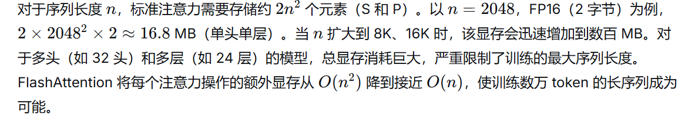{.ocr-src}

---

#### FlashAttention 可以精确实现标准注意力吗？还是近似？

FlashAttention 可以精确实现标准注意力，并不是近似算法。

尽管 FlashAttention 使用了分块和动态 softmax 更新，但它所执行的数学运算与标准注意力完全等价。其精确性建立在以下基础之上：

- 分块 softmax 的精确性：softmax 可以通过维护当前最大值和分母来进行逐块更新，最终结果与一次性对整个向量计算 softmax 完全相同。FlashAttention 正是利用这一性质，在遍历 K、V 块时逐步计算并修正 softmax 结果，最终得到准确的注意力输出。

- 数值精度：在标准浮点精度下，FlashAttention 的结果与标准实现可能有微小的舍入误差（通常低于 1e-5），但这主要是由于运算顺序不同造成的，而非算法近似。在 FP16/BF16 下，它与标准注意力的差异在可接受范围内，不影响模型训练和收敛。

- 不支持的操作：原始的 FlashAttention 不支持某些标准注意力中可能用到的元素（如注意力偏置、掩码张量等），但后来的 FlashAttention-2 及 v2 变体增加了对这些功能的支持，仍然保持精确。

因此，用户可以放心地使用 FlashAttention 替代标准注意力，而不必担心模型性能因近似而下降。

---

#### FlashAttention 对序列长度 n 的加速效果如何？为什么？

FlashAttention 的加速效果随序列长度 $n$ 的增加而愈发显著，尤其是在中等长度到长序列（如 1K 到 8K）时，可达到 2-4 倍甚至更高的速度提升。

加速的原因：

- **消除了 HBM 读写瓶颈**：标准注意力的时间主要消耗在 $O(n^2)$ 大小的中间矩阵的写入和读出上。FlashAttention 避免了这些 IO，使得实际运行时间更接近于理论上的计算时间（$O(n^2 \cdot d)$ FLOPs）。由于 GPU 计算能力远超 HBM 带宽，减少 IO 直接转化为速度提升。

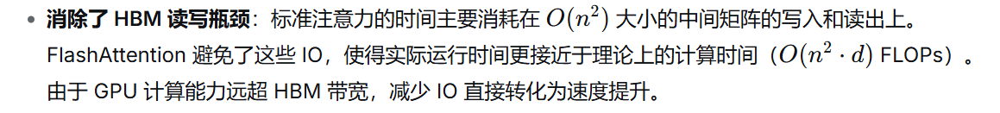{.ocr-src}

- 更好的计算与带宽重叠：FlashAttention 通过分块，使得每个块的计算可以在 SRAM 中高效完成，同时数据加载可以与计算重叠（预取），进一步隐藏了延迟。

- 更高的算术强度：算术强度（FLOPs/byte）在 FlashAttention 中大幅提升，因为每个字节从 HBM 加载的数据能被更充分地用于计算。

- 效果曲线：对于很短的序列（如 n<128），标准注意力的 IO 开销占比不大，FlashAttention 优势不明显；但随着 n 增长，标准注意力很快变为 IO-bound，而 FlashAttention 始终 compute-bound，因此加速比不断上升，直至 GPU 计算单元被充分利用。

实际测试中，在 A100 GPU 上，使用 FlashAttention 训练 GPT-2 模型时，序列长度 2K 时加速约 2 倍，4K 时可达 3 倍，且显存占用降低数倍。

---

#### FlashAttention 如何处理因果掩码？

FlashAttention 原生支持因果掩码（自回归掩码），且在因果模式下能获得额外的加速。

处理方式：

- 对于因果注意力，每个 query 只能关注到 key 序列中位置不晚于自己的 token。这在掩码上表现为下三角为有效，上三角（未来 token）被屏蔽（设置为 -∞）。

- FlashAttention 在分块计算时，会自动应用因果掩码。当处理一个 Q 块和 K 块时，如果该 K 块所对应的序列位置全部在 Q 块的“未来”（即 K 块的最小位置 > Q 块的最大位置），则整个块对的注意力分数均为 -∞，FlashAttention 可以直接跳过该 K 块的计算，不加载其 K、V 数据，也不进行计算。

- 对于部分重叠的块（即 K 块包含部分合法位置和部分非法位置），FlashAttention 会在 SRAM 内对该小块应用精确的因果掩码，只计算下三角部分。

- 由于因果掩码下，注意力矩阵的上三角全为 0，FlashAttention 可以跳过大约一半的块计算，从而相比于双向注意力获得接近 1.7-2 倍的额外加速。

因此，FlashAttention 通过利用因果掩码的稀疏性，不仅实现了功能，还提升了效率。

---

#### 写出 FlashAttention 的前向传播伪代码流程（核心思想）。

以下伪代码描述了 FlashAttention 前向传播的核心流程。假设 Q、K、V、O 存储在 HBM 中，块大小 Br 和 $B_c$ 根据 SRAM 大小确定。

```python
# 在 HBM 中分配 Q, K, V, O
# 将 Q, K, V 分成块: Q_1..Q_{T_r}, K_1..K_{T_c}, V_1..V_{T_c}

for i in 1..T_r:                          # 遍历 Q 块
    load Q_i from HBM to SRAM             # 加载一个 Q 块
    # 初始化该 Q 块的统计量
    m_i = (-inf)                          # 当前行最大值
    l_i = 0                                # 当前行 softmax 分母
    acc_i = 0                              # 输出累加器 O_i

    for j in 1..T_c:                      # 遍历 K, V 块
        load K_j, V_j from HBM to SRAM    # 加载一对 K, V 块
        # 计算局部注意力得分
        S_ij = Q_i @ K_j^T                # 大小 B_r x B_c
        # 应用掩码（如果需要）
        S_ij = apply_mask(S_ij)

        # 更新 softmax 统计量
        m_new = max(m_i, rowmax(S_ij))
        # 缩放因子
        alpha = exp(m_i - m_new)
        beta = exp(S_ij - m_new)
        # 更新累加器和分母
        l_new = alpha * l_i + rowsum(beta)
        acc_i = (alpha * l_i / l_new) * acc_i + (beta / l_new) @ V_j

        # 更新 m_i, l_i
        m_i = m_new
        l_i = l_new

    # 最终写入 O_i
    O_i = acc_i
    store O_i to HBM

# 如果需要，额外存储 softmax 统计量用于反向传播
```

核心思想：

- 外层循环遍历 Q 块，内层循环遍历 K、V 块。

- 通过动态维护每行的最大值和 softmax 分母，可以逐块更新注意力输出，最终结果与全局计算完全相同。

- 整个过程中，大的注意力矩阵从未完整地写入或读出 HBM，只在 SRAM 中短暂存在，从而大幅度减少了 IO。

---

#### FlashAttention-2 相比 v1 做了哪些改进？

FlashAttention-2 在 v1 的基础上进行了多项关键优化，将 GPU 利用率提升到接近理论峰值的水平，速度提高了 2-3 倍。

主要改进：

- 重新设计在线 softmax 的调度：v1 在遍历 K、V 块时，需要频繁更新 softmax 统计量（最大值和分母），涉及多次跨块的同步和缩放。v2 改进了调度策略，减少了不必要的重缩放和同步，使得计算流更平滑。

- 减少非矩阵乘法 (non-matmul) FLOPs：v1 中的某些操作（如掩码、缩放、统计量更新）以低效率的逐元素方式执行。v2 将这些操作尽可能融合到矩阵乘法内核中，或重新设计算法以降低它们的占比，使得总的浮点运算中有效矩阵乘法的比例更高，从而更充分利用 Tensor Cores。

- 改善并行化策略：v1 主要沿 batch 和 head 维度并行。v2 增加了沿序列长度维度的并行化，这对于长序列特别有效，可以更好地在多个 SM 之间分配工作负载，减少空闲。

- 减少共享内存读写：v2 通过更精细的数据复用和分块策略，减少了 SRAM 内部的读写次数，进一步压低了延迟。

- 更好的自动调优：针对不同的序列长度和硬件，v2 提供了自动选择的块大小和并行参数，以达到最佳性能。

结果是在 A100 GPU 上，FlashAttention-2 可以将注意力计算加速到理论最大吞吐的 70% 以上，而 v1 仅约 30-40%。

---

#### FlashAttention-3 又有哪些新特性？

FlashAttention-3 针对 NVIDIA Hopper 架构（H100/H200）引入了多项新特性，以实现更高的性能和更灵活的功能。

核心新特性：

- FP8 支持：利用 Hopper 的 FP8 张量核心，在保持模型质量的同时大幅提升计算速度并降低显存带宽需求。FlashAttention-3 在 FP8 下可实现近两倍于 BF16 的吞吐。

- TMA (Tensor Memory Accelerator)：使用 Hopper 特有的硬件单元进行异步数据拷贝，可以在计算的同时从 HBM 预取数据到 SRAM，并支持更复杂的数据布局转换，几乎完全隐藏了内存延迟。

- 异步执行与流水线化：将数据加载、计算、统计量更新等操作拆分为异步流水线，使各硬件单元并行工作，最大化利用率。

- 更灵活的掩码和偏置：原生支持任意形状的注意力掩码和偏置（如 ALiBi、相对位置偏置），并针对这些操作进行了融合优化，无需额外开销。

- 更高的可编程性：通过 CUTLASS 库提供了模块化的内核构建方式，方便研究者定制注意力算子。

FlashAttention-3 在 H100 上比 FlashAttention-2 快约 1.5-2 倍，进一步巩固了其在长序列训练和推理中的核心地位。

---

#### 如何在 PyTorch 中使用 FlashAttention？

在 PyTorch 中使用 FlashAttention 主要有两种方式：通过内置的 `scaled_dot_product_attention` 函数或使用 `flash_attn` 库。

方法一：PyTorch 内置函数（推荐，PyTorch 2.0+）

```python
import torch
import torch.nn.functional as F

# 假设 q, k, v 形状为 [batch, heads, seq_len, head_dim]
# causal=True 表示自回归因果掩码
output = F.scaled_dot_product_attention(q, k, v, attn_mask=None, dropout_p=0.0, is_causal=True)
```

PyTorch 会自动选择最优的后端实现，其中包括 FlashAttention。可以显式指定后端或设置环境变量 `torch.backends.cuda.enable_flash_sdp(True)`。

方法二：使用 flash_attn 库\
首先安装：`pip install flash-attn --no-build-isolation`。然后：

```python
from flash_attn import flash_attn_func

# q, k, v 形状 [batch, seq_len, heads, head_dim] 或 [batch, seq_len, heads*head_dim]
output = flash_attn_func(q, k, v, causal=True)
```

该库提供了更丰富的参数（如 `window_size` 用于滑动窗口注意力、`softmax_scale` 等），并支持 GQA/MQA。

在 HuggingFace Transformers 中使用：\
很多模型（如 LLaMA、GPT）通过配置 `attn_implementation="flash_attention_2"` 自动启用 FlashAttention。

---

#### FlashAttention 是否支持 GQA 或 MQA？

完全支持。 FlashAttention-2 及更高版本原生支持分组查询注意力（GQA）和多查询注意力（MQA）。

实现方式：

- 传入 K、V 张量的头维度可以与 Q 不同。例如，Q 有 32 个头，K 和 V 只有 8 个头（GQA）或 1 个头（MQA）。

- FlashAttention 内核会自动检测键值头数，并在计算时对 K 和 V 进行广播（将每组内的 K、V 复制或直接在寻址时复用），使得每个查询头与其对应的键值头正确匹配。

- 这不需要用户手动扩展 K、V 张量，既节省了显存，又减少了不必要的数据搬运，性能比在 PyTorch 中先广播再传入标准注意力高得多。

使用示例：

```python
# Q: [B, H, L, D]    K: [B, G, L, D]    V: [B, G, L, D]
output = flash_attn_func(q, k, v, causal=True) # 自动处理 GQA
```

几乎所有现代推理和训练框架均集成了 FlashAttention 对 GQA/MQA 的支持。

---

#### 在使用 FlashAttention 时，模型精度（FP16/BF16）会影响结果吗？

会影响计算精度和数值稳定性，但在正确配置下可以安全使用。

- 推荐使用 BF16：因为 BF16 有更大的动态范围（与 FP32 相同的指数位），可以有效避免 softmax 过程中因极端值导致的溢出。大多数现代大模型（如 LLaMA、GPT-4）使用 BF16 训练和推理，与 FlashAttention 结合得非常好。

- FP16 也可用，但需注意：FP16 的数值范围较小（最大约 65504），在计算 softmax 之前，如果注意力分数（logits）特别大，可能导致溢出。FlashAttention 内部通过缩放因子和在线 softmax 算法来缓解此问题，通常能正常工作。但在极端长的序列或未经校准的模型上，可能偶尔出现 NaN 或 Inf。这时可以切换到 BF16 或应用动态缩放。

- FlashAttention-3 支持 FP8：在 FP8 下，数值风险更大，需要更精细的量化缩放和误差补偿策略，通常用于推理或对精度要求稍低的训练阶段。

- 混合精度训练：在训练中使用 FlashAttention 时，通常会与自动混合精度（AMP）配合。FlashAttention 会在 FP16/BF16 下计算注意力，而 softmax 统计量的累积可能需要更高的精度（内部可能用 FP32 累加）。这些都由库自动处理。

总之，FlashAttention 在设计时已经充分考虑了混合精度场景，只要按官方推荐的精度和数据范围使用，精度损失可忽略。

---

#### 能否将 FlashAttention 应用于训练和推理？效果有何不同？

可以，且两者均可获得显著收益，但优化的侧重点有所不同。

训练时：

- **显存节省**：前向和反向均无需存储 $n \times n$ 的注意力矩阵，显存占用从 $O(n^2)$ 降为 $O(n)$。这使得在相同硬件下可以训练更长的序列或使用更大的批次。

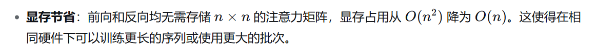{.ocr-src}

- 速度提升：通过消除 IO 瓶颈，训练吞吐大幅提高，尤其对于中等长度到长序列（1K-16K），加速比可达 2-4 倍。

- 重计算策略：反向传播时重新计算注意力，避免了存储庞大的中间激活，尽管增加了少量计算，但整体训练时间反而因 IO 减少而缩短。

推理时：

- 预填充（Prefill）阶段：处理输入提示符时，需要一次计算整个序列的注意力。FlashAttention 加速了这一过程，降低首 token 延迟。

- 解码（Decode）阶段：每步仅生成一个 token，Q 的长度为 1，此时注意力计算量本身很小，不再 IO-bound。FlashAttention 的加速效果主要体现在优化 KV Cache 的访问模式以及提升吞吐量。它常与 PagedAttention 结合使用，以高效管理缓存并减少内存碎片。

- 长序列推理：对于上下文长度极长（如 128K）的推理，KV Cache 的读取成为新瓶颈。FlashAttention 优化了读取方式和带宽利用，仍然能带来速度提升。

总结：训练侧重于节省显存和加速矩阵计算，推理侧重于预填充加速和缓存访问优化。

---

#### 为什么 FlashAttention 通常和 PagedAttention 配合使用？

FlashAttention 和 PagedAttention 解决的是推理中不同层面的问题，二者配合使用可达到端到端的极致效率。

- FlashAttention 的职责：高效地计算注意力。它通过分块和重计算减少 IO，加速注意力运算本身。

- PagedAttention 的职责：高效地管理 KV Cache 内存。在长序列和多请求并发时，KV Cache 内存占用巨大且容易产生碎片。PagedAttention 借鉴操作系统的分页思想，将 KV Cache 切分为固定大小的块，按需分配和释放，几乎消除了内存碎片，提高了显存利用率。

- 协同工作：PagedAttention 将 KV Cache 组织为分页的块，而 FlashAttention 可以无缝地以这些块为单位进行分块计算，无需将整个 KV Cache 连续存储。FlashAttention 内核能够直接接收来自 PagedAttention 的非连续块指针，在计算时动态加载，避免了数据拷贝。这实现了从内存管理到实际计算的全面优化，使得推理系统（如 vLLM）能够将吞吐量提升数倍，同时支持长上下文和高并发。

因此，它们成为现代 LLM 推理引擎的标准组合。

---

#### 在没有 GPU 张量核的硬件上，FlashAttention 还适用吗？

FlashAttention 的核心算法（分块、重计算）仍然适用，但其高性能实现通常依赖张量核，因此实际运行效果和兼容性会受限。

- 算法层面：分块避免存储完整的注意力矩阵，即使在旧款 GPU 上也能显著节省显存。这一优势与硬件特性无关，因此在任何支持 CUDA 的 GPU 上都能体现。

- 性能层面：FlashAttention 的官方实现大量使用 Tensor Cores 进行快速半精度矩阵乘法，这些指令只有在 Volta 架构及以上的 GPU 上可用（Compute Capability ≥ 7.0）。如果没有张量核，矩阵乘法将回退到 FP32 CUDA 核心，速度会慢很多，可能无法达到超越标准注意力的加速比。

- 兼容性：官方 `flash-attn` 库要求 Compute Capability ≥ 7.0。对于更早的 GPU（如 Pascal、Maxwell），无法直接运行。但研究者可以基于 FlashAttention 的算法思想，自行实现 FP32 版本，尽管可能无法达到同样的加速比，但仍能从显存节省中获益。

- 替代方案：对于不支持张量核的老旧硬件，可以考虑使用 PyTorch 内置的 `scaled_dot_product_attention`，它会根据硬件能力自动选择最优实现（包括 Memory Efficient Attention 等）。这些实现同样可能采用分块等 IO 优化，但不一定达到 FlashAttention 的极致性能。

总之，FlashAttention 的思想是通用的，但最优性能高度依赖现代 GPU 的硬件特性。在旧硬件上，其思想仍可借鉴以节省显存。

---

#### FlashAttention 是否支持反向传播的 Dropout 和 attention bias？

完全支持，而且实现方式非常精巧，没有破坏其 IO 节省的特性。

- Dropout 支持：在训练前向传播时，FlashAttention 可以对 softmax 后的注意力权重施加 Dropout。为了在反向传播时复现相同的随机掩码，它不会存储完整的 $n$×$n$ 掩码矩阵（这违背了其节省显存的初衷）。相反，它只存储随机数生成器的种子和必要的状态信息。反向时，利用这些信息重新生成与正向完全一致的 Dropout 掩码，从而精确计算梯度。这避免了任何大型中间矩阵的存储。

- Attention Bias 支持：FlashAttention 完全支持在 softmax 之前添加偏置矩阵，例如相对位置偏置（如 T5）、ALiBi 的线性偏置，或自定义的复杂掩码。在分块计算过程中，它会加载与当前 Q、K 块相对应的偏置块，加到注意力分数上。对于可学习的位置偏置，其梯度也会在反向传播时正确计算。FlashAttention-2 及后续版本对偏置的支持进行了深度优化，使其在不牺牲性能的前提下兼容更复杂的注意力模式。

因此，FlashAttention 没有为了效率而牺牲标准注意力中的常用功能，而是通过精巧的重计算和分块策略保留了它们。

---

#### 与 xFormers 的 memory_efficient_attention 相比，FlashAttention 的优势在哪里？

两者都旨在解决标准注意力的 IO 瓶颈，采用了相似的分块和重计算思想，但 FlashAttention 在极致性能、生态地位和硬件适配方面占据优势。

| 特性 | FlashAttention | xFormers memory_efficient_attention |
| --- | --- | --- |
| 极致性能 | 手工深度优化的 CUDA 内核，在 A100/H100 等现代 GPU 上几乎压榨出全部 Tensor Core 性能。速度通常领先 xFormers 20-40%。 | 高度优化的通用实现，性能优秀，但可能未充分利用最新硬件的特性。 |
| 反向传播 | 反向同样经过极致优化，训练吞吐极高。 | 反向优化程度稍弱，在某些场景下整体训练速度慢于 FlashAttention。 |
| 功能覆盖 | 原生支持 GQA/MQA、滑动窗口、ALiBi 等，且在持续更新。 | 同样支持多种变体，但新特性跟进速度可能稍慢。 |
| 生态集成 | 已成为 PyTorch 2.0 官方后端 (torch.nn.functional.scaled_dot_product_attention)，并被 HuggingFace、vLLM、DeepSpeed 等主流框架默认集成。 | 同样被广泛使用，但在官方生态中的地位弱于 FlashAttention。 |
| 易用性 | 在 PyTorch 2.0+ 中通常无需显式调用即可自动启用，开发者几乎零感知。 | 需要显式调用 xformers.ops.memory_efficient_attention。 |

总结：FlashAttention 凭借对硬件的深度适配、更高的性能、更早的官方集成和更广泛的功能覆盖，已成为注意力优化的绝对标准。xFormers 仍然是一个可靠的替代方案，尤其在需要兼容一些特殊配置或较老硬件时。

---

#### 解释 FlashAttention 的“online softmax”技巧。

Online softmax 是 FlashAttention 实现分块计算且保持精确的数学基础。它解决了“如何在不看到整行所有分数的情况下，计算出正确的 softmax”这一难题。

核心思想：在遍历 K、V 块时，动态维护三个量——当前的全局最大值 $m$、归一化分母 $l$ 和输出累加器 $a_{cc}$。当处理一个新块时：

1. 计算该块的局部最大值 $m_{local}$。

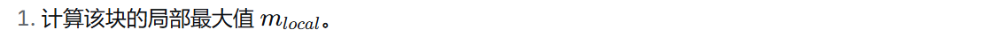{.ocr-src}

1. 更新全局最大值：`m_new = max(m_old, m_local)`。

2. 由于最大值变大，之前基于旧最大值计算的指数值需要被“缩小”以保证正确。因此，将旧的累加器和分母乘以缩放因子 `exp(m_old - m_new)`。

3. 对新块计算稳定的指数 `exp(score - m_new)`，并将其累加到缩放后的累加器和分母上。

随着逐块处理，累加器中始终维护着相当于已经处理过的所有元素的正确加权和。当遍历完所有 K、V 块后，累加器中的值就是精确的完整 softmax 输出。整个过程只在 SRAM 中进行，无需存储整个 $n$×$n$ 的注意力矩阵。

---

#### 如果我的序列长度是 128K，FlashAttention 还能有效吗？需要注意什么？

FlashAttention 对 128K 长度依然有效，并且是处理这种超长序列的关键使能技术，但需要解决新的瓶颈。

有效的原因：

- FlashAttention 将注意力矩阵的显存从 $O(n^2)$ 降为 $O(n)$，使得 128K 序列不会因为注意力矩阵本身而 OOM。
- 通过分块和 IO 优化，计算过程依然高效，是计算瓶颈而非 IO 瓶颈。

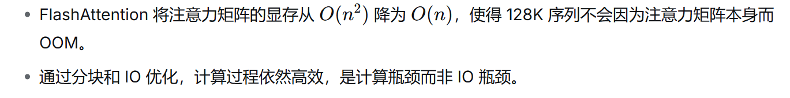{.ocr-src}

需要注意的新瓶颈：

- Q、K、V 本身的存储：128K 序列的 Q、K、V 张量本身就会占用大量显存（例如单头 d=128，128K 序列的 K 矩阵约 32MB）。在多头、多层、大批次下，总显存可达数十 GB。FlashAttention 不能减少这部分存储。

- KV Cache 的爆炸：在推理时，128K 的 KV Cache 是巨大负担。必须结合 GQA/MQA 将缓存头数压缩，以及 PagedAttention 进行高效内存管理。

- 数值稳定性：在极长序列下，softmax 的指数求和可能趋于无穷。Online softmax 通过动态最大值保证了稳定性。使用 BF16 精度可以进一步避免 FP16 可能出现的溢出。

- **计算时间**：注意力计算量是 $O(n^2 \cdot d)$，128K 序列的单次注意力计算仍然非常耗时。这本质上受限于算力，而非 FlashAttention 能解决的带宽问题。

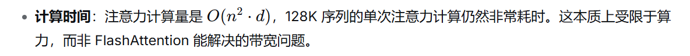{.ocr-src}

因此，FlashAttention 是处理 128K 序列的必要条件，但需要配合 GQA、PagedAttention 和足够的内存/算力才能流畅运行。

---

#### FlashAttention 对 MoE 模型中的专家注意力计算有帮助吗？

非常有帮助，但帮助的对象是 MoE 中密集的注意力层，而非稀疏的专家层。

- 注意力层是密集的：在 MoE 架构中，尽管 FFN 被替换为稀疏激活的专家，但自注意力层通常是所有 token 共享的密集层。FlashAttention 直接加速这一部分，尤其是在长序列训练和推理时，收益巨大。

- 间接促进 MoE 的扩展：MoE 模型通常拥有极大总参数，为控制计算成本，它们往往需要处理更长的上下文或更大的批次来保持高效。FlashAttention 通过降低注意力层的显存和计算开销，使得 MoE 可以更好地支持长上下文，从而发挥其容量优势。

- 对专家 FFN 无直接作用：FlashAttention 不涉及专家层的前馈计算。专家层的瓶颈在于路由、负载均衡和通信，这需要专家并行、All-to-All 通信优化等技术来解决。

因此，FlashAttention 在 MoE 中扮演的角色与在密集模型中完全一样——加速注意力计算，为模型的其他部分（如扩展专家数量）腾出资源。

---

#### 从算子融合的角度，FlashAttention 融合了哪些操作？

FlashAttention 将标准注意力中原本分离的多个 GPU 内核调用（kernel launch）融合为单个高效内核，避免了中间结果的 HBM 读写。它融合了以下操作：

1. Q、K、V 的分块加载

2. 矩阵乘法：`S = Q_i @ K_j^T`

3. 缩放：`S = S / sqrt(d)`

4. 注意力偏置或掩码加法（如 causal mask、ALiBi 偏置）

5. Online Softmax 的全部子步骤：求最大值、指数、求和、重缩放

6. Dropout（训练时，对 softmax 后的权重）

7. 与 V 的加权求和：`O = attn @ V_j`

8. 输出累加与写回

通过将这些操作全部融合，FlashAttention 在 SRAM 中一次性地完成了从 Q、K、V 到输出 O 的所有计算。这消除了传统实现中多次启动内核、写入和读出 HBM 的巨大开销，是它实现极致效率的根本原因。

---

#### 你认为 FlashAttention 会成为 LLM 推理加速的标配吗？

会的，它已经是标配，并且正在成为 AI 基础设施中透明的一层。

- 标准化集成：PyTorch 2.0 将其纳入官方函数，HuggingFace、vLLM、TensorRT-LLM 等几乎所有主流框架都默认或推荐使用。对于开发者而言，FlashAttention 正变得“无感”——只需正常编写代码，底层自动调用。

- 无法绕开的效率需求：随着上下文窗口向 128K、1M 甚至更长发展，标准注意力的显存和带宽消耗已完全不可接受。FlashAttention 及其衍生技术是实现长上下文经济的唯一可行路径之一。

- 全生命周期优化：它同时解决了训练时的显存瓶颈和推理时的预填充延迟，成为从研发到部署全流程的基石。

- 硬件协同演进：FlashAttention-3 针对 H100 的 FP8 和 TMA 进行深度定制，展现出算法与硬件协同设计的强大生命力。未来的 GPU 架构很可能会进一步围绕这类 IO-aware 算法进行设计。

因此，FlashAttention 已不仅仅是“一种优化”，它已成为现代大模型技术栈的默认组件，是 LLM 规模继续增长的基础保障。

---

#### 大胆预测一下，未来 FlashAttention 可能往什么方向发展？

1. 支持更丰富的稀疏与自适应模式：未来的版本可能原生支持可学习或动态的稀疏注意力掩码，让模型自动跳过不重要的块计算，实现“按需注意力”，进一步降低计算量。

2. 多模态与异构注意力融合：将文本、图像、音频等不同模态的注意力计算统一到一个内核中，处理各种交织的因果/双向掩码，成为多模态大模型的高效计算后端。

3. 与新硬件更深耦合：随着下一代 GPU 引入更智能的内存加速器，FlashAttention 将采用更激进的异步流水线，完全隐藏数据搬运，并可能支持 FP4 等超低精度注意力计算。

4. 注意力与相邻层的端到端融合：将注意力后的线性投影（`W_O`）、残差连接、层归一化等操作全部融合进同一个内核，形成“超级注意力块”，彻底消除它们之间的显存往返。

5. 分布式注意力计算优化：针对百万 token 级别的超长序列，专门优化跨多 GPU 的序列并行注意力计算，解决分块通信和负载均衡问题。

6. 可编程的注意力编译器：提供类似“注意力 DSL”的工具，允许研究者定义新的注意力变体，自动生成并优化对应的 CUDA 内核，大幅降低注意力机制的创新门槛。

最终，FlashAttention 将从一个“优化的注意力实现”演变为“通用的、可组合的注意力计算平台”，持续推动大模型向更长上下文、更高效率和更多模态进化。

