# 22.大模型（LLMs）多头潜在注意力（MLA）

## 大模型（LLMs）多头潜在注意力（MLA）面

#### MLA 是由哪个模型提出的？它要解决什么问题？

MLA 由 DeepSeek-V2 提出。它要解决的根本矛盾是：大模型推理时，KV Cache 随序列长度和模型规模线性爆炸，严重制约了长上下文和高并发能力。

标准 MHA 中，**每个 token 的每层每个头都要缓存一对 K、V 向量**，总元素量为 `2 × 层数 × 头数 × 序列长度 × 头维度`。当序列长度达到 128K 时，KV Cache 的显存占用可能远超模型权重本身。MLA 的目标是将 KV Cache 压缩一个数量级以上，同时保持模型性能几乎不降，从而让长上下文推理在经济上可行。

**图 1-1 · KV Cache 爆炸问题原理图**

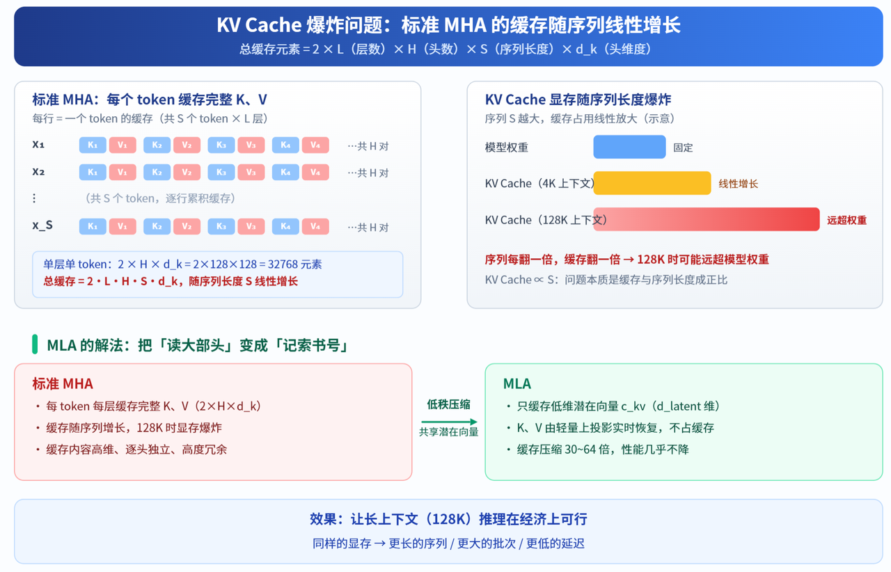

---

#### MLA 的核心思想是什么？如何通过“低秩压缩”减少 KV Cache？

MLA 的核心思想是：K 和 V 在多头之间是高度冗余的，可以用一个极低维的共享潜在向量来承载它们的公共信息，再通过轻量级的上投影为每个头恢复出定制的 K 和 V。

实现上，它把标准的键值投影矩阵 $W_K$ 和 $W_V$ 分解为两个低秩矩阵的乘积：

$$
W_K = W_{down} \cdot W_{up}^K, \quad W_V = W_{down} \cdot W_{up}^V
$$

其中 $W_{down} \in \mathbb{R}^{d_{model} \times d_{latent}}$ 将输入压缩到极低维的潜在向量 $c_{kv}$，$d_{latent} \ll H \times d_k$。推理时只需缓存 $c_{kv}$，而非完整的 K、V。需要使用时，通过上投影 $W_{up}^K, W_{up}^V$ 实时恢复。由于上投影矩阵参数量大（$d_{latent} \times H \times d_k$），表达能力被保留在参数中，缓存则被极限压缩。

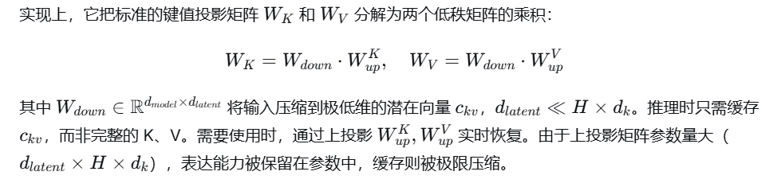{.ocr-src}

类比：标准 MHA 是每次查阅都去图书馆翻大部头书（读完整 K、V）；MLA 是只记下书的索书号（潜在向量），用的时候通过索书号快速定位并展开内容。索书号极小，但配合庞大的索引系统（上投影权重），能精确恢复原书。

**图 2-1 · 低秩压缩完整原理图**

---

#### 画出 MLA 的注意力计算流程，并与标准 MHA 对比。

标准 MHA：

```plain text
x → W_Q → Q (独立头)
x → W_K → K (独立头) → [缓存 K]
x → W_V → V (独立头) → [缓存 V]
Q, K, V → Attention → O
```

缓存的是高维的 K、V。

MLA：

```plain text
x → W_down → c_kv (低维) → [缓存 c_kv]
c_kv → W_up^K → K (所有头)
c_kv → W_up^V → V (所有头)
x → W_Q → Q (或同样低秩压缩)
Q, K, V → Attention → O
```

缓存的是极小的潜在向量 $c_{kv}$。K 和 V 的上投影可以与注意力计算融合，在推理时甚至不需要显式地展开成完整的 K、V 张量，直接将上投影矩阵的运算与 `QK^T` 结合，进一步节省计算和显存。

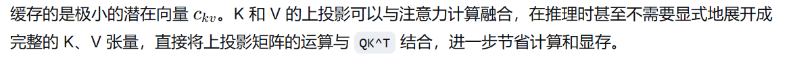{.ocr-src}

---

#### 在 MLA 中，K 和 V 是如何从压缩后的潜在向量生成的？

1. 输入 token 的隐藏状态 $x$ 经过一个线性下投影：$c_{kv} = xW_{down}$，得到一个极低维的向量。
2. 潜在向量 $c_{kv}$ 分别通过两个不同的上投影矩阵：
    - $K = c_{kv}W_{up}^{K}$，恢复出所有头的 K。
    - $V = c_{kv}W_{up}^{V}$，恢复出所有头的 V。
3. 这些上投影矩阵的参数量很大，保证了从低维恢复到高维时信息的丰富性。

**关键**：所有头的 K 共享同一个潜在向量 $c_{kv}$，头的差异性由不同的上投影矩阵列块来实现。这意味着缓存一个 $c_{kv}$ 就替代了原本 $H$ 个独立的 K 和 V 向量。

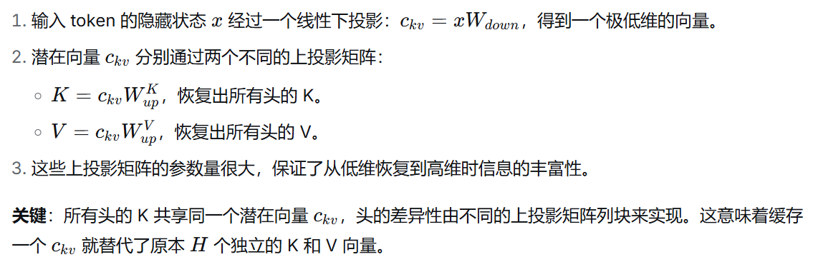{.ocr-src}

---

#### 为什么 MLA 能大幅减少推理时的键值缓存，而不显著损失性能？

MLA 之所以能“白嫖”极高的压缩比，是因为它把信息存储从缓存转移到了参数。

- 缓存里放的是实例化信息（每个 token 的具体 K、V），占空间大。

- 参数里放的是结构化知识（上投影矩阵），占空间固定，不随序列增长。

- 注意力中不同头的 K、V 高度冗余，MLA 通过低秩共享表示剔除了冗余。潜在向量只保留不可再压缩的核心差异，而将如何展开到各个头的信息固化在上投影矩阵中。

- 从信息瓶颈角度看，$d_{latent}$ 虽然小，但上投影矩阵提供了巨大的“译码”容量，足以还原出高质量的 K、V。
- 实验证明，只要 $d_{latent}$ 选得合适（通常几百维），模型性能可以持平甚至优于 MHA（低秩结构本身就有正则化作用）。

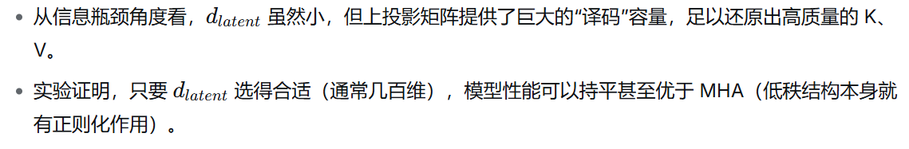{.ocr-src}

本质：MLA 用固定的模型参数换取了随序列增长的可变缓存，因此序列越长，MLA 的相对优势越大。

---

#### MLA 的压缩率大约是多少？具体由什么决定？

压缩率 = $\frac{2\times H\times d_k}{d_{latent}}$（若 K、V 共享同一个潜在向量，缓存元素数为 $d_{latent}$）。

- DeepSeek-V2 中，$H=128$，$d_k=128$，总 KV 维度为 16384。$d_{latent}$ 被设为 512。若 K、V 共享潜在向量，压缩比高达 $2\times16384/512\approx64$ 倍。
- 若 K、V 各有独立的潜在向量（部分设计），压缩比约为 32 倍。

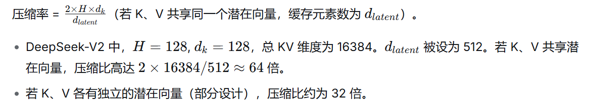{.ocr-src}

决定因素：

- $d_{latent}$ 的大小：越小压缩率越高，但太小会限制模型表达力。
- 模型规模（$H$ 和 $d_k$）：模型越大，MLA 的压缩收益越惊人。
- 是否共享潜在向量：共享可使压缩比翻倍。

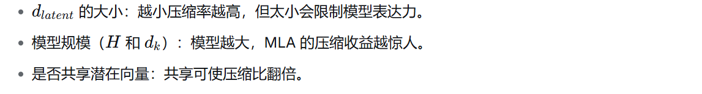{.ocr-src}

---

#### 训练 MLA 模型时，是否需要额外的损失函数来约束潜在空间？

不需要。 MLA 完全通过标准的下一个 token 预测损失来端到端训练。低秩结构只是一个架构上的约束，梯度自然通过上投影矩阵流回潜在向量，模型自动学习如何利用这个信息瓶颈。

没有辅助损失、没有正则项、没有特殊的初始化。这正是 MLA 的工程优势之一——训练流程与标准 Transformer 几乎一致。

---

#### MLA 与 GQA 相比，在压缩 KV Cache 的思路和效果上有何不同？

| 特性 | GQA | MLA |
| --- | --- | --- |
| **压缩维度** | 减少 KV 的**头数**（数量维度） | 压缩 KV 的**特征维度**（质量维度） |
| **缓存大小** | $2\times L\times G\times S\times d_k$，G 为组数 | $L\times S\times d_{latent}$（共享潜在向量时） |
| **压缩比** | 通常几倍到十几倍 | 几十倍到上百倍 |
| **多样性来源** | 不同组有独立 K、V，组内共享 | 所有头共享潜在空间，通过上投影差异化 |
| **参数量** | 减少 K、V 投影参数 | 增加低秩分解参数，总量可控 |
| **实现难度** | 低，已广泛支持 | 高，需要定制内核 |

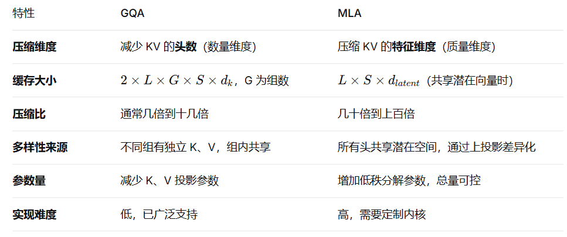{.ocr-src}

核心区别：GQA 是“用更少的头”，MLA 是“用更少的维度”。MLA 压缩得更彻底，因为它直接从向量的维度上做文章，而不是仅仅合并冗余的头。在极长上下文场景下，MLA 的收益远超 GQA。

---

#### 如果只压缩 K，不压缩 V，是否可行？和 MLA 有什么差异？

可行，但收益减半。KV Cache 中 K 和 V 各占一半，只压缩 K 最多将总缓存降低约 50%（相对于 MHA），而 MLA 联合压缩可将缓存降低 30-60 倍。

更重要的是，K 和 V 在功能上是耦合的——好的键匹配需要对应的值内容来支撑。如果 V 不压缩，K 被极度压缩后可能无法提供足够的匹配信息，导致 V 的丰富性无法被有效利用。MLA 的联合压缩让 K 和 V 共享同一个低维表示，保证它们的信息是协调的。

此外，单独压缩 K 而不压缩 V，意味着缓存中 V 仍占据大量空间，当序列极长时，V 的读取本身成为新的带宽瓶颈。MLA 同时对两者压缩，是从缓存大小和带宽两个维度同时优化。

---

#### 解释 MLA 的“解耦旋转位置编码”设计，为什么 RoPE 不能直接加到压缩后的 K 上？

RoPE 需要作用在每个头独立的 K 和 Q 上，因为它通过旋转来编码相对位置，而旋转是头特定的。

MLA 的潜在向量 $c_{kv}$ 是所有头共享的，如果直接对 $c_{kv}$ 施加 RoPE，那所有头的 K 都会带上相同的位置信息，头之间的差异被抹杀，注意力模式会严重退化。

解耦设计：

- K 被拆成两部分：**内容部分**（从 $c_{kv}$ 上投影得到，不加 RoPE）和**位置部分**（从一个独立的位置编码向量通过上投影得到，施加 RoPE）。

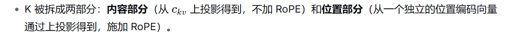{.ocr-src}

- Q 同样拆成内容和位置两部分。

- 注意力分数 = 内容 Q × 内容 K + 内容 Q × 位置 K + 位置 Q × 内容 K。

这样，位置信息通过专门的位置通道注入，不与共享的内容潜在空间冲突。这个设计是 MLA 能够实际工作的关键，它巧妙地在极限压缩和位置感知之间架起了桥梁。

---

#### 在 MLA 中，Q 是否也被压缩了？为什么？

在 DeepSeek-V2 的 MLA 中，Q 同样也被低秩压缩了，但动机与 KV 压缩不同。

- **压缩 Q 的目的**：不是为了减少 KV Cache（Q 在推理时根本不需要缓存），而是为了**降低训练时的参数量和激活内存**。Q 的投影矩阵 $W_Q$ 尺寸为 $d_{model}\times H\times d_k$，在多头上参数巨大。通过同样的低秩分解，将其拆分为下投影和上投影，可以大幅削减训练时的权重矩阵尺寸和梯度内存。

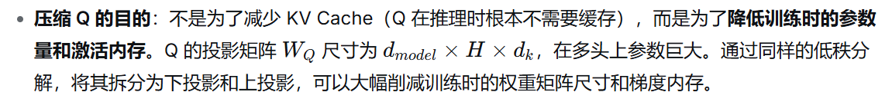{.ocr-src}

- Q 的缓存无关性：在自回归推理时，每步只需计算当前 token 的 Q，历史 Q 不需要保留。因此，即使 Q 被压缩，也不会对推理缓存产生任何影响。MLA 对 Q 的低秩处理纯粹是训练效率优化，与推理时 KV Cache 的压缩是解耦的。

- 对性能的影响：实验表明，对 Q 施加低秩约束通常不会损害模型质量，甚至有时能起到轻微正则化的作用。但过激的压缩（极小潜在维度）可能限制查询的多样性，因此需要平衡。

因此，MLA 对 Q 的压缩是“顺手”做的训练优化，其核心创新和最大收益始终在于 KV Cache 的极致压缩。

---

#### DeepSeek-V2/V3 使用的 MLA 配置是怎样的？有多少个头、潜在维度？

根据 DeepSeek-V2 的技术报告和开源信息，其 MLA 的典型配置如下：

- 总参数量：DeepSeek-V2 约 236B 参数，DeepSeek-V3 在此基础上进一步扩展。

- 头数：注意力头数 $H$=128，每头维度 $d_k$=128。因此标准 MHA 下 KV 总维度为 128×128=16384。

- 潜在维度：KV 的潜在空间维度 $d_{latent}$ 被设置为 512。这意味着每个 token 每层仅需缓存一个 512 维的向量，而不是原本的 16384 维的 K 和 V 各一份。

- 压缩比：若 K 和 V 共享同一个潜在向量，缓存大小从 2×16384 降为 512，压缩比高达 64 倍。若 K 和 V 分别有独立的潜在向量，压缩比约为 32 倍。

- Q 的潜在维度：Q 也被低秩压缩，其潜在维度通常设为与 KV 的潜在维度相同或更大一些（例如 1536），以保留查询的多样性。

- 解耦位置编码：额外引入位置编码向量，维度远小于 $d_k$，用于施加 RoPE，不参与低秩压缩。

这个配置使得 DeepSeek-V2 能够在保持强大性能的同时，将 KV Cache 的显存需求降低了约一个数量级，直接支撑了其超长上下文（如 128K token）的高效推理。

---

#### 实现 MLA 的前向传播时，需要注意哪些数值稳定性问题？

MLA 在前向传播中面临与标准注意力类似的数值稳定性挑战，并且由于其低秩上投影操作，有一些额外风险需要注意：

- Softmax 的溢出与下溢：与标准注意力相同，注意力分数可能因数值过大而导致 exp 溢出。必须使用 online softmax（或 FlashAttention 内置的稳定版本），动态减去最大值以保证数值稳定性。

- **低秩上投影的数值范围**：潜在向量 $c_{kv}$ 的值通常较小，但通过上投影矩阵 $W_{up}$ 映射到高维时，可能产生较大的数值范围。如果上投影矩阵初始化或训练不当，K、V 的范数可能过大，导致注意力分数进入 softmax 的饱和区，梯度消失。因此，需要谨慎初始化上投影矩阵（如使用较小的标准差），并在训练早期监控 K、V 的范数。

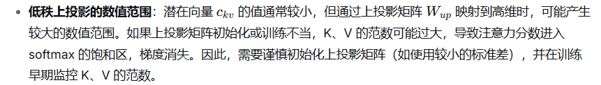{.ocr-src}

- 位置编码与内容向量的融合：解耦的 RoPE 路径中，内容部分和位置部分的相加必须保证数值量级匹配。如果位置向量的范数远大于内容向量（或反之），softmax 前的分数分布会偏向某一路径，破坏平衡。通常需要对位置编码向量进行适当的缩放。

- FP16/BF16 的精度问题：在混合精度训练中，上投影涉及大矩阵乘法，可能因 FP16 的动态范围不足而产生 NaN 或 Inf。推荐使用 BF16（有更大的指数位），或在 MLA 的上投影计算中强制使用 FP32 累加。

- 分块计算中的统计量维护：与 FlashAttention 类似，MLA 在分块实现时，每块的 online softmax 统计量（最大值、分母）需要正确维护和更新，尤其是在 K、V 是从潜在向量动态恢复时，不可出错。

只要遵循与标准 Transformer 相同的数值安全准则，并对上投影部分进行合理的初始化和精度控制，MLA 可以稳定训练。

---

#### MLA 在推理时，如何与 PagedAttention 配合使用？

MLA 与 PagedAttention 可以完美配合，并且这一组合是 DeepSeek 推理服务高效性的关键。

- PagedAttention 的角色：管理 KV Cache 内存的分配、回收和访问。它将缓存切分为固定大小的页面（blocks），允许不同请求的缓存非连续存放，消除了内存碎片。

- MLA 的缓存对象：在 MLA 中，每 token 的缓存不是高维的 K、V，而是极小的潜在向量 $c_{kv}$。PagedAttention 直接管理这些潜在向量页面，而不是通常的 K、V 页面。

- 推理流程：

1. 生成新 token 时，计算其 $c_{kv}$ 并存入 PagedAttention 管理的页面中。
2. 计算注意力时，从页面加载历史 $c_{kv}$（极小的数据量），通过轻量级的上投影矩阵实时恢复出 K 和 V。由于上投影是固定的权重矩阵，可以高效实现。
3. 可以将上投影矩阵的一部分与注意力计算融合：例如，$QK^T = Q(c_{kv}W_{up}^K)^T = (QW_{up}^{K,T})c_{kv}^T$。这样连显式的 K 都不需要生成，直接在注意力计算中消耗潜在向量。

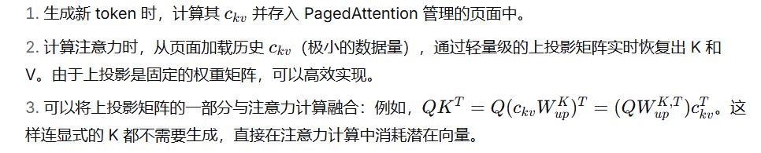{.ocr-src}

- 收益：MLA 将每个缓存页面的大小压缩了数十倍，同样的显存可以容纳更长的上下文或更大的批处理。PagedAttention 负责高效调度这些小块页面，FlashAttention 负责极速的注意力计算。三者共同构成了现代大模型长上下文推理的完整方案。

因此，MLA 与 PagedAttention 的结合是自然且高效的，PagedAttention 管理“压缩后的页面”，MLA 负责“压缩与解压”。

---

#### MLA 对训练吞吐量有影响吗？为什么？

有一定影响，但总体来说可以在同等计算预算下训练更大的模型或更长的序列。

- 增加的计算开销：MLA 引入了额外的低秩投影层（下投影和上投影）。每个 token 需要额外计算 $x → c_{kv}$ 和 $c_{kv} → K, V$。这些是小矩阵乘法，FLOPs 增加比例通常在 1-3%，相对较小。

- 减少的通信和显存：由于 KV 不再需要以完整高维形式在设备间传输（例如在张量并行中），MLA 可以减少 All-Reduce 或 All-to-All 的通信量。同时，训练时无需为所有头存储庞大的激活中间值，降低了显存压力，使得可以使用更大的 micro batch size，从而可能提升整体吞吐。

- 与 FlashAttention 的协同：MLA 的上投影可以在 FlashAttention 的分块循环内部完成，不增加 HBM 读写。优化良好的实现中，MLA 的训练吞吐下降很小（1-3%），甚至在某些长序列场景下，因显存节省带来的批次增大，总吞吐反而提升。

- 对大规模训练的正向作用：对于千亿参数模型，通信和显存是制约训练规模的关键。MLA 通过压缩表示，有效缓解了这两方面的压力，使得在相同硬件上可以训练更长的上下文或更深层的模型。

综上，MLA 的训练开销可控，其节省的显存和通信带宽在长序列训练中会转化为净收益。

---

#### 能否将 MLA 的思想应用于 FFN，压缩 FFN 的中间表示？

理论上可以，但实际收益有限，且可能损害 FFN 的知识存储能力。

- FFN 与注意力的本质区别：FFN 的中间层是“知识存储”的主要场所，其高维特征（通常 `4×d_model`）对于记忆海量事实和模式至关重要。对其进行低秩压缩等同于限制了模型的知识容量，可能导致事实性知识严重丢失。

- FFN 中间表示无需缓存：FFN 是逐 token 计算的，其激活值在推理时不需要缓存（不会随序列长度累积）。因此，没有“FFN Cache”的概念，压缩的主要动机——节省 KV Cache——在 FFN 中不成立。

- 仅出于参数削减的目的：可以通过低秩分解（如 SVD）压缩 FFN 的权重矩阵，减少参数量。但现代大模型已经趋向于在训练后对 FFN 进行剪枝或量化，而非在训练时施加低秩约束。低秩 FFN 可能会限制模型的学习能力，导致收敛更慢或最终性能下降。

- 例外情况：在一些极轻量化的模型中，可能会对 FFN 使用低秩适配器（如 LoRA），但这是一种微调策略，而非重新设计 FFN 来节约缓存。

因此，MLA 的思想是为解决“缓存过大”这一特定问题量身定制的，直接迁移到没有缓存需求的 FFN 上，既无必要，也可能有害。

---

#### MLA 的潜在维度如何选择？太大会怎样，太小会怎样？

潜在维度 $d_{latent}$ 是 MLA 最核心的超参数，它直接决定了压缩率与模型性能之间的权衡。

- $d_{latent}$ **太小**：

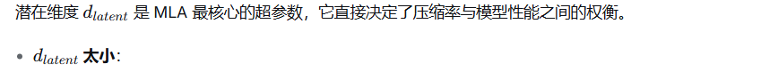{.ocr-src}

- 压缩率极高，缓存极小。

- 信息瓶颈过紧，可能无法保留足够的键值特征用于精确的注意力检索和值聚合，导致模型语言建模困惑度上升，下游任务性能下降。

- 上投影矩阵可能难以弥补信息的严重丢失，出现欠拟合。

- $d_{latent}$ **太大**：

{.ocr-src}

- 压缩率降低，缓存节余减少，MLA 的优势减弱。

- 接近原始 K、V 的总维度时，MLA 退化为标准 MHA（但带有冗余的低秩结构），不但没有缓存收益，还额外增加了低秩投影的计算和参数开销。

- 过大的潜在空间可能保留太多冗余信息，降低低秩正则化的益处。

- **选择依据**：通常通过在小规模消融实验中，绘制不同 $d_{latent}$ 下的困惑度-缓存大小曲线，找到拐点。DeepSeek-V2 选择 512（约为原始 KV 维度的 1/32），在几乎不损失性能的前提下实现了约 64 倍的缓存压缩。一般而言，可以尝试从 $d_{latent}=H\times d_k/32$ 到 $H\times d_k/16$ 开始搜索。

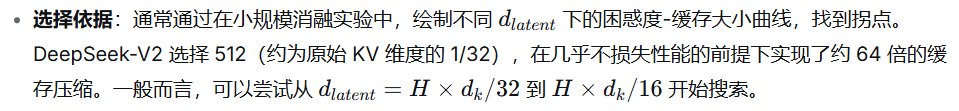{.ocr-src}

关键是在性能和效率之间找到帕累托最优点，这依赖于模型规模、训练数据量和目标任务。

---

#### 从线性代数角度，MLA 可以看作是在做什么？

从线性代数视角，MLA 对键（和值）投影矩阵 $W\in\mathbb{R}^{d_{model}\times(H\cdot d_k)}$ 施加了一个**硬性的低秩约束**。

- **矩阵分解**：它将权重矩阵分解为两个低秩矩阵的乘积 $W=AB$，其中 $A\in\mathbb{R}^{d_{model}\times d_{latent}}$ 是下投影矩阵，$B\in\mathbb{R}^{d_{latent}\times(H\cdot d_k)}$ 是上投影矩阵。由于 $d_{latent}$ 远小于 $d_{model}$ 和 $H\cdot d_k$，$W$ 的秩被限制为不超过 $d_{latent}$。
- **动态分解**：对于每个输入 token $x$，线性层输出 $y=xW=(xA)B$。MLA 等效于先计算低维潜在向量 $c=xA$（压缩），再通过 $B$ 将其映射回高维空间（恢复）。这比直接使用全秩矩阵 $W$ 在计算和存储上更高效（尤其对于 KV Cache）。
- **信息论解释**：低秩分解迫使模型学习一个紧凑的潜在表示，这个表示需要捕获 K（以及 V）在多头间的共享结构。这可以看作是一种自动的去冗余和特征解耦。
- **与 SVD 的关系**：若 $W$ 是训练好的全秩矩阵，可对其做奇异值分解 $W=U\Sigma V^T$，然后取前 $d_{latent}$ 个奇异值和对应的奇异向量来低秩近似。但 MLA 的低秩结构是**端到端训练**出来的，不是事后近似，因此能更好地适应损失景观。

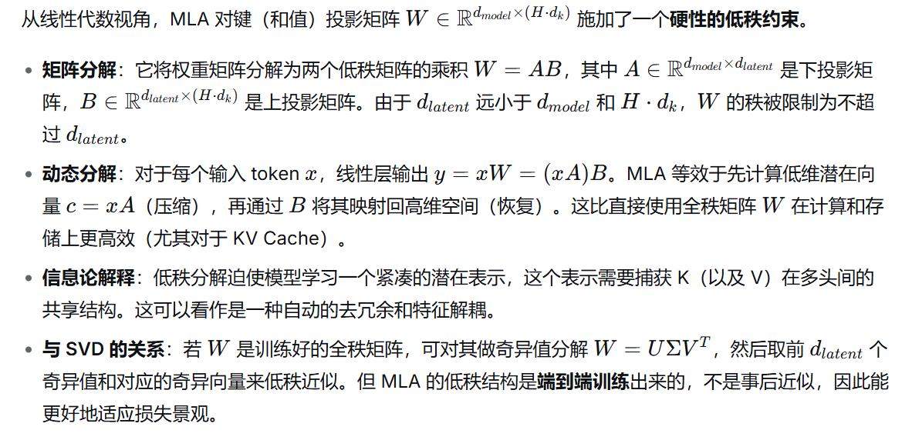{.ocr-src}

因此，MLA 本质上是一种结构化的低秩参数化，它将注意力的键值生成过程限制在一个低维子空间中，并利用这一约束极大地压缩了推理时需要的缓存信息。

---

#### 除了 DeepSeek 系列，还有哪些模型探索了类似 MLA 的方法？

低秩压缩注意力缓存的想法并非孤例，多个研究方向与此有交集：

- Linformer（2020）：通过低秩投影将 K 和 V 的序列长度维度压缩到固定小尺寸，实现线性复杂度。它与 MLA 压缩的维度不同（压缩序列长度 vs. 压缩特征维度），但都利用了低秩结构。

- Performer（2020）：使用随机正交特征映射来近似 softmax 核，隐式地对注意力矩阵进行低秩近似，避免计算完整的 $n\times n$ 矩阵。

- LoRA（Low-Rank Adaptation）：微调时在预训练权重旁添加低秩支路。这虽非直接压缩缓存，但证明了低秩结构在 Transformer 中的有效性和普适性。

- 多模态模型中的 Perceiver：使用极小的潜在向量池来交叉关注高维输入，思想类似于用低维瓶颈压缩信息。

- 一些自研的工业界方案：大型科技公司在内部可能试验了类似 MLA 的缓存压缩技术，但未公开发表。MLA 是第一个在大规模公开模型上将这一思想系统化并取得巨大成功的案例。

MLA 的独特之处在于，它显式地将低秩压缩应用于 K 和 V 的特征维度，并以极简的设计（共享潜在空间 + 解耦位置编码）实现了推理缓存的几十倍压缩，同时保持了强大的模型性能。

---

#### 如果要将一个已有的 MHA 模型转换为 MLA，需要重新训练吗？

需要重新训练，且基本等同于从头训练一个新模型。

- 架构已根本改变：MLA 不仅是在原始权重上加一个支路，而是完全替换了 K、V 的生成方式（增加了下投影和上投影，去除了原来的大矩阵）。这需要全新的参数矩阵，原有的 MHA 权重无法直接重用。

- 简单的权重转换不可行：可以尝试对原始 $W_K$ 矩阵进行 SVD 分解，取其低秩近似来初始化 MLA 的上、下投影矩阵。但这会引入显著的近似误差，且没有经过训练，模型性能会断崖式下降。

- 必须进行充分训练：即使是使用低秩近似初始化，也必须在大量数据上进行完整的预训练或至少大规模的继续训练，才能让模型适应新的低秩结构并恢复性能。微调数据量通常不足以完成如此剧烈的架构迁移。

- 最实际的路径：从零开始按照 MLA 架构设计并训练新模型，就像 DeepSeek-V2 所做的那样。这保证了所有权重都完美适配低秩结构，并通过完整的训练过程达到最优性能。

总之，MLA 是一种架构级的创新，而非一种即插即用的微调方法。从 MHA 转换到 MLA 的门槛极高，通常需要重新投入完整的训练资源。

