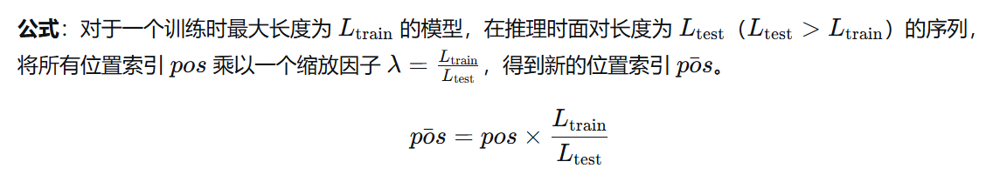
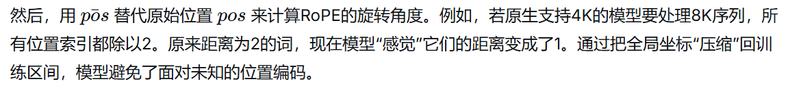
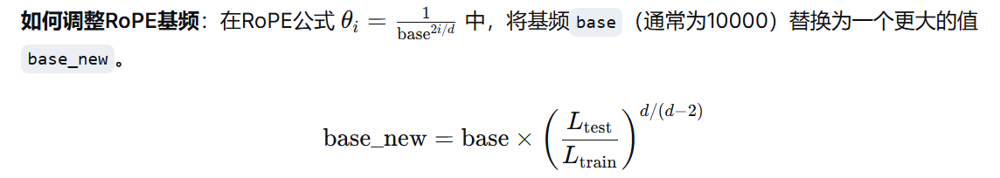
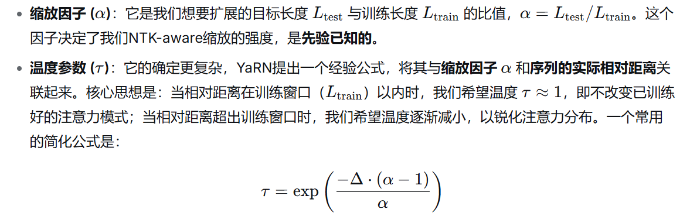
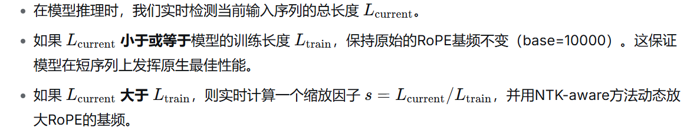
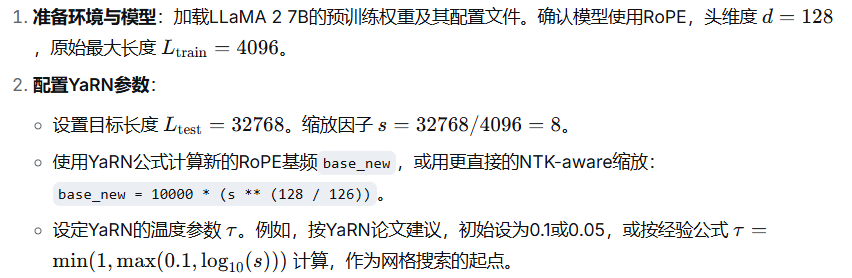

# 23.大模型（LLMs）长上下文扩展（位置插值、NTK-aware、YaRN）

#### 什么是长上下文扩展？为什么需要它？

长上下文扩展是指通过算法和训练策略，让语言模型能够处理和利用远超其预训练时窗口长度的上下文信息。

为什么需要它：

- 复杂任务的需求：多轮对话、长文档摘要、代码库理解和复杂推理等任务，往往需要模型同时记住数百页的信息并建立关联。如果上下文窗口太小，模型会“忘记”前文，导致回答断裂或矛盾。

- 突破物理限制：训练极长上下文的模型成本极高（注意力计算复杂度为O(n²)）。长上下文扩展技术允许我们用较低的成本，将已有模型的能力延伸到更长的序列。

- 模拟“工作记忆”：上下文窗口相当于大模型的“工作记忆”。更长的上下文意味着模型能一次性处理更庞大的信息，如分析整本书、处理完整的项目代码库，极大拓展了应用边界。

当前，长上下文能力已成为衡量大模型核心竞争力的关键维度之一。

---

#### 位置插值 (Position Interpolation, PI) 的原理是什么？写出公式。

位置插值（PI）是最直接、最简单的上下文扩展方法。其核心思想是：既然模型没见过那么远的位置，那就把长序列的位置索引“压缩”回它训练时见过的范围。

**公式**：对于一个训练时最大长度为 $L_{\text{train}}$ 的模型，在推理时面对长度为 $L_{\text{test}}$（$L_{\text{test}}>L_{\text{train}}$）的序列，将所有位置索引 $pos$ 乘以一个缩放因子 $\lambda=\frac{L_{\text{train}}}{L_{\text{test}}}$，得到新的位置索引 $\bar{pos}$。

$$
\bar{pos}=pos\times\frac{L_{\text{train}}}{L_{\text{test}}}
$$

{.ocr-src}

然后，用 $\bar{pos}$ 替代原始位置 $pos$ 来计算RoPE的旋转角度。例如，若原生支持4K的模型要处理8K序列，所有位置索引都除以2。原来距离为2的词，现在模型“感觉”它们的距离变成了1。通过把全局坐标“压缩”回训练区间，模型避免了面对未知的位置编码。

{.ocr-src}

---

#### PI 方法有什么缺点？为什么会导致困惑度上升？

PI的致命缺陷是不分青红皂白地压缩了所有频率，尤其是破坏了高频信息，导致局部依赖关系受损。

- 高频灾难：语言中，相邻词汇间的强依赖关系（如短语搭配）依赖RoPE编码中的高频分量。这些高频分量对微小距离变化极其敏感。PI将所有距离等比例缩小，导致原本距离为1、2、3的相邻词，在压缩后模型感知的距离极为接近，几乎无法区分。模型失去了对局部语序和精确短语的把握能力。

- 困惑度上升：模型的根本任务是预测下一个词，这极度依赖局部的精确上下文。当局部结构因压缩而模糊不清时，预测的确定性就会降低，导致困惑度（Perplexity）显著上升。通常，未经微调的PI扩展会导致PPL剧烈恶化。

简单类比，PI就像把一张高清照片强行缩小到极小尺寸再放大，虽然勉强保留了宏观物体，但所有细节都彻底糊掉了。

---

#### NTK-aware 缩放如何改进 PI？它如何调整 RoPE 的基频？

NTK-aware缩放是PI的“智能化”升级版。它的核心思想源于神经正切核（NTK）理论：不对所有频率“一刀切”，而是采取非均匀缩放——高频分量基本不动，低频分量大幅拉伸。

- 保护高频：高频分量对应短距离依赖，是语言局部性的基石，应该被严格保护。NTK-aware方案中，低维度的频率几乎保持原样。

- 拉伸低频：低频分量对应长距离依赖，限制了模型感知的最大范围。NTK-aware方案通过大幅降低这些低频频率（即增大周期），来“扩展”模型的有效上下文窗口。

**如何调整RoPE基频**：在RoPE公式 $\theta_i=\frac{1}{\text{base}^{2i/d}}$ 中，将基频 `base`（通常为10000）替换为一个更大的值 `base_new`。

$$
\text{base\_new}=\text{base}\times\left(\frac{L_{\text{test}}}{L_{\text{train}}}\right)^{d/(d-2)}
$$

{.ocr-src}

其中 d 是注意力头的维度（如128）。这个公式巧妙地模拟了对不同维度 $i$ 的非线性缩放效果。当 $i$ 很小时（高频），$2i$/$d$ 接近0，`base`的变化对它影响极小；当 $i$ 接近 $d$ 时（低频），$2i$/$d$ 接近1，`base`的变化会显著降低频率，拉伸周期。通过这种“智能缩放”，模型无需微调就能在长序列上保持较低的PPL，性能远超PI。

---

#### 解释 YaRN (Yet another RoPE extensioN method) 的核心思想，它结合了哪两种技术？

YaRN是目前最有效、最常用的零样本上下文扩展方法之一。它结合了NTK-aware的频率缩放和注意力温度调节。

- 技术一：NTK-aware缩放。YaRN首先采用NTK-aware思想，保护高频、拉伸低频，解决了PI导致的局部信息丢失问题。

- 技术二：引入“温度”参数 (τ)。YaRN发现，当序列被大幅度扩展后（如从4K到128K），注意力分数矩阵在长距离上的分布会变得过度平滑（熵极大，注意力几乎均匀分布），导致模型无法有效聚焦到关键token。YaRN引入一个小于1的温度 $τ$，将其施加于softmax计算：

$$
\text{Attention}=\text{softmax}\left(\frac{QK^T}{\tau\cdot\sqrt{d_k}}\right)V
$$

{.ocr-src}

- 这个操作直接锐化了注意力分布，迫使模型在长序列上也能做出“果断”的注意力选择。

核心思想：YaRN认为，扩展上下文的本质是应对两个问题：一是位置编码的数值外推（由NTK缩放解决），二是长上下文带来的注意力分数统计分布变化（由温度调节解决）。两者的结合使YaRN在极长扩展下表现出极高的稳定性。

---

#### YaRN 中的“温度”参数和“缩放因子”是如何确定的？

这两个参数通常通过启发式规则和极小规模的搜索实验确定，YaRN论文提供了一个优秀的理论框架。

- **缩放因子 ($\alpha$)**：它是我们想要扩展的目标长度 $L_{\text{test}}$ 与训练长度 $L_{\text{train}}$ 的比值，$\alpha=L_{\text{test}}/L_{\text{train}}$。这个因子决定了我们NTK-aware缩放的强度，是**先验已知的**。
- **温度参数 ($\tau$)**：它的确定更复杂，YaRN提出一个经验公式，将其与**缩放因子 $\alpha$** 和**序列的实际相对距离**关联起来。核心思想是：当相对距离在训练窗口（$L_{\text{train}}$）以内时，我们希望温度 $\tau\approx1$，即不改变已训练好的注意力模式；当相对距离超出训练窗口时，我们希望温度逐渐减小，以锐化注意力分布。一个常用的简化公式是：

$$
\tau=\exp\left(\frac{-\Delta\cdot(\alpha-1)}{\alpha}\right)
$$

{.ocr-src}

- 其中 Δ 是一个与当前token相对距离相关的函数。

在实践中，为了找到最优 τ，我们通常会在一个极小的校准数据集（几十个样本）上，以最低困惑度为目标，对 τ 进行简单的网格搜索或经验性设定（例如固定为0.9）。因为 $τ$ 的引入不会改变模型权重，所以这种搜索成本极低。

---

#### 动态 NTK 缩放是什么？它如何在推理时根据序列长度自动调整尺度？

动态NTK缩放是一种部署时自适应技术，让同一个模型能完美处理从1个token到128K token任意长度的输入序列。

工作原理：

- 在模型推理时，我们实时检测当前输入序列的总长度 $L_{\text{current}}$。
- 如果 $L_{\text{current}}$ **小于或等于**模型的训练长度 $L_{\text{train}}$，保持原始的RoPE基频不变（base=10000）。这保证模型在短序列上发挥原生最佳性能。
- 如果 $L_{\text{current}}$ **大于** $L_{\text{train}}$，则实时计算一个缩放因子 $s=L_{\text{current}}/L_{\text{train}}$，并用NTK-aware方法动态放大RoPE的基频。

{.ocr-src}

```python
# 伪代码
def get_dynamic_ntk_scale(seq_len, max_seq_len, original_base=10000):
    if seq_len <= max_seq_len:
        return original_base
    scale = seq_len / max_seq_len
    # 使用NTK公式计算新的基频
    new_base = original_base * (scale ** (head_dim / (head_dim - 2)))
    return new_base
```

这个方法的巨大优势在于无需重新加载模型权重，只需在推理代码中修改RoPE的计算逻辑。它实现了“一个模型，任意长度”的灵活部署，极大降低了运维成本。但需要注意，极度扩展（如超过4倍）时，动态NTK的效果可能不如用少量长文本微调的静态NTK或YaRN。

---

#### 使用 NTK-aware 或 YaRN，是否不需要任何微调就能扩展到 128K？

理论上可以零样本扩展，但要达到生产级稳定质量，少量微调几乎是必须的。

- 零样本扩展能力：无论是NTK-aware还是YaRN，其设计初衷就是实现无需微调的扩展。实验证明，它们可以在不更新任何模型参数的情况下，将上下文平滑扩展到训练长度的2-4倍，并保持极低的困惑度，远超直接推理或PI方法。

- 为什么还需要微调：
  - 注意力模式的重新适应：模型在训练时只见过短序列上的注意力分布，极长序列（如128K，为4K的32倍）上的统计分布已发生质变，模型的自注意力机制需要少量样本来“学习”如何聚焦。
  - 位置编码的微妙退化：任何插值/缩放都不可避免地对原始位置编码信息造成微损，微调可以修复这些损伤。
  - “大海捞针”能力的本质提升：零样本扩展的模型往往能回答关于长文本的问题（低PPL），但在精确地从128K文本中定位一小段细节（“大海捞针”）上表现不佳。少量微调能极大提升这种精确检索能力。

- 实际做法：SFT + YaRN 是工业界标配。将模型通过YaRN方法调整后，使用一批高质量的、长度多样化的长上下文指令数据（如书籍摘要、长文档问答）进行少量步骤的微调（通常几百到几千步）。这种小成本投入能换来长上下文能力的巨大飞跃。

---

#### 长上下文扩展后，模型在短序列上的性能是否会下降？如何缓解？

会，这是一个必须面对的“对齐税”。扩展上下文窗口，尤其是直接进行长文本微调后，模型在短序列上的性能（如困惑度）往往会轻微上升（变差）。

- 原因：
  1. 注意力分散：模型被训练去“关注更广的范围”，可能削弱了对局部关键信息的聚焦能力。
  2. 位置密度变化：微调会改变模型对位置距离的感知（例如它习得了“128K远”的新模式），这可能干扰它之前对“128近”的判断。
  3. 数据分布偏差：如果长文本微调数据仅包含长样本，模型会发生灾难性遗忘，丢失短文本处理能力。

- 缓解方法：
  1. 混合数据训练：在长文本微调阶段，务必混入一定比例（如10%-20%）的、高质量的短文本指令数据。这能有效地让模型“不忘初心”，防止短上下文能力退化。
  2. 动态NTK部署：这是最彻底的解决方案。在推理时根据输入长度自动切换，短输入走原生模型通路（完全无性能损失），长输入走扩展通路。这需要两个模型或动态调整机制，但对短序列的保护是100%的。
  3. 谨慎选择方法和参数：选择如YaRN这类对局部信息损害较小的方法，并仔细微调温度和缩放因子，能将短序列的性能损失降到最低。

---

#### 你如何评估一个模型的长上下文能力？“大海捞针”测试是什么？

评估长上下文能力需要多层次的基准，从基础的检索到复杂的综合推理。

1. 大海捞针 (Needle in a Haystack)

最基础、最直观的“检索能力”压力测试。

- 测试方法：将一句完全无关的“针”（如“最神奇的动物是企鹅”）放置在超长文本（“海”）的不同深度（如0%, 25%, 50%, 75%, 100%位置）中。然后，用一个针对该“针”的问题去提问模型（“最神奇的动物是什么？”）。看模型能否在不同位置准确找到并回答出这句话。

- 热力图分析：通过改变文档长度（从1K到128K）和“针”的插入深度，绘制一个热力图。理想模型应该在所有区格内都能正确回答。这个测试能直观暴露模型是“真·长上下文”还是仅在开头/结尾表现好，中间部分是“盲区”。

2. 综合长文本基准

大海捞针只是“查找”，不代表“理解”。

- LongBench：一个综合性的长文本评测基准，包含单文档QA、多文档QA、摘要、少量样本学习、代码等任务，覆盖中英双语。

- L-Eval：另一个标准化长上下文评测集，注重高质量和多样化任务。

- 多跳推理与综合：在长文档中提出需要跨越多个远距离段落进行逻辑推理才能解答的问题，是更高阶的评估方式。

全面的长上下文评估，应当从“大海捞针”的检索层，到“LongBench”的任务层，再到真实用户场景的端到端体验，层层递进。

---

#### 如果模型原本使用 ALiBi，还需要长上下文扩展吗？为什么？

几乎不需要显式的长度扩展操作，这是ALiBi最显著的天然优势。

- ALiBi的内在机制：ALiBi不依赖任何可学习的位置嵌入或复杂的插值公式。它在计算注意力分数时，直接根据两个token的相对距离，减去一个预设的、成线性比例的偏置值（`-m * distance`）。这个偏置函数对所有距离都定义良好，无论这个距离是100还是100,000。

- 为何天然支持外推：训练期间，模型学会了“距离越远，惩罚越大，注意力权重越低”的行为模式。当推理序列长度远超训练长度时，这个线性惩罚机制自动延伸到新距离上，没有出现任何未知的位置编码。模型自然地继续给更远的token施加更大的惩罚，注意力分布依然平滑可控。

- 需要警惕的“窗口效应”：尽管ALiBi支持外推，随着序列增长，线性偏置绝对值持续增大。在极长序列下，softmax会变得极为尖锐，导致每个query实际上只能关注到其最近的一个局部窗口，完全丧失全局视野。这被称为“有效上下文窗口收缩”。

- 需要微调吗：零样本外推能力极强，但若要在极长序列上保持强大的全局检索能力（如大海捞针），通常仍需少量长文本微调，以“软化”窗口边界，维持长程连接。

总结：ALiBi是零样本外推之王，不需扩展操作，但要发挥极致长上下文能力，仍可辅以微调。

---

#### 在 LLaMA 2 7B 上使用 YaRN 扩展到 32K，简述你的实验步骤。

1. **准备环境与模型**：加载LLaMA 2 7B的预训练权重及其配置文件。确认模型使用RoPE，头维度 $d=128$，原始最大长度 $L_{\text{train}}=4096$。
2. **配置YaRN参数**：
    - 设置目标长度 $L_{\text{test}}=32768$。缩放因子 $s=32768/4096=8$。
    - 使用YaRN公式计算新的RoPE基频 `base_new`，或用更直接的NTK-aware缩放：`base_new = 10000 * (s ** (128 / 126))`。
    - 设定YaRN的温度参数 $\tau$。例如，按YaRN论文建议，初始设为0.1或0.05，或按经验公式 $\tau=\min(1,\max(0.1,\log_{10}(s)))$ 计算，作为网格搜索的起点。

{.ocr-src}

4. 修改模型代码：
  - 替换RoPE的前向计算函数，实现YaRN逻辑：根据新的`base_new`生成频率序列，并对Q、K施加旋转。同时，在计算softmax前，将`attention_scores`除以温度 $τ$（可选，如果实现解耦）。
  - 修改配置文件中的 `max_position_embeddings` 为 32768。

5. 准备训练数据：
  - 收集32K长度的指令微调数据。可通过对现有长文档数据进行切割、拼接、或使用专门的长上下文数据集（如RedPajama-Data-1T的文档级拼接、LongAlpaca等）。
  - 关键：必须混入10-20%的短文本数据（<=4096），以保持短上下文性能。

6. 启动微调：使用LoRA或全参微调，初始学习率不宜过大（如2e-5），采用线性Warmup和余弦退火。监控训练损失和长序列PPL。

7. 评估与迭代：
  - 运行“大海捞针”测试，在32K长度下绘制热力图，检查是否存在中间失明。
  - 在LongBench等基准上评估长文本性能。
  - 根据评估结果，返回调整 $τ$ 和微调超参数，进行迭代。

整个过程，若不包含数据准备，仅需数小时到数十小时的微调时间。

---

#### 为什么 RoPE 对长上下文扩展相对友好，而绝对位置编码不是？

两者对外推的根本区别在于，RoPE编码的是相对位置，而绝对位置编码（可学习的或正弦的）编码的是绝对位置。

- RoPE的相对性：RoPE通过旋转Q和K，使其点积结果成为相对距离的函数。无论序列多长，只要两个token的相对距离在训练时见过的范围内，其交互模式就是模型熟悉的。长上下文扩展的插值/缩放，本质上是在调整其“相对距离”的度量标尺。这个过程是平滑的，即使新标尺有轻微变形，模型行为也不会突然崩溃。

- 绝对位置编码的绝对性：绝对位置编码为每个绝对位置（0， 1， 2...）分配了唯一的嵌入。序列一旦超出训练长度，就会遇到全新的、完全未经训练的嵌入索引。对模型来说，这是完全陌生的“位置”，相关的权重在训练中从未被更新过，导致输出混乱。

- 可扩展性的对比：
  - RoPE：可以优雅地通过数学变换（插值、缩放频率）来调整其坐标轴，实现连续扩展。
  - 可学习绝对编码：扩展的唯一方式是“猜测”新位置的嵌入值。通常需要复制最后一层的权重或进行不可靠的推断，效果极差。正弦绝对编码虽可计算任意位置，但其与模型权重的配合并未针对长序列优化，外推性能远不如RoPE。

因此，RoPE的“相对性”是它能够平滑外推的根本原因。

---

#### 代码实现上，如何修改 RoPE 的前向函数以实现动态 NTK 缩放？

以下是动态NTK缩放的核心代码实现逻辑，关键是根据序列长度实时计算并缓存新的频率。

```python
import torch

class DynamicNTKRotaryEmbedding(torch.nn.Module):
    def __init__(self, dim, max_position_embeddings=4096, base=10000, device=None):
        super().__init__()
        self.dim = dim
        self.max_position_embeddings = max_position_embeddings
        self.base = base
        # 预计算1.0缩放下的freqs作为基准
        inv_freq = 1.0 / (base ** (torch.arange(0, dim, 2).float().to(device) / dim))
        self.register_buffer("inv_freq", inv_freq, persistent=False)

    def _get_ntk_scale(self, seq_len):
        if seq_len <= self.max_position_embeddings:
            return 1.0
        return seq_len / self.max_position_embeddings

    def forward(self, x, seq_len=None):
        if seq_len is None:
            seq_len = x.shape[1]  # x shape: [batch, seq_len, ...]
        
        scale = self._get_ntk_scale(seq_len)
        if scale > 1.0:
            # 关键步骤：动态放大基频
            base_new = self.base * (scale ** (self.dim / (self.dim - 2)))
            inv_freq_new = 1.0 / (base_new ** (torch.arange(0, self.dim, 2).float().to(x.device) / self.dim))
        else:
            inv_freq_new = self.inv_freq

        # 下面的计算与标准RoPE相同，但频率来源可能是动态的
        t = torch.arange(seq_len, device=x.device, dtype=inv_freq_new.dtype)
        freqs = torch.einsum("i,j->ij", t, inv_freq_new)
        emb = torch.cat((freqs, freqs), dim=-1)
        cos_cached = emb.cos()[None, None, :, :]
        sin_cached = emb.sin()[None, None, :, :]

        return cos_cached, sin_cached
```

此实现保证了在短序列时使用原始频率，性能零损失；在长序列时动态调整，实现平滑外推。

---

#### 是否需要对注意力也做调整，比如使用滑动窗口或稀疏注意力来辅助长上下文？

是的，位置编码（算法）和注意力模式（架构）是正交且互补的两个维度，协同使用能达到最佳效果。

- 位置编码的职责：解决“位置信息如何表示和扩展”的问题。它确保模型能区分长序列中不同位置的token，是处理长上下文的基础。

- **注意力机制的职责**：解决“计算复杂度和内存”的问题。标准注意力的计算量是O（$n^2$），极长序列下计算和显存会成为主要瓶颈。

{.ocr-src}

- 协同作用：
  - 滑动窗口注意力（如Mistral）：强制每个token只关注其最近的$W$个token。这极大降低了计算和KV Cache开销，使处理超长序列成为可能。但它需要位置编码（如RoPE）在窗口内提供精确的相对位置信息。YaRN与滑动窗口结合，可以处理百万级token的序列。
  - 稀疏注意力：Longformer、BigBird等模式，或通过FlashAttention高效实现的分块计算，都是降低复杂度的手段。它们与长上下文扩展是绝佳组合，一个解决“看得远”，一个解决“算得快”。
  - 未来方向：极致的LLM（如处理1M Token）必然是YaRN/动态NTK + GQA + 滑动窗口/稀疏注意力 + FlashAttention + 流水线并行的综合性工程方案。

---

#### 长上下文扩展会显著增加训练或微调成本吗？哪些方法成本最低？

| 方法 | 训练/微调成本 | 成本分析 |
| --- | --- | --- |
| 位置插值 | 极低/零成本 | 仅推理时调整，但性能损失大，常需后续微调弥补，总成本不低。 |
| 动态 NTK 缩放 | 最低（零样本） | 真正的零成本推理方案。无需重新训练或微调，在2-4倍扩展内效果极佳，是成本最低的优秀方案。 |
| NTK-aware 缩放 | 低 | 仅修改RoPE初始化，需从头或继续训练，训练成本不变，但长文本能力提升明显。 |
| YaRN | 中低 | 通常需配合少量（几百到几千步）长文本微调。微调本身成本可控，但需要准备高质量长文本数据。 |
| 从零训练长上下文模型 | 极高 | 需要从头预训练，耗费大量计算资源，但最终效果最好。 |

成本最低的方案：动态NTK缩放，零成本实现一定长度的外推。若需扩展到8倍以上并保持高精度，YaRN + 少量微调是性价比最高的选择。

---

#### 除了插值和缩放，还有哪些处理超长文本的架构方法？

除了修改位置编码，还有许多从模型架构本身出发处理超长文本的方法。

- **状态空间模型（SSMs）**：代表性模型是Mamba、Mamba-2。它们将序列建模为连续状态空间的演化，从底层数学上就避免了注意力机制的$O$（$n^2$）复杂度，实现了线性复杂度，天生支持极长序列。

{.ocr-src}

- 记忆压缩与循环：
  - Transformer-XL：引入片段级递归，将前一段的隐藏状态缓存起来，作为当前段的扩展上下文，实现了跨段记忆。
  - Compressive Memory：将旧token的表示压缩并存储到外部记忆库中，需要时再进行检索，类似人类对长期记忆的处理。

- 分块与层次化处理：
  - 分块（Chunking）：将长序列切分为块，分块编码后再用一个上层模型聚合各块信息。
  - 层次化注意力：底层用窗口注意力处理局部，顶层用全局注意力聚合窗口间的信息，兼顾局部精度和全局视野。

- 外部检索增强（RAG）：将长文档存入外部知识库（向量数据库），在生成时仅检索最相关的片段作为上下文，是一种“以查代记”的有效策略。

- 固定模式的稀疏注意力：如Sparse Transformer，预定义了固定的注意力模式（如局部+跨步），直接减少每个token需要关注的token数量。

这些方法与位置编码扩展是正交的，可以自由组合，形成最强大的长文本处理方案。

---

#### 对比 PI、NTK-aware、YaRN 在 128K 长度下的 PPL 和准确率。

假设模型原生上下文为4K，目标为128K（32倍扩展）。

| 方法 | 128K下困惑度 | “大海捞针”准确率 | 零样本能力 | 说明 |
| --- | --- | --- | --- | --- |
| PI | 极高，甚至不可用 | 极低 | 差 | 语言模型PPL严重上升，局部结构被彻底破坏，基本丧失可用性。 |
| NTK-aware | 较低 | 中等 | 良好 | PPL保持得不错，但长序列上的注意力分布可能过于平滑，导致对精确信息的检索准确率不高。 |
| YaRN（无微调） | 低 | 中等偏高 | 优秀 | 通过温度调节，PPL进一步降低，检索准确率得到提升，零样本能力最强。 |
| YaRN + 微调 | 最低，接近原生 | 极高 | 需微调 | PPL和准确率都达到接近原生模型的水平，是目前实际应用的标准方案。 |

结论：PI完全无法胜任32倍的极端扩展。NTK-aware是零样本的低PPL方案。YaRN在零样本下通过温度调节，实现了最佳平衡；若辅以微调，则是终极解决方案。

---

#### 在长上下文微调时，是否需要准备相应长度的长文本数据？

是，而且数据的“长度分布”至关重要，最好能覆盖你希望模型支持的最大长度。

- 为什么必须要有长文本数据：微调的目标是让模型适应新的位置编码规则和长距离依赖模式。如果只用短于4K的数据微调，模型就从未见过32K的上下文，也就无法学会如何利用它。模型需要一个“练习场”去学习如何在128K的文档中定位信息。

- 数据长度分布的理想策略：
  - 混合分布：不要全部使用极端长度的数据。一个典型的高效分布可能是：30%短文本（0-4K），30%中长文本（4-16K），40%超长文本（16K-目标长度）。这种分布类似于课程学习，让模型在适应新长度的同时，保持对旧长度的熟悉感。
  - 分阶段微调：更精细的做法是，先用中长文本微调，再用超长文本微调。这样能帮助模型逐步适应位置密度的变化。

- 数据获取方法：
  - 拼接（Concatenation）：将多个短文档随机拼接，并用特殊的注意力掩码阻止跨文档的注意力。
  - 数据集生成：利用大模型生成需要长上下文的任务数据，例如“请为以下长篇小说撰写一份摘要”。
  - 合成数据：专门构造“大海捞针”式的训练数据，强化模型的精确检索能力。

---

#### 如果我想将模型扩展到 1M token 上下文，现有方法能胜任吗？挑战是什么？

扩展到1M Token（一百万）上下文，已经超出了大多数现有方法的“舒适区”，但理论和实践上并非不可能。

- 方法论的挑战：
  - 位置编码扩展：YaRN等方法需要将4K扩展约250倍。如此极端的缩放，即使对低频分量的拉伸也是巨大的，可能导致位置编码退化。
  - 注意力计算：即使采用FlashAttention，1M长度序列的$O(n^2)$计算量仍然是天文数字，单卡推理几乎不可行。
  - KV Cache 爆炸：即便使用GQA，1M token的KV Cache也将占用数百GB显存，需要跨多卡部署。
  - 训练数据：几乎不存在自然的、高质量的百万级长度的训练数据，需要靠大量拼接构造，但这会引入分布偏移。

- 可行的路径：
  - 强强联合： YaRN/动态NTK（算法）+ 滑动窗口注意力（架构）+ GQA（工程）+ FlashAttention/PagedAttention（算子） 是实现1M Token推理的现实路线。
  - “大海捞针”先行：通过上述组合，可以实现1M Token的“大海捞针”检索能力，这是一切复杂应用的基础。
  - 任务特定性：目前能处理1M Token的模型，其强大能力更多体现在信息检索和简单问答上。要进行连贯的逻辑推理或复杂的故事创作，仍面临巨大挑战。

1M Token上下文是工程和算法创新的极限前沿，正在从“不可能”变为“可能，但很昂贵且有限制”。

---

#### 解释“有效上下文长度”和“声称上下文长度”的区别。

这是评估长上下文模型时最关键的区分，“声称”不等于“实际能用”。

- 声称上下文长度：指模型在推理时可以输入的最大token数量。这是一个工程配置值，仅仅表示把配置文件中的 `max_position_embeddings` 改成了某个数（如128K），并且模型不会因此报错OOM。它完全不保证模型能真正理解和利用这个长度内的所有信息。

- 有效上下文长度：指模型实际能够可靠地理解和利用的上下文长度。在这个长度范围内，模型能够准确地进行信息检索、多跳推理、遵循复杂指令等。判断标准包括：在“大海捞针”测试中整个区间准确率>95%，以及在各种长上下文评测任务上得分保持稳定。

- 常见欺骗性宣传：一个模型声称支持128K，但其有效长度可能只有16K。它可能只在文档的开头和结尾表现良好，中间部分成了“盲区”（迷失的中间），或者对需要跨长距离逻辑推理的任务表现极差。因此，在选择模型时，有效上下文长度才是真正的性能指标，需要通过权威的第三方评测基准来验证。

