#  24.大模型（LLMs）线性注意力机制概览

#### 标准点积注意力的复杂度是 O(n^2)，线性注意力如何将其降低到 O(n)？

标准自注意力的计算需要构建一个 `n × n` 的注意力分数矩阵，然后与 `V` 相乘。其复杂度为 O(n²d)。线性注意力通过改变计算顺序彻底避开了显式的注意力矩阵。

核心思想是用核函数将原始的 softmax 注意力近似为：

$$
\text{Attention}(Q,K,V)\approx\frac{\phi(Q)(\phi(K)^TV)}{\phi(Q)(\phi(K)^T\mathbf{1})}
$$

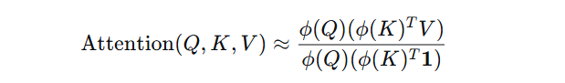{.ocr-src}

其中 $ϕ$ 是一个按元素作用的非线性变换（核函数）。我们首先计算 `K^T V`（大小为 `d × d`），这是一个与序列长度 `n` 无关的操作，其复杂度为 O(nd²)；然后再乘以 Q，整体复杂度降为 O(nd²)。当序列长度 `n` 远大于特征维度 `d` 时，这实现了 O(n) 级别的计算效率。这使得处理极长序列成为可能。

---

#### 写出线性注意力的一般形式，并使用核函数替换 softmax。

标准注意力：

$$
\text{Attention}(Q,K,V)=\text{softmax}\left(\frac{QK^T}{\sqrt{d_k}}\right)V
$$

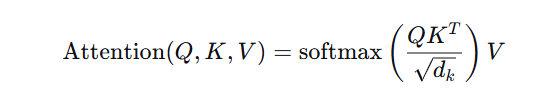{.ocr-src}

将其重写为一种通用的“相似度加权”形式：

$$
y_i=\frac{\sum_j\text{sim}(q_i,k_j)v_j}{\sum_j\text{sim}(q_i,k_j)}
$$

在标准注意力中，$\text{sim}(q,k)=\exp(q^Tk/\sqrt{d_k})$。

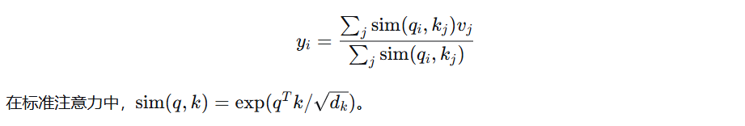{.ocr-src}

线性注意力将这个指数相似度替换为一个核函数的输出：

$$
\text{sim}(q,k)=\phi(q)^T\phi(k)
$$

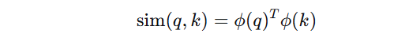{.ocr-src}

其中 ϕ(x) 是一个可设计的非线性特征映射。带入原始公式：

$$
y_i=\frac{\sum_j\phi(q_i)^T\phi(k_j)v_j}{\sum_j\phi(q_i)^T\phi(k_j)}=\frac{\phi(q_i)^T\sum_j\phi(k_j)v_j^T}{\phi(q_i)^T\sum_j\phi(k_j)}
$$

令 $S=\sum_j\phi(k_j)v_j^T$ 和 $Z=\sum_j\phi(k_j)$，这两个量可以在遍历一次序列后算出，然后每个 $y_i$ 只需与这个全局状态交互即可得出。

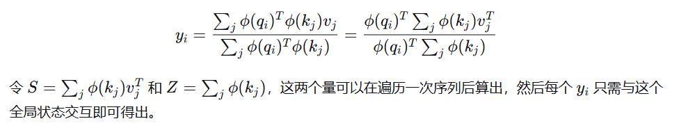{.ocr-src}

---

#### 线性注意力的常见核函数有哪些？

1. ELU + 1\
   来自论文《Transformers are RNNs》，选择 ϕ(x)=ELU(x)+1。ELU 在负值域平滑非零，加 1 保证所有值为正，避免分母为零且保留了非线性。

2. ReLU\
   最简单的选择：ϕ(x)=max⁡(0,x)。计算极快，在 Transformer 的浅层或部分注意力头上工作良好，但在深层可能导致信息丢失，因为负值被彻底舍弃。

3. Performer 的 FAVOR+

通过**随机正交特征**显式地逼近 softmax 核。它使用随机投影来近似 $\exp(q^Tk)\approx\phi(q)^T\phi(k)$。FAVOR+ 是 Performer 提出的正交随机特征，它具有无偏估计且方差更小的优点，能够以极低维的投影达到接近 softmax 的效果。形式为：

$$
\phi(x)=\frac{1}{\sqrt{m}}e^{-\frac{\|x\|^2}{2}}\left[\exp(w_1^Tx),\ldots,\exp(w_m^Tx)\right]
$$

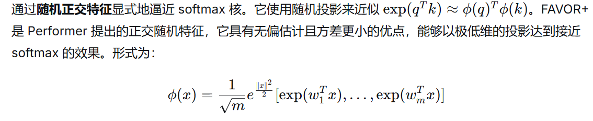{.ocr-src}

其中 $w_i$ 是从标准正态分布或正交系中采样的随机向量。

4. 其他核函数

- CosFormer：使用 ϕ(x)=ReLU(x) 并引入额外的余弦重加权来注入位置信息。

- PolyNL：使用多项式核来近似注意力。

核函数的选择在线性注意力的性能和精度之间起着关键的权衡作用。

---

#### 为什么线性注意力可以改变计算顺序来降低复杂度？

标准注意力强制按顺序计算：`QK^T` 必须先生成一个 `n × n` 矩阵，然后再乘以 `V`。这是 O(n²) 的来源。

线性注意力之所以能改变顺序，关键在于其**相似度函数的可分解性**：核函数使得 `sim(q, k)` 被拆成了 `ϕ(q)` 和 `ϕ(k)` 的内积。因此：

$$
\sum_j\phi(q_i)^T\phi(k_j)v_j=\phi(q_i)^T\left(\sum_j\phi(k_j)v_j^T\right)
$$

这里，$\sum_j\phi(k_j)v_j^T$ 可以先于任何查询被独立计算出来，它是一个 `d × d` 的矩阵，与序列长度无关。于是整个过程变成了：先遍历一次 K，构建一个全局的“上下文状态”；再遍历 Q，从该状态中提取每个查询的输出。这个“状态构建 + 查询提取”的模式天然避开了对每对 `(i,j)` 的显式交互，从而实现了 O(n) 的计算。

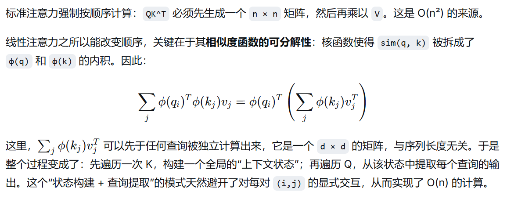{.ocr-src}

---

#### 线性注意力与标准注意力在效果上的主要差距是什么？

1. 表达能力和记忆容量受限

标准注意力的 softmax 具有指数归一化和动态范围极大的特点，能够产生极其尖锐的注意力分布，精准地聚焦于少数关键 token。线性注意力则倾向于产生更平滑、更分散的注意力权重，这在需要“大海捞针”式的精确复制或检索任务上表现较弱。

2. 对位置和局部性的建模

标准注意力的 O(n²) 矩阵允许为每对 token 学习任意复杂的交互模式。线性注意力的序列混合能力较弱，在标准基准（如语言建模）上，同规模模型的困惑度通常劣于 softmax 注意力。它更适合于长序列、低计算预算的场景，而在对精度要求极高的短/中序列任务上，softmax 注意力仍是首选。

3. 记忆清除困难

RNN 式的线性注意力将历史信息压缩进一个固定大小的矩阵中，无法像标准注意力那样“自然遗忘”无关信息。这可能导致记忆过饱和，影响对新信息的敏感度。

总结：线性注意力是“广度优先”（处理超长序列），标准注意力是“深度优先”（精确建模复杂交互）。差距可以通过增大模型、混合使用（如滑动窗口+线性注意力）来部分弥补。

---

#### Performer 如何通过随机正交特征逼近 softmax？

Performer 的核心是 **FAVOR+ 算法**（Fast Attention Via positive Orthogonal Random features）。它目标是找到一种特征映射 $\phi$，使得 $\phi(q)^T\phi(k)$ 能够无偏地近似 $\exp(q^Tk/\sqrt{d})$。

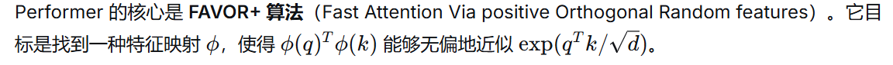{.ocr-src}

1. 随机特征：利用高斯核可以表示为随机投影的期望这一数学性质。对于 softmax 核 `exp(q^T k)`，可以先写成 `exp(||q||^2/2) * exp(||k||^2/2) * exp(-||q-k||^2/2)`。其中 `exp(-||q-k||^2/2)` 是一个高斯核，它可以用随机傅里叶特征来近似：`exp(-||q-k||^2/2) ≈ φ(q)^T φ(k)`。

2. 正交性：Performer 不仅仅用普通的随机高斯向量，而是采用正交随机矩阵来生成投影方向。正交性保证了投影后的特征之间有更小的相关性，从而显著降低了估计的方差。在相同的小投影维度 `m` 下，正交特征的近似误差远小于独立同分布随机投影。

3. 正向性：通过对特征映射加上一个精心设计的常数偏移（确保所有特征值为正），进一步稳定了训练，避免了分母为零或负值。

这样，Performer 以 O(nmd) 的复杂度，用一个极小的 `m`（如 32）就实现了对完整 softmax 注意力的高保真近似，且全程无需计算 `n × n` 矩阵。

---

#### 线性注意力在长序列任务上是否一定比标准注意力好？什么时候会差？

不是一定更好，这取决于“好”的定义。

- 好的一面（效率）：在长序列、低延迟、小显存场景，线性注意力具有压倒性优势。它能处理标准注意力无法触及的序列长度（如百万 token），且推理速度极快，显存占用恒定。

- 差的一面（效果）：

- **短/中序列任务**：在序列长度 < 2K 时，标准注意力的 O(n²) 瓶颈尚不突出，而其强大的 softmax 表达能力能带来更高的模型质量。此时线性注意力的精度损失会让其困惑度或下游任务评分低于标准注意力。

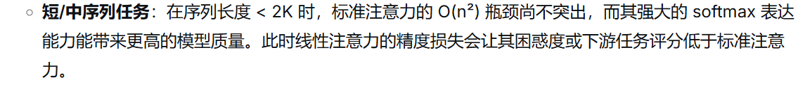{.ocr-src}

- 需要强记忆和精确检索的任务：如“大海捞针”测试中，标准注意力能通过尖锐的注意力权重轻松记住“针”的位置，而线性注意力可能因为将信息“融化”在固定大小的记忆矩阵中而丢失细节。

- 需要复杂多跳推理：标准注意力为每对 token 建立直接连接，推理路径更短。线性注意力的信息需要通过全局状态中转，推理路径变长，可能引入误差。

因此，真正的理想方案是混合使用：用标准注意力或窗口注意力处理局部上下文，用线性注意力或状态空间模型处理远距离依赖，两者取长补短。

---

#### 有哪些基于线性注意力的预训练模型？举例说明。

1. Linformer\
   线性注意力的先驱之一。它理论证明自注意力矩阵是低秩的，通过添加线性投影层将 `K` 和 `V` 的序列长度维度压缩到一个固定的小常数 `k`，使复杂度降为 O(nk)。它在长文本分类等任务上效果显著，但生成任务上有限制。

2. Performer

第一个将线性注意力大规模应用于预训练语言模型的工作。它使用 FAVOR+ 随机正交特征近似 softmax，成功训练了与标准 Transformer 可比的模型，尤其在长序列蛋白序列建模上显示出优势。

3. Linear Transformer

将标准 softmax 替换为 ELU+1 核函数，揭示了线性注意力的 RNN 本质，并实现了高速推理。它是轻量级长序列任务的重要基座。

4. RWKV

最成功的线性注意力（类）大模型之一。它融合了 RNN 和 Transformer 的思想，使用一种可学习的、位置相关的指数衰减机制来替代点积注意力，实现了纯 O(n) 复杂度，并在大规模训练中展现了与同尺寸 Transformer 竞争的性能，尤其在推理效率上极为突出。

5. RetNet / CosFormer

RetNet 提出“保留机制”（Retention），将注意力分解为并行的分块训练和串行的 RNN 推理模式。CosFormer 通过余弦重加权在提升局部性建模的同时保持了线性复杂度。

这些模型证明了线性注意力不仅在理论上可行，在工程上也能支撑起数十亿参数的大模型。

---

#### 线性注意力是否支持因果掩码？如何实现？

完全支持，而且实现起来比标准注意力更自然、更高效。

因果掩码要求当前时间步只能看到过去的信息。在线性注意力的 RNN 式实现中，这天然成立。

实现方法：\
将整个计算视为一个递推过程，维护一个随时间步更新的“状态矩阵” $S_t$ 和一个归一化因子 $Z_t$。

对于每个时间步 $t$，我们进行如下递推更新：

1. 状态更新：

$$
S_t=S_{t-1}+\phi(k_t)v_t^T
$$

$$
Z_t=Z_{t-1}+\phi(k_t)
$$

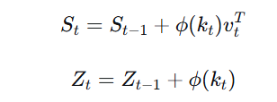{.ocr-src}

2. 计算当前输出：

$$
y_t=\frac{\phi(q_t)^TS_t}{\phi(q_t)^TZ_t}
$$

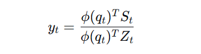{.ocr-src}

在这个递推过程中，我们从未使用未来时间步 $j$>$t$ 的 key 和 value。因此，因果性被自然地、毫无额外成本地满足了。这种实现模式使得线性注意力在推理时完全是一个固定大小状态的 RNN，可以用于无限长度序列的自回归生成，不存在 KV Cache 爆炸问题。

---

#### 为什么线性注意力可以看作是 RNN 或状态空间模型的变体？

因为它们共享同一个核心计算图：线性递推（Linear Recurrence）。

- 线性注意力：将注意力分数分解为核函数，使得输出计算可以被压缩为一个递推更新：

这个 $S_t$ 就是一个隐藏状态，其更新是线性的，大小固定。

- **经典 RNN**：隐藏状态 $h_t$ 遵循 $h_t=f(Wh_{t-1}+Ux_t)$，这是一个非线性递推。线性注意力的递推是线性的，但对 $K,V$ 的依赖是数据控制的（data-controlled），相当于一个“输入相关的线性 RNN”。
- **状态空间模型（SSM, 如 Mamba）**：其核心公式 $\dot{x}(t)=Ax(t)+Bu(t)$ 的离散化形式就是 $x_t=\bar{A}x_{t-1}+\bar{B}u_t$，也是一种线性递推。Mamba 的改进在于将 $\bar{A}$ 和 $\bar{B}$ 设计为依赖于输入，使其成为**选择性**的状态空间模型。

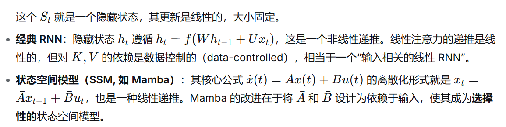{.ocr-src}

共同本质：它们都将序列历史压缩进一个固定大小的状态矩阵（或向量）中，并通过线性变换和输入门控来更新这个状态。差异在于状态更新的规则：线性注意力通过核函数和值的外积更新；SSM 通过预定义的动态矩阵和输入投影更新；RNN 通过饱和非线性更新。因此，线性注意力可以看作是连接 Transformer 和 RNN/SSM 两大家族的一座桥梁，它兼具 Transformer 的并行训练能力和 RNN 的高效序列推理能力。

---

#### 分析线性注意力在训练和推理时的显存占用。

线性注意力在显存占用上具有序列长度独立性，这是它相对于标准注意力的核心优势之一。

- 训练时显存占用

- **标准注意力**：需要存储 `n × n` 的注意力分数矩阵和softmax后的权重矩阵，显存复杂度为 **O(n²)**。对于长序列，这是绝对的瓶颈。

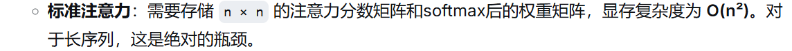{.ocr-src}

- 线性注意力：显存占用主要来自 Q、K、V 矩阵（每个 O(nd)）以及核函数映射后的特征矩阵（如 `φ(K)` 和 `φ(V)`，每个 O(nd)）。由于计算顺序变为先算 `K^T V`，完全不需要存储 `n × n` 的中间矩阵。其显存复杂度为 O(nd)。当 `n` 远大于 `d` 时，显存节省极为显著。

- 推理时显存占用
  - 标准注意力：自回归解码需要KV Cache，其大小随序列长度线性增长，为 O(nhd)（h为头数）。这是长文本推理的主要显存瓶颈。
  - 线性注意力：采用RNN式递推，只需维护一个固定大小的状态矩阵 `S`（大小 `hd × d`）和归一化向量 `Z`（大小 `hd`）。这个状态是恒定大小的，不随序列长度增长。因此，线性注意力在推理时可以处理无限长序列而显存不会耗尽，也无需复杂的PagedAttention等内存管理技术。\
    **总结**：线性注意力在训练时避免了 O(n²) 的中间激活，在推理时消除了线性增长的 KV Cache，其显存占用在整个生命周期中都极其高效。

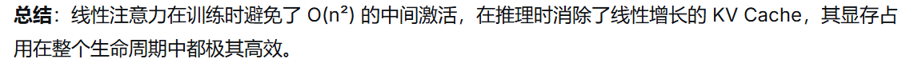{.ocr-src}

---

#### 线性注意力能否捕捉长距离依赖？理论上可以，实际上呢？

- 理论上：可以，而且比标准注意力更“平等”。标准注意力的 softmax 指数归一化可能过度聚焦于少数 token，忽略远处但有价值的信息。线性注意力的核函数（如ELU+1）没有这种强烈的归一化，理论上能更好地保留全局信息，为所有 token 提供一个“全局视野”。

- 实际上：存在一个严重问题——记忆稀释。线性注意力的状态矩阵 `S_t = Σ φ(k_j) v_j^T` 是一个固定大小的累加器。随着序列变长，旧信息会逐渐被新信息“淹没”。因为累加没有遗忘机制，早期的重要信息在状态矩阵中的影响力会被后续巨量 token 不断稀释，导致模型虽然“看到了”远处，却“记不清、用不上”。标准注意力通过 O(n²) 的直接连接避免了这个问题，每个距离的依赖都能被等权地建立和利用。

- 补偿方案：为了解决这个问题，研究者在线性注意力中引入遗忘门或指数衰减。例如，RetNet 和 RWKV 使用显式的指数衰减来控制记忆保留时间，Mamba 则使用输入相关的选择性机制来动态决定记住什么、遗忘什么。这些改进使“实际”的长距离依赖捕捉能力大大增强。

---

#### 与 FlashAttention 相比，线性注意力在加速方面的异同。

两者都旨在解决标准注意力的瓶颈，但路径完全不同，且数学上不等价。

- 线性注意力（算法近似）：

- **原理**：通过核函数**近似** softmax，将复杂度从 O(n²) 降到 O(n)。它改变了注意力的计算范式。

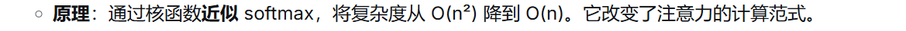{.ocr-src}

- 加速来源：算法复杂度的根本降低。对于极长序列（如 100K），加速比可达数十倍。

- 代价：模型表达能力的损失。它不是精确的 softmax，可能在需要精确检索的任务上表现不佳。

- FlashAttention（IO优化）：
  - 原理：通过分块（tiling）和重计算，减少对高带宽显存（HBM）的读写，但执行的数学运算与标准注意力完全等价。
  - 加速来源：充分利用硬件，将 IO-bound 操作变为 compute-bound。对于中等长度序列（如 2K-8K），可达到 2-4 倍加速。
- **代价**：无精度损失。但它依然是 O(n²) 复杂度的算法，序列长度受限于计算和显存（即使优化后）。
- **对比总结**：

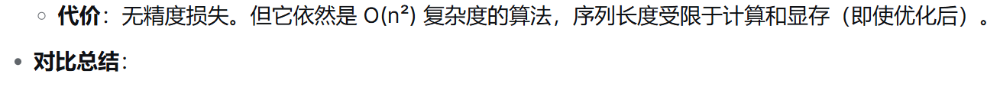{.ocr-src}

| 特性 | 线性注意力 | FlashAttention |
| --- | --- | --- |
| **本质** | 算法近似 | 精确的IO优化 |
| **复杂度** | **O(n)** | **O(n²)** |
| **加速原理** | 降低计算量 | 减少IO等待 |
| **最佳场景** | 超长序列（>8K） | 中长序列（1K-8K） |
| **精度** | 有损 | 无损 |

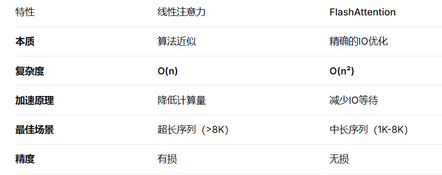{.ocr-src}

两者并非对立，可以结合。在线性注意力的分块计算中，同样可以利用 FlashAttention 的 IO 优化思想，让每个块内的矩阵乘法更快。

---

#### 如果我现在要训练一个处理 100K 序列的模型，你会选择线性注意力还是 FlashAttention？为什么？

首选 FlashAttention，但仅限于 Transformer 架构，并需结合其他技术。如果计算资源极度受限，则考虑线性注意力/SSM。

- 为什么首选 FlashAttention（精确注意力）：
  1. 精度至上：100K 序列任务往往对信息精确性要求极高。经过无数次验证，softmax 注意力的建模精度和下游任务效果是当前最优的。我不想在模型能力的核心引擎上妥协。
  2. 工程可行性：训练 100K 序列已不再是单靠 FlashAttention 解决。但它是基石。我会采用 FlashAttention + GQA（大幅压缩 KV Cache）+ 分块并行（序列并行） 的组合拳。这套方案已将 100K 训练变为现实，且各大公司均有成功实践。
  3. 避免技术债务：使用线性注意力意味着选择一个在精度上限、生态支持上尚不明确的路径。如果最终效果不佳，排查和优化的成本很高。

- 什么情况下选线性注意力/SSM（如 Mamba）：
  - 我的目标是处理百万 token 级别的序列。
  - 任务对延迟和吞吐有极端要求，且可以容忍一定的精度损失。
  - 我是在探索新架构，而非追求最稳妥的 SOTA 分数。

结论：在 100K 这个量级，标准注意力的生态和精度优势依然明显。我会选择以 FlashAttention 为核心的方案来保证模型能力上限。

---

#### 线性注意力对多头机制是否还有需求？

有需求，但“多头”的角色和重要性发生了变化。

- 需要多头的原因：多头机制的本质是让模型从不同的表示子空间去关注信息，这种“集成学习”的收益在任何架构中都存在。对于线性注意力，多头同样可以增强模型的表达能力，提供多样化的特征视角。例如，Mamba 也引入了类似多头的扩展。

- 角色的变化：在标准注意力中，多头还承担着缓解注意力矩阵秩不足的任务。单头 softmax 注意力的输出可能过于锐利，多头的平均化可以平滑输出。线性注意力没有这种强烈的稀疏性，因此对“多头平均化”的需求可能降低。

- 部署的挑战：线性注意力的推理状态大小与头数 `h` 和头维度 `d` 的乘积（即 `hd × d`）成正比。如果无节制地增加头数或头维度，这个固定大小的状态矩阵会迅速膨胀，抵消其显存优势。因此，在线性注意力中，对头数和头维度的选择需要更加谨慎。

---

#### 为什么大部分主流 LLM 依然使用标准注意力，而没有换成线性注意力？

因为主流 LLM 的竞争焦点是“智能密度”，而非单纯的“性价比”。

1. 模型能力（质量）是王牌：LLaMA 3、GPT-4、Claude 3 等顶级模型之间的竞争是核心智力的竞争。标准 softmax 注意力具有无可替代的动态范围大、筛选能力强的特性，可以精准地检索和利用信息。在任何一个评测基准上，这点微弱的优势都可能决定排名的胜负。在追求最顶尖效果的目标下，工业界不会轻易放弃已被验证的最强组件。

2. 生态惯性：围绕标准注意力，已经形成了庞大的技术生态，包括 FlashAttention、PagedAttention、GQA、以及各种高效的分布式训练策略。这个生态能极快地放大标准注意力的工程可行性，抵消了它的一部分效率劣势。

3. 线性注意力的“木桶效应”：线性注意力在需要长程、连续记忆的任务上很有潜力，但在需要“过目不忘”式的精确检索或多跳推理时，其精度短板就会暴露。对于追求通用智能的 LLM，不能有明显的短板。

4. 巨头可以通过算力弥补：对于 OpenAI 或 Meta，他们有能力使用数万张 H100 集群去暴力训练标准注意力的模型。对他们而言，算力可以部分弥补效率问题，但模型的“智力极限”是算法决定的，不能妥协。

结论：主流 LLM 选择标准注意力，是因为在当前的竞争阶段，“做到最强”比“做得更便宜”更重要。但当模型智能水平趋于同质化后，效率问题会再次成为焦点，那时就是线性注意力/SSM 大放异彩的时刻。

---

#### 有没有办法结合线性注意力和标准注意力的优势？

有，这正是目前的研究热点，通过混合或层次化架构各取所长。

- 混合层架构（Interleaving）：在模型的某些层使用标准注意力（如每隔一层），专门负责处理精确的局部依赖和需要强筛选能力的关系；在另一些层使用线性注意力，负责以低成本聚合全局上下文。这类似于 GPT-3 中混合密集和稀疏注意力的思想。

- “局部+全局”双流架构：一个分支使用滑动窗口注意力（标准注意力的一个子类）处理局部上下文，另一个分支使用线性注意力或状态空间模型处理远距离依赖。最后将两个分支的输出融合。Mistral 和 Jamba 等模型是这种思想的代表。

- 混合模型（如 Jamba）：Jamba 是 SSM 和 Transformer 的块级别混合。它将 Transformer 块（包含标准注意力）和 Mamba 块（包含 SSM）交错堆叠。Transformer 块提供精确的上下文交互，Mamba 块提供长程记忆和高效性。

- 在两阶段流程中结合：第一阶段使用线性注意力快速扫描并压缩超长上下文（如百万级Token），生成一个压缩记忆库；第二阶段，使用标准注意力在这个“记忆库”和当前的短上下文中进行精细交互。

这种“混合派”的做法，被认为是通往下一代高效且强大基础模型的最有希望的道路。

---

#### 解释一下 cosFormer 是如何结合余弦重加权和线性注意力的。

cosFormer 是一个经典工作，旨在解决标准线性注意力丢失位置信息和局部建模能力差的问题。

- 问题背景：标准线性注意力（如用 ReLU 核）忽略了 token 之间的相对距离。它会平等地对待距离为 1 和距离为 1000 的两个 token，这与“越近的 token 通常越相关”的语言学直觉相悖。

- 核心思想：cosFormer 在计算注意力权重时，显式地引入一个余弦重加权机制。
  - 它对线性注意力的核函数进行改造，在原始核函数（如 ReLU）之外，额外乘上一个余弦函数项： `cos(π(i - j) / 2N)`，其中 `i` 和 `j` 是位置索引，`N` 是序列长度。
  - 这个余弦项的值仅取决于 token 间的相对距离 `i - j`。

- 为什么这样设计：
  - 引入局部性偏置：余弦函数在距离为 0 时取得最大值 1，随着距离增大到 `N`，其值平滑衰减为 0。这恰好为模型提供了一个“越远越不重要”的归纳偏置。
  - 保持线性复杂度：关键创新在于，这个余弦项可以分解为 `cos(i)cos(j) + sin(i)sin(j)`。因此，它可以被吸收到查询和键的特征映射 `φ(q)` 和 `φ(k)` 中，不破坏线性注意力“先算 K^T V”的计算范式，从而保持了 O(n) 的复杂度。

- 效果：cosFormer 在保持线性复杂度的同时，显著提升了模型在语言建模等任务上的局部感知能力，缩小了与标准注意力的性能差距。

---

#### 线性注意力在生成任务中是否容易出现质量下降？

是的，尤其是在标准语言模型基准测试中，质量通常会下降。 这是由于“记忆稀释”和“精度损失”共同导致的。

- 质量下降的表现：在相同参数量和训练数据下，线性注意力模型的困惑度（PPL）通常会高于标准注意力模型。这意味着它对文本的预测能力更弱。在下游任务（如代码生成、长文本问答）中，虽然可能在长程依赖上有优势，但在需要精确复制或短距离强推理的任务上，会显得“粗心大意”。

- 根本原因：精度与记忆的取舍
  1. 精度损失（核近似）：用核函数（如 ReLU）替代指数 softmax，本身就是一种信息压缩。softmax 能产生极尖锐的分布以精准聚焦，而线性注意力分布更平滑，容易“分心”。
  2. 记忆稀释：如前所述，RNN 式的递推状态在面对极长序列时，早期的精确信息容易被后期的信息淹没。
  3. 缺乏精细的遗忘机制：标准注意力通过因果掩码精确控制看到的历史；线性注意力的固定大小状态没有内置的“精确删除”某条过去信息的机制，只能依赖全局的衰减。

- 缓解方法：
  - 引入显式遗忘门（如 RWKV）或选择机制（如 Mamba）。
  - 使用层次化结构，混合标准窗口注意力和线性注意力。
  - 在设计核函数时加入更强的位置偏置，保留局部性（如 CosFormer）。
  - 在生成时，可以采用更先进的解码策略来弥补一些质量损失。

---

#### 能否将线性注意力思想应用于交叉注意力？

完全可以，而且线性注意力在交叉注意力中同样能带来显著的效率提升，尤其适合编码器-解码器架构中的长序列处理。

应用方式：交叉注意力的标准形式为 `Attention(Q_dec, K_enc, V_enc)`。将其线性化只需应用相同的核函数替换 softmax。公式变为：

$$
y_i=\frac{\phi(q_i^{(dec)})^T\sum_j\phi(k_j^{(enc)})v_j^{(enc)T}}{\phi(q_i^{(dec)})^T\sum_j\phi(k_j^{(enc)})}
$$

**独特优势**：

- **源序列的固定状态**：编码器的输出 `K_enc` 和 `V_enc` 是一次性生成的。在线性交叉注意力中，可以预先计算好一个固定大小的“源状态矩阵” $S_{enc}=\sum_j\phi(k_j)v_j^T$ 和归一化向量 $Z_{enc}=\sum_j\phi(k_j)$。无论源序列多长，解码器都只需访问这个固定的状态，解码复杂度与源长度无关。

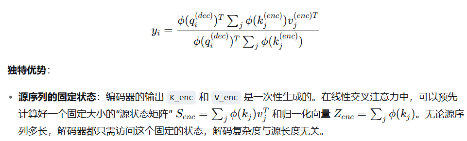{.ocr-src}

- 消除编码器缓存：标准交叉注意力需要缓存整个编码器的 K、V 矩阵，这在长源序列（如长文档翻译）中会占用大量显存。线性版本只需缓存极小的状态矩阵，极大节省资源。

- 在机器翻译、长文档摘要、语音识别等任务中，源序列往往很长，而目标序列相对较短。线性交叉注意力能在几乎不损失质量的情况下，将此类任务的处理长度扩展至百万 token 级别。

注意事项：核函数的选择同样会影响交叉注意力的建模精度。在一些对对齐精度要求极高的任务（如同声传译）中，标准 softmax 的尖锐匹配能力可能仍然是首选。但总体而言，线性注意力是交叉注意力长序列化的极佳方案。

---

#### 状态空间模型 (Mamba) 和线性注意力有什么联系？

两者本质上是“线性递推”家族的孪生兄弟，在计算图和核心公式上惊人地一致，主要区别在于状态更新规则和归一化机制。

核心联系：两者都将序列处理视为维护一个固定大小的隐藏状态，并通过输入对该状态进行更新，然后从状态中读取输出。

- 线性注意力（RNN 形式）：

$$
S_t=S_{t-1}+\phi(k_t)v_t^T,\quad y_t=\phi(q_t)^TS_t/(\phi(q_t)^TZ_t)
$$

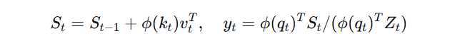{.ocr-src}

- 状态更新是加性的，且没有遗忘门（除非显式加入）。

- Mamba（选择性状态空间模型）：\
  其离散化递推公式为：

$$
h_t=\bar{A}_th_{t-1}+\bar{B}_tx_t,\quad y_t=C_th_t
$$

其中 $\bar{A}_t$ 控制遗忘，$\bar{B}_t$ 控制输入，$C_t$ 控制输出，且这些矩阵都**依赖于当前输入**。

**联系**：

- 两者都避免了 O(n²) 的注意力矩阵，都使用固定大小的状态。
- 线性注意力的 $k_tv_t^T$ 是一种外积更新，等价于一个“写操作”。Mamba 的 $\bar{B}_tx_t$ 也可以看作将输入投影后写入状态。

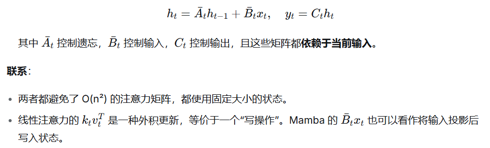{.ocr-src}

- 最新的混合工作甚至证明了，通过设计特殊的核函数，线性注意力可以等价为某种 SSM。

核心区别：

| 特性 | 线性注意力 | Mamba |
| --- | --- | --- |
| **状态更新** | 加性（无遗忘） | 乘性（有遗忘门 $\bar{A}_t$） |
| **选择性** | 由核函数 $\phi$ 控制 | 由输入相关的 $\bar{A}_t,\bar{B}_t,C_t$ 控制，更灵活 |
| **归一化** | 显式除以 $\phi(q)^TZ$ | 通常无显式归一化（或通过输出门控制） |
| **训练并行性** | 可并行（通过矩阵乘法） | 需要特殊并行算法（如关联扫描） |

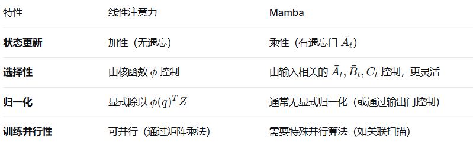{.ocr-src}

结论：Mamba 和线性注意力是同一片森林中两棵最高的大树，它们的共同目标是取代标准注意力，实现高效长序列建模。Mamba 凭借输入相关的遗忘和选择机制，在实际性能上超越了早期线性注意力；而线性注意力则提供了更简单的训练范式和更清晰的 Transformer 迁移路径。

---

#### 从数学上推导，为什么线性注意力失去了 softmax 的非线性特性，会有什么影响？

推导：标准注意力的 softmax 是一个高度非线性的归一化函数。对于查询 $q$ 和所有键 $k_j$，输出是：

$$
y=\sum_j\frac{\exp(q^Tk_j)}{\sum_{j'}\exp(q^Tk_{j'})}v_j
$$

这里的 exp 是指数函数，具有极强的**凸性**和**放大效应**。即使两个分数 $q^Tk_j$ 只有微小差异，经过指数和归一化后，权重分布也会呈现“赢家通吃”的尖锐形态。这种非线性使得注意力能够**选择性聚焦**。

线性注意力将 softmax 替换为核函数内积 $\phi(q)^T\phi(k)$，然后除以 $\phi(q)^T\sum\phi(k)$。虽然这仍然是非线性的（因为 $\phi$ 是非线性函数），但它**失去了指数函数的极端非线性和竞争性**。

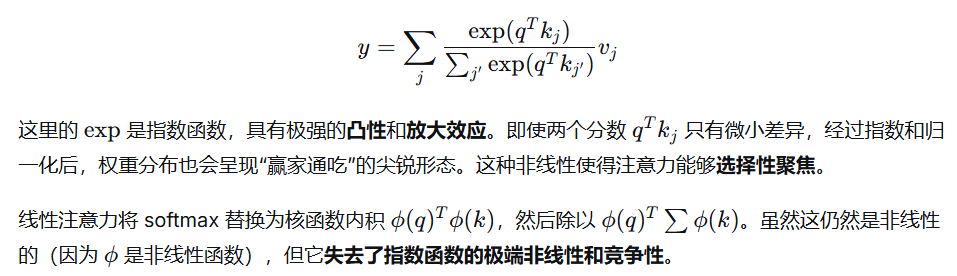{.ocr-src}

关键差异：

- 标准注意力的 `softmax` 是一种“赢家通吃”的竞争机制。一个键的得分提升，会通过分母的指数和显著降低其他所有键的权重。

- 线性注意力的归一化更像是一种“加权平均”。分母是所有核函数输出的线性和，增加一个新的键，对其他键权重的影响仅仅是稀释，而不是激烈竞争。

影响：

1. 聚焦能力下降：线性注意力无法产生极其尖锐的注意力分布。在处理需要精准定位少量信息（如事实检索、复制任务）时，它容易“分心”，将权重过度平滑地分配给许多不相关的 token。

2. 区分度降低：对于高度相似的键，softmax 能放大它们之间的微小差异；线性注意力则可能将它们视为几乎等同，从而损失精细的结构信息。

3. 记忆干扰更严重：在线性注意力的递推状态中，由于没有强非线性过滤，早期的信息容易被后期大量无关信息“冲淡”或“干扰”，导致记忆质量随时间下降。

这就是为什么对于需要“过目不忘”和“精确匹配”的任务，标准注意力依然是不可替代的。线性注意力牺牲了这种极端的非线性和竞争性，换取了线性复杂度的巨大效率优势。

---

#### 如何评估一种线性注意力机制的效果？常用基准有哪些？

评估线性注意力需要一套多维度的诊断流程，既要衡量效率提升，也要精准刻画其能力边界。

1. 效率评估（显存和速度）：

- 基准工具：PyTorch Profiler、NVIDIA Nsight、自定义时间统计。

- 指标：在不同序列长度（1K, 4K, 16K, 64K, 128K）下的训练吞吐量（tokens/sec）和推理延迟（ms/token），以及峰值显存占用。

- 比较对象：必须与同配置的标准注意力（以及使用 FlashAttention 的版本）进行严格比较。

2. 语言建模能力评估（核心基础）：

- 基准：标准语言建模数据集 WikiText-103、PG-19（长篇小说，测试长程依赖）、The Pile。

- 指标：困惑度（Perplexity, PPL）。这是衡量模型预测文本能力的核心指标。有效的方法应在同参数规模下实现与标准注意力接近的 PPL。

3. 长程依赖捕捉能力评估（存在的意义）：

- 基准：Long Range Arena (LRA)。这是专为评估高效注意力在长序列任务上效果而设计的基准，包含文本分类、文档检索、图像分类、路径查找等任务，序列长度从 1K 到 16K 不等。

- 指标：各任务上的准确率。LRA 能有效区分一种方法是“真的抓住了远程信息”还是“仅仅算得快”。

4. 精确检索与“大海捞针”能力：

- 基准：Needle in a Haystack 测试（在极长文本中随机插入一个事实，提问看能否找到）。可结合 RULER、LongBench 等长上下文基准。

- 指标：在不同文本长度和“针”的插入深度下的检索准确率。

5. 与标准注意力的兼容性：

- 测试该方法是否支持因果掩码、GQA/MQA、FlashAttention 的硬件优化，以及是否能轻松替换现有 Transformer 架构中的注意力模块。

---

#### 如果硬件自由，你还会研究线性注意力吗？

绝对会，而且会更加积极地研究。

“硬件自由”只能暂时缓解算力和显存的瓶颈，但无法解决 算法可扩展性的根本问题。即使拥有无限算力，我依然需要线性注意力，理由如下：

1. 能源效率与可持续性：暴力计算永远不应是唯一解。标准注意力的 O(n²) 是一种算法上的“挥霍”。在追求通用人工智能的路上，我们必须找到更聪明的、复杂度更低的方法。线性注意力是通往 “绿色AI” 和 “可持续智能” 的必由之路。

2. 解锁新应用场景：即使云端有无限的 A100，本地设备、手机、嵌入式系统也永远需要高效的算法。线性注意力及其变体是实现真正实时交互、本地化处理超长上下文的基石，比如一个能记住你过去一年对话的本地个人助理。

3. 认知科学的启示：人脑就是一台极其高效的“线性注意力”机器（海马体记忆索引、前额叶工作记忆的有限容量）。研究线性注意力有助于我们理解生物智能如何高效处理信息，并设计出更接近“世界模型”的人工智能架构。

4. **能力的本质不同**：O(n²) 的注意力是一种“蛮力”，它通过强行建立所有连接来解决问题。线性注意力（尤其是结合了遗忘和选择机制的版本）则是一种“智慧”，它迫使模型学习**有损压缩和动态记忆管理**。这种能力可能恰恰是涌现出更高级推理和泛化能力的关键。

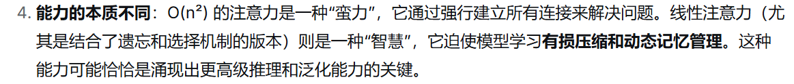{.ocr-src}

5. 真正实现无限长上下文：标准注意力受限于物理内存，永远无法处理真正的“无限长”序列（如持续数年的视频流、不间断的传感器数据）。线性注意力/状态空间模型恒定的内存占用是实现这一终极目标的唯一现实路径。

因此，硬件自由不是研究的终点，而是解放我们，让我们能更自由地探索真正智能本质的起点。线性注意力正是这个探索过程中的核心课题之一。

---

#### 你对线性注意力未来在 LLM 中的角色怎么看？

我认为线性注意力不会完全取代标准注意力，而是会与之深度融合，共同构成下一代基础模型的“双引擎”架构。

1. 终结“纯 Transformer 时代”：以纯标准注意力为核心的架构，在迈向更长上下文时正逐渐触及其效率天花板。线性注意力（及其 SSM 变体）已经成为新架构探索的主要方向，它们将在未来 2-3 年内大规模进入主流 LLM 的核心设计。

2. “混合专家”式的架构成为主流：未来的 LLM 将采用高度混合的结构。

- 局部精细处理：使用滑动窗口注意力或标准注意力处理局部上下文，保证对短语和邻近细节的精准建模。

- 全局低分辨率扫描：使用线性注意力/SSM 层，以极低成本对整个历史上下文进行“背景感知”和“信息检索”。

- 动态路由：模型甚至可能学习根据当前任务需求，动态决定使用哪种注意力模式。

3. 在特定领域占据主导：

- 实时交互领域：在语音助手、实时翻译、自动驾驶等对延迟要求极高的场景，纯 RNN 式的线性注意力/SSM 将成为唯一选择。

- 超长文档和代码库：处理整个代码库或长篇小说时，线性注意力将承担全局检索的任务，而标准注意力则负责局部精确修改。

- 多模态和具身智能：处理视频、连续传感器流等本质上无限长的数据时，线性复杂度的架构将不可或缺。

4. 技术融合与归一化：线性注意力和状态空间模型（Mamba）之间的界限将越来越模糊。它们会吸收彼此的优点（如线性注意力的易并行训练和 Mamba 的精细遗忘机制），演化为一种统一的“线性循环单元”。这个单元将既拥有 Transformer 的训练并行性，又拥有 RNN 的高效推理能力。

结论：线性注意力不是标准注意力的替代品，而是它进化的必然方向。它将作为下一代基础模型的核心组件，帮助我们打破上下文长度的物理限制，让大模型从“能读”走向“能懂”，最终实现高效、通用且可持续的智能。

