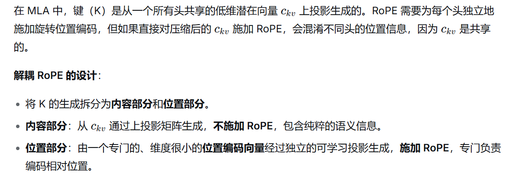
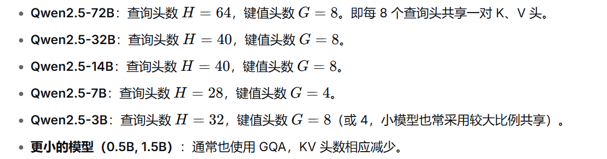

# 25.大模型（LLMs）最新主流模型架构特点（DeepSeek-V3, Qwen2.5 等）

#### DeepSeek-V3 的架构有哪些核心创新？请列出至少三点。

DeepSeek-V3 是 DeepSeek 发布的超大规模 MoE 语言模型，其架构创新主要体现在以下几个方面（不限于三点）：

- 多头潜在注意力（Multi-head Latent Attention, MLA）：通过低秩压缩将键值缓存（KV Cache）压缩至极小的潜在向量，在推理时仅缓存该向量，实现数十倍压缩，极大降低长上下文推理的显存和带宽需求。

- DeepSeekMoE（细粒度专家 + 共享专家）：将 FFN 专家进一步细粒度化，使每个专家的参数量更小但数量更多，提升路由的灵活性和组合表达能力；同时引入共享专家，所有 token 均会经过，用于捕获通用知识，减少路由专家间的知识冗余。

- 无辅助损失的负载均衡策略（Auxiliary-Loss-Free Load Balancing）：通过动态调整每个专家的路由偏置（bias）来控制专家负载，而不依赖传统的辅助均衡损失，避免了对语言模型主损失的干扰，同时保持了良好的专家利用率。

- 多 token 预测训练目标（Multi-Token Prediction）：训练时要求模型不仅预测下一个 token，还预测未来多个 token，使模型学到更长程的依赖关系，提升收敛速度和最终性能。

- FP8 混合精度训练：首次在超大规模模型上验证了 FP8 训练的可行性和稳定性，显著降低了训练显存和通信开销。

此外，还包括解耦 RoPE 设计、极致的工程优化和高效的流水线并行等。

---

#### DeepSeek-V3 的 MLA 是如何工作的？对推理有何帮助？

MLA 是 DeepSeek 为了解决标准多头注意力中 KV Cache 过大问题而提出的核心创新。

工作原理：

- 将键（K）和值（V）的生成过程进行低秩分解。输入 token 的隐藏状态首先通过一个下投影矩阵压缩到一个极低维的潜在向量 $c_{kv}$，然后再通过各自的上投影矩阵恢复出所有注意力头的 K 和 V。

- 由于所有头共享同一个潜在向量，且该向量的维度远小于原始多头 KV 的总维度（例如 512 vs 16384），推理时只需缓存这个极小的潜在向量，而无需缓存完整的 K 和 V。

对推理的帮助：

- 显存大幅降低：KV Cache 的显存占用被压缩了数十倍。以 DeepSeek-V2/V3 为例，压缩比可达约 64 倍。这使得在相同硬件上可以支持更长的上下文或更大的批处理量。

- 带宽压力缓解：每次自回归解码步骤需要读取的缓存数据量剧减，推理从显存带宽瓶颈转为计算瓶颈，显著提升吞吐。

- 长上下文能力经济化：结合 PagedAttention 等内存管理技术，MLA 使得数十万 token 的长上下文推理在商业上变得可行。

---

#### DeepSeek-V3 的 MoE 架构与 Mixtral 有何不同？细粒度专家和共享专家是什么？

DeepSeek-V3 的 MoE 架构（DeepSeekMoE）相比于 Mixtral 8x7B 等传统 MoE，有两大显著改进：细粒度专家分割和共享专家。

细粒度专家（Fine-grained Experts）：

- Mixtral 每个专家是一个完整大小的 FFN，模型包含 8 个专家，每次激活其中 2 个。

- DeepSeek-V3 将每个专家的 FFN 中间维度进一步切分，使单个专家的参数量更小，但总数更多。例如，DeepSeek-V2 使用 160 个细粒度专家，每次激活 6 个。这种“小而多”的设计提高了路由组合的灵活性，让专家可以更精细地专精于不同模式，同时便于更均衡的负载分配。

共享专家（Shared Experts）：

- DeepSeekMoE 在每层除了可路由的细粒度专家外，还设计了少量始终激活的共享专家。所有 token 都会经过共享专家的处理，其输出与路由专家的输出相加。

- 作用：共享专家用于捕捉跨领域的通用知识（如基础语法、高频词汇），让路由专家专注于差异化、专业化的特征，减少知识在各专家间的重复存储，提高参数利用效率，并增强训练稳定性。

因此，DeepSeekMoE 通过“共享专家保底，细粒度专家专精”的策略，在相同总参数量下实现了更好的性能。

---

#### DeepSeek-V3 如何实现负载均衡？是否使用了辅助损失？

DeepSeek-V3 没有使用传统的辅助负载均衡损失，而是提出了一种全新的无辅助损失的负载均衡策略（Auxiliary-Loss-Free Load Balancing）。

传统方法的缺点：标准的辅助损失（如 Switch Transformer 的 load balancing loss）会鼓励将 token 均匀分配给专家，但这可能与语言建模的主损失产生冲突，导致模型性能的轻微下降。

DeepSeek-V3 的方法：

- 为每个专家的路由 logits 添加一个可动态调节的偏置项（bias）。

- 在训练过程中，如果某个专家在连续多个步骤中被过度使用，系统会自动减小其偏置值，使其在后续的路由决策中“竞争力”下降；反之，如果某专家长期空闲，则增大其偏置以增加被选中的几率。

- 这个偏置调整过程独立于主梯度更新，不干扰语言模型损失的优化。

效果：该方法实现了比传统辅助损失更优的负载均衡，专家利用率极高，同时完全避免了辅助损失对模型性能的负面影响。

---

#### 解释 DeepSeek-V3 的“多头潜在注意力”解耦 RoPE 的设计。

在 MLA 中，键（K）是从一个所有头共享的低维潜在向量 $c_{kv}$ 上投影生成的。RoPE 需要为每个头独立地施加旋转位置编码，但如果直接对压缩后的 $c_{kv}$ 施加 RoPE，会混淆不同头的位置信息，因为 $c_{kv}$ 是共享的。

**解耦 RoPE 的设计**：

- 将 K 的生成拆分为**内容部分**和**位置部分**。
- **内容部分**：从 $c_{kv}$ 通过上投影矩阵生成，**不施加 RoPE**，包含纯粹的语义信息。
- **位置部分**：由一个专门的、维度很小的**位置编码向量**经过独立的可学习投影生成，**施加 RoPE**，专门负责编码相对位置。

{.ocr-src}

- 查询 Q 也做类似处理：内容部分和位置部分分别生成。

- 计算注意力分数时，内容-内容、内容-位置、位置-内容的点积被组合起来，从而等效于标准 RoPE 的效果，但完全避免了在共享潜在空间上施加旋转所带来的问题。

优势：既保留了 MLA 对 KV Cache 的极致压缩能力，又完整地保留了 RoPE 的相对位置编码能力，使模型能够精确捕捉长距离依赖关系。

---

#### DeepSeek-V3 的训练成本和性能之间达到了怎样的平衡？

DeepSeek-V3 是极致的成本-性能平衡典范。

- 训练成本：根据官方报告，DeepSeek-V3 的完整训练仅耗费约 557.6 万美元（基于 H800 GPU 集群的计费），总计算量约 2.664e6 H800 GPU 小时。这个成本远低于同级别规模的其它大模型（如 LLaMA-3-405B 等）。

- 性能表现：在如此低的成本下，DeepSeek-V3 在 MMLU、HumanEval、GSM8K、BBH 等大量基准上达到了开源 SOTA 水平，并在很多任务上接近或匹敌 GPT-4o、Claude 3.5 Sonnet 等顶级闭源模型，成为当时性能最强的开源模型。

- 平衡之道：这种平衡是通过全方位的架构创新（MLA、DeepSeekMoE）、高效的训练策略（FP8 混合精度、多 token 预测、极致工程优化）以及灵巧的负载均衡策略共同实现的。

---

#### Qwen2.5 系列模型在架构上遵循了什么设计原则？

Qwen2.5 系列模型（包含 0.5B 到 72B 的密集模型和 MoE 模型）遵循了成熟且高效的设计原则：

- 标准化 Transformer 架构：采用标准的 Decoder-Only Transformer 架构，确保与现有主流生态无缝兼容。

- 稳定且高效的组件：使用 Pre-Norm 结构，RMSNorm 归一化，SwiGLU 激活函数，无偏置项设计。这些经过 LLaMA 等模型验证的组件提供了稳定的训练和高效的推理。

- RoPE 位置编码：采用旋转位置编码（RoPE），并具备通过 NTK-aware/YaRN 等方法灵活扩展上下文长度的能力。

- 分组查询注意力（GQA）：在所有规模的模型中都采用了 GQA，以平衡推理效率与模型质量。

- 大规模高质量数据驱动：强调在高质量、大规模多语言数据上进行充分训练，而不是过度追求复杂的架构创新。

- 统一的词表和分词：使用大词表（约 152K）的 Byte-level BPE 分词器，统一处理多语言和代码。

这些原则确保了 Qwen2.5 系列在性能、效率和易用性上的出色平衡。

---

#### Qwen2.5 使用 GQA 的具体配置是怎样的？组数多少？

Qwen2.5 全系列采用 分组查询注意力（GQA），分组数因模型规模而异，KV 头数通常为查询头数的几分之一。

具体配置（以 Qwen2.5 技术报告和公开信息为准）：

- **Qwen2.5-72B**：查询头数 $H=64$，键值头数 $G=8$。即每 8 个查询头共享一对 K、V 头。
- **Qwen2.5-32B**：查询头数 $H=40$，键值头数 $G=8$。
- **Qwen2.5-14B**：查询头数 $H=40$，键值头数 $G=8$。
- **Qwen2.5-7B**：查询头数 $H=28$，键值头数 $G=4$。
- **Qwen2.5-3B**：查询头数 $H=32$，键值头数 $G=8$（或 4，小模型也常采用较大比例共享）。
- **更小的模型（0.5B, 1.5B）**：通常也使用 GQA，KV 头数相应减少。

{.ocr-src}

这种配置将 KV Cache 大小压缩为 MHA 的 1/4 到 1/8，显著提升了长文本推理的效率和并发能力。

---

#### Qwen2.5 如何实现长上下文支持？用了什么扩展技术？

Qwen2.5 支持最高 128K token 的长上下文，通过以下组合技术实现：

- 原生训练长度的扩展：在预训练后期，引入更高比例的长序列数据（如文档级拼接），将模型的原生上下文窗口从初始的短长度逐步提升到较长的长度。

- RoPE 扩展技术：在推理或继续训练时，采用 动态 NTK 缩放 和 YaRN 等 RoPE 频率扩展技术。这些方法通过智能调整旋转位置编码的频率（保护高频、拉伸低频），使得在不牺牲短上下文性能的情况下，将有效上下文平滑扩展到 128K 甚至更长。

- 滑动窗口注意力的可选配合：在一些部署场景中，可与滑动窗口注意力结合以进一步降低长序列下的 KV Cache 和计算压力，但核心是基于精确注意力加位置扩展的方案。

- 专门的微调阶段：在长上下文数据上进行微调，使模型适应扩展后的位置编码和长距离依赖模式。

这些技术的结合确保了 Qwen2.5 在处理超长文档、多轮对话等任务时具有出色的检索和理解能力。

---

#### Qwen2.5 的词表大小和分词器有何特点？如何处理多语言？

- 词表大小：Qwen2.5 的词汇量约为 152,064（152K）。这是一个较大的词表，旨在高效覆盖多语言文字和代码。

- 分词器：采用 Byte-level BPE（Byte-Pair Encoding） 分词器，以字节为最小单位构建词表。这带来了多语言处理的友好性：几乎任何语言的任何字符都能被正确编码，而不会出现大量 `<unk>` 标记。

- 多语言处理特点：
  - 广泛的语料覆盖：预训练数据中包含了大量高质量的多语言文本，涵盖中文、英文、以及数十种其他语言。
  - 词表平衡：大词表的设计确保中英等主要语言被高效编码（较短的 token 序列），同时通过字节级回退机制保证了低资源语言的可用性。
  - 专门的训练策略：在预训练和后训练阶段，针对多语言任务（如翻译、跨语言问答）进行了优化，使得模型具备强大的跨语言理解和生成能力。

---

#### 比较 Qwen2.5 和 LLaMA-3 在架构上的异同。

Qwen2.5 和 LLaMA-3 都是当前最顶级的开源 Decoder-Only 大模型系列，它们在架构上高度趋同，共享了大量经过验证的最佳实践，但在细节配置上有所不同。

相同点：

- Decoder-Only 架构：均采用标准的仅解码器 Transformer，遵循统一的“预测下一个 token”范式。

- 归一化与激活：都使用 RMSNorm 进行归一化，SwiGLU 作为前馈网络的激活函数，且线性层通常无偏置（bias）。

- 位置编码：均采用 RoPE（旋转位置编码），并支持通过 NTK-aware 或 YaRN 等方法进行上下文扩展。

- 注意力变体：均采用 分组查询注意力（GQA） 来压缩 KV Cache，提升推理效率。

- 长上下文能力：都支持 32K 到 128K 甚至更长的上下文窗口，依赖 RoPE 扩展和长文本微调。

主要差异：

| 特性 | Qwen2.5 | LLaMA-3 |
| --- | --- | --- |
| 词表与分词 | 词表约 152K，使用 Byte-level BPE，对多语言和代码覆盖更宽。 | 词表 128K，使用 tiktoken BPE，对英文和多语言同样高效。 |
| GQA 分组配置 | 全系列统一使用 GQA，较大模型 KV 头数为 8（Q 头 64），较小的模型为 4。 | LLaMA-3 8B 使用 GQA（KV头 8），70B 同样 KV头 8。7B/13B 在 LLaMA-2 中曾为 MHA，LLaMA-3 全面 GQA。 |
| FFN 维度 | SwiGLU 中间维度通常为 8/3 d_model 左右并取整，与主流一致。 | 同样遵循 8/3 d_model 的规则。 |
| 模型规模分布 | 提供从 0.5B 到 72B 的密集模型，以及 MoE 模型（Qwen2.5-MoE）。 | 提供 8B 和 70B 两种密集模型。 |
| 训练数据与专注 | 特别强调高质量、大规模多语言数据，中文能力尤为突出。 | 在英文和多语言基准上表现顶尖，但中文数据占比相对较少。 |
| 上下文长度原生支持 | 原生 32K，扩展支持至 128K。 | 原生 8K，扩展支持至 128K（LLaMA-3.1）。 |

总结：两者在核心架构上趋于一致，主要差异在词表大小、分组配置细节以及训练数据导致的性能侧重上。Qwen2.5 在多语言和代码的覆盖范围上更为宽泛，而 LLaMA-3 在纯英文基准上竞争力极强。

---

#### Qwen2.5 的某些变体是否也采用了 MoE？介绍 Qwen2.5-MoE 的路由策略。

是的，Qwen2.5 系列包含了 MoE 变体，例如 Qwen2.5-MoE（如 14B-A2.7B 等），它采用了与 Mixtral 类似的稀疏专家混合架构，但融入了自身的优化。

Qwen2.5-MoE 的路由策略：

- Top-k 硬路由：每个 token 通过门控网络（一个线性层）计算每个专家的得分，然后选择得分最高的 Top-k 个专家（通常 k=2）。token 只被发送给这几个专家进行处理。

- 专家配置：包含多个专家（例如 60 个），每次激活其中的 2 个。每个专家的 FFN 维度相对密集模型有所缩小，以控制总参数量和单个 token 的计算量。

- 负载均衡：采用标准的辅助负载均衡损失（Auxiliary Loss），鼓励 token 被均匀分配给所有专家，防止专家坍塌。同时，也可能结合了专家容量限制和 token 丢弃等策略来保证训练稳定性。

- 共享参数：在 MoE 层之外，注意力层和部分 FFN 层是共享的，只有特定的层被替换为 MoE 模块，结构与 Mixtral 相似。

这种路由策略在保证模型强大表达能力的同时，通过稀疏激活极大降低了推理时的计算成本，使得总参数高达数十亿的模型在推理时仅需激活一小部分参数。

---

#### 除了 DeepSeek 和 Qwen，近期还有哪些值得关注的新架构？简述其特点。

近期大模型领域涌现了多个极具创新性的架构，以下简要介绍几个代表：

- Gemma-2（Google）：
  - 特点是知识蒸馏和架构优化。Gemma-2 并非从零预训练，而是从一个更大的教师模型蒸馏而来。
  - 使用 GeGLU 激活（GELU的门控变体）和 RMSNorm。
  - 强调在较小参数量下达到卓越的性能，通过蒸馏和高效的训练策略实现了极强的性能密度。
  - 上下文长度原生支持 8K。

- Phi-3/Phi-3.5（Microsoft）：
  - 核心是 “教科书级”高质量数据驱动。Phi-3 系列延续了 Phi-2 的数据哲学，使用经过精心筛选和合成的“教科书质量”数据进行训练。
  - 架构上相对简约，使用标准 Transformer + GQA + RoPE。
  - 极小模型（如 Phi-3-mini 3.8B）在推理和知识任务上展现出惊人的能力，甚至超越部分 7B 模型，证明了数据质量可以极大弥补参数量的不足。
  - 支持 4K 到 128K 的上下文，通过数据调整和位置编码扩展实现。

- Command R / Cohere For AI：
  - 强调企业级应用和可操控性，原生支持多步工具调用和检索增强生成（RAG）。
  - 使用 GQA 和 RoPE，并针对长上下文（128K）进行了深度优化。
  - 架构上并无颠覆性，但在后训练和对齐上做了大量工作，使其在真实业务场景中非常实用。

- Jamba（AI21 Labs）：
  - SSM-Transformer 混合架构。首次将 Mamba 状态空间模型层与标准 Transformer 注意力层交错堆叠。
  - 利用 Mamba 层处理长程上下文的高效性，用注意力层保证短程交互的精确性。实现了极高的长文本吞吐量。
  - 支持 256K 上下文，且推理速度和显存占用显著优于纯 Transformer。

- Grok-1（xAI）：
  - 一个超大规模（314B 参数）的 MoE 模型，采用 GQA 和 RoPE。
  - 特点是专家数较多（8 个专家，每次激活 2 个），并且开源了完整权重，对研究界极具价值。
  - 架构上相对标准，但其开源的超大 MoE 本身就是一个重要贡献。

这些模型共同展示了当前架构探索的两条主线：极致的数据与训练效率（Phi-3, Gemma-2） 和高效的序列建模新结构（Jamba, Mamba）。

---

#### 为什么这些新模型普遍使用 RMSNorm 和 SwiGLU？这已成标配了吗？

是的，RMSNorm 和 SwiGLU 的组合已经成为现代大语言模型架构的“事实标配”。这并非偶然，而是大量理论分析和工程实践筛选出的最优解。

为什么选择 RMSNorm？

1. 计算高效：相比 LayerNorm，RMSNorm 省去了计算均值和减均值的步骤，运算量减少约 20-30%，对于数十亿参数的模型，累积效应显著。

2. 性能相当或更优：实验证明，在 Pre-Norm 的 Transformer 结构中，去除均值中心化几乎不损害模型性能，甚至有时能提升训练稳定性。

3. 参数更少：通常不再使用偏置参数 β，进一步减少了参数量。

为什么选择 SwiGLU？

1. 门控机制提升表达能力：SwiGLU 将激活过程变成了一个“信息门”（一个线性投影 + SiLU）与另一个线性投影的逐元素乘积。这种输入依赖的动态门控比静态的 ReLU/GELU 更强大。

2. 更高效的参数利用：在相同参数量下，使用 SwiGLU 的模型通常能获得更低的困惑度。为了平衡参数量，FFN 的中间维度会相应缩小（从 4d 变为约 8/3 d），最终在同等计算开销下，SwiGLU 模型性能显著更优。

3. 梯度流动更平滑：SwiGLU 的门控路径使用 SiLU（Swish），该函数平滑且没有梯度截断，有利于深层网络训练。

标配趋势：从 LLaMA 系列开始，这一组合迅速被业界采纳。GPT-4、PaLM、Mistral、Falcon、Qwen、DeepSeek 等几乎所有最新模型都使用了 RMSNorm + SwiGLU。它已经成为设计高效 Transformer 的黄金准则。

---

#### DeepSeek-V3 在推理部署时，如何处理 MoE 的专家分发和合并？

DeepSeek-V3 在推理时高效处理 MoE 专家分发和合并，依赖于其独特的架构设计和工程优化。

1. 专家并行（Expert Parallelism）：
  - 模型将不同的专家分布到不同的 GPU 设备上。每张 GPU 只持有部分专家的参数。
  - 推理服务启动时，所有专家权重加载到对应设备的显存中。

2. Token 路由与分发（All-to-All 通信）：
  - 当一批 token 进入 MoE 层，门控网络计算出每个 token 的目标专家后，通过高效的 All-to-All 集合通信，将 token 的隐藏状态发送到其目标专家所在的设备上。
  - 这个通信过程经过高度优化，利用 NVLink 和 InfiniBand 等高速互联，使路由延迟降到最低。

3. 专家计算与合并：
  - 各设备独立计算其持有的专家 FFN 对这些 token 的处理结果。
  - 计算完成后，再次通过 All-to-All 通信，将专家输出传回 token 原本所在的设备，并进行加权求和（若 top-k>1）。
  - 因为使用了 无辅助损失的偏置路由，专家负载天然较均衡，避免了某设备过载的热点问题。

4. 共享专家的特殊处理：
  - 共享专家（始终激活的专家）通常被复制或分布到所有设备上，或者作为一个独立的计算步骤，所有 token 都会经过共享专家，其计算无需通信路由。

5. 结合 PagedAttention 和 MLA：
  - 对于注意力层的 KV Cache，利用 MLA 压缩后进行分页管理（PagedAttention），将显存占用降至极低。这使得更多显存可用于存储专家权重。

这种“稀疏激活+高效通信+极限压缩缓存”的组合拳，使 DeepSeek-V3 以超低的推理成本实现了极高的并发和吞吐能力。

---

#### 分析 DeepSeek-V3 相比 DeepSeek-V2 在架构上的演进。

DeepSeek-V3 并非推倒重来的架构，而是在 DeepSeek-V2 的成功基础上进行了关键的深化和优化。

1. FP8 混合精度训练的全面应用：
  - V2 使用了 BF16 训练。V3 率先在整个训练流程中大规模验证并采用了 FP8 精度。通过精细的缩放因子管理，显著降低了训练显存和带宽需求，这是降低训练成本的关键。

2. Multi-Token Prediction（MTP）：
  - V3 引入了一个全新的训练目标：不仅预测下一个 token，还利用额外的小型 Transformer 层预测未来多个 token。这迫使模型学习更长程的规划和依赖，提升了样本效率和最终性能。这是 V3 最重要的新增功能。

3. 无辅助损失的负载均衡策略成熟化：
  - 在 V2 中提出的 Auxiliary-Loss-Free 策略在 V3 中得到了更大规模的验证和优化，成为保证 MoE 训练稳定的基石，完全消除了对主损失的干扰。

4. 更极致的工程优化：
  - 继续沿用了 V2 的 MLA 和 DeepSeekMoE 架构，但在流水线并行、通信调度、计算重叠等方面进行了更深度的定制优化，使得在 H800 等硬件上能以极高的效率运行。

5. 规模和数据：
  - V3 的总参数量、专家数量和训练数据规模都在 V2 的基础上进一步扩大，达到了性能的新高度。

演进本质：从 V2 到 V3 的进化，核心在于训练方法论（FP8, MTP）和工程优化的突破，而非基础架构模块（MLA, MoE）的颠覆性改变。

---

#### Qwen2.5 针对长上下文和推理效率做了哪些独特的优化？

Qwen2.5 为了实现高性能的长上下文和推理，采用了多项协同优化技术。

1. 全局 GQA 配置：在所有规模模型上使用 分组查询注意力（GQA），特别是对较大模型（如 72B）将 KV 头数降为 8，极大压缩了 KV Cache 大小，为长上下文推理奠定基础。

2. 动态 RoPE 扩展：在推理框架中集成了 动态 NTK 缩放。系统会根据输入序列的实际长度，实时调整 RoPE 的基频。这使得同一个模型可以完美适配从 1K 到 128K 任意长度的输入，无需切换模型或配置，且不会牺牲短文本的性能。

3. 高效的分词器：152K 的大词表，特别是对中文、代码等压缩率更高。同样的内容需要的 token 数更少，间接缩短了序列长度，减少了注意力计算和缓存开销。

4. 推理框架整合：
  - 与 vLLM、SGLang 等高性能推理框架深度适配，利用 FlashAttention-2、PagedAttention、连续批处理 等技术加速计算和管理内存。
  - 针对 MoE 模型（Qwen2.5-MoE），实现了高效的专家并行和路由通信，确保稀疏模型也能获得高吞吐。

5. 数据驱动的长文本适应：在训练和微调阶段，精心设计了数据长度分布，包含大量长文档数据，使模型在扩展上下文后仍能保持强大的检索和理解能力，而不仅仅是“声称”支持。

---

#### 最新模型在训练数据配比和上下文扩展方面有哪些共同的趋势？

纵观近期最顶尖的模型，可以总结出以下两大趋势：

训练数据配比趋势：

1. 质量远胜于数量：从 Phi-3 的“教科书级”数据到各大模型广泛使用的数据过滤和去重，“数据质量”已成为最核心的竞争力。模型不再追求无差别的海量爬取，而是投入大量资源进行数据的清洗、筛选、加权和合成。

2. 代码和数学数据占比大幅提升：公认代码和数学数据能显著增强模型的逻辑推理能力。几乎所有新模型都将代码/数学数据的比例提升至 20-30% 甚至更高。

3. 多语言和多模态数据融合：为了成为真正的世界模型，预训练数据中多语言文本的比例显著增加。同时，纯文本模型开始与视觉、语音数据进行联合训练，提升基础理解能力。

4. 合成数据的规模化应用：大模型自己生成的数据（合成数据）被越来越广泛地用于训练，特别是在推理能力、长文本和工具使用方面，这能有效解决高质量数据枯竭的问题。

上下文扩展趋势：

1. 128K 成为新基线：32K-128K 的上下文窗口已成为顶级模型的标配，不再是差异点。

2. 原生扩展 vs 后期扩展：趋势是从“后期插值微调”向“原生长上下文训练”演变。虽然 YaRN 等后期方法仍有价值，但模型在预训练后期就引入长序列数据，能获得更稳固的长程能力。

3. 动态长度适应：推理时，动态 NTK 缩放已成为事实标准。它允许模型无需任何配置，自动适应从短到长的各种输入，真正实现“一个模型，所有长度”。

4. 长文本能力与推理效率深度绑定：单纯支持长上下文已不够，GQA、MLA、滑动窗口注意力、SSM 等架构技术成为标配，确保长上下文推理的经济性（显存、速度）。长文本能力必须建立在“可承受的推理成本”之上才有意义。

---

#### 如何看待 DeepSeek-V3 的“预测下一个 token”目标仍然有效，并且配合 MoE 和 MLA 达到极致效率？

“预测下一个 token”依然是构建通用人工智能的最强范式和最纯粹的驱动力。 DeepSeek-V3 的成功并非推翻了这一目标，而是通过精妙的架构设计，证明了如何以极致效率去逼近这个目标的上限。

- “下一个 token 预测”的简洁与强大：这一目标将语言理解、知识存储、逻辑推理、代码生成等所有能力统一在一个极其简单的自监督学习框架下。它强制模型学习海量数据中的一切模式，无需人工标注，天然具备无限的扩展性。至今没有任何其他目标能在大规模下展现出如此一致且持续的 scaling 能力。

- MoE 的作用是“扩大容量，控制计算”：MoE 通过稀疏激活，将模型总参数量放大一个数量级，但单 token 的计算量仅少量增加。这使得模型拥有了更庞大的“知识库”和“推理专家池”，本质上是在不改变核心目标的前提下，极大地增强了模型的记忆和模式拟合能力。

- MLA 的作用是“压缩记忆，释放算力”：长上下文是“下一个 token 预测”的必然追求，但标准注意力的 KV Cache 显存爆炸成为了主要瓶颈。MLA 通过低秩压缩，将维护长上下文记忆的成本降低了数十倍。这不仅仅是省显存，更重要的是，它将推理计算从“带宽瓶颈”中解放出来，使得庞大的 MoE 模型也能在长序列上实现高吞吐。

总结：DeepSeek-V3 的哲学是，继续坚定不移地相信“预测下一个 token”的力量，并用 MoE 解决“如何让它变得更博学”，用 MLA 解决“如何让它记得更久、读得更快”。三者结合，达成了一种帕累托最优——用最低的成本，训练出最智能、最能处理长上下文的模型。

---

#### 如果让你综合 DeepSeek-V3 和 Qwen2.5 的优点，设计一个新的架构，你会怎么做？

我会设计一个名为 “HybridPro” 的模型，核心思路是 “DeepSeek 的效率内核 + Qwen 的数据与多语言优势 + 动态架构”。具体设计如下：

1. 核心注意力层：MLA + 动态 GQA 解耦

- 采用 MLA 的 KV Cache 压缩：作为长上下文推理的基础，将缓存压缩 64 倍，这是 DeepSeek 的杀手锏。

- 解耦 RoPE 保留位置感知：完整保留其解耦设计，确保位置编码不污染内容表示。

- 动态查询头分组：借鉴 Qwen2.5 的全系列 GQA 经验，对不同层采用不同的 KV 头数。浅层使用较小的 KV 头数（接近 MQA），因为浅层注意力模式更偏局部和通用；深层使用较大的 KV 头数（接近 MHA），以处理需要精细交互的复杂依赖。这能进一步平衡效率与深层表达力。

2. MoE 层：DeepSeekMoE + 动态专家选择

- 细粒度专家和共享专家：直接继承 DeepSeek 的细粒度专家和共享专家设计，保证知识无冗余且路由灵活。

- 动态 Top-k 路由：结合 Qwen2.5-MoE 的经验，不固定使用 Top-2，而是允许模型根据 token 的复杂度动态选择激活专家的数量（例如 Top-1 用于简单 token，Top-4 用于高难度 token）。同时使用 DeepSeek 的无辅助损失偏置调整来保持负载均衡。

3. 数据与分词：超大词表 + 高质量多语言数据

- 采用 Qwen2.5 的 152K 词表：以获得对多语言文本和代码的极高压缩率，间接缩短序列长度，加速训练和推理。

- Qwen 的数据配比哲学：在数据混合中，强调高质量、高多样性的多语言数据，特别提升代码、数学和多语种的占比，这一点在众多实验中已被证明对提升模型综合能力至关重要。

4. 训练目标与扩展：MTP + 长上下文课程学习

- 多 token 预测（MTP）：引入 DeepSeek-V3 的 MTP 训练目标，提升样本效率和模型对长程规划的能力。

- 动态 NTK + 分阶段长文本训练：在预训练后期，采用动态 NTK 缩放和课程学习（先短后长），将上下文窗口平滑扩展到 256K。同时，结合滑动窗口注意力作为可选特性，在推理超长序列（如 1M）时自动开启，以降低计算成本。

5. 推理部署：极致的显存和计算优化

- FP8/FP4 混合精度推理、PagedAttention 管理压缩后的缓存、专家并行 和 异步通信 等技术全部集成，确保架构优势能完全转化为实际推理速度和低成本。

这个架构将 DeepSeek 的极致效率核心与 Qwen 的广度数据生态融合，形成一个既“聪明”又“博学”，且运行成本极低的新一代模型。

---

#### 这些前沿模型在降低推理成本方面，主要依赖哪些技术？

降低推理成本已成为模型落地的核心竞争力。前沿模型主要依赖以下几层技术进行优化：

1. 压缩 KV Cache，释放带宽瓶颈

- GQA / MQA：通过减少独立的键值头数，成倍缩小缓存。

- MLA（多头潜在注意力）：通过低秩压缩，将缓存降低一个数量级以上，是当前最极致的方案。

- 滑动窗口注意力 / 稀疏注意力：限制每个 token 关注的上下文长度，将缓存大小固定为常数。

2. 稀疏激活，降低每 Token 计算量

- MoE（混合专家）：通过稀疏路由，每个 token 只激活模型总参数的一小部分，在保持大模型能力的同时，使实际计算量远小于同性能的密集模型。

3. 量化和低精度计算

- 从 FP16 到 BF16 再到 FP8/INT8/INT4。低精度计算减少了单次运算的消耗和显存占用。DeepSeek-V3 的 FP8 训练和推理就是典型代表。

4. IO 感知的精确计算优化

- FlashAttention / FlashDecoding：通过极致的分块和重计算，消除注意力计算中的 HBM 读写瓶颈，加速预填充和解码过程。

- 算子融合：将多个连续操作（如投影、激活、归一化）合并为一个 GPU 内核，减少数据搬运。

5. 高效的内存管理与调度

- PagedAttention：像操作系统管理内存一样管理 KV Cache，消除内部碎片，显著提高显存利用率，提升批处理能力。

- 连续批处理（Continuous Batching）：在推理服务中动态插入新请求，充分利用 GPU 算力，减少空闲。

6. 投机采样（Speculative Decoding）

- 使用一个极轻量的小模型快速生成候选 token，再由大模型并行验证，在不损失精度的前提下将解码速度提升数倍。

这些技术共同构成了一个多层级的降本方案：从算法级（MoE, MLA），到算子级（FlashAttention），再到系统级（PagedAttention, 连续批处理），环环相扣。

---

#### 对比这些模型的位置编码方案，是否都使用了 RoPE？有没有例外？

绝大多数顶级模型都使用了 RoPE，但并非全部，且存在值得关注的例外和改进。

- 使用 RoPE 的模型：LLaMA 系列、Qwen 系列、Mistral/Mixtral、DeepSeek-V2/V3、Gemma、Falcon 等。RoPE 因其编码相对位置、易于外推、与线性注意力兼容等优点，已成为事实标准。

- 例外情况：
  - ALiBi：MPT 系列和 BLOOM 模型使用了 ALiBi。它通过在注意力分数上直接加上一个与距离成线性比例的偏置来编码位置，完全无需可学习参数，具备极强的零样本外推能力。但它在一些复杂任务上的性能上限略低于 RoPE，因此没有被后续追求极致性能的模型大规模采用。
  - NoPE（无显式位置编码）：一些实验性模型和部分非 Transformer 架构（如 Mamba）不依赖于显式的位置编码。Transformer 中如果完全不使用位置编码，会导致性能显著下降，但近期有研究表明，通过对注意力分数进行特定的掩码或偏置设计，可以部分弥补。
  - T5 的相对偏置：T5 使用一种将相对距离分桶后学习偏置的方法，这是相对位置编码的早期代表，但如今已被更简洁的 RoPE 取代。

结论：RoPE 的位置短期内难以撼动。它的变体（如 NTK-aware scaling、YaRN）构成了当前上下文扩展技术的基础。ALiBi 作为一个极简的替代方案，在特定需要强外推的场景下仍有价值。未来可能会出现将 RoPE 的优点与状态空间模型等新架构融合的位置感知方案。

---

#### 最新模型在注意力机制上的创新（MLA, GQA, 窗口注意力等）如何影响开发者选择？

这些创新为开发者提供了一个明确的“效率-性能”权衡光谱，选择取决于应用场景。

- GQA（分组查询注意力）：最稳妥的均衡之选。它提供了 2-8 倍的 KV Cache 压缩，性能几乎无损，且已被 FlashAttention、vLLM 等所有主流框架广泛支持。对于大多数从零训练或微调的场景，GQA 是风险最低、收益显著的标准配置。

- MLA（多头潜在注意力）：极致长上下文的终极方案。它提供了高达数十倍的缓存压缩，是处理 128K 及以上长度的关键。但代价是实现复杂度极高，需要深度定制的 CUDA 内核，目前仅有 DeepSeek 等少数团队掌握。对于追求极致显存和带宽效率、且有强大工程团队的开发者，MLA 是未来的方向。

- 窗口注意力（如 Mistral）：长文本与流式应用的天然选择。它将缓存大小固定，计算量从 O(n²) 降为 O(n)，支持理论上无限长的序列，且实现简单。适合需要处理连续数据流、且对极远距离的精确检索要求不高的场景。常与 GQA 或 MQA 结合使用。

- 标准 MHA：小模型或短序列的首选。当模型尺寸较小（如 <1B）或序列长度通常较短（<4K）时，MHA 的额外多样性能带来更好的质量，且其缓存和计算开销尚在可接受范围内，实现最简单。

开发者的选择路径：如果你在部署一个 7B 模型并提供 8K 服务，GQA 是最佳平衡。如果你想做一个能读取整个代码库的 100K+ 上下文助手，且有能力进行深度定制，MLA 是革命性选择。如果你在做实时语音交互，窗口注意力可能最合适。

---

#### 从这些模型的架构演进，你看出 LLM 设计的哪些“不变要素”和“变化趋势”？

不变要素（第一性原理）：

1. 自回归生成范式：Decoder-Only 的“预测下一个 token”目标，因其统一性和扩展性，成为不可动摇的基石。

2. Transformer 骨架：以注意力机制和 FFN 为核心的残差连接结构，依然是当前最优的序列建模基础块。

3. 归一化与残差连接：Pre-Norm 和残差连接是确保深层网络可训练性的必备组件。

4. 知识的分布式存储：模型的“智能”依然主要蕴藏在海量的参数中，参数规模与智能水平呈正相关（在充分训练的前提下）。

变化趋势（演进方向）：

1. 效率至上：从计算密集型转向 IO 优化和稀疏化
  - 注意力从 MHA → GQA/MQA → MLA，追求极限的缓存压缩。
  - 架构从 Dense → MoE，追求极限的稀疏激活和容量扩展。
  - 计算从 FP16 → BF16/FP8，追求极限的低精度加速。

2. 上下文持续变长：从 2K → 128K → 1M
  - 位置编码从绝对位置 → RoPE → 动态 NTK/YaRN 扩展。
  - 长文本能力从“后期微调”变成“原生长上下文训练+动态适应”。

3. 数据处理的前移：从“多即是好”到“质量为王”
  - 数据的清洗、过滤、配比和合成（如教科书数据、代码数据）已成为比模型架构更关键的竞争力。

4. 架构组件的标准化：从百花齐放到殊途同归
  - 归一化：普遍采用 RMSNorm。
  - 激活函数：普遍采用 SwiGLU。
  - 这些组件已成为经过验证的“最佳实践”，新模型几乎不再在这些地方创新。

5. 训练目标的丰富化：从单一到辅助
  - 在“预测下一个 token”之外，引入辅助目标，如 DeepSeek-V3 的多 token 预测（MTP），以提升样本效率和远期规划能力。

---

#### 预测一下，未来一年的 LLM 架构会在哪些方面出现突破？

未来一年的突破将集中解决当前架构的核心矛盾：“无限长的上下文”与“恒定的计算成本”之间的冲突，以及“超大规模模型”与“可持续的训练/推理成本”之间的冲突。

1. SSM 与 Transformer 的深度融合
  - 纯 Transformer 或纯 Mamba 不会是终点。我们将会看到更成熟的混合架构（如 Jamba 2.0），能够动态地在不同层或同一层内，根据输入特征在“精确的注意力交互”和“高效的线性状态记忆”之间切换。这种架构将在 1M Token 级别的任务上展现出压倒性优势。

2. 动态与自适应计算的普及
  - 动态 MoE：不仅是专家选择，还有动态的专家数量、动态的层深度（提前退出），模型会根据每个 token 的推理难度，自适应地分配计算资源。简单的 token 快速通过，复杂的 token 触发深层推理。
  - 可学习的稀疏注意力：注意力模式将不再是固定的窗口或全连接，而是由模型自身学习出最优的稀疏连接模式，实现“按需关注”。

3. 训练效率的革命：从单 token 到多 token 和压缩训练
  - 多 token 预测 (MTP) 将成为标配。在此基础上，可能会出现更激进的训练目标，比如直接预测下一个语义片段或句子。
  - 训练数据的智能压缩：模型将不再逐 token 地学习所有原始数据，而是在“浓缩信息”或“数据摘要”上进行训练，极大提升训练效率。

4. 极致缓存的“无 Cache”或“零 Cache”推理
  - 通过 MLA、低秩分解和强化学习的结合，我们可能接近实现“恒定状态”模型。推理时的状态不再随序列长度线性增长，而是完全固定在几十 MB 以内，真正实现无限长序列的零成本维护。

5. 原生多模态的统一架构
  - 不再是“文本模型+视觉插件”的松散组合，而是从底层就设计为处理交错的多模态序列流的统一 Transformer/SSM 架构。视觉、语音、文本将在一个统一的注意力/状态框架中被处理，实现无缝的多模态理解和生成。

这些突破将共同指向一个目标：创造出既拥有 GPT-4 级智能，又能以极低成本处理无限长上下文、并原生理解多模态世界的新一代通用模型。

