# 3. 大模型（LLMs）多头注意力（Multi-Head Attention）

## 大模型（LLMs）多头注意力面

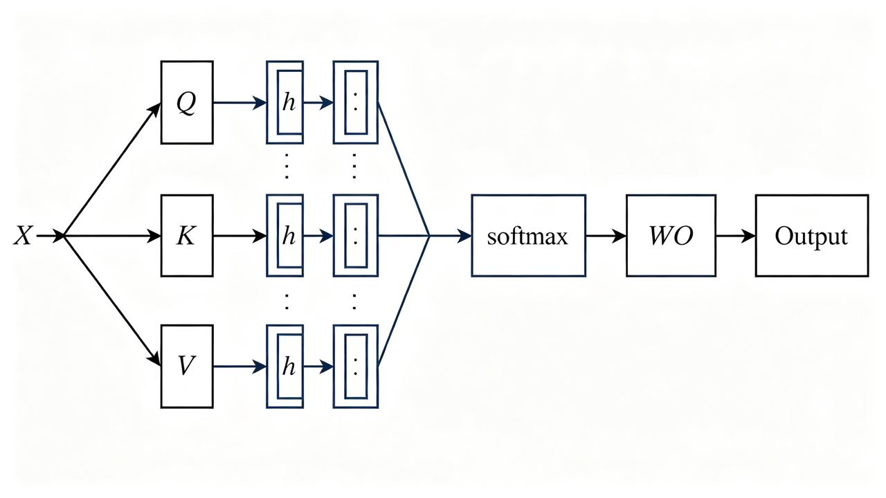

#### 多头注意力的运算流程是怎样的？用公式表示。

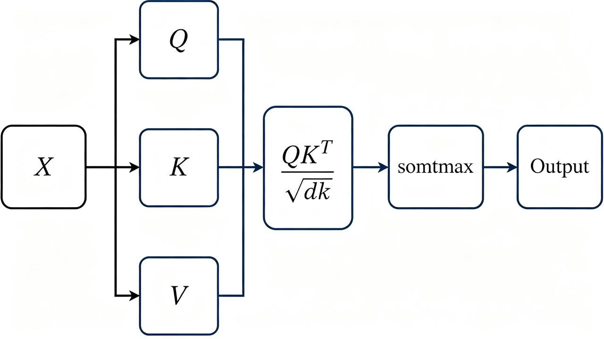

> 多头注意力的本质是：在多个低维子空间里并行计算注意力，再融合多视角信息。
>

设输入序列为 $X\in\mathbb{R}^{n\times d_{model}}$，头数为 $h$，每个头的维度 $d_k=d_{model}/h$。

对于第 $i$ 个头：

- 有三个可学习的投影矩阵 $W_Q^{(i)},W_K^{(i)},W_V^{(i)}\in\mathbb{R}^{d_{model}\times d_k}$。
- 投影得到查询、键、值：

$$
Q_i=XW_Q^{(i)},\quad K_i=XW_K^{(i)},\quad V_i=XW_V^{(i)}
$$

- 计算该头的注意力输出：

$$
\text{head}_i=\text{Attention}(Q_i,K_i,V_i)=\text{softmax}\left(\frac{Q_iK_i^T}{\sqrt{d_k}}\right)V_i
$$

所有 $h$ 个头并行计算后，将结果在特征维度上拼接：

$$
\text{MultiHead}(X)=\text{Concat}(\text{head}_1,\ldots,\text{head}_h)W_O
$$

其中 $W_O\in\mathbb{R}^{d_{model}\times d_{model}}$ 是最终的输出投影矩阵。

**工程实现上的等价写法**：\
实际代码中通常将 $W_Q,W_K,W_V$ 分别合并为三个大的矩阵 $\in\mathbb{R}^{d_{model}\times hd_k}$，一次性算出所有头的 Q、K、V，再通过 reshape 和 transpose 拆成 $(B,h,n,d_k)$ 的形状，批量进行注意力计算。这样可以利用高度优化的矩阵乘法，所有头完全并行。

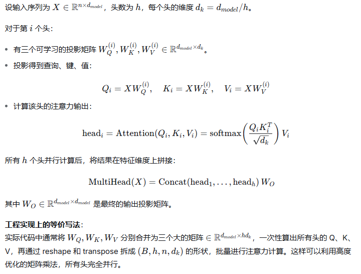{.ocr-src}

---

#### 为什么需要“多头”？用一个头的注意力有什么问题？

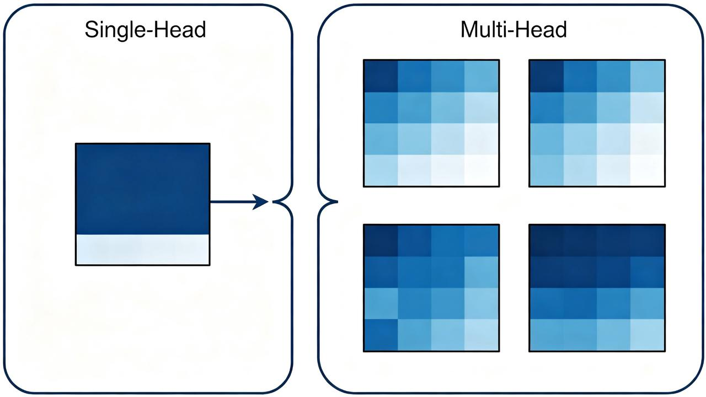

单头的本质缺陷：

单头注意力只能学习一种“什么值得关注”的模式。问题在于，语言中的依赖关系是多层面的：一个词可能需要同时关注它的语法支配者、它的指代先行词、它的局部上下文词，以及全局主题词。这些不同类型的依赖，需要完全不同的相似性度量标准。

单头迫使所有注意力权重都由同一个点积空间 $QKT$ 定义，这会导致平均化灾难：模型不得不把多种不同的注意力需求折中到一个分数里，最终每个依赖关系都捕捉得不够精准，边界模糊。

多头如何从根本上解决这个问题：

每个头有自己独立的 $W_Q,W_K,W_V$ 投影矩阵，因此每个头可以将输入映射到**不同的语义子空间**。这意味着：

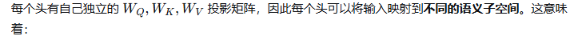{.ocr-src}

- 头 A 的 $Q$,$K$ 可以专注于“动词-主语”的句法关系；

- 头 B 的 $Q$,$K$ 可以专注于“代词-实体”的指代关系；

- 头 C 的 $Q$,$K$ 可以专注于“关键词-文档主题”的全局语义关系。

最终通过 $W_O$ 融合各头信息，模型就同时拥有了“多双眼睛”，从不同角度观察同一个序列，拼凑出完整的上下文表示。这就好比一个调查团队中，有人负责调查动机，有人负责调查时间线，有人负责调查人际关系，最后汇总成一份全面的报告。单头则是只有一个人试图包揽所有维度，必然存在观察盲区。

---

#### 多个头的输出如何合并？为什么要做线性投影？

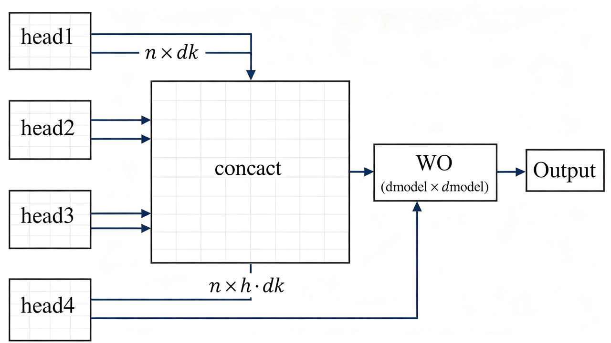

合并方式：

每个头的输出是形状为 $(n,d_k)$ 的张量。将 $h$ 个头的结果沿最后一维拼接起来，得到 $(n,h\cdot d_k)=(n,d_{model})$ 的大矩阵。

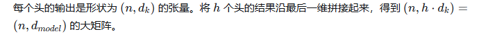{.ocr-src}

为什么不能直接拼接就结束？

拼接只是把各头的信息“物理上”放在一起，但各头之间的信息是相互隔离的，它们之间没有发生任何交互。如果不做线性投影，下一层就只能在“这些是来自不同头的信息”这种割裂状态下工作。

$W_O$ 的核心作用：

- **跨头信息融合**：$W_O$ 是一个 $d_{model}\times d_{model}$ 的稠密矩阵，它允许**每个输出位置的特征是所有头输出的线性组合**。这意味着一个头提取到的信息（例如“这个词是主语”）可以调节另一个头提取的信息（例如“这个词和远处的某个词相关”）在最终表示中的权重。它将割裂的“多视角观察”融合为“一个综合表征”。
- **维度恢复**：由于 $h\cdot d_k=d_{model}$，经过 $W_O$ 后输出维度与输入 $X$ 保持一致，使得残差连接 `X + MultiHead(X)` 成为可能。残差连接是深层 Transformer 能够稳定训练的基础。
- **增加表达能力**：这个线性层为模型提供了额外的参数容量，可以学习更复杂的特征重组函数。

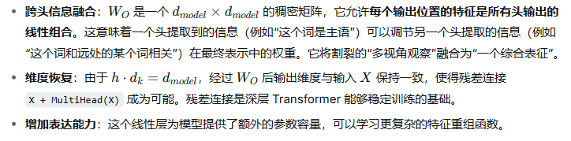{.ocr-src}

---

#### 头的数量 h 如何选择？h 太大会有什么影响？

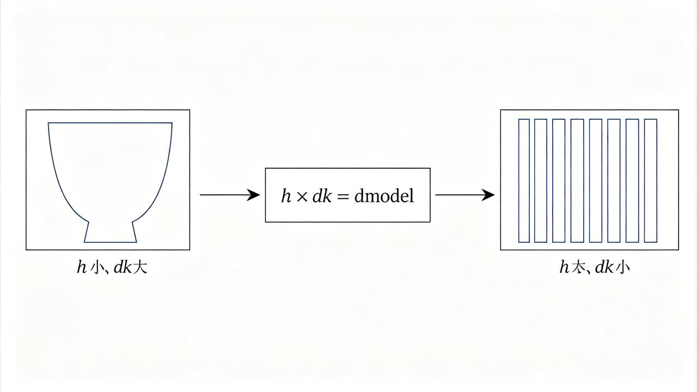

选择 h 的核心约束：

$d_{model}$ 必须能被 $h$ 整除，所以 $d_k=d_{model}/h$ 必须是整数。因此，关键不是直接选 $h$，而是选 $d_k$（每个头的维度）。

**经验上 $d_k$ 的合适范围**：

- $d_k$ 太小（例如 16 或 32）：每个头子空间的表达能力严重受限。向量的维度太低，无法编码复杂的语义关系，点积相似度的判别力也下降。模型可能学不到有意义的注意力模式。
- $d_k$ 太大（例如 512 或 1024）：头数 $h$ 就变得很小，退化为接近单头，丧失了“多视角”的优势。
- 工业界和学术界的经验甜区在 $d_k=64$ 或 $d_k=128$。Transformer-base 选择 $d_{model}=512,h=8,d_k=64$；Transformer-large 选择 $d_{model}=1024,h=16,d_k=64$。LLaMA-7B 选择 $d_{model}=4096,h=32,d_k=128$。

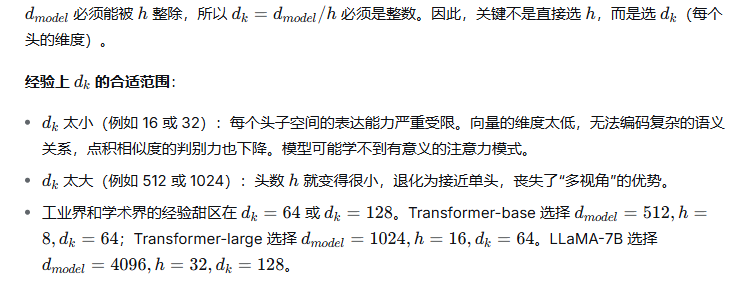{.ocr-src}

h 太大的具体影响：

- 每个头容量不足：$d_k$ 极小，限制了每个头能捕获的模式复杂度。

- 大量冗余头：研究发现，很多头学到的注意力模式高度相似甚至是重复的。头数过多并没有带来多样性的持续增加，反而浪费了参数和计算。这也是为什么可以通过头剪枝（Head Pruning）在推理时移除大部分头而对性能影响很小。

- 实现效率下降：头数过多会导致在 reshape 和 transpose 操作中产生大量的小矩阵乘法，GPU 的利用率可能降低，内存碎片增加。

---

#### 多头注意力是否可以并行计算？简述实现方式。

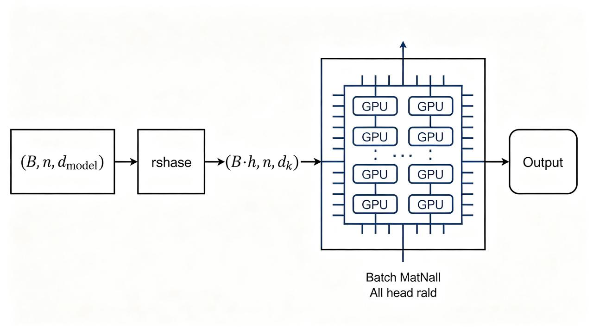

> 完全可以并行，这是设计使然。
>

并行原理：\
注意力的计算核心是矩阵乘法。在多头实现中，所有头的计算被组织为批量矩阵乘法。通过对输入张量进行维度变换，将“头”这个维度合并到 batch 维度中，成为 ($B$⋅$h$,$n$,$d_k$) 的形状，这样所有头可以共享同一个矩阵乘法内核，在 GPU 上完全并行地一次性完成计算，无需任何循环。

PyTorch 典型实现步骤：

1. 输入 $X$ 形状为 $(B,n,d_{model})$。
2. 使用合并后的权重矩阵一次性计算所有头的 Q, K, V，输出形状为 $(B,n,h\cdot d_k)$。
3. `reshape` 为 $(B,n,h,d_k)$，再 `transpose` 为 $(B,h,n,d_k)$。
4. 批量计算注意力分数 `scores = Q @ K^T / sqrt(d_k)`，形状为 $(B,h,n,n)$。
5. softmax 并乘以 V，得到输出 $(B,h,n,d_k)$。
6. `transpose` 回 $(B,n,h,d_k)$，`reshape` 回 $(B,n,d_{model})$。
7. 通过 $W_O$ 线性投影。

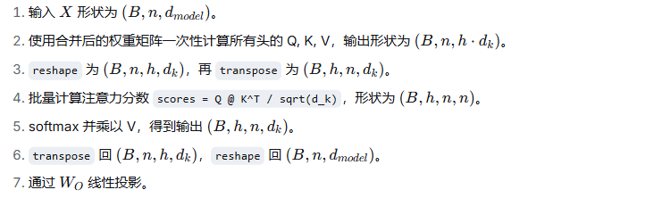{.ocr-src}

整个过程没有串行依赖，所有头在所有 token 上的注意力计算同步进行。这与 RNN 的时间步串行形成鲜明对比，是 Transformer 能够高效训练的根本原因。

---

#### 如果每个头都学到了完全相同的注意力模式，会怎样？

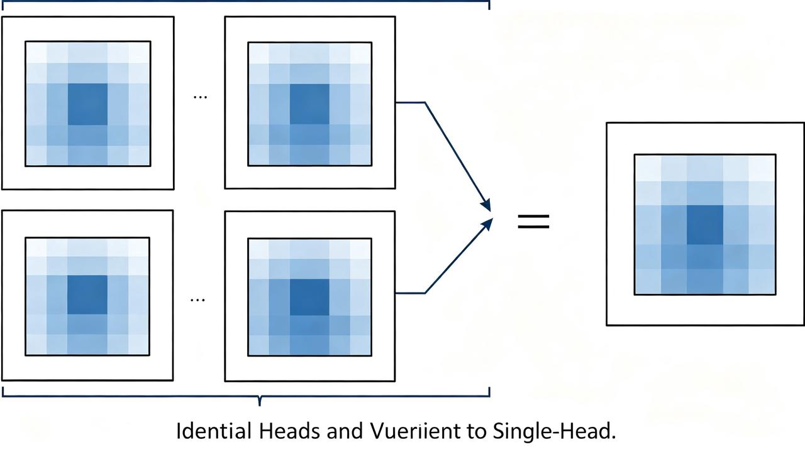

> 等价于单头注意力，多头完全失效。
>

当所有头的 $W_Q,W_K,W_V$ 投影矩阵相同，或者它们在功能上等价时，每个头都会对相同的 token 赋予相同的注意力权重，提取相同的上下文信息。拼接后乘以 $W_O$ 的组合，在数学上总可以等价地简化为一个单头注意力的输出（因为线性变换的叠加仍然是线性变换）。

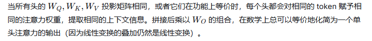{.ocr-src}

实际危害：

- 参数浪费：$h$ 倍的参数量只换来了单头的表达能力，效率极低。

- 训练中可能发生模式坍塌：如果初始化不当或学习率过大，模型可能在训练早期就陷入这种对称解，之后难以逃逸。此时模型就永久丧失了对多种依赖关系建模的能力。

- 对复杂任务不利：需要全局-局部、句法-语义等多层次建模的任务，在这种退化模型上表现会很差。

实际模型中的真实情况：

训练良好的 Transformer 通常会自然地分化出功能各异的头。但同时也存在相当比例的冗余头（功能重复或可以被其他头替代），这是模型可以被大量剪枝的理论基础。

---

#### 如何解读“每个头关注不同子空间”？

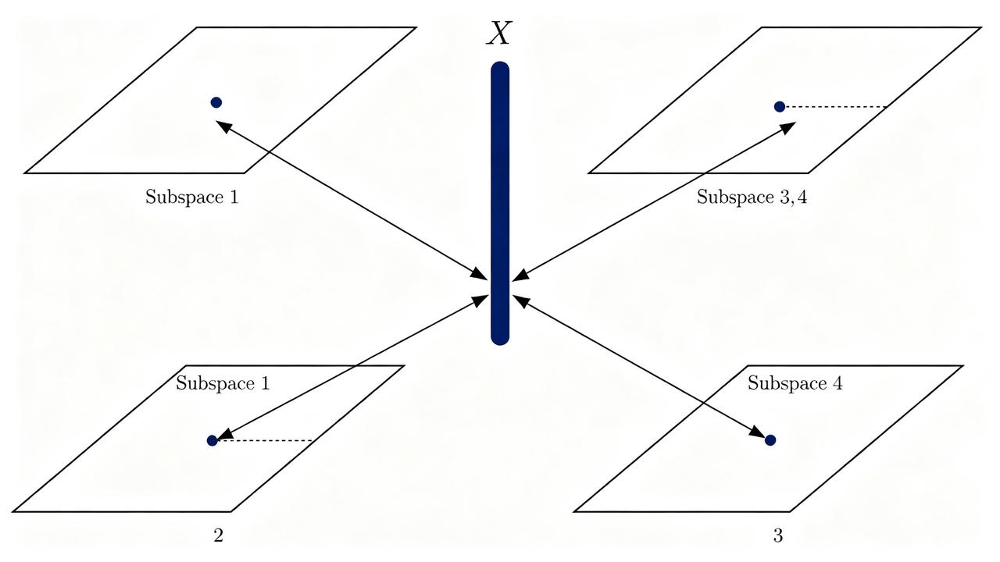

直观理解：\
可以把输入 $X$ 的每一行（一个 token 的嵌入）看作一个高维向量。这个向量中混杂了语义、句法、位置、主题等各种各样的信息。

多头注意力做的事情，就是通过不同的 $W_Q^{(i)},W_K^{(i)}$ 投影矩阵，从原始向量中**抽取不同的特征组合**，形成不同的低维“子空间”。在每个子空间里，“相似”的定义是不同的。

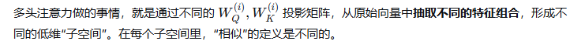{.ocr-src}

- 在某个子空间中，Q 和 K 可能主要保留“名词-动词”的语法信息，因此在这个子空间里，相似的 token 是根据它们的语法角色聚合的。

- 在另一个子空间中，Q 和 K 可能主要保留语义主题信息，因此相似的 token 是根据话题相关性聚合的。

“子空间”的数学解释：

$W_Q^{(i)}$ 的列向量构成了第 $i$ 个查询子空间的一组基。$X$ 通过 $W_Q^{(i)}$ 的投影，就是求 $X$ 在这组基下的坐标。不同的头使用不同的基，因此它们“看到”的是原始高维向量在不同低维映射下的“影子”。每个影子保留了原始输入的一个侧面，所有影子拼在一起，就构成了对原始输入的更完整的描述。

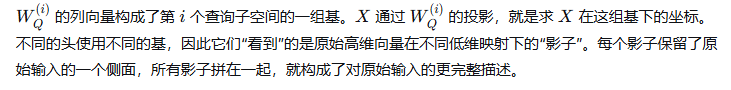{.ocr-src}

---

#### 多头注意力的总参数量与 h 无关，这个说法对吗？为什么？

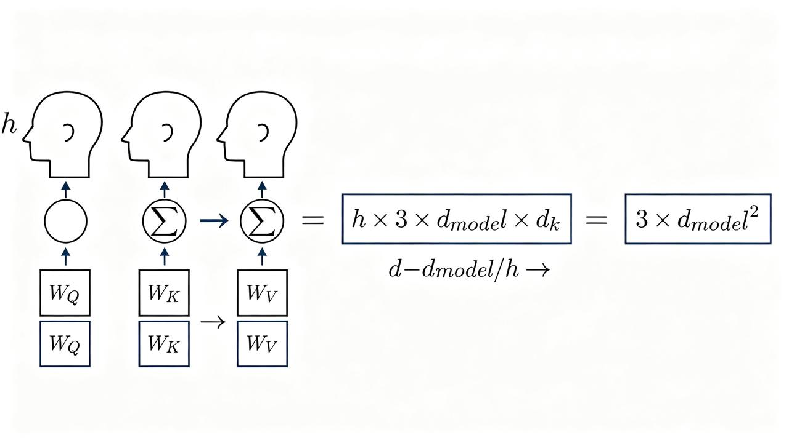

**完全正确，前提是 $d_k=d_{model}/h$ 不变。**

**推导**：

- 对于单个头 $i$：$W_Q^{(i)},W_K^{(i)},W_V^{(i)}$ 都是 $d_{model}\times d_k$ 的矩阵。
- 单个头的参数量 = $3\times d_{model}\times d_k$。
- 所有 $h$ 个头的参数量 = $h\times3\times d_{model}\times d_k$。
- 由于 $d_k=d_{model}/h$，代入得：$h\times3\times d_{model}\times(d_{model}/h)=3\times d_{model}^2$。

**结论**：投影矩阵部分的总参数量是常数 $3d_{model}^2$，与 $h$ 无关。输出投影 $W_O$ 的大小是 $d_{model}\times d_{model}$，也与 $h$ 无关。

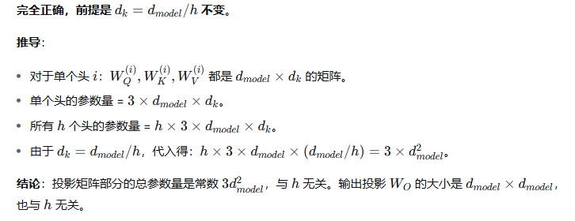{.ocr-src}

这意味着什么：\
这是一个非常优雅的设计——我们可以自由调节头数 $h$，而不改变模型的总参数规模。增大 $h$ 让每个头更窄（$d_k$ 更小），换取更多样化的视角；减小 $h$ 让每个头更宽，换取更强大的单头表达能力，参数量完全相同。这为我们提供了一个在不增加模型预算的前提下，探索最优架构配置的自由度。

---

#### 在同一个 Transformer 层中，不同头的 Q、K、V 是否共享权重？

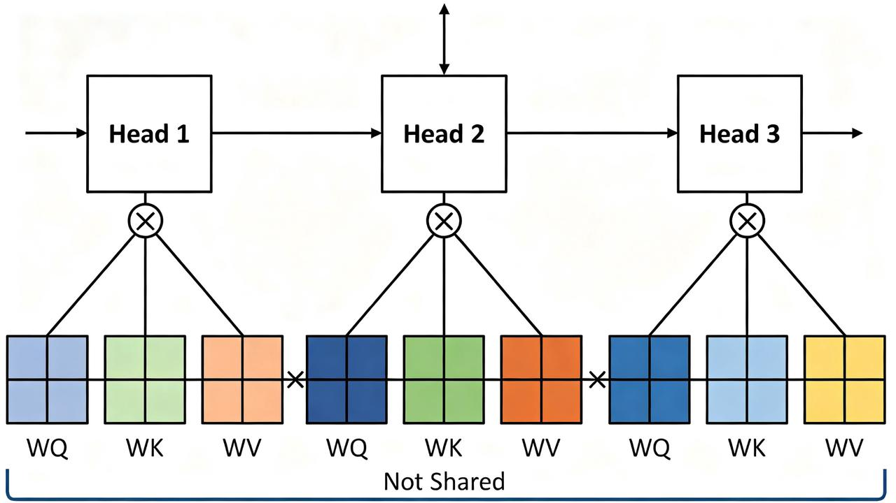

> 绝对不共享。如果共享，多头就退化为单头了。
>

为什么必须独立：

每个头的核心价值在于从不同的子空间去计算注意力。如果所有头共享 $W_Q$，那么它们计算出的查询向量就都位于同一个线性子空间中，视角完全一致。即使 $W_K,W_V$ 不同，由于 Q 决定了“要寻找什么”，所有头本质上还是在问同一个问题，只是用不同的 K 去回答。这会严重限制注意力模式的多样性。

实验和实践早已证明，独立的 $W_Q,W_K,W_V$ 是多头注意力成功的关键前提。任何形式的强制共享都会导致性能显著下降。模型在训练过程中会自动学习分化这些矩阵，以覆盖不同类型的依赖关系。

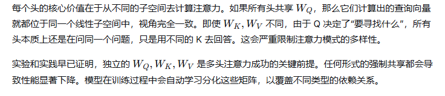{.ocr-src}

---

#### 可以只使用一组 Q，但使用多组 K 和 V 吗？

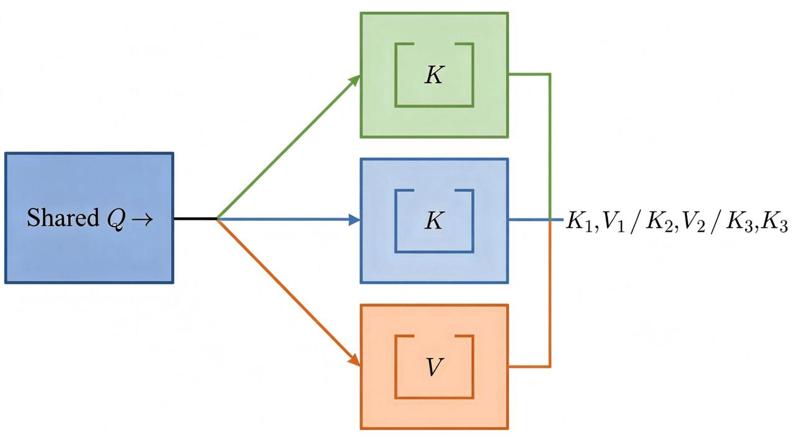

> 可以，但不是标准做法，而且会丧失多头注意力的核心优势。
>

如果所有头共享同一个查询投影 $W_Q$，那么对于给定的输入，所有头都会产生完全相同的查询向量 $Q$。这意味着所有头都在问**同一个问题**：“在我的上下文中，哪些token与这个统一的查询相关？”

然而，不同头拥有独立的 $W_K$ 和 $W_V$，因此键和值被投影到了不同的子空间。于是，对于同一个问题，不同的头会用不同的“标签”和“内容”来回答。这确实能带来一定的多样性：同一个查询，在头A的键空间中可能匹配到动词的主语，在头B的键空间中可能匹配到局部上下文词。

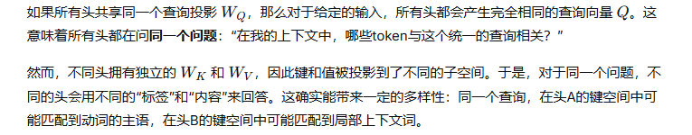{.ocr-src}

为什么一般不这样做：

- 查询视角的单一性是瓶颈：语言中一个token需要关注其他token的原因是多重的。同一个词可能既是某个动词的宾语，又是某个代词的先行词，还是某个全局主题的关键词。这些不同的关注需求，需要从不同角度去“提问”。共享Q使得所有头都只能从同一个语义角度去搜寻信息，极大地限制了注意力的灵活性。

- 表达能力远低于独立Q：独立Q允许模型根据当前token的多重身份分别生成不同的查询，这才是多头能够同时捕捉句法、语义、指代等多种关系的关键。共享Q虽然比纯单头强一些，但远不如标准多头。

- 实践中无人采用：主流模型从未采用这种设计，因为保留独立Q的成本很低（只是一些投影参数），但带来的多样性收益巨大。

不过在推断加速的语境中，出现了多查询注意力，它的设计是反过来的：保留多组Q，但共享K和V，这能极大压缩KV缓存。

---

#### 有没有办法压缩多头注意力，减少 KV 缓存？举例说明。

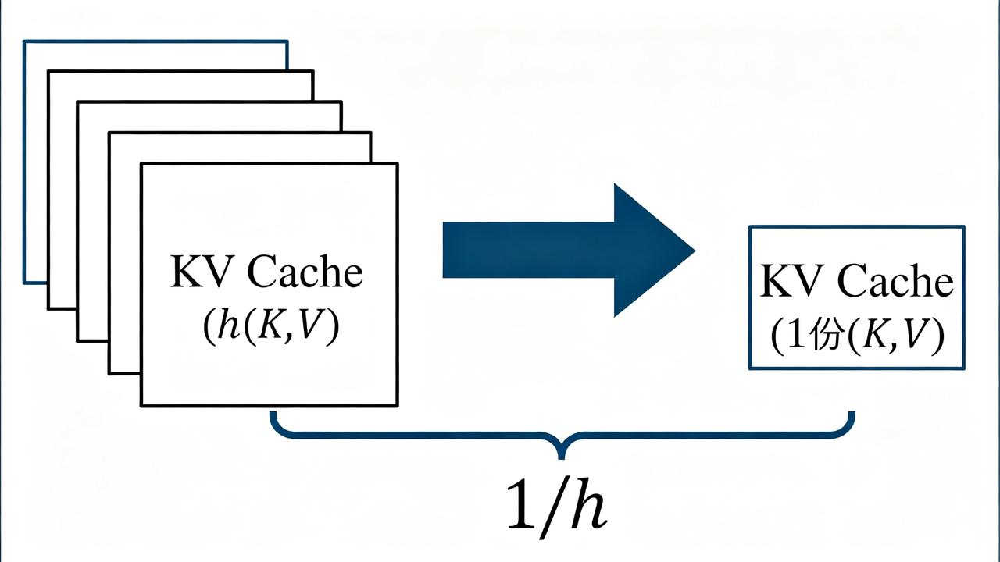

> 有，核心思路是让多个头共享同一组K和V，因为KV缓存的存储量与头数和序列长度成正比，是长文本推理的主要显存瓶颈。
>

举例1：多查询注意力

- 所有头共享唯一的一组K和V投影。只有Q保持多头。

- 效果：KV缓存大小缩小为原来的 1/$h$。在自回归解码时显存占用大幅下降，推理速度显著提升。

- 代价：注意力质量略有下降，因为不同头无法再从不同的K、V子空间中提取信息，只能通过不同的Q去“解读”同一套K、V。PaLM模型采用了这一设计。

举例2：分组查询注意力

- 将 $h$ 个头分成 $g$ 组（$g$<$h$），同一组内的头共享K和V，不同组之间独立。Q保持多头。

- KV缓存缩小为原来的 $g$/$h$。

- 这是标准MHA和MQA的灵活折中。LLaMA 2 的70B模型使用了 $h$=64,$g$=8，在几乎不损失注意力质量的情况下，将KV缓存压缩到了原来的1/8。

举例3：跨层KV共享

- 让相邻的若干层Transformer共用同一套KV缓存。通过减少总层数的有效缓存份数来压缩。

举例4：低秩压缩KV

- 对K和V的投影矩阵进行低秩分解，或者在推理时将缓存的KV张量进行动态量化（如INT8/INT4），从而降低每个元素的存储位宽。

这些方法的核心都是利用注意力的参数冗余性——实验表明，不同头的键值投影存在大量共享的信息，不必为每个头都维护一份完整的独立表示。

---

#### 多查询注意力 (MQA) 和多头注意力的区别是什么？

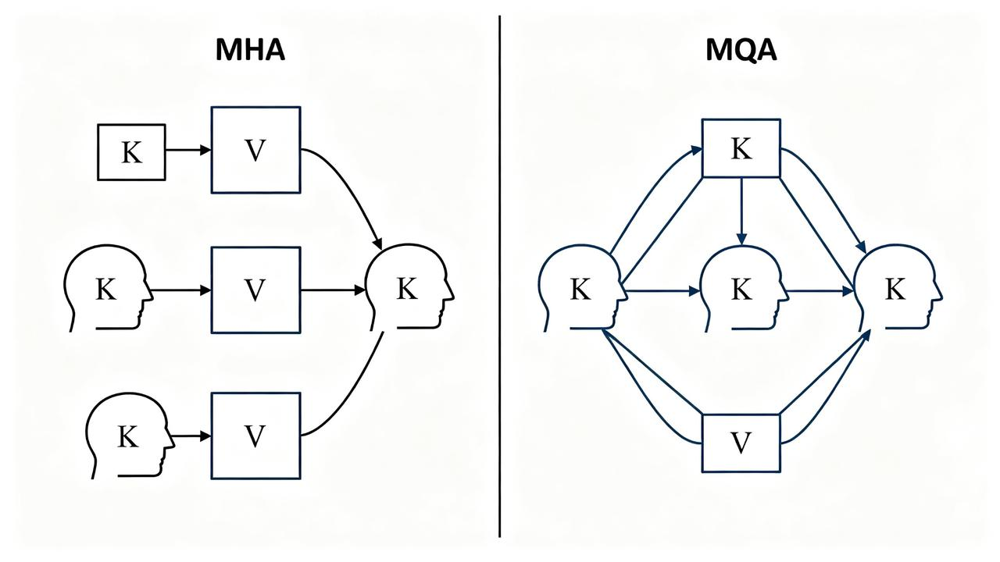

> 区别集中在K和V是否被所有头共享。
>

- 多头注意力：

- 每个头有自己独立的 $W_Q,W_K,W_V$。

{.ocr-src}

- 每个头在自己的子空间中进行完整的 Q、K、V 交互。

- KV缓存大小 = 2×层数×头数×序列长度×头维度。

- 多查询注意力：

- 每个头有自己独立的 $W_Q$，但**所有头共享同一组 $W_K,W_V$**。

{.ocr-src}

- 因此所有头的K是相同的，V也是相同的。只有Q是不同的。

- KV缓存大小 = 2×层数×1×序列长度×头维度（只存一份K和V）。

带来的本质差异：

- MQA用极小的KV缓存代价换取几乎所有的多头查询多样性，因为多样性主要通过不同的Q实现，而缓存的压缩通过共享K、V实现。

- MHA的表达能力更强，因为K、V的独立投影允许不同头从不同角度标注和聚合信息。MQA由于共享K、V，不同头看到的是相同的“被查内容”和“被聚合内容”，仅仅因为查询不同而产生不同注意力分布。

- 在自回归解码中，MQA的内存带宽需求远远小于MHA，这使得在相同硬件下可以支持更长的上下文或更大的batch。

---

#### 分组查询注意力 (GQA) 是如何在 MHA 和 MQA 之间折中的？

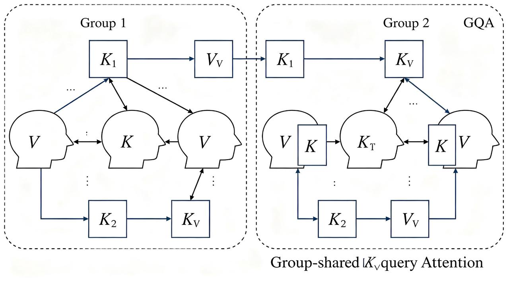

> GQA 提供了一把连续的旋钮，让我们可以在MHA（质量上限）和MQA（效率上限）之间平滑调节。
>

机制：

将 $h$ 个头划分为 $g$ 个组。对于每个组，组内的所有头共享同一套 $W_K,W_V$，但每个头仍保留独立的 $W_Q$

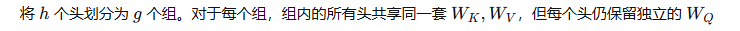{.ocr-src}

- 当 $g$=$h$ 时，每个组只有一个头，退化为标准MHA。

- 当 $g$=1 时，所有头都在一个组里，退化为MQA。

- 当 1<$g$<$h$ 时，处于中间地带。

折中的精妙之处：

实验发现，MHA中的很多头学到的K、V模式高度相似，存在很大的冗余。但直接让所有头共享K、V（MQA）又过于极端，有些头确实需要独立的K、V来捕获特定的依赖类型。GQA通过分组，让模型自己在训练中决定多大程度的K、V共享是合适的。

效果：\
在LLaMA 2 70B上的实践表明，使用 $g$=8,$h$=64 的GQA，其性能几乎与MHA持平，但KV缓存降为MHA的1/8。推理时延和吞吐得到了极大改善，而对下游任务的质量损失极小。这就是GQA能够在现代大模型中迅速普及的原因。

---

#### 如何理解“多头”实际上是一种集成学习？

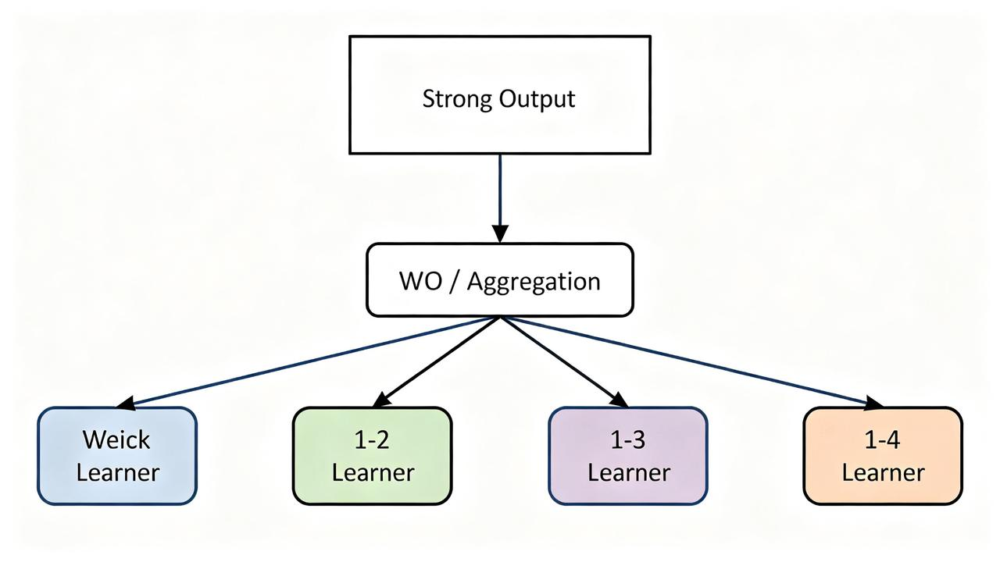

从函数近似角度：\
每个注意力头可以看作一个独立的“弱学习器”，它在自己的子空间中产生一个对上下文信息的聚合结果。多头的本质是用 $h$ 个不同的、弱相关的模型，从不同角度去建模依赖关系，然后将它们的结果集成起来，得到一个比任何单个头都更强、更鲁棒的最终表示。

集成学习的关键要素在多头中都有体现：

- 多样性：每个头使用不同的初始化、不同的投影矩阵，训练中由于随机梯度噪声和不同的学习动态，它们自然分化出不同的注意力模式。这类似于Bagging中不同模型在数据的不同子集上训练产生多样性。

- 聚合方式：多头的聚合是将各头输出拼接后通过一个可学习的线性变换 $W_O$。这比简单的投票或平均更强大，因为 $W_O$ 可以学会给不同头赋予不同的重要性权重，甚至让一个头的信息去抑制或增强另一个头的贡献。这相当于一个学习到的“元学习器”来组合基学习器。

- 效果：即使某些头产生了噪声或错误偏向，多个头的集成也能平滑这些错误。实验表明，剪枝少量头通常对整体性能影响很小，正是因为有其他头可以弥补其功能。这直接体现了集成学习的鲁棒性。

因此，多头注意力可以理解为在同一层中，使用参数高效的子空间投影，隐式地训练了一个多样化的注意力集成模型，并且这个集成模型与其余参数一起端到端优化。

---

#### 在代码实现中，如何高效地计算多头注意力？（如 reshape 和 transpose 操作）

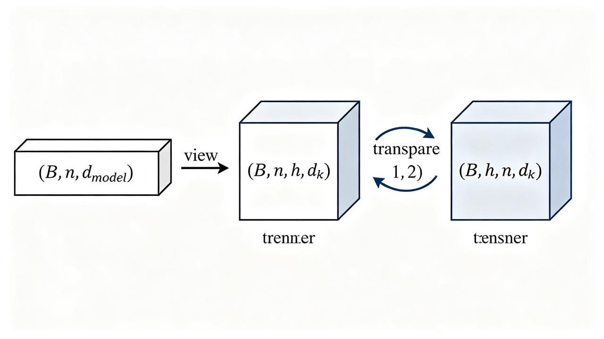

> 高效实现的核心是将所有头的计算合并为批量矩阵乘法，避免任何Python循环。
>

**典型PyTorch实现流程**（以输入 $X\in\mathbb{R}^{B\times N\times D}$，$D$ 为 $d_{model}$，$H$ 为头数，$d_k=D/H$ 为例）：

1. **一次性投影**：使用合并的权重矩阵 $W_Q\in\mathbb{R}^{D\times D}$（将 $H$ 个共小的 $W_Q^{(i)}$ 沿列拼接），计算 $Q=X@W_Q$，形状为 $(B,N,D)$。对K、V同理。这一步产生了所有头的完整Q、K、V，尚未区分头。
2. **重塑与转置**：
    - `Q = Q.view(B, N, H, d_k).transpose(1, 2)` → 形状 $(B,H,N,d_k)$。
    - 这一步是精髓：通过 `view` 将 $D$ 维拆成 $H\times d_k$，然后通过 `transpose` 将头维度移到batch维度之后，使得张量变为 `(batch_size, num_heads, seq_len, head_dim)`。现在，`H` 和 `B` 在逻辑上都作为并行的批次维度。

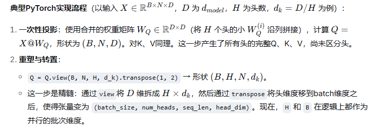{.ocr-src}

1. 批量注意力计算：
  - `scores = torch.matmul(Q, K.transpose(-2, -1)) / math.sqrt(d_k)` → 形状 (B,H,N,N)。
  - 由于`Q`和`K`的前两维是 `(B, H)`，`matmul`自动对这两个维度进行批量矩阵乘法，每个头独立计算自己的注意力分数矩阵。

2. 掩码与softmax：对`scores`加上掩码，然后`attn = F.softmax(scores, dim=-1)`。

3. 加权求和：
  - `output = torch.matmul(attn, V)` → 形状($B$,$H$,$N$,$d_k$)。

4. 逆重塑：
  - `output = output.transpose(1, 2).contiguous().view(B, N, D)`。
  - 先`transpose`将头维度移回序列维度之后，再用`view`将最后两维合并回 $D$，恢复为原始输入形状。

5. 输出投影：`output = output @ W_O`。

整个过程没有任何循环，全部是高度优化的张量操作，可在GPU上极致并行。

---

#### 如果某层的某几个头对最终任务贡献很小，能否剪枝？

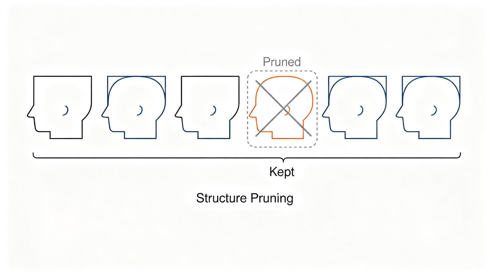

> 可以，而且这是模型压缩的常见手段。
>

剪枝依据：

- 通过对注意力头的重要性进行评分（例如基于它对损失函数的梯度、或基于移除该头后对下游任务性能的影响），可以识别出贡献极低或功能高度冗余的头。

- 研究发现，尤其是在深层Transformer的某些中间层，相当比例的头可以被完全移除而对最终性能几乎没有影响（有时甚至因为减少了过拟合而有微小提升）。

剪枝方法：

- **结构化剪枝**：直接移除整个头（即该头的 $W_Q,W_K,W_V,W_O$ 中对应的部分），并相应地调整后续层的维度，从而永久缩小模型尺寸。
- **动态掩码**：训练时学习一个门控参数，把不重要头的输出置零，实现软剪枝。或直接在推理时跳过这些头的计算。

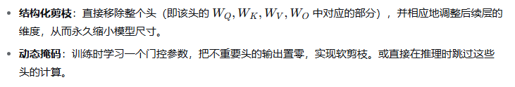{.ocr-src}

为什么能剪枝：

这正是多头集成学习特性的体现——冗余头和其他头功能重叠，集成中移除一个弱学习器不影响大局。此外，有些头可能学到了非常局部的、仅适用于特定数据模式的知识，对于大多数输入没什么贡献，这些头就成了可剪枝的“死权重”。

---

#### 解释“头冗余”现象，并说出可能的应对方法。

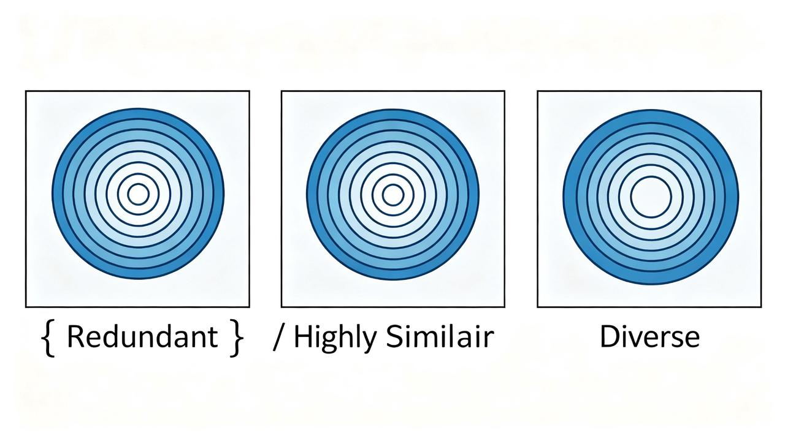

> 头冗余是指在训练好的多头注意力中，存在相当一部分头学到的注意力模式高度相似或完全可以被其他头替代，它们没有提供额外有用的信息。
>

现象表现：

- 不同头的注意力权重分布高度相关（例如计算两两注意力图之间的余弦相似度，发现接近1）。

- 剪掉某些头后，模型在下游任务上的指标几乎不变。

- 在可视化中，多个头的注意力热点区域几乎一致。

成因：

- 模型容量过剩。$d_k=64$ 的头表达能力可能已经足够，额外的头找不到足够多样化的新模式去学习，被迫复制已有模式。

- 训练动力学。某些头在初始化时偶然落入相同的吸引域，一直未能充分分化。

应对方法：

- 训练阶段：在损失函数中加入正则项，鼓励不同头的注意力分布差异（如最小化注意力权重矩阵的互信息或最大化它们之间的距离），强制头去学不同的模式。

- 后训练剪枝：通过重要性评估，系统性地裁剪冗余头，压缩模型而不损失性能。

- 架构改进：采用GQA等设计，从架构层面限制K、V的独立头数，减少可产生的冗余。

- 更优的初始化策略：让不同头的投影矩阵初始化时具有更大的多样性，帮助它们更早地分化。

---

#### 自注意力和多头注意力中，哪里用到了 Dropout？

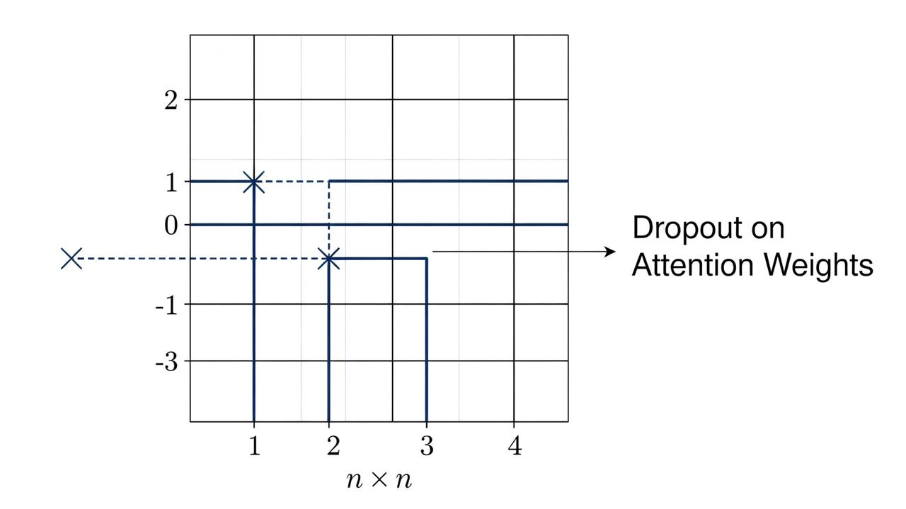

> Dropout 在 Transformer 中被广泛用于防止过拟合，应用在以下关键位置：
>

- 注意力权重上：在 softmax 之后、与 V 相乘之前，对注意力概率矩阵 $A$ 施加 dropout。这会随机丢弃一些注意力连接，迫使模型不能只依赖某几个固定的 token 关系，学习到更鲁棒的上下文表示。这是多头注意力中最核心的 dropout 位置。

- 每个子层的输出上（残差连接之前）：在每个自注意力子层和前馈网络子层的输出后，先进行 dropout，然后再与输入相加（即 `x + Dropout(Sublayer(x))`）。这会随机丢弃某些维度的特征，防止子层之间产生复杂的协同适应。

- 嵌入层之后：在词嵌入与位置编码相加之后，进入第一个编码器/解码器层之前，施加 dropout。相当于对输入表示进行随机掩码。

- 在前馈网络中：通常在两个线性层之间、激活函数之后，也加入 dropout。

现代大规模预训练模型（如 LLaMA）由于数据量极其庞大，往往大幅降低 dropout 比例甚至完全去除，转而依赖数据本身的多样性来防止过拟合。但在中等规模训练或微调时，这些 dropout 位置仍然是重要的正则化手段。

---

#### 对于不同层，头的注意力模式通常会发生怎样的变化？

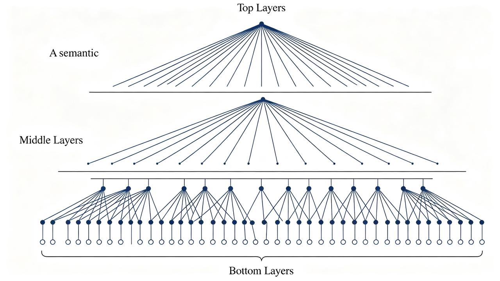

> 总体规律：从底层到顶层，注意力模式呈现出从局部、句法向全局、语义的层次化转变。
>

- 底层（靠近输入的层）：
  - 注意力模式倾向于局部，即每个词主要关注其邻近的几个词。这与CNN的低层提取局部边缘和纹理特征类似。
  - 很多头会形成清晰的、可预测的模式，如“关注前一个词”、“关注对角线（自身）”、“关注后一个词”等。这些模式有助于编码短语结构和局部语法关系。

- 中间层：
  - 注意力范围开始扩大。部分头转向句法结构，例如动词的头会强烈关注其主语或宾语，介词的关注其宾语等，形成句法依存树的大致结构。
  - 同时，一些头开始捕捉更长距离的语义关联，如同义词、相关概念。

- 顶层（靠近输出的层）：
  - 注意力变得非常全局和稀疏。大部分注意力权重可能集中在少数几个特殊 token 上，例如句子开头的 `[CLS]` token（BERT中）、关键的语义中心词（如主要实体、主题词），或者特定的分隔符。
  - 这种集中表明顶层在进行高层语义综合，将整个序列的信息聚合到少数关键点，为最终的分类或生成做准备。

在生成任务（解码器）中，这种层次化同样存在，但自回归掩码使得注意力只能向前看，因此底层偏向捕捉局部的近期依赖，顶层则能够关注到非常远的历史关键信息。

这种层次化的注意力模式是 Transformer 强大的重要来源，它使得模型能像人类的阅读和理解过程一样，先解析局部结构，再逐步构建全局意义。

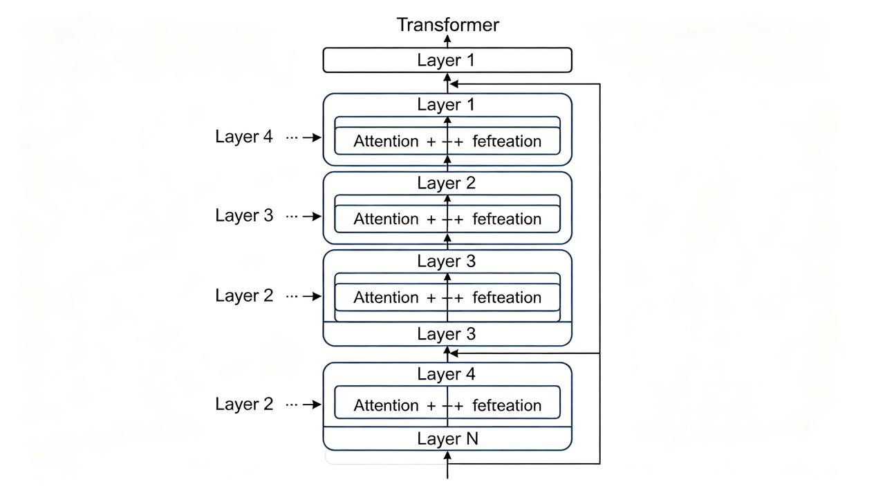

