# 4.  大模型（LLMs）因果掩码（Causal Mask）

#### 什么是因果掩码？它在自注意力中如何实现？

因果掩码（Causal Mask），又称自回归掩码或未来掩码，是一种在自注意力机制中施加的约束，确保每个位置只能关注自身及其之前的 token，而不能看到任何未来的 token。它是维持语言模型自回归性质的关键机制。

实现方式：

- 在计算缩放点积注意力时，首先得到注意力分数矩阵 $S=QK^T/\sqrt{d_k}$，形状为 $[n,n]$（$n$ 为序列长度）。矩阵中第 $i$ 行、第 $j$ 列的元素表示位置 $i$ 对位置 $j$ 的原始关注分数。

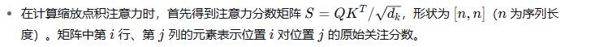{.ocr-src}

- 为了实现“不能看未来”，我们需要将 j>i 的所有位置（即当前位置的右侧、未来 token）的分数置为负无穷 −∞。

- 具体操作：构建一个与 $S$ 同形状的掩码矩阵 $M$，其中 $M_{ij}=0$ 当 j≤i（合法位置），Mij=−∞ 当 j>i（非法位置）。然后将 $M$ 加到分数矩阵上：

$$
S^{\mathrm{masked}} = S + M
$$

- 之后进行 softmax 归一化。由于 $e^{-\infty} = 0$，被掩码的未来位置的注意力权重变为 0，模型在加权求和 $V$ 时完全忽略它们。

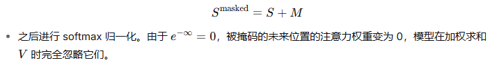{.ocr-src}

- 在实际代码实现中，往往不显式构建一个 −∞ 矩阵，而是通过 `torch.triu` 生成上三角的布尔掩码，然后使用 `masked_fill_` 将分数矩阵上三角部分填充为 `float('-inf')`。

这样，自注意力就变成了单向的，每个 token 只能基于它之前（包括自己）的上下文生成。

---

#### 绘制一个 4×4 的因果掩码矩阵，并说明其含义。

对于一个长度为 4 的序列，其因果掩码矩阵如下（✓ 表示分数保持为原始值，✗ 表示被置为 −∞）：

```plain text
位置 j (Key)
   0  1  2  3
i=0 [✓, ✗, ✗, ✗]
i=1 [✓, ✓, ✗, ✗]
i=2 [✓, ✓, ✓, ✗]
i=3 [✓, ✓, ✓, ✓]
```

数值表示（掩码矩阵 M）：

```plain text
[[  0, -∞, -∞, -∞],
 [  0,   0, -∞, -∞],
 [  0,   0,   0, -∞],
 [  0,   0,   0,   0]]
```

含义解读：

- 第 0 行（第一个 token）：只能关注自己（位置 0）。因为它左边没有其他 token，它没有任何上下文可以依赖。

- 第 1 行（第二个 token）：可以关注自己（位置 1）以及它之前的 token（位置 0）。这模拟了预测第二个词时可以看到第一个词的真实场景。

- 第 2 行（第三个 token）：可见范围扩大到位置 0, 1, 2。

- 第 3 行（第四个 token）：可以看到全部四个 token，因为它是序列的末尾。

- 每一行都代表了对应位置在生成时所能利用的最大历史信息。这个严格的上三角结构确保了时序因果性——信息只能从过去流向现在，不能从未来泄露。

---

#### 为什么在语言模型训练时需要使用因果掩码？

语言模型训练的目标是最大化整个序列的联合概率的分解：

$$
P(x_1, x_2, \ldots, x_n) = \prod_{t=1}^{n} P(x_t | x_1, \ldots, x_{t-1})
$$

{.ocr-src}

这个分解要求每一个 token $x_t$ 的预测**只能以它之前的 token 为条件**。如果在训练时模型能够看到未来的 token，那么这个条件概率就不再是真实的 $P(x_t|x_{<t})$，而变成了 $P(x_t|x_{<t}, x_{>t})$，这就违反了自回归的假设，导致训练和推理不一致（曝光偏差）。

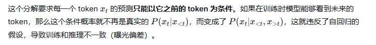{.ocr-src}

具体来说，使用因果掩码的原因包括：

- 保持自回归一致性：让训练时的条件分布与推理时完全相同（推理时自然看不到未来）。

- 防止信息泄露：如果允许双向注意力，模型在预测第 $t$ 个词时可以直接“抄”到第 $t$ 个词本身（或者它的未来上下文），相当于作弊，损失函数将无法真实反映模型的预测能力。

- 实现并行训练：因果掩码允许在训练时一次性输入整个序列，通过掩码技巧让每个位置只看到该看到的部分，从而可以并行计算所有位置的输出，极大提升训练效率。

---

#### 如果没有因果掩码，直接用双向自注意力训练 Decoder-Only 模型会怎样？

如果去掉因果掩码，Decoder-Only 模型将变成双向编码器，失去自回归生成能力。具体后果：

- 训练时信息泄露：每个 token 都能看到整个序列（包括自己及其未来），模型将无法学会根据前文预测下一个词，而是学会了一种“根据上下文填空”或“复制输入”的捷径。预测损失会极低，但这毫无意义，因为模型根本没有学到生成能力。

- 无法进行自回归推理：推理时我们需要逐个生成 token。如果在训练时模型习惯了看到整个序列的双向上下文，那么在推理时，它只能看到已生成的部分（单向），这种输入分布的剧变会导致模型行为完全崩溃，生成的 token 毫无意义。

- 变成类似 BERT 的模型：这样的模型适用于理解任务（如文本分类、问答），但不能直接用于开放生成。Decoder-Only 模型的本质是其单向注意力，这是它与编码器模型的根本区别。

因此，因果掩码是 Decoder-Only 模型的结构性必需品，没有它，GPT 系列等模型就不复存在。

---

#### 因果掩码和零一掩码的区别是什么？在注意力分数中如何体现？

因果掩码：使用 0 和 −∞。合法位置加 0（分数不变），非法位置加 −∞，经 softmax 后权重变为 0。它用于屏蔽未来的 token。

零一掩码：通常指的是 Padding Mask（填充掩码）。用于处理变长序列时，将 `<PAD>` token 屏蔽掉。Padding Mask 在分数矩阵中，对 `<PAD>` 位置加上 −∞（或减去一个很大的数），使得 softmax 后这些位置的权重为 0。其掩码矩阵元素通常是 0（非 pad）或 −∞（pad）。因果掩码和 Padding Mask 可以组合使用：先加因果掩码，再加 Padding Mask，或者将两者合并为一个统一的加性掩码。

在注意力分数中，它们都以加性掩码的形式作用在 softmax 之前：

$$
\mathrm{MaskedScores} = \frac{QK^T}{\sqrt{d_k}} + \mathrm{CausalMask} + \mathrm{PaddingMask}
$$

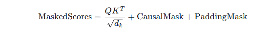{.ocr-src}

其中 CausalMask 是一个上三角为 −∞、下三角为 0 的矩阵；PaddingMask 在序列长度维上，对应 pad token 的列全部为 −∞。

两者都是通过将非法位置的 logits 强行压到极小值，使得经过 softmax 后权重为零。

---

#### 将因果掩码用于自注意力，是否会改变矩阵乘法的并行性？

不会改变矩阵乘法的并行性。 这是自注意力机制的巧妙之处。

- 矩阵乘法 $QK^T$ 仍然是完全并行的，一次性计算出所有 token 对之间的原始分数，形状为 $[n, n]$。这个计算不依赖掩码，完全可以并行。
- 掩码的加法 $S + M$ 是逐元素操作，同样可以完全并行。
- softmax 是逐行独立操作，也可以完全并行。

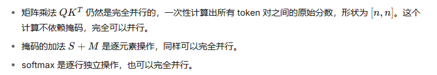{.ocr-src}

因果掩码并没有引入任何时间步之间的顺序依赖（不像 RNN 那样必须等前一步算完才能算下一步），它仅仅是在已经并行计算出的分数矩阵上施加了一个数据屏蔽。因此，整个注意力模块的训练过程仍然是高度并行的，这正是 Transformer 能够高效训练的关键。

注意：这种并行性是指训练时一次性处理整个序列。在推理时，因为自回归需要逐个生成 token，所以推理过程在序列长度维度上是串行的，但单步内计算仍然是并行的。因果掩码与 KV Cache 配合可以避免重复计算。

---

#### 在推理时，为什么因果掩码可以配合 KV Cache 使用？

推理时，自回归生成是一个 token 一个 token 地进行。假设已经生成了 $t$−1 个 token，现在要预测第 $t$ 个 token。自注意力需要当前 token 对之前所有 token 的注意力。

- KV Cache 的作用：将前 $t$−1 步计算的 Key 和 Value 向量缓存起来。预测第 $t$ 步时，只需为新的 token 计算其 Q、K、V，然后使用这个新 Q 与所有缓存的 K 计算注意力分数，再与缓存的 V 加权求和。

- 因果掩码的角色：在这个场景下，新 token 的 Q 只会与所有已缓存的 K（全部都是过去的 token）交互，天然满足“只能看过去”的因果约束。实际上此时序列已经天然是单向的，显式掩码有时可以省略，但通常仍会保留以维持结构一致。

因果掩码和 KV Cache 配合完美：因果掩码从逻辑上定义了哪些位置可看，KV Cache 从工程上避免了重复计算这些位置的 K 和 V。两者结合，使自回归推理在保证因果性的同时，计算复杂度从每步 $O(n^2d)$ 降到 $O(nd)$。

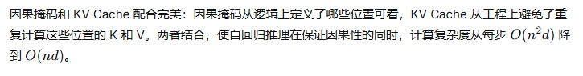{.ocr-src}

---

#### 如何用代码生成一个下三角的因果掩码？

使用 PyTorch 生成一个形状为 `(seq_len, seq_len)` 的下三角布尔掩码（True 表示需要屏蔽的未来位置，False 表示保留），然后转换为加性掩码。示例如下：

```python
import torch

def generate_causal_mask(seq_len):
    # 生成上三角矩阵，对角线以上为True，表示需要mask
    # triu: upper triangle, diagonal=1 表示不包含对角线
    mask = torch.triu(torch.ones(seq_len, seq_len), diagonal=1).bool()
    # mask 中 True 的位置需要被屏蔽，转为 -inf
    # 在注意力分数上使用时： scores.masked_fill_(mask, float('-inf'))
    return mask

# 示例：长度为4
mask = generate_causal_mask(4)
print(mask)
```

输出：

```plain text
tensor([[False,  True,  True,  True],
        [False, False,  True,  True],
        [False, False, False,  True],
        [False, False, False, False]])
```

然后可以在注意力计算中使用：

```python
scores = torch.matmul(Q, K.transpose(-2, -1)) / math.sqrt(d_k)
scores = scores.masked_fill(mask, float('-inf'))
attn_weights = torch.softmax(scores, dim=-1)
```

如果还需要同时处理 padding mask，可以先将 padding mask 扩展为与 scores 相同的形状，然后组合：

```python
scores = scores.masked_fill(causal_mask, float('-inf'))
scores = scores.masked_fill(padding_mask, float('-inf'))
```

#### 扩展一句话：“通过将注意力分数中未来位置设为 -inf，softmax 后变为 0。”

这句话的核心是 softmax 函数的数学性质：

$$
\mathrm{softmax}(z_i) = \frac{e^{z_i}}{\sum_j e^{z_j}}
$$

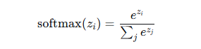{.ocr-src}

当某个分数 $z_j = -\infty$ 时，其指数 $e^{-\infty} = 0$。因此该位置对 softmax 输出的贡献为 0，同时它也不会影响分母的和（因为加 0）。最终，该位置的注意力权重精确为 0，完全不会参与后续的 Value 加权求和。

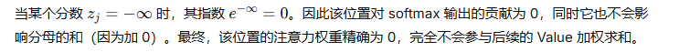{.ocr-src}

扩展：

这一机制优雅地实现了“屏蔽”效果，而且由于 softmax 的归一化性质，被屏蔽位置的概率质量会被重新分配给未被屏蔽的位置，使得剩余的注意力权重之和仍为 1。这种“加性掩码 + softmax”的模式成为注意力机制中实现各种约束（因果、填充、窗口、稀疏等）的通用范式。

---

#### 在 Transformer 的解码器中，交叉注意力是否需要因果掩码？

不需要，且绝对不能加。

交叉注意力的 Q 来自解码器当前层的输入（即目标序列的表示），K 和 V 来自编码器的最终输出（源序列的全部表示）。源序列在编码器中已经经过完整的双向自注意力处理，是一次性提供的完整上下文，它没有“未来”概念——整个源序列就等同于“过去的知识库”。

在解码器的每一步生成中，模型需要利用全部源信息来指导当前目标 token 的生成。例如，翻译“我爱吃苹果 → I like apples”时，解码器在生成“apples”时，需要同时看到“我”、“爱”、“吃”、“苹果”的全部编码信息，没有任何理由屏蔽源端的某个位置。

如果错误地加上因果掩码，解码器在生成早期目标 token 时只能看到源序列的前几个词，无法利用后面的关键信息，这会导致性能灾难。

关键记忆：掩码的规则是“不能看到未来的目标 token”（在自注意力中），以及“不能看到未来的源 token”（但源序列没有未来，因为它是给定的完整上下文）。交叉注意力永远是双向全可见的。

---

#### 解释“自回归生成”和因果掩码的关系。

自回归生成是指模型按时间步顺序，依次生成每个 token，并将已生成的 token 作为下一步的输入，其数学基础是概率的链式法则：

$$
P(x_1, x_2, \ldots, x_T) = \prod_{t=1}^{T} P(x_t \mid x_{<t})
$$

这个分解要求每个 $x_t$ 的预测**仅依赖于它之前生成的 token** $(x_1, \ldots, x_{t-1})$，而不能偷看未来的真实答案。

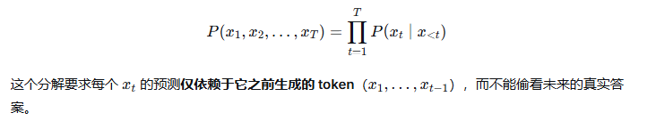{.ocr-src}

因果掩码正是这一约束在注意力机制中的实现。在训练时，我们将整个目标序列一次性输入模型，但通过掩码确保在计算位置 $t$ 的输出时，模型只能注意到位置 1…$t$，位置 $t$+1 及之后的所有 attention score 被设为 −∞，权重为 0。这就等价于模拟了自回归生成的条件：每个位置只看到了“历史”。

因此，因果掩码使得高效的并行训练成为可能：我们无需像 RNN 那样逐时间步串行训练，而是一次前向传播计算所有位置的输出，同时严格保持了自回归的逻辑一致性。没有因果掩码，自回归的生成模型就无法进行并行训练，或者会因信息泄露而学不到有意义的生成能力。

---

#### 在 GPT 系列模型中，因果掩码是如何在每一层中使用的？

GPT 是典型的 Decoder-Only 架构，每一层仅包含一个掩码自注意力子层（无交叉注意力）。其因果掩码的使用规则极为统一：

- 每一层的自注意力计算中，都施加相同的因果掩码矩阵 $M$，使得每个 token 只能注意到该层输入序列中位置编号小于等于自身的 token。

- 即使随着层数加深，token 的表示已经融合了部分全局信息（通过前层的隐式传递），但注意力模式依然是严格的因果单向：后层不能直接“越权”去看前层中那些来自未来的隐式信息（因为前层本身就已经屏蔽了未来），所以整个模型的感受野对每个 token 而言，始终保持其左向上下文。

- 在代码实现中，每一层的自注意力模块都会接收同一个 `causal_mask`，形状为 `(1, 1, seq_len, seq_len)`，并对该层的注意力分数进行掩码。每层的计算独立应用，没有区别。

这种层层一致的因果掩码，是 GPT 系列能够流畅进行自回归生成的基础，保证了在任意深度，模型都从未“看到过未来”。

---

#### 如果模型的训练目标不是生成，而是句子分类，因果掩码还有必要吗？

完全没有必要，反而有害。

句子分类任务（如情感分析、主题分类）通常需要一个聚合了整个句子信息的表示，通常是取 `[CLS]` token 的输出或对所有 token 进行池化。为了获得丰富的上下文理解，每个 token 的表示都应该能够融合其左右两侧的信息。这正是双向自注意力（无因果掩码）的用武之地。

如果错误地使用因果掩码，那么：

- 句子前面的 token 将完全无法利用后面的信息，比如主语可能无法看到句末的关键谓词，导致对整个句子的理解支离破碎。

- 分类决策所依赖的 `[CLS]` token（通常放在句首）只能看到自己，几乎无法聚合下文语义，性能会大幅下降。

因此，分类任务使用 BERT 风格的 Transformer 编码器（双向注意力，无因果掩码），其设计就是为了这种“理解”场景。因果掩码是为“生成”而生的。

---

#### 是否有一种模型可以同时进行双向和单向注意力？举例说明。

可以，这类模型通常采用混合掩码（Hybrid Mask）或前缀机制，在同一模型中灵活切换或混合两种注意力模式。 典型代表有：

- UniLM (Unified Language Model)：
  - 在预训练时，使用不同的掩码矩阵混合训练。同一个模型既可以用双向掩码（全0，如阅读理解），也可以用单向掩码（因果掩码，如文本生成），还可以用 seq2seq 掩码（前缀部分双向，后缀部分单向）。通过控制自注意力掩码，单个 Transformer 模型就可以同时具备理解和生成能力。

- Prefix LM（前缀语言模型）：
  - 输入序列被切分为前缀（通常为任务描述或上文）和后续待生成部分。前缀部分使用双向注意力（所有 token 可以互相看），生成部分使用因果掩码（只能看前缀和已生成的前文）。这种设计在 T5 的“prefix language modeling”和 GLM 等模型中得以应用。

- XLNet：
  - 采用排列语言建模（Permutation Language Modeling），通过打乱 token 顺序，对排列中的每个 token，只使用其“排列上下文”（即排列中在它之前的 token，可能来自原文的前后）。虽然不直接是“同时双向和单向”，但它在单次训练中融合了双向的语境理解能力。

这些模型证明了：掩码矩阵不需要是一个固定不变的下三角，它可以根据任务和位置动态调整，从而使同一个架构兼具编码器和解码器的优势。

---

#### 在实现 FlashAttention 时，因果掩码会如何影响分块计算？

FlashAttention 通过分块（tiling）来减少 HBM 读写。在具有因果掩码时，其核心影响是：矩阵的上三角部分是不需要计算的，或者可以在分块时直接被跳过。

具体来说，FlashAttention 将 Q, K, V 沿着序列维度切分为块。对于因果掩码，由于位置 $i$ 只能注意到位置 j≤i，因此在分块计算时：

- 对于 query 块 $Q_i$（对应位置范围），它只需要与 key 块 $K_j$ 中满足 j≤i的块进行计算。对于 j>i的块，整块注意力输出必然为零（因为所有元素都被 mask 掉），因此 FlashAttention 可以安全地跳过这些块的加载和计算，从而进一步节省计算和显存带宽。

- 当必须计算一个块对（i≥j）时，FlashAttention 在块内部仍然进行标准的因果掩码：在 softmax 前对块内的上三角元素施加 −∞。

- 由于跳过了近乎一半的块计算（下三角部分），FlashAttention 在训练因果模型时可以获得接近 2 倍的加速。

这一优化被称为 “causal” 模式，在 FlashAttention 的 API 中通常只需设置 `causal=True`，底层的分块调度就会自动利用掩码的稀疏性。

---

#### 有没有可能让模型学习“因果掩码的程度”？即不完全是严格的下三角。

有可能，而且这是一种前沿探索，旨在使掩码更加灵活或任务自适应。

实现方式包括：

- 可学习的注意力偏置矩阵：不直接硬加 −∞，而是初始化一个偏置矩阵 $B_{ij}$，让模型在训练中学习哪些未来位置可以被“窥视”。通过 sigmoid 或门控机制控制 $B_{ij}$ 的值，使得某些未来 token 在特定任务或特定层中可以被部分看到。例如，在需要简单句法信息时允许小范围的前向注意。

- 自适应跨度（Adaptive Span）或动态掩码：为每个注意力头学习一个注意力范围（如一个可变的窗口大小），超出范围的未来 token 被 mask，范围内的则允许。这种“程度”由模型在训练中根据数据自动调节。

- 使用软掩码（Soft Masking）：加性掩码不再是 0 或 −∞，而是用一个可学习的温度或衰减因子，使得未来位置的注意力权重呈指数衰减而不是直接为零。这在某些连续信号建模或半生成任务中有用。

- 稀疏因果掩码：如 Sparse Transformer 使用固定的稀疏模式，但也可以让模式本身参数化并通过结构搜索学习。

不过，在标准的自回归语言模型预训练中，严格的下三角掩码仍然是保证生成一致性和不泄露未来信息的最可靠方式。任何“程度”的学习都可能使模型在开域生成时产生曝光偏差或生成质量下降。因此这类灵活性主要见于理解任务或非自回归生成的探索中。

---

#### 解释“前缀语言模型”的掩码方式，并说明它和因果掩码的区别。

前缀语言模型（Prefix LM） 的掩码方式是一种分段混合掩码。输入序列被分割为两部分：

- 前缀部分（通常为源序列、提示或任务定义）：这些 token 之间使用双向注意力（全可见掩码，即全0），使得每个前缀 token 都能看到整个前缀的上下文。

- 生成部分（目标序列或回复）：这些 token 使用因果掩码，每个位置只能看到前缀部分以及它自己在生成部分中的前文。

具体掩码矩阵形式（假设前缀长度为 $P$，总长度为 $P$+$G$）：

- 对于行 $i$：
  - 如果 $i$<$P$（前缀部分），则列 $j$ 无限制（全0）。
  - 如果 $i$≥$P$（生成部分），则列 $j$ 只能为 $j$<$P$（前缀）或 $P$≤$j$≤$i$（生成部分的前文），j>i 的生成部分 token 被 mask（−∞）。

与纯因果掩码的区别：

- 纯因果掩码（如 GPT）：整个序列，包括输入给模型的所有 token，都采用下三角掩码。第一个 token 只能看到自己，无法看到后面的任何 token，即使那是用户的指令。

- 前缀语言模型：前缀部分相当于一个“已知的知识库”，允许模型充分双向理解指令和上下文，这极大地提升了模型对任务意图的把握；而后面的生成部分仍保持自回归，保证生成质量。这种设计常见于 T5 的预训练、GLM、以及现代的 Chat 模型（例如，系统提示和用户问题作为前缀，模型回答作为生成部分），在实际产品中应用广泛。

---

#### 在图像生成模型中，因果掩码通常如何定义？

在图像生成（如自回归图像生成模型 PixelCNN、ImageGPT 或变分自编码器的自回归先验）中，图像被展平为一个一维的像素序列（通常按光栅扫描顺序：从左到右、从上到下）。因果掩码的目标是确保当前像素的生成仅依赖于它之前被生成的像素，即位于它上方或同一行左侧的像素，而不能看到它右下方的未来像素。

具体定义方式：

- 将二维图像坐标 ($h$,$w$) 映射到一个线性的序列位置 $i$。

- 对于序列位置 i（对应像素 $x_i$），它只能注意到位置 j≤i。但这仅当纯按光栅顺序时成立。如果是二维卷积实现的自回归（如 PixelCNN），因果掩码是作用在卷积核上：使用掩码卷积（Masked Convolution），把卷积核中对应于未来像素的权重置零。常见有两种掩码：
  - 掩码A：仅允许当前像素的上下文包含已生成的像素（不包括当前像素本身），用于初始层。
  - 掩码B：允许包含当前像素，用于后续层。

- 在 Transformer 图像生成模型中（如 ImageGPT），图像被分割为 patch，然后展开为序列，此时直接应用标准的下三角因果掩码到序列维度。

因此，图像生成中的因果掩码本质与文本生成相同——将二维空间关系转化为一维时序依赖，保证自回归的因果性。

---

#### 对于长度为 1 的序列，因果掩码是否退化？

是的，完全退化，等同于没有掩码（即全可见注意力）。

对于长度 $n$=1 的序列，因果掩码矩阵是一个 1×1 的矩阵，其中唯一元素为 0（因为位置 0 可以注意位置 0，即自身）。没有未来位置可屏蔽，因此因果掩码不起任何实际作用。

此时，自注意力计算退化为：Q、K、V 都是单个 token 的向量，注意力分数为 $QK^T/d_k$ 是一个标量，softmax 之后恒为 1，输出就只是 V 本身（经过残差连接后保留原 token 表示）。整个自注意力子层在这一步等价于恒等映射（加上 FFN 和残差）。

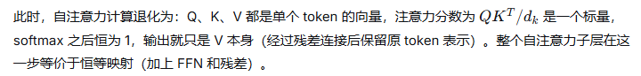{.ocr-src}

这也就是为什么在推理的第一个 token 生成时，因果掩码虽然没有屏蔽任何 token，但依然可以加上（通常为了代码统一而保留），它只是没有任何屏蔽效果而已。

---

#### 为什么说因果掩码是确保模型看到“过去”信息的关键？

“看到过去”是自回归模型的核心约束：模型在预测当前 token 时，只能依据历史 token，不能偷看未来。因果掩码正是这一约束在注意力机制中的强制执行者。

注意力机制本身是完全对称且无顺序的，如果没有任何约束，每个 token 都能平等地看到序列中所有其他 token，形成双向上下文。对于生成任务，这会导致：

- 训练时，模型可以利用未来真实答案作为上下文，这无法模拟推理时“未来未知”的状况。

- 推理时，由于无法提前知道未来 token，模型输入分布与训练时完全不一致，导致生成崩溃。

因果掩码通过将未来位置的注意力分数置为 −∞，强制它们的注意力权重为 0，从而切断了从未来到现在的信息流。这意味着，在每一层的自注意力中，信息只能从位置编号小的 token 流向位置编号大的 token，如同物理时间箭头。正是这种硬性屏蔽，保证了模型在任何深度下都只能基于“过去”做决策，从而学习到正确的自回归生成能力。

---

#### 如果不使用因果掩码，生成任务中会出现“作弊”问题，请具体说明。

不使用因果掩码，模型在训练时面对一个完整的序列，可以直接看到每个 token 右侧的未来 token。例如，给定句子“我 爱 吃 苹果”，模型被要求预测位置 2（“爱”）的下一个词，但它通过双向注意力可以直接看到位置 3（“吃”）和位置 4（“苹果”）。

这种“作弊”机制会导致：

- **损失函数失真：**模型不需要学习从“我”、“爱”中推断出“吃”，而是直接看到了正确答案。训练 loss 会降得极低，但学到的是一个“复制者”，而非一个“预测者”。

- **无法进行推理：**在自回归推理时，模型只能看到已生成的 token，未来 token 是未知的。它无法再“偷看”，但它的参数已经过度依赖于未来信息的捷径，此时预测的分布会崩溃，输出乱码或不合理的 token。

- **无法学习真正的语言规律**：自回归语言模型的目标是学习条件概率 $P(x_t|x_{<t})$。如果未来信息泄漏，模型学到的实际上是 $P(x_t|\text{整个序列})$，这破坏了语言模型的基础，导致它在真实生成时无法正确地维持主题、逻辑和语法。

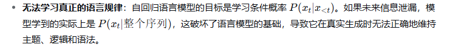{.ocr-src}

因此，因果掩码是防止“作弊”、保证自回归任务定义严谨的绝对必要组件。

---

#### 因果掩码能否和其他注意力掩码（如填充掩码）叠加使用？

可以，且在实际应用中必须叠加。 这是处理批量变长序列的标准操作。

在一个 batch 中，不同序列的长度通常不同，我们需要通过 padding 将它们填充到相同长度。这些 `<pad>` token 没有实际意义，不应参与注意力的计算，因此需要填充掩码来屏蔽它们。

**叠加方法**：

在注意力分数矩阵 $S = QK^T/\sqrt{d_k}$ 上，首先应用填充掩码 $M_{pad}$（形状为 `(batch, 1, 1, seq_len)` 或广播到 `(batch, 1, seq_len, seq_len)`），将 `<pad>` 对应位置的列全部设为 $-\infty$。然后应用因果掩码 $M_{causal}$（上三角为 $-\infty$，下三角为 0）。由于这两种掩码都是加性的（+0 或 + $-\infty$），它们可以直接相加：

$$
S_{\mathrm{masked}} = S + M_{pad} + M_{causal}
$$

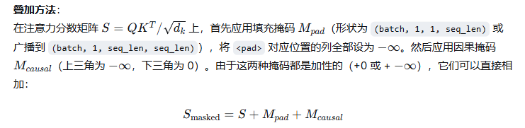{.ocr-src}

在具体实现中，更常见的做法是先将因果掩码的 −∞ 扩展，然后将 padding mask 也融入其中（例如 padding mask 直接对 scores 的特定行和列赋 −∞）。由于 softmax 的运算性质，只要某个位置被设为 −∞，其注意力权重就为 0，与叠加多少次无关。

因此，因果掩码与填充掩码的组合使用是序列建模中的基本技巧，确保了变长序列的正确批量处理。

---

#### 在实现中，如何高效地应用因果掩码以减少显存带宽浪费？

显存带宽浪费主要来自：构造一个完整的 $n\times n$ 掩码矩阵并进行逐元素加法。优化手段包括：

- 不显式构造掩码张量：使用 `torch.triu` 生成布尔掩码，直接在计算出的 `scores` 张量上调用 `masked_fill_`，将上三角部分原地填充为 `-inf`。这样可以避免额外分配一个与 `scores` 同大小的掩码矩阵。

- 利用 FlashAttention 的因果模式：FlashAttention 的前向和反向传播中，如果指定 `causal=True`，它会自动跳过上三角部分的分块计算，既省了计算，又避免了加载和写出那些必然为零的注意力矩阵部分。这极大节省了高带宽内存（HBM）的读写。

- 与其他掩码融合：将 padding mask 直接编码到 causal mask 中，或使用 `torch.where` 等融合操作，减少多次内存读写。

- 使用自动混合精度：在 FP16/BF16 下计算，`-inf` 可以表示为对应浮点格式的最小值，减少存储空间。

- 不存储注意力矩阵：在反向传播时重新计算注意力权重，而不是从保存的中间激活中读取，这可以完全避免存储 $n\times n$ 注意力矩阵（其显存占用为 $O(n^2)$），从而大幅降低显存压力。

这些手段的组合，使得因果掩码的实际开销被压缩到几乎可以忽略。

---

#### 谈谈你对“下三角掩码 + 稀疏注意力”结合使用场景的理解。

下三角掩码保证了因果性，而稀疏注意力（如局部窗口注意力、扩张注意力、随机稀疏注意力）则通过限制每个 token 可关注的 token 范围，来降低计算和存储的 O(n2) 复杂度。两者结合是长序列自回归生成的关键技术，但需要精心设计以保证因果性不被破坏。

结合方式：在定义稀疏注意力模式时，必须确保这个模式本身是因果的——即对于任何位置 $i$，其可关注的集合 Si⊆{0,1,...,i}。例如：

- 滑动窗口注意力：每个 token 只关注它前面大小为 $W$ 的窗口内的 token，天然满足因果性。

- 扩张滑动窗口：使用膨胀率，周期性地扩大感受野，仍只看向过去。

- 全局 token + 局部窗口：指定少数全局 token 可以被所有位置看到，局部 token 仅窗口可见，全局 token 也可以看到全局 token 的过去。

典型应用场景：

- 长文本/长视频生成：如生成小说、高分辨率视频，需要极长序列建模。标准 Transformer 无法承受二次复杂度，稀疏+因果的组合可以在保持生成质量的同时将复杂度降至 O(n) 或 O(nlog⁡n)。

- 大模型推理加速：Longformer、Sparse Transformer 等模型使用预定义的稀疏因果模式，使得长文本生成的速度和内存大幅优化。

- 多尺度建模：在底层使用局部窗口捕捉精细信息，在高层引入稀疏的全局注意力捕捉长程依赖，形成层次化的因果建模。

关键挑战：稀疏模式的设计需要平衡效率与感受野。过于激进的稀疏可能丢失关键的长程依赖，导致生成内容前后矛盾。因此，往往需要与记忆机制（如 Transformer-XL 的片段级递归）或外部记忆库结合使用。

---

#### 为什么现在的 LLM 预训练普遍采用因果掩码而不是前缀掩码？

现代通用大语言模型（如 GPT 系列、LLaMA、PaLM 等）几乎全部使用纯因果掩码（Decoder-Only 架构），而非前缀掩码（Prefix LM），主要有以下深层原因：

- 简洁统一的生成范式：纯因果掩码将所有输入（包括指令、上下文、历史）都视为“已生成的序列”，模型以“预测下一个 token”为唯一目标。这带来了极其简洁的训练目标、数据格式和推理流程。前缀掩码则需要区分“前缀”和“生成”部分，训练时对两者使用不同掩码，增加了系统复杂性。

- 上下文学习的天然适配：在纯因果模型中，few-shot 示例和用户指令自然地作为“历史 token”存在，模型无需任何架构调整就能通过自注意力从它们中提取模式和指令。而在前缀模型中，前缀部分是双向编码的，虽然理论上也支持，但纯因果模型在统一的单向框架下展现出了极强的上下文学习（in-context learning）能力。

- 更好的长文本外推与位置编码兼容：现代的 RoPE 等位置编码在纯因果模型上表现极佳，且可以通过 NTK、YaRN 等技术高效外推上下文窗口。前缀模型由于前缀和生成部分的位置编码可能需要不同的处理，增加了复杂性。

- 训练与推理高度一致：纯因果模型在预训练、SFT、RLHF 等各个阶段使用的都是相同的自回归格式，连数据格式都无需转换。前缀模型在预训练（可能是因果）和下游任务（前缀+因果）之间存在差异，需要额外的适配。

- 显存与计算效率：对于给定的序列长度，纯因果模型的注意力计算量是确定的，且现代 FlashAttention 可以高效利用其下三角结构。前缀模型的双向前缀部分虽然可能带来更好的理解，但也意味着前缀部分的注意力计算是稠密的（全矩阵），当序列很长时显存和计算开销更大。

- 经验证明的缩放定律：过去几年的实践证明，将计算资源全部投入解码器的扩大，遵循 scaling law 可以持续、可预测地提升性能。而前缀模型尚未在超大规模（>100B）上展现出超越纯因果模型的显著优势。

因此，纯因果掩码凭借其架构的极致简洁性、强大的涌现能力以及成熟的工程生态，成为了当前 LLM 预训练的绝对主流。

