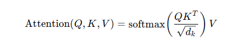
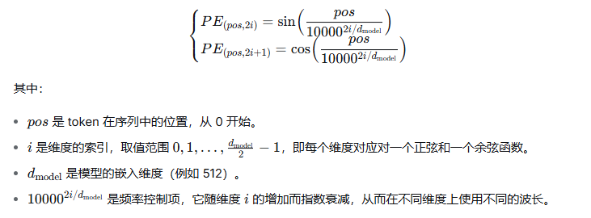
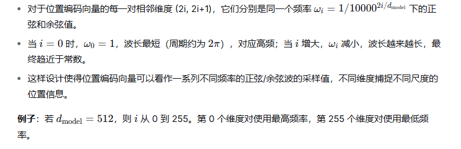
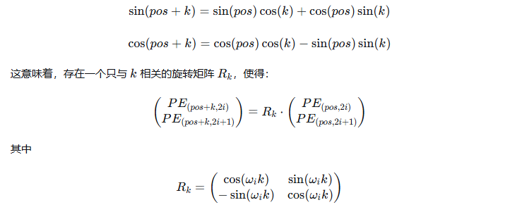
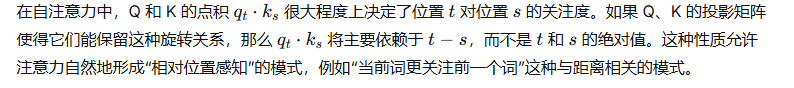
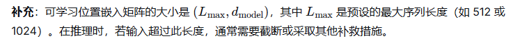
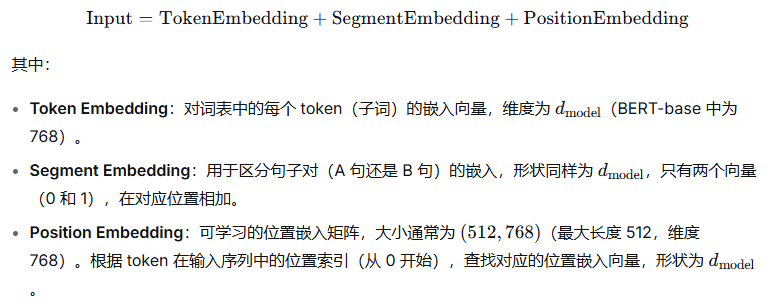
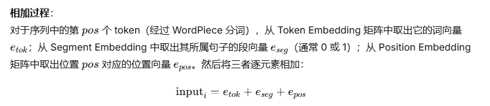

# 5.大模型（LLMs）位置编码（绝对位置编码、可学习位置编码）

#### 为什么 Transformer 需要显式的位置编码？

1. 自注意力机制的本质缺陷

自注意力的计算可以概括为：

$$
\mathrm{Attention}(Q, K, V) = \mathrm{softmax}\left(\frac{QK^T}{\sqrt{d_k}}\right)V
$$

{.ocr-src}

在这个公式中，每个 token 与其他所有 token 的交互仅由它们的内容嵌入（即 Q 和 K）决定，而不包含任何顺序信息。如果我们将输入序列中所有 token 的嵌入向量按任意方式打乱，自注意力输出的结果也会以完全相同的方式被打乱，每个 token 的新表示中并不会记录它原来在序列中的位置。这就是所谓的“置换等变性”。

2. 没有位置编码的后果

对于自然语言，顺序是语义的重要载体。例如：

- “狗咬人” vs “人咬狗”

- “不，我喜欢” vs “我喜欢，不”\
  如果没有位置编码，这两组句子中对应位置的 token 表示将完全无法区分，模型也就无法学到句法、时态、指代、逻辑先后等依赖于顺序的规律。训练出的模型最多相当于一个复杂的词袋分类器，无法处理序列生成任务。

3. RNN 和 CNN 的对比

RNN 天然具有时间顺序：每个隐藏状态都是前一时间步和当前输入的递归组合，位置信息隐含在序列路径中。CNN 虽然有一定并行性，但卷积核的滑动窗口也天然提供了局部位置感。而 Transformer 完全放弃了循环和卷积，纯粹靠注意力，因此必须显式地把位置信息编码进输入表示，否则就丧失了序列建模能力。

4. 解决方案：位置编码

Transformer 选择将位置编码向量直接加到词嵌入（或输入嵌入）上，即：

$$
\mathrm{Input} = \mathrm{TokenEmbedding} + \mathrm{PositionalEncoding}
$$

{.ocr-src}

这样，在进入第一层自注意力之前，每个 token 的向量就已经被打上了它在序列中位置的“印记”。之后的层虽然仍保持置换等变性，但 token 表示中已经融入了位置信息，使得模型能够区分不同位置的相同词并建立顺序依赖。

---

#### 原始 Transformer 使用的正弦位置编码公式是什么？每个维度如何计算？

原始论文《Attention Is All You Need》中提出的位置编码公式为：

$$
\begin{cases}
PE_{(pos,2i)} = \sin\left(\dfrac{pos}{10000^{2i/d_{\mathrm{model}}}}\right) \\
PE_{(pos,2i+1)} = \cos\left(\dfrac{pos}{10000^{2i/d_{\mathrm{model}}}}\right)
\end{cases}
$$

其中：

- $pos$ 是 token 在序列中的位置，从 0 开始。
- $i$ 是维度的索引，取值范围 $0, 1, \ldots, \frac{d_{\mathrm{model}}}{2} - 1$，即每个维度对应一个正弦和一个余弦函数。
- $d_{\mathrm{model}}$ 是模型的嵌入维度（例如 512）。
- $10000^{2i/d_{\mathrm{model}}}$ 是频率控制项，它随维度 $i$ 的增加而指数衰减，从而在不同维度上使用不同的波长。

{.ocr-src}

如何理解每个维度的计算：

- 对于位置编码向量的每一对相邻维度 (2i, 2i+1)，它们分别是同一个频率 $\omega_i = 1/10000^{2i/d_{\mathrm{model}}}$ 下的正弦和余弦值。
- 当 $i=0$ 时，$\omega_0 = 1$，波长最短（周期约为 $2\pi$），对应高频；当 $i$ 增大，$\omega_i$ 减小，波长越来越长，最终趋近于常数。
- 这样设计使得位置编码向量可以看作一系列不同频率的正弦/余弦波的采样值，不同维度捕捉不同尺度的位置信息。

**例子**：若 $d_{\mathrm{model}} = 512$，则 $i$ 从 0 到 255。第 0 个维度对使用最高频率，第 255 个维度对使用最低频率。

{.ocr-src}

---

#### 正弦位置编码的哪些性质使其能表示相对位置？

正弦位置编码最精妙的地方在于，它能让模型更容易地学习到 token 之间的相对位置关系。这是因为：

性质1：位置 pos+k 的编码可以表示为位置 $p_{os}$ 编码的线性函数\
对于任意固定的偏移量 $k$，我们有三角恒等式：

$$
\sin(pos + k) = \sin(pos)\cos(k) + \cos(pos)\sin(k)
$$

$$
\cos(pos + k) = \cos(pos)\cos(k) - \sin(pos)\sin(k)
$$

这意味着，存在一个只与 $k$ 相关的旋转矩阵 $R_k$，使得：

$$
\begin{pmatrix} PE_{(pos+k,2i)} \\ PE_{(pos+k,2i+1)} \end{pmatrix} = R_k \cdot \begin{pmatrix} PE_{(pos,2i)} \\ PE_{(pos,2i+1)} \end{pmatrix}
$$

其中

$$
R_k = \begin{pmatrix} \cos(\omega_i k) & \sin(\omega_i k) \\ -\sin(\omega_i k) & \cos(\omega_i k) \end{pmatrix}
$$

{.ocr-src}

注意，这个旋转矩阵仅依赖于相对距离 $k$，与绝对位置 $p_{os}$ 无关。

性质2：点积与相对位置

在自注意力中，Q 和 K 的点积 $q_t \cdot k_s$ 很大程度上决定了位置 $t$ 对位置 $s$ 的关注度。如果 Q、K 的投影矩阵使得它们能保留这种旋转关系，那么 $q_t \cdot k_s$ 将主要依赖于 $t - s$，而不是 $t$ 和 $s$ 的绝对值。这种性质允许注意力自然地形成"相对位置感知"的模式，例如"当前词更关注前一个词"这种与距离相关的模式。

{.ocr-src}

性质3：远距离衰减平滑

因为不同维度使用不同的频率，点积的效果随着距离增大而整体平滑衰减，同时在某些特定相对距离上仍能产生较强的关联，这种性质有利于捕获不同粒度的依赖关系。

因此，虽然正弦位置编码给每个位置的是唯一的绝对向量，但其数学结构内建了相对位置的可学习性，这正是它受到理论青睐的关键原因。

---

#### 绝对位置编码和可学习位置嵌入有什么本质区别？

绝对位置编码（如正弦位置编码）是根据固定的数学函数生成的，参数完全确定，无需训练。它的值仅依赖于位置索引。

**可学习位置嵌入**（Learned Positional Embedding）是将每个位置视为一个独立的"词"，在词嵌入矩阵旁边再维护一个位置嵌入矩阵 $W_{pos} \in \mathbb{R}^{L_{\max} \times d_{\mathrm{model}}}$，其中每一行对应一个绝对位置的嵌入向量。这些向量是随机初始化的，然后在训练过程中通过反向传播与模型其他参数一同更新。

{.ocr-src}

本质区别：

| 维度 | 绝对位置编码（正弦） | 可学习位置嵌入 |
| --- | --- | --- |
| 参数来源 | 确定性函数，无自由参数 | 随机初始化，通过训练学习 |
| 是否可训练 | 不可训练（固定） | 可训练 |
| 外推能力 | 理论上可外推到任意长度（函数定义无限） | 受限于训练时见到的最大长度，超出部分无训练好的嵌入 |
| 灵活性 | 结构固定，无法根据数据调整 | 灵活，能适应特定数据中的位置模式 |
| 相对位置表示 | 内建相对位置结构（通过三角函数性质） | 不直接内建，需要模型从数据中自己学 |
| 存储开销 | 无存储参数（即时计算） | 需要存储 Lmax×d 的矩阵 |

简言之，正弦编码是“预设好的数学规律”，而可学习嵌入是“让数据说话”。前者理论性质优良，后者更灵活但在序列长度扩展上受限。

---

#### 可学习位置嵌入的维度是多少？如何初始化？

**维度**：与词嵌入维度 $d_{\mathrm{model}}$ 完全一致，通常也是 $d_{\mathrm{model}}$（例如 512、768、4096 等）。这是因为位置嵌入需要与词嵌入逐元素相加，两者的维度必须匹配。

{.ocr-src}

**初始化：**

- 通常使用标准正态分布 N(0,0.02) 或 均匀分布 U(−0.02,0.02) 进行初始化，这与词嵌入的初始化相似。

- 也可以使用较小的标准差，避免在训练初期位置信息盖过语义信息。

- 一些实现（如 HuggingFace 的 BERT 模型）使用 `nn.Embedding(max_position_embeddings, hidden_size)`，默认初始化方式为该模块自带的正态分布初始化。

- 没有采用正弦编码作为初始值再学习的必要，因为随机初始化已足够让模型自行学习最佳的位置表示。

**补充**：可学习位置嵌入矩阵的大小是 $(L_{\max}, d_{\mathrm{model}})$，其中 $L_{\max}$ 是预设的最大序列长度（如 512 或 1024）。在推理时，若输入超过此长度，通常需要截断或采取其他补救措施。

{.ocr-src}

---

#### 当测试序列长度超过训练时的最大长度时，绝对位置编码会遇到什么问题？

问题：对于可学习位置嵌入，如果测试序列长度超过了训练时定义的最大长度 $L_{max}$，那么超出部分的 token 将没有对应的位置嵌入向量。这些位置从未在训练中出现过，其嵌入矩阵中没有对应行，直接使用会引发索引越界错误。即使通过一些方法（如循环重复或插值）补上一个向量，模型也从未见过这些位置，其表示质量无法保证，通常导致性能大幅下降。

对于正弦位置编码，由于它是数学函数定义的，理论上可以为任意 $p_{os}$ 生成编码，不存在“超出”的问题。然而，如果模型在训练时从未见过那些很长的位置，相关的注意力权重模式仍可能不够优化，外推时的性能还是会有所退化，但优于可学习嵌入的直接崩溃。这种退化是由于训练时位置分布和测试时不同导致的，而非编码本身不存在。

总结：

- 可学习嵌入：直接不可用，属于硬限制。

- 正弦编码：可用但性能可能下降，属于软限制。

这引出位置编码的“外推”问题。

---

#### 如何解决绝对位置编码无法外推的问题？

针对不同编码类型，解决方案不同：

（1）正弦位置编码的外推提升

虽然正弦编码能生成任意位置的值，但其原始设计的外推能力仍有限。改进方法包括：

- 在更大长度上继续训练：直接扩增训练数据中的序列长度，让模型见到更多位置。

- 改变位置编码的频率分布：如使用相对位置编码（RoPE、ALiBi）代替绝对正弦编码，这些方法天然具有更好的外推能力。

（2）可学习位置嵌入的外推

- 线性插值（Position Interpolation）：将测试时超出部分的位置索引按比例压缩到训练长度范围内。例如，训练时最大 2048，现需要 4096，则将位置 4096 通过除以 2 映射到 2048。此时需对嵌入矩阵进行相应插值（如线性插值），获得新位置的表示。这虽简单，但会改变位置间的相对距离，损害短距离依赖。

- NTK-Aware 插值：对 RoPE 的频率进行非线性缩放，高频部分少压缩，低频部分多压缩，更好地保持局部和全局信息。

- YaRN：结合 NTK 插值和温度缩放，进一步改善外推时的注意力分布。

- ALiBi：直接在注意力分数上加上一个与距离成比例的惩罚项，免除位置编码，外推极强。

（3）架构层面的改善

使用相对位置编码代替绝对位置编码，例如：

- 相对位置表示（Shaw et al., 2018）：在注意力计算中直接使用相对距离的嵌入。

- RoPE（旋转位置编码）：将绝对位置转化为旋转矩阵作用于 Q、K，点积后自然依赖于相对位置，外推良好。

- T5 的相对偏置：每个注意力头学习一个标量偏置，仅依赖于相对距离的桶。

这些相对编码从根本上解决了“未见过绝对位置”的问题，因为它们关心的只是 token 之间的距离，而非绝对位置，因此天然支持任意长度。

---

#### 为什么正弦位置编码更受理论青睐，但实践中很多模型使用可学习的位置嵌入？

理论青睐正弦编码的原因：

- 优美的数学性质：如前所述，它具有线性相对位置表示能力，为模型学习相对依赖提供了显式便利。

- 无参数，无过拟合风险：完全确定，不增加模型容量，在小数据场景下可能更鲁棒。

- 外推可能：虽然原始外推效果不够完美，但它是连续函数，为进一步的外推方法（如插值）提供了基础。

- 归纳偏置：这种波形编码为模型提供了一种直观的“距离”概念，符合人类对顺序的直觉。

实践中选择可学习位置嵌入的原因：

- 灵活性更强：可以完全从数据中学习最适合该任务的序列位置模式，不受预设函数形式的束缚。在某些任务上，学习到的位置嵌入可能比正弦编码效果更好。

- 实现简单：直接使用一个 Embedding 层，代码简洁，易于理解和调试。

- 与预训练深度绑定：像 BERT、GPT-2 等早期大模型都使用了可学习位置嵌入，并随着它们的成功，这种方案被广泛采用。后来的 GPT-3 也沿用了可学习嵌入。

- 足够的数据量：在大规模训练数据下，模型能够学到优秀的绝对和相对位置表示，可学习嵌入的性能往往与正弦编码相当甚至更优，且没有明显劣势。

- 长度固定场景：很多任务（如分类、短文本生成）对最大长度有明确限制，外推能力并非刚需。

因此，正弦编码是理论家的优雅杰作，而可学习嵌入是工程师的实用选择。现代趋势则是两者之外的道路：RoPE（旋转位置编码）以其兼备绝对和相对位置表示、以及良好的外推能力，成为 LLM 的新宠，可以说是两个世界的最佳结合。

---

#### 在 BERT 中，位置嵌入是如何与 token 嵌入相加的？

BERT 使用三种嵌入的求和作为模型的底层输入：

$$
\mathrm{Input} = \mathrm{TokenEmbedding} + \mathrm{SegmentEmbedding} + \mathrm{PositionEmbedding}
$$

其中：

- **Token Embedding**：对词表中的每个 token（子词）的嵌入向量，维度为 $d_{\mathrm{model}}$（BERT-base 中为 768）。
- **Segment Embedding**：用于区分句子对（A 句还是 B 句）的嵌入，形状同样为 $d_{\mathrm{model}}$，只有两个向量（0 和 1），在对应位置相加。
- **Position Embedding**：可学习的位置嵌入矩阵，大小通常为 $(512, 768)$（最大长度 512，维度 768）。根据 token 在输入序列中的位置索引（从 0 开始），查找对应的位置嵌入向量，形状为 $d_{\mathrm{model}}$。

{.ocr-src}

**相加过程**：

对于序列中的第 $pos$ 个 token（经过 WordPiece 分词），从 Token Embedding 矩阵中取出它的词向量 $e_{tok}$；从 Segment Embedding 中取出其所属句子的段向量 $e_{seg}$（通常 0 或 1）；从 Position Embedding 矩阵中取出位置 $pos$ 对应的位置向量 $e_{pos}$。然后将三者逐元素相加：

$$
\mathrm{input}_i = e_{tok} + e_{seg} + e_{pos}
$$

{.ocr-src}

相加后不进行任何缩放或变换，直接输入到 Transformer 的编码器第一层。

关键点：

- 所有这些嵌入都是可学习的参数，在预训练和微调过程中通过反向传播联合优化。

- 由于位置嵌入的最大长度为 512，BERT 不能直接处理超过 512 个 token 的序列。对于更长文本，通常采用截断、滑动窗口或层次化方法。

- 这种三嵌入相加的方式是 BERT 类模型的标准输入构造，后续的 RoBERTa、ALBERT 等模型基本沿用了类似设计（ALBERT 中为了压缩参数，将 Token Embedding 分解，但位置嵌入仍是独立的可学习矩阵）。

总结：BERT 的位置嵌入是可学习的，维度与词嵌入相同，通过简单的加法与词义和段落信息融合，使模型在每一层都能感知到 token 的顺序。

---

#### 绝对位置编码是否可以被替换为相对位置编码？简述影响。

可以被替换，并且这是现代大模型（如LLaMA， Mistral）的主流趋势。

影响分析：

- 外推能力质的飞跃：绝对位置编码（尤其是可学习嵌入）的最大痛点是无法外推。相对位置编码（如RoPE、ALiBi、T5的相对偏置）的核心是建模token间的距离，天然不受绝对位置索引的限制，使得模型能轻松处理比训练时长得多的序列。

- 注意力模式的转变：绝对编码引导模型学习“在第5个位置通常是一个动词”这种绝对位置先验。相对编码则引导模型学习“当前词应该关注它前面第2个词”这种平移不变的依赖模式。后者更符合语言的本质——一个短语无论出现在段落开头还是中间，其内部语法结构是相似的。

- 性能与效率：相对位置编码通常不会增加额外的可学习参数量（或增加极少），其计算往往可以高效地融合进自注意力的计算图中。在长序列上，由于不需要存储庞大的绝对位置嵌入矩阵，显存占用也更友好。

- 工程复杂度：将绝对编码替换为相对编码，需要对注意力计算核心进行修改。例如，RoPE需要在计算Q和K之后对其应用旋转变换；ALiBi需要将固定的相对偏置矩阵加到注意力分数上。这种改动是架构级的，但一旦完成，收益是巨大的。

总结：替换为相对位置编码是解决“长度外推”和“平移不变性”这两大核心难题的关键，虽然需要架构修改，但已成为LLM进化的必经之路。

---

#### 有没有一种位置编码不需要训练，也能处理任意长度？

有，而且不止一种。 这正是相对位置编码或经过特殊设计的绝对位置编码的拿手好戏。

- 正弦位置编码：原始Transformer的编码。它是一个确定性函数，理论上可以为任意长度序列生成唯一编码。但其外推性能并不完美，模型在没见过的长度上表现会退化，所以只能说它能“处理”，但不保证“处理得好”。

- ALiBi（Attention with Linear Biases）：这可能是最符合“不需要训练、能处理任意长度”描述的方案。它在注意力分数矩阵上加上一个预设的、仅与相对距离成线性比例的惩罚项（例如，第i个token对第j个token的分数减去 `m * |i-j|`，其中`m`是头特定的斜率）。完全无参数，无需学习，外推能力极强，甚至在训练长度10倍以上的序列上仍能保持良好性能。

- RoPE（旋转位置编码）：虽然RoPE通常被视为相对编码，但它从绝对位置出发。其频率基频`theta`可以动态调整（如通过NTK-aware缩放），使得在推理时处理未见过的长度成为可能。这种动态调整机制使得RoPE成了一个“无需重新训练，仅通过推理时参数调整就能处理任意长度”的强大利器。

结论：如果“不需要训练”和“处理任意长度”是硬性要求，ALiBi是最直接的答案。如果允许在推理时做轻微的参数调整，动态NTK-scaled RoPE是当前综合性能最优的选择。

---

#### 位置编码是否可以加在 QKV 投影之前，而不是之后？效果如何？

可以，这在实践中很常见，并且和加在之后有细微但重要的区别。

标准的Transformer是位置编码加到输入嵌入 `X` 上，形成 `X' = X + PE`，然后再投影到 Q、K、V。即：`Q = (X+PE)W_Q`， `K = (X+PE)W_K`。\
如果加在投影之后，则为：`Q = XW_Q + PE_Q`， `K = XW_K + PE_K`，其中 `PE_Q` 和 `PE_K` 是专门学习或设计的用于查询和键的位置信息。

效果如何？

- 解耦内容与位置：将位置信息直接注入Q和K，可以更显式地将“语义内容”和“位置关系”分离。模型可以独立地学习内容如何转换为查询/键，以及位置如何影响它们。这通常能带来更好的可解释性和稍优的性能。

- 更灵活的位置表示：可以为Q和K设计不同的位置编码。例如，有些工作只为K注入位置信息，而Q不注入，认为查询应该“专注于内容”，然后通过键的位置信息找到匹配。这被称为 “解耦注意力”。

- 相对位置编码的自然载体：绝大多数相对位置编码（如RoPE）都是在Q和K投影之后进行操作的。RoPE直接在 Q 和 K 向量上施加旋转，这个旋转量依赖于token的绝对位置。这种方式完美地将相对位置信息融入了Q和K的点积中，是现代LLM的核心技术。

- 效果对比：加在投影之后通常被认为更优，因为它允许内容和位置在更高维的语义空间中进行更灵活的交互，而不是在低层的嵌入空间就固化。这也是为什么几乎所有后续改进的位置编码（如RoPE、相对位置偏置）都选择在QK层面或注意力分数层面介入。

---

#### 写出一个实现可学习位置嵌入的 PyTorch 代码片段。

```python
import torch
import torch.nn as nn

class LearnedPositionEmbedding(nn.Module):
    def __init__(self, max_seq_len, d_model):
        super().__init__()
        # 创建一个可学习的嵌入矩阵，大小为 (max_seq_len, d_model)
        self.position_embedding = nn.Embedding(max_seq_len, d_model)

    def forward(self, x):
        # x: 输入张量，形状 (batch_size, seq_len, d_model)
        batch_size, seq_len, _ = x.size()
        
        # 生成位置索引 [0, 1, ..., seq_len-1]
        position_ids = torch.arange(seq_len, dtype=torch.long, device=x.device)
        position_ids = position_ids.unsqueeze(0).expand(batch_size, seq_len)
        
        # 查找嵌入，形状 (batch_size, seq_len, d_model)
        pos_emb = self.position_embedding(position_ids)
        
        # 直接与 token 嵌入相加
        return x + pos_emb

# 示例用法
max_len = 512
d_model = 768
batch_size = 4
seq_len = 30

# 随机生成一个 token 嵌入作为输入
token_embeddings = torch.randn(batch_size, seq_len, d_model)
pos_encoder = LearnedPositionEmbedding(max_len, d_model)

output = pos_encoder(token_embeddings) # (4, 30, 768)
print(output.shape)
```

#### 为什么“位置信息”通常以加法形式注入，而不是拼接？

核心原因：效率、信息融合以及与残差结构的兼容性。

- 参数效率与维度控制：如果使用拼接，假设原始嵌入维度为`d`，位置编码维度为`p`，那么输入到第一层的维度将变为`d+p`。这意味着模型的所有权重矩阵（W_Q， W_K， W_V等）的第一维都必须是`d+p`，这会大幅增加模型的参数量。而采用加法，维度保持不变，无需修改任何后续层的结构，参数量完全不变。

- 信息的线性融合与解耦：加法可以看作一种特殊的拼接+线性变换。假设拼接后输入为`[x; p]`，第一个线性层的权重矩阵可以分块为`[W_x; W_p]`，那么`[x; p] * [W_x; W_p] = x W_x + p W_p`。可见，加法在数学上等价于先拼接，再通过一个非常稀疏的线性层进行降维。这种形式强制模型将词义信息和位置信息进行线性叠加，在实际中足以让模型学会区分和融合它们。

- 与残差网络的协同：Transformer的核心是残差连接`Output = LayerNorm(x + Attention(x))`。加法保证了位置信息能够通过残差连接畅通无阻地传播到更深的层。如果使用拼接，维度会在每一层膨胀，或者需要额外的投影层降维，破坏了残差连接简洁的恒等映射，增加了训练难度。

- 经验有效性：多年的实践证明，简单的加法足以让模型学习到复杂的顺序依赖。加上其巨大的参数和计算效率优势，加法成为了事实上的标准。

---

#### 如果完全去掉位置编码，但是使用一个能捕捉位置的模型结构，可行吗？举例说明。

完全可行。 位置编码的本质是弥补Transformer置换等变性的缺陷。如果一个模型结构本身就具有序列感知能力，就不再需要显式的位置编码了。

典型例子：

- 状态空间模型（SSMs），如Mamba：这是去位置编码最火的方向。Mamba等模型基于选择性状态空间，其内部状态更新机制本身就是时间敏感的。一个token的处理依赖于上一个token遗留下来的状态，这个过程天然是顺序的，因此SSM天生就知道token的顺序，完全不需要位置编码。

- 循环神经网络（RNN / LSTM / GRU）：它们通过循环连接，将上一步的隐藏状态作为下一步的输入，序列顺序是运算的核心，同样不需要位置编码。

- 卷积神经网络（CNN）在序列中的应用：一维卷积在序列上滑动，其感受野是局部的，并且卷积核的权重位置是固定的。这种局部性和权重共享带来了隐式的相对位置感知。虽然绝对位置感知较弱，但通过堆叠多层，也能建立长程的顺序依赖。

- Transformer + 结构化稀疏注意力：如Sparse Transformer，它使用固定的、与位置相关的稀疏掩码（例如，第i个token只能关注i-1， i-2， i-4， i-8等位置）。这种掩码本身就强加了一种显式的位置依赖模式，即使没有位置编码，模型也会被迫学到这些特定位置的重要性。这可以看作是用结构化的注意力偏置替代了位置编码。

结论：未来模型的发展方向之一，就是通过更具归纳偏置的架构（如SSM）来取代显式的位置编码，让“顺序感”回归到模型的计算逻辑本身。

---

#### 绝对位置编码的最大长度限制对 LLM 的训练有哪些实际影响？

这是一个从“学术纯净”走向“工业落地”时碰到的硬钉子，影响深远：

- 硬性推理瓶颈：这是最直接的影响。一个在2048长度下训练的模型，无法处理一个长度超过2048的对话或文档。这意味着它无法进行长文档摘要、长篇小说续写，甚至在多轮对话中也会因为历史超长而直接崩溃。这极大地限制了LLM的应用场景。

- 训练资源的浪费与挑战：为了获得长上下文能力，必须在预训练后期（或SFT阶段）使用极长文本进行训练。这会带来计算量（O（n²））的暴增，显存占用急剧膨胀，导致训练成本呈平方级甚至更高地增长。很多团队为了平衡性能和成本，只能采用混合长度训练、分阶段训练等复杂策略。

- SFT数据构造困难：想要模型具备32K的对话能力，就需要海量的、高质量的、长度超过32K的指令数据。构建这样的数据集本身成本极高，远非短数据可比。

- 评估的失准：传统的评测基准大多基于短文本。即使模型通过外推“声称”支持128K，其在真实长文本任务上的表现也往往大打折扣，出现“高分低能”或“迷失在中间”的现象，这使得我们难以准确评估模型的真实长文本能力。

- 推动编码方式革新：正是绝对位置编码的这个硬伤，直接催生并推动了RoPE、ALiBi及其一系列外推技术（PI， NTK， YaRN）的飞速发展，成为学术界和工业界共同攻关的核心课题。

---

#### 在推理时，如何通过插值方式扩展可学习位置嵌入的长度？

这是针对可学习位置嵌入在推理时无法外推的核心补救方法，称为位置插值（Position Interpolation）。

核心思想：将超出训练最大长度`L_train`的、新的位置索引，按比例压缩回`L_train`的范围内，然后通过插值算法从旧的、已训练好的位置嵌入矩阵中，计算出这些新位置对应的嵌入向量。

实现步骤：

1. 确定缩放因子：`scale = L_train / L_new`。例如，训练最大长度为2048，现在要扩展到4096，缩放因子为0.5。

2. 映射新位置：对于新序列中的任意位置`pos_new`（例如3000），计算它在旧坐标轴上的虚拟位置：`pos_virtual = pos_new * scale` （3000 * 0.5 = 1500）。

3. 向量插值：`pos_virtual`很可能不是整数（如1500.5）。因此，需要根据它在旧嵌入矩阵中相邻的两个整数位置（如位置1500和1501）的向量，进行线性插值，得到最终的位置嵌入：

4. text

5. pe_new[3000] = (1 - 0.5) * pe_old[1500] + 0.5 * pe_old[1501]

6. 替换位置嵌入层：将原始模型的位置嵌入层替换为一个能够执行上述映射和插值逻辑的新层，或者直接生成一个全新的、扩展后的嵌入矩阵并加载。

关键局限性：这种简单的线性插值会等比例地压缩所有位置间的相对距离。比如，距离为100的两个token，在被压缩后，模型感知到的距离变成了50。这对局部依赖（相邻词）是毁灭性的，因为原本非常近的词（距离1-2）被压得更近甚至几乎重合，模型将难以区分它们。因此，线性插值通常会带来性能损失，并且需要少量长文本数据做微调（fine-tuning）来让模型适应这种新的位置密度。这也是为什么后来会出现NTK-Aware、YaRN等更精细、更偏向于保护高频/局部信息的插值算法。

---

#### 你对“位置编码就是给 token 加上一个偏置”这句话的理解。

这句话抓住了位置编码在数学形式上的本质，但掩盖了其功能的复杂性。可以从两个层面来理解：

1. 形式层面：完全正确\
   从向量运算的角度看，token嵌入 `e` 和位置编码 `p` 相加，得到 `e+p`。这等价于在向量空间的每个维度上，给token的原始坐标加上了一个偏移量（偏置）。这个偏置`p`是位置相关的，因此可以写成`e[pos] = e + bias(pos)`。这确实就是“加一个偏置”。

2. 功能层面：过于简化

- 它不是简单的标量偏置：这个“偏置”是一个高维向量，其各个分量的值是精心设计的（正弦曲线）或通过学习得到的，共同构成了一个多维空间中的点。不同的`pos`对应空间中不同的点，序列的顺序就被编码为了这个空间中的一条轨迹。

- 它的作用是“染色”，而非“偏移”：更形象的比喻是，位置编码给每个词向量“染上”了一个独一无二的颜色，这个颜色代表了它在序列中的位置。自注意力机制虽然对词本身的内容具有置换等变性，但现在每个词都带上了颜色标签。后续的Q/K投影可以学会利用这些颜色信息，从而打破置换等变性，感知到顺序。

- 它是打破对称性的唯一力量：在没有位置编码时，所有位置在模型中是完全对称的。位置编码这个“偏置”的加入，是模型中唯一能够区分不同位置的信息源。正是这个微小的扰动，打破了对称性，让“我爱你”和“你爱我”的中间向量产生了差异，从而使得整个模型能够学习序列依赖。其作用堪比物理学中的“自发对称性破缺”。

所以，“加偏置”是操作，“打破对称性并注入顺序信息”是目的。这个说法很精炼，但不能因此忽视其高维、结构化的本质及其在模型中扮演的关键角色。

---

#### 绝对位置编码能否学习到“相对距离”信息？解释原因。

能。无论是固定的正弦编码，还是可学习的位置嵌入，都能在一定程度上让模型学到相对距离信息。 这并非绝对编码的专利，只是相对编码（RoPE， ALiBi）做得更显式、更高效。

原因解释：

- 正弦编码的内建机制：如前所述，正弦编码的数学性质决定了`PE（pos+k）`可以通过一个仅与`k`相关的旋转矩阵作用于`PE（pos）`得到。这意味着，位置`i`和`j`的编码点积`PE（i）·PE（j）`仅依赖于它们的相对距离`|i-j|`。当这些编码与Q/K投影矩阵交互时，模型可以学会提取这种点积中的距离信息。本质上，正弦编码为相对距离的学习提供了一个完美的数学“脚手架”。

- 可学习嵌入的经验学习：对于可学习嵌入，虽然没有预设的数学结构，但模型通过海量数据的训练，可以靠蛮力学到相对关系。一个被训练来预测下一个词的语言模型，其损失函数会惩罚所有预测错误的token。为了准确地预测位置`t`的词，模型的注意力机制必须学会识别出位置`t-1`、`t-2`等信息最丰富的位置。在这个过程中，模型会调整位置嵌入的权重，使得例如`W_Q * pe（t）`和`W_K * pe（t-1）`的点积值变大。经过万亿次训练，这种与相对距离相关的权重模式就被内化到了位置嵌入和注意力权重矩阵之中。

- 关键区别：绝对编码学到的是特定上下文中的相对距离模式（例如，“在一段英文文本中，当前词与它前面第1-3个词最相关”）。而相对编码则是直接建模“距离”这个概念本身，是一种结构化的归纳偏置，因此更通用、外推性更强。

---

#### 是否可以将位置编码学习为一个单独的嵌入向量，并在注意力中直接相乘？

可以，但这相当于设计了一种新的注意力机制。

如果我们不再做加法，而是为每个位置学习一个向量`p_i`，然后修改注意力分数计算为 `（q_i * p_i）·（k_j * p_j）` 或类似的乘法形式，这在数学上是完全可行的。

效果与问题：

- 效果：这种方法直接让位置信息以乘法的方式调节注意力强度。例如，它可能更容易让模型学到“位置越近，乘法结果越大，注意力越强”的模式，是一种强相对位置偏置。

- 问题：
  - 破坏了标准的点积注意力：原始的 `QK^T` 是基于内容的相似性，乘法引入了一种内容和位置的复杂非线性交互，可能使训练不稳定或更难优化。
  - 参数量可能爆炸：如果每个位置都要学一个单独的、与`d_model`同维度的向量，这和可学习位置嵌入的参数量一样。
  - 革命性的新范式：这已经不是传统意义上的“位置编码”了，而是一种全新的位置感知的注意力头设计。

事实上，一些研究确实在探索这类方案。例如，通过元素级相乘来融合内容和位置信息。但通常，为了让训练稳定，会采用解耦的方式：`q·k + 相对位置偏置`（如T5）或 `q·k` 后对Q，K进行旋转变换（如RoPE）。这些方法在实践中被证明比纯乘法更稳定、更有效。所以，简单回答是“可以，但目前主流实践认为加性或旋转式是更优设计”。

---

#### 位置编码的维度为什么通常和 token 嵌入维度相同？

直接原因：因为需要进行逐元素相加。 两个向量相加，它们维度必须一致。

更深层次，这带来了一系列好处：

- 信息耦合与统一表示空间：加法要求维度的匹配，这迫使位置信息被映射到与词义信息相同的表示空间中。这意味着，模型在处理“苹果”这个词时，会根据它在句子中的位置，在“苹果”的向量上沿着位置编码的方向进行微调。这种耦合使得内容和位置能够以一种高度集成的方式被后续的注意力层处理，是Transformer强大能力的基础。

- 通过残差连接的稳定传播：Transformer每一层的输入输出维度都是`d_model`。维度一致的加法保证了位置信息能够无缝地融入这个恒等映射框架中。位置编码像是一个“常量信号”，贯穿整个网络的残差流，持续地向深层网络提供位置线索。

- 模型结构的统一与简洁：整个Transformer内部，张量的维度可以保持高度一致，这极大地简化了模型的实现、调试和扩展。这使得模型可以轻松地堆叠更多层，而无需处理维度匹配问题。

- 经验上的最优选择：将位置编码设计为不同维度（例如更小或更大）并通过投影层匹配，在理论上可行，但在实践中通常会引入额外的参数和复杂度，而性能收益甚微，甚至可能因为破坏了上述的简洁性而导致训练不稳定。因此，维度相同成为了压倒性的主流设计。

