# 6.大模型（LLMs）旋转位置编码（RoPE）

#### RoPE 的核心数学思想是什么？用公式说明如何对 Q 和 K 施加旋转。

RoPE（Rotary Position Embedding）的核心思想是：通过旋转矩阵将绝对位置信息编码到 Q 和 K 向量中，使得两个向量的点积自然地依赖于它们的相对位置。

具体而言，对于序列中位置为 $m$ 的 token，我们将其查询向量 $q_m$ 和键向量 $k_n$（位置 $n$）分别乘以一个与位置相关的旋转矩阵 $R_m$ 和 $R_n$：

$$
q'_m = R_m q_m, \quad k'_n = R_n k_n
$$

其中 $R_m$ 是一个分块对角矩阵，每个 $2 \times 2$ 块的形式为：

$$
\begin{pmatrix} \cos m\theta_i & -\sin m\theta_i \\ \sin m\theta_i & \cos m\theta_i \end{pmatrix}
$$

这里 $\theta_i = 10000^{-2i/d}$ 是第 $i$ 个维度对的旋转频率，$d$ 是向量维度，$i = 0, 1, \ldots, d/2 - 1$。

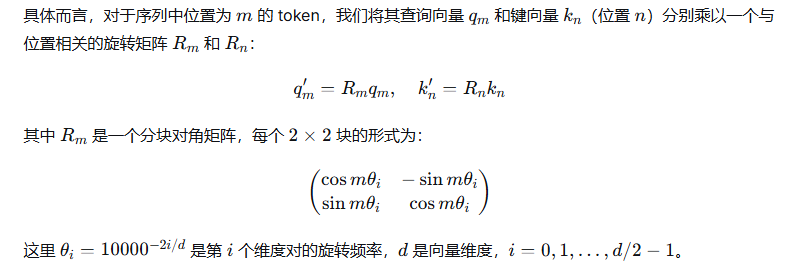{.ocr-src}

在实现中，这种旋转通过逐元素操作高效完成：

$$
\begin{aligned}
q'_{2i} &= q_{2i} \cos m\theta_i - q_{2i+1} \sin m\theta_i \\
q'_{2i+1} &= q_{2i} \sin m\theta_i + q_{2i+1} \cos m\theta_i
\end{aligned}
$$

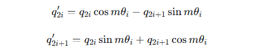{.ocr-src}

对 $k$ 做同样处理。整个旋转过程可视为将向量在二维子空间内旋转 $mθi$ 角度。

---

#### 为什么 RoPE 能自然地编码相对位置？推导其点积结果。

RoPE 的核心优势在于：旋转后的 Q 和 K 的点积仅依赖于它们的相对位置 $m$−$n$，而不再依赖绝对位置 $m$ 和 $n$。

**推导**：

设 $q, k \in \mathbb{R}^d$，我们将它们视为 $d/2$ 个二维子向量的拼接。对每个二维子空间，旋转后的向量为：

$$
q'^{(i)} = R(m\theta_i)q^{(i)}, \quad k'^{(i)} = R(n\theta_i)k^{(i)}
$$

其中 $R(\theta) = \begin{pmatrix} \cos\theta & -\sin\theta \\ \sin\theta & \cos\theta \end{pmatrix}$。

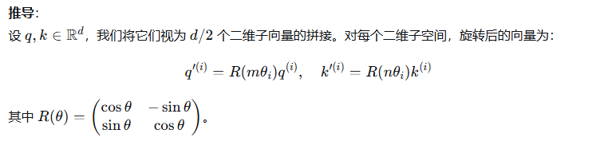{.ocr-src}

这两个旋转向量的内积为：

$$
q'^{(i)} \cdot k'^{(i)} = (R(m\theta_i)q^{(i)})^T(R(n\theta_i)k^{(i)}) = q^{(i)T}R(m\theta_i)^T R(n\theta_i)k^{(i)}
$$

利用旋转矩阵的性质 $R(m\theta_i)^T R(n\theta_i) = R((n-m)\theta_i)$，得到：

$$
q'^{(i)} \cdot k'^{(i)} = q^{(i)T}R((n-m)\theta_i)k^{(i)}
$$

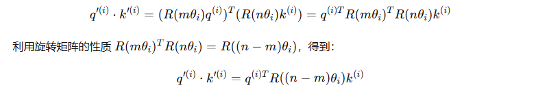{.ocr-src}

整个向量的点积为所有子空间内积之和：

$$
q' \cdot k' = \sum_{i=0}^{d/2-1} q^{(i)T}R((n-m)\theta_i)k^{(i)}
$$

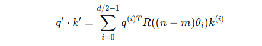{.ocr-src}

结论：点积结果仅依赖于相对位置 $m$−$n$ 的旋转矩阵 R((n−m)θi)，而与绝对位置 $m$,$n$ 无关。这意味着自注意力分数天然编码了相对位置关系。

---

#### RoPE 中的旋转频率是如何定义的？它和序列长度的关系是什么？

RoPE 在第 $i$ 个维度对（i=0,1,…,d/2−1）的旋转频率为：

$$
\theta_i = 10000^{-2i/d}
$$

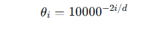{.ocr-src}

其中 $d$ 是向量维度（通常为 head_dim，如 64, 128）。

频率特性：

- $i = 0$ 时，$\theta_0 = 1$，对应高频分量，周期 $2\pi$ 约为 6 个 token。
- $i = d/2 - 1$ 时，$\theta_{d/2-1} = 10000^{-(d-2)/d} \approx 1/10000$，对应极低频，周期约为 $2\pi \times 10000 \approx 62830$ 个 token。

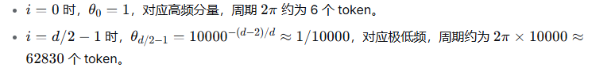{.ocr-src}

这种指数衰减的频率设计使得低维度对捕捉短距离局部模式，高维度对捕捉长距离全局依赖。类似于信号处理中的多分辨率分析。

与序列长度的关系：

- 频率设计决定了模型“感受野”的范围。最低频率对应的波长决定了模型在训练长度内能够区分的最大相对距离。

- 当序列长度超过最低频率对应的波长时，极低频分量几乎成为常数，无法再提供有效的位置区分能力，导致外推失效。这是 RoPE 需要扩展的根本原因。

---

#### 解释 RoPE 的“远程衰减”特性，以及它对模型的影响。

远程衰减是指：随着两个 token 的相对距离增大，它们之间的注意力分数（在无内容交互时）整体呈现衰减趋势。

数学解释：

当 $q$ 和 $k$ 为常数向量（或内容相似度固定）时，RoPE 的点积 $q' \cdot k'$ 是多个频率分量的加权和。由于各频率的旋转矩阵在长距离上会因相位差异而相互抵消，导致点积的绝对值随着距离增加而减小。这种衰减不是严格的单调，但总体趋势是下降的。

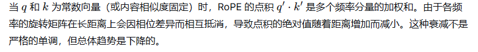{.ocr-src}

对模型的影响：

- 积极影响：远程衰减是一种符合语言直觉的归纳偏置——越远的上下文对当前 token 的影响通常越小。这有助于模型形成局部注意力优先，同时保留捕捉远距离强依赖的能力。

- 外推时的双刃剑：当序列长度远超训练长度时，极低频分量开始生效，远程衰减曲线可能变得不平滑甚至出现反弹（某些距离上的注意力异常增强），导致模型注意力模式混乱。因此，扩展 RoPE 时需要保持远程衰减的平滑性。

---

#### 如何将 RoPE 扩展到比训练时更长的序列？说出至少两种方法。

方法1：位置插值（Position Interpolation, PI）\
将超出训练长度的位置索引按比例压缩回训练长度范围内。例如，训练最大长度 $L$=2048，目标 L′=4096，则将所有位置乘以因子 $L$/$L$′=0.5。这等效于降低了旋转频率，使得原本一个波长的距离现在对应更长的 token 数。实现简单，但会等比例压缩所有频率，损害局部高频分辨率。

方法2：NTK-Aware 缩放

利用神经正切核理论，对 RoPE 的频率进行非线性缩放。核心思想是：高频（低维）几乎不变，以保持局部模式的锐度；低频（高维）大幅降低频率（即增大周期），以扩展有效上下文。相当于“拉伸”波长而不损失高频细节。

方法3：YaRN（Yet another RoPE extensioN）

在 NTK 缩放基础上，进一步对注意力 logits 应用温度缩放，解决插值后注意力分布过于平滑的问题，使模型在长距离上的注意力模式更接近训练时的分布。

方法4：自扩展（Self-Extend）或窗口注意力

在推理时，将长序列分成块，块内使用原始精确 RoPE，块间使用零向量或更简单的距离偏置，强制模型依赖局部精确位置和跨块远距离衰减。

---

#### 位置插值 (PI) 是怎样应用于 RoPE 的？它有什么副作用？

PI 应用方式：

- 原始 RoPE 在位置 $pos$ 使用角度 $m\theta_i$。
- 在 PI 中，将 $m$ 替换为 $m \cdot (L_{train}/L_{target})$。这相当于把频率 $\theta_i$ 缩放为 $\theta_i \cdot (L_{train}/L_{target})$。
- 例如，训练长度 2K，扩展到 8K，则缩放因子为 0.25，所有位置索引乘以 0.25。原来距离 100 的 token 现在在模型中"看起来"距离为 25。

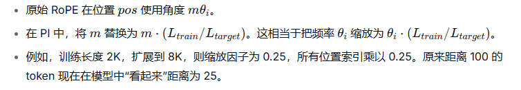{.ocr-src}

副作用：

- 局部依赖受损：高频分量对于区分相邻 token（距离 1,2,3...）至关重要。PI 将高频的频率也等比例降低，导致相邻位置的旋转角度差异变小，模型难以捕捉精确的局部语法和短语结构。这是 PI 后通常需要少量长文本微调的原因。

- 低频混淆：原本的低频被进一步压缩，可能将原本在训练中未见过的超长距离关系扭曲进训练分布，造成位置信息的混淆。

---

#### NTK-aware 缩放在 RoPE 扩展中做了什么改进？

NTK-aware 缩放不再对所有频率“一刀切”，而是根据神经正切核理论，对不同频率进行非均匀缩放：

核心思想：

- 将 RoPE 的基频 $b = 10000$ 替换为更大的基数 $b'$，其中 $b' = b \cdot \kappa$，$\kappa$ 是缩放因子。
- 等效操作是：保持高频（低维 $i$）的频率几乎不变（因为 $b'^{2i/d} \approx b^{2i/d}$ 当 $i$ 很小时），而将低频（高维 $i$）的频率显著降低（放大周期）。
- 具体实现可简单地将原公式中的 10000 替换为一个经过计算的更大值（如 10000 * (scale)），或对每个维度对单独调整。

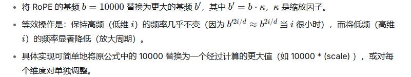{.ocr-src}

改进效果：

- 保留局部精度：高频分量的保留确保模型对相邻 token 的区分能力不下降。

- 扩展远程容量：低频分量的周期被拉伸，使模型能够区分更远距离的位置。

- 实验证明，NTK-aware 缩放无需微调（或仅需极少微调）即可在长序列上取得良好性能，显著优于 PI。

---

#### YaRN 方法是如何进一步优化 NTK-aware 的？

YaRN（Yet another RoPE extensioN） 在 NTK-aware 缩放的基础上，解决了一个关键问题：注意力分布的“锐度”退化。

当频率被 NTK 缩放后，虽然位置区分能力被扩展到长距离，但在长距离上的注意力分数分布会变得过于平滑（即 logits 方差变小，softmax 后趋于均匀）。这导致模型的长程注意力变得“模糊”，无法聚焦到关键 token。

YaRN 的优化：

- 温度缩放：在计算 softmax 之前，将注意力 logits 乘以一个温度系数 1/$t$，其中 $t$<1（通常取 0.9 或根据长度动态调整）。这等效于锐化注意力分布，使 softmax 输出更集中。

- 动态温度调整：YaRN 可以根据输入序列长度动态调整温度，实现“短则正常，长则锐化”的自适应行为。

- 配合 NTK 缩放：YaRN 同时使用 NTK-aware 的频率缩放和温度缩放，既保证了位置信息的有效扩展，又维持了注意力权重的辨识度。

总结：YaRN = NTK-aware scaling + attention temperature scaling，是目前效果最稳健的 RoPE 长度外推方法之一，被广泛应用于 LLaMA 等开源模型的上下文窗口扩展（如 4K → 32K）。

#### RoPE 相比绝对位置编码，在长文本外推方面有哪些优势？

RoPE 相比绝对位置编码（无论是正弦的还是可学习的），在长文本外推方面拥有根本性的优势，主要体现在以下几点：

1. 天然建模相对位置\
   绝对位置编码为每个位置分配一个唯一向量，模型要学会位置间的依赖，必须通过训练将绝对位置映射到相对关系。而 RoPE 通过旋转矩阵直接使 Q 和 K 的点积依赖于它们的相对距离 $m$−$n$，模型无需学习“位置5和位置3之间的关系”，而是直接感知“距离2”。这种相对关系是平移不变的——无论出现在序列的哪个位置，相同距离的依赖模式都是一样的。因此，当序列长度超过训练长度时，只要相对距离在模型见过的范围内（或能被外推），注意力模式依然有效。

2. 频率的分层结构赋予外推潜力

RoPE 的频率从高到低指数分布。高频分量负责捕捉局部短距离模式（如相邻词的语法关系），这些高频分量即使在未见过的长序列上也仍然有效，因为相邻位置的距离永远是1，与总长度无关。低频分量负责长距离依赖，在训练长度内其周期可能尚未走完一个完整波长。当序列变长，这些低频分量开始表现出更多的变化，但它们的变化是平滑的、周期性的，而不是像绝对位置嵌入那样完全未见过。因此，通过适当缩放这些低频分量的频率（如NTK-aware缩放），可以平滑地将模型扩展至更长序列。

3. 可插值性与外推方法丰富

绝对位置编码（尤其是可学习嵌入）外推时基本只有插值一条路，且会严重损害局部特征。RoPE 则拥有位置插值（PI）、NTK-aware 缩放、YaRN 等多种外推方法，并且理论支撑更扎实。通过调整旋转频率，RoPE 可以在不改变模型参数的情况下获得极好的零样本外推能力（动态NTK），或者通过极少量的微调适应超长上下文。

4. 远程衰减作为隐式先验

RoPE 内建的远程衰减（随着距离增大，点积期望衰减）为模型提供了“越远相关性越弱”的合理先验。这个先验在短文本上学习，在长文本上依然成立，并且在外推时仍能引导模型保持合理的注意力范围。而绝对位置编码没有这种内在衰减，外推时可能出现注意力模式混乱。

---

#### 在代码中，如何高效地实现 RoPE？是否需要构造完整的旋转矩阵？

不需要构造完整的 d×$d$×$d$ 旋转矩阵，那样将极其低效。 高效实现直接利用旋转的逐元素公式，将计算复杂度控制在 O(n⋅d)。

高效实现步骤：

以 PyTorch 为例，常用实现如下：

```python
import torch
import math

def apply_rotary_pos_emb(x, cos, sin):
    """
    x: 输入张量，形状 (batch_size, seq_len, num_heads, head_dim)
    cos, sin: 形状 (seq_len, head_dim) 或 (1, seq_len, 1, head_dim)
    """
    # 将x视为成对的二维子空间: 偶数索引为x1，奇数索引为x2
    x1 = x[..., 0::2]  # 取偶数位置
    x2 = x[..., 1::2]  # 取奇数位置
    
    # 应用旋转: x1*cos - x2*sin,  x1*sin + x2*cos
    rotated_x1 = x1 * cos - x2 * sin
    rotated_x2 = x1 * sin + x2 * cos
    
    # 交错合并回原形状
    output = torch.empty_like(x)
    output[..., 0::2] = rotated_x1
    output[..., 1::2] = rotated_x2
    return output
```

关键点：

- 预计算每个位置的 cos⁡(mθi)cos($mθi$) 和 sin⁡(mθi)sin($mθi$) 并缓存，因为它们在训练和推理中只依赖于序列长度和频率配置。

- 上述实现避免了矩阵乘法，完全通过逐元素乘法和加减操作完成，可在 GPU 上高效并行。

- 很多框架（如 HuggingFace Transformers、FlashAttention）内置了高度优化的 RoPE 实现，甚至将其融入注意力核心计算中，以进一步减少显存带宽。

总结：RoPE 的高效实现利用了其特殊结构，只需少量张量操作，不需构造旋转矩阵，因此计算开销极低。

---

#### RoPE 是否可以被应用于 V 或者 attention weights 上？为什么通常只用于 Q 和 K？

理论上可以，但通常不需要，甚至可能有害。

为什么只用于 Q 和 K？\
RoPE 的数学设计目标是让 注意力分数的点积 依赖相对位置。由于注意力分数由 $Q$⋅$K$ 决定，只需要对 Q 和 K 施加旋转即可达成目标。一旦 Q 和 K 被旋转，它们的内积就包含了相对位置信息，之后对 V 的加权求和以及拼接、线性投影等操作，都是在已经注入了位置感知的上下文表示基础上进行。

如果应用于 V 会怎样？

若对 V 也施加旋转，意味着每个 token 的“内容”也被位置信息调制了。这会导致：

- 信息混淆：V 携带的是要被聚合的实际语义内容。如果 V 被旋转，那么越是位置靠后的 token，其内容向量就越被扭曲，这会破坏内容的语义一致性。

- 残差流污染：V 的旋转信息会通过残差连接传递到后续层，并被深层的 Q、K 再次处理，可能造成位置信息的过度叠加和混乱。

- 没有增益：实验表明，对 V 使用 RoPE 并不会提升性能，有时还会略微损害模型效果。因此学术界和工业界的一致做法是仅对 Q 和 K 应用 RoPE。

是否可应用于 attention weights？

从数学上，RoPE 作用于 Q、K 后自动改变了注意力权重（点积后 softmax 的输入分布）。如果直接在注意力权重矩阵上施加旋转，将没有清晰的物理意义，且会破坏 softmax 概率分布的性质。因此，不会这样做。

---

#### LLaMA 系列全面采用 RoPE，这对它的架构有何意义？

LLaMA 系列（从 LLaMA 1 到 LLaMA 3）全面采用 RoPE，这标志着其架构从传统绝对位置编码向先进的相对位置编码范式的根本转变，意义重大：

1. 赋能长上下文能力

LLaMA 通过 RoPE 获得了原生的相对位置感知，并在此基础上通过 PI、NTK、YaRN 等方法将原本 2K 或 4K 的上下文窗口平滑扩展到 8K、32K 甚至 128K，成为开源社区长文本能力的标杆。没有 RoPE 及其外推方法，LLaMA 的长文本能力将大打折扣。

2. 高效的推理优化

RoPE 与 FlashAttention 等高效注意力实现高度兼容。FlashAttention 能够利用 RoPE 的结构特点进行分块计算优化，减少 HBM 读写。LLaMA 结合 GQA 和 RoPE，实现了在长序列推理时的高吞吐与低显存，这是其工程成功的关键。

3. 灵活的扩展性与生态

RoPE 的诸多外推方法（动态 NTK、YaRN 等）可以在不修改模型权重的情况下动态调整上下文长度。这让 LLaMA 的部署非常灵活，同一个 7B 模型可以按需配置为 4K、8K 或 32K 上下文，极大丰富了应用场景。

4. 简洁统一的架构设计

相比于 T5 的相对偏置、Transformer-XL 的片段级递归等方案，RoPE 在保持注意力计算简洁性的同时，实现了高效的相对位置编码。LLaMA 以此保持了架构的优雅，降低了实现复杂度，同时享有相对位置编码带来的性能与外推优势。

5. 社区生态的基石

LLaMA 的成功使得 RoPE 成为开源 LLM 的事实标准。几乎所有的 LLaMA 衍生模型（Alpaca、Vicuna、Mistral 等）都继承了 RoPE，围绕 RoPE 开发的工具、优化库、外推脚本形成了庞大的生态系统。

---

#### 如果将 RoPE 用于视觉模型，需要做哪些调整？

将 RoPE 从一维序列迁移到二维图像，核心在于将二维空间坐标转换为可旋转的位置角度。

1. 二维坐标的旋转编码

图像具有高度和宽度两个维度。常见的做法是：

- 将高度坐标 $h$ 和宽度坐标 $w$ 分别通过不同频率的 RoPE 进行编码。
- 具体实现：将特征向量分成两半，一半用于高度位置的旋转，另一半用于宽度位置的旋转。高度旋转使用频率 $\theta_i^H$，宽度旋转使用频率 $\theta_i^W$。
- 对每个 patch，其位置编码为：对其 Q 和 K 的前半部分应用高度的旋转，后半部分应用宽度的旋转。

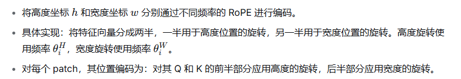{.ocr-src}

2. 处理多尺度与高分辨率

视觉模型常需处理不同分辨率。RoPE 的旋转是连续的，因此可通过调整频率或位置索引来应对分辨率变化，这与 NLP 的长度外推类似。例如，在高分辨率输入下，可以将位置索引按比例插值到训练分辨率范围。

3. 适配 ViT 架构\
   视觉 Transformer 通常使用 `[CLS]` token 进行分类，`[CLS]` token 本身没有位置信息，通常不施加位置编码（或使用特殊的可学习位置嵌入）。对于其他 patch token，RoPE 可以在每个自注意力层中应用。

4. 注意力的变体适配

如果使用窗口注意力或稀疏注意力，RoPE 仍需为每个 token 计算其在全局二维坐标系中的绝对位置，然后转换为对应的旋转角度。

5. 与相对位置偏置的结合

一些视觉模型（如 Swin Transformer）使用相对位置偏置而非绝对位置编码。RoPE 本质上就是一种基于绝对位置的相对编码，因此可以替代或融合相对位置偏置，使模型同时具备平移不变性和灵活的注意力范围。

已实践的例子：VisionLLaMA 等工作已将 RoPE 成功应用于视觉 Transformer，展示了其在图像分类、目标检测等任务上的竞争力，证明了 RoPE 在视觉领域的适用性。

---

#### 假设我们要将基于 RoPE 的 4K 模型扩展到 128K，简述你会采取的步骤。

将 RoPE 模型从 4K 扩展到 128K，需综合考虑位置编码、数据、训练策略和工程实现。

步骤1：选择外推方法

- 优先选择 YaRN 或 动态 NTK-aware 缩放，因为它们通常不需要全量微调，只需极少校准数据或零样本即可工作。

- 计算缩放因子 s=128K/4K=32。若使用 YaRN，需确定合适的基频放大倍数和温度系数。

步骤2：调整 RoPE 频率（离线或在线）

- 离线：修改模型配置文件中的 RoPE 基频（如将 10000 改为 10000 * 32 或根据 NTK 公式计算的新值），并保存新权重。

- 在线（动态）：在推理代码中集成动态 NTK，根据输入序列的实际长度自动调整 `theta`，无需修改权重。

步骤3：少量长文本数据微调（可选但推荐）

- 准备 128K 长度的指令微调数据，对调整后的模型进行少量步数的 SFT（如 100-500 steps）。这有助于模型适应新的位置密度和恢复可能受损的短距离性能。

- 数据需保证多样性，包含长文档 QA、多轮对话、代码等。

步骤4：工程优化

- 启用 FlashAttention-2 或 FlashAttention-3，并设置 `causal=True`，以在长序列上保持合理显存和速度。

- 使用 GQA（若模型已支持）减少 KV 缓存。

- 评估推理时的延迟和吞吐，必要时引入量化（如 INT8/INT4 KV Cache 量化）。

步骤5：评测验证

- 使用“大海捞针”（Needle-in-a-Haystack）测试评估在不同位置、不同长度下的检索准确率。

- 在长文本基准（如 LongBench、L-Eval）上评测生成质量、事实一致性。

- 验证短文本性能是否有退化，必要时进行短文本数据回放微调。

步骤6：迭代优化

- 根据评测结果调整 RoPE 参数（如温度、缩放因子），或增加微调数据。直至在长度-性能曲线上达到满意效果。

---

#### 动态 NTK 是什么？它如何避免微调，实现零长度外推？

动态 NTK（Dynamic NTK-aware scaling） 是一种推理时自适应调整 RoPE 频率的技术，使模型在不经过微调的情况下，就能处理比训练时长得多的序列。

核心原理：

- 与固定 NTK 缩放不同，动态 NTK 不是预先算好一个缩放因子应用到模型权重，而是**在推理过程中，根据当前序列的实际长度，实时计算一个缩放因子 $\alpha$**。
- 通常设定一个最大训练长度 $L_{train}$，当输入序列长度 $L_{input} \leq L_{train}$ 时，$\alpha = 1$，模型按原始频率运行，完全保持训练时性能。
- 当 $L_{input} > L_{train}$ 时，$\alpha = L_{input}/L_{train}$（或按某个非线性函数）。然后对 RoPE 的基频 $b$ 进行缩放：$b' = b \cdot \alpha$。这一缩放改变了旋转频率，使其适应更长的序列。

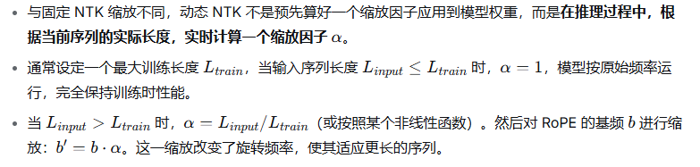{.ocr-src}

为什么能避免微调？

- 对于短于训练长度的输入，动态 NTK 与原模型完全等效，零性能损失。

- 对于长输入，缩放是平滑的，且仅调整了低频分量（因为基频放大主要影响高频 i 较大时的频率）。高频分量相对变化极小，所以局部模式得以保留；低频分量的周期被拉伸，能够区分更远的距离。这种平滑变化使模型能够泛化，而不需要重新训练来“记忆”新的位置编码。

实现要点：

- 在推理代码的 RoPE 计算前，检测序列长度，动态修改 `theta` 值（或 `freqs` 数组）。

- 一些推理框架（如 vLLM、HuggingFace Transformers）已支持动态 NTK 配置选项，只需设置 `rope_scaling` 参数即可。

---

#### RoPE 和 ALiBi 在实现相对位置编码上的思路有何不同？

两者都是免训练的、能够外推的相对位置编码方案，但思路截然相反：

RoPE（旋转位置编码）：

- 作用于表示向量：通过旋转 Q 和 K 向量，显式地将绝对位置转换为旋转角度，使点积自然依赖相对位置。

- 位置信息嵌入在向量空间：相对位置信息被编码在 Q、K 的旋转变换中，内容与位置是多维融合的。

- 外推方法：通过频率缩放（PI, NTK, YaRN）调整位置编码本身，再进行训练或零样本外推。

ALiBi（Attention with Linear Biases）：

- 作用于注意力分数：完全不修改 Q、K、V 向量。直接在注意力分数矩阵上加上一个预设的、仅与相对距离 ∣i−j∣ 成线性比例的负偏置。

- 位置信息作为偏置注入：相对位置以简单的“距离惩罚”形式直接加入 softmax 前的 logits。没有可学习参数，极度简洁。

- 外推方法：由于线性偏置对所有距离都定义良好，ALiBi 天然支持极强外推，无需任何额外修改或微调，甚至在训练长度10倍以上仍表现良好。

思路差异总结：

- RoPE 是“将相对位置隐式地编码进内容表示”，它修改了 Q、K 的计算，使得点积携带有相对位置信息。

- ALiBi 是“将相对位置作为显式的距离惩罚直接作用于注意力权重”，它完全不修改 Q、K，只是在注意力分数上加一个固定的偏置矩阵。

- RoPE 的频率设计赋予了其分层的局部/全局感知，但外推需要技巧；ALiBi 的线性偏置极其简单、外推鲁棒，但对注意力模式的表达能力可能不如 RoPE 丰富。

两者代表了相对位置编码的两种极端设计哲学：一个通过向量变换与内容深度耦合，另一个通过标量偏置与内容完全解耦。

---

#### 为什么 RoPE 的旋转维度通常是成对进行的？

数学根源：二维旋转矩阵只能作用于二维向量。为了将高维向量旋转，必须将其分解为多个独立的二维子空间，在每个子空间内执行二维旋转。这是旋转操作在高维空间中的自然推广。

具体来说：

- 一个 $d$ 维向量被分成 d/2 个正交的二维平面。

- 在每个平面上，使用一个特定频率的旋转矩阵进行旋转。

- 这种分块对角结构保证了旋转矩阵是正交的，从而内积在旋转后仅依赖于相对角度，不会扭曲向量的模长。

- 如果尝试用一个 $d$×$d$ 的稠密旋转矩阵，不仅参数量巨大，而且破坏了分块对角的优雅性质，无法简单地将相对位置与频率解耦。

工程便利性：成对操作使得计算极度高效——只需对向量的相邻两个元素进行乘加，不涉及跨维度的复杂交互，容易实现和并行化。

因此，成对旋转是 RoPE 数学形式的必然要求和工程实现的巧妙选择。

---

#### 如果不使用任何位置编码，仅靠 RoPE 可以吗？

不可以，因为 RoPE 本身就是一种位置编码。 这个问题可能想表达的是：“如果只使用 RoPE，而不再添加任何绝对位置嵌入（如可学习的或正弦的），可以吗？” 答案是：完全可以，RoPE 本身就是完整的、自足的位置编码方案。

RoPE 通过旋转 Q 和 K 向量，成功地将绝对位置注入模型，同时使点积依赖于相对位置。它替代了“绝对位置嵌入 + 模型自行学习相对关系”的传统范式。因此，使用 RoPE 时，输入嵌入层不再需要额外的位置嵌入相加。模型接收的 token 嵌入就是纯粹的语义嵌入，位置信息完全交由每层注意力中的 RoPE 提供。

这也是 LLaMA、Mistral 等现代 LLM 的做法：输入仅含 token 嵌入，所有位置信息均通过 RoPE 在注意力层实现。这种设计简洁、高效，且具备前述所有外推优势。

总结：RoPE 就是位置编码。它不需要其他位置编码作为补充，其本身已经提供了完备的位置信息建模能力。

---

#### RoPE 的计算复杂度高吗？是否会成为推理瓶颈？

计算复杂度极低，不会成为推理瓶颈。

RoPE 的计算量是 **O(n·d)**，其中 n 是序列长度，d 是头维度。它仅涉及对 Q 和 K 向量的逐元素乘法和加减法，不包含任何矩阵乘法。具体来说，对每个 token 的每个头的 Q 和 K，只需做一次与预计算的 cos/sin 值的逐元素操作。这与自注意力的 O(n²·d) 计算量相比完全可以忽略。

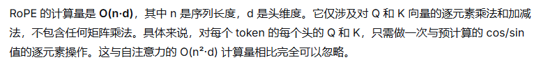{.ocr-src}

在推理时，RoPE 的计算只占总延迟的极小部分，主要瓶颈仍是注意力矩阵的计算和 KV 缓存读写。因此，RoPE 不仅不是瓶颈，反而因为其结构简单，可以与 FlashAttention 等高效实现无缝集成，甚至在线计算也不会增加明显开销。

---

#### 解释为什么 RoPE 能够保持注意力矩阵的“Toeplitz”结构倾向。

Toeplitz 矩阵的特点是：矩阵的每条对角线元素相等，即元素值仅依赖于 `i - j`（相对位置），而与绝对位置 `i` 和 `j` 无关。在纯相对位置编码下，若内容向量完全相同，注意力分数矩阵将是一个 Toeplitz 矩阵。

RoPE 正是通过将绝对位置转化为 Q、K 的旋转，使得同一对相对距离在不同绝对位置产生的点积相同，从而在内容无关的极限下，注意力分数仅依赖于相对距离。虽然在实际中内容向量不同会破坏严格的 Toeplitz 结构，但 RoPE 内建了这种平移不变性，使注意力矩阵天然倾向于表现出 Toeplitz 特征。这种倾向有利于模型学习位置平移不变的序列模式，也是在长文本外推时注意力模式稳定的数学基础。

---

#### 有哪些模型使用了 RoPE 的变体？简要说明其改进。

- LLaMA 系列：使用标准 RoPE，并从 LLaMA 2 开始结合 GQA。通过 NTK-aware 和 YaRN 等方法扩展上下文，成为开源社区的事实标准。

- Mistral：同样使用 RoPE，并引入滑动窗口注意力与 RoPE 结合，以高效处理长序列。

- Qwen：采用 RoPE 并引入 LogN 缩放，对注意力 logits 施加层相关的缩放因子，以稳定深层网络的训练；同时采用动态 NTK 实现长文本外推。

- GPT-NeoX：使用与原始 RoPE 稍有不同的实现方式，将旋转应用于 Q 和 K 之前先做部分变换，但本质相同。

- ChatGLM：在 RoPE 基础上结合二维位置编码，用于处理中英双语和多轮对话的长程依赖。

这些变体主要在频率设计、外推方法和与其他注意力优化（如 GQA、滑动窗口）的配合上进行改进，以适应更大规模、更长上下文的训练需求。

---

#### 如果训练时使用了很小的旋转基频，推理时扩展长度会怎样？

RoPE 的基频（如 10000）决定了最低频率分量的波长。基频越小，最低频率分量的波长越短。

如果在训练时使用了很小的基频，意味着所有频率都整体偏高，即便是最低频分量也有相对较短的周期。在训练长度内，这些频率已经经历了一次或多次完整的周期变化，位置编码的“远距离区分度”在训练时就已经达到上限。

当推理时扩展长度，序列长度将远超最低频分量的波长。此时，极低频（已经是相对高频了）会产生周期性重复，导致不同距离的位置产生混淆——多个不同的相对距离可能对应相似的内积值，模型无法区分它们。这会造成长距离注意力模式的混乱，外推性能大幅下降。相反，较大的基频（如 500000）可以产生极低频分量，使得在训练长度内这些分量还未完成一个周期，从而保留了远距离的区分潜力，在扩展长度时可以继续提供有效的位置信息。这就是为什么许多长上下文模型会增大基频的原因。

---

#### 从物理角度，为什么“旋转”可以编码位置？

旋转是一个连续且周期性的运动。在物理学中，圆周运动的位置由相位角唯一确定。若我们将序列中的每个 token 看作在某个抽象空间中以不同角速度旋转的向量，那么 token 的位置就对应于这些向量在各自旋转平面上的相位。

RoPE 构建了一系列旋转平面（成对的维度），每个平面有一个特定的角频率。在位置 `m`，向量的相位是 `m * θ`。不同位置的向量具有不同的相位。两个向量的点积取决于它们的相位差，即相对位置 `(m-n) * θ`。这就像在信号处理中，两个正弦波的相位差决定了它们的相关性。旋转将“位置”这个离散概念映射为“相位”这个连续物理量，而相对位置则自然成为“相位差”，从而使模型能够通过简单的内积运算感知距离。

---

#### RoPE 对注意力分数的稀疏性有什么影响？

RoPE 内建的远程衰减特性使注意力分数随着相对距离的增加而整体下降。在未经过 softmax 的 logits 上，这意味着长距离 token 的分数普遍较低。当这些分数经过 softmax 后，大量的长距离注意力权重变得非常小，甚至接近于零。

这种特性自然地导致了注意力矩阵的软稀疏性：大部分注意力权重集中在局部上下文（短距离），少数关键的长程依赖仍然可以保留（如果内容非常相关）。这与绝对位置编码或没有位置编码的情况相比，能更稳定地形成稀疏但有效的注意力模式，有利于模型专注于重要信息，并在长序列上降低计算开销（配合稀疏注意力算法可进一步加速）。

---

#### 谈谈你对“RoPE 是绝对位置编码实现相对位置编码的优雅方案”这句话的理解。

这句话精准概括了 RoPE 的设计哲学。

绝对位置编码的本质：为每个位置分配一个唯一的向量，位置信息是绝对的。

相对位置编码的本质：模型感知的是 token 之间的距离，而非他们在序列中的绝对坐标。

RoPE 的优雅之处在于，它形式上从绝对位置出发（为每个位置定义了唯一的旋转角度 `mθ`），通过旋转作用于 Q 和 K 的绝对过程，却在效果上达成了相对位置编码的目标（点积结果仅依赖相对距离）。它不需要像经典相对位置编码那样显式地在注意力分数上加上一个相对距离偏置矩阵，也不需要存储庞大的相对位置嵌入表。它仅通过一种简单的、计算高效的向量变换，就将绝对位置信息完美地转化为了平移不变的相对距离感知。

这种设计既保留了绝对位置编码的简洁性（无额外参数或复杂计算），又获得了相对位置编码的核心优势（相对关系建模、外推能力），实为两者融合的典范。所以说它是一种“优雅方案”，因为它以极简的数学形式实现了从绝对到相对的深刻转化。

