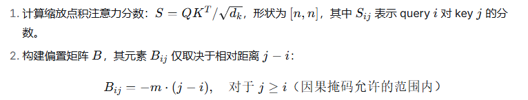
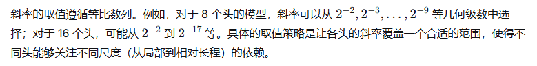

# 7.大模型（LLMs）ALiBi 位置编码

#### ALiBi 的注意力偏置如何施加？写出偏置矩阵的计算方式。

ALiBi 不修改 Q、K、V，也不添加位置嵌入，而是直接在注意力分数矩阵（softmax 之前）上加上一个预设的、与相对距离成线性比例的负偏置。具体步骤：

1. 计算缩放点积注意力分数：$S = QK^T/\sqrt{d_k}$，形状为 $[n, n]$，其中 $S_{ij}$ 表示 query $i$ 对 key $j$ 的分数。
2. 构建偏置矩阵 $B$，其元素 $B_{ij}$ 仅取决于相对距离 $j - i$：

$$
B_{ij} = -m \cdot (j - i), \quad \text{对于 } j \geq i \text{（因果掩码允许的范围内）}
$$

{.ocr-src}

其中 $m$>0 是一个头特定的斜率。对于 j<i 的位置（自回归的未来位置），本身已被因果掩码屏蔽为 −∞。

3. 最终注意力权重：

$$
\mathrm{Attention} = \mathrm{softmax}(S + B)V
$$

{.ocr-src}

直观理解：每个 query 在看向过去的 key 时，离得越远的 key 会减去越大的分数，因此近处的 token 天生更容易获得高注意力权重。

---

#### ALiBi 中的斜率 m 如何确定？对于多头注意力，每个头是否不同？

每个头使用不同的斜率，但所有斜率都是预先设定、无需训练的常数。

斜率的取值遵循等比数列。例如，对于 8 个头的模型，斜率可以从 $2^{-2}, 2^{-3}, \ldots, 2^{-9}$ 等几何级数中选择；对于 16 个头，可能从 $2^{-2}$ 到 $2^{-17}$ 等。具体的取值策略是让各头的斜率覆盖一个合适的范围，使得不同头能够关注不同尺度（从局部到相对长程）的依赖。

{.ocr-src}

这些斜率在训练开始时设定后就保持不变，不参与反向传播。这种设计极其简洁，每个头的注意力头通过不同的斜率自然分化为“短距离关注头”（大斜率，强惩罚长距离）和“长距离关注头”（小斜率，弱惩罚长距离），无需额外学习。

---

#### 为什么 ALiBi 无需训练即可外推到更长的序列？

ALiBi 的外推能力根源于其基于距离的偏置是纯线性的、无界的。

- 无参数，无分布限制：ALiBi 的偏置是解析确定的，不依赖任何可学习参数。因此它不会像可学习位置嵌入那样存在“未见过的位置”问题。

- 线性距离惩罚的定义域是整个自然数集：对于任意两个 token 的距离 d=j−i，偏置值 −$m$⋅$d$ 都有明确、合理的定义，即使 $d$ 远超训练时见过的最大距离。

- 保持 softmax 的行为模式：由于惩罚随距离线性增长，模型在训练时会形成“近处关注度高，远处关注度低”的注意力模式。当序列增长时，这个线性惩罚机制自动延伸到更远的距离，继续压制过远 token 的注意力分数，使得注意力分布依然保持在合理范围，不会因为出现未见过的位置而崩溃。

- 稳定的 softmax 归一化：线性偏置的方差在长序列下不会像绝对位置嵌入那样失控，softmax 的分布仍然平滑可控。

因此，ALiBi 实现了几乎“即插即用”的长度外推，无需任何微调或插值。

---

#### ALiBi 与 RoPE 相比，各自有什么优缺点？

| 特性 | ALiBi | RoPE |
| --- | --- | --- |
| 位置信息注入方式 | 直接在注意力分数上加线性偏置 | 对 Q 和 K 向量施加旋转 |
| 参数 | 无（完全无参数） | 无（频率固定）或极少量可调超参 |
| 外推能力 | 极强，几乎无成本，10倍以上仍有效 | 较强，但通常需借助 PI/NTK/YaRN 等技术 |
| 局部/全局建模 | 通过不同斜率让多头分工，偏置单一 | 通过频率的分层设计，更细腻的多尺度 |
| 注意力模式复杂度 | 简单，纯距离衰减 | 可学习复杂的相对位置模式 |
| 性能（同规模） | 在部分基准上稍弱于 RoPE | 通常略优，是现代 LLM 主流 |
| 训练兼容性 | 极易实现，不改变核心注意力代码 | 需修改注意力核心以施加旋转 |
| 理论优雅性 | 极其简单粗暴 | 优美，利用复数旋转，相对位置内建于点积 |

总结：ALiBi 赢在极简和强大的零样本外推；RoPE 赢在表达力和生态成熟度。工业界目前更倾向 RoPE，但 ALiBi 的超长外推能力仍有其独特魅力。

---

#### 在 ALiBi 中，随着序列增长，偏置的数值会线性增大，这会导致 softmax 输出怎样变化？

随着序列长度的增长，最远距离的 token 对应的负偏置会越来越大（例如，-m × 10000）。这对 softmax 的影响是：

- 远端 token 的注意力权重呈指数级衰减。因为 softmax 是指数函数，-m × d 对应的 exp 值极小，权重接近于零。

- 概率质量更集中于近处 token。由于远端权重大幅降低，近处 token 的权重相对上升。

- 注意力分布变得更加尖锐和稀疏。在极长序列下，每个 query 的有效注意力范围基本被限制在一个由 m 决定的局部窗口内，超过一定距离的 token 几乎完全被忽略。

这种“强制局部性”是 ALiBi 在长序列上保持稳定的关键，但也可能使模型完全丧失捕捉极长距离（如跨越数万 token）关键依赖的能力。这是一个权衡。

---

#### ALiBi 能否处理超过训练长度数倍的序列？它的极限是什么？

可以，ALiBi 已被实验证明能在训练长度的 10 倍甚至更长 的序列上保持稳定的困惑度，且无需任何微调。其极限主要来自两个方面：

- 软极限：注意力窗口的狭窄化。如前所述，随着序列变长，线性偏置的绝对值持续增大，softmax 会变得极其尖锐，导致每个 query 只能注意到最邻近的一小段上下文。这意味着模型丧失了捕捉长程依赖的能力。虽然它能“处理”长序列，但可能只是把长序列当成很多个短片段独立处理，缺乏全局理解。

- 硬极限：数值表示范围。当距离极大（如百万级别）时，-m × d 可能会超出浮点数可表示的范围，导致 softmax 计算出现 NaN 或 inf。

因此，ALiBi 的极限不是“长度”本身，而是有效全局上下文窗口的消失。对于需要跨很远距离精确检索信息的任务（如“大海捞针”），ALiBi 在极大长度下不如经过精心外推的 RoPE。但在语言建模困惑度上，它表现出惊人的平滑外推能力。

---

#### 为什么说 ALiBi 是一种“线性衰减”的相对位置偏置？

因为 ALiBi 所施加的偏置 $B_{ij}$ 是与两个 token 之间的相对距离 $d$=$j$−$i$ 成严格线性关系的：

$$
B_{ij} = -m \cdot (j - i)
$$

{.ocr-src}

这意味着惩罚力度随距离增加而均匀增长，没有拐点或衰减减缓。这与 RoPE 的复杂频率依赖、T5 的相对位置桶（分桶后再嵌入）等非线性或离散化方案形成鲜明对比。因此 ALiBi 被称为“线性衰减”或“线性偏置”的位置编码。

---

#### 如果将 ALiBi 的偏置改为距离的二次方，会有什么效果？

若将偏置改为 $B_{ij} = -m \cdot (j-i)^2$，会导致：

{.ocr-src}

- 惩罚随距离呈平方增长，长距离 token 的注意力分数下降极快。

- 局部性过强：模型将几乎完全聚焦于非常近的上下文，长距离依赖几乎完全消失。

- 外推能力可能急剧下降：在训练长度之外，二次惩罚可能使有效注意力窗口收缩到极小，模型无法利用任何远距离信息，反而破坏了在长序列上的困惑度稳定性。

- 不符合语言直觉：语言中的远距离依赖虽然衰减，但并非平方级衰减，一个信息完全可能在相隔很远的情况下依然关键（如代词与先行词）。

实验也表明，使用二次偏置的模型在困惑度和下游性能上均不如线性偏置。线性偏置在“局部优先”与“长程可能”之间取得了良好平衡。

---

#### ALiBi 是否适合用于 Encoder-Only 模型？为什么通常在 Decoder 中使用？

ALiBi 更适用于 Decoder（自回归）模型，而在 Encoder-Only（双向）模型中较少使用，且不是最优选择。

原因：

- Encoder 需要双向上下文：编码器的任务是理解整个序列，每个 token 需要平等地关注所有其他 token，距离不应该是注意力分配的决定性因素。线性衰减强加了一个“越近越重要”的先验，这可能会阻碍信息从远端关键 token 流动到当前 token，损害对长句子的理解能力。

- Encoder 通常长度固定或较短：BERT 等编码器模型的序列长度通常较短（如 512），外推不是其主要需求。而 ALiBi 的核心优势在超长序列外推，这个优势在短序列场景无法体现。

- Decoder 的自回归性质与衰减天然契合：生成模型在预测下一个词时，其注意力强烈依赖于最近的上下文，而线性衰减恰好提供了这种符合直觉的归纳偏置。同时 Decoder 往往需要极长的上下文生成，ALiBi 的外推能力大放异彩。

- 历史实践：最初的 ALiBi 论文主要验证了其在自回归语言模型（如 GPT 类 Decoder）上的效果。后来的研究很少将 ALiBi 用于 BERT 类编码器，而更多使用绝对位置编码或 RoPE。

结论：ALiBi 的线性衰减和超强外推使其成为 Decoder 架构的优良选择，但对于需要无偏双向理解的 Encoder，其强加的距离先验反而可能成为桎梏。

---

#### 与 T5 的偏置位置编码相比，ALiBi 的优势在哪里？

T5 采用“相对位置嵌入”（relative position embeddings），其核心是将两个 token 之间的相对距离划分为若干个桶（bucket），每个桶分配一个可学习的标量偏置，然后将此偏置加到注意力 logits 上。ALiBi 与其相比，有以下显著优势：

- 零参数，无学习负担：T5 的相对偏置需要在训练中学习桶的嵌入值，而 ALiBi 的线性斜率是预先设定的常数，完全无需训练，极大地简化了模型设计和优化。

- 真正的无限外推：T5 的桶有最大距离限制（例如 128），超出该距离的相对位置全部归入同一个桶，无法进一步区分。当序列长度远超预设桶的范围时，模型将丢失远距离的位置信息。ALiBi 的线性函数天然覆盖所有距离，不存在这种硬性限制，因此外推能力远强于 T5。

- 更快的推理速度：T5 需要查表并计算相对位置偏置，涉及额外的嵌入查找和矩阵组装。ALiBi 的偏置矩阵可以在运行时即时生成（简单的线性运算），或在静态缓存中一次构建，计算开销更小。

- 简洁与鲁棒性：ALiBi 的线性先验对大多数自然语言序列提供了一种非常通用的归纳偏置，即“越近越相关”，这使得它在各种长度的序列上表现稳定，不易过拟合。

概括而言，T5 的相对偏置是离散、有界、需训练的，而 ALiBi 是连续、无界、免训练的，这让 ALiBi 在扩展性和简便性上明显占优。

---

#### ALiBi 在推理时是否增加计算量？为什么？

几乎不增加显著的计算量。

原因在于：

- ALiBi 施加的偏置矩阵 `B` 只依赖于相对距离和预设的斜率 `m`，可以事先计算并缓存。在每次推理时，只需将该偏置矩阵加到注意力分数 `QKᵀ/√dₖ` 上。这个加法是逐元素的，复杂度仅为 `O(n²)`，且完全可以在现有的高带宽矩阵乘法流水线中被“隐藏”。

- 相比于自注意力本身的 `O(n²·d)` 计算量，以及后续的 softmax 和加权求和，这个加法的开销几乎可以忽略不计。特别是当序列长度增加时，注意力的矩阵乘法占绝对主导，ALiBi 的偏置加法不会成为瓶颈。

- 使用 FlashAttention 等优化算法时，ALiBi 的偏置同样可以在分块计算中融合，不需要额外加载和存储整个偏置矩阵，进一步减小了带宽开销。

因此，ALiBi 在推理时基本是“免费的午餐”，不会对延迟或吞吐产生实质性影响。

---

#### 对于短序列（<512），ALiBi 的表现如何？是否需要做特殊处理？

对于短序列，ALiBi 的表现通常与可学习位置编码相当，甚至在一些基准上略有提升。不需要任何特殊处理。

原因：

- 在短序列中，线性偏置同样能提供有用的距离先验：相邻 token 距离为 1~10，偏置值 `-m·d` 变化明显，能够帮助模型区分不同距离的上下文。

- 不同斜率的多头设计仍然有效，一些头专注于极局部（大斜率），另一些头关注稍远的依赖，这种多样性在短序列上同样有益。

- 实验证明，ALiBi 在标准长度（如 512、1024）的语言建模困惑度上与正弦/可学习位置嵌入持平或更优，从未出现因序列短而性能劣化的情况。

所以，ALiBi 是一个对长度“无感”的通用位置编码方案，短序列可直接使用。

---

#### 如何结合 ALiBi 和因果掩码？画出掩码+偏置的最终注意力矩阵。

ALiBi 与因果掩码结合的方式是叠加：在未掩码的下三角区域，每个 `(i, j)` 位置（其中 `j ≤ i`）施加线性偏置 `-m · (i - j)`；上三角区域（未来 token）依然被因果掩码设为 `-∞`。

最终的注意力分数矩阵（softmax 之前）形如：

```plain text
         j=0    1    2    3  ...
i=0   [ -0,   -∞,  -∞,  -∞ ]
i=1   [ -m·1, -0,   -∞,  -∞ ]
i=2   [ -m·2, -m·1, -0,   -∞ ]
i=3   [ -m·3, -m·2, -m·1, -0 ]
...
```

- 对角线元素为 0（无偏置，因为距离为 0）。

- 下三角中，距离每增加 1，偏置就线性增加 `-m`。

- 上三角保持 `-∞`，由因果掩码保证。

这种复合掩码在代码实现中非常直接：先用因果掩码将上三角置 `-∞`，再将下三角逐元素减去 `m * (i - j)`（或加上对应的负偏置矩阵）。

---

#### 有哪些知名模型使用了 ALiBi？请举例。

- BLOOM：BigScience 项目的大型多语言语言模型（176B 参数），完全采用 ALiBi 作为位置编码方案，证明了 ALiBi 在超大规模下的有效性。

- MPT 系列（MosaicML 的预训练 Transformer）：如 MPT-7B、MPT-30B，它们使用 ALiBi 并以此获得了极强的外推能力，支持在极长上下文上进行训练和推理。

- BLOOMZ / mT0：基于 BLOOM 的指令微调变体，自然也继承了 ALiBi。

- 一些研究性模型如 XGLM、GLM 的早期版本等也曾使用或借鉴 ALiBi 思想。

这些模型普遍利用 ALiBi 的免训练外推特性，在长文本任务上展现出优异性能。

---

#### ALiBi 的斜率选择有理论依据吗？还是纯经验值？

目前以经验选择为主，尚无公认的严格理论推导。

ALiBi 的原始论文中，斜率的选择是基于几何级数的简单启发：对于 `n` 个头的模型，斜率设置为 $2^{-2}, 2^{-3}, …, 2^{-(n+1)}$ 等，使得不同头能够覆盖从极局部到中等距离的不同范围。这种选择在实践中工作得很好，但并未从优化或泛化理论上给出证明。

一些后续工作试图通过分析注意力分布的信息瓶颈、梯度流或损失景观，解释为何几何分布的斜率有助于多尺度建模，但都处于探索阶段，没有形成统一理论。尽管如此，经验上的鲁棒性已足够支撑 ALiBi 的广泛应用。

---

#### 如果所有头使用相同的 m，会有什么问题？

会出现严重的多尺度建模能力缺失和性能下降。

具体来说：

- 如果所有头都使用相同的、较大的斜率，那么模型的所有注意力头都会强烈地偏好极近的 token，长距离依赖将几乎无法被捕获。这会导致模型在需要跨远距离理解的任务（如长文本推理、指代消解）上表现糟糕。

- 如果使用相同的、较小的斜率，所有头都倾向于保留较宽的注意力窗口，但又会失去对精细局部结构的敏感度（因为缺乏短距离强偏置头）。

- 本质问题在于，语言中的依赖关系是多尺度的：有的需要单词间的局部语法（距离 1~3），有的需要句子间的逻辑衔接（距离数十上百）。多头注意力通过分化斜率，自然形成从“显微镜”到“望远镜”的多层次观察。同质化斜率会剥夺这种能力。

因此，斜率的多样性是 ALiBi 成功的关键，缺失它将使模型退化为一种能力单一的粗粒度注意力机制。

---

#### ALiBi 对注意力值的分布有什么影响？会不会导致过于稀疏？

ALiBi 的线性偏置会系统性地压低远距离 token 的注意力分数，使得 softmax 后的注意力权重分布向近处集中。

- 在短序列或中等长度下，这种集中效应是温和的，注意力矩阵仍保留一定的长程连接，尤其对于小斜率头，远端 token 仍有非零权重。

- 在长序列（如 10K、100K）时，大斜率头的注意力会变得极端稀疏：距离超过某个阈值（例如 1/m）后，偏置 `-m·d` 远小于 0，exp 值趋近于 0，注意力几乎只停留在非常近的局部窗口内。

- 但整体模型的有效感受野是由所有头共同决定的：小斜率头仍然可以在长距离上保持非零注意力，从而保留全局信息流动的可能。因此不会出现整个模型注意力都过于稀疏的问题，而是形成一种 “局部密集 + 全局稀疏” 的混合分布。

因此，ALiBi 确实会促使注意力稀疏化，但通过多头斜率的巧妙配合，它可以在局部精度和全局视野之间取得平衡。

---

#### 在预训练阶段使用 ALiBi 的模型，在微调时如果遇到更长的序列，需要做特殊处理吗？

基本不需要特殊处理，这正是 ALiBi 的核心卖点。

由于 ALiBi 的偏置是纯线性的，并且在预训练时已经教会了模型“距离越远，关注越少”的行为模式，当微调时出现更长的序列，这种模式会自动延伸：模型对从未见过的长距离会自然地分配更低的注意力，而不会像绝对位置编码那样因“位置嵌入不存在”而崩溃。

实践中，只需确保：

- 模型的最大推理长度在工程上可支持（显存、计算资源足够）。

- 微调数据中包含适当比例的长文本，可以帮助模型更好地适应新的长度分布（虽然这并非 ALiBi 架构所强制）。

大多数情况下，直接用长序列微调即可平滑过渡，无需任何额外插值或架构修改。

---

#### ALiBi 是否可以通过学习 m 来进一步提升性能？

可以，但需要权衡利弊。

如果将斜率 `m` 设为可学习参数，模型将能够根据数据和任务自动调整每个头的最佳注意力窗口，理论上可能获得更好的下游性能。事实上，一些改进工作（如 Learnable ALiBi 或 Adaptive ALiBi）正是这样做的，它们在特定任务上取得了微小但一致的提升。

然而，这样做也会带来一些代价：

- 增加少量参数和训练成本。

- 可能损害外推能力：如果模型在训练时只见过一定长度的序列，学习到的斜率可能过度拟合了该长度下的最优模式，当序列长度显著增长时，学到的斜率可能不再最优，反而限制了泛化。固定斜率则避免了这种过拟合。

- 复杂性提升，削弱了 ALiBi 原本的简洁优势。

因此，是否可学习取决于应用场景：如果需要极致的零样本外推，固定斜率更安全；如果目标领域长度固定或有大量长文本数据，可学习斜率或许能带来额外增益。

---

#### 你认为 ALiBi 的“线性偏置”和 RoPE 的“旋转相对位置”哪一种更符合语言中的位置规律？

两者从不同角度逼近语言中的位置规律，但 RoPE 的方式更接近语言本质的复杂性，而 ALiBi 提供了一种简洁强大的近似。

- 语言中的位置规律：一方面，语言具有强局部性——相邻词的组合构成短语，句法依赖往往在短距离内。另一方面，语言中也存在远程依赖——主谓一致、代词回指、篇章连贯等可能跨越数百甚至数千个 token。更重要的是，这些依赖不是简单地随距离单调衰减，而是高度依赖于内容与结构。

- ALiBi 的线性偏置：强制了“距离越远，相关性必定越弱”的先验，这对于局部性建模非常有效，但对于需要“跨越干扰区间、精准连接远处特定词”的场景（如在一篇长文中找到开头提到的人名），它的单调衰减反而是障碍。它是一种与内容无关的、刚性的位置先验。

- RoPE 的旋转相对位置：不强制单调衰减，而是通过内积的几何性质，让位置信息与内容深度耦合。理论上，如果内容足够匹配，RoPE 可以使远距离的两个 token 产生很高的注意力分数，从而突破距离限制。这种灵活的内容感知的相对位置建模，显然更接近人类语言处理中“基于内容和语法结构寻回远距离依赖”的真实机制。

因此，如果追求最真实的语言规律建模，RoPE 更优；如果追求极致的实现简单性与鲁棒外推，ALiBi 更优。实际中，RoPE 因其更高的性能上限和灵活性成为当前大模型的主流，而 ALiBi 在需要零样本处理极长序列的特定场景中仍有一席之地。

