# 8.大模型（LLMs）前馈网络（FFN）

#### Transformer 中的 FFN 由哪几层组成？写出它的公式。

标准 Transformer 的 FFN 由两个线性变换和一个非线性激活函数组成。其公式为：

$$
\mathrm{FFN}(x) = \mathrm{ReLU}(xW_1 + b_1)W_2 + b_2
$$

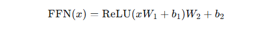{.ocr-src}

或者更一般地：

$$
\mathrm{FFN}(x) = \max(0, xW_1 + b_1)W_2 + b_2
$$

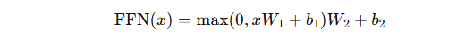{.ocr-src}

其中：

- $x \in \mathbb{R}^{d_{\mathrm{model}}}$ 是输入向量（经过层归一化后，来自注意力子层的输出）。
- $W_1 \in \mathbb{R}^{d_{\mathrm{model}} \times d_{\mathrm{ff}}}$，$b_1 \in \mathbb{R}^{d_{\mathrm{ff}}}$ 是第一层线性变换的权重和偏置。
- $W_2 \in \mathbb{R}^{d_{\mathrm{ff}} \times d_{\mathrm{model}}}$，$b_2 \in \mathbb{R}^{d_{\mathrm{model}}}$ 是第二层线性变换的权重和偏置。
- $d_{\mathrm{ff}}$ 是 FFN 的隐藏层维度，通常远大于 $d_{\mathrm{model}}$（例如 $d_{\mathrm{ff}} = 4 \times d_{\mathrm{model}}$）。

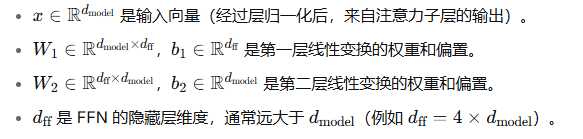{.ocr-src}

因此，FFN 本质上是一个两层的全连接网络，先升维、激活、再降维回原始维度。

---

#### FFN 通常先将维度扩大几倍？这个放大倍数是固定的吗？

**常用的放大倍数是 4 倍**，即 $d_{\mathrm{ff}} = 4 \times d_{\mathrm{model}}$。这是原始 Transformer 论文中的设置，也成为后续大多数模型（如 BERT、GPT-2、GPT-3、LLaMA 等）的默认选择。

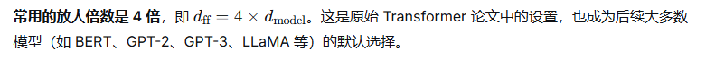{.ocr-src}

但这个倍数不是绝对固定的，可以根据模型规模、计算预算和任务需求进行调整：

- 一些轻量级模型会使用 2 倍或 3 倍的扩展比以减少参数量。

- 大型模型（如 GPT-3、LLaMA-70B）通常保持 4 倍，因为足够大的 FFN 是模型容量的重要保证。

- 在 MoE（混合专家）架构中，每个专家的 FFN 维度可以缩小（例如保持与 $d_{\mathrm{model}}$ 相同甚至更小），但由于有多个专家，总参数量仍然很大。

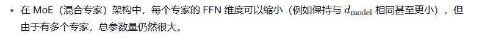{.ocr-src}

- 某些高效 Transformer 变体（如 MobileBERT）采用瓶颈结构，先降维再升维。

因此，4 倍是经验上的甜区，在容量和计算效率之间取得了良好平衡，但并非不可动摇。

---

#### FFN 在整个 Transformer 中扮演什么角色？为什么不能只靠注意力层？

FFN 扮演以下关键角色：

1. 引入非线性

自注意力机制本质上是线性操作（加权求和），即使堆叠多层，如果没有非线性激活，整个模型仍然是输入序列的线性变换，表达能力极其有限。FFN 中的激活函数（ReLU、GELU 等）为模型提供了必要的非线性，使其能够学习任意复杂的函数映射。

2. 逐位置的特征变换与知识存储

自注意力负责“从哪些位置获取信息”，而 FFN 负责“如何处理这些信息”。FFN 对每个 token 独立进行相同的变换（position-wise），相当于让每个 token 在汇聚了上下文信息之后，再独立地进行特征提取、整合和非线性映射。大量研究表明，FFN 的权重矩阵中存储了模型从训练语料中学到的大量事实和知识（如实体属性、关系、常识）。可以说，注意力是“检索”，FFN 是“记忆库”。

3. 增大模型容量

FFN 的隐藏维度通常数倍于模型维度，这使得 FFN 的参数量占 Transformer 总参数量的约三分之二。没有 FFN，模型的总参数量会大幅缩减，容量不足以支撑复杂的语言理解和生成。

为什么不能只靠注意力层？

如果去掉 FFN，只堆叠注意力层，模型将严重退化。原因：

- 缺乏非线性，深层退化为浅层。

- 没有逐位置的特征变换，模型无法独立加工每个 token 的内部表示。

- 模型容量严重不足，无法存储大量知识。

- 实验证明，纯注意力堆叠的性能远低于标准 Transformer，语言建模困惑度极高，下游任务几乎不可用。

---

#### 如果完全去掉 FFN，只堆叠注意力层，会发生什么？

如前所述，去掉 FFN 会带来一系列灾难性后果：

- 表达能力坍缩为线性模型：没有激活函数，多层注意力退化为输入序列的线性变换。理论上，多层线性变换的复合仍然是线性的，模型无法学习非线性决策边界。

- 丧失“知识记忆”能力：FFN 的权重矩阵是模型参数记忆的主要载体。去掉它们，模型只能通过注意力头来隐式捕获语料统计，但这远远不足以存储海量的事实和词汇知识。

- 模型容量骤减：标准 Transformer 中 FFN 参数占 2/3 左右。去掉 FFN 后，模型大小锐减，无法充分利用训练数据，导致严重欠拟合。

- 下游任务完全失败：在机器翻译、语言建模、问答等任务上，纯注意力模型的性能会断崖式下降，甚至无法正常训练收敛。

因此，FFN 不是可选组件，而是 Transformer 强大能力的结构性基石。

---

#### 标准的 FFN 使用 ReLU 激活，如果换成 GELU 或 SwiGLU，有什么变化？

ReLU：ReLU(x)=max⁡(0,x)。优点：计算简单，稀疏激活（负值截断为 0）。缺点：在负半区梯度为零，可能导致“神经元死亡”；非线性形式较为刚性。

GELU：GELU(x)=x⋅Φ(x)，其中 Φ 是标准正态分布的累积分布函数。GELU 是 ReLU 的平滑近似，保留了负值的小概率输出，梯度处处非零，训练更稳定。在 BERT、GPT 等模型中广泛使用。相比 ReLU，GELU 通常带来微小的性能提升，但计算成本略高（涉及误差函数）。

SwiGLU：一种门控激活单元的变体。公式为：

$$
\mathrm{SwiGLU}(x) = (xW_1 + b_1) \otimes \mathrm{Swish}(xW_g + b_g)
$$

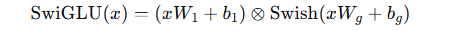{.ocr-src}

其中 Swish 激活函数为 x⋅σ(x)。SwiGLU 将 FFN 改造为门控线性单元：一条路径产生“信息”，另一条路径产生“门控值”，两者逐元素相乘。这种机制允许模型动态地控制信息流，实验证明在相同计算量下能显著提升语言建模和下游任务性能。LLaMA、PaLM 等现代 LLM 均采用 SwiGLU 或其变体替代标准 ReLU/GELU FFN。

变化总结：从 ReLU 到 GELU 是平滑化改进，从 GELU 到 SwiGLU 是结构性的门控升级，后者在大型模型上性能增益明显，但引入了额外的参数矩阵（门控投影），需适当调整 FFN 隐藏维度以保持参数量平衡。

---

#### FFN 的参数量在全模型中占比多大？为什么这么大？

在标准 Transformer 中，FFN 的参数量占整个模型（不含嵌入层）的约 2/3。

**计算**：假设模型维度 $d$，头数 $h$，头维度 $d_k = d/h$，FFN 隐藏维度 $d_{ff} = 4d$。

- 多头注意力参数（四个投影矩阵）：$4d^2$。
- FFN 参数（两个线性层）：$d \times 4d + 4d \times d = 8d^2$。
- 总参数量：注意力 $4d^2$ + FFN $8d^2$ = $12d^2$。FFN 占 $8/12 = 2/3$。

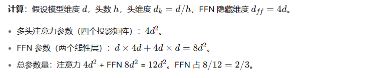{.ocr-src}

为什么这么大？

- FFN 的隐藏维度需要足够大，以提供强大的特征变换和知识存储能力。大量研究表明，语言模型的知识（如事实、常识）主要存储在 FFN 的权重中。扩大 FFN 能够直接提升模型的记忆容量和表达能力。

- 注意力层负责动态的上下文聚合，对参数量的需求相对更低（其优势在于并行和长程依赖建模）；而 FFN 是“静态”的知识库，需要更多参数来编码海量训练数据中的信息。

- 在 Scaling Law 中，增大 FFN 维度是提升模型性能最经济有效的方式之一，因此现代大模型普遍维持甚至增大 FFN 的扩展比。

---

#### 为什么 FFN 被称为“position-wise feed-forward network”？

“Position-wise”意为逐位置的、按位置独立操作的。FFN 对输入序列中的每一个位置（token）独立且相同地应用同样的全连接网络，不同位置共享同一套权重参数。

这意味着：

- 对于序列中位置 $i$ 的向量 $x_i$，FFN 输出 FFN(xi)，不依赖于其他位置的信息。

- 这种独立性与自注意力形成鲜明对比：自注意力是跨位置的（需要所有 token 交互），而 FFN 是位置内的特征提取。

- 共享权重保证了模型参数不随序列长度增长，同时实现了对每个 token 的深度非线性变换。

因此，FFN 被称为 position-wise，突出了其跨位置共享且仅作用于单个位置的特性。

---

#### 在 MoE 架构中，FFN 如何被替换为专家网络？

MoE（Mixture of Experts）将 Transformer 层中的单一 FFN 替换为多个并行的 FFN（专家），并通过一个门控路由器动态选择每个 token 应该由哪几个专家处理。

替换方式：

1. 准备 $E$ 个结构相同但参数独立的 FFN 模块，每个称为一个“专家”。

2. 引入一个门控函数 G(x)，通常是一个线性层 + softmax，输出每个专家的选择概率。

3. 对于输入向量 $x$，门控网络计算每个专家的得分，选择 Top-$k$ 个得分最高的专家（通常 $k$=1 或 $k$=2）。

4. 输入 $x$ 仅被路由到被选中的 Top-$k$ 个专家，各专家独立计算其 FFN 输出，然后按门控得分加权求和。

5. 为了负载均衡，训练时常加入辅助损失，鼓励所有专家被均匀使用。

公式（简化）：

$$
y = \sum_{i \in \mathrm{Top\text{-}k}(G(x))} G_i(x) \cdot \mathrm{FFN}_i(x)
$$

其中 $G_i(x)$ 是第 $i$ 个专家的路由权重。

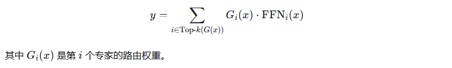{.ocr-src}

这种设计使模型总参数量大幅增加（$E$ 倍），但每个 token 的计算量仅增加约 $k$ 倍（远小于总专家数），因此在相同计算预算下，MoE 可以拥有更大的模型容量，从而提升性能。代表性模型如 Switch Transformer、Mixtral 等。

---

#### 解释 SwiGLU 激活的门控机制，并写出其公式。

SwiGLU 是 Swish-Gated Linear Unit 的缩写，它结合了门控机制和 Swish 激活函数。其核心思想是：将输入通过两条不同的线性变换，一条产生“信息”信号，另一条产生“门控”信号，然后逐元素相乘，动态控制信息流。

公式：

$$
\mathrm{SwiGLU}(x) = (xW_1 + b_1) \otimes \mathrm{Swish}(xW_g + b_g)
$$

其中：

- $W_1 \in \mathbb{R}^{d \times d_{ff}}, W_g \in \mathbb{R}^{d \times d_{ff}}$ 分别是信息和门控路径的权重。
- $\mathrm{Swish}(z) = z \cdot \sigma(z)$，$\sigma$ 是 sigmoid 函数。
- $\otimes$ 表示逐元素乘法（Hadamard 积）。

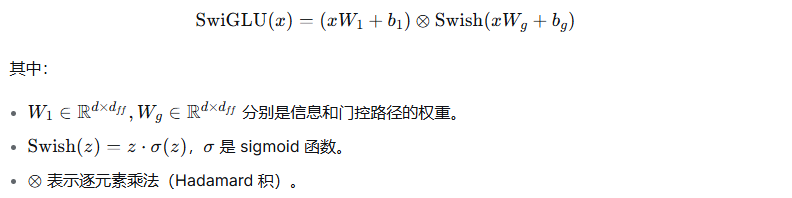{.ocr-src}

门控机制解释：

- 门控路径的输出经过 Swish 函数，值域在 (−≈0,∞)，可以看作一个“软开关”。当门控值接近 0 时，信息被抑制；当门控值较大时，信息可以畅通。

- 这种机制允许模型根据输入内容动态地调节哪些特征应该被保留、放大或抑制，比固定激活函数（ReLU/GELU）更灵活，表达力更强。

在实践中，SwiGLU 通常会将 FFN 的隐藏维度 $d_{ff}$ 调整为约 $\frac{8}{3}d$ 而非 $4d$，以保持总参数量与标准 FFN 基本持平（因为多了一个门控权重矩阵）。实验表明，SwiGLU 在大模型上能带来显著的性能提升，是现代 LLM 的标准选择之一。

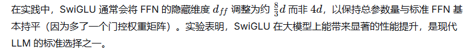{.ocr-src}

---

#### SwiGLU 相对于 ReLU 和 GELU 在训练大规模模型时有哪些优势？

SwiGLU 在现代大模型（如 LLaMA、PaLM）中被广泛采用，主要优势如下：

1. 更强的表达能力

SwiGLU 使用门控机制：一路产生信息，一路产生门控值，两者逐元素相乘。这相当于对信息进行动态筛选，而不是像 ReLU/GELU 那样仅通过一个固定激活函数。模型可以学习更复杂的非线性变换，对训练数据的拟合能力更强。

2. 更好的梯度流动\
   SwiGLU 的门控路径使用 Swish 激活（`x·σ(x)`），它在负值区域也有非零梯度且平滑过渡。相比 ReLU 在负半区完全截断梯度（可能造成神经元“死亡”），SwiGLU 保持梯度流通，训练更稳定，尤其适合超深网络和大批量训练。

3. 更高效的参数利用

虽然 SwiGLU 引入了额外的门控权重矩阵（三个投影矩阵代替了两个），但通过适当缩小 FFN 隐藏维度（如从 4 倍降为 8/3 倍），总参数量可与标准 FFN 基本持平。在相同参数预算下，SwiGLU 的模型通常获得更低的困惑度和更好的下游性能。

4. 训练收敛更快

实验表明，SwiGLU 模型在相同训练步数下能达到比 ReLU/GELU 更低的损失，相当于在更少的训练计算量下获得同等效果，这对于大规模训练意味着显著的成本节约。

5. 与大规模训练基础设施兼容

SwiGLU 的计算图简单（矩阵乘法、逐元素乘法和 Swish 激活），高度可并行，且没有引入难以优化的算子，因此在 GPU/TPU 上能高效执行。

---

#### FFN 中的两个线性层权重是否共享？为什么？

**不共享**，两个线性层的权重矩阵 $W_1$ 和 $W_2$ 是独立学习的。

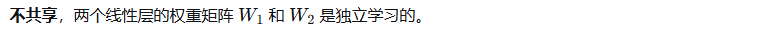{.ocr-src}

原因：

- 功能不同：第一个线性层将输入投影到高维空间，负责提取特征和引入非线性；第二个线性层将高维表示压缩回原始维度，负责信息整合和投影。两者操作不同，需要不同的权重来学习最优的升维/降维变换。

- 增加模型容量：独立权重为 FFN 提供了两个可学习的参数矩阵（加上激活后的非线性），使模型能够表示更复杂的函数。如果共享，则 FFN 退化为某种自编码器结构，表达能力大大减弱。

- 实践中从不共享：在所有主流 Transformer 实现中（BERT、GPT、LLaMA 等），FFN 的两个线性层都是独立的可学习参数。共享权重在实验中被证明会导致性能显著下降。

---

#### 有一种观点认为“FFN 存储了知识”，你怎么理解？

这种观点源于大量分析和实验，其核心依据如下：

1. 参数占比与记忆容量

FFN 占据 Transformer 约 2/3 的参数量，且其隐藏维度远大于模型维度。这些庞大的权重矩阵为模型提供了巨大的“记忆空间”。研究表明，语言模型中的事实知识（如“巴黎是法国的首都”）、实体属性、常识等，主要通过 FFN 的参数进行编码和检索。

**2. FFN 作为键值记忆**

一些理论将 FFN 理解为一种**可学习的键值记忆（Key-Value Memory）**。第一层线性变换 $W_1$ 充当"键"（检测输入中的特定模式），激活函数进行非线性筛选，第二层线性变换 $W_2$ 充当"值"（输出对应的知识表示）。这个视角下，FFN 就像一个存储海量事实的数据库，注意力负责"查询"，FFN 负责"应答"。

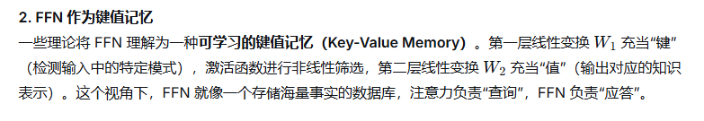{.ocr-src}

3. 知识编辑的实验证据

知识编辑（如修改模型对特定事实的记忆）的研究发现，对 FFN 中特定神经元的干预能精准地改变模型对相关知识的输出，而对注意力头的修改效果则不明显。这强有力地证明了 FFN 是事实知识的主要存储位置。

4. 剪枝与探针分析

对 Transformer 进行结构化剪枝时，注意力头可以被大量移除而对知识密集型任务影响较小，但剪掉 FFN 层中的关键神经元会迅速导致事实错误。探针实验也表明，可以从 FFN 的隐藏表示中高精度地解码出实体、关系等信息。

因此，“FFN 存储了知识”是有充分理论和实验支撑的，是现代 Transformer 理解中的关键洞见。

---

#### 如果对 FFN 也进行剪枝或量化，对模型性能影响多大？

剪枝：FFN 层中存在大量冗余神经元。结构化剪枝（如移除整个 FFN 中间层的某些神经元）在剪枝率较低（例如 10-20%）时，通常对性能影响很小；但当剪枝率超过 30-40%，模型的事实知识和语言流畅度开始显著退化。因为 FFN 存储了知识，过度剪枝会导致模型“遗忘”事实，产生更多幻觉和错误。

量化：FFN 的权重和激活值通常对量化较为鲁棒。使用 INT8 甚至 INT4 量化，在大多数推理场景下性能下降很小（困惑度增加 < 1%）。但极端低位量化（如 INT2）会严重损害表示精度，导致生成质量崩溃。量化对 FFN 的影响与注意力层相当，因为两者的参数量都很大且存在冗余。

关键区别：注意力头对剪枝更鲁棒（因为多头冗余大），而 FFN 对剪枝更敏感（因为其神经元功能更专门化，且存储了具体知识）。因此在压缩模型时，通常先剪注意力头，再谨慎地剪 FFN，并辅以知识蒸馏来恢复性能。

---

#### 为什么现代 LLM 的 FFN 普遍采用 SwiGLU，而非传统 ReLU？

从 ReLU 到 GELU，再到 SwiGLU，是 LLM 演进中逐步追求更强表达能力和更高训练效率的结果。

1. 门控机制带来的质变

SwiGLU 将激活从“逐元素非线性”升级为“门控线性单元”。门控机制允许模型动态调节信息流，相当于为每个 token 的每个特征维度赋予了一个自适应的“重要性权重”。这种柔性处理比 ReLU 的“一刀切”截断更精细，能学习更复杂的函数。

2. 大规模训练下的效率优势

在相同计算预算和参数规模下，使用 SwiGLU 的模型通常获得更低的 loss。换句话说，要取得同样的性能，SwiGLU 模型需要的训练 FLOPs 更少。在大模型时代，这种效率优势意味着巨大的成本节省。

3. 稳定的训练动态

SwiGLU 的梯度流动更平滑（Swish 函数不存在梯度截断），在超深网络和大批次训练中表现出更好的数值稳定性，减少了 loss spike 和发散的风险。

4. 成功实践的示范效应

从 PaLM、LLaMA 到后来的众多开源模型，SwiGLU 被反复验证为一种简单而有效的基础组件。社区因此形成了“新模型必用 SwiGLU”的工程惯例。

5. 硬件友好

SwiGLU 的计算主要由矩阵乘法和逐元素操作构成，与 GPU/TPU 高度匹配，没有引入低效算子，易于优化和扩展。

---

#### FFN 的参数量和注意力层的参数量加起来，哪个更多？为什么？

FFN 的参数量更多，约占整个 Transformer 层（不含嵌入层）总参数量的 2/3。

以标准设置（$d_{model} = d$, $d_{ff} = 4d$）为例：

- 注意力层参数：四个投影矩阵 $W_Q, W_K, W_V, W_O$，每个大小为 $d \times d$，共 $4d^2$ 参数。
- FFN 参数：两个线性层 $W_1: d \times 4d$，$W_2: 4d \times d$，加上偏置项（通常可忽略），共 $8d^2$ 参数。
- 总参数：$4d^2 + 8d^2 = 12d^2$，FFN 占 $8/12 \approx 66.7\%$。

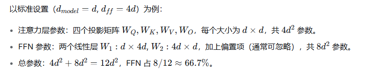{.ocr-src}

为什么 FFN 更大？

FFN 需要巨大的隐藏维度来提供足够的特征变换能力和知识存储空间。注意力层主要负责动态的上下文聚合，对参数量的需求相对较低（因为它的计算优势在于并行和长程依赖）；而 FFN 作为模型的知识库，必须拥有海量参数才能记忆海量训练数据中的事实和语言模式。

---

#### 如何初始化 FFN 的权重？

FFN 权重的初始化遵循 Transformer 的整体初始化策略，具体如下：

- **线性层**：通常使用 **Xavier/Glorot 均匀分布**或**正态分布**初始化，或采用以 0 为中心、标准差为 $\sqrt{2/(d_{in}+d_{out})}$ 的截断正态分布。
- **激活函数前层的特殊处理**：对于使用 ReLU 或 GELU 的 FFN，由于激活函数会导致一半的输出为零（ReLU）或期望方差变化，一些实现会使用 **Kaiming He 初始化**（`nn.init.kaiming_normal_`）来确保信号方差在网络中保持一致。
- **偏置**：通常初始化为 0。
- **现代大模型的统一初始化**：在 LLaMA 等模型中，所有线性层（包括 FFN 和注意力投影）统一使用一个很小的标准差（如 0.02 或 $1/\sqrt{d}$）的截断正态分布初始化。这种简洁的方案在实践中表现良好，且与预训练学习率、优化器等协同工作。

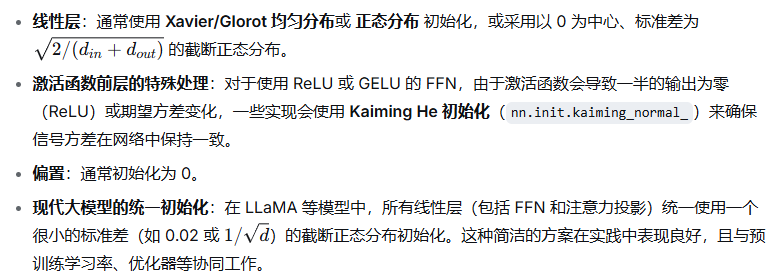{.ocr-src}

- SwiGLU 的门控权重：通常与普通线性层相同初始化，因为门控矩阵在训练初期不引入额外偏差。

核心目标是保证前向传播的信号方差稳定，避免梯度消失或爆炸。

---

#### 在推理时，FFN 的计算是否可以与注意力部分并行？

在单层内，不能并行，因为 FFN 的输入依赖于注意力子层的输出（经过残差连接和层归一化）。这是 Transformer 的顺序结构：注意力 → 残差+LN → FFN → 残差+LN。

但跨层存在并行机会：如果使用流水线并行（Pipeline Parallelism），可以将不同层分配到不同设备上，第 $L$ 层的 FFN 可以与第 $L$+1 层的注意力计算重叠执行。但这属于系统级优化，而非单层内的并行。

注意力的 KV Cache 阶段：在自回归推理时，注意力的 KV Cache 更新和 FFN 计算是串行的，无法并行，因为当前 token 必须通过注意力后再进入 FFN。但当前 token 的 FFN 计算可以和下一 token 的输入处理重叠，前提是使用异步或多步调度（如 vLLM 的连续批处理）。

结论：单层内 FFN 和注意力必须串行；跨层和跨步可以通过调度实现部分并行。

---

#### 能否使用 Conv1D 替代 FFN？有什么影响？

可以，且已有相关工作（如 CNN-based Transformer、ConvFFN）。但会有以下影响：

优势：

- Conv1D 能够引入局部感受野，捕获邻近 token 之间的 n-gram 模式。对于某些任务（如语音、字符级文本），局部依赖的建模可能比纯 position-wise FFN 更有优势。

- 在一些高效架构中，轻量卷积可以降低参数量同时保持性能。

劣势：

- 丧失 position-wise 独立性：标准 FFN 是逐 token 独立变换，保证了模型对序列长度的高度并行性。引入卷积会引入跨位置的依赖，可能干扰自注意力已经捕获的全局依赖。

- 增加的序列长度依赖：卷积操作的计算量随序列长度线性增长（与卷积核大小相关），而 position-wise FFN 的计算量与序列长度成简单的线性关系，更易扩展。

- 理论和工程上的额外复杂度：需要处理 padding、因果掩码的兼容性等问题，且可能与为 position-wise FFN 高度优化的硬件内核不匹配。

- 实践中，纯 Conv1D 替代 FFN 并未在主流 LLM 中成为趋势，因为 position-wise FFN 的简洁高效和强大的知识存储能力难以被卷积轻易取代。

---

#### LLaMA 中的 FFN 和原始 GPT 的 FFN 有什么不同？

LLaMA 和 GPT 系列（以 GPT-2/3 为例）在 FFN 上的主要差异：

| 特性 | GPT-2 / GPT-3 (传统) | LLaMA |
| --- | --- | --- |
| 激活函数 | GELU（GPT-2）、ReLU 或 GELU（GPT-3 未完全公开，但典型是 GELU） | SwiGLU |
| FFN 结构 | 两层：Linear -> GELU -> Linear | 三层：Linear_up -> SiLU -> Linear_gate，以及逐元素乘法，然后可能还有一个 Linear_down。实际上 SwiGLU 使用三个权重矩阵：gate_proj, up_proj, down_proj。 |
| 隐藏维度 | $d_{ff}=4d$ | 调整为 $\frac{8}{3}d$ 左右，以平衡总参数量（因为多了一个门控矩阵）。 |
| 偏置 | 通常有偏置项 | 无偏置（LLaMA 所有线性层都不使用偏置，以简化）。 |

总结：LLaMA 将 FFN 升级为 SwiGLU，引入了门控机制，并相应调整了隐藏维度和去除了偏置。这使得它在相同参数预算下获得更强的表达能力和训练效率。

---

#### 当隐藏维度 d_model=4096，FFN 中间层扩大 8/3 倍（SwiGLU 后），中间层维度是多少？

计算公式：

$$
d_{ff} = \frac{8}{3} \times d_{model} = \frac{8}{3} \times 4096 = \frac{32768}{3} \approx 10922.666\ldots
$$

在实际实现中，通常会对该值进行取整。LLaMA-7B（$d_{model} = 4096$）使用的中间维度为 **11008**，这个值正是最接近 10922.67 且满足硬件对齐（如 256 的倍数）的整数。取整方式为：

$$
d_{ff} = \mathrm{round}\left(\frac{8}{3} \cdot d_{model}\right)
$$

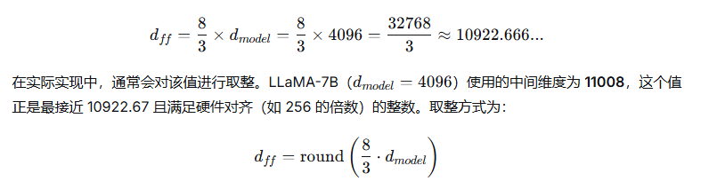{.ocr-src}

并略微调整以对齐（如 256 的倍数），以确保在 GPU 上的高效计算。

所以，答案是 约 11008（LLaMA 的实际取值）。

---

#### 如果 FFN 的激活函数被替换为恒等映射，网络的能力会如何变化？

将激活函数替换为恒等映射（即去除非线性），FFN 变为：

$$
y = xW_1W_2 + b
$$

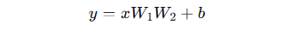{.ocr-src}

即两个线性层的复合，仍然是一个线性变换（因为两个矩阵乘积仍是矩阵）。

后果：

- 整个 Transformer 退化为线性模型。自注意力本身是线性操作，残差和层归一化也基本上是线性或准线性。没有非线性激活，深层网络坍缩为浅层线性模型，无法学习复杂的非线性决策边界。

- 模型表达能力崩溃：对于语言这种高度复杂、非线性的数据，线性模型严重欠拟合，困惑度极高，生成任务完全失败。

- 训练无法收敛到有效解：损失函数很难下降，因为模型没有足够的容量去逼近真实的数据分布。

因此，激活函数（非线性）是 FFN 乃至整个 Transformer 能够工作的绝对必要组件，去掉它将使模型退化为无用的线性映射。

