# 9.大模型（LLMs）激活函数（ReLU、GELU、SwiGLU）

#### ReLU 的公式是什么？它有哪些缺点？

公式：

$$
\mathrm{ReLU}(x) = \max(0, x)
$$

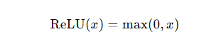{.ocr-src}

缺点：

- 神经元死亡（Dying ReLU）：当输入 $x$<0 时，输出为 0，梯度也为 0。一旦某个神经元落入负值区域且后续梯度不再更新，其权重将永远无法恢复，导致该神经元永久失活。这在深层网络中尤为严重。

- 非零中心输出：ReLU 的输出总是非负的，均值大于 0。这会导致后层神经元的输入分布发生偏移（均值非零），可能减缓收敛速度（因为梯度更新方向易偏向同一方向）。

- 信息完全丢失：对负值输入，ReLU 直接置零，丢弃了所有负半轴的信息。在某些任务中，负值可能包含有意义的模式（如特征抑制信号）。

- 不可导点：在 $x$=0 处不可导，需要人为定义次梯度（通常取 0 或 0.5），尽管在实践中影响不大。

- 无界的正半轴：虽然正半轴无界，但这并不是严重问题，主要通过权重初始化和归一化层控制。

这些缺点促使了 GELU 等更平滑的激活函数的出现。

---

#### 为什么在 Transformer 的 FFN 中，直接用 ReLU 往往不如 GELU？

在 Transformer 的 FFN 中，GELU 相比 ReLU 的性能优势源于：

1. 平滑性与梯度流动\
   ReLU 在 $x$=0 处有一个突变，梯度在负半轴完全为零。GELU 是处处连续可导的平滑函数，保留了负值的小概率输出，使得梯度在任何点都不完全消失。这对具有大量参数和深层堆叠的 Transformer 至关重要：平滑的激活函数有助于梯度在整个网络中更稳定地传播，减少训练过程中的损失波动和发散风险。

2. 信息保留与非线性丰富度\
   ReLU 对负值信息完全丢弃，而语言中的某些模式可能需要负值表达（例如，特征之间的抑制关系）。GELU 通过其概率形式 $x$⋅Φ($x$)（其中 Φ 是标准正态 CDF）为每个输入乘以一个介于 0 到 1 之间的权重，相当于软门控，使得负值不会被粗暴截断，而是按大小得到保留或衰减。这使得 FFN 能够学习更细微的特征组合。

3. 类似于自适应的 Dropout

GELU 可以理解为一种“输入依赖的 Dropout”：它以概率 Φ(x) 保留输入，否则置零。这种随机性（在期望下）为模型提供了一种正则化效果，有助于防止过拟合，而 ReLU 则是确定性的裁剪。

4. 实验验证

原始 Transformer 论文使用 ReLU，但后续工作（BERT、GPT-2 等）改用 GELU 后在各项 NLP 基准上取得了显著提升。即使计算开销略高（涉及误差函数），在精度提升面前也是值得的。

因此，GELU 以其平滑、非线性丰富和良好的梯度特性，成为取代 ReLU 的标准选择。

---

#### GELU 的近似公式是什么？它是如何融合 Dropout 思想的？

精确公式：

$$
\mathrm{GELU}(x) = x \cdot \Phi(x) = x \cdot \frac{1}{2}\left[1 + \mathrm{erf}\left(\frac{x}{\sqrt{2}}\right)\right]
$$

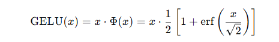{.ocr-src}

其中 Φ 是标准正态累积分布函数，erf 是误差函数。

常用近似公式：

- tanh 近似（更精确但稍复杂）：

$$
\mathrm{GELU}(x) \approx 0.5x\left[1 + \tanh\left(\sqrt{\frac{2}{\pi}}\left(x + 0.044715x^3\right)\right)\right]
$$

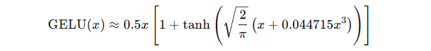{.ocr-src}

sigmoid 快速近似（更简单）：

$$
\mathrm{GELU}(x) \approx x \cdot \sigma(1.702x)
$$

{.ocr-src}

在实践中，多数框架直接使用精确的 erf 实现或上述 tanh 近似。

**融合 Dropout 思想**：

GELU 的设计灵感来源于将 Dropout 与激活函数结合。标准 Dropout 以固定概率 $p$ 随机将神经元置零。GELU 则可视为一种"自适应 Dropout"：对于输入 $x$，它被乘以一个伯努利随机变量 $m \sim \mathrm{Bernoulli}(\Phi(x))$，然后输出 $m \cdot x$。期望值就是 $\mathbb{E}[m \cdot x] = \Phi(x) \cdot x = \mathrm{GELU}(x)$。换句话说，GELU 在期望下等效于根据输入的大小随机丢弃神经元：输入 $x$ 越大，保留概率 $\Phi(x)$ 越接近 1；输入越小（尤其是负值），保留概率越小（接近 0）。这比固定丢弃概率的 Dropout 更灵活，因为它使得正则化强度与输入本身相关，有利于保护强信号并抑制弱噪声。

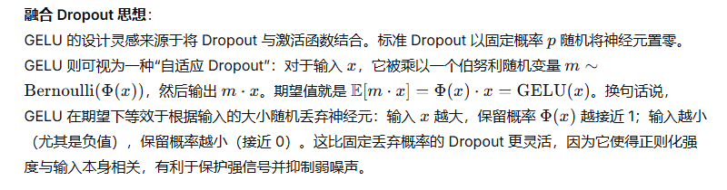{.ocr-src}

---

#### 比较 GELU 和 Swish 激活函数的异同。

定义：

- GELU：GELU(x)=x⋅Φ(x)

- Swish：Swish(x)=x⋅σ(βx)，其中 $σ$ 是 sigmoid 函数，$β$ 是可学习参数或常数 1（此时也称为 SiLU）。

相同点：

- 都是平滑、非单调的激活函数，形状相似：在负半轴有轻微隆起（非零），正半轴近似线性。

- 都有“软门控”机制：输出为输入乘以一个介于 0 和 1 之间的门控值（GELU 用正态 CDF，Swish 用 sigmoid）。

- 都处处可导，梯度不会完全消失，有利于深层网络训练。

- 都能带来性能提升，在 Transformer 等架构中优于 ReLU。

不同点：

- 门控函数：GELU 使用标准正态累积分布 Φ，Swish 使用 logistic sigmoid。两者在形状上接近，但尾部衰减速度不同：正态分布尾部衰减更快，因此 GELU 对负值抑制更强；sigmoid 尾部更平坦，Swish 在负值区域的门控值下降稍慢。

- 计算复杂度：GELU 涉及误差函数 erf，计算略复杂；Swish 只需 sigmoid 和乘法，计算更简单高效。

- 可学习性：Swish 有一个可选的参数 $β$，可以训练调整门控的“硬度”；GELU 无参数（固定分布）。

- 在大模型中的偏好：目前社区更倾向使用 Swish（SiLU）或基于它的门控变体 SwiGLU，因为它们计算更快且在大量实验中表现优异。

总结：两者极为相似，在许多场景下可以互换。Swish 因其简单和速度优势，在现代大模型（如 LLaMA、PaLM）中成为激活函数的基础。

---

#### SwiGLU 的公式是什么？解释门控机制。

SwiGLU 公式：

SwiGLU 是 Gated Linear Unit (GLU) 与 Swish（SiLU）激活的结合。通常定义为：

$$
\mathrm{SwiGLU}(x) = \mathrm{Swish}(xW_g + b_g) \odot (xW_1 + b_1)
$$

其中：

- $W_g, W_1$ 是不同线性变换的权重矩阵，$b_g, b_1$ 为偏置（可省略）。
- $\mathrm{Swish}(z) = z \cdot \sigma(z)$（SiLU）。
- $\odot$ 表示逐元素乘法。

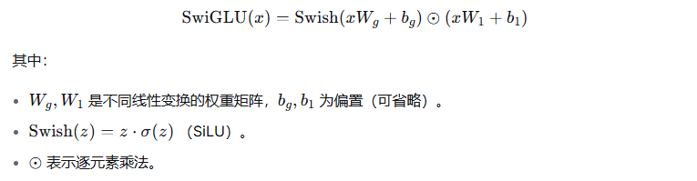{.ocr-src}

有些实现会再经过一个输出投影：$y = \mathrm{SwiGLU}(x)W_2 + b_2$。在 Transformer FFN 中，标准 SwiGLU 使用三个线性层：`gate_proj`（接 SiLU）、`up_proj`，两者乘积后再经过 `down_proj`。

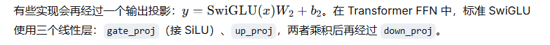{.ocr-src}

门控机制：

门控机制是 SwiGLU 的核心创新。它通过两个独立的线性变换将输入映射到两个不同的空间：

- 信息路径（`up_proj`）：产生待传递的信息向量。

- 门控路径（`gate_proj`）：产生一个门控信号，经过 Swish（SiLU）激活后，值域为 (0,∞)，但通常会集中在 0 附近（当输入为负）到 1 以上（当输入为正）的范围。门控信号可以看作每个特征维度的“音量旋钮”。

最终输出是信息向量与门控向量的逐元素乘积。这意味着：

- 当门控值接近 0 时，对应信息被抑制（关闭）。

- 当门控值较大时，对应信息被放大（增强）。

- 门控值随输入动态变化，因此模型可以根据输入内容自适应地选择哪些特征应该通过、哪些应该抑制。

这类似于 LSTM/GRU 中的门控思想，但应用于前馈网络的每一层，为 FFN 提供了强大的动态特征调制能力。

---

#### SwiGLU 为什么需要两个线性变换？额外增加的参数量如何控制？

为什么需要两个线性变换：

SwiGLU 的门控机制需要同时计算“信息”和“门控”两个不同的表示。这两个表示通常需要从输入中提取不同的特征组合，因此使用两个独立的线性变换是自然的：一个学习如何生成信息，另一个学习如何生成门控。共享权重将迫使两者耦合，失去门控的灵活性，削弱表达能力。

**参数量增加**：

相比标准 FFN（两个线性层：`fc1` 和 `fc2`），SwiGLU 引入了第三个线性层（门控投影）。假设模型维度为 $d$，原始 FFN 隐藏维度 $d_{ff} = 4d$，参数量为：

$$
2 \cdot d \cdot d_{ff} = 8d^2
$$

若 SwiGLU 同样使用隐藏维度 $d_{ff}$，参数量将变为：

$$
3 \cdot d \cdot d_{ff} = 12d^2 \text{（假设 } \texttt{down\_proj} \text{ 的输入维度等于 } \texttt{up\_proj} \text{ 和 } \texttt{gate\_proj} \text{ 的输出维度，即 } d_{ff}\text{）。}
$$

为控制总参数量，通常会缩小 SwiGLU 的中间层维度。如果希望参数量与标准 FFN 相当，可设 SwiGLU 的中间维度为 $\frac{8}{3}d$ 左右（具体推导：解 $3 \cdot d \cdot d' = 8d^2$ 得 $d' = \frac{8}{3}d$）。因此，现代大模型（如 LLaMA）采用 $d_{ff} = \frac{8}{3}d$ 并取整。这样总参数量基本保持不变，同时获得门控机制的益处。

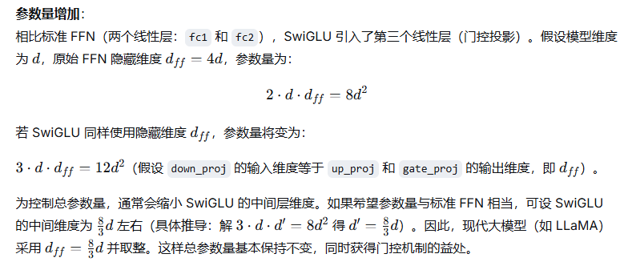{.ocr-src}

---

#### 为什么 SwiGLU 在大规模语言模型中表现更优？

SwiGLU 在大模型中的优势来源于其门控机制、高效参数利用和稳定的训练动态。

1. 门控机制提供动态特征选择

与 ReLU/GELU 等固定非线性不同，SwiGLU 的门控路径会根据输入内容生成门控信号，选择性地放大或抑制信息。这使得 FFN 能够更灵活地处理不同 token 的不同模式，尤其是在复杂语言现象中（如多义词消歧、句法结构差异）表现出更强的适应力。

2. 更好的梯度流动

SwiGLU 中使用的 Swish/SiLU 激活是平滑且非单调的，梯度在负值区域也不完全消失。这确保了深层网络的梯度传播更为顺畅，减少了训练中的不稳定性和损失尖峰。对于千亿参数级别的模型，训练稳定性的重要性尤为突出。

3. 高效的参数与计算利用率

在相同参数量预算下，SwiGLU 模型通常获得更低的困惑度（perplexity）。换句话说，要达到同样的性能，SwiGLU 模型需要的训练 FLOPs 更少。这种效率优势在大规模训练中直接转化为时间和成本的节约。

4. 已被大量实验反复验证

从 PaLM、LLaMA 到后来的众多开源模型，SwiGLU 均被采用并表现出相对于 ReLU/GELU 的显著提升。这种广泛实践确立了其作为现代 LLM 标准激活方案的地位。

5. 硬件友好

SwiGLU 的计算主要由矩阵乘法和逐元素乘法组成，都是 GPU/TPU 上高度优化的操作，没有引入低效的计算步骤，适合大规模并行化。

综合来看，SwiGLU 以较小的额外设计复杂度换取了模型容量和训练效率的双重提升，是大模型时代激活函数演进的重要成果。

---

#### 如果 LLM 使用 SiLU (Swish) 激活，和 GELU 会有明显差异吗？

效果差异通常很小，但 SiLU 在计算效率和某些场景下有微弱优势。

1. 形状相似性

SiLU（$x \cdot \sigma(x)$）和 GELU（$x \cdot \Phi(x)$）的曲线高度重合，都是平滑的非单调函数。在绝大多数输入范围内，两者的输出差异极小。因此，用 SiLU 直接替换 GELU，模型性能一般不会出现剧烈下降，大多持平或略有浮动。

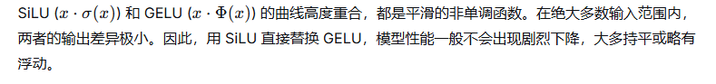{.ocr-src}

2. 计算效率

SiLU 只需计算一次 sigmoid 函数，而 GELU 的精确计算需要误差函数 erf（或 tanh 近似），计算量稍大。在大规模训练和推理中，SiLU 的轻量优势会累积。这也是为什么现代 LLM（LLaMA、Mistral 等）倾向使用 SiLU（或其门控变体 SwiGLU）。

3. 在 SwiGLU 中已包含 SiLU

当前主流 LLM 已经不再单独使用 GELU 或 SiLU，而是采用 SwiGLU，其门控分支正是使用的 SiLU。因此可以说，GELU 已经在实践中被 SiLU 和 SwiGLU 所取代。

4. 基准对比

在相同设置下，一些消融实验表明，直接替换 GELU 为 SiLU 在大型模型上可能导致极微弱的困惑度变化（±0.1 以内），但结合 SwiGLU 结构后，优势才更加明显。

结论：单独看 SiLU vs GELU，差异不明显；但在大模型架构中，SiLU 作为更简洁的选择，并进一步发展为 SwiGLU，已经成为事实上的标准。

---

#### 在 LLaMA 模型中，SwiGLU 是如何应用的？中间层维度设为多少？

LLaMA 模型完全采用 SwiGLU 作为 FFN 的激活方案，具体实现如下：

结构组成：

LLaMA 的每个 Transformer 层中的 FFN 由三个线性投影层组成（无偏置）：

- `gate_proj`：将输入投影到高维空间，然后再通过 **SiLU** 激活函数（即 Swish，$\mathrm{SiLU}(x) = x \cdot \sigma(x)$）。
- `up_proj`：将输入投影到相同的高维空间，不经过激活，直接输出信息向量。
- 将 `gate_proj` 的输出与 `up_proj` 的输出进行**逐元素乘法**。
- `down_proj`：将乘法结果投影回原始维度 $d_{model}$。

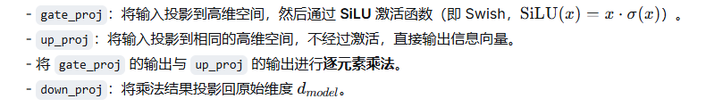{.ocr-src}

公式表达：

$$
\mathrm{FFN}(x) = \mathrm{down\_proj}(\mathrm{SiLU}(\mathrm{gate\_proj}(x)) \odot \mathrm{up\_proj}(x))
$$

**中间层维度设置**：

设模型隐藏维度 $d_{model}$。LLaMA 的 FFN 中间维度（即 `gate_proj` 和 `up_proj` 的输出维度）设置为：

$$
d_{intermediate} = \frac{8}{3} \times d_{model}
$$

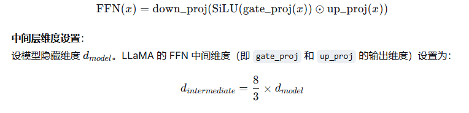{.ocr-src}

然后取整到合适的值（通常对齐到 256 的倍数以优化硬件性能）。例如：

- LLaMA-7B：$d_{model} = 4096$，$d_{intermediate} = 11008$（$\frac{8}{3} \times 4096 \approx 10922.67$，取整为 11008）。
- LLaMA-13B：$d_{model} = 5120$，$d_{intermediate} = 13824$。
- LLaMA-70B：$d_{model} = 8192$，$d_{intermediate} = 28672$。

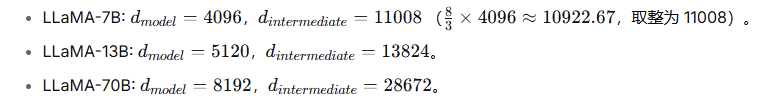{.ocr-src}

这种维度选择使得 SwiGLU 的参数量与传统 4 倍扩维的 GELU-FFN 基本持平，既控制了模型大小，又享受了门控激活带来的性能增益。

---

#### 激活函数的选择如何影响梯度流动？

激活函数直接决定了反向传播时梯度的计算方式，其形状决定了梯度在深层网络中的衰减或放大特性，进而影响训练的稳定性和收敛速度。

1. 梯度消失

对于具有饱和区的激活函数（如 sigmoid、tanh），当输入绝对值很大时，函数输出趋于平缓，导数趋于零。在深层网络中，连乘效应会使浅层梯度指数级衰减，导致参数几乎无法更新。ReLU 通过在正半轴导数恒为 1 缓解了梯度消失，但负半轴导数为零会带来神经元死亡。GELU 和 Swish 在负半轴保留微小梯度，且正半轴导数接近 1，使得深层梯度流动更加平稳。

2. 梯度爆炸

若激活函数在正半轴无上界且导数始终大于等于 1（如 ReLU 导数恒为 1），梯度本身不会因激活函数放大，但若权重初始化不当，配合无界的激活值可能导致后续层输出过大，间接引起梯度爆炸。因此激活函数通常与层归一化和适当的初始化共同作用来控制梯度规模。

3. 梯度噪声与平滑性

非平滑的激活函数（如 ReLU 在 0 点突变）会使梯度在零点附近产生不连续性，可能导致优化路径震荡。平滑函数（GELU、Swish）的导数处处连续，梯度更新更稳定，有利于使用更高的学习率，加速收敛。

4. 梯度的选择性流动

门控类激活（如 SwiGLU 的门控分支）允许模型根据输入动态调整信息流和梯度：门控值接近 0 时抑制对应的参数更新，起到类似“学习何时学习”的作用，有助于聚焦重要特征，减少噪声梯度干扰。

总结：激活函数通过其导数的值域、平滑性和门控机制，深刻影响着深层网络中梯度的保持、噪声水平和选择性，是训练稳定性和效率的关键因素。

---

#### GELU 的精确实现和近似实现，推理速度有区别吗？

有区别，但通常可忽略，取决于硬件和实现。

精确 GELU 使用误差函数 `erf`：

$$
\mathrm{GELU}(x) = 0.5x\left[1 + \mathrm{erf}\left(\frac{x}{\sqrt{2}}\right)\right]
$$

{.ocr-src}

`erf` 是一个特殊函数，其计算涉及到超越函数和数值近似，虽然在现代数学库中已高度优化，但与简单的代数操作相比仍显昂贵。

近似 GELU 常用 tanh 近似：

$$
\mathrm{GELU}(x) \approx 0.5x\left[1 + \tanh\left(\sqrt{\frac{2}{\pi}}(x + 0.044715x^3)\right)\right]
$$

{.ocr-src}

此近似仅需计算 `tanh` 和少量乘加，计算量小于 `erf`。还有更快的 sigmoid 近似 `x·σ(1.702x)`，只需一次 sigmoid。

推理速度影响：

- 在 GPU 上，使用高度优化的 CUDA 数学库时，精确 `erf` 和近似 `tanh` 的延迟差异很小（通常 <5%）。对于 Transformer 中 FFN 的一小部分，总体吞吐差异微乎其微。

- 在 CPU 推理或轻量级边缘设备上，近似版本的加速可能更明显。

- 许多框架（如 PyTorch）默认的 GELU 实现已采用 tanh 近似，因为它在不损失精度的前提下更快。

- 现代大模型已普遍转向 SwiGLU（使用 SiLU），不再使用 GELU，因此 GELU 的速度差异已不是主要关注点。

结论：近似 GELU 通常更快，但差异不大，且多数框架已默认使用近似版本以平衡精度与速度。

---

#### 为什么大多数激活函数在正区间都是无上界的？

主要原因是为避免梯度消失并保持网络的表达能力。

1. 梯度流动的需要：若激活函数在正区间有上界且饱和（如 sigmoid 在正区间接近 1，导数接近 0），当神经元输出进入饱和区后梯度几乎为零，参数停止更新。无上界函数（如 ReLU、GELU、Swish）在正半轴至少保持常数梯度（ReLU 导数为 1）或接近 1，确保深层网络在正激活区的梯度不会消失。

2. 表示能力的保持：有界激活函数将特征空间限制在一个紧致范围内，可能限制模型对高幅值特征的编码能力。在 Transformer 等依赖层归一化的架构中，层归一化会控制激活的分布尺度，因此允许激活函数在正区间无上界，同时结合残差连接和归一化防止数值爆炸。

3. 与残差网络的兼容性：残差连接要求输出可以是任意幅度的向量。如果激活函数有上界（如 sigmoid 上限为 1），则残差路径的输出可能被迫接近饱和，削弱梯度。无上界函数让残差流可以自由调整输出幅度。

4. 自然语言中特征的分布：重要特征可能需要较大的激活值来表达强烈的正向贡献，无上界特性允许模型学习到这种“强度”表示。

因此，无上界性并非绝对必要，但在当前主流架构下提供了更好的梯度特性和表示灵活性，成为大多数激活函数的设计选择。

---

#### 在注意力机制中，softmax 本身就是一种激活函数吗？为什么？

可以视为一种激活函数，但与传统逐元素激活函数有本质不同。

是激活函数的理由：

- softmax 将任意实值向量映射为概率分布（所有元素非负且和为 1），引入了非线性变换。

- 它在自注意力中扮演关键角色，将注意力分数转化为归一化权重，控制信息的聚合方式，类似于门控机制。

与传统激活函数的区别：

- 逐元素 vs 全局归一化：传统激活函数（ReLU、GELU）独立作用于每个元素；softmax 则是跨整个序列维度进行归一化，其输出依赖于输入向量的所有元素，具有竞争性（增大某个元素会挤压其他元素）。

- 训练动态：softmax 在反向传播时产生雅可比矩阵而非对角矩阵，梯度计算更复杂，且当输入值差异很大时容易出现梯度饱和（输出接近 one-hot）。

- 功能定位：softmax 主要用于概率建模和选择（如分类输出、注意力权重），而 FFN 中的激活函数用于非线性特征变换。尽管它们都提供非线性，但在网络中的角色不同。

因此，softmax 可归为“归一化激活函数”，但其竞争性、跨维度依赖和概率解释使其成为特殊类别，与传统激活函数并列，而非完全等同。

---

#### 有没有可能使用可学习的激活函数？举例说明。

可以，且已有多种可学习激活函数被提出，旨在让模型自适应地调整非线性形状。

例子1：PReLU（Parametric ReLU）

$$
\mathrm{PReLU}(x) = \max(0, x) + a \cdot \min(0, x)
$$

{.ocr-src}

其中 $a$ 是可学习参数（标量或通道级），控制负半轴的斜率。这解决了 ReLU 的“死亡”问题，因为即使输出为负，梯度也能通过 $a$ 反向传播。

例子2：Swish（可学习 β）

$$
\mathrm{Swish}_\beta(x) = x \cdot \sigma(\beta x)
$$

{.ocr-src}

β 控制门控的陡峭程度。当 β=0 时退化为线性，β→∞ 时趋近于 ReLU。β 可被训练，使激活函数形状自适应任务。

例子3：KAF（Kernel Activation Functions）

使用一组可学习的高斯基函数来逼近任意形状的激活函数，每个神经元拥有独立的激活函数参数，极其灵活但参数开销大。

例子4：Maxout

$$
\mathrm{Maxout}(x) = \max(w_1 x + b_1, w_2 x + b_2, \ldots, w_k x + b_k)
$$

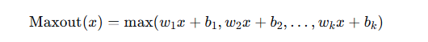{.ocr-src}

通过取多个仿射变换的最大值，Maxout 可以近似任意凸函数，权重是可学习的。

优缺点：

- 优点：增加模型灵活性，可能带来微小性能提升，适应特定数据分布。

- 缺点：引入额外参数和计算开销；可能导致过拟合；在现代大模型中，固定激活函数（如 SiLU）结合充分容量已足够，可学习激活带来的收益有限，故未成为主流。

大模型时代，SwiGLU 的门控机制本身提供了动态调制能力，相当于一种结构化可学习激活，因此单独的可学习激活函数不再是研究焦点。

---

#### 在 MoE 模型中，门控网络通常使用 softmax，而专家网络使用 SwiGLU，为什么？

这种分工源于两者功能的不同需求。

门控网络（Router） 负责将每个 token 分配给最相关的专家（或多个专家）。它需要产生一个概率分布（非负、和为 1），以便进行硬选择（Top-k 采样）或软加权。softmax 天然满足这一要求：它强制输出元素间竞争，使路由决策更明确，同时保证数值范围适合后续的离散采样。此外，softmax 在训练中结合负载均衡损失有助于专家均匀使用。

专家网络（FFN） 需要强大的非线性特征提取和知识存储能力。SwiGLU 通过门控机制（SiLU + 逐元素乘法）提供了动态信息过滤，比简单激活函数更强大。在相同参数量预算下，SwiGLU 的专家容量效率更高，能更好地捕捉模式。同时，专家网络的处理是独立的且计算量集中，使用高效的 SwiGLU 能最大化每个专家的表现。

总结：门控用 softmax 做“路由决策”，专家用 SwiGLU 做“特征计算”。二者各取所长，共同支撑 MoE 的高效扩展。

---

#### 说出一种能够缓解“神经元死亡”问题的激活函数，并解释原理。

Leaky ReLU 是一个经典解决方案，其定义为：

$$
\text{Leaky ReLU}(x) = \max(0, x) + \alpha \cdot \min(0, x)
$$

{.ocr-src}

其中 $α$ 是一个小的正数（如 0.01），固定或可学习。

原理：

- 在负半轴，Leaky ReLU 输出 $α_x$ 而非 0，导数恒为 $α$（而非 0）。即使神经元输出持续为负，梯度仍能通过 $α$ 反向传播，权重可以更新，从而有机会在后续迭代中“复活”，跳出负激活区。

- 这从根本上解决了 ReLU 的“死亡”问题：只要 $α$>0，梯度永远不会完全消失，神经元不会永久性失活。

- 固定 $α$（如 0.01）简单有效；可学习 $α$（PReLU）则让模型自行决定负半轴的最佳斜率，进一步提升灵活性。

其他缓解方案还有 ELU（负半轴指数衰减至一个负数常数，输出均值接近零）和 SELU（自归一化），它们通过非零负输出保证梯度流动，从而避免神经元死亡。

---

#### 如果将 LLM 中的激活函数全部替换为 ReLU，训练时可能出现哪些问题？

将 LLM 中的所有激活函数（包括 FFN 和注意力中可能的激活）强制替换为 ReLU，会带来多重风险：

1. 大量神经元死亡：深层 LLM 参数量巨大，训练初期或使用较大学习率时，许多神经元可能落入负区且再未恢复，导致有效容量急剧下降，模型欠拟合。

2. 梯度消失加剧：尽管 ReLU 正半轴梯度为 1，但死亡的神经元梯度为零，等效于网络中大量连接被截断，有效深度减小，浅层参数可能长期得不到充分训练。

3. 表示能力受损：ReLU 丢弃所有负值信息，而语言模型中许多重要的特征抑制和对抗模式依赖负值表达，纯 ReLU 将丧失这种能力，降低生成文本的连贯性和事实准确性。

4. 训练不稳定：ReLU 的非零均值输出和突变特性，在缺乏强大归一化时可能导致层间激活分布偏移，与 LLM 常用的大批量训练和高学习率不兼容，容易引发损失尖峰甚至发散。

5. 性能上限受限：几乎所有现代 LLM（GPT-3、LLaMA、PaLM）均使用 GELU 或 SwiGLU，这些平滑激活已被反复验证能带来更好的困惑度和下游性能。倒退到 ReLU 会显著降低模型质量。

因此，全用 ReLU 虽可训练，但会严重影响稳定性和最终性能，在现代 LLM 中不可行。

---

#### 为什么 GPT-3 使用 GELU，而 LLaMA 使用 SwiGLU？趋势说明了什么？

GPT-3（2020）沿用了 BERT/GPT-2 的传统，采用 GELU 激活。而 LLaMA（2023）以及同期大模型纷纷转向 SwiGLU。这一变化反映了对高效训练和更强表达能力的持续追求。

1. 性能效率的提升

PaLM 等早期工作证实了 SwiGLU 在相同计算量下可获得更低困惑度。LLaMA 继承并优化了这一发现，通过调整隐藏维度使得 SwiGLU 的参数量与 GELU-FFN 持平，同时获得门控机制带来的动态特征筛选优势。这意味着同样的训练成本，模型能学到更好的表示。

2. 对训练稳定性和收敛速度的改进

SwiGLU 中的 SiLU 激活比 GELU 计算更简单（无 erf），且门控分支提供了额外的梯度路径，训练更稳定。现代大模型动辄训练数万亿 token，稳定性和快速收敛至关重要。

3. 社区共识与生态演进

当多个顶尖团队（Google、Meta）的实验一致表明 SwiGLU 优于 GELU 时，它迅速成为新架构的事实标准。LLaMA 的开源影响力进一步加速了这一趋势，后续 Mistral、Qwen、DeepSeek 等均采用 SwiGLU 或其变体。

4. 硬件适配的思考\
   SwiGLU 的纯矩阵乘法和逐元素乘法对 GPU/TPU 极其友好，而 GELU 的 `erf` 实现虽有高度优化，但不如简单乘法直接。在极致追求训练吞吐的当下，硬件效率是架构设计的重要考量。

趋势说明：激活函数的选择已经从“够用即可”进化为“精打细算”，微小的效率优势在大规模训练中会被放大为巨大的成本和时间差距。SwiGLU 代表了一种结构化的激活设计——将非线性与门控机制融合，而非仅依赖逐点激活。这也是 MoE、SwiGLU 等创新共同指向的方向：用可学习的结构化模块替代固定、通用的激活函数。

---

#### 在 RMSNorm 中并没有使用激活函数，它和激活函数的功能有什么重叠和差异？

RMSNorm（Root Mean Square Layer Normalization）是一种归一化技术，激活函数是一种非线性变换，它们服务于不同目的，但有互补和部分重叠的效果。

核心差异：

- RMSNorm：调整激活的分布形态（缩放），使其均方根为 1，主要解决内部协变量偏移，加速训练，稳定梯度。不引入非线性，只做线性缩放。

- 激活函数：引入非线性，使网络能学习复杂映射；同时可能改变输出范围（如 ReLU 截断、SwiGLU 门控）。

功能重叠：

- 两者都能影响特征的尺度。激活函数可改变值的范围，而 RMSNorm 显式控制尺度。现代架构通常在激活函数之前或之后放置归一化层（如 Pre-Norm：`x + FFN(RMSNorm(x))`），二者协同工作：RMSNorm 提供稳定的输入分布，激活函数在这个分布上施加非线性，两者缺一不可。

- 深层网络中，良好的归一化可以减轻对激活函数鲁棒性的依赖（例如允许使用 ReLU 而不严重死亡），但不能替代激活函数。

总结：RMSNorm 负责“调校”，激活函数负责“变换”。归一化保证信号不爆炸不消失，激活函数赋予网络非线性建模能力，二者共同支撑 Transformer 的稳定训练。

---

#### 激活函数对模型量化友善吗？哪些激活函数更难量化？

激活函数的特性会影响量化后的精度，尤其是当激活函数的输出范围或分布极不均衡时。

对量化不友善的特性：

- 无界或极宽的输出范围：例如 ReLU 正半轴无界，若激活值可达到几百甚至几千，在 INT8 量化下需要大量的动态范围，导致微小值被量化为零，精度损失。

- 尖锐的分布：softmax 输出近似 one-hot 的尖锐分布，大部分位置接近 0，量化后这些位置基本为 0，信息损失严重。

- 饱和区：sigmoid/tanh 在饱和区梯度近似零，量化带来的噪声可能使神经元彻底卡在饱和区，丧失表示能力。

更难量化的激活函数：

- softmax 由于其输出是概率分布，具有极强的动态范围和稀疏性，是量化中的难题。常用解决方案包括使用更高的位宽（如 INT16）专门处理 softmax 部分，或采用 log-softmax 技巧。

- GELU 涉及 `erf` 操作，量化实现复杂，且输出分布非标准，需要专门的校准。

- Swish/SiLU 相对较好，因为它的输出范围通常受限于预归一化后的合理区间，且分布较为平滑。

量化友善的激活函数：

- ReLU 由于正半轴是线性的，量化非常简单，只需处理正值范围。

- Hard Swish / Hard Sigmoid 等分段线性近似，专门为量化设计。

实践中，量化通常结合层归一化和适当的校准（如 KL 散度校准、百分位数校准）来处理激活函数引入的分布偏移，且往往对 FFN 和注意力输出采用对称量化以适配硬件。

---

#### 解释“平滑的激活函数有助于模型收敛”的原因。

平滑的激活函数（处处可导，导数连续）有助于模型收敛，主要基于以下几个优化理论原因：

1. 损失景观更平滑

平滑激活使网络输出对参数可导且导数变化连续，损失函数在参数空间中更加“平滑”，不存在尖锐的梯度突变。这有利于基于梯度的方法找到更优的极小值，减少震荡，加快收敛。

2. 梯度噪声减小

非平滑激活（如 ReLU 在 0 点不可导，实践中使用次梯度）会在训练中引入随机性（因神经元对不同样本可能激活或死亡）。平滑函数的梯度是连续的，不同输入间的梯度变化平缓，减少了随机梯度噪声，使优化方向更一致。

3. 更好的数值稳定性

处处非零的梯度（即使很小）保证了即使输出落入负区，梯度信息仍能反向传播，网络各部分都能持续学习。这避免了因大量神经元永久失活而导致的“有效网络变窄”，保持模型容量。

4. 适合高阶优化器

许多自适应优化器（如 AdamW）利用梯度的二阶矩估计来调整学习率。平滑、稳定的梯度序列能提供更准确的二阶统计量，使学习率调整更有效，加速收敛。

5. 允许更大的学习率

由于梯度不会因突变而剧烈变化，平滑激活允许使用更大的初始学习率而不引起发散，这在大模型训练初期可以快速逃离不良初始点，找到损失较低的区域。

因此，从 ReLU 到 GELU 再到 SwiGLU 的演进，正是一条不断强化激活函数平滑性、以支撑更大规模模型稳定训练的路径。

