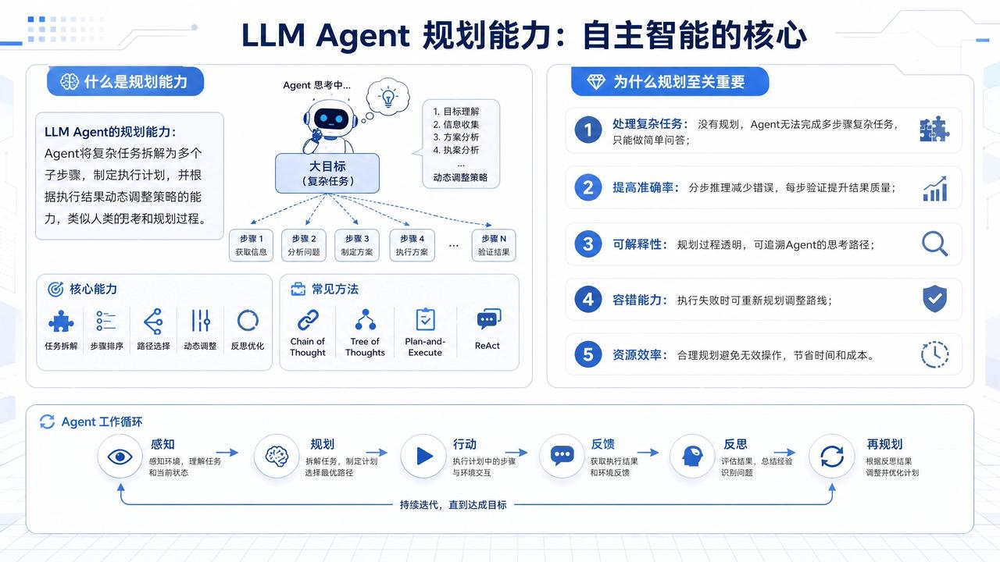

# 98.大模型（LLMs）Agent 规划（Planning）

## 大模型（LLMs）Agent 规划面

#### 什么是 LLM Agent 的规划能力？为什么规划对自主 Agent 至关重要？

**规划能力的定义**

LLM Agent 的规划能力，是指智能体在接收到一个复杂的高级目标后，能够不依赖人类逐步指导，自主地将其分解为一系列逻辑有序、可执行的子任务或动作序列，并在执行过程中根据环境反馈进行动态调整，最终实现该目标的能力。

这种规划不是简单的模式匹配或线性链条，而是包含了目标分解、资源预估、路径选择、风险预判和动态纠错等一系列高级认知活动。一个具备规划能力的 Agent，就像一个经验丰富的项目经理，而不是一个只会机械执行指令的工人。

**规划为何对自主 Agent 至关重要**

规划能力是区分“真正的自主 Agent”与“高级的指令执行器”的核心分水岭，其重要性体现在五个层面。

第一，处理复杂性与多步依赖。现实世界中的任务很少能一步完成。例如，“帮我做一次竞品分析”需要先搜索竞品名单，再逐一搜集产品信息，最后汇总撰写报告。**每一步都依赖前一步的输出**。没有规划能力，Agent 只能完成简单的单步任务，无法胜任这种需要长程推理和多步依赖的复杂工作。



第二，实现资源与工具的自主调度。规划决定了 Agent 在何时、以何种顺序调用何种外部工具（搜索、计算器、API、代码解释器等）。一个糟糕的规划会导致工具滥用、浪费资源、甚至陷入死循环。而优秀的规划则能高效地编排工具链，以最小的成本和延迟完成任务。

第三，提供错误应对与鲁棒性保障。执行过程中必然会遇到意外：搜索不到信息、API 调用超时、中间结果出现矛盾。规划赋予了 Agent 应对这些不确定性的框架。它可以在发现某条路径走不通时，回溯并尝试替代方案，而不是直接崩溃或输出错误结果。

第四，保证生成结果的逻辑一致性与完整性。对于需要最终产出一份报告、一段代码、一份方案的任务，规划先行能够确保最终产物的结构是严谨的、论证是充分的、所有子目标都被覆盖到。没有规划，Agent 可能写了一堆看似相关但逻辑混乱的片段。

第五，提升用户信任与可解释性。当 Agent 能够向用户清晰地展示它的计划——“我将分三步来完成您的需求：首先……，其次……，最后……”——用户会对它的能力建立信任，并能在计划阶段就进行干预和修正，避免后续更大的错误。

因此，规划能力是 LLM 从“对话机器”迈向“自主智能体”的关键一跃，是 Agent 框架的神经中枢和战略大脑。

---

#### 常见的 Agent 规划方法有哪些？简述基于思维链、任务分解、搜索式规划的异同。

当前主流的 Agent 规划方法主要分为三类：基于思维链、基于任务分解、以及基于搜索式规划。它们分别代表了从“线性推理”到“结构化拆解”再到“全局探索”的能力阶梯。

一、基于思维链的规划

这种方法将规划和执行融为一体，形成一个“思考-行动-观察”的交替循环。它不要求在开始时就有一个全局蓝图，而是每走一步，都先思考下一步该怎么走，然后行动，根据结果再思考，再行动。ReAct 范式是其典型代表。

- 核心机制：模型在生成动作前，先输出一段“思考”，分析当前状态、决定下一步行动。这就像一个人一边做一边想，走一步看一步。

- 优势：灵活度极高，能很好地应对执行过程中的意外和反馈，因为每一步决策都是基于最新的、最真实的环境信息。

- 局限：缺乏全局视野，容易在长程任务中“短视”，陷入局部最优或不断在错误方向上碰壁，缺乏系统的回溯机制。

- 适用场景：环境动态、信息不完整、需要高度交互和灵活应变的任务，如对话式搜索、交互式调试。

二、基于任务分解的规划

这种方法的核心思想是“分而治之”。在行动之前，Agent 会先生成一个完整的分步计划，将复杂的总目标拆解为一系列独立的、较小的、更易于逐个击破的子任务，然后再按部就班地去执行。

- 核心机制：Plan-and-Execute 范式是先规划后执行，不轻易在中途改变大方向。

- 优势：全局视野好，能保证最终产物的结构完整性。适合步骤明确、结果可预期的任务。

- 局限：缺乏灵活性，对计划和环境的“意外”应对不足。如果初始计划有缺陷或中途出现新信息，它很难自适应地调整。

- 适用场景：生成结构化的长文档、遵循标准操作流程的任务、简单的顺序型任务。

三、基于搜索式规划的规划

这是最复杂、也最强大的一类方法。它将规划视为在一个巨大的“动作-状态”空间中进行搜索。模型不再是输出一个线性的计划，而是在每一个决策节点生成多个可能的分支，探索不同的路径，评估它们的前景，然后选择最优的路径继续。

- 核心机制：Tree of Thoughts 和 Graph of Thoughts 是其代表。它显式地构建一个推理树或图，进行“生成-评估-搜索”的循环，支持回溯和汇聚。

- 优势：具备强大的探索和回溯能力，能够找到非线性的、经过深思熟虑的最优解。

- 局限：计算成本极高，延迟大，对模型的基础生成和评估能力要求极高。

- 适用场景：创意写作、复杂的数学和逻辑推理、需要大量脑力风暴和严格评估的优化问题。

方法对比总结

| 规划方法 | 核心机制 | 规划时机 | 灵活性 | 计算成本 | 典型应用 |
| --- | --- | --- | --- | --- | --- |
| 思维链式 | Think-Act-Observe循环 | 执行中动态规划 | 极高 | 中 | 交互式搜索、对话 |
| 任务分解式 | 先分解目标，再按部就班执行 | 执行前静态规划 | 低 | 低 | 文档生成、流程任务 |
| 搜索式 | 生成-评估-搜索，构建树/图 | 执行中全局探索 | 高 | 极高 | 创意写作、复杂推理 |

在实际的高性能 Agent 系统中，这些方法常常是组合使用的。例如，在高层采用任务分解制定战略计划，在执行每一具体步骤时，采用思维链式的动态交互，而在关键的决策节点，则触发小规模的搜索式探索来寻找最佳方案。

---

#### 如何让 Agent 将一个复杂目标分解为可执行的子任务？请描述任务分解的提示设计。

让 Agent 将一个复杂的、模糊的高级目标，分解为一系列清晰的、可操作的子任务，需要精心设计的提示工程。这本质上是教会模型“像项目经理一样思考”。

任务分解的提示设计核心原则

一个高质量的任务分解提示，必须让 LLM 同时扮演“战略家”和“实干家”的双重角色。提示词的设计需要围绕以下四个层面展开。

一、角色与目标的显式定义

首先，必须为模型设定一个高度具体的角色，并清晰地定义其使命。例如：“你是一位资深的技术项目经理。你的任务是为给定的总目标，制定一份详尽、可执行的行动计划。”

二、分解原则与粒度控制

这是提示的核心。必须将抽象的“分解”转化为具体的、可操作的指令。需要明确要求：

- 最小可执行单元：每个子任务应该是一个单一、明确、可以被一个工具调用或一个简单生成动作完成的单元。

- 逻辑排序：子任务之间应按照执行顺序排列，并注明依赖关系（哪些任务必须在哪些任务之前完成）。

- 完全覆盖：所有子任务加在一起，必须能完整地实现总目标，不能有遗漏。

- 可验证性：尽可能为每个子任务定义一个“完成标准”，以便 Agent 在执行时自我检查。

三、提供清晰的输出结构\
为了避免模型输出一段散文式的计划，需要强制它使用结构化的格式。例如，要求输出一个 JSON 列表，每个元素包含 `step_id`（步骤编号）、 `subtask`（子任务描述）、`action_type`（动作类型，如“搜索”、“计算”、“生成”）、`tool_required`（所需工具）、`depends_on`（依赖的步骤编号）等字段。结构化输出极大方便了后续程序的解析和调度。

四、注入少量典型示例

在提示词中提供一到两个从高维目标到详细计划的完整示例，能显著提高模型输出的质量和稳定性。示例需要体现逻辑依赖关系的处理和对边界情况的覆盖。

示例提示词片段

```plain text
[系统]
你是一个世界级的任务规划师。你的职责是将一个复杂的用户目标，拆解成一个有序的、可执行的子任务列表。

[规划原则]
1. 自顶向下：先识别核心里程碑，再逐步细化每个里程碑下的具体动作。
2. 最小动作：每个子任务应该是一个原子操作，例如“搜索关于X的信息”或“撰写Y的段落草稿”。
3. 明确依赖：清晰地指出哪些任务是其他任务的前置条件。
4. 完整覆盖：确保所有子任务完成后，总目标可以被完美达成。

[输出格式]
请以JSON列表格式输出你的计划，每个元素包含：
- "step": 步骤编号 (整数)
- "goal": 本步骤要达成的子目标 (字符串)
- "action": 需要执行的具体动作 (字符串)
- "depends_on": 依赖的步骤编号列表 (列表)

[示例]
总目标：撰写一份关于产品A的市场分析报告
计划：
[
  {"step": 1, "goal": "收集产品信息", "action": "搜索产品A的官方参数、定价和用户评价", "depends_on": []},
  {"step": 2, "goal": "竞品分析", "action": "搜索产品A的主要竞争对手B和C的信息", "depends_on": []},
  {"step": 3, "goal": "撰写报告初稿", "action": "基于步骤1和2的信息，生成报告的主体内容", "depends_on": [1, 2]}
]

[现在请处理]
总目标：{用户输入}
计划：
```

通过这种精心设计的提示，LLM 能够生成一份既高屋建瓴又脚踏实地、且能被机器自动调度执行的行动计划，为后续的 Agent 自主运行奠定坚实基础。

---

#### 分层规划在 Agent 中如何实现？高层目标如何映射到低层动作？

分层规划是解决超复杂、长周期任务的利器。它将规划问题在不同抽象层级上解耦，使得高层级可以专注于“做什么”和“为什么”，而低层级专注于“怎么做”。

分层规划的实现架构

一个典型的分层规划 Agent 系统，通常采用三层金字塔架构。

- 顶层：战略层。这是规划的“大脑”。它接收用户的模糊高层目标，并将其分解为几个宏观的里程碑。例如，对于目标“将公司产品发布流程自动化”，战略层可能分解为：“1. 分析现有流程瓶颈”、“2. 设计自动化方案”、“3. 评估方案可行性与风险”。战略层不关心具体的执行细节。

- 中层：战术层。这是规划的“桥梁”。它负责将战略层下达的每一个宏观里程碑，进一步分解为一系列具体的、可执行的步骤序列。例如，对于“1. 分析现有流程瓶颈”，战术层可能分解为：“1.1 访谈产品经理”、“1.2 分析项目管理系统日志”、“1.3 绘制当前流程图”。战术层开始涉及具体的行动类型，但仍不涉及具体的API调用或代码。

- 底层：执行层。这是规划的“手脚”。它负责执行战术层下达的具体步骤。在这一层，一个子任务会转化为具体的工具调用或生成指令。例如，对于“1.2 分析项目管理系统日志”，执行层会调用 API 查询工具，拉取指定时间范围内的数据，并可能调用一个代码解释器进行初步清洗。

高层目标到低层动作的映射机制

实现从高层到低层的精确映射，关键在每一层规划时，都将上下文信息逐级向下传递，并将执行结果逐级向上反馈。

1. 上下文注入：当战术层为“分析现有流程瓶颈”这个战略目标制定计划时，LLM 的提示词中会明确包含这个战略目标的完整描述作为核心上下文。这确保了战术层的计划不会偏离战略方向。

2. 动态重规划：分层不是一成不变的。当执行层在执行具体动作时遇到困难（例如，API 不可用、数据格式无法解析），它不能自行其是，也不能让整个任务失败。它会将错误信息封装成“异常事件”，向上抛给战术层。战术层接收到异常后，会评估是否需要修改本层的执行序列，例如用替代数据源替换当前步骤。如果战术层无法解决（例如，整个方案的核心假设被证伪），它会进一步向上抛给战略层，触发更高层次的目标修正。

这种逐级下发、层层上报、闭环反馈的机制，使得 Agent 能够像一支高效运转的团队，既保证了高层的战略定力，又具备了底层的灵活应变能力。

---

#### 动态规划与静态规划的区别：Agent 在执行过程中如何根据新信息调整原有计划？

核心区别

静态规划（Static Planning）和动态规划（Dynamic Planning）是两种根本不同的 Agent 行为模式，其分野在于“计划在何时生成”以及“计划是否可以被修改”。

- 静态规划：在行动开始前，一次性生成一个完整的、详尽的计划。执行阶段严格按照这个计划逐步推进，就像在执行一份写死的程序脚本。即使环境变了，它也不会主动去修改自己的计划。Plan-and-Execute 范式的朴素版本就是典型的静态规划。

- 动态规划：并不要求在行动前就有一个完美的全局蓝图。它在执行过程中，不断地根据外部环境返回的真实信息（如搜索结果、API 返回值、代码执行错误）以及内部生成的中期结论，来动态地、增量式地调整和修正原有的计划。它是一个持续“观察-评估-调整”的闭环过程。

Agent 如何根据新信息动态调整计划

动态调整的核心是一个自主的元认知评估循环。Agent 在每执行完一步动作后，都会进行一次“自我反思”：

1. 环境反馈解析：Agent 接收上一步动作的结果。它需要判断这个结果是成功、失败、部分成功，还是返回了意料之外的信息。例如，一个搜索动作可能没有找到相关文档，或者找到了一个与预期完全相反的事实。

2. 计划状态评估：Agent 将新获得的信息与原有的计划进行对比。它要回答：“我目前是否还在正确的轨道上？”。这包括检查子任务依赖关系是否被破坏、原有假设是否被推翻、以及是否出现了更优的执行路径。

3. 触发再规划：如果评估发现偏差，Agent 就会触发再规划。根据偏差的严重程度，可以是微调（例如，用“张三 出生地”替换“张三 在哪出生”），也可以是替换子序列（例如，“直接生成答案”路径走不通，改为“补充搜索更多证据”），甚至可以是推翻和重建高层目标（例如，发现整个问题基于一个错误的假设，需要重新定义问题）。

这一调整机制通常通过 LLM 来实现，其提示词模板会要求模型同时处理“原始计划”、“已完成步骤”、“上一步结果”和“当前状态”，然后输出一个“更新后的下一步计划”。通过这种方式，Agent 就从僵化的执行者变成了灵活的决策者。

---

#### 如何利用 ReAct 或 Plan-and-Execute 等范式实现规划与执行的交替？

ReAct 和 Plan-and-Execute 是两种实现规划与执行交替的代表性范式，它们分别适用于不同类型的任务，并在交替的粒度和方式上存在显著差异。

ReAct：细粒度的“思考-行动”即时交替

ReAct 将规划和执行融合到了每一小步中。它没有一个独立的、前置的规划阶段，而是通过“Thought”（推理）来实现动态的、局部的规划。其交替模式是：

1. Thought：模型输出一段“思考”，分析当前状态，判断下一步需要做什么。这本身就是一个针对当前状态的微规划。

2. Action：基于“思考”，模型发出一个具体的、可执行的动作指令，如调用搜索工具。

3. Observation：外部环境执行动作，并返回结果。

4. 循环：模型阅读“观察”，进入下一轮“思考”。

ReAct 的“规划”就体现在每一轮的“Thought”中，它是一种分布式、动态的规划。它的优势是极度灵活，能对环境反馈做出即时响应，适合需要大量探索、信息不明确、没有标准流程的开放域任务。

Plan-and-Execute：粗粒度的“先规划-后执行”阶段交替

Plan-and-Execute 则将规划和执行分成了两个明显的阶段，并在必要时触发重新规划。

1. 规划阶段：Agent 收到任务后，第一步不是去执行，而是先生成一个完整的、结构化的任务计划。这个计划是一个静态的蓝图。

2. 执行阶段：Agent 按照计划中的顺序，逐个执行子任务。在每完成一个子任务后，它会更新状态。

3. 再规划阶段：如果在执行中遇到无法克服的困难，或者发现初始计划有缺陷，Agent 会触发“再规划”。它会将当前的执行状态和失败信息反馈给规划器，由规划器生成一个新的、修订后的计划，然后从断点继续执行。

与 ReAct 相比，Plan-and-Execute 更像一个有章法的项目团队，先开项目启动会定下蓝图，再分工执行，遇到重大问题再开会调整蓝图。它适合步骤相对明确、对结果的结构性要求高、对执行效率有追求的任务，例如自动生成一份格式严格的项目报告。

两者可以结合。例如，在 Plan-and-Execute 框架中，每个子任务的执行过程，可以内嵌一个 ReAct 的循环，来处理该子任务内部的动态性和灵活性。这样就形成了“战略层 Plan-and-Execute，战术层 ReAct”的混合架构。

---

#### 搜索式规划：在 LLM Agent 中，如何运用树搜索或图搜索来探索可能的动作序列？

搜索式规划是将经典的 AI 搜索算法与 LLM 的生成和推理能力相结合，用于解决那些需要深度探索、多步前瞻和全局权衡的复杂任务。它让 Agent 不再满足于一条“看起来不错”的路径，而是系统性地探索多种可能，并从中选出最优解。

树搜索（Tree of Thoughts, ToT）的应用

在 ToT 框架下，Agent 将问题求解过程构建为一棵思维树。每一个树节点代表一个中间推理状态或部分解决方案，树枝代表从一个状态到另一个状态的候选思维步骤。搜索过程遵循四个步骤的循环：

1. 生成：对于当前待探索的节点，让 LLM 生成多个不同的后续思维步骤。这就像一个人在思考时，同时想出几种不同的解法。

2. 评估：让 LLM 对每个新生成的候选状态进行价值评估，判断其前景。这就像对每个想法进行快速的可行性分析。

3. 选择与扩展：根据评估结果，使用搜索算法（如束搜索）选择最有价值的节点继续扩展，同时保留其他节点作为备选。

4. 回溯与探索：如果某条路径被评估为死胡同，算法可以回溯到之前的决策节点，尝试其他未被探索的分支。

ToT 通过显式的生成、评估和搜索，赋予了 LLM 系统性的探索和纠错能力。

图搜索（Graph of Thoughts, GoT）的应用

GoT 是 ToT 的进一步演进。它认识到人类的复杂思维不是简单的树状结构，而是可以汇聚和整合的图状结构。GoT 允许将来自不同分支的思维节点进行合并，形成一个更全面的观点。

例如，在撰写一篇关于某项政策的分析报告时，GoT 可以同时探索“支持该政策的论点”和“反对该政策的论点”两条分支，然后将两个分支的结论通过“聚合”操作合并成一个“权衡分析”节点。这种“分而治之，再合而观之”的能力是树结构不具备的。GoT 通过引入循环和交叉依赖，实现了更复杂的推理范式，如迭代精炼和类比推理。

在工程实现上，系统会维护一个全局的图状态。调度器根据策略（如 UCB 算法）动态选择节点进行扩展或合并，从而在巨大的搜索空间中高效地寻找最优解。这种机制让 Agent 展现出了初步的“深思熟虑”能力。

---

#### 规划中的“死锁”或“循环”问题：Agent 反复执行无用动作，如何检测和打破循环？

“死锁”和“循环”是自主 Agent 在执行长期任务时最常见的失败模式之一。当 Agent 陷入一个无效的行为循环中时，它会不断消耗 Token 和计算资源，而无法推进任务的进展。

检测循环的方法

需要从多个层面进行检测，形成一个立体的监控网。

1. 硬性步数/时间限制：这是最基础的保护网。为每个任务或子任务设定一个最大执行步数或时间预算，一旦超限，无条件中断，防止无限消费。

2. 动作级别的重复检测：监控最近的 Action 历史。如果一个 Agent 在连续的 N 轮中，输出了完全相同或高度相似的 Action（例如，连续三次用同一个关键词搜索），它很可能已经陷入了思维定势。

3. 状态级别的语义循环检测：这是更高级的检测。使用一个轻量级的文本嵌入模型，将 Agent 最近的几轮“思考”文本和“观察”文本进行向量化。通过计算这些向量的余弦相似度，判断 Agent 是否在相同的语义空间里打转，而没有实质性的信息增益。

4. 无效动作计数与占比：统计无效 Action（如搜索返回空结果、代码执行报错、API 调用失败）的比例。如果这个比例在近期持续高于某个阈值，说明当前策略很可能已经失效。

打破循环的策略

一旦检测到循环，系统不能简单地终止任务，而应尝试更智能的干预。

1. 注入反思指令：这是最温和的干预。在 Agent 下一轮的 Observation 中，强制追加一条系统消息，如：“检测到你可能陷入了重复循环。请重新评估当前状态和你的策略，尝试一种完全不同的方法。”

2. 强制动作变异：在 Agent 的下一个 Action 生成阶段，通过调整解码参数（如临时提高温度）或硬性要求模型必须输出一个不同于前几次的 Action，来强制打破行为惯性。

3. 触发外部干预或回退：如果自动干预无效，可以触发人类介入。或者，系统可以强制 Agent 回退到规划链的上一步（或任务的起始状态），并告知它之前的方法行不通，让它从那个“分叉点”重新进行任务分解和路径规划。

4. 优雅降级与总结：作为最后的保底，当一切干预都失败时，系统不应崩溃或沉默。它可以调用一个总结器模型，基于目前已收集到的所有信息，生成一个当前能做到的最好回答，并诚恳地告知用户：“我根据目前掌握的信息，为您整理了以下内容，但未能完成所有步骤。”

通过这套“检测-干预-降级”的组合策略，可以将循环对系统和用户体验的损害降到最低。

---

#### 如何设计规划的停止条件？何时宣布目标达成或失败？

规划一个清晰、鲁棒的停止条件，是 Agent 系统设计中与生成计划同等重要的一环。一个不完善的停止机制，会导致 Agent 过早在信息不足时收手，或者无限执行下去直到资源耗尽。

成功的停止条件：目标达成

目标达成不是简单的“模型认为自己做完了”，而必须是一套客观、可验证的判断逻辑。

1. 显式的“完成”信号：最可靠的方式是训练或提示 Agent，在它认为自己已经完成任务时，输出一个专门的、不可被误用的结束动作令牌，如 `FINISH` 或 `SUBMIT_ANSWER`。这个动作不是普通工具调用，而是向调度器宣告任务结束。

2. 基于验证函数的客观判断：定义一个外部的、非 LLM 驱动的验证函数来评估任务的完成状态。例如，在代码生成任务中，最终生成的代码必须通过所有预设的测试用例，才算成功。在问答任务中，可以在生成答案后，由另外一个 LLM 评判者来验证答案是否完整覆盖了原始问题的所有方面。这种外部验证比模型的自评可靠得多。

3. 规划完成度的对比检查：如果 Agent 最初使用了任务分解的范式，那么一个直接的判断标准就是“计划中的所有子任务是否都已被执行完毕”。系统会维护一个任务清单，每完成一项就标记一项。当清单被清空时，任务即告完成。

失败的停止条件：优雅地承认失败

并非所有任务都能被完成。一个成熟的 Agent 必须具备“自知之明”，知道何时应该放弃并优雅退出。

1. 资源耗尽的失败：这是最常见的失败类型。当 Agent 的执行步数、Token 消耗量或时间超过了预设的硬性上限时，调度器应强制终止规划循环。此时，不应简单地丢弃所有信息，而应触发一个“最佳尝试总结”的流程，将已完成的部分成果呈现给用户。

2. 逻辑无解的失败：Agent 经过多轮搜索和探索后，发现所有可能的路径都已被证明是走不通的。这通常在搜索式规划（如 ToT）中通过评估分数体现出来——所有待探索节点的前景评估分数都低到了一个不可接受的阈值。此时，Agent 应返回一个“无法完成”的状态，并向用户清晰解释它尝试了哪些路径以及失败的原因。

3. 检测到无法恢复的错误：当 Agent 连续多次陷入死循环无法自拔，或者触发了严重的安全/合规错误时，调度器应立即终止任务，将其标记为“错误终止”，并进入错误处理和用户告知流程。

---

#### 资源受限下的规划：当有 token 或时间预算时，Agent 如何动态裁剪计划深度？

在真实的在线服务环境中，规划和执行每一步都是有金钱和时间成本的。一个不考虑预算、只顾追求极致答案质量的 Agent，无法被真正部署到生产中。资源受限下的规划，要求 Agent 成为一个精打细算的战略家，在有限的资源内做出最好的选择。

动态裁剪计划深度的策略

核心思想是将资源消耗从外部约束转变为内部决策要素，让 Agent 自己学会省吃俭用。

1. 预算感知的初始规划：在规划阶段，就明确告知 Agent 它的资源上限。提示词可以这样设计：“你本轮的 Token 总预算为 8000，请务必在预算内完成任务。如果问题过于复杂，请优先规划最核心的子任务，并舍弃次要任务。” 这迫使 Agent 从最高价值的角度出发来裁剪计划。

2. 渐进式计划生成与动态权衡：Agent 不先生成完整的计划，而是像滚动预算一样，每次只规划下一步最该做什么。在每轮循环中，模型都会评估剩余预算和时间，然后决定：是继续深入探索当前子任务，还是见好就收进入下一个子任务，或者立即汇总已有信息给出答案。这种机制将“何时停止”的决策内化到了每一步的推理中。

3. 自适应的答案精度降级：Agent 可以学习根据剩余资源动态调整答案的精炼程度。例如，当资源充裕时，它可以生成一份带有详细论点和引用来源的完整报告；当资源紧张时，它可以退化为生成一份简洁的要点摘要，或者只回答最核心的子问题。这种优雅降级确保了在任何情况下都能给用户一个基本可用的反馈。

4. 设置资源预警和强制收束机制：系统实时监控资源消耗。当剩余 Token 或时间低于预警阈值时，向 Agent 发出“资源即将耗尽”的紧急信号，并强制启动收束流程：忽略所有未完成的子任务，立即基于当前已有的结果生成最终答案，结束对话。

通过这些策略，Agent 从实验室里追求完美、不计成本的“艺术品”，转变为了现实世界中能够量入为出、高效可靠的“工业品”。

---

#### 规划与推理的结合：Agent 规划时，内部应如何权衡“思考”与“行动”？

核心问题：在资源有限、环境不确定的情况下，Agent 必须在“花时间深度思考以制定完美计划”和“立即采取行动以获取环境反馈”之间做出精准的权衡。这本质上是在探索（Exploration）与利用（Exploitation）、以及计算成本与信息价值之间寻找最优均衡点。

权衡机制：

1. 动态预算分配：Agent 不应为所有任务分配同等的“思考”时间。系统需在规划入口设置一个轻量级的查询复杂度分类器。对于简单、明确的任务，分配极低的“思考预算”，直接进入快速行动模式，用 ReAct 式的轻量推理驱动执行；对于复杂、模糊的任务，则允许 Agent 进入深度规划模式，生成分层计划、多路径探索，甚至触发搜索式规划。这实质上是将“何时深思熟虑”变成了一个基于任务特征的、前置的路由决策。

2. 信息价值驱动的停止规则：在行动过程中，Agent 需要持续评估“继续思考”的边际价值。当它发现再多搜几篇文档、再多做几步推理，都无法显著提升当前答案的质量或确定性时，就应果断停止思考，立即输出答案。这个判断可以通过内置的价值网络或置信度阈值来实现。例如，如果当前答案的忠实度评估分数已超过0.95，即使还有未探索的子分支，也应认为“信息已足够”，停止深入。

3. 双进程架构：一种更先进的架构是维持两条并行的“生产线”。一条是快速响应通道，它基于当前已有的信息和粗略的直觉式推理，迅速生成一个“足够好”的答案，保证了系统的低延迟和基本可用性。另一条是慢速深度思考通道，它在后台异步运行，进行复杂的规划、检索和验证。当后台通道产出了更高质量的答案后，系统可以无缝地“更新”给用户。这种方式既兼顾了响应速度，又不牺牲深度推理的价值。

4. 行动作为思考的延伸：在某些场景下，“行动”本身就是为了“思考”。例如，Agent 可以发出一个“计算器”动作，或将一段草稿代码送入代码解释器执行。这些行动的产出（精确计算结果、程序运行错误日志）本质上是对外部确定性工具的计算卸载，这是最高效的思考方式。因此，一个优秀的 Agent 会优先通过使用工具来解决内部认知的不足，而不是自己苦苦“脑补”。

结论：权衡思考与行动的本质，是将认知资源（Token、时间、GPU）视为一种战略资产，根据任务特性、信息增益和资源预算，动态地进行调度和分配。这要求 Agent 具备对自身能力局限的元认知。

---

#### 基于 LLM 的规划与经典规划器（如 PDDL）有何不同？能否融合？

核心差异：

基于 LLM 的规划与使用 PDDL 等语言的经典符号化规划器，代表了人工智能两种截然不同的流派，它们在知识表示、推理机制和适用边界上有着根本的区别。

| 维度 | 经典规划器（如PDDL） | LLM 规划器 |
| --- | --- | --- |
| 知识表示 | 需要精确、完整、无歧义的符号化领域模型（对象、谓词、初始状态、目标状态、动作的前置条件和效果）。 | 处理非结构化的自然语言，知识与规则隐含在模型参数中。对世界的理解是模糊、概率化的。 |
| 推理机制 | 基于严谨的逻辑演算和搜索算法（如A*、启发式搜索），能够保证在给定模型下找到最优解，或证明无解。 | 基于统计模式匹配和联想记忆。推理是近似的、不可预测的，可能产生幻觉或逻辑谬误，无法提供形式化保证。 |
| 优势 | 结果确定、可验证、可解释，在定义清晰的封闭环境中极为高效。 | 极其灵活，能处理开放域、模糊、定义不清的问题，能利用海量常识进行推理。 |
| 局限 | 极度脆弱，需要人工预先建模，无法应对现实世界的复杂性和动态性，领域模型稍有偏差就会失败。 | 规划可能不严谨、不一致，难以处理严格约束和长程规划，容易遗忘或忽略早期设定的条件。 |

融合路径：两者的互补性远大于竞争性，融合它们可以打造既有灵活智能又有严谨逻辑的混合规划系统。这正是通向未来 Agent 的关键方向。

1. LLM 作为模型构建器，经典规划器作为求解器：这是最经典的融合范式。利用 LLM 强大的自然语言理解和常识推理能力，从非结构化的用户指令和环境中自动提取出 PDDL 所需的符号化模型——包括从文本中识别出对象、谓词、动作的前置条件和效果。然后，将这些信息喂给一个成熟的经典规划器（如 Fast Downward）去求解，得到一个有最优性保证的动作序列。最后，再由 LLM 将这个动作序列“翻译”回自然语言，向用户解释或指导执行。这解决了经典规划最大的痛点——手工建模。

2. 规划器提供骨架，LLM 填充细节并动态调整：经典规划器生成的计划可以作为一个可靠的“高层骨架”或“标准作业流程”。而 LLM 负责在执行这个骨架的每一步时，进行动态的、上下文感知的精细化。例如，经典规划器给出了“去A地 - 买B - 回C地”的骨架，LLM 负责实时查询交通API、搜索最佳购物地点、并根据天气和路况动态调整具体路线。当执行中遇到骨架上未预料到的情况时，LLM 可以触发重规划。

3. LLM 作为启发式评估器嵌入搜索：在经典规划器进行大规模搜索时，面临的最大问题是组合爆炸。此时，可以调用 LLM 作为一个强大的启发式函数，来评估当前搜索节点的“前景”。例如，让 LLM 判断当前的部分计划是否比另一个计划“看起来更合理”。这种评估虽然不完全精确，但在缺乏形式化启发式的复杂领域中，能极大地引导搜索方向，提高效率。

---

#### 如何为 Agent 规划设置中间检查点，以监控进展和及时纠错？

为长期运行的 Agent 任务设置检查点，是提升其鲁棒性和可控性的关键工程实践。检查点就像一个项目中的里程碑节点，在关键节点停下脚步，检查进度、审视方向，必要时进行修正。

检查点设置策略：

1. 基于计划结构的检查点：在分层规划的框架下，每个子任务的完成自然就是一个检查点。Agent 在完成一个子任务并准备进入下一个时，会被强制暂停，进行一轮自我反思。反思的内容包括：“这个子任务是否达到了预期的完成标准？”、“子任务的结果是否与原始计划一致？”、“是否需要根据当前结果调整后续计划？”。这种结构化的自我审计，能确保每个阶段的工作都是扎实且方向正确的。

2. 基于置信度触发器的检查点：Agent 在执行每个动作前，都可以被要求输出一个对动作结果的“预期置信度”。如果连续几个动作的实际结果与预期置信度偏差过大（例如，连续三次搜索都返回了低质量结果），系统就自动触发一个检查点。此时，Agent 会被强制暂停，并被要求进行更深入的分析，而不是继续盲目前行。

3. 关键决策点的外部验证检查点：对于会产生不可逆后果的高风险动作（如执行支付、发送邮件、删除文件），强制执行一个“人机协同检查点”。Agent 的计划会在此处暂停，将即将执行的动作及其理由清晰地呈现给授权的人类用户，只有在获得明确批准后，才会继续执行。

4. 资源消耗监控检查点：在每次 Agent 完成一个循环或一组动作后，系统会自动检查 Token 消耗、时间消耗和步数。如果发现消耗速度过快，或已接近预设的预警阈值，就触发一个“降级检查点”。在此检查点，Agent 的任务会被强制简化，例如，要求它放弃次要目标，立刻基于现有信息生成摘要性答案，以保证在资源耗尽前给用户一个反馈。

通过这些分层、分类的检查点机制，系统对 Agent 的运行状态获得了细粒度的监控和干预能力，使得长期任务的自动化运行不再是“放出去就听天由命”的黑盒操作。

---

#### 多目标规划：当 Agent 同时有多个可能冲突的目标时，如何处理优先级和约束？

现实世界中，用户常常提出多目标请求，例如“帮我找一家离火车站近、评分高且价格低于300元的酒店”。这些目标（距离、评分、价格）之间往往存在矛盾（近的贵，便宜的低分）。一个合格的 Agent 必须能够识别、权衡并解决这些冲突。

处理策略：

1. 基于优先级排序与逐级满足：Agent 的第一步是请求用户澄清或自己推断目标的优先级。例如，它可以主动问：“您最看重的是价格、位置还是评分？” 如果用户没有给出，Agent 会根据自己的常识（如商务出行可能更看重位置）进行预设。然后，Agent 会按照优先级从高到低的顺序来筛选。先搜索满足最高优先级目标（如价格）的候选集，然后在缩小后的候选集中，再寻找满足次高优先级（如评分）的选项，依此类推。

2. 硬约束与软目标的分离与形式化：Agent 需要有能力区分“必须满足”的硬约束（如“价格必须低于300元”）和“希望满足”的软目标（如“评分越高越好”）。在处理时，硬约束被用作严格的过滤条件，任何不满足的选项直接被淘汰。在通过硬约束筛选出的候选集内，再通过软目标进行加权评分和排序。Agent 在规划时会生成类似这样的逻辑：“步骤1：调用酒店API，设置硬过滤条件 price <= 300。步骤2：对返回结果，计算加权得分 = 0.3*距离分 + 0.7*评分分。步骤3：按得分降序排列，返回前3。”

3. 帕累托优化与折中建议：当所有目标无法同时达到最优时，Agent 应寻找“帕累托最优解”，即无法在不损害其他目标的情况下进一步改进某一目标的方案。Agent 会生成一个“权衡分析”：搜索不同参数组合下的结果，然后汇总成一份报告。例如，“方案A价格最低，但评分稍逊；方案B评分最高，但价格接近上限。综合分析，建议选择折中的方案C，它在两者之间取得了较好的平衡。” 这种分析能力体现了 Agent 的价值。

---

#### 规划的可解释性：如何让 Agent 清晰输出其计划，以便用户理解或调试？

可解释性是建立用户信任和进行高效调试的基石。一个只知道闷头执行、无法解释自己想法的 Agent，就像一位态度傲慢、拒绝沟通的专家，很难获得用户的信赖。

实现路径：

1. 结构化的计划先验输出：在开始执行任何动作之前，Agent 必须首先向用户清晰地展示它的“作战计划”。这不只是一段文字描述，而应是一份结构化的文档，包含：总目标的分解、各子任务的逻辑依赖关系、将要调用的工具及其理由、以及计划的主要假设和潜在风险。这种前置的透明度，让用户在错误发生前就有机会进行干预和修正，成本最低。

2. 流式渲染的实时思想轨迹：在执行过程中，Agent 应将内部的“思维链”可视化地呈现出来。可以设计一个用户界面，用不同颜色和标签区分“思考”（Thought）、“动作”（Action）和“观察”（Observation）。用户可以实时看到 Agent 正在搜索什么、为什么选择这个动作、以及从环境中得到了什么反馈。这就像一个透明的玻璃工厂，整个生产过程一目了然。

3. 可追溯的证据链与引用：在生成最终答案时，Agent 必须提供清晰的来源引用。例如，在答案中用角标标记每一个关键事实来自哪篇检索文档的哪个片段，或者在规划报告中注明每一步决策是“基于什么信息”和“经过何种推理”做出的。这使得答案不再是黑盒输出，而是可以被审计、被验证的结论。

4. 调试模式的思考回放：为开发者提供一个“调试模式”。该模式下，系统会记录下 Agent 完整的、详细的思想轨迹，包括那些被评估后淘汰掉的备选方案和分支。开发者可以事后回放，检查 Agent 在某个关键节点为什么选择了路径A而不是路径B，从而快速定位规划逻辑中的缺陷或提示词中的不清晰之处。

---

#### 如何评估 Agent 规划的质量？除了任务成功率，还有哪些指标？

评估 Agent 规划的质量，远比评估单次问答复杂。它不仅要看最终结果“对不对”，更要看整个过程“好不好”——是否高效、是否可靠、是否经济。

核心评估维度与指标：

1. 规划的正确性与准确性：
  - 最终任务成功率：最根本的指标。给定一个标准化测试集，Agent 成功完成任务的百分比。
  - 子任务完成率：在任务分解式规划中，评估每个子任务是否按预期完成。
  - 规划的可行性：由专家评判生成的计划在现实逻辑上是否成立。计划中的步骤是否在逻辑上自洽？步骤之间的依赖关系是否正确？

2. 规划的效率与资源消耗：
  - 平均执行步数：完成任务平均需要的行动-观察循环次数。步数越少，效率越高。
  - 总时间和 Token 成本：端到端任务完成的耗时和消耗的总 Token 数。这是衡量计算成本的核心。
  - 行动效率比：成功完成的子任务步数与总执行步数（包含错误重试、无效探索）之比。低效的规划会在这个指标上暴露出来。

3. 规划的鲁棒性与适应性：
  - 错误恢复率：在人为注入错误（如提供错误信息、模拟工具超时）后，Agent 是否能感知错误并成功调整计划，最终完成任务的比例。
  - 循环/死锁发生率：Agent 陷入无法自拨的重复循环或死锁状态的频率。
  - 对动态环境的适应性：当外部环境变化（如新增了更优的工具、知识库被更新）时，Agent 能否在计划中及时调整并利用新信息。

4. 规划的可解释性与可信度：
  - 计划的可理解性：由人工评估 Agent 输出的计划是否清晰、逻辑是否易懂。
  - 引用准确率：Agent 声称的决策依据与实际执行的工具返回结果的一致性。

5. 规划的泛化能力：
  - 跨任务迁移能力：在未见过的同类型新任务上，规划质量是否依然保持稳定。

一个全面的评估体系，应将这些指标组合起来，形成一张评估规划能力的“雷达图”，从而多维度地揭示 Agent 的优缺点。

---

#### 上下文窗口对规划的限制：长计划如何压缩或分段维护？

大语言模型有限的上下文窗口是长期规划最主要的物理瓶颈之一。随着对话和任务执行的推进，初始计划、每一步的观察、工具返回的大量数据、以及模型自身的中间推理，会迅速塞满整个窗口，导致模型遗忘早期的规划指令，失去对全局目标的把控。

压缩与分段维护策略：

1. 分层摘要与工作记忆：不对整个对话历史进行全量保留，而是用一个独立的、更廉价的轻量级 LLM 定期（例如每完成一个子任务或每过 N 轮）对历史进行摘要。摘要只保留“为达成目标，目前已完成的关键事实、已确认的决策、当前的状态和未解决的子问题”。然后用这段摘要替换掉冗长的原始对话历史，释放上下文空间。这相当于为 Agent 配备了一个“外置的速记秘书”。

2. 计划的分段序列化与外部存储：将一个完整的长期计划，拆分成多个独立的、可被分别加载的“计划片段”，存储在外部的向量数据库或文档存储中。每个片段只包含一个阶段的目标和步骤。Agent 在运行时，不是将所有计划都装进大脑，而是通过一个“计划管理器”，根据当前所处的阶段，动态地检索并加载下一个需要的计划片段，以及相关的历史结果摘要。这类似于操作系统中的分页机制。

3. 迭代式计划生成：放弃在任务之初就生成长篇大论的详细计划。改为在每完成一步后，都动态地生成“下一步做什么”的短期计划。这种滚动式的规划天然地规避了超长计划占用窗口的问题。虽然它牺牲了部分全局视野，但通过与工作记忆的结合，可以很好地平衡短视和长程的关系。

4. 利用长上下文模型与检索增强生成：在条件允许的情况下，使用原生支持超长上下文窗口（如 128K、1M Token）的模型作为规划器。同时，结合检索增强生成技术，当需要回顾历史的某个细节时，不是靠模型自己“记忆”，而是靠检索工具来精准获取，把上下文窗口从“记忆库”转变为“工作台”。

通过这些策略的组合，Agent 可以有效地突破上下文窗口的物理限制，处理更复杂、更长周期的任务。

---

#### 在规划过程中引入外部知识或反馈，有哪些有效方法？例如从环境中获取信息后重新规划。

封闭世界的规划是脆弱的。真正的智能 Agent 必须能够不断地从外部环境中吸收新的知识和反馈，并利用这些信息来修正、优化甚至推翻原有的计划。

引入外部知识与反馈的方法：

1. 基于实时反馈的增量式重规划：这是最基本的形态。执行层每执行一步，其结果（Observation）都会和预期进行比对。如果发现偏差，Agent 会立即在下一个思考中评估偏差的影响，并生成一个微调后的后续步骤。这种“微调”不断发生，形成了一个连续的自适应流。例如，搜索返回了意外但高价值的信息，Agent 可以临时决定深入探索这个新方向，而不是死守原计划。

2. 触发全局重规划：当多次微调仍无法解决问题，或者环境反馈揭示了初始计划的核心假设存在根本性错误时，Agent 需要触发一次全局重规划。它会将“原始目标”、“已失败的尝试”和“新获得的关键信息（如新规则、新约束）”一起打包，发送给一个独立的规划器 LLM，要求它生成一个全新的计划。这相当于推倒重来，但基于了更丰富的经验。

3. 知识库增强的离线规划：在规划阶段，Agent 可以主动调用检索工具，从外部知识库（如维基百科、企业文档库）中搜索最佳实践和成功案例。通过阅读这些“先验知识”，Agent 能够生成更合理、更专业的初始计划，避免从零开始在黑暗中摸索。这就像一位项目经理在制定计划前，先去查阅公司过往类似项目的结项报告。

4. 多智能体反馈与辩论：让一个“规划者 Agent”生成计划，然后由另一个“评论家 Agent”审视该计划。评论家可以注入自己从外部知识库检索到的信息，对计划提出质疑、指出逻辑漏洞或提供替代方案。规划者吸收这些反馈后，生成修订版。这种内部的、基于外部知识的辩论机制，能够极大地提升计划的鲁棒性。

5. 从历史成功的规划中学习：系统可以将过往成功的规划及其执行上下文存入一个“案例库”。当遇到新任务时，先检索与此相似的、被证明有效的历史规划，将其作为模板，在此基础上进行修改和适配，而不是从零开始生成。这大大提升了规划效率和质量。

---

#### 规划与工具使用的耦合：Agent 如何在未知工具实际效果的情况下预先规划？

一个常见但棘手的问题是：Agent 在执行前，往往并不完全清楚所有可用工具的具体表现和边界。它可能知道有一个“搜索”工具，但不知道搜索结果的格式、噪音程度，或者是否有时间范围限制。这种“工具黑箱”给预先规划带来了巨大挑战。

应对策略：

1. 基于工具描述和签名的推理：现代 Agent 框架都会为每个工具提供一个详细的自然语言描述和参数定义（Function Schema）。LLM 的规划能力首先建立在对这些文本描述的深刻理解之上。它会像一个经验丰富的工程师阅读 API 文档一样，根据描述推断工具的适用场景和可能返回的结果类型。因此，编写高质量、精准、包含边界情况的工具描述，是赋能 Agent 规划能力的第一步。

2. 将工具测试纳入规划的第一步：对于关键但效果未知的工具，一个高级的规划是：“第一步：对未知工具 X 进行一次最小成本的试探性调用，以观察其返回结果的格式和内容质量。第二步：基于试探结果，调整后续的主规划。” 这种“先探测、后行动”的策略是处理不确定性的经典范式。

3. 规划中的备选路径与弹性设计：预见到工具调用可能失败，是良好规划的标志。Agent 不应只规划一条“阳光路径”，而应为关键的、易出错的工具调用步骤设计弹性方案。例如，“如果搜索未找到任何结果，则尝试用同义词改写查询再次搜索。如果两次搜索均失败，则放弃此路径，转而采用‘询问用户’的保底策略。” 这种弹性规划是 Agent 鲁棒性的关键。

4. 从工具反馈中持续学习和建模：一个更高级的 Agent 会具备记忆能力。它能将每次工具调用的“查询-参数-返回结果特征”记录下来，形成对工具的经验性认知。下次再进行类似规划时，它会检索这些“工具使用经验”，从而做出更准确的预测和更合理的编排。这类似于强化学习中的世界模型构建。

5. 分层规划中延迟绑定具体工具：在高层的战略和战术规划中，可以先不指定具体的工具，而是使用更抽象的动作描述，如“收集关于X的资料”。当执行层准备执行这一抽象步骤时，再根据当前最新的环境状态和可用工具列表，动态地选择最合适的具本工具来执行。这种延迟绑定策略解耦了高层规划的稳定性和底层工具的易变性。

---

#### 如何利用少样本示例或微调提升 Agent 的规划能力？

通用 LLM 的规划能力可以通过注入领域知识、固化成功模式来显著提升。两种主要途径是上下文学习（Few-Shot Prompting）和模型微调（Fine-Tuning）。

一、基于少样本示例的上下文学习

这是提升特定任务规划能力最快速、成本最低的方法。其核心思想是在提示词中给模型展示几个完美的“问题-计划”范例，让它模仿学习。

- 示例的构造：关键在于示例的质量和多样性。需要人工或借助强模型，准备一批高质量的规划示例。每个示例应包含：一个复杂的用户目标、一个详细的、结构正确的计划、以及计划中每一步的关键决策理由（可选）。示例需要覆盖不同类型的任务，展示如何处理依赖关系、处理边界情况和失败模式。

- 提示词的组织：将少样本示例放在系统提示和用户问题之间。格式上，应清晰地用标记分隔开每个示例，并保证示例的输出格式与最终期望的模型输出格式完全一致。通过这种示范，模型能够快速内化“在面对此类任务时，应该按照何种结构和粒度来生成计划”。

- 局限：受限于上下文窗口大小，只能提供少量示例。对复杂多变的任务，泛化能力有限。

二、基于模型微调的领域固化

当上下文学习无法满足复杂度和稳定性的要求时，通过对模型进行监督微调来内化规划能力是更强大的选择。

- 训练数据构造：这是最核心的工程。需要构建一个大规模的“规划数据集”，其中每一条数据都是一个“任务输入-理想规划输出”的配对。数据的来源包括：由最强模型（如 GPT-4）生成的规划结果（经人工审核修正）、由人类专家手工编写的规划、以及线上成功执行的 Agent 规划日志。

- 微调策略：
  - 全参数微调：效果最好，但成本最高，且要求基础模型开源。
  - 参数高效微调：如使用 LoRA 技术，只训练非常少量的参数，即可显著提升模型在特定规划任务上的性能。这是目前性价比较高的选择。
  - 奖励模型与强化学习：收集对规划质量的偏好数据（例如，对同一任务，专家标注出哪个计划更好），训练一个奖励模型。然后通过强化学习（如 PPO）来优化 Agent 的规划行为，使其生成符合人类偏好的高质量计划。

- 课程学习：在微调过程中，遵循从易到难的课程学习策略。先从简单的、步骤少的任务开始训练，待模型掌握基本规划能力后，再逐步增加任务的复杂度和规划步数，使其平稳过渡到处理更复杂的规划问题。

通过“少样本学习实现快速启动和领域适配，微调实现深层能力的内化和固化”，可以系统性地、分阶段地将一个通用 LLM 打造成特定领域的规划专家。

---

#### 从认知科学角度，人类的规划策略（如 means-ends analysis）能否启发 Agent 规划？

核心回答：完全可以。认知科学中关于人类问题解决的经典理论，如手段-目的分析、子目标分解和类比推理，为 LLM Agent 的规划机制提供了丰富的设计灵感。这些策略帮助 Agent 从“盲目的文本生成器”进化为具备结构化思考能力的自主智能体。

一、手段-目的分析及其在 Agent 中的应用

手段-目的分析是人类最核心的通用问题解决策略之一。其核心逻辑是：不断比较当前状态与目标状态之间的差异，然后选择一个能够最大程度减少这种差异的操作，循环执行直至目标达成。

在 LLM Agent 中，ReAct 范式完美地模仿了这一策略。Agent 在每一步的“思考”阶段，本质上就是在进行手段-目的分析：

- 识别差异：模型评估当前已知信息与回答用户问题所需信息之间的差距。例如，“要回答这个问题，我需要知道 2024 年的销售数据，但我现在还没有。”

- 选择操作：基于差异，模型选择一个能最大程度弥补信息缺口的动作，如发起一次搜索、调用一个计算器或查询一个 API。

- 评估效果：动作执行后的观察，被用来更新当前状态，并进入下一轮差异分析。

这种“评估差距→选择动作→缩小差距”的循环，使得 Agent 的行为具有了明确的目标导向性，而不是随机探索。

二、子目标分解与分层规划

人类在面对复杂任务时会自然地将其分解为更小、更易管理的子目标。这一策略直接启发了 Agent 的任务分解和分层规划能力。

- 实现机制：通过精心设计的提示词，LLM 被要求“在行动前先制定计划”。它需要将高层目标分解为一系列逻辑有序的、可独立完成的子任务。这模仿了人类在项目启动阶段的工作分解结构制定过程。

- 分层执行：更进一步，分层规划将手段-目的分析应用到了不同抽象层级。高层规划负责分解战略目标，低层规划负责实现战术子目标。这种分层递进的结构，使得 Agent 能够处理远超出其单步推理能力的超长程任务。

三、类比推理与案例复用

人类在遇到新问题时，常常会回忆过去解决过的类似问题，并将其解决方案作为模板进行适配。这种基于案例的推理可以显著提升 Agent 的规划效率和质量。

- 实现方式：系统维护一个“规划案例库”，存储过往成功执行的任务规划及其上下文。当新任务到来时，Agent 首先在案例库中检索语义上最相似的若干历史规划，将其作为少样本示例注入到规划提示词中，或者直接要求 LLM “参考以下成功案例，为新任务生成计划”。这比从零开始的零样本规划要可靠得多。

四、回溯与备选方案评估

人类在思考复杂问题时，经常会在脑中探索多条路径，如果发现某条路走不通，会退回来尝试另一条。这种认知策略启发了搜索式规划。

- 在 Agent 中的应用：思维树和思维图范式显式地实现了这种能力。它们通过生成多个候选思维分支、评估其前景、并在必要时回溯到之前的决策节点，系统性地探索解空间。这比线性规划更接近人类处理复杂、开放性问题的真实思考过程。

结论：认知科学为 Agent 规划提供了经过亿万年进化验证的策略蓝图。将这些策略工程化地注入 LLM 的提示词、训练数据和系统架构中，是当前提升 Agent 智能水平最有效的路径之一。

---

#### 当环境动态变化（如其他 Agent 也在行动），Agent 的规划如何保持鲁棒性？

核心回答：在动态、多智能体并发的环境中，任何静态的、一次性的预先规划都会迅速失效。保持规划鲁棒性的关键在于，将规划从“一次性生成”转变为“持续感知、持续评估、持续调整”的闭环过程，并在规划中嵌入对不确定性和外部智能体行为的预判。

一、构建“感知-规划-行动”的持续闭环

这是最基础的鲁棒性保障。Agent 不能执行完一步后，就盲目地按原计划执行下一步。它必须在每一步行动后，重新感知环境状态，并将新的观察与原有预期进行对比。如果出现偏差，无论偏差大小，都应触发一次轻量级的计划有效性评估。这个闭环让规划始终建立在最新的、真实的环境信息之上。

二、多层次的重规划触发与执行

重规划是应对动态性的核心武器，但需要分层设计以避免过度反应。

- 微调层：当环境变化较小，且不改变当前子任务的可行性时，Agent 仅调整下一步的动作参数，而不改变整体计划。例如，搜索“张三 出生地”没找到，改为搜索“张三 哪里人”。

- 局部重规划层：当当前子任务失败，或新的信息表明原计划的某个分支走不通时，Agent 应能放弃当前的执行序列，仅对该子任务及其依赖项进行重新规划，而保持其他已完成或未受影响的计划部分不变。

- 全局重规划层：当环境变化从根本上推翻了原始计划的假设，或者总目标本身发生变化时，Agent 需要触发彻底的全局重规划。它会汇总所有已完成步骤的经验和新获取的环境信息，重新进行任务分解和路径规划。

三、概率规划与风险预留

借鉴机器人领域的概率规划思想，Agent 在生成计划时，不应只考虑最可能的“阳光路径”，还应评估关键步骤的失败概率，并为高风险步骤设计备选方案或弹性策略。例如，在规划中显式地包含“如果步骤 3 失败，则执行备选方案 3B”这样的分支逻辑。同时，在资源预留（如时间、预算）上，为不确定性留出缓冲余地。

四、多智能体环境中的行为预测与协调

当环境中存在其他 Agent 时，对其他 Agent 行为意图的建模和预测成为保持自身规划鲁棒性的前提。

- 显式通信：最理想的协调方式是与其他 Agent 进行直接通信，协商计划、避免冲突。

- 隐式建模：如果无法通信，Agent 需要通过观察其他 Agent 的历史行为，利用 LLM 的推理能力来推测其意图和下一步可能的动作。然后，将这些预测作为动态环境约束，纳入自身的规划考量。例如，一个智能调度 Agent 在规划路线时，需要预测其他车辆的可能行驶路径。

通过这些机制，Agent 的规划能力从静态走向动态，从封闭走向开放，具备了在复杂、混乱的现实世界中有效运作的基础。

---

#### 重新规划（Replanning）的触发条件如何设计？如何避免频繁的无意义重规划？

核心回答：重新规划是动态 Agent 的必备能力，但触发条件的设计直接决定了系统的稳定性和效率。设计目标是：在“对环境变化足够敏感”和“对微小波动足够鲁棒”之间取得精妙平衡。

一、重新规划的触发条件设计

触发条件应来自多个维度，形成一个综合的决策矩阵。

1. 目标执行失败：这是最强、最明确的触发信号。当 Agent 无法在规定步数或时间内完成当前子任务，或者遇到不可恢复的错误（如工具反复报错、搜索永远返回空结果）时，必须触发重规划。

2. 环境信息的实质性变化：不是任何新信息都值得重规划。关键在于评估新信息是否“实质性”地改变了问题的上下文。例如，搜索返回了一个与之前所有假设完全矛盾的事实；用户追加了一条关键约束；通过 API 获取了最新的数据，且该数据改变了任务的优先级或可行性。这可以通过让 Agent 在思考中显式评估“这个新信息是否改变了我的原计划”来实现。

3. 核心假设被推翻：Agent 在初始规划时往往基于一些假设。如果执行过程中发现某个关键假设是错误的（例如，原计划以为某个 API 是免费的，结果发现需要付费认证），这是一个强烈的重规划信号。

4. 资源消耗超出预期：当 Agent 发现当前策略的 Token 消耗速度、时间消耗远超预算，且按照此趋势将无法在资源耗尽前完成剩余步骤时，它需要触发一个“紧急降级重规划”，以更经济、更快速的方式达成目标。

二、避免频繁无意义重规划的机制

频繁的、非必要的重规划不仅浪费计算资源，还可能导致 Agent 行为摇摆不定，无法稳定推进任务。

1. 设置最小重规划间隔与冷却期：规定在完成一次重规划后的 N 个执行步内，除非遇到任务失败，否则不再触发新的重规划。这给新计划一个稳定执行、收集反馈的时间窗口。

2. 引入重规划的成本-收益评估：在执行重规划前，让 Agent 自己进行一次快速的元认知评估：“投入额外的 Token 和延迟来重新制定计划，预计会带来多大的质量提升？”只有当预期收益明确高于其成本时，才允许启动重规划流程。

3. 建立偏差容忍区：并非所有细微的偏差都需要重规划。为关键指标设定一个“可接受范围”。只有当偏差持续超出这个范围，才认为事态严重到需要调整航向。

4. 锁定核心路径：将计划中已经过验证、且执行顺利的核心主干路径锁死，不允许轻率修改。重规划应更多地发生在不确定的、探索性的外围分支上。

通过这种精细的触发和抑制机制，Agent 能够在“顽固地执行一个失败计划”和“神经质地反复修改计划”这两个极端之间，找到一条稳健的中间路线。

---

#### 在 Agent 中，计划是否应该对用户可见？完全黑盒有何风险？

核心回答：计划对用户的可见性，是区分“可信任的自主工具”与“失控的黑盒”的核心设计要素。在绝大多数面向终端用户的生产级应用中，计划不仅应该可见，而且应该被设计为交互的核心界面之一。

一、计划可见的显著益处

1. 建立信任与心智模型：当用户看到 Agent 清晰地列出它即将执行的步骤时，一种掌控感和理解感油然而生。用户能理解 Agent 的“思考”过程，从而对其最终结果产生更合理的预期。

2. 实现低成本的早期纠错：这是在错误发生前进行干预的最后、也是最佳的机会。如果 Agent 误解了用户意图，或者选择了一个次优的策略，用户可以在计划阶段就轻松地纠正它，避免后续一连串无效的执行和资源浪费。这比在答案生成后再去挑错要高效得多。

3. 增强可调试性与透明度：对于开发者和高级用户，可见的计划是一份宝贵的调试日志。当 Agent 表现失常时，可以通过查看其计划，快速定位是“目标理解错误”、“任务分解不合理”还是“工具选择错误”，从而实现精准的迭代优化。

4. 促进人机协同：在复杂任务中，可见的计划可以成为人机协作的协议。人类可以批准部分计划、修改某些步骤、或者将某些关键决策点标记为“需要人工确认”。这创造了比完全自主或完全手动更强大的协同工作模式。

二、完全黑盒的重大风险

1. 错误累积与最终失控：一个错误的初始方向，如果没有被及时发现和纠正，会随着计划的一步步执行，被不断放大和固化。当用户最终发现问题时，不仅浪费了大量时间，而且可能已经造成了不可逆的操作或糟糕的用户体验。

2. 用户信任崩溃：一个不透明的系统一旦出错，用户会对其完全失去信心。用户无法区分“它只是这次没做好”和“它从根本上就是不可靠的”。这种不确定性是商业产品的大忌。

3. 安全与合规风险：在金融、医疗、法律等领域，一个黑盒 Agent 的执行过程是无法被审计的。如果它执行了一个高风险操作，责任归属将变得极其模糊。

结论：一个负责任的设计策略是“渐进式可见性”。默认情况下，以非侵入式的方式向用户展示一个精简的、结构化的计划摘要。在关键决策点或高风险操作前，强制执行人工确认。同时，为有需求的用户提供“展开查看详细规划”的选项。这样既保持了交互的简洁性，又不牺牲透明度和控制力。

---

#### 如何将“Plan-as-Code”思想用于 Agent？即输出可执行脚本而不是自然语言步骤。

核心回答：“Plan-as-Code”是一种将 Agent 规划的形式从模糊、易歧义的自然语言，升级为精确、可执行、可验证的代码或结构化工作流定义的范式。这本质上是在用软件工程的方法来武装人工智能的规划能力。

一、Plan-as-Code 的核心优势

1. 确定性与无歧义执行：自然语言计划充满了模糊性，机器难以直接执行。而代码或结构化工作流（如 JSON、YAML）是给机器阅读的，其语义是确定且无歧义的。这消除了规划意图与执行结果之间的鸿沟。

2. 原生支持复杂逻辑与工具集成：代码可以自然地表达循环、条件分支、异常处理等复杂控制流，这是自然语言难以做到的。同时，代码本身就是调用 API、操作数据库、执行计算的最直接方式。

3. 可验证、可测试与可复用：生成的计划可以像普通软件一样进行单元测试和集成测试。一个被验证为有效的“计划模板”或“函数”，可以被封装成模块，在不同的任务中反复调用，实现知识的固化。

二、实现 Plan-as-Code 的方法

1. 生成可执行脚本：Agent 的规划器不输出自然语言步骤，而是直接生成一个 Python 脚本（或任何目标环境支持的语言）。该脚本包含了对可用工具函数的调用，并实现了任务所需的逻辑流程。生成后，将脚本送入一个安全的沙箱化代码解释器执行。执行过程中的标准输出和变量状态可以作为“观察”返回给 Agent，用于决定是否需要生成新的代码补丁（即重规划）。

2. 生成结构化工作流定义（DSL）：利用 JSON 或 YAML 定义一套领域特定语言来描述工作流。例如，定义一个顺序执行的步骤列表，每个步骤包含 `id`、`tool`、`params`、`depends_on` 等字段。Agent 的职责就是生成这份结构化的配置文件。然后，由后端一个专门的“编排引擎”来解析这份文件，并严格按照定义调度工具执行。这种方式将“规划”和“执行”彻底解耦，系统稳定性极高。

3. 混合模式：骨架代码与自然语言子任务：对于某些极其复杂、难以完全用代码表达的创造性子任务（如“撰写一段富有感染力的营销文案”），可以在生成的代码中使用一个特殊的 `generate_text` 函数，其参数是自然语言描述的详细需求。这样，代码负责整体的、逻辑性的流程控制，而 LLM 的生成能力负责局部的、创造性的内容填充。

Plan-as-Code 代表了 Agent 规划从“艺术”走向“工程”的重要一步，是构建高可靠性、可大规模复制的 Agent 系统的关键技术。

---

#### 强化学习中基于模型的规划与 LLM 规划的结合点在哪？

核心回答：基于模型的强化学习擅长在精确的环境中通过大量模拟进行前瞻性搜索，而 LLM 规划擅长利用海量常识和模式识别处理复杂的、定义模糊的任务。两者的结合可以取长补短，形成既有深度思考能力又有严谨逻辑保障的强大智能体。

结合点一：LLM 作为世界模型

RL 的基于模型规划需要一个世界模型来预测动作的后果。在现实世界的复杂任务中，学习一个精确的世界模型极其困难。此时，LLM 可以充当一个强大的、先验的世界模型。

- 实现方式：在需要预测某个动作的后果时，Agent 可以提示 LLM：“如果我执行以下动作：<描述动作>，那么环境状态可能会发生什么变化？” LLM 会基于其海量常识进行推理，输出一个可能的结果状态描述。这个预测虽然不保证完全精确，但可以作为一个强大的启发式，指导搜索算法去优先探索那些看起来更合理的路径。

结合点二：LLM 作为启发式策略/价值函数

在 AlphaGo 等算法中，蒙特卡洛树搜索需要一个策略网络来引导搜索方向，以及一个价值网络来评估节点的前景。LLM 可以完美地扮演这两个角色。

- 策略引导：在搜索树的某个节点，需要决定生成哪些候选动作时，LLM 可以根据其对当前任务的理解，直接生成几个最可能的、最有价值的候选动作。这比盲目的随机扩展要高效得多。

- 价值评估：对于搜索树中的某个中间状态（即部分计划），可以调用 LLM 来评估其最终成功的可能性。LLM 的评估结果可以作为该节点的价值分数，用于搜索算法的剪枝和选择。

结合点三：LLM 生成动作序列供 RL 搜索与优化

这是一种“宏观-微观”结合的模式。LLM 负责在高层次上生成多个可行的、粗粒度的计划草图（例如，一个由 5 步组成的行动计划）。然后，一个经典的 RL 规划器（或 MCTS 算法）可以以这些草图为搜索的起点，在每一步中，对如何具体实现那一步进行更细粒度的、带模拟反馈的局部搜索，从而优化出每一步的具体实施方案。这就像 LLM 负责制定战术，RL 负责精细执行。

未来展望：这种结合目前仍处于早期阶段。一个关键挑战是，LLM 作为世界模型和价值函数的评估是充满噪声且可能带有偏见的。未来的研究将致力于通过在线交互数据来微调和校准 LLM 的这些预测能力，使其成为一个更可靠的规划组件。

---

#### 规划中的时间推理：如何处理带有时间约束的任务（如“在 10 分钟之后做 X”）？

核心回答：时间推理是 LLM 的著名弱项，因为模型本身对时间没有真实的感知。在 Agent 规划中，处理时间约束需要将 LLM 从时间的“思考者”转变为时间的“编排者”，通过外部工具和执行框架来管理和执行时间逻辑。

一、时间约束的解析与形式化

Agent 在处理任务的第一步，是利用 LLM 的语义理解能力，从自然语言中精确地解析出时间约束。

- 相对时间转绝对时间：将“10分钟之后”这种相对表述，结合当前的系统时间，转换为一个精确的、可被机器处理的绝对时间戳（例如，`target_time = current_time + timedelta(minutes=10)`）。

- 约束的形式化表示：解析出的约束可以被形式化为一个结构化的对象，例如 `{"action": "do_X", "constraint": "at", "target_time": "2024-05-20T15:10:00Z"}` 或 `{"action": "do_Y", "constraint": "before", "deadline": "..."}`。

二、规划中的时间感知与工具集成

一旦时间约束被形式化，规划的核心就不再是自己去计算时间，而是编排能够处理时间的工具。

- 使用计划/定时工具：Agent 应被授予一个 `schedule_task` 工具。在规划中，它不会说“我等 10 分钟”，而是生成一步动作：“调用 `schedule_task`，参数为 `action: '执行 X', target_time: '<目标时间戳>'`”。系统的执行框架负责在目标时间触发该任务的执行。

- 在计划中显式表示时间线：对于更复杂的多步骤时间约束（如“先做A，做完之后等5分钟再做B”），Agent 生成的计划可以是一个时间线图或一个带时间戳的甘特图。执行引擎根据此时间线进行调度。

- 处理超时与期限：计划中应为有时间限制的任务设置超时机制。Agent 可以规划：“在 5 分钟内尝试搜索，如果超时，则使用缓存数据。” 这要求 Agent 的每一步工具调用都能接受一个 `timeout` 参数。

三、执行层的时间管理

最终，时间的精确控制是由 Agent 的执行环境（操作系统、框架）来保证的。LLM 的规划只负责将模糊的时间约束转化为精确的、可调度的指令。这种“智能规划 + 精确执行”的分离模式，是弥补 LLM 固有缺陷的最有效方式。

---

#### 讨论“规划与反思”的结合：Agent 如何反思已执行步骤来改进后续规划？

核心回答：规划和反思的结合，赋予了 Agent 从自身经验中学习的能力，是从“弱人工智能”走向“强人工智能”的关键。反思机制让 Agent 不仅是一个计划的执行者，更是一个计划的批评者和改进者。

一、实现“规划与反思”的经典框架：Reflexion

Reflexion 范式是实现这种结合的典型代表。它在标准的 ReAct 循环之外，增加了一个长期记忆的“反思”模块。工作流程如下：

1. 执行与结果评估：Agent 完成一个完整的任务尝试（或一个大的子任务）。

2. 生成反思：系统将本次执行的完整轨迹（思考、动作、观察）和最终结果（成功或失败）输入给 LLM，要求它生成一条“反思”。这条反思不是简单的错误描述，而是对失败根因的深入分析，并提炼出对未来行动的抽象教训。例如，一个典型的反思可能是：“我意识到在搜索关于X的信息时，不能只使用简单的关键词，必须加上年份限定符，否则会返回大量过时信息。”

3. 将反思注入后续规划：这条生成的反思文本会被持久化存储。当 Agent 再次面对相同或类似的任务时，系统会从记忆库中检索出这些相关的历史反思，并将其作为“经验教训”注入到新规划的提示词中。这样，Agent 在开始新规划时，就已经拥有了过去的经验，能够主动避开已知的陷阱。

4. 启发式发现与规则提取：多次的、重复的成功或失败反思，可以被进一步提炼为明确的启发式规则或偏好。例如，Agent 可以形成一条内部规则：“当需要高精度信息时，优先使用 site: [official-website.com](https://official-website.com/) 的搜索限定。” 这些规则可以被存储在知识库中，作为未来规划的直接指导。

二、反思对规划的改进

- 优化规划策略：当 Agent 发现某种任务分解方式总是导致失败时，它会在反思中总结教训，并在下次规划时尝试采用不同的分解结构。

- 修正错误的假设：如果多次搜索都未能找到某种信息，反思可能得出“我的知识库可能不包含这类信息”的结论，从而在后续规划中避免浪费资源进行无谓的搜索，转而寻求替代方案。

- 提升元认知能力：持续的反思让 Agent 能够更好地了解自身和工具的局限性，使其规划更贴近实际，更加务实。

通过规划与反思的闭环，Agent 不再是一个只会机械执行一次性指令的程序，而是一个能够在实践中不断学习、积累经验、优化自身行为模式的持续成长系统。

---

#### 零样本规划能力是否随着模型规模涌现？有哪些实验证据？

核心回答：是的，大量实验证据表明，LLM 的零样本规划能力是一种典型的“涌现能力”，它并非随着模型规模线性增长，而是在参数规模超过某个阈值后突然出现或显著增强。这已成为 LLM 领域的核心共识之一。

实验证据：

1. 思维链推理能力的涌现：Wei et al. (2022) 的经典研究首次系统性地展示了这一现象。对于需要多步推理的数学题和常识问题，当模型参数规模较小时（如 < 10B），使用思维链提示不仅没有帮助，甚至可能降低性能。但当模型规模达到约 100B 级别时，同样的提示技巧突然带来了巨大的性能飞跃。规划的基础正是复杂的多步推理，因此这一发现直接支持了规划能力的涌现。

2. 在复杂任务分解与工具使用上的涌现：Suzgun et al. (2022) 在 BIG-Bench 等基准上发现，模型在需要将复杂目标分解为子任务、并按需调用外部工具的挑战性任务上，其零样本性能也呈现出随规模涌现的特性。小型模型几乎无法独立完成这些任务，而大型模型（如 PaLM 540B）则表现出令人惊讶的自主规划能力。

3. 在开放域规划基准上的表现：Valmeekam et al. (2023) 在专门设计的 PlanBench 基准上测试了 LLM 的规划能力，同样发现性能随模型规模提升而显著增加，但即使是最大的模型（如 GPT-4）在复杂任务上仍不完美。这既证实了涌现，也揭示了当前的上限。

涌现的可能原因：

更大规模的模型在海量数据的预训练中，能够接触到更多样化的推理模式和问题解决范例。它不仅仅是更好地记忆了事实，更是通过组合泛化，隐式地学会了更抽象的推理策略和元认知能力。这种能力在小模型中无法通过简单的统计模仿来实现。

重要局限：

尽管零样本规划能力随规模涌现，但这并不意味着它已经可靠。即使在 GPT-4 这样的超大模型上，零样本规划仍然存在幻觉、逻辑谬误、遗漏约束和无法长程一致等问题。因此，在实际生产系统中，将大模型的涌现规划能力与外部工具、结构化规划框架、以及反思和验证机制相结合，是比单纯依赖大模型零样本规划更可靠、更负责任的做法。

---

#### 你认为未来 LLM Agent 的规划能力会成为标准组件，还是被端到端策略取代？

核心回答：我的观点是，在可预见的未来（5-10 年），显式的、模块化的规划能力不仅不会被取代，反而会巩固其作为 LLM Agent 标准核心组件的地位。端到端的反应式策略将与之长期共存，并负责处理大量简单、高频的交互，但在复杂任务中，规划将是不可或缺的。最终，两者将深度融合。

一、为何显式规划将成为标准组件（而非被取代）

1. 可解释性与信任：在任何高风险、需要人类监督和审计的领域（医疗、金融、法律），一个端到端的、无法解释其决策过程的黑盒模型是不可接受的。显式规划提供了透明的决策链，是人类理解、信任和干预 Agent 行为的窗口。

2. 可控性与安全：显式规划允许开发者在计划生成后、执行前设置安全护栏和规则检查。我们可以在计划阶段就阻止危险的动作序列，这是端到端策略难以做到的。

3. 结构性优势与复杂任务处理：对于需要长程推理、多步工具编排、涉及大量依赖和约束的复杂任务，人类数千年来发展出的结构化规划方法（如任务分解、关键路径分析）至今仍是最有效的。LLM 作为这一过程的智能核心，可以极大地加速这些方法的执行，但并不能从根本上证明这些方法本身是无效的。

4. 模块化开发与可维护性：一个规划-执行分离的系统，其各个模块（规划器、执行器、工具）可以独立开发、测试和迭代。这种工程上的优势是端到端黑盒模型难以比拟的。

二、端到端策略的用武之地与长期融合趋势

1. 简单反应式任务：对于“今天天气怎么样？”、“帮我设个闹钟”这类简单、高频、低风险的交互，端到端（或极轻量级的规划，如单步 ReAct）无疑是最优选择。它延迟低、成本小。

2. 混合架构的主导地位：未来的 Agent 架构很可能是双系统的。一个轻量级的、端到端训练的 System 1 负责快速响应；一个基于显式规划的、计算密集型的 System 2 负责深度思考和复杂任务。两者由一个智能路由器进行调度。当 System 1 无法处理或置信度不足时，任务会被升级到 System 2。

3. 端到端模型的内部规划：随着模型能力的提升，未来的端到端模型可能会在内部自发地进行某种形式的“隐式规划”，其表现可能看起来像有规划。但这种能力更可能源于用大量包含显式规划轨迹的数据进行微调，让模型内化了规划模式，这本身就是一种规划能力的“蒸馏”。

结论：显式规划不会消失，它将从一种外挂的策略，逐渐演变为 Agent 的一种深度内化的核心能力。它既是 Agent 推理过程的外显，也是构建可信、安全、可控 AI 系统的基石。未来最强大的 Agent，将是那些既能进行“深思熟虑”的显式规划，又能进行“直觉反应”的端到端执行的混合智能体。

