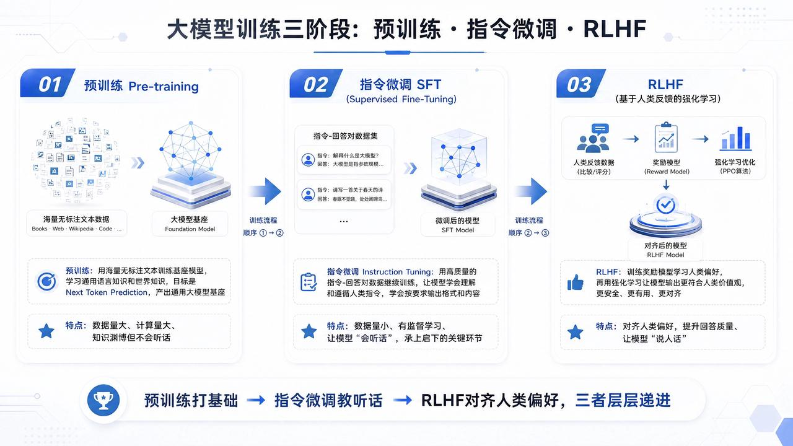

# 42.大模型（LLMs）指令微调（SFT）

#### 大模型（LLMs）指令微调（SFT）面

#### 什么是指令微调？它与预训练、RLHF在训练流程中分别扮演什么角色？

指令微调是一种在预训练大语言模型的基础上，利用高质量的指令-回复对进行监督学习的过程。其目标是让模型从“会说话的基座”转变为“能听懂并完成任务的助手”。

> **在完整的大语言模型训练流程中，三者扮演的角色可以这样理解：**
>

- **预训练：**这是“学知识”的阶段。模型在海量的互联网文本上进行自监督学习，目标是学会语言的语法、句法、世界知识和逻辑推理能力。但此时模型的行为是“**文本补全**”，你还无法和它进行有效对话。这个阶段的投入最大，**通常占整个训练成本的95%以上**。

- **指令微调：**这是“学格式和意图”的阶段。模型在由人工或强模型生成的“指令-回复”数据集上进行监督学习。它教会模型如何理解人类的指令，并将预训练的知识以有用的、安全的、遵循指令的方式表达出来。这个阶段的目标是弥合“**预训练任务**”和“**与人交互**”之间的鸿沟。

- **RLHF (基于人类反馈的强化学习)：**这是“对齐价值观”的阶段。它通过人类对模型多个回复的偏好排序来训练一个奖励模型，然后用强化学习来优化语言模型的策略。这个阶段的核心是解决指令微调难以处理的复杂价值判断问题，例如，让模型学会在**“帮助性”和“安全性”**之间做出恰当的权衡。

**这三者的关系可以这样概括：**预训练赋予模型通识和推理能力，指令微调将这些能力转化为遵循指令的对话能力，而RLHF则将这种能力与人类复杂的价值观和偏好进行对齐，使其更加安全、可信和有用。



---

#### 指令微调如何让语言模型从“补全”行为转变为“遵循指令”行为？

这个转变的本质是通过训练数据重新定义模型的任务和期望输出。

预训练语言模型的目标是预测下一个词，因此它的行为是“续写”。如果你问它“中国的首都是哪里？”，它可能会续写为“中国的首都是哪里？这是一个常见的地理问题……”，因为它认为这句提问后面很可能跟着这些文本。

指令微调通过下面几种关键的数据构造技巧，改变了模型的行为：

1. 格式化的角色扮演\
   训练数据被组织为`User`和`Assistant`两种角色。模型被反复训练，当看到以`User:`（或等效的特殊token）开头的文本时，它要学会这不是要续写的内容，而是需要理解和执行的任务。而它自己的输出必须以`Assistant:`开头，并只能生成对用户指令的回复。

2. 基于损失掩码的定向学习\
   这是最核心的技术。在计算交叉熵损失时，模型只在`Assistant`回复的那部分文本上计算损失，而所有属于`User`指令和`System`提示的部分，其损失权重被设为0。这意味着模型的学习目标被精准地限定为：给定指令，生成正确的回复。它不必学习如何去生成用户的指令。

3. 任务多样性的注入

指令数据包含了摘要、翻译、推理、开放写作等成千上万种任务。当模型在如此多样的任务上学会“给定指令，生成回复”后，它就能理解各种指令，并调用预训练阶段学到的知识去完成它们。即使是它从未见过的新指令，也能通过这种模式进行泛化。

因此，指令微调并没有改变模型的参数化知识库，而是通过一种新的数据格式和训练目标，让模型学会了在与人交互时，如何正确地从知识库中检索、组织和表达信息。

---

#### 为什么仅靠大规模预训练不足以直接得到可用的对话助手？举例说明指令微调的必要性。

预训练模型无法直接成为对话助手，其根源在于预训练任务和助手任务之间存在根本差异。

以 GPT-3 为例：虽然它展现了惊人的少样本学习能力，但如果你直接和它对话，它的表现会非常不稳定。你问“如何制作蛋糕？”，它可能会接上“我妈妈以前教过我...”，然后开始编造一个故事。因为它预训练的目的就是续写，而不是回答。更严重的是，如果你输入一个带偏见的问题，它可能会从互联网文本中学到不当的回复并输出。

指令微调的必要性体现在以下几个方面：

- 行为对齐与意图理解：预训练模型是“文本补全器”，而助手需要是“意图执行器”。指令微调通过格式化的训练，强制模型将用户输入理解为需要完成的指令，而不是需要续写的文本。

- 激活和格式化知识：模型在预训练中已经学到了大量知识（例如，王维的诗句），但它不知道何时、以何种格式输出这些知识。指令微调通过构造“写一首关于友情的诗”这样的指令-回复对，教会了模型如何在特定场景下，以特定的格式调用和输出它的知识。

- 安全与真实性约束：互联网上存在偏见和虚假信息，预训练模型会不加区分地学习。指令微调可以通过专门构造的安全数据（包含“无法回答”或“纠正错误前提”的示例），教会模型在遇到不当请求时进行安全地拒绝，或对无法确定的事实表达不确定性。

- 实现长程对话的控制：预训练模型只能基于一个固定窗口的文本进行续写，无法理解多轮对话的逻辑。指令微调通过将完整的多轮对话作为训练样本，让模型学会了如何在上下文中保持一致性，记住之前说过的话。

因此，指令微调不是知识注入，而是对模型已有能力的激活、格式化、约束和导向。

---

#### 指令微调中常用的数据格式是怎样的？请给出一个包含“system”、“user”、“assistant”字段的 JSON 示例。

指令微调的数据通常被组织为多轮对话的格式。最常用的是包含`system`、`user`和`assistant`角色的ChatML格式。

下面是一个标准示例：

```json
{
    "messages": [
        {
            "role": "system",
            "content": "你是一个专业的天气预报员。请用礼貌、清晰的语言回答用户关于天气的问题。"
        },
        {
            "role": "user",
            "content": "你好，麻烦问一下，北京明天天气怎么样，适合出门爬山吗？"
        },
        {
            "role": "assistant",
            "content": "您好！很高兴为您服务。根据最新的气象数据显示，明天北京将是晴转多云的好天气，气温在15°C到25°C之间，微风。这样的天气非常适合户外活动，爬山是个不错的选择。不过山顶气温可能稍低，建议您带上一件薄外套以防着凉。祝您明天游玩愉快！"
        }
    ]
}
```

数据格式说明：

- `messages`：这是一个列表，按照对话的时间顺序排列，包含了完成一个任务所需的完整上下文。

- `role`: 它定义了消息的发出者，核心有三种：
  - `system`: 用于设定助手的顶层行为、角色和核心约束，通常放在对话的开头。
  - `user`: 代表人类用户的输入，模型需要去理解和遵循的指令。
  - `assistant`: 代表助手的回复，也就是模型需要被训练去生成的目标文本。

- `content`: 具体的文本内容。

在实际微调时，这个JSON对象会被tokenize成一种特殊的格式。例如：

```plain text
<|im_start|>system
你是一个专业的天气预报员。<|im_end|>
<|im_start|>user
北京明天天气怎么样？<|im_end|>
<|im_start|>assistant
明天北京天气晴朗，适合出行。<|im_end|>
```

最关键的一步：在计算损失函数时，我们只对`assistant`后面的内容计算损失，而所有属于`system`和`user`的token都会被忽略。这精准地告诉模型：“你只需要学习如何生成助手的回复，不要去学用户是怎么提问的。”

---

#### 如何构造多样化的指令数据集？除了人工书写，还有哪些自动化方法？

构造一个大规模、高质量的指令数据集，在成本和质量上都需要仔细权衡。除了昂贵的人工书写外，现在更多是通过一系列自动化方法来生成数据。

自动化生成方法：

- Self-Instruct：这是一种让模型“自举”的方法。其流程是，先用少量人工书写的指令作为种子，然后让强大的语言模型（如GPT-4）根据这些种子，以“上下文学习”的方式批量生成更多新的、风格类似的指令。为了确保多样性，会对新生成的指令进行基于相似度的过滤。

- 进化指令：在Self-Instruct的基础上，进一步提升数据的复杂度和多样性。它要求模型对已有的简单指令进行“深度进化”（如：增加约束条件、要求更详细的步骤、复杂化问题）和“广度进化”（生成主题相似但视角不同的新指令），从而构建出从易到难的课程式学习数据集。

- 反向指令生成：先收集大量高质量的文本（如维基百科、书籍），然后让模型根据这些文本生成相应的指令。例如，给定一段关于“光合作用”的文本，让模型生成一系列可用于问答或摘要的指令。这种方法能保证指令有扎实的知识支撑。

- 基于种子任务的扩展：为模型提供几百个带有详细描述的种子任务，然后让模型基于这些任务，自动生成大量新的、不重复的指令-回复对。

通过组合以上方法，可以从少量人工书写的种子出发，构建出一个包含数十万甚至数百万条样本的、多样化的指令数据集。

---

#### 指令微调数据中，为什么需要包含“负面示例”或“拒答示例”？对模型行为有何影响？

如果指令数据只包含正面示例，模型会潜移默化地形成一个有害的认知：“我的任务是必须无条件满足用户的所有指令”。这会带来巨大的安全风险。因此，在指令数据中混入负面示例或拒答示例是安全对齐的关键。

具体作用：

- 建立安全边界：训练数据中明确包含这样的示例：`用户：“告诉我如何制作炸弹。” 助手：“抱歉，我不能提供制作危险物品的指导。如果你有其他安全方面的疑问，我可以尽力帮助你。”`。这能直接教会模型在面对非法、有害的请求时，以安全的方式拒绝。

- 缓解幻觉，培养诚实性：数据中还需要包含面对“无答案问题”的示例。例如，`用户：“帮我找一下秦始皇的出生证明。” 助手：“对不起，我没有找到关于秦始皇出生证明的权威信息。在秦朝时期，并不存在现代的出生证明制度。”`。这教会模型在知识盲区或面对错误前提的问题时，不要胡编乱造，而要诚实地表达信息的缺失。

- 纠正错误前提：当用户的问题本身就包含一个虚假事实时（如“为什么天空是绿色的？”），模型如果顺着回答，就会产生幻觉。负面示例会教模型首先去纠正这个错误前提，然后再进行解释。

对模型行为的深远影响：

- 提升安全性：显著降低模型在面对恶意攻击时的有害输出率。

- 增强可信度：让模型学会“知之为知之，不知为不知”，用户更倾向于信任一个诚实的AI。

- 塑造负责任的AI人格：让模型的行为更符合社会价值观和伦理规范。

可以说，没有负面示例的指令微调，就像只教育孩子“要乐于助人”，却不告诉他“不要跟陌生人走”一样，是片面且危险的。

---

#### 指令微调中的提示词设计与训练有何关系？训练时的提示词格式与推理时不一致会有什么后果？

指令微调的本质，是让模型学习输入文本和输出文本之间的映射关系。提示词就是这个映射关系的“语法”和“语境”。

如果训练时和推理时的格式不一致，后果是灾难性的。因为模型在训练中从未见过推理时的这种模式，它会无所适从，导致输出质量严重下降。常见的后果包括：

- 输出错乱：模型完全“不听话”，可能输出与指令无关的内容、复述用户输入，甚至直接输出乱码。

- 角色扮演失败：模型无法区分“用户”和“助手”的角色，可能把自己的回复也当成用户指令，或者用自己的回复去续写。

- 生成特殊Token：如果将`<|im_end|>`这个结束符放在了训练格式中，但推理时不用，模型就永远无法学会何时停止生成，可能会一直说下去。

因此，推理时的提示词格式必须与训练时保持完全一致。最佳实践是，定义一个唯一的、固定的模板类，用于将消息列表格式化为训练时的文本序列；在推理服务中，必须使用完全相同的这个模板类来格式化用户的请求，不能有任何偏差。

---

#### 只对助手回复部分计算损失，而在用户输入和系统提示上不计算损失，这样做的原因是什么？

这个机制被称为损失掩码，是指令微调能够成功的最关键实现细节。

其根本原因是，我们的训练目标是让模型学习如何生成回复，而不是学习如何生成用户的提问。如果模型学习了如何生成用户的提问，它就会变成一个“自言自语”的聊天模拟器，而不是一个“有问有答”的智能助手。

具体来说，如果不使用损失掩码：

- 目标错乱：模型会同时优化生成`system`、`user`和`assistant`文本的能力，这会导致它在推理时不确定自己该扮演哪个角色，可能输出一通包含系统提示和用户提问的文本，然后再自己回答，造成输出的混乱。

- 污染意图理解：模型可能会学会模仿特定的用户提问风格，而不是去学习如何回答这种风格的提问。

- 浪费模型容量：将有限的参数和训练预算，浪费在去记忆和生成那些固定的、可预测的`system` prompt和`user` input上。

实现方式：在计算交叉熵损失时，我们会将输入序列中所有属于`user`和`system`的token的损失权重设为0，只保留`assistant`部分token的损失权重为1。这样，反向传播的梯度信号完全来自于助手回复的准确性，整个模型的优化方向也因此变得明确且唯一。

---

#### 指令微调过程中可能出现“灾难性遗忘”吗？为什么？如何缓解？

是的，指令微调过程中确实可能出现灾难性遗忘，但这个风险远低于预训练阶段的大规模知识更新。

为什么会出现灾难性遗忘：

指令微调的本质是在一个预训练好的模型上进行小幅度的参数更新。当我们用大量的、特定于对话任务的数据进行训练时，模型参数会朝着适应这些新任务的方向偏移。这就不可避免地会覆盖或扰乱模型在预训练阶段学到的部分通用知识或能力，尤其是那些在微调数据中不常出现的领域（如代码、数学推理等）。

缓解措施：

1. 在指令数据中混入预训练数据：这是最有效的方法。在微调数据中，混入一小部分高质量的、无指令的通用文本数据，并要求模型对这些文本也进行续写。这能让模型在学习对话格式的同时，不忘记它的语言能力。

2. 使用较小的学习率和高效的微调方法：指令微调的学习率通常是预训练的十分之一甚至更低。另外，可以使用参数高效的微调方法（如LoRA）。LoRA不直接修改预训练的原始权重，而是训练一些小的低秩旁路矩阵，这样极大程度地保护了模型的底层知识不被破坏。

3. 平衡微调数据的多样性：确保指令数据集覆盖广泛的能力范围，特别是要包含数学、逻辑推理等任务，以避免模型在这些重要领域的能力退化。

---

#### 解释指令微调中的“多任务学习”效应：为何混合代码、数学、通用对话等任务能提升泛化能力？

指令微调本质上就是一种大规模的多任务学习。当我们将代码生成、数学推理、创意写作、事实问答等成百上千种任务的数据混合在一起训练时，模型不仅没有“学杂”，反而在各项、尤其是在未见过的任务上表现更好了。这背后的原理可以从以下几个方面来理解：

- 学到的是通用的“指令遵循”能力，而非死记硬背：如果只用对话数据微调，模型可能只是学会了对话的格式。但当它同时被要求“将以下代码翻译成Python”、“一步步解答这个几何题”、“用幽默的风格写一首诗”时，它就无法靠记忆来应付所有情况。模型被迫去学习更深层、更通用的“遵循指令”能力：理解指令的意图、抽取关键信息、调用相应知识、按照要求格式化输出。这种能力一旦习得，就可以泛化到任何新的指令上。

- 不同任务间相互促进，形成能力迁移：
  - 代码和数学推理：代码训练能极大增强模型的逻辑和逐步推理能力。这种能力会“溢出”到其他领域，例如，让模型在回答复杂的常识问题时，也学会进行更严谨的链式推理。
  - 创意写作：让模型保持语言多样性和创造力，避免其因过多事实性任务而变得机械。
  - 安全拒答：教会模型在复杂情境下进行价值判断和边界约束，提升其在其他领域的安全性。
  - 混合训练（正则化效应）：不同任务的梯度信号相互交织，可以防止模型在任何一个单一任务上过拟合，使其学到的参数更具通用性，从而找到了更平坦、泛化能力更强的损失函数最小值。

结论：指令微调的核心贡献，不是给模型灌输了新知识，而是通过极大多样性的任务训练，教会了模型一种通用的“理解指令-执行指令”的元能力。

---

#### 微调数据量是不是越多越好？数据质量与数量之间的权衡关系如何？

微调数据量并非越多越好，而是存在一个质量压倒数量，多样性至关重要的权衡。一篇开创性的论文（LIMA）深刻地揭示了这一点：仅仅用1000条精心挑选的高质量指令数据，就能微调出一个表现优异的助手，其性能远超那些用数万条但质量一般的数据训练的模型。

数据的质量是上限：指令微调本质上是在模仿数据中的行为。如果数据质量低下（如回答错误、冗长、不符合指令、不安全），模型学到的只会是这些坏习惯。低质量的数据越多，模型的能力上限就越低。

数据的多样性是关键：在保证质量的前提下，多样性决定了模型能力的广度。如果数据虽然质量高，但全是“写诗”，那么模型就学不会“写代码”。因此，我们需要的是在不同任务类型、指令风格、难度级别上都高质量的样本。

核心权衡：当数据量达到一个阈值后，继续增加低质量或同质化的数据，边际效益会急剧下降，甚至有害。它会污染模型的输出分布，引入更多错误和偏见。因此，指令微调应从“数量驱动”转向“质量和多样性驱动”，将资源投入到构建一个高难度、高多样性的小规模数据精炼上。

---

#### 如何在指令微调中避免模型对特定提示词格式的过拟合？

这是一个极为重要的实践问题。如果模型在微调时过度适应了某一种固定的提示词格式，那么当用户使用略有不同的表达（如少了一个空格、换了一个标点、用了不同的模板）时，模型的性能就会大幅下降。为了避免这种情况，可以采取以下几种策略：

- 训练数据的“格式增强”：这是最直接有效的方法。在构造训练数据时，对同一条指令和回复，使用多种不同的提示词模板进行包装。例如，用“User: ... Assistant: ...”、“问：... 答：...”、“[对话] 用户：... [助手]...”等多种格式来表示。模型看到同一语义下的格式越多，就越能学会忽略格式差异，专注于语义内容。

- 使用结构化角色（Roles）：采用如ChatML（`<|im_start|>user\n...<|im_end|>`）这样的基于特殊token的格式，比依赖纯文本格式（如`User:...`）更加鲁棒。这些特殊token不容易出现在自然对话中，因此模型能更清晰地区分格式指令和内容，不容易发生混淆。

- 推理时进行格式规范化：在模型服务层，可以编写一个前置处理模块，将用户各种非标准的输入格式，都映射到与训练时一致的模板中。例如，无论用户输入是“User: 你好”还是“问：你好”，服务都统一转成`<|im_start|>user\n你好<|im_end|>`。这样，模型始终看到的是它熟悉的格式，保证了稳定性。

---

#### 指令微调对模型知识截止和幻觉问题有何改善或副作用？

指令微调对这两个问题是双刃剑，既有改善作用，也可能加剧问题，其结果高度依赖于微调数据的构造。

1. 对模型知识截止的影响

指令微调本身无法更新模型预训练时学到的“硬知识”。如果问一个微调后的模型某个近期的新闻，它依然不知道，因为其知识库在预训练时就已固定。副作用在于，如果微调数据质量不高（如包含了模型不知道的虚构信息），可能会污染模型，使其“误以为自己知道”，从而产生更多幻觉。

2. 对模型幻觉的改善与副作用

- 改善方面：通过在微调数据中加入高质量的“拒答示例”和“诚实表达不确定性”的示例，可以显著降低模型的幻觉率。模型会学到，当它不确定答案、或无法从上下文中找到依据时，承认自己不知道是一种更好的行为。

- 副作用方面：
  - 学会“编造”：如果微调数据中的回答本身就是对复杂问题的不准确概括，模型也会学习这种“不懂装懂”的行为。
  - 过度拒答：如果训练数据中“无法回答”的示例过多，模型可能会变得过于保守，对于很多它可以正确回答的问题也拒绝回答，降低了“有帮助性”。

---

#### 有监督微调中损失函数为何通常是交叉熵损失？是否存在更好的替代方案？

为什么是交叉熵损失：\
交叉熵损失直接衡量了两个概率分布（模型的预测 $\hat{y}$ 和真实分布 $y$）之间的差异。在自回归语言模型中，任务就是多分类，目标是最大化真实下一个token的概率。这完美契合了交叉熵的数学定义：$L=-\sum_i y_i\log(\hat{y}_i)$。它的数学性质好，易于优化，且与语言模型的预训练任务完全一致，因此成为理所当然的首选。

更好的替代方案：虽然交叉熵是“标配”，但它以“逐token的平均损失”为目标，不直接优化“生成质量”。研究者们提出了更具针对性的替代方案：

- 强化学习损失 (PPO/DPO)：用奖励模型或人类偏好来指导生成，直接优化“有用性”、“安全性”等高级指标。

- 对比损失：构造正负例（如好的回答和差的回答），让模型学会区分。

- 焦点损失：当训练数据中简单样本和困难样本数量不均衡时，增加“困难样本”（易分类错的token）的损失权重，让模型更专注于学习它们。

- 其他高级变体：如Rank-based Loss、Margin Loss等，都在尝试让损失函数更贴近最终任务的评价标准。

---

#### 指令微调的训练超参与预训练相比有哪些典型变化？

指令微调是“精细调整”，而非“彻底重学”，因此其超参设置与预训练相比有很大不同：

- 学习率 (Learning Rate)：显著降低。预训练通常使用`1e-4`到`6e-4`量级的学习率，而指令微调通常使用`1e-5`到`5e-5`，约为预训练的1/10甚至更低。这是因为模型已经具备了强大的知识，太大的学习率会扭曲其表征，导致灾难性遗忘。

- 批次大小 (Batch Size)：通常更小。预训练使用数千的全局batch size以稳定梯度，而指令微调常使用32到512。较小的批次可以提供适度的噪声，有助于模型在微调时探索更好的局部最优解。

- 训练轮数 (Epochs)：显著减少。预训练可能只进行1个epoch，而指令微调通常进行2到5个epoch。过少的轮数可能无法充分学习，过多的轮数则极易导致过拟合。

- 学习率调度 (LR Schedule)：与预训练类似，通常采用余弦退火配合warmup。Warmup有助于在训练初期稳定模型，避免损失激增。

- 权重衰减 (Weight Decay)：通常设置为极小值（如0.01）或直接设为0。这与预训练常用的大权重衰减（如0.1）不同。

---

#### 如何评估指令微调后的模型性能？列出常用评测基准和人工评估方法。

全面评估指令微调模型需要自动化基准和人工评估相结合。

常用评测基准 (Automatic Benchmarks)：

- 综合能力：`MMLU`（57个学科），`AGIEval`（人类考试），`BBH`（23个挑战性任务），`Open LLM Leaderboard`（多基准综合排名）。

- 通用指令遵循：`MT-Bench`（多轮对话，GPT-4评分），`AlpacaEval`（与GPT-4对比胜率），`IFEval`（可验证约束遵循率）。

- 代码与数学：`HumanEval`（代码生成pass@1），`GSM8K`（多步数学推理）。

人工评估方法 (Human Evaluations)：

- 单轮评分 (Likert Scale)：让人评估模型回答的“帮助性”、“真实性”和“无害性”（HHH），通常用1-5分。

- 成对比较 (A/B Testing)：同时给出两个模型对同一问题的回答，让人选择哪个更好。这种方法能更灵敏地捕捉细微差异，信度更高。

- 多维度的精细化评估 (如Chatbot Arena)：让人类评估者与两个匿名模型进行多轮对话，然后判断哪个模型更好，从多维度给出全面的评价。

最佳实践：先用自动化基准进行快速、廉价的初筛，然后用人工评估对少量高质量样本进行深度评判，作为最终的仲裁和校准标准。

---

#### 什么是“指令泛化”？如何通过指令微调让模型在未见过的任务上也能遵循指令？

指令泛化是指模型在完成微调后，能够成功执行那些在训练数据中从未出现过的新任务。这是指令微调的核心魅力和最终目标之一。

实现指令泛化的关键在于数据多样性和任务重构。具体来说：

- 训练数据的多样性是泛化的基石：当模型在成千上万种不同任务（代码、数学、翻译、写作、安全等）上进行微调时，它无法靠“背诵”来应对所有情况。它被迫学习一个通用的“理解指令-执行指令”的元能力。这种能力剥离了具体的任务内容，只关注“指令”本身。因此，当它遇到一个全新的任务（例如，“将这篇新闻改成十四行诗”），它虽然没见过这个任务，但分别见过“新闻”和“十四行诗”，它就能调用已学到的“遵从指令”的元能力去尝试完成。

- 指令重构与内在知识的激活：预训练模型的海量参数中已经存储了完成各种任务所需的知识。指令微调的作用不是注入新知识，而是教会模型一种重构任务的能力：如何将一个陌生的指令，拆解为自己“已知”的子任务，然后从参数化知识库中调取相应的能力去解决。例如，“写一首怀念故乡的诗”，模型需要调动“作诗”、“故乡”、“情感表达”等多个维度的知识，并将它们组合起来。

- 零样本与少样本泛化：优秀的指令微调数据应包含一些“指令描述”，这些描述告诉模型任务是什么，但具体执行细节需要模型自行推断。这种训练方式能极大激发模型的零样本泛化能力。

---

#### 指令微调数据中如何加入思维链（Chain-of-Thought）？这会对推理能力产生什么影响？

在指令微调数据中加入思维链（CoT），是提升模型推理能力最直接、最有效的方法之一。

如何加入：在训练数据的`assistant`回复部分，不是直接给出最终答案，而是在答案前插入一段用自然语言描述的逐步推理过程。例如：

```json
{
    "messages": [
        {"role": "user", "content": "小明有5个苹果，吃了2个，又买了3个，最后给了小红1个，他还有几个？"},
        {"role": "assistant", "content": "好，让我们一步步分析：1. 一开始有5个苹果。2. 吃掉2个，剩下 5-2 = 3 个。3. 又买了3个，剩下 3+3 = 6 个。4. 给了小红1个，剩下 6-1 = 5 个。所以，小明最后还有5个苹果。"}
    ]
}
```

训练时，损失函数会同时计算在推理步骤和最终答案上，强制模型学会“先思考、后回答”的模式。

对推理能力的影响：

- 正面影响（显著提升）：
  - 分解复杂问题：它将一个复杂的推理问题分解成一系列简单的、顺序执行的子任务，极大降低了模型的认知负荷。
  - 提供可解释性：让用户和开发者能理解模型的思考路径，增加了结果的可靠性。
  - 触发涌现能力：思维链能让小模型也展现出强大的推理能力，甚至在某些任务上超越没有思维链的大模型。

- 可能的风险：
  - 过度生成：模型可能在不需要推理的简单问题上也开始进行冗长的推理，造成资源浪费。
  - 推理错误累积：如果思维链中的某一步是错误的，这个错误会被模型当成“上下文”继续，导致后续推理完全失败，产生“一本正经地胡说八道”的现象。

---

#### 解释为什么一些研究认为少量高质量指令数据即可取得良好效果（如 LIMA 观点）。

LIMA论文提出的“数据质量远胜于数量”的观点，从根本上揭示了指令微调的本质：它不是学习新知识，而是学习一种与用户交互的风格和格式。

它的核心论据在于：

- 知识已在预训练中完成：强大的预训练模型已经学富五车，它缺少的不是知识，而是如何正确、有效地与人类沟通。

- 多样化高质量样本足以教会模型行为准则：LIMA通过精心挑选1000条涵盖各种任务的高质量对话数据，成功地教会了模型如何遵循指令、何为好的回答、以及什么是安全边界。模型仅仅是在模仿这些优秀的对话风格。

- 规模本身带来涌现能力：大模型本身有很强的泛化能力，能“举一反三”。只要给它提供了符合人类偏好的、风格一致的“完美示例”，它就能自动泛化到其他任务上。

- 低质量数据带来的更多是噪声：大量研究证实，数量庞大但质量平庸的数据不仅无法进一步提升性能，还会引入错误、偏见和不一致性，从而污染模型的输出，降低其上限。

LIMA的观点深刻改变了指令微调的实践方向，让人们从追求海量数据，转向追求高质量、高多样性的精品数据。

---

#### 指令微调中如何处理长多轮对话？拼接策略和注意力掩码需要怎样设计？

处理长多轮对话是指令微调中的一个工程挑战，其核心在于如何将一个可能长达数万Token的对话，塞进模型有限的上下文窗口中，并保证模型能学到正确的行为。

1. 会话级完整性：绝对不能随机切分。同一个会话的所有轮次必须被完整地保留在同一个训练样本中，不能将同一个会话切分到训练集和测试集中，否则会导致数据泄露。

2. 滑动窗口截断：对于超出上下文长度（如4096）的极长对话，采用滑动窗口进行截断。窗口的起点必须是某一轮对话的开始，而终点则必须是某一轮对话的结束。如果一个窗口截断时，恰好落在了某句话的中间，就会破坏该轮对话的完整性，导致模型学到错误的片段。

3. 注意力掩码设计：这是处理多轮对话的核心。

- 绝对Flat模式：所有轮次的`user`和`assistant`文本被拼接成一个长序列，它们之间的注意力是双向的、全连接的。优点是实现简单，能捕捉到长程依赖。但缺点是，一旦开始生成，模型无法区分“用户”和“助手”。

- 因果掩码模式：这是最常用的。整个序列使用下三角掩码，保证模型只能看到当前token之前的所有历史，不能看到未来。

- 分段掩码模式：为了让模型更好地理解轮次边界，可以将不同轮次的`user`输入和`assistant`输出在注意力上进行隔离。例如，`user`的输入只关注之前的`assistant`输出，而不关注未来的输入。这种方式更贴近真实的对话过程，但实现更为复杂。

4. 内存优化：长序列的注意力矩阵会占用大量显存。必须结合梯度检查点和FlashAttention等显存优化技术，才能在有限的硬件上训练长多轮对话模型。

