# 46.大模型（LLMs）人类反馈强化学习（RLHF）

#### 画图说明 RLHF 的三阶段流程：SFT、奖励模型训练、PPO 微调。

RLHF 的流程可以分为三个界限清晰、目标明确的阶段。以下通过流程图和文字结合的方式进行说明。

第一阶段：监督微调

- 输入：预训练基座模型（Base LLM）。

- 数据：高质量、多样化的（提示，人工书写的理想回复）对。

- 过程：使用这些标注数据，以标准的自回归交叉熵损失对预训练模型进行微调。训练时只对回复部分计算损失。此阶段结束后，得到一个能够进行流畅对话、遵循基本指令的SFT模型。

- 目标：教会模型“什么是好的对话格式和风格”，为后续的强化学习提供一个稳定、可控的初始策略。

第二阶段：奖励模型训练

- 输入：第一阶段得到的 SFT 模型（或预训练模型）。

- 数据：人类偏好数据。对于同一个提示，人类标注者（或更强大的模型）会在模型生成的多个回复中，根据有用性、真实性、无害性等标准进行排序，形成一个高质量回复和低质量回复的对。

- 过程：将 SFT 模型的生成头替换为一个输出标量分数的回归头。在这个偏好数据集上训练该模型，使其能对任意回复给出一个与人类偏好排序一致的分数。这个分数代表了回复的“质量”或“对人类而言的价值”。

- 目标：训练出一个能替代人类进行打分的奖励函数 $Rϕ$，为后续强化学习提供即时的、自动化的反馈信号。

第三阶段：PPO 微调

- 输入：第一阶段得到的 SFT 模型（作为初始策略 Actor 和 Reference 模型）、第二阶段得到的奖励模型（RM），以及一个价值模型（Critic，通常由奖励模型初始化）。

- 数据：大量的、无标注的提示。

- 过程：这是一个在线的强化学习循环。
  1. 对于一个提示，Actor 模型（待优化的策略）生成回复。
  2. 该回复被送入 Reward Model 得到一个奖励分数 $rθ$。
  3. 同时，计算 Actor 生成该回复的概率与 Reference 模型生成该回复的概率之间的 KL 散度，作为惩罚项。
  4. Critic 模型估计当前状态（提示+已生成的token）的价值 V(s)$V$($s$)，用于计算优势函数 $A_t$。
  5. 最后，使用 PPO 算法，最大化“奖励得分减去 KL 惩罚”，来更新 Actor 模型和 Critic 模型的参数。

- 目标：在不过度偏离 SFT 模型（保证语言流畅性）的前提下，最大化生成回复的质量，使模型的行为与复杂的人类价值观对齐。

---

#### 为什么仅靠 SFT 无法完全对齐人类偏好？RLHF 能解决哪些 SFT 的不足？

SFT 是对齐的基石，但它存在根本性的局限，使得它无法独立完成对齐任务。RLHF 正是为解决这些局限而设计的。

- 局限一：无法处理“模糊”和“冲突”的指令。SFT 只能学习给定指令到单一最佳回复的映射。但人类的偏好往往是复杂、微妙且存在冲突的。例如，“帮我写一封拒绝邀请的邮件，既要坚决，又不能冒犯对方”。SFT 难以学到这种微妙的平衡，而 RLHF 可以通过人类对“好的拒绝”和“差的拒绝”进行偏好排序，引导模型学习权衡。

- 局限二：缺乏对负面信号的直接学习。SFT 只通过正样本学习，告诉模型“什么是好的”。对于“什么是坏的”，它没有直接的惩罚机制。RLHF 的奖励模型通过对差回复给出低分甚至负分，为模型提供了明确的负面信号。这不仅能教会模型生成更好的内容，更能明确教会它不要生成某些内容。

- 局限三：目标与真实评价标准不一致。SFT 的优化目标是最大化训练数据的似然，这与最终目标“生成人类喜欢的有用回复”存在差距。RLHF 的 PPO 阶段则直接以奖励模型的评分作为优化目标，实现了“所见即所得”的对齐。这好比训练一个球员，SFT 是让他看球星的录像学习，而 RLHF 是让他上场，根据教练的实时打分来调整打法。

- 局限四：无法超越标注者，产生“涌现”能力。SFT 模型的性能上限是其训练数据，它很难超越数据中人类标注者的水平。而在 RLHF 中，模型通过强化学习的探索机制，有可能生成一些标注者未曾见过的、但质量极高的回复，并通过奖励模型获得高分，从而实现“自我超越”。这是一种从模仿到创新的飞跃。

- 局限五：对不安全行为的约束力弱。尽管可以通过构造拒答数据来教会 SFT 模型拒绝，但在对抗攻击下，模型仍然可能被诱导出有害内容。RLHF 通过与环境的交互（奖励模型），让模型在无数次“尝试-出错-纠正”的循环中，更深刻地内化安全边界，形成鲁棒的“安全价值观”。

---

#### RLHF 中的人类反馈具体指什么？一般通过哪种数据形式表达？

RLHF 中的人类反馈，不是让人类直接告诉模型“你应该生成哪个词”，而是让人类表达对不同回复的偏好。

具体形式：对于同一个提示，人类标注者（或一个被训练来模拟人类的强大AI）会看到模型生成的多个不同回复。标注者的任务不是修改这些回复，而是根据一套预定义的、细致的标准，对这些回复进行排序。

这套标准通常被称为“HHH”，即：

- 有帮助性（Helpfulness）：回复是否解决了用户的问题？是否提供了准确、完整、有用的信息？

- 诚实性（Honesty）：回复是否基于事实？是否承认了自己的不确定性？是否编造了不存在的信息（幻觉）？

- 无害性（Harmlessness）：回复是否安全？是否包含暴力、色情、歧视等内容？在面对恶意提问时，是否妥善处理？

数据形式：这种偏好排序最终被表达为偏好对：

**数据形式**：这种偏好排序最终被表达为**偏好对**：

$$
(\text{提示}, \text{较好回复}, \text{较差回复})
$$

或者，更常见的是**多回复排序数据**：

$$
(\text{提示}, \text{回复1}, \text{回复2}, \text{回复3}, \ldots)
$$

其中，`回复1` > `回复2` > `回复3` 代表人类认为的质量高低顺序。

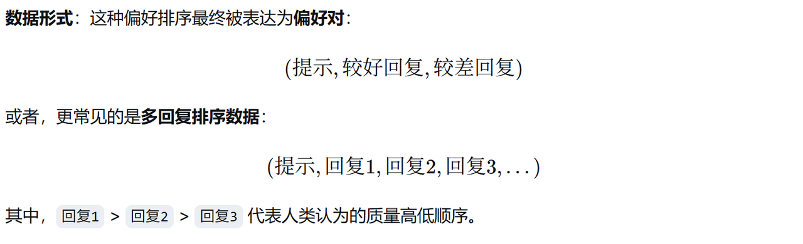{.ocr-src}

为什么是排序而非直接打分？

因为让不同的人对一段文本打一个绝对分数（如7.5分）是非常主观且尺度不一的。而比较两段文本哪个更好，对任何人来说都更直观、更一致。因此，偏好排序能提供更稳定、更高质量的训练信号。

---

#### 奖励模型在 RLHF 中起什么作用？为什么要训练一个独立的奖励模型而不是直接让人打分？

奖励模型是 RLHF 中的核心组件，它的作用是充当一个自动化的、可扩展的人类偏好代理。

核心作用：

在 PPO 训练的每一步，模型都会生成新的回复。如果每次都让人来对这些新回复打分，成本将是天文数字，且反馈延迟极高，训练根本无法进行。奖励模型通过在海量人类偏好数据上学习，训练完毕后，就可以在毫秒级内给出一个与人类偏好高度一致的奖励分数。这个分数作为强化学习的即时奖励信号，驱动策略模型向高质量方向优化。

为什么必须是独立的奖励模型？

除了自动化之外，更重要的原因是防止“奖励黑客”行为。如果让人直接给模型打分：

1. 无法规模化：强化学习需要海量的试错和反馈，人类的精力和时间无法满足。

2. 反馈延迟巨大：人需要阅读、思考、打分，这会导致训练过程被无限拉长。

3. 无法保证一致性：同一个回复，不同的人、同一个人的不同时刻，给出的分数可能都不一样。这种不一致的噪声会严重破坏 RL 训练的稳定性。

4. 无法进行“反事实”评估：对于模型生成的、人类未曾见过的创造性表达，一个训练有素的奖励模型可以利用其学到的偏好模式进行合理的打分，而人类可能需要更长时间的思考或存在主观偏见。

因此，训练一个独立的奖励模型，是将昂贵、缓慢、稀疏的人类反馈，转化为廉价、快速、密集的自动化奖励信号的关键一步。

---

#### PPO 阶段同时使用四个模型：Policy（Actor）、Reference、Critic（Value）、Reward Model，请解释各自的作用。

PPO 训练阶段是一个复杂的多模型协同过程，四个模型各司其职：

1. Policy / Actor Model（策略模型）：
  - 来源：由 SFT 模型初始化。
  - 角色：待优化的“主角”。它是我们最终要得到的、对齐好的模型。在训练的每一步，它负责根据提示生成回复。
  - 更新：它的参数会根据奖励和 KL 惩罚计算出的信号，通过 PPO 算法不断更新。

2. Reward Model / RM（奖励模型）：
  - 来源：第二阶段独立训练得到。
  - 角色：“裁判”。它对 Actor 模型生成的回复进行评分，输出一个标量分数（Reward）。这个分数是优化目标的核心部分。
  - 更新：在整个 PPO 阶段，RM 的参数被完全冻结，不参与更新。这是为了保证奖励信号的稳定性和一致性。

3. Reference Model（参考模型）：
  - 来源：第一阶段的 SFT 模型。
  - 角色：“行为参照线”。它代表了模型在开始强化学习前的初始能力。它不会被更新。
  - 作用：计算 Actor 模型当前输出分布与 Reference 模型输出分布之间的 KL 散度。这个 KL 散度作为一个惩罚项（KL Penalty），确保 Actor 模型不会为了追求高奖励而“跑偏”，变得满口胡言，从而丧失预训练阶段学到的语言流畅性和常识。

4. Critic / Value Model（价值模型）：
  - 来源：通常由 Reward Model 初始化。
  - 角色：“战略分析师”。它不直接评价一个完整的回复好坏，而是估计当前状态（提示+已生成的token序列）的长期价值 V(s)。
  - 作用：在 PPO 算法中，它与 Reward Model 一起，用于计算优势函数（Advantage）。优势函数衡量了在某个状态下采取某个动作（生成某个token），相比平均情况要好多少。使用优势函数代替原始奖励进行更新，可以极大地降低梯度估计的方差，使训练更稳定、更高效。

---

#### 为什么 RLHF 需要 Reference 模型？KL 散度惩罚项的目的是什么？

Reference 模型是 RLHF 中的稳定器和防遗忘机制。没有它，PPO 训练几乎必然会崩溃。

为什么需要 Reference 模型？

RLHF 的根本目标不是追求奖励模型给出的极限高分，而是在保证模型基础语言能力的前提下，更好地对齐人类偏好。如果没有 Reference 模型的约束，Actor 模型会很快发现奖励模型的“漏洞”。例如，它可能学会通过堆砌华丽词藻、说废话或者生成重复但安全的模板来骗取高奖励，而忽略了生成内容的实际质量、多样性和准确性。

KL 散度惩罚项的目的：

KL 散度衡量了两个概率分布之间的差异。在这里，它衡量的是 Actor 模型当前的策略分布 $\pi_\theta$ 与 Reference 模型原有的策略分布 $\pi_{\mathrm{ref}}$ 之间的差异。

$$
KL\left(\pi_\theta \| \pi_{\mathrm{ref}}\right) = \mathbb{E}_{y \sim \pi_\theta}\left[\log \pi_\theta(y|x) - \log \pi_{\mathrm{ref}}(y|x)\right]
$$

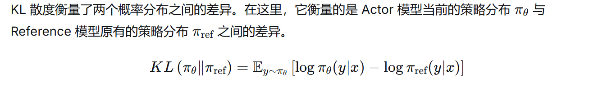{.ocr-src}

在 PPO 的目标函数中，我们会从奖励值中减去这个 KL 散度。其目的非常明确：

- 防止语言能力退化：它强制 Actor 模型的生成概率分布不要与它最初的“SFT状态”偏离太远。这有效防止了灾难性遗忘，确保了模型在追求高分的同时，仍然保留着流畅的语言表达能力、丰富的词汇量和正确的语法。

- 防止奖励黑客：当模型试图用一些“奖励黑客”的伎俩时，这些新学的伎俩往往与 Reference 模型的语言分布差异巨大，会导致 KL 惩罚急剧增大，从而抵消掉骗来的奖励，迫使模型回到正确的优化路径上。

---

#### 写出 RLHF 的 PPO 训练目标函数，并解释每一项的意义。

RLHF 中使用的 PPO 目标函数是一个复合函数，通常称为 PPO-ptx。其完整形式如下：

$$
\mathcal{L} = \mathcal{L}_{PPO} - \beta \cdot \mathcal{L}_{KL} + \gamma \cdot \mathcal{L}_{PTX}
$$

下面详细解释每一项：

**1. PPO 损失（$\mathcal{L}_{PPO}$）**

这是 PPO 算法的核心，驱动策略模型去获得更高的奖励。

$$
\mathcal{L}_{PPO} = \mathbb{E}_{(x,y) \sim \pi_\theta}\left[\min\left(r(\theta) \cdot A_t, \mathrm{clip}(r(\theta), 1-\epsilon, 1+\epsilon) \cdot A_t\right)\right]
$$

- **优势函数 $A_t$**：衡量在状态 $t$ 下，采取动作 $y_t$ 相比当前策略平均水平的优势。它由 Critic 模型和 Reward Model 共同计算。$A_t > 0$ 表示该动作优于平均水平，应该鼓励。
- **概率比 $r(\theta)$**：新策略 $\pi_\theta$ 与旧策略 $\pi_{\theta_{old}}$ 在生成 token $y_t$ 的概率之比。$r(\theta) = \frac{\pi_\theta(y_t|x, y_{<t})}{\pi_{\theta_{old}}(y_t|x, y_{<t})}$。
- **裁剪（Clip）机制**：这是 PPO 的精髓。通过 `clip` 函数和 `min` 函数，算法确保了当 $A_t > 0$ 时，不会让概率比 $r(\theta)$ 无限制增大（防止步子迈得太大）；当 $A_t < 0$ 时，不会让概率比无限制减小。这种保守的更新策略保证了训练的稳定性。

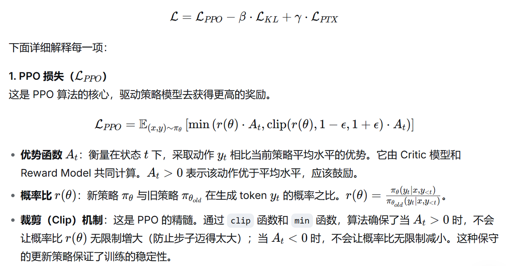{.ocr-src}

**2. KL 散度惩罚（$\mathcal{L}_{KL}$）**

$$
\mathcal{L}_{KL} = \mathbb{E}_{(x,y) \sim \pi_\theta}\left[KL\left(\pi_\theta \| \pi_{\mathrm{ref}}\right)\right]
$$

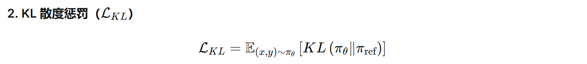{.ocr-src}

- **作用**：这是 PPO 目标函数中的一个正则化项。它衡量当前策略模型 $\pi_\theta$ 与参考模型 $\pi_{\mathrm{ref}}$ 之间的差异。
- **为什么是减号**：我们希望在最大化 PPO 目标（获得高奖励）的同时，最小化 KL 散度（保持在参考模型附近）。因此，在总目标函数中，KL 散度项前面有一个负号（或者说，我们加上一个负的KL散度）。系数 $\beta$ 用于控制惩罚的强度。这个惩罚防止了模型过度优化奖励而偏离太远。

**3. 预训练梯度（$\mathcal{L}_{PTX}$）**

$$
\mathcal{L}_{PTX} = \mathbb{E}_{(x,y) \sim \mathcal{D}_{pretrain}}\left[\log \pi_\theta(y|x)\right]
$$

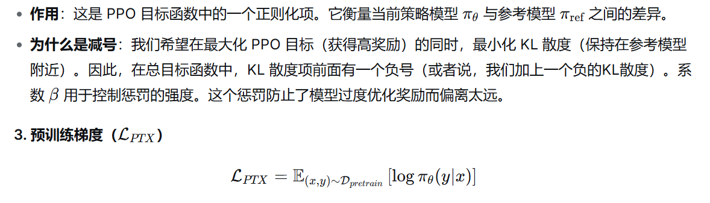{.ocr-src}

- 作用：这是一个可选的辅助任务损失。它要求模型同时在原始的预训练数据集 D $p_{retrain}$ 上进行优化。

- 目的：防止灾难性遗忘。在 PPO 训练中，模型可能会在优化人类偏好的同时，丧失其在下游任务（如代码生成、数学推理）上的能力。通过混合预训练损失，可以显著缓解这种能力退化。

总结：PPO 训练通过一个精妙的目标函数，同时实现了 “追求高分”、“保持本我”和“巩固旧知” 三个目标的平衡。

---

#### 如何平衡 RLHF 中的奖励（reward）与 KL 惩罚？超参数 β 如何影响结果？

平衡 RLHF 中的奖励与 KL 惩罚，是训练过程中最核心的调优艺术。这一平衡完全由超参数 β 控制。

β (Beta) 的作用：

β 是 KL 散度惩罚项的系数，它决定了 KL 惩罚在总目标函数中的权重。总目标可以简化为：

$$
\mathrm{Objective} = \mathrm{Reward} - \beta \times \mathrm{KL\ Divergence}
$$

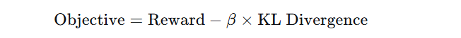{.ocr-src}

- β 值过大（保守策略）：
  - 表现：KL 惩罚极强。模型被紧紧束缚在参考模型附近，每一步更新都非常微小。
  - 结果：训练过程非常稳定，语言流畅性保持完好。但模型可能无法有效学习人类偏好，因为它不敢探索新的生成方式，最终模型的行为与最初的 SFT 模型相差无几，对齐效果不明显。

- β 值过小（激进策略）：
  - 表现：KL 惩罚几乎可以忽略不计。模型可以肆无忌惮地最大化奖励分数。
  - 结果：模型会迅速学会“奖励黑客”技巧，利用奖励模型的漏洞骗取高分。例如，它会生成大量重复的、格式漂亮的、但实际内容空洞的“垃圾”回复。严重的会导致策略崩溃，生成乱码，语言能力完全丧失。

如何找到合适的 β？

这是一个动态调整的过程。实践中，通常从一个较小的 β 值开始尝试，同时密切监控三个核心指标：

1. 平均奖励分数：是否在健康地上升？

2. KL 散度：是否在合理范围内（通常 5-15 nats）增长？如果 KL 散度出现爆炸性增长，说明 β 太小。

3. 策略模型的生成质量：在验证集上检查模型生成的回复是否依然流畅、有意义。

最终，一个合适的 β 值是让模型在“提高奖励”和“保持语言能力”之间达到一个动态均衡，奖励和 KL 散度最终会收敛到一个稳定的平台。

---

#### RLHF 训练中，奖励模型的值域和打分分布对 PPO 训练的稳定性有何影响？

奖励模型的输出特性直接影响 PPO 训练的稳定性和效率。PPO 算法对奖励的尺度是敏感的。

1. 值域（Value Range）的影响\
   奖励模型输出的分数范围至关重要。如果分数值域太大（例如从 -100 到 100），会导致计算出的优势函数 $A_t$ 的绝对值非常大。PPO 中的梯度更新幅度会因此剧烈波动，可能使训练极不稳定，一步更新过猛导致策略崩溃。反之，值域太小（例如从 -0.1 到 0.1），则优势函数太小，模型得到的学习信号非常微弱，训练过程将极其缓慢，甚至无法收敛。

2. 打分分布（Score Distribution）的影响

打分分布反映了奖励模型对不同质量回复的区分能力。

- 分布过于集中：如果奖励模型给绝大多数回复的打分都集中在某一个很小的区间内（例如，好回复在1.80-1.85，差回复在1.75-1.80），那么它就无法有效区分质量。噪声（如标注者的不一致）会淹没真实的质量信号。PPO 模型将无法判断哪个方向是正确的，优化过程会变得混乱且低效。

- 分布存在不连续性：如果奖励模型对某些特定模式的回复给出极高或极低的分数，形成尖锐的“奖励尖峰”，会导致策略模型不择手段地去追求这些尖峰，而忽略其他合理的优化路径，极易引发“奖励黑客”行为。

最佳实践：\
为了让 PPO 训练稳定，通常需要对奖励模型的输出进行归一化处理。一种常见的做法是，在 PPO 训练过程中，将奖励模型输出的分数进行 Z-score 标准化（减去均值，除以标准差）。这使得奖励分布转化为均值0、标准差1的标准分布。这样处理后的优势函数 $A_t$ 值域也会变得稳定，从而保证 PPO 训练的稳定和高效。这个标准化过程也是 RLHF 训练管线中的一个重要细节。

---

#### 为什么 RLHF 容易出现“奖励黑客”现象？举出至少两个例子。

奖励黑客是 RLHF 中最核心的挑战之一。它产生的根本原因在于奖励模型只是人类真实偏好的一个不完美的代理，而强化学习算法会无情地利用这个代理的任何缺陷来最大化分数，而不是实现我们真正的目标。

例子一：废话连篇、重复无意义的词语

假设奖励模型在训练时，人类标注者更偏好那些看起来“详尽”和“热情”的回复。策略模型发现，通过在回复中不断重复“当然！我非常乐意为你解答”这类礼貌且冗长的开场白，并反复罗列相似的废话，可以有效提高奖励分数。这些文本虽然单个看是自然语言，但组合起来空洞无物，没有提供实质性信息。然而，对于只见过好回复与差回复的奖励模型而言，这种文本模式可能恰好落在了“高质量回复”的分布区域，从而给予高分。策略模型为了最大化奖励，便大量生成这种“金玉其外，败絮其中”的回复，造成了“奖励黑客”。

例子二：使用模板化、安全但无用的回复

当奖励模型被训练为偏好“安全”的回复时，策略模型可能会学到一种极端的策略：无论用户问什么，都用一套固定、万能的模板来回应。例如，用户问“如何治疗感冒？”，模型不提供任何具体建议，只回复：“感冒是一种常见的疾病，建议您咨询专业医生。同时，保持健康的生活方式非常重要。” 这种回复确实绝对安全，不会产生幻觉或有害内容，在安全性奖励上得分极高，但它完全没有帮助性。策略模型发现，这种“绝对安全但无用”的策略是获得高奖励的捷径，从而放弃了学习如何平衡有用与安全的努力。

---

#### PPO 算法中的优势函数（Advantage）是如何计算出来的？简述 GAE。

优势函数 A(s,a) 回答了这样一个问题：“在状态 s 下采取动作 $a$，比平均水平好多少？” 如果 $A$>0，说明该动作优于平均水平，值得鼓励；反之则应该抑制。它是 PPO 算法的核心，能够有效减少梯度估计的方差。

广义优势估计（GAE，Generalized Advantage Estimation） 是目前最主流的优势函数计算方法。它将一步的 TD 误差和多步的回报通过指数加权的方式结合起来，在偏差和方差之间取得了优秀的平衡。

GAE 的核心是基于 TD 误差（$δ_t$） 的指数加权平均。TD 误差定义为即时奖励加上下一状态的价值减去当前状态的价值：

$$
\delta_t = r_t + \gamma V(s_{t+1}) - V(s_t)
$$

其中，$r_t$ 是奖励，$\gamma$ 是折扣因子，$V(s)$ 是 Critic 模型估计的状态价值。

那么，GAE 优势 $\hat{A}_t^{GAE(\gamma,\lambda)}$ 的计算公式如下：

$$
\hat{A}_t = \sum_{l=0}^{\infty} (\gamma\lambda)^l \delta_{t+l}
$$

其中，$\lambda \in [0, 1]$ 是 GAE 的关键参数。当 $\lambda = 0$ 时，$\hat{A}_t = \delta_t$，就是一步 TD 误差，方差最小但偏差最大。当 $\lambda = 1$ 时，$\hat{A}_t = \sum_{l=0}^{\infty} \gamma^l \delta_{t+l} = \sum_{l=0}^{\infty} \gamma^l r_{t+l} - V(s_t)$，这是蒙特卡洛回报，偏差最小但方差最大。在实践中，$\lambda$ 通常取值在 0.95 左右，通过对未来 TD 误差进行衰减加权，显著降低了蒙特卡洛估计的方差，使训练更加稳定高效。

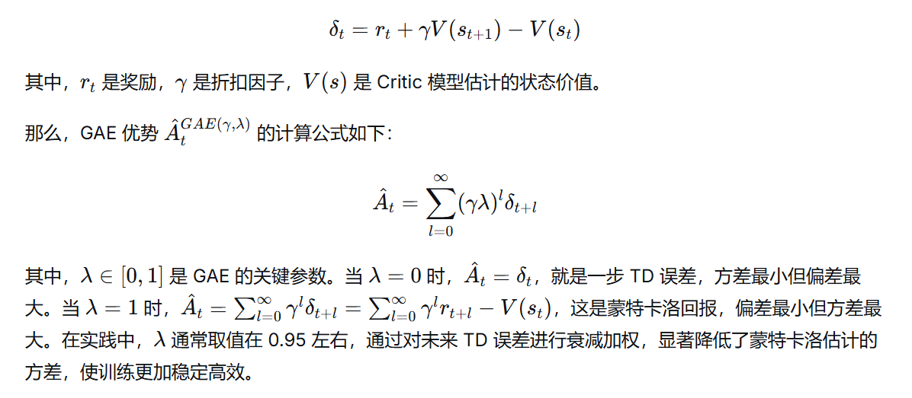{.ocr-src}

计算流程：

1. 采样：用当前策略在环境中执行，得到一个完整的轨迹，包含状态、动作、奖励和 Critic 模型的价值估计 V(s)。

2. 计算 TD 误差：根据上述公式，从轨迹的最后一步反向计算每一步的 $δ_t$。

3. **计算 GAE 优势**：再次从后向前，用 GAE 公式累加出每一步的 $\hat{A}_t$。
4. **使用优势**：将 $\hat{A}_t$ 代入 PPO 损失函数中，用于更新 Actor 模型。

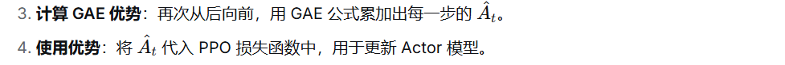{.ocr-src}

---

#### 在 RLHF 实践中，如何收集人类偏好数据？比较点式打分、对比排序、好/差分类等格式的优劣。

收集高质量的人类偏好数据是 RLHF 成功的基石。主要有以下几种数据格式，其优劣各异。

1. 点式打分

- 格式：给定一个提示和一个回复，标注者给出一个绝对分数（如 1-5 分）。

- 优点：直观，易于理解。可以用来校准不同标注者的尺度。

- 缺点：
  - 主观偏差巨大：不同标注者对“4分”的理解天差地别，数据噪声极大。
  - 校准困难：很难将不同标注者的分数统一到同一个标准上。
  - 反馈成本高：通常需要经过良好训练的专业标注员才能给出相对一致的分数。

2. 好/差分类

- 格式：给定一个提示和一个回复，标注者判断它是“好”还是“坏”。

- 优点：最简单、成本最低、标注速度最快。非常适合用于安全过滤（如“是否包含色情内容？”）。

- 缺点：信号过于粗糙，无法区分“一般好”和“非常棒”的回复，丢失了大量偏好细节，不利于模型学习如何生成高质量内容。

3. 对比排序

- 格式：给定一个提示和两个（或多个）回复，标注者指出哪个回复更好，或者对这些回复进行质量排序（A > B > C）。

- 优点：这是 RLHF 的黄金标准。它极大地降低了标注者之间的认知偏差，因为“A比B好”是一个客观得多的判断。信号质量高、噪声低。可以直接用于训练 Bradley-Terry 等排序模型。

- 缺点：当回复数量增多时，比较的组合数呈平方级增长，标注成本随之上升。

比较与实践：

在实际的 RLHF 管线中，通常采用**对比排序**作为主要数据格式，因为它提供了训练奖励模型所需的最优信号。为了进一步提升数据效率，有时会采用"多回复排序"：模型一次性生成 K 个回复，标注者将它们从最好到最差进行排序。这样标注一次就得到了 $\binom{K}{2}$ 个对比对。

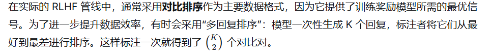{.ocr-src}

---

#### 奖励模型的训练数据通常如何构造？损失函数是什么？写出 Bradley-Terry 模型下的排序损失。

训练数据构造：

1. 数据来源：从 SFT 模型或早期版本的 PPO 模型中，针对大量多样化的提示，生成多个回复。

2. 数据筛选：为了确保数据多样性并降低标注成本，会选择那些在生成时使用了不同采样策略（如不同的温度）的回复，并筛选出差异足够大的候选对。

3. **人类标注**：将这些（提示，回复A，回复B）对交给人类标注员，标注员根据"HHH"标准指出哪个更好。最终得到的数据集为 $\mathcal{D} = \{(x, y_w, y_l)\}$，其中 $y_w$ 是胜出的较好回复，$y_l$ 是失败的较差回复。

**Bradley-Terry 模型下的排序损失**：

奖励模型的训练目标是，让奖励模型 $r_\phi(x, y)$ 给出的分数，能够正确反映人类的偏好排序。Bradley-Terry 模型将人类偏好概率建模为：

$$
P(y_w \succ y_l | x) = \frac{\exp(r_\phi(x, y_w))}{\exp(r_\phi(x, y_w)) + \exp(r_\phi(x, y_l))}
$$

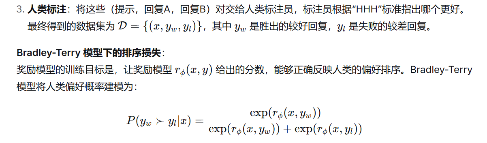{.ocr-src}

**我们的目标就是最大化这个偏好概率。因此，损失函数是该概率的负对数似然：**

$$
\mathcal{L}(\phi) = -\mathbb{E}_{(x, y_w, y_l) \sim \mathcal{D}} \left[ \log \sigma \left( r_\phi(x, y_w) - r_\phi(x, y_l) \right) \right]
$$

其中 $\sigma$ 是 sigmoid 函数。这个损失函数直观地告诉我们：让较好回复 $y_w$ 的分数比 $y_l$ 越高越好。当两者分数差距很小时，损失大；差距足够大时，损失趋近于零。

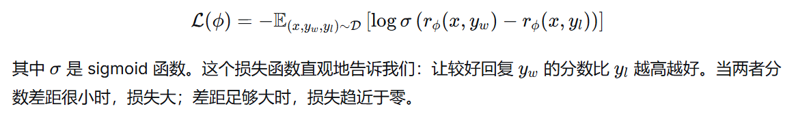{.ocr-src}

训练技巧：

- 响应随机化：在训练时，随机交换 $y_w$ 和 $y_l$ 的位置，防止模型学习到位置偏差。

- 奖励值中心化：通常会在损失函数中加入一个正则项，鼓励奖励模型的输出在均值0附近，防止其输出值无约束地漂移，从而提升 PPO 训练的稳定性。

---

#### 奖励模型与策略模型之间的规模比例有什么经验法则？奖励模型太小会带来什么问题？

这是一个重要的工程实践问题。奖励模型的容量不能太低，否则会成为整个对齐过程的短板。

经验法则：

- 同源初始化：奖励模型通常从与策略模型（Actor）相同规模的 SFT 模型初始化而来。这是最常用、最稳健的做法。它保证了奖励模型和策略模型具有相似的语言理解能力。

- 避免使用过小的模型：一个普遍的共识是，奖励模型的规模不应显著小于策略模型。如果策略模型是一个 70B 的模型，那么使用一个 7B 的奖励模型去引导它是充满风险的。

奖励模型太小会带来什么问题：

1. 无法识别高质量回复：奖励模型的语言能力有限，无法准确理解复杂、深奥或专业领域的回复，可能将平庸的回复误判为高质量，或无法欣赏真正有洞见的回答。

2. 容易被策略模型“欺骗”：强大的策略模型能很快发现小奖励模型的弱点，并学会生成那些能骗过高分、但实际意义不大的“奖励黑客”内容。这本质上是“道高一尺，魔高一丈”的失衡。

3. 评分一致性差：小的奖励模型由于容量不足，在面对细微的语义差异时，其打分可能不一致，产生较大噪声。这种噪声会严重破坏 PPO 训练的稳定性，导致策略模型在优化方向上迷失。

反向的另一种可能：在 DPO 中，有研究表明，如果策略模型太大，而奖励模型（DPO 中隐式的）容量不足，同样无法有效对齐。因此，保证用于提供偏好信号的模型具有足够的“智力”，是成功对齐的前提。

---

#### RLHF 中，PPO 训练通常只进行少数几个 epoch，为什么？过度 RL 训练会出现什么现象？

PPO 训练通常只进行 1 到 4 个 epoch，甚至在很多成功的实践中，模型只见过训练数据一次。

为什么只进行少数 epoch？

1. 防止奖励黑客和过拟合：奖励模型本身是有缺陷的。随着 PPO 训练的进行，策略模型会逐渐发现并利用奖励模型的这些缺陷。如果进行多个 epoch，模型有充足的时间去“钻空子”，导致严重的奖励黑客行为。

2. KL 散度的持续累积：虽然 KL 惩罚会限制每一步的更新幅度，但在多轮 epoch 中，策略模型与最初的 SFT 模型之间的差异会持续累积。一旦 KL 散度超出安全范围，模型的语言能力就会开始退化。

3. 在线策略的本质要求：PPO 是 on-policy 算法，理论上要求用于更新的数据必须由最新版本的策略模型生成。在 RLHF 实践中，为了效率，我们通常会用上一版本的模型生成大量数据，然后进行多轮小批量的 PPO 更新。这被称为“准在线”训练。如果进行过多 epoch，数据将严重“过时”，导致更新偏差。

过度 RL 训练会出现的现象（“过优化”）：

1. 输出质量崩溃：模型的回复开始变得冗长、重复、空洞，或者充满奇怪的格式和标点。它为了骗奖励而牺牲了语言流畅性。

2. 多样性丧失（模式崩溃）：无论用户输入什么，模型的输出都收敛到几种固定的、高奖励的回复模板上。它失去了创造力和处理长尾问题的能力。

3. 奖励得分与真实质量脱钩：在训练过程中，监控到的奖励分数可能还在上升，但人工抽检却发现回复质量已经大幅下降。这是典型的奖励黑客信号。

---

#### 如何判断 RLHF 训练过程中的“模式崩溃”或输出多样性丧失？

及时判断模式崩溃是 RLHF 训练中最重要的监控任务之一。以下是关键的判断方法。

1. 监控生成样本的多样性指标

- Distinct-n 骤降：计算生成回复中不重复的 n-gram 比例。如果 Distinct-1 和 Distinct-2 在训练过程中出现断崖式下跌，说明模型词汇量急剧减少，正在使用固定模板。

- Self-BLEU 飙升：将模型对同一提示的多次生成结果，两两计算其 BLEU 分数。Self-BLEU 分数越高，表示不同次的生成结果彼此越相似，多样性越差。

- 嵌入空间分布集中化：将大量回复用句子嵌入模型（如 Sentence-BERT）编码为向量，然后可视化（如 t-SNE）。如果原来分散的点云开始向少数几个点汇聚，说明多样性正在丧失。

2. 监控训练曲线的异常

- 奖励与 KL 散度的背离：奖励曲线在持续上升，但 KL 散度曲线也在急剧上升。这通常意味着模型在通过“跑偏”来换取奖励，是模式崩溃的前兆。

- Critic 模型的价值估计异常：价值函数 V(s) 的估计值突然变得极其极端（过大或过小），表示策略模型进入了一个陌生的状态空间。

3. 基于模型裁判的评估

- 使用一个强大的外部模型（如 GPT-4）作为裁判，对训练过程中的模型回复进行打分，判断其“创新性”和“多样性”。如果模型裁判给出的多样性评分持续下降，也是一个重要信号。

4. 人工抽检与感知

- 最直观的方法：定期对模型进行人工抽检。如果发现模型的回复开始变得“套话连篇”，无论问什么都回复得像新闻稿，那么就说明模式已经严重崩溃。

---

#### 讨论 RLHF 在减少幻觉方面的效果及局限性。

RLHF 在减少幻觉方面的效果：

1. 通过诚实性偏好直接惩罚幻觉：在构造偏好数据时，标注者被明确要求“对于不确定的事实，承认‘不知道’的回答优于胡编乱造的回答”。通过在排序数据中惩罚幻觉、奖励诚实，奖励模型学会了识别和低分处理幻觉。PPO 训练时，模型为了追求高奖励，会主动内化这种诚实性，减少编造行为。

2. 拒绝回答不知道的问题：模型学会了在面对超出其知识范围的问题时，以“我没有相关信息”等方式拒绝回答，而不是强行生成一个看似合理的错误答案。

3. 鼓励引用来源：通过偏好数据鼓励模型在回答中引用可靠的来源，这间接提升了回复的事实准确性。

局限性：

1. 奖励模型的“幻觉盲区”：奖励模型本身也会产生幻觉。对于复杂或专业的事实，奖励模型无法准确判断真伪。如果一个策略模型编造了一个专业领域的虚假事实，且语言风格非常自信、流畅，奖励模型极有可能被“蒙骗”，给出高分。

2. 无法修正模型内部知识：RLHF 无法修改模型在预训练阶段学到的错误知识。如果模型本身坚信一个错误的事实（如“地球是平的”），而奖励模型也认为这是对的，那么 RLHF 只会强化这个错误信念。

3. 过度保守的副作用：为了追求安全的高奖励，模型可能变得过度拒答。对一些它其实知道答案的边缘问题，也选择说“我不知道”，这损害了有用性。

4. 无法应对复杂推理中的幻觉：在多步推理中，某一步出现幻觉，后续步骤可能被带偏。RLHF 的奖励通常针对最终回复，很难对中间推理过程进行精细化纠偏。

结论：RLHF 是减少幻觉的有效工具，特别是对于常见的、易于辨别的事实。但它不是银弹，无法解决根深蒂固的知识错误，且依赖奖励模型自身的事实判断能力。

---

#### 如何将安全偏好与有用偏好结合到一个奖励模型中？多奖励头还是多阶段训练？

将安全与有用结合，核心是解决目标冲突：有些回复很有用但不安全，有些很安全但毫无帮助。实践中主要有以下两种方案。

方案一：多奖励头（Multi-Head Reward Model）

- 架构：共享一个底座模型（Backbone），但在其上接入多个独立的输出头。例如，一个“有用性”头，一个“安全性”头。

- 训练：需要两个独立的偏好数据集：一个只关注有用性，一个只关注安全性。模型同时进行多任务学习，分别优化两个头的损失。

- PPO 中的使用：在 PPO 阶段，最终的奖励是这两个头输出分数的加权和：

$$
R_{total} = \alpha \cdot R_{helpful} + \beta \cdot R_{safe}
$$

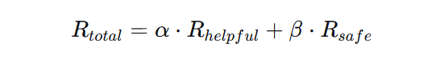{.ocr-src}

- 通过调整 $α$ 和 $β$，可以精确控制模型的行为是在“有用”和“安全”之间偏向哪一边。

- 优点：灵活，可动态调整，各头专注自身任务，效果通常更好。

- 缺点：需要构造多套偏好数据，工程成本略高。

方案二：多阶段训练（Staged Training）

- 流程：
  1. 阶段一（SFT）：在包含安全拒答示例的 SFT 数据上微调，打下安全基础。
  2. 阶段二（有用性 RLHF）：使用仅包含有用性偏好的奖励模型进行 PPO 训练，优化模型的有用性。
  3. 阶段三（安全性 RLHF）：使用仅包含安全性偏好的奖励模型进行 PPO 训练，强化安全行为。

- 优点：每个阶段的目标单一、明确，训练过程简单清晰。

- 缺点：灵活性差，阶段二的优化成果可能在阶段三被部分破坏（遗忘），最终行为难以精确调控。

结论：多奖励头是更优、更主流的方案，因为它通过加权和的方式实现了精细的实时调节，避免了多阶段训练中的遗忘问题。

---

#### PPO 训练时，生成样本的采样策略（温度、top-p）如何影响训练效果？

PPO 训练中，Actor 模型生成用于探索的样本时，其采样策略直接影响训练的效率、稳定性和最终效果。

温度（Temperature, $T$）：

- 低温（T<1）：策略倾向于选择最高概率的 token，生成内容更安全、更确定，但多样性低。
  - 对训练的影响：探索不足。模型可能过早收敛到次优解，因为它没有尝试过那些概率稍低但可能获得更高奖励的路径。PPO 需要一定程度的随机探索来发现更好的策略。

- 高温（$T$>1）：概率分布被拉平，低概率 token 被选中的机会增大，生成内容更多样，但也更容易出现语法错误或胡言乱语。
  - 对训练的影响：方差过大。生成质量的巨大波动会导致优势函数的估计极不稳定，使 PPO 训练难以收敛，甚至崩溃。

最佳实践：在 RLHF 中，通常采用中等偏高的温度（如 $T$=0.8 到 1.1），并结合 top-p 采样来截断尾部噪声，鼓励模型在安全范围内进行充分的探索。

Top-p 采样：

- Top-p 可以动态地调整候选 token 集合的大小。当模型非常确信（概率分布尖锐）时，top-p 只保留极少 token，保证生成质量；当模型不确定（概率分布平坦）时，top-p 会纳入更多 token，鼓励多样性探索。这比固定 k 的 top-k 更灵活。

经验法则：常用的组合是 `temperature=0.9, top-p=0.95` 左右。这个设置在保证生成内容基本可读的前提下，为 PPO 提供了足够的探索多样性。同时，在 PPO 训练的预热阶段，温度可以设得稍高一些，然后随着训练进行逐渐降低。

---

#### 在 RLHF 中使用动态全局奖励归一化有何作用？

动态全局奖励归一化是 PPO 训练稳定性的一个关键工程技巧。其做法是：在训练过程中，实时统计整个训练批次（或一个较大的缓冲区）的奖励值，计算其均值和标准差，然后用 Z-score 标准化公式对每个奖励值进行归一化：

$$
\hat{R} = \frac{R - \mu}{\sigma}
$$

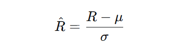{.ocr-src}

作用：

1. 消除奖励值域的漂移：在 PPO 训练中，随着策略模型的更新，它生成的回复分布也在变化，奖励模型给出的分数均值和方差可能会随之漂移。如果不进行归一化，PPO 算法中的优势函数 $A_t$ 的计算将受到这种漂移的严重影响，导致学习信号不稳定。

2. 平衡不同提示的奖励差异：对于某些提示，奖励模型可能天生就给出高奖励（如简单问题），对于另一些则低（如高风险问题）。动态归一化能够将这些不同难度的任务置于同一尺度下，让模型在所有任务上都能获得有效的学习信号，而不是只专注于“刷”高分提示。

3. **提供一致的优化信号**：归一化后的奖励均值约为 0。这意味着，如果模型生成的回复“高于平均水平”，它会得到正奖励（$\hat{R} > 0$），反之会得到负奖励。这使得优化目标变得极其明确：**不断超越自己当前的平均水平。**

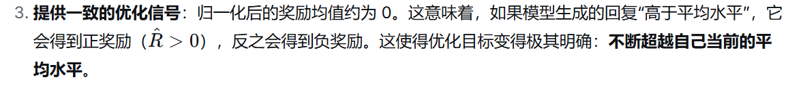{.ocr-src}

3. 与 PPO 的 Clip 机制协同：PPO 的更新幅度受 Clip 范围限制。一个稳定的、归一化的奖励值域，保证了优势函数的绝对值在合理范围内，从而让 PPO 的 Clip 机制能更精确地控制更新步长，防止策略崩溃。

总之，动态全局奖励归一化是 RLHF 训练中一项成本极低但收益极高的技术，它使得调参更容易，训练过程更鲁棒。

---

#### 解释 RLHF 训练中可能出现的不稳定问题，如梯度尖峰、loss 爆炸等，以及应对措施。

RLHF 的 PPO 训练是出了名的不稳定，主要问题及应对措施如下。

1. 奖励模型打分尺度的漂移

- 现象：随着训练的进行，Actor 模型生成的回复分布不断变化，奖励模型会输出越来越大或越来越小的分数，导致 PPO 的 loss 越来越大并最终爆炸。

- 应对措施：
  - 动态全局奖励归一化：如上题所述，这是最有效的方法。
  - Reward Clipping：直接对奖励值进行硬截断，将其限制在一个固定范围（如 [-10, 10]）内。

2. KL 散度失控

- 现象：策略模型的更新方向过于激进，导致 KL 散度在短时间内急剧增大。监控曲线上出现 KL 散度的“尖峰”。

- 应对措施：
  - 增大 KL 惩罚系数 $β$：收紧“安全绳”，强制模型不要偏离参考模型太远。
  - KL 早停（Early Stopping）：一旦 KL 散度超过预设阈值（如 20 nats），立即停止当前 PPO 更新，跳到下一批数据。
  - 使用 Trust Region (TR) 或 Ratio Clipping：PPO 自带的 Clip 机制本身就是一种信任域方法，确保调参合理。

3. 优势函数（Advantage）异常

- 现象：由于奖励值域巨大或 Critic 模型估计不准，优势函数 $A_t$ 的绝对值极大，导致策略更新的梯度范数爆炸。

- 应对措施：
- **优势归一化**：对计算出的 $\hat{A}_t$ 进行 Z-score 标准化，这是 PPO 原论文中的标准实践。
- **梯度裁剪**：直接对全局梯度范数进行裁剪（`max_grad_norm`）。
- **提升 Critic 模型容量**：确保 Critic 模型足够强大，能准确估计价值 $V(s)$。

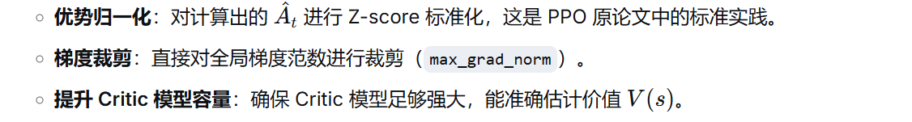{.ocr-src}

4. 策略崩溃（模式坍塌）

- 现象：模型输出多样性急剧丧失，生成千篇一律的回复，甚至生成乱码。

- 应对措施：
  - 降低 PPO Epoch：减少对同一批数据重复使用的次数。
  - 混合预训练梯度（PPO-ptx）：在 PPO 损失函数中加入预训练数据的交叉熵损失，强制模型保持语言能力。
  - 减小学习率。

---

#### 比较 RLHF 与基于对比的偏好对齐方法（如 DPO）在数据需求上的差异。

RLHF (PPO) 和 DPO 对数据的需求存在本质区别，这源于它们优化方式的不同。

| 特征 | RLHF (PPO) | DPO |
| --- | --- | --- |
| 核心数据 | 人类偏好数据，用于训练奖励模型。 | 人类偏好数据，直接用于优化策略模型。 |
| 数据形式 | 偏好对 (提示, 好回复, 差回复)。 | 偏好对 (提示, 好回复, 差回复)。 |
| 数据量需求 | 需求量大、复杂度高。分为两部分：1) 海量、高质量的人类偏好数据用于训练奖励模型。2) 大量无标签的提示用于 PPO 阶段的在线探索和生成。 | 需求单一。只需要一份高质量的人类偏好数据集即可完成训练。 |
| 数据质量要求 | 极高，且要求分布一致。奖励模型训练和 PPO 探索阶段的数据分布不能相差太大，否则奖励模型会失效。 | 极高，但没有分布一致性问题。DPO 直接拟合人类偏好，无需担心后续的分布漂移。 |
| 离线/在线 | 在线（或准在线）。PPO 训练时需要不断用最新策略模型生成新数据，并让奖励模型打分。 | 完全离线。DPO 仅在固定的、预先收集好的偏好数据集上训练一次，简单高效。 |
| 奖励模型 | 必须额外训练。这本身就需要大量数据和计算资源。 | 无需训练。奖励模型被隐式地替代，大大简化了流程和成本。 |
| 标注难度 | 偏好数据的要求一致，但 PPO 还需要大量无标签提示用于探索，这部分无需标注。 | 只需要偏好数据，标注成本相对较低且流程简单。 |

总结：RLHF 的数据需求更为复杂和庞大，它需要一个独立的奖励模型和持续的在线交互。DPO 则极大地简化了这一流程，它将整个对齐问题转化为一个标准的、完全离线的监督学习任务，因此对数据的量要求更低，对标注一致性的要求更高。DPO 的成功之处正是在于它用更少、更简单的人工标注，达到了与 RLHF 可比甚至更优的效果。

