# 47.大模型（LLMs）近端策略优化（PPO） / PPO 中 Actor、Critic、Reference 模型0

#### 简述 PPO 算法的目标函数中 clipping 的作用，写出 PPO-clip 的公式。

PPO 的核心目标函数是 PPO-clip，其最大的创新在于引入了 clipping（裁剪）机制。这个机制的核心作用是防止策略更新步幅过大，保证训练过程的稳定性和可靠性。

在没有 clipping 的传统策略梯度算法中，如果某个动作的优势函数 $A_t$ 很高，算法会鼓励新策略 $πθ$ 在该动

作上的概率比旧策略 $\pi_{\theta_{old}}$ 提升很多倍。这种“大跨步”式的更新极易导致训练崩溃，因为一旦策略进入一个糟糕的区域，就很难恢复。

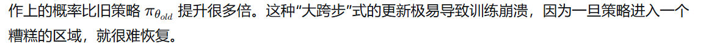{.ocr-src}

**PPO-clip 的公式：**

$$
\mathcal{L}^{CLIP}(\theta) = \mathbb{E}_t \left[ \min \left( r_t(\theta) A_t, \operatorname{clip}(r_t(\theta), 1-\epsilon, 1+\epsilon) A_t \right) \right]
$$

其中：

- $r_t(\theta) = \frac{\pi_\theta(a_t|s_t)}{\pi_{\theta_{old}}(a_t|s_t)}$ 是新旧策略的概率比。

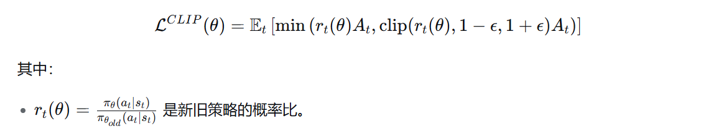{.ocr-src}

- $A_t$ 是优势函数。

- $ϵ$ 是一个超参数，通常取 0.1 或 0.2，用于控制裁剪的幅度。

Clipping 的作用机制：\
这个公式通过 `min` 和 `clip` 函数的组合，实现了一种保守的更新策略。

- **情况一：$A_t$>0（该动作优于平均水平）**

我们希望提升这个动作的概率，即让 $r_t(\theta) > 1$。但 `clip` 函数会将其限制在 $1+\epsilon$ 以下。所以，最终的目标是 $\min(r_t(\theta), 1+\epsilon)$。这意味着即使该动作的优势再大，它对策略的更新幅度也不会超过 $1+\epsilon$。这像是一个“奖励天花板”，防止模型因为某次偶然的高奖励而过度改变。

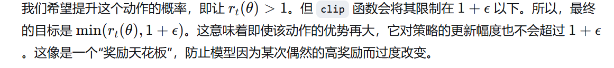{.ocr-src}

**情况二：At≤0（该动作差于平均水平）**

我们希望降低这个动作的概率，即让 $r_t(\theta) < 1$。此时，`clip` 函数会将其限制在 $1-\epsilon$ 以上。最终的目标是 $\max(r_t(\theta), 1-\epsilon)$ 的相反数（通过取 `min` 实现）。这意味着对该动作的惩罚力度也被限制了，不会因为某个动作的偶然失败就从策略中彻底抹除。

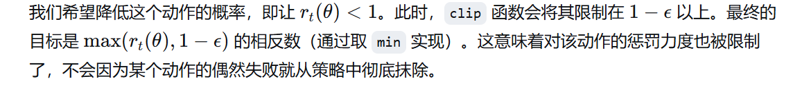{.ocr-src}

通过这种方式，PPO 算法保证了每一步的策略更新都处在一个信任域内，使得训练过程非常平滑，极大降低了对超参数的敏感性。

---

#### 在 RLHF 的 PPO 阶段，Actor、Critic、Reference Model、Reward Model 这四者的关系是什么？

这四种模型在 PPO 阶段的角色，可以概括为一个协作训练的体系。

- Actor Model（策略模型，待优化对象）：这是我们要训练的主角，即最终要得到的对齐好的模型。它在训练循环中不断更新参数。它的任务是根据输入提示，生成回复。

- Reward Model（奖励模型，固定的裁判）：这是在第二阶段独立训练好的模型。在整个 PPO 阶段，它的参数被完全冻结。它的作用是给 Actor 生成的回复打分，提供即时的、自动化的质量反馈。

- Reference Model（参考模型，行为标尺）：这是第一阶段的 SFT 模型。在整个 PPO 阶段，它的参数也被完全冻结。它的作用不是打分，而是计算 KL 散度惩罚。它会对比 Actor 模型当前的生成概率分布与它自己原有的概率分布，防止 Actor 偏离太远。

- Critic Model（价值模型，战略分析师）：这个模型需要随着 Actor 模型的更新而更新。它通常由 Reward Model 或 SFT 模型初始化，但很快会学习出自己的参数。它的任务是估计当前状态（提示+已生成的token）的长期价值 V(s)$V$($s$)。这个价值估计会被用来计算优势函数 $A_t$，从而更稳定地指导 Actor 模型更新。

四者协同工作的流程：

1. 对于一个提示，**Actor** 生成回复。
2. 将回复分别送给 **Reward Model** 和 **Reference Model**，计算 $R_{total} = \text{Reward} - \beta \times \text{KL}(\pi_\theta, \pi_{ref})$。
3. **Critic** 模型根据生成的 token 序列，估计每一步的状态价值 $V(s_t)$。
4. 利用 $R_{total}$ 和 $V(s_t)$，计算出优势函数 $A_t$。
5. 最后，用 $A_t$ 和 PPO-clip 目标函数，**同时更新 Actor 模型和 Critic 模型的参数**。

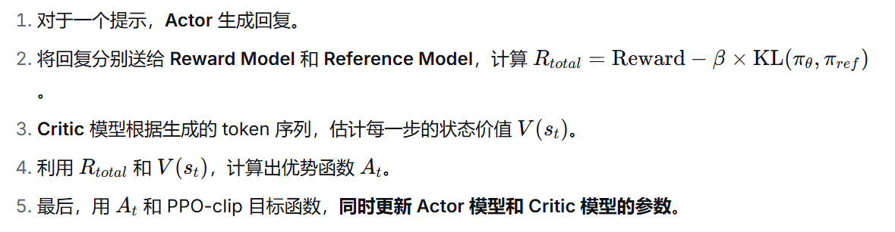{.ocr-src}

---

#### 为什么需要 Reference Model？如果去掉 KL 惩罚只最大化奖励会怎样？

Reference Model 是 RLHF 的安全绳和语言能力保险丝。

如果去掉 KL 惩罚，只最大化奖励，将会是灾难性的。它会直接导致严重的奖励黑客和策略崩溃现象。主要原因有两点：

1. 语言的退化与模式崩溃：奖励模型只是一个不完美的代理。在没有约束的情况下，Actor 模型会迅速发现奖励模型的漏洞，并学会通过生成一些“奖励黑客”文本去骗取高分。例如，它可能生成大量重复的、格式漂亮但内容空洞的废话，或者直接复制提示中的文本。这些“骗分”策略虽然能得到高分，但语言流畅性、逻辑性、多样性会完全丧失。

2. 灾难性遗忘：SFT 模型具备的常识、推理、代码生成等强大能力，在单纯追求高分的过程中会迅速被覆盖。模型会变成一个只会说漂亮话但毫无实质内容的“空壳”。

因此，Reference Model 和 KL 惩罚的存在，本质上是在强制 Actor 模型在保持原有强大语言能力的基础上，进行安全的、有益的优化。它保证了优化方向是一个“帕累托改进”，而不是一场以牺牲语言能力为代价的“分数内卷”。

---

#### Critic 模型（价值网络）是如何初始化的？是随机初始化还是从 Actor 初始化？

Critic 模型不是随机初始化的，也通常不直接从 Actor 初始化。

- 最佳实践：从 Reward Model 初始化。\
  因为 Critic 模型的任务（评估回复的质量）和 Reward Model 的任务（给回复的质量打分）在本质上高度相似。Reward Model 经过训练，已经具备了对文本质量进行评估的强大能力。用它来初始化 Critic 模型，可以让 Critic 在一个非常高的起点上开始学习，极大地加速收敛并提升稳定性。

- 为什么不用 Actor 初始化？\
  Actor 模型是一个语言生成模型，它的输出是一个词表大小的概率分布。而 Critic 模型需要输出一个标量价值。虽然底层架构可以相同，但 Actor 的预训练权重是为“生成”任务优化的，而非“评估”。从 Actor 初始化，Critic 将需要更长的时间来“遗忘”如何生成，并学会如何评估，收敛慢且不稳定。

- 在 RLHF 实践中，通常会在 Reward Model 的基础上，替换掉其打分头（回归头），换成一个新的价值头（Value Head），然后将整个模型作为 Critic。为了保持稳定性，在 PPO 训练的初期，Critic 模型的价值头部分会使用一个较小的学习率。

---

#### PPO 中如何计算优势（Advantage）？GAE 的参数 λ 和 γ 对训练有何影响？

优势函数 $A$($s$,$a$) 回答了“在状态 $s$ 下采取动作 $a$，比平均水平好多少？”的问题。它是 PPO 算法的核心，能有效减少梯度估计的方差。广义优势估计（GAE） 是计算优势的主流方法。

计算流程：

1. Critic 评估：对于生成序列的每一个时间步 $t$，Critic 模型给出状态价值估计 V(st)。

2. 计算即时奖励：Reward Model 给出每个 token 的奖励 $r_t$，通常只在序列末尾给出。因此，模型生成的中间 token 的奖励为 0。

3. **计算 TD 误差**：$\delta_t = r_t + \gamma V(s_{t+1}) - V(s_t)$。它代表了当前步的实际价值 $r_t + \gamma V(s_{t+1})$ 与预期价值 $V(s_t)$ 之间的偏差。
4. **GAE 计算**：$\hat{A}_t = \sum_{l=0}^{\infty} (\gamma\lambda)^l \delta_{t+l}$。这是对未来的 TD 误差进行指数衰减加权求和。

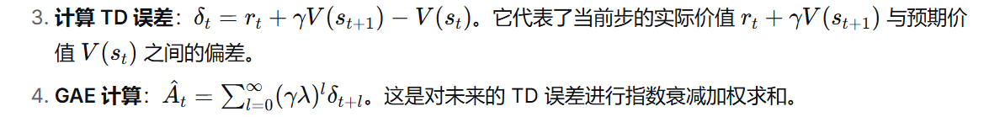{.ocr-src}

参数 $γ$ 和 $λ$ 的影响：

- 折扣因子 $γ$（Gamma）：决定了模型对远期奖励的重视程度。$γ$ 越接近 1，模型越看重长期回报，生成的回复可能更具规划性；$γ$ 越小，模型越短视，只追求眼前的奖励。在 LLM 的 RLHF 中，$γ$ 通常设为 1.0 或接近 1.0（如 0.99），因为我们要优化的是整个回复的最终质量，而不是生成过程中的某个中间 token。

- GAE 参数 $λ$（Lambda）：是平衡偏差和方差的关键旋钮。

- $\lambda = 0$：$\hat{A}_t = \delta_t$。只使用一步 TD 误差，方差最小（因为只依赖一步奖励和 Critic），但偏差最大（因为 Critic 的估计可能不准）。
- $\lambda = 1$：$\hat{A}_t = \sum_{l=0}^{\infty} \gamma^l \delta_{t+l} = \sum_{l=0}^{\infty} \gamma^l r_{t+l} - V(s_t)$。这等价于蒙特卡洛回报，偏差最小（因为使用了真实的累计奖励），但方差最大（因为累计奖励的随机性很大）。

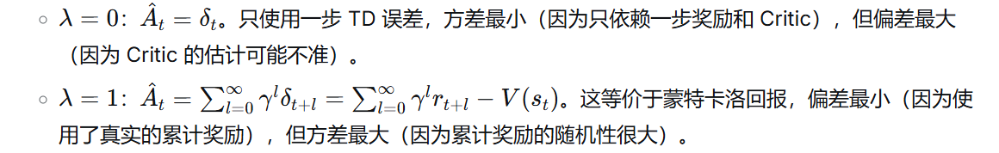{.ocr-src}

- 实践选择：$λ$ 通常取 0.95。它通过指数加权，在偏差和方差之间取得了极好的平衡，使得训练过程既稳定又高效。

---

#### 为什么在 RLHF 中，Actor 通常从 SFT 模型初始化，而不是随机初始化？

如果随机初始化 Actor 模型，将导致三个致命问题。

1. 训练成本不可承受：一个随机初始化的模型需要从零开始学习语言、语法、世界知识和对话能力。这相当于重新进行一次预训练加上 SFT，其计算成本和时间成本是完全不可接受的。

2. 探索空间爆炸，无法收敛：RL 面对的是离散且巨大的词表空间。随机初始化的模型会产生完全随机的文本，几乎不可能“碰巧”生成一个像样的回复。奖励模型无法给这些随机文本提供有意义的学习信号。模型将完全无法收敛。

3. 语言能力的丧失：从 SFT 模型初始化，本质上是为了继承其强大的语言先验。这使得 PPO 的优化不再是“从零开始学说话”，而是“在会说话的基础上，学习怎么说更让人喜欢”。这极大地缩小了搜索空间，让 RL 的微调成为可能。

因此，从 SFT 模型初始化 Actor，是将一个已经被“预训练”和“指令微调”过的、具备强大先验知识的策略，迁移到 RL 环境中进行精细化调优的必然选择。

---

#### 解释 PPO 训练中的“在线”和“离线”样本生成。RLHF 通常是在线还是离线？为什么？

在强化学习中，“在线”和“离线”指的是用于训练的样本是由当前最新版本的策略模型生成的，还是由旧版本的策略模型生成的。

- 在线训练：策略模型在环境中实时交互，生成新的经验样本（状态、动作、奖励），然后立即用这些最新的样本去更新自己的参数。这保证了训练数据与当前策略的分布完全一致。

- 离线训练：使用一个预先收集好的、由某个固定策略（通常是旧版模型）生成的静态经验数据集，来训练当前的新策略模型。

- RLHF 的实际做法：准在线训练。\
  RLHF 中的 PPO 阶段并非完全在线，也不是完全离线，而是一种“准在线”的训练方式。原因在于，如果完全在线，每生成一个新的 batch 的数据，就要用它更新模型，这会导致极大的通信和计算开销。为了提升训练效率，工程上通常的做法是：
  1. 用当前版本的 Actor 模型，对同一批 Prompt 生成大量的回复（进行 rollout），收集一个较大的经验数据包。
  2. 在这个固定的数据包上，进行多个 mini-batch 的 PPO 参数更新（通常是 3-4 个 epoch）。

- 这个过程中，数据是由稍旧一点的策略生成的（因为模型参数在第二步被更新了），所以它不是严格的“在线”。但这种“准在线”的方式，通过在同一个经验数据包上进行小批量多次更新，在保证训练效率（GPU 利用率高）的同时，也大体遵循了在线更新的原则，通过限制更新次数（epoch 数少）来防止过大的策略漂移。

---

#### 在 PPO 训练的每一步，如何生成用于更新的经验批次？描述 rollout 和参数更新的交替过程。

在 RLHF 中，PPO 训练是一个复杂的、多步骤循环的交替过程。每一步训练（一个 PPO 步）大致包含以下流程：

第一阶段：Experience Rollout

1. 采样提示：从数据集中随机抽取一个 batch 的提示。

2. Actor 生成回复：将当前版本的 Actor 模型设置为推理模式，对这批提示生成回复。这个过程称为 rollout。为了鼓励探索，生成时通常会使用较高的温度或 top-p 采样。

3. 多模型协作评估：
- 将生成的回复，连同提示一起，送入**Reference Model**。Reference Model 计算其在这些 token 上的对数概率 $\log \pi_{ref}$。

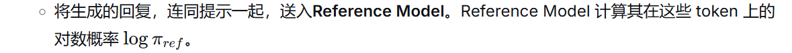{.ocr-src}

  - 将生成的回复送入Reward Model。Reward Model 对整体回复打分，得到奖励 $r$($x$,$y$)。通常只在序列的最后一个 token（EOS token）处赋予奖励值，中间 token 的奖励为 0。
  - 将生成的回复送入Critic Model。Critic Model 估计序列中每个 token 位置的状态价值 $V$($s_t$)。

4. 计算目标与优势：
  - 计算每个 token 的即时奖励 $r_t$（中间 token 为 0，最后为 $r$($x$,$y$)）。

- 根据即时奖励 $r_t$ 和 Critic 的价值估计 $V(s_t)$，使用 GAE 算法计算出每个 token 的优势函数 $\hat{A}_t$。
- 计算每个 token 的 KL 散度惩罚值。
- 计算出用于 PPO 更新的总目标值：$R_{total} = \hat{A}_t - \beta \cdot \text{KL}$。
- Actor 模型在生成时的对数概率 $\log \pi_{old}$ 会被保存下来，作为计算概率比 $r_t(\theta)$ 的基准。

至此，我们已经构建了一个完整的经验 batch，它包含了：提示、回复、$\log \pi_{old}$、$\hat{A}_t$、以及 Critic 的 $V(s_t)$ 估计等所有信息。

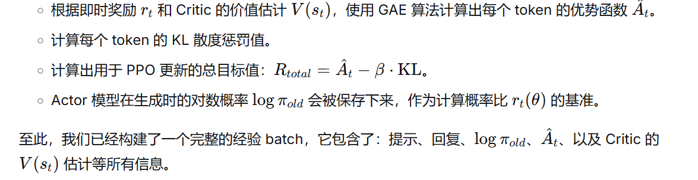{.ocr-src}

第二阶段：参数更新

现在，我们在这个构建好的经验 batch 上，进行多次小批量（mini-batch）的参数更新。

1. 更新 Critic 模型：将经验 batch 中的数据输入 Critic 模型，让它预测 $V$($s_t$)，然后用计算出的 *V target*（由 GAE 得到）作为标签，通过均方误差（MSE）损失来更新 Critic 的参数。这个步骤通常会进行多个 epoch。

2. **更新 Actor 模型**：将经验 batch 中的数据输入 Actor 模型，让它计算当前策略下的 $\log \pi_{new}$。结合之前保存的 $\log \pi_{old}$ 和 $\hat{A}_t$，计算 PPO-clip 损失。同时，可以加入预训练数据的交叉熵损失（PPO-ptx）。用这个总损失更新 Actor 的参数。这个步骤也会进行多个 epoch。

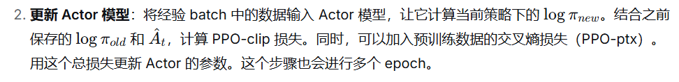{.ocr-src}

完成以上所有步骤后，才算完成了一个完整的 PPO 训练步。然后清空经验 batch，开始下一个循环。这个过程不断重复，直到达到预定的训练步数或 KL 散度超过阈值。

---

#### RLHF 的 PPO 训练中，如何设置 clip range、learning rate 以及 mini-batch 大小？

在 RLHF 的 PPO 训练中，超参数的选择对训练稳定性和最终效果至关重要。以下是一些经过实践检验的经验法则。

1. PPO 裁剪系数 (clip range)

- 典型取值：0.2。这是 PPO 原论文的推荐值，在 RLHF 中同样适用。

- 作用：定义了信任域的半径。`0.2` 意味着新的策略概率与旧策略概率的比值最多相差 20%。

- 影响：
  - 过大（如 0.4）：训练可能不稳定，更新可能过于激进。
  - 过小（如 0.05）：训练会非常稳定，但更新速度极慢，可能需要非常多步才能收敛。对于 RLHF 这种成本高昂的训练，需要找到稳定和速度的平衡点。实践中，0.2 是一个优秀的平衡点。

2. Actor 模型学习率

- 典型取值：1e-6 到 5e-6。

- 为什么这么小？\
  RLHF 是在一个已经非常强大的 SFT 模型上进行微调。我们需要的是“精细雕刻”，而不是“大刀阔斧”。过大的学习率会迅速破坏 SFT 模型已有的语言能力。

- 实践技巧：通常采用带有 warmup 的余弦退火学习率调度。训练初期用 warmup 逐步提升学习率，避免初始不稳定；后期学习率衰减，使模型能精细收敛。

3. Critic 模型学习率

- 典型取值：通常是 Actor 学习率的 2 到 10 倍，例如 1e-5。

- 为什么比 Actor 高？：Critic 模型的价值头是随机初始化的（或从奖励模型微调），它需要从头（或从较低水平）开始学习准确的价值估计。而 Actor 已经在一个很好的初始点上了。因此，Critic 需要更快的更新速度来跟上 Actor 的步伐，提供准确的价值估计，否则会拖 Actor 更新的后腿。

4. Mini-batch 大小与 PPO Epoch

- Mini-batch 大小：取决于 GPU 显存。在显存允许的前提下，更大的 mini-batch 能提供更稳定的梯度估计。对 LLM 而言，一个 PPO batch 通常包含数百个提示，每个提示对应一个回复。然后，这个大数据集会被进一步切分成更小的 mini-batch 用于梯度下降。

- PPO Epoch：指的是在同一个经验 batch 上重复进行参数更新的次数。
  - 典型取值：2 到 4。
  - 原因：次数太少（如 1），数据利用率低，训练慢；次数太多，会因“离线偏差”导致策略漂移，可能损害模型。2 到 4 个 epoch 是在数据利用率和保持在线策略特性之间的一个良好平衡。这个参数需要根据 KL 散度的增长情况动态调整。如果发现 KL 散度增长过快，就需要减少 PPO Epoch。

5. 动态全局奖励归一化

这是一项重要的工程技巧。在 PPO 训练过程中，实时统计奖励的均值和标准差，对奖励值进行 Z-score 标准化。这能让奖励信号的尺度保持稳定，使上述超参数在不同训练阶段都能有效，极大降低了调参的难度。

---

#### PPO 训练时，如何监控和改进训练的稳定性？有哪些常用的 trick（如 reward normalization, advantage normalization）？

RLHF 的 PPO 训练是出了名的敏感和不稳定，但它也有一套行之有效的稳定性工具箱。这些技巧的核心目标是控制梯度信号的尺度、防止策略发生不可逆的崩溃。

核心监控指标：

在 PPO 训练过程中，必须实时监控以下几个核心指标，它们构成了训练状态的“仪表盘”：

- 奖励值：包括原始奖励和归一化后的奖励。原始奖励的均值应在训练过程中健康上升，但不能出现激增或骤降。如果奖励值一直原地踏步或急剧上升，都可能预示着问题。

- KL 散度：这是最重要的监控指标。理想情况下，它应该随着训练步数平滑、缓慢地增长。如果 KL 散度在短时间内出现尖峰或爆炸性增长，说明策略模型正在“跑偏”，远离 SFT 模型。

- 策略熵：衡量 Actor 模型生成概率分布的不确定性。熵值过低意味着模型多样性丧失，正在趋于模式崩溃；熵值过高则可能生成乱码。

- 策略更新幅度的比率 rt(θ)：即新旧策略的概率比。分布应该在 1.0 附近，受限于裁剪范围 `[1-ε, 1+ε]`。如果该比率频繁触及裁剪边界，说明更新可能过于激进。

- Critic 损失和价值估计：Critic 的损失应该在下降。同时，我们要监控 Critic 预测的价值 V(s) 的均值和方差，防止价值估计出现巨大的漂移。

常用的稳定性改进技巧：

1. 奖励归一化 (Reward Normalization)：这是最有效、最基础的技巧。在整个 PPO 训练批次中，计算所有生成回复的奖励分数的均值和标准差，然后对每个奖励进行 Z-score 标准化（减去均值，除以标准差）。这能确保奖励信号始终在均值0、标准差1的稳定范围内，消除了奖励模型打分可能存在的整体漂移。没有这一步，PPO 对奖励值的绝对值极其敏感，调参几乎不可能。

2. **优势归一化 (Advantage Normalization)**：在计算出优势函数 $\hat{A}_t$ 后，对同一批次内的所有优势值进行 Z-score 标准化。这保证了优势函数的均值为0、方差为1，使得梯度的尺度不随任务难度和批次大小而变化，是 PPO 原论文中推荐的标准做法。

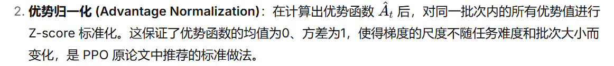{.ocr-src}

3. 梯度裁剪 (Gradient Clipping)：对参数梯度进行全局范数裁剪，限制单步参数更新的最大幅度。这是防止梯度爆炸、导致模型参数突然被推向不可恢复状态的标准防御措施。

4. Critic 学习率独立调整：通常 Critic 的学习率会设置得比 Actor 更高（例如 5-10 倍）。因为 Critic 的价值头需要从相对较低的水平开始学习，而 Actor 已经是一个强大的 SFT 模型了。让 Critic 更快地学习，能为 Actor 提供更准确、更稳定的价值估计和优势信号。

5. 经验回放池的准在线使用：PPO 是 on-policy 算法，但为了提高效率，我们通常采用“准在线”方式。用当前模型生成一批经验后，在这批经验上重复进行数次（如 2-4 个 epoch）更新。这样做需要在“数据利用率”和“策略过时（off-policy）”之间权衡，严格控制更新 epoch 数，并密切监控 KL 散度。

---

#### 为什么 RLHF 中的 PPO 往往只需少量 epochs？多 epochs 会有什么风险？

PPO 在 RLHF 中通常只训练 1 到 4 个 epoch，很多时候甚至每个经验批次只使用一次（1 epoch）。这与传统深度学习动辄几十、上百个 epoch 的训练模式截然不同。

为什么只需少量 epochs？

1. 强大的初始点：PPO 优化的起点是一个经过 SFT 的、已经非常强大的模型。它不需要从零开始学习语言，只需要对输出分布进行“精细雕刻”。少量的几次更新就足以将模型的行为引向期望的方向。

2. On-policy 算法的核心要求：PPO 是 On-policy 算法，其理论前提是用于梯度更新的数据，必须由最新版本的策略模型生成。如果对同一批旧数据反复训练，数据将越来越“过时”，导致梯度计算出现严重偏差。进行少量 epoch，是在数据利用率和保持 On-policy 性质之间的一个折中。

多 epochs 的风险：

- 严重的奖励黑客行为：这是最大的风险。如果允许模型在固定数据集上反复训练，策略模型会很快发现并利用奖励模型的漏洞。例如，它可能学会生成空洞、重复但格式漂亮的文本，或者学会复述问题来骗取高分。这种“刷分”行为在单次 epoch 中很难被完全学会，但多 epoch 训练为它提供了完美的学习环境。

- 策略崩溃与语言能力退化：随着策略模型与旧数据的偏差越来越大，更新方向会偏离正确的优化路径。模型可能开始生成语法混乱的文本，甚至只输出几个固定的高频词。这是不可逆的“策略崩塌”现象，一旦发生，模型通常无法恢复。

- KL 散度失控：多 epoch 训练会使得 KL 散度在每一轮循环后持续累积，最终远超安全阈值。即使设置了 KL 惩罚，模型也可能在多个 epoch 后“跳出”信任域，导致语言流畅性和常识知识被遗忘。

---

#### 解释 Actor 和 Critic 共享参数与分离参数各自的优缺点。

在 RLHF 中，Actor 和 Critic 既可以共享底层参数（一个模型，两个输出头），也可以完全分离（两个独立的模型）。

共享参数 (Shared Backbone)：

- 优点：
  - 训练高效，节省显存：只需要加载和维护一个大型语言模型的参数，这是最大的优势。LLM 的参数量动辄数十亿，复制一份作为 Critic 的显存开销是巨大的。
  - 特征复用，收敛更快：Actor 和 Critic 可以共享对语言的理解和表示能力。Actor 学到的更好的文本表示，可以直接被 Critic 用来更准确地估计价值。

- 缺点：
  - 优化目标冲突：Actor（最大化奖励）和 Critic（最小化价值估计误差）的优化目标不同。共享参数可能导致梯度相互干扰，使得模型在“生成”和“评价”两个任务间难以找到最优平衡。一个过强的 Critic 损失可能会损害 Actor 的生成能力。
  - 训练不稳定：如果 Actor 更新时参数发生剧烈变化，会直接影响 Critic 的评估准确性；而 Critic 不准又会反过来给 Actor 错误的指导，形成恶性循环。

分离参数 (Separate Parameters)：

- 优点：
  - 训练稳定，避免目标冲突：两个模型可以独立地专注于自己的任务，互不干扰。这是最安全、最稳定的方案。
  - 灵活性高：可以为 Actor 和 Critic 选择不同大小的模型，进行更精细的超参数调优。

- 缺点：
  - 计算和显存成本翻倍：需要同时加载和更新两个大型模型，对硬件的要求极高。因此，在实践中，为了控制成本，Critic 模型有时会被做得比 Actor 小一些。

实践选择：在资源有限的情况下，共享参数是更实际的选择。在资源充足且追求极致稳定性时，分离参数是更好的方案。

---

#### PPO 中，策略更新的步长如果太大，会怎样影响模型行为？

策略更新步长太大，意味着 PPO 的训练不受控制，其影响是灾难性的。PPO 的裁剪机制正是为了防止这种情况而设计的。

步长过大的后果：

1. 语言能力彻底崩溃：模型可能会瞬间“忘记”预训练和 SFT 学到的语言知识、语法、词汇，开始输出毫无意义的乱码或不相关的词语。这是最极端的后果，通常表现为损失函数突然爆炸（NaN），模型参数被彻底破坏，无法恢复。

2. 严重的模式坍塌：即使没有立刻崩溃，过大的步长也会将策略推到一个非常狭窄的区域。模型可能突然陷入一个极端的“行为模式”，例如，无论用户问什么，它都只回复“好的，没问题！”这个高奖励的句子。模型失去了生成多种不同回复的能力。

3. 剧烈的 KL 散度尖峰：一次过大的更新会导致 KL 散度瞬间突破天际。这意味着模型已经远远偏离了其语言基础，即使奖励分数看起来还在增加，模型的实际能力已经丧失。

4. 陷入“奖励黑客”的死循环：过大的步长可能让模型一步就跨越到了某个奖励模型的“漏洞”区域，并从此固守在那里，无法被后续的优化拉回正轨。

PPO 的 “clip” 机制和 KL 惩罚正是为了强制将每次的更新步长限制在一个安全范围（信任域）内，确保模型的能力是平滑、渐进地提升的。

---

#### 如何理解 KL 散度惩罚项中的“自适应”系数调整？简述动态调整 β 的方法。

KL 散度的惩罚系数 $β$ 是一个至关重要的超参数，但它很难被设定为一个完美的固定值。一个固定的 $β$ 可能在训练初期太松（导致偏离），在后期太紧（导致优化停滞）。自适应 KL 惩罚系数正是为了解决这个问题而设计的。

核心思想：不预先定义一个固定的 $β$，而是根据 KL 散度的实时变化，动态地调整它。如果 KL 散度过高，就增大 $β$ 收紧限制；如果 KL 散度过低，就减小 $β$ 放宽限制，允许模型进行更充分的探索和优化。

动态调整方法：

一种常见且有效的方法是：设定一个理想的 KL 散度区间 $[KL_{min}, KL_{max}]$。在每个 PPO 更新步之后，计算当前策略 $\pi_\theta$ 与参考模型 $\pi_{ref}$ 的平均 KL 散度 $KL_{current}$。

- **如果 $KL_{current} > KL_{max}$**：说明策略偏离得太多、太快。此时，将 $\beta$ 乘以一个大于 1 的系数（如 1.5 或 2.0），以加强惩罚。
- **如果 $KL_{current} < KL_{min}$**：说明策略还在安全区内，当前的优化可能过于保守。此时，将 $\beta$ 乘以一个小于 1 的系数（如 0.5 或 0.7），以减小惩罚，让模型更大胆地去优化奖励。

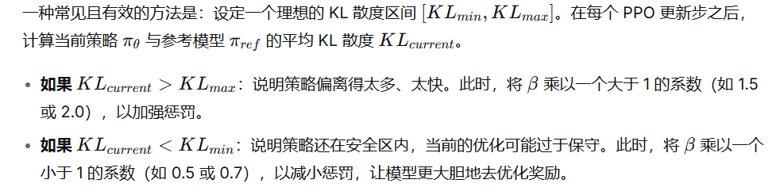{.ocr-src}

通过这种简单的规则，$β$ 就像一个自动调节的“温度控制器”，始终将策略的偏离程度维持在一个健康的区间内，极大地提升了训练的鲁棒性，减少了人工调参的难度。

---

#### RLHF 训练中，价值网络的损失函数通常是什么？MSE 还是 Huber loss？

在 RLHF 的 PPO 训练中，Critic 模型的损失函数通常是 均方误差（MSE），但 Huber Loss 也是一个常见且更鲁棒的选择。

- **MSE Loss**：是最直接、最常用的损失函数。它的目标是让 Critic 模型预测的价值 $V(s_t)$ 尽可能接近通过 GAE 算法计算出的目标价值 $V_{target}$。

$$
\mathcal{L}_{Critic}^{MSE} = \frac{1}{N} \sum_t (V(s_t) - V_{target})^2
$$

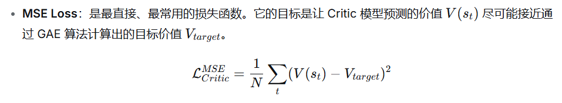{.ocr-src}

- MSE 计算简单，梯度线性，在大多数情况下效果良好。但它的一个缺点是对异常值（outliers）非常敏感。如果某次的奖励或价值估计出现极端值，MSE 会产生巨大的梯度，可能导致 Critic 更新过猛。

- Huber Loss：为了缓解 MSE 对异常值的敏感性，Huber Loss 应运而生。它在误差较小时表现为 MSE（平方误差），在误差较大时表现为 MAE（线性误差）。

$$
\mathcal{L}_{Critic}^{Huber} = \frac{1}{N} \sum_t \begin{cases} 0.5 \cdot (V(s_t) - V_{target})^2, & \text{if } |V(s_t) - V_{target}| \le \delta \\ \delta \cdot (|V(s_t) - V_{target}| - 0.5 \cdot \delta), & \text{otherwise} \end{cases}
$$

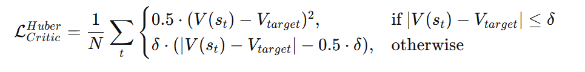{.ocr-src}

- 其中 $δ$ 是一个阈值。在 RLHF 这种奖励信号可能存在噪声和波动的环境下，Huber Loss 能提供更平稳的 Critic 更新，避免单个 bad case 对价值函数造成过大的冲击。

实践选择：MSE Loss 是许多实现（如 HuggingFace TRL）的默认选项。如果发现 Critic 损失曲线震荡剧烈，或者怀疑数据中存在离群点，切换到 Huber Loss 是一个简单有效的优化。

---

#### 解释为什么 Critic 只在 PPO 阶段使用，推理时不用。

这是一个关于模型训练与部署阶段的根本区别问题。

Critic 模型的作用是指导训练，而不是执行任务。它就像一个教练，在运动员（Actor）训练时提供实时指导和反馈，但到了正式比赛（推理），运动员必须独自上场，教练只能在场边观看。

具体来说：

- 训练阶段：Actor 模型需要根据奖励和惩罚来更新自己的“行为”。但是，直接使用原始的奖励信号具有很高的方差，会让训练非常不稳定。Critic 模型的作用就是通过估计一个“基准线”（即状态价值 V(s)），帮助计算出低方差的优势函数 $A_t$，从而更精准地指导 Actor 的更新方向。

- 推理阶段：一旦 Actor 模型训练完成，它的目标就变成了根据用户输入，直接生成高质量的回复。这个过程不需要任何反馈或指导，只需要模型自身强大的生成能力。Critic 模型在推理过程中完全派不上用场。

因此，Critic 模型是一个纯粹的训练辅助工具。它使得 RL 训练过程成为可能，但自身并不具备解决最终用户任务的能力。

---

#### 如果 Critic 估计不准确，会对 Actor 更新造成什么影响？

如果 Critic 模型估计不准确，会对 Actor 模型的学习产生严重的误导。

- **信号失真，导致错误优化**：Actor 的更新依赖于优势函数 $\hat{A}_t = R_{total} - V(s_t)$。如果 Critic 高估了某个状态的价值 $V(s_t)$，那么即使 Actor 采取了一个很好的动作（$R_{total}$ 高），计算出的优势也可能很小，甚至为负数。这会导致一个本应被鼓励的好行为，反而被算法“惩罚”了。反之，如果 Critic 低估了价值，一个平庸的动作也可能获得很高的优势，导致 Actor 朝着错误的方向学习。

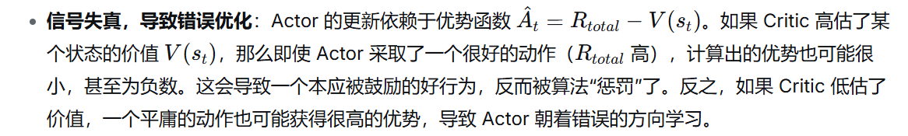{.ocr-src}

- 引入巨大方差，导致训练震荡：不准确的 Critic 就像一个不稳定的基准线，使得每一次估计的优势值都包含巨大的噪声。这种噪声会直接传递给 Actor，导致其梯度的方差极大，训练过程剧烈震荡，难以收敛。

- 导致策略崩溃：在极端情况下，如果 Critic 的估计完全错误，Actor 将在一个完全混乱的反馈信号中学习，其行为会变得毫无章法，极易引发策略崩溃。

因此，确保 Critic 模型足够强大、训练充分且收敛，是 RLHF 成功的关键前提之一。

---

#### PPO 如何平衡探索与利用？在 RLHF 中通常使用哪种采样策略？

平衡探索与利用是所有强化学习算法的核心议题。在 RLHF 中，PPO 通过以下方式实现这种平衡：

采样策略是核心杠杆：

RLHF 中的“探索”不是指模型去尝试从未见过的词，而是指它在生成回复时，根据概率分布随机采样下一个 token，而不是每次都选择概率最高的 token。这种随机性使得模型能够“探索”不同的生成路径和表达方式。

PPO 算法通过 Actor 模型生成回复时的温度参数和 Top-p 采样来控制探索的强度。

- 温度较高（如 T=0.9 或 1.1）：概率分布更平坦，低概率的 token 有更多被选中的机会。这增加了生成的随机性和多样性，属于强探索。

- 温度较低（如 T=0.5 或更小）：概率分布更尖锐，模型倾向于选择最高概率的 token。这减少了随机性，属于强利用（保守生成）。

在 RLHF 实践中，通常采用中等偏高的温度（如 0.8-1.0）并结合 Top-p（如 p=0.95） 的策略。这个设置在保证生成内容基本合理的同时，为 PPO 提供了足够的探索多样性，让它有机会去发现比 SFT 模型更优的表达方式。

其他探索机制：

PPO 的裁剪机制本身也间接地控制了探索。它允许在一定范围内（信任域内）进行探索，但严格禁止过于极端的更新，这使得探索是在一个“安全区”内进行的，不会突然产生荒谬的输出。

---

#### 如何检测 Actor 训练中是否发生“策略崩塌”？

策略崩塌是 RLHF 训练中最致命的失败模式之一，表现为模型的行为突然、不可逆地退化。必须通过严密的监控体系来及时发现。

检测信号：

1. KL 散度激增：这是最直接、最灵敏的信号。如果 KL 散度曲线在短时间内呈指数级上升，说明策略正在迅速远离参考模型，崩塌迫在眉睫。

2. 生成质量的断崖式下跌：这是最直观的表现。定期对 Actor 模型进行人工抽检或自动评估（如用 GPT-4 打分）。如果发现模型开始输出：
  - 大量重复文本：一段话或某个词不断重复。
  - 格式崩溃：例如，在未要求代码的情况下输出大量代码或奇怪的符号。
  - 角色混乱：突然不再遵循对话格式，或在一句话中混合多种角色。
  - 内容空洞：回复变成千篇一律的、无信息的套话。

3. 多样性指标骤降：这是自动化的检测手段。计算生成回复的 Distinct-1/2 分数，或计算同一提示下多次采样结果的 Self-BLEU 值。如果 Distinct 分数急剧下降，而 Self-BLEU 分数迅速上升至接近 1.0，说明模型正在生成完全重复、缺乏多样性的内容，崩塌已经发生。

4. 奖励与质量的背离：训练监控显示奖励分数在上涨，但模型裁判的评分或人工评估的质量却在下降。这是典型的“奖励黑客”信号，意味着模型在通过崩塌的方式来骗取高分。

一旦检测到这些信号，最及时的响应是立即停止当前训练，并回退到上一个稳定的模型检查点。

---

#### PPO 训练的计算开销主要在哪里？如何优化？

RLHF 的 PPO 训练是极其昂贵的，其计算开销主要来自于以下几个环节：

1. 经验生成 (Rollout)：这是最耗时的部分之一。需要让巨大的 Actor 模型（策略模型）对批量提示生成完整的回复。这个过程是自回归的，无法并行加速，且生成长度不一。

2. 多模型的前向传播：对于每一个生成的 token，我们都需要用它来计算：
  - Reference Model 的对数概率（计算 KL 散度）。
  - Critic Model 的价值估计（计算优势函数）。\
    这意味着每一步训练都需要进行至少两次额外的、完整的大模型前向传播（Actor、Reference、Critic）。这些模型通常是同一规模，计算量极其庞大。

3. PPO 参数更新：Actor 和 Critic 模型的反向传播和参数更新，本身也需要消耗巨大的计算资源。

优化技巧：

- LoRA (Low-Rank Adaptation)：不对整个大模型进行全参数微调，而是只训练低秩旁路矩阵。这可以将训练中的可训练参数数量减少上千倍，极大降低显存占用和计算量，使得 PPO 训练可以在更廉价的硬件上进行。

- 模型卸载 (Offloading)：将 Reference Model 和 Critic Model 卸载到 CPU 内存，仅在需要计算时异步加载到 GPU。这可以节省大量 GPU 显存，虽然增加了 CPU-GPU 通信开销，但对降低成本至关重要。

- Critic 模型缩小：实践表明，Critic 模型不需要和 Actor 一样大。使用一个更小的 SFT 模型初始化 Critic，可以在几乎不损失训练效果的前提下，显著降低其前向传播和参数更新的开销。

- 准在线训练与数据复用：如前所述，在一个经验 batch 上执行多个 epoch 的更新，可以在牺牲少量 On-policy 性质的情况下，显著提高数据的利用率和训练的吞吐量。

---

#### 比较 PPO 在标准 RL 环境与在 RLHF 语言模型训练中的实现差异。

标准 RL 环境和 RLHF 语言模型训练中的 PPO，虽然在算法原理上相通，但在工程实现上存在天壤之别。

| 特征 | 标准 RL 环境（如 OpenAI Gym） | RLHF 语言模型训练 |
| --- | --- | --- |
| 动作空间 | 通常是少量离散动作（如“上”、“下”、“左”、“右”）。 | 极其巨大且离散的词表空间（如 32000 个 token）。每一次生成都是在一个有成千上万个选项的类别中进行选择。 |
| 状态空间 | 低维、连续的向量，易于处理。 | 高维、离散的 token 序列，上下文长度可达数千。状态依赖于整个对话历史。 |
| 轨迹长度 | 通常较短，固定步数或很快到达终止状态。 | 可变长度，从一个 token 到数千个 token 不等，没有固定的终止步数。 |
| 奖励信号 | 由环境规则给出，通常是即时、稠密的（如每步都得分）。 | 由不完美的奖励模型给出，且通常是稀疏、延迟的（只在整个回复生成完后给一个总分）。中间生成 token 的奖励为 0。 |
| Actor/Critic 结构 | 通常是参数独立的简单神经网络（MLP/CNN）。 | 共享参数或分离参数的巨型 Transformer 模型，参数量可达数十亿。 |
| 价值函数估计 | 估计基于低维向量的状态价值。 | 估计基于整个对话历史和已生成序列的语言状态的价值，难度极大。 |
| 终止状态 | 由环境规则明确定义。 | 由模型自行生成特殊的 EOS token 来终止，这是一个需要被学习的动作。 |
| 计算开销 | 极低，可在 CPU 上快速进行。 | 极高，需要多卡 GPU 集群，对显存和带宽要求严苛。 |

最主要的差异在于动作空间和状态空间的复杂性与规模，这导致了RLHF中的PPO实现必须围绕如何高效处理巨型Transformer模型、如何处理稀疏奖励以及如何保持语言连贯性来展开。

---

#### 写出在 RLHF PPO 中计算 KL 惩罚的两种方式：通过 log probabilities 和通过奖励形式。

在 RLHF 中，KL 散度惩罚用于约束策略模型 $\pi_\theta$ 的更新不会偏离参考模型 $\pi_{ref}$ 太远。计算这个惩罚有两种等价的方式，但实践中更推荐第一种。

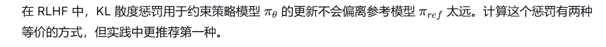{.ocr-src}

方式一：通过 Log Probabilities 直接计算（主流方式）

这是最直接、最标准的方法。在 Actor 模型生成的 token 序列上，分别计算参考模型 $\pi_{ref}$ 和当前策略模型 $\pi_\theta$ 的对数概率。然后，直接计算这两个对数概率的差值的数学期望，作为 KL 散度的无偏估计。

$$
\text{KL}(\pi_\theta \| \pi_{ref}) = \mathbb{E}_{y \sim \pi_\theta} \left[ \log \pi_\theta(y|x) - \log \pi_{ref}(y|x) \right]
$$

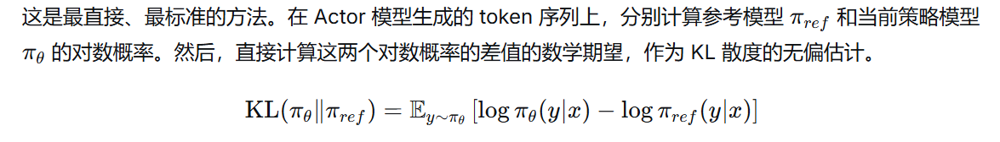{.ocr-src}

在工程实现中，这通常就是逐 token 的对数概率的差值求和。计算出的值是一个正的、无上界的标量。然后在 PPO 的总目标中，会减去这个值乘以系数 $β$。这种方式的好处是理论清晰，直接控制策略的概率分布本身。

方式二：将 KL 惩罚直接融入奖励值（相当于对奖励进行调整）\
这种方式不直接在损失函数中减去 KL 散度，而是在计算每个 token 的即时奖励 $r_t$ 时，就对其进行“KL 惩罚调整”。

具体做法是，对于每个生成的 token $y_t$，其调整后的奖励 $\tilde{r}_t$ 定义为：

$$
\tilde{r}_t = r_t - \beta \cdot \left( \log \pi_\theta(y_t|x, y_{<t}) - \log \pi_{ref}(y_t|x, y_{<t}) \right)
$$

然后将 $\tilde{r}_t$ 作为新的奖励值，用于后续 GAE 优势函数的计算中。这种方法在数学上与方式一等价，因为它改变了奖励，进而改变了优势估计，最终的梯度更新方向是一致的。在一些 RLHF 的实现中，这种方式更便于与现有的 PPO 代码库集成。

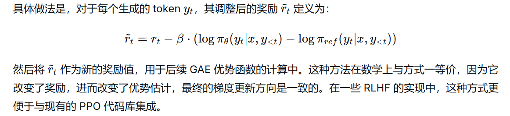{.ocr-src}

核心区别：方式一是“事后惩罚”（在损失函数层面直接加惩罚项），方式二是“事前惩罚”（修改奖励信号）。两种方法最终都能达到约束策略更新的目的。方式一更显式，更容易监控 KL 散度本身；方式二则将 KL 惩罚内化到了 PPO 的奖励处理流程中。在 HuggingFace TRL 等流行的 RLHF 库中，方式一（直接计算 KL 散度并加到损失中）是更常见的做法。

---

#### PPO 训练时，是否需要梯度检查点或 offload 来节省内存？为什么 RLHF 通常更耗显存？

答案是肯定的，梯度检查点和模型卸载是 RLHF 训练中常用的、甚至是必需的显存优化技术。

为什么 RLHF 更耗显存？

RLHF 的 PPO 阶段与标准的有监督微调（SFT）相比，显存占用有数量级的提升，原因在于需要同时承载多个巨型模型：

1. 四模型协同，显存叠加：PPO 训练时，GPU 显存中需要同时存在（或频繁交换）四个大型模型：
  - Actor Model：正在被优化的策略模型，需要参与前向和反向传播，占用的显存最大。
  - Critic Model：价值模型，同样需要参与前向和反向传播。
  - Reference Model：冻结的原始 SFT 模型，需要参与前向传播以计算 KL 散度。
  - Reward Model：冻结的奖励模型，需要参与前向传播以计算奖励分数。\
    即使 Actor 和 Critic 可能共享部分底层参数，但 Reference 和 Reward 模型通常是完全独立的。这四个模型的参数和优化器状态（对于需要更新的 Actor 和 Critic 而言）会迅速占满 GPU 显存。

2. 生成阶段的特殊开销：PPO 的第一步是 Rollout，即 Actor 模型生成回复。这个过程会分配大量的 KV Cache 来加速自回归生成，这本身就是一个显存消耗大户。RLHF 倾向于使用较大的 batch size 来稳定训练，这进一步加剧了 KV Cache 的显存压力。

3. 强化学习的多步过程：PPO 需要维持一个经验池（或一个较大的 batch），包含整个对话历史的隐藏状态、log probabilities、价值估计等，这些中间张量都需要消耗显存。

优化手段：梯度检查点与模型卸载

- 梯度检查点 (Gradient Checkpointing)：这是用来节省 Actor 和 Critic 模型在反向传播时的激活内存。因为 PPO 训练时激活内存极大，使用梯度检查点可以在前向传播时丢弃部分中间激活，在反向传播需要时重新计算，以计算时间换取显存空间。这在 RLHF 中是标配。

- 模型卸载 (Offloading)：这是用来节省 Reference 和 Reward 模型的显存。由于这两个模型在 PPO 阶段完全冻结，不需要计算梯度，我们可以将它们从 GPU 显存卸载到 CPU 内存，仅在需要计算前向传播时才异步地将其权重加载到 GPU。这可以节省出大量显存给需要更新的 Actor 和 Critic 模型。DeepSpeed ZeRO-3 和部分框架的 `offload` 功能正是为此设计的。

- LoRA 等参数高效微调 (PEFT)：通过仅训练低秩适配器，将可训练参数的数量减少数千倍，从而大幅降低 Actor 和 Critic 的优化器状态所占用的显存。这是近年来最有效的显存优化手段之一。

- Critic 模型缩小：实践表明，Critic 模型不需要和 Actor 一样大。使用一个更小的模型作为 Critic，可以在几乎不损失训练效果的前提下，显著降低其占用的显存和计算量。

---

#### 当使用 LoRA 进行 PPO 对齐时，如何设计 Actor 和 Critic 的参数高效方案？

LoRA 和 PPO 的结合是当前最主流的资源友好型 RLHF 方案。核心思路是：只对 Actor 和 Critic 模型注入极少量可训练的 LoRA 参数，同时保持昂贵的 Reference 和 Reward 模型为冻结的全精度或量化模型。

一个典型的、高效的方案设计如下：

1. Actor 模型（策略模型）的 LoRA 设计

- 基座模型：以 SFT 模型作为基座，完全冻结其原始参数。

- LoRA 注入位置：在 Actor 模型的所有线性层（或至少是自注意力层的 Q、V 投影矩阵以及前馈网络的线性层）注入低秩矩阵 $A$ 和 $B$。

- 训练目标：PPO 训练时，只更新这些 LoRA 矩阵，而原始参数保持不变。这大大降低了需要优化的参数量和优化器状态。

2. Critic 模型（价值模型）的 LoRA 设计

- 最优方案：复用 Actor 基座，独立 LoRA 头。Critic 和 Actor 可以共享同一个冻结的 SFT 基座模型，但是各自拥有独立的、分离的 LoRA 适配器。Actor 的 LoRA 专注于生成任务，Critic 的 LoRA 专注于价值评估任务。这种方式最大化地共享了底层表示，同时避免了两个不同优化目标（Actor 和 Critic 损失）之间的梯度冲突。

- 次优方案：独立的 Critic 模型 + LoRA。如果显存允许，Critic 可以使用一个独立的、较小的冻结基座（例如从 Reward Model 初始化），并同样注入 LoRA 适配器。这种方案的训练更稳定，但显存开销更大。

3. 其余模型的处理

- Reference Model：必须是冻结的、不包含任何 LoRA 的原始 SFT 模型。计算 KL 散度需要与优化前的策略进行比较，因此它绝对不能包含 Actor 的 LoRA 参数。

- Reward Model：完全冻结，不使用 LoRA。

4. 训练流程

训练开始时，加载：

- 一个共享的、冻结的 SFT 基座模型。

- Actor 的 LoRA 适配器。

- Critic 的 LoRA 适配器。

- Reference 模型（与 SFT 基座相同，无 LoRA）。

- Reward 模型（冻结）。

通过这种设计，整个 RLHF 训练过程中，真正需要更新和存储梯度的参数只有两组小的 LoRA 矩阵，显存和计算开销得到数量级的降低。这种方案使得在单张消费级显卡（如 24GB）上对 7B 甚至 13B 模型进行 PPO 微调成为可能。

---

#### 在 RLHF 的 PPO 中，Reference Model 需要参与前向计算，是否可以用较廉价的近似？

在 RLHF 中，Reference Model 的作用是计算 KL 散度，作为防止策略偏离的约束。用“廉价”的近似来替代它是可能的，但风险很高，需要谨慎权衡。

潜在方案与风险：

1. 使用量化 (Quantization) 或更小的 Reference Model：将 Reference Model 量化为 INT8 或 INT4，或者直接使用一个参数量更小的 SFT 模型作为参考。
  - 优点：显著降低显存占用和前向计算成本。
  - 风险：KL 散度的计算将变得不准确。由于 KL 散度惩罚是 PPO 优化中关键的约束项，其不准确可能导致惩罚过松（模型实际偏离已很大，但没检测到，引发崩溃）或过紧（限制了有效优化）。这种“近似”的偏差可能会被 PPO 的反复迭代放大，最终导致策略模型的行为不可控。

2. 定期更新 Reference Model (Stale Reference Model)：这是一种策略上的近似。我们并不在每一个 PPO 步都使用最新的、与优化前完全一致的 SFT 模型作为参考，而是使用一个“稍旧”版本的 SFT 模型，或者每隔 N 步才更新一次 Reference Model 的权重。这可以在某些工程实现中提高效率，但本质上引入了偏差。

为什么主流方案不轻易使用廉价近似？

RLHF 的成功很大程度上依赖于稳定性和可复现性。Reference Model 所提供的稳定、精确的 KL 约束是整个 PPO 训练能够收敛而不崩溃的基石。一旦这个基石出现偏差，整个训练过程就会变得不稳定，极易出现奖励黑客、策略崩溃等问题。因此，工业界和学术界的共识是，Reference Model 的计算开销是“必要的成本”，宁可通过硬件和工程优化（如 offload、量化）来承担，也不轻易用不准确的近似来替代其数值精度。

更可行的优化方向：

相比于用近似 Reference 模型，更主流的优化方向是使用 LoRA 进行 PPO 训练。在这种模式下，Actor 模型本身的可训练参数极少，Reference 模型与 Actor 共享冻结的基座模型，需要额外计算的仅仅是 Actor 的 LoRA 权重所带来的一小部分前向开销。这从根本上降低了整体计算量。

---

#### 如果多个 GPU 进行 PPO 训练，如何设计 rollout 与训练的并行？

在多 GPU 环境下，高效并行化 PPO 训练需要精细设计，将生成和经验利用两个阶段进行流水线化。

典型方案：数据并行 + 模型并行 + 流水线式处理

1. 模型放置

- Actor 和 Critic：使用张量并行和流水线并行分布在多张 GPU 上，或使用 ZeRO-3 进行分片。如果使用 LoRA，则基座模型参数被分片，LoRA 参数在每个设备上冗余存储。

- Reference 和 Reward Model：这两个模型只用于推理。它们可以放置在另一组 GPU 上，或者与 Actor/Critic 共享 GPU 但使用低优先级流进行异步推理。为了最大化效率，通常将它们独立部署，形成推理服务流水线。

2. 流水线并行设计

PPO 训练可以天然地分为两个阶段：生成和训练。它们可以被流水线化，以充分利用 GPU 资源。

- 生成阶段 (Rollout)：一组专门用于推理的 GPU（或 GPU 上的一个推理引擎）加载 Actor 模型（通常是 LoRA 适配后的模型），对大量 Prompt 批量生成回复。此阶段主要消耗显存（KV Cache）和推理算力。

- 经验处理与训练阶段：生成的回复、提示等数据被送入一个队列。另一组用于训练的 GPU（或同一组 GPU 在空闲时）从队列中取出数据，执行以下操作：
  - 使用 Reference 和 Reward Model 进行前向计算（可能在这组 GPU 或远程服务上）。
  - 计算优势函数。
  - 对 Actor 和 Critic 模型进行多步 PPO 更新。

- 异步流水线：生成阶段和训练阶段可以异步重叠进行。当训练 GPU 正忙于更新参数时，生成 GPU 可以继续使用旧版本的 Actor 模型生成下一批数据。这实现了“准在线”的训练，其中略微的 Off-policy 偏差可以通过限制数据复用的次数（PPO Epoch）来控制。

3. 关键优化点

- 使用 NCCL 进行高效通信：在模型并行中，All-Reduce 和 All-Gather 是主要瓶颈，需优化通信拓扑。

- 平衡负载：生成和训练阶段的计算时间可能不匹配。需要调整 GPU 数量配比，确保训练 GPU 不会长时间等待新数据，生成 GPU 也不会积压过多数据。

- Distributed Data Parallel (DDP)：在每个模型内部，可以使用 DDP 在多张 GPU 上复制模型副本来加速批量处理。

这种“推理集群 + 训练集群”的分离架构，是训练百亿以上参数模型进行 RLHF 的标准实践。

---

#### 解释“reward model score 漂移”现象，及其如何通过预处理或归一化解决。

现象描述：

在 PPO 训练过程中，随着 Actor 模型参数的不断更新，它生成的回复的分布会逐渐发生变化。这意味着，奖励模型（RM）在 PPO 训练初期看到的数据分布，与在训练中后期看到的数据分布是不同的。由于 RM 是在一个静态的、主要由 SFT 模型生成的数据集上训练的，面对这种新的、分布外的数据，它给出的分数可能会发生整体性的偏移，例如分数整体偏高或整体偏低。

这种“漂移”会导致严重的问题：PPO 算法对奖励的尺度非常敏感。如果 RM 给出的分数整体越来越高，优势函数 $A_t$ 的绝对值会不断变大，导致策略更新幅度不受控制，引发训练崩溃。

解决方案：

1. 奖励归一化 (Reward Normalization)：这是最基本、最有效的策略。在每一个 PPO 训练批次（Batch）中，对 RM 给出的所有回复的奖励分数进行 Z-score 标准化：

$$
\hat{R} = \frac{R - \mu_{batch}}{\sigma_{batch}}
$$

其中 $\mu_{batch}$ 和 $\sigma_{batch}$ 是当前批次奖励的均值和标准差。通过这个操作，奖励信号被强制调整为均值0、标准差1的分布，彻底消除了分数整体漂移的影响。这使得 PPO 算法每次看到的奖励尺度都是稳定和一致的。

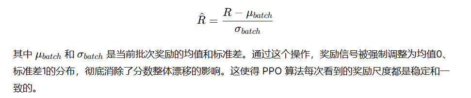{.ocr-src}

2. 在线奖励模型更新：在 PPO 训练过程中，定期利用新生成的数据对 RM 进行微调。这可以保持 RM 对当前数据分布的适应性，但工程实现复杂，成本较高。

3. 固定奖励值域（Reward Clipping）：对 RM 的输出进行硬截断，将其限制在一个固定的范围之内（如 [-10, 10]）。这也能防止奖励值漂移到过于极端的区域。

奖励归一化是一种无成本的、即时的、极其有效的解决方案，它使得 PPO 调参变得容易得多，是 RLHF 训练中的标准实践。

---

#### PPO 训练中，actor loss、critic loss、reward 等指标的变化趋势有什么典型特征？

在健康的 RLHF PPO 训练中，各项指标会呈现出一种协同演进的典型趋势。

- 奖励 (Reward)：无论是原始奖励还是归一化后的奖励，其均值应该呈现出缓慢、持续、健康的上升趋势。这代表 Actor 模型正在按照奖励模型的偏好逐步优化自己的行为。如果奖励值激增或出现尖峰，通常意味着发生了奖励黑客行为。如果奖励值长期停滞，说明优化可能陷入了瓶颈。

- Critic Loss（价值损失）：Critic 的任务是准确估计状态价值，因此其损失（通常为 MSE 或 Huber Loss）应呈现持续下降并趋于收敛的趋势。这表明 Critic 模型在变得越来越“聪明”，能够更准确地预测未来的期望回报。如果 Critic Loss 突然飙升或剧烈震荡，说明 Critic 的学习不稳定，可能无法为 Actor 提供可靠的优势估计。

- Actor Loss（策略损失）：这个指标的解读需要谨慎，因为它与数学上的“损失”不同。在 PPO 中，Actor 的目标是最大化代理目标（Surrogate Objective）。它的变化趋势往往不明显，甚至可能在一个范围内持续震荡。这是正常现象，因为 PPO 的目标函数本身就是一个依赖于优势函数的、动态变化的值。更重要的观察指标是基于 PPO-clip 的 “Clip Fraction”（即 rt(θ) 超出 [1−ϵ,1+ϵ] 范围的比例）。理想情况下，Clip Fraction 应该保持在一个较低的水平（如 10%-20%），这说明更新步长在信任域内，训练稳定。

- KL 散度 (KL Divergence)：这是最重要的健康指标。它应该呈现出平滑、缓慢、可控的上升趋势。初期增长较快，然后逐渐趋于平缓。这表明模型在稳健地探索新的、更好的策略，同时没有偏离原始语言能力太远。如果 KL 散度突然飙升或超过预设阈值，是策略接近崩溃的最明显警告信号。

一个健康的 PPO 训练状态可以概括为：奖励在涨，KL 散度在平稳地涨，Critic 损失在降，Clip Fraction 处于低位。

---

#### 如果只有单轮偏好数据，PPO 是否还能进行有效训练？讨论其局限性。

“单轮偏好数据”指的是仅包含一个 Query 和一个对应的 Human Preference 排序，而没有多轮交互历史的数据。PPO 仍然可以进行有效训练，事实上，绝大多数 RLHF 系统使用的就是这种数据。但这种方式也存在固有的局限性。

为什么可以进行有效训练？

PPO 的训练过程本身是单轮的：对于一个给定的 Prompt，模型生成一个完整的回复（可能包含多个句子），然后 Reward Model 对整个回复给出一个单一的奖励分数。这个过程并不要求模型与用户进行多轮交互。因此，单轮偏好数据完全能够驱动 PPO 训练，教会模型在一次交互中生成高质量的、符合人类偏好的回复。

局限性：

1. 无法捕捉多轮对话的长期奖励：单轮数据训练的模型可能会在追求高分时，生成一个对单轮问题看起来很完美、但可能导致后续对话无法继续的回复。例如，它可能过度承诺或给出一个不容置喙的终极答案，扼杀了进一步讨论的可能。这就像只训练一个棋手走好第一步，却没有教会它如何赢下一整盘棋。

2. 无法学习交互式策略：在真实的多轮对话中，一个好的助手有时会选择不直接回答，而是通过提问来澄清用户意图。这种“反问”策略在单轮数据中可能会被判为低分（因为它没有直接回答问题），但在多轮交互中是极其高明的行为。单轮 PPO 训练会抑制这种行为。

3. 对幻觉的惩罚不够精细：在单轮打分中，人类标注者可能无法仔细核实一个长回复中的每一个事实细节，导致一些包含微妙幻觉的回复依然获得了高分。在多轮交互中，用户会基于上一轮的信息继续提问，模型前一轮的幻觉会迅速暴露并被惩罚。

结论：单轮偏好数据是训练一个“一次性回复”质量很高的模型的有效手段，但它无法替代多轮交互数据在训练长程规划、交互策略、以及深层事实一致性方面的价值。最高质量的对齐往往需要结合单轮和多轮的人类反馈。

---

#### 简述 RLHF 中 PPO 替代方案（如 ReST、RRHF）的基本原理及与 PPO 的比较。

RLHF 中的 PPO 虽然效果强大，但训练不稳定、工程复杂。为此，学术界和工业界提出了一些更简洁、更高效的替代方案。

1. ReST (Reinforced Self-Training)

- 基本原理：ReST 是一种基于离线强化学习和自训练的迭代式方法。它不像 PPO 那样需要在线交互。其流程是：
  1. 生成 (Generate)：使用当前模型（策略）对一个大型 Prompt 数据集生成多个回复，形成一个大规模的离线数据集。
  2. 评分与筛选 (Score & Filter)：使用奖励模型对生成的回复进行评分，根据分数筛选出一个高质量的子集。
  3. 微调 (Fine-tune)：使用这个筛选出的高质量数据集，通过标准的监督微调（SFT）方式，对模型进行下一轮的训练。\
     重复此过程，模型会通过“自我进化”不断变强。

- 与 PPO 的比较：ReST 将复杂的在线 RL 问题简化为离线的“采样-过滤-SFT”循环。它非常稳定、易于实现，完全不需要 Critic 模型和 KL 惩罚。但它的效果高度依赖于奖励模型的准确度，且探索能力受限于初始模型，可能不如 PPO 的在线探索那么深入。

2. RRHF (Rank Response to align Human Feedback)

- 基本原理：RRHF 的核心思想是通过排序损失，将人类偏好直接注入到 SFT 中。它不设计一个独立的奖励模型，也不需要强化学习。
  1. 采样：对于一个 Prompt，生成 K 个不同的回复。
  2. 排序：使用人类偏好（或一个奖励模型）对这 K 个回复进行质量排序。
  3. 训练：使用一个专门的排序损失函数来优化模型。这个损失函数鼓励模型提高它认为“最好”的回复的对数概率，同时降低它认为“最差”的回复的对数概率。本质上，它是在 SFT 中直接融入了对比学习的思想。

- 与 PPO 的比较：RRHF 和 PPO 一样高效，但比 PPO 稳定得多。它避免了复杂的在线 RL 训练和 Critic 模型，直接在标准的 SFT 框架中实现了偏好对齐。它的主要缺点是需要对每个 Prompt 生成多个回复并排序，数据收集成本较高。

总结：

| 特性 | PPO | ReST | RRHF |
| --- | --- | --- | --- |
| 训练范式 | 在线 RL | 离线自训练 | 离线 SFT |
| 稳定性 | 低（需要大量技巧） | 高 | 高 |
| 工程复杂度 | 极高（多模型协同） | 低 | 低 |
| 核心机制 | 优势函数、KL惩罚 | 采样-过滤-SFT | 排序损失 |
| 探索能力 | 强（在线探索） | 中等 | 较弱（依赖初始模型） |

这些替代方案代表了 RLHF 从复杂的在线强化学习向更可控、更易于工业落地的离线学习范式的演进方向。

