# 48.大模型（LLMs）直接偏好优化（DPO）

#### 写出 DPO 的损失函数，并解释它如何直接从偏好对中优化策略。

DPO 的最大创新在于，它将偏好对齐从一个复杂的强化学习问题，转化为一个优雅的、可直接在偏好数据上执行的分类问题。其核心损失函数如下：

$$
\mathcal{L}_{\text{DPO}}(\pi_\theta; \pi_{\text{ref}}) = -\mathbb{E}_{(x, y_w, y_l) \sim \mathcal{D}} \left[ \log \sigma \left( \beta \cdot \log \frac{\pi_\theta(y_w|x)}{\pi_{\text{ref}}(y_w|x)} - \beta \cdot \log \frac{\pi_\theta(y_l|x)}{\pi_{\text{ref}}(y_l|x)} \right) \right]
$$

其中：

- $\pi_\theta$：待优化的策略模型（即我们最终想要的对齐模型）。
- $\pi_{\text{ref}}$：参考模型，通常为 SFT 模型，且在整个 DPO 训练过程中参数被冻结。
- $x$：提示，$y_w$ 和 $y_l$ 分别是偏好数据中的“较好回复”和“较差回复”。
- $\beta$：一个超参数，用于控制对参考模型的偏离程度。
- $\sigma$：sigmoid 函数。

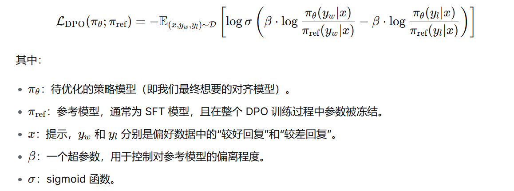{.ocr-src}

它是如何直接从偏好对中优化策略的？

这个损失函数的优化目标极其直观：最大化“较好回复”相对于“较差回复”的隐式奖励边际。公式内部可以看作一个对数几率：

1. 计算奖励边际：括号内的 `β * log(π_θ(y_w|x) / π_ref(y_w|x)) - β * log(π_θ(y_l|x) / π_ref(y_l|x))` 部分，实际上计算了策略模型 $πθ$ 对两个回复的“偏好程度”之差。它衡量的是：相较于参考模型，新策略在多大程度上更偏好 $y_w$ 而不是 $y_l$。

2. 通过 Sigmoid 转化为概率：这个差值通过 sigmoid 函数被压缩到 (0,1) 之间，表示策略模型认为 $y_w$ 优于 $y_l$ 的概率。

3. 最大化对数似然：最后，我们最大化这个概率的对数。这正是标准分类任务中的交叉熵损失。通过梯度下降最小化该负对数似然，模型被强制提升它认为“更好”的回复的相对概率，同时降低“更差”的回复的相对概率。

关键洞察：DPO 绕过了显式训练奖励模型的步骤，直接用偏好数据来更新策略模型。这是因为从数学上，最优奖励函数可以由策略模型和参考模型的对数概率比隐式表示。因此，偏好数据可以直接用来指导策略模型的更新，无需学习一个独立的奖励模型。

---

#### DPO 如何隐式地包含奖励模型？推导 DPO 损失与 Bradley-Terry 模型下奖励最大化的等价关系。

DPO 并没有显式地训练一个奖励模型，而是通过一个巧妙的数学变换，将奖励模型“隐藏”在了策略模型内部。其核心在于 RLHF 中 PPO 目标函数的最优解具有的特殊结构。

推导过程：

1. **RLHF 的 PPO 目标函数**：在 RLHF 中，我们的目标是最大化奖励模型给出的分数，同时最小化与参考模型 $\pi_{\text{ref}}$ 的 KL 散度。

$$
\max_{\pi_\theta} \mathbb{E}_{x \sim \mathcal{D}, y \sim \pi_\theta(y|x)} \left[ r_\phi(x, y) \right] - \beta \cdot \text{KL} \left( \pi_\theta(y|x) \| \pi_{\text{ref}}(y|x) \right)
$$

2. **该目标函数存在解析解**：通过变分法可以证明，这个带 KL 约束的奖励最大化问题，其最优策略 $\pi^*(y|x)$ 具有以下封闭形式：

$$
\pi^*(y|x) = \frac{1}{Z(x)} \pi_{\text{ref}}(y|x) \exp \left( \frac{1}{\beta} r_\phi(x, y) \right)
$$

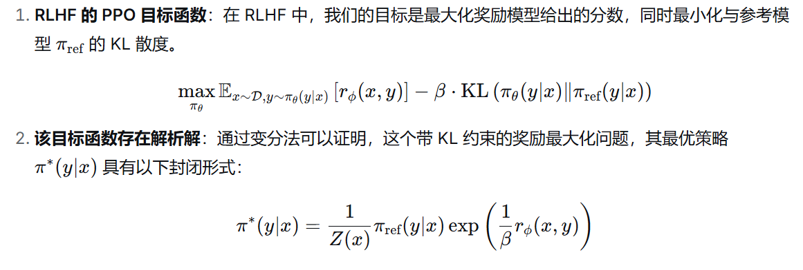{.ocr-src}

其中 $Z$($x$) 是配分函数，一个与 $y$ 无关的归一化因子。

3. 重写奖励函数：对这个等式两边取对数并重新排列，我们可以将奖励函数 rϕ(x,y)$rϕ$($x$,$y$) 用策略模型和参考模型表示出来：

$$
r_\phi(x, y) = \beta \cdot \log \frac{\pi^*(y|x)}{\pi_{\text{ref}}(y|x)} + \beta \cdot \log Z(x)
$$

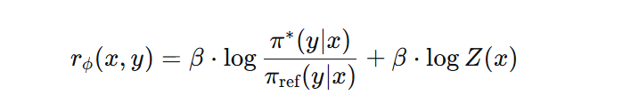{.ocr-src}

这个公式是 DPO 的数学基石。它告诉我们：最优策略隐含地定义了奖励函数。奖励值可以由策略模型和参考模型的对数概率比来表征。

4. **代入 Bradley-Terry 偏好模型**：人类偏好通常用 Bradley-Terry 模型来描述，即认为人类偏好 $y_w \succ y_l$ 的概率取决于两者之间隐式奖励的差值：

$$
P(y_w \succ y_l|x) = \sigma \left( r(x, y_w) - r(x, y_l) \right)
$$

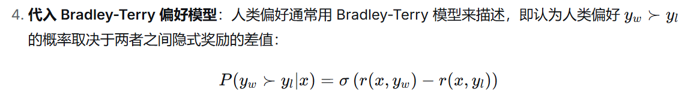{.ocr-src}

现在，我们将上一步推导出的 rϕ(x,y)代入这个偏好公式中。此时，与 $y$ 无关的项 Z(x) 在差值中被巧妙地抵消了：

$$
r(x, y_w) - r(x, y_l) = \beta \cdot \log \frac{\pi^*(y_w|x)}{\pi_{\text{ref}}(y_w|x)} - \beta \cdot \log \frac{\pi^*(y_l|x)}{\pi_{\text{ref}}(y_l|x)}
$$

{.ocr-src}

5. 得到 DPO 损失函数：将这个差值代入 Bradley-Terry 模型，并对偏好数据集 DD 取负对数似然，我们便得到了 DPO 的损失函数：

$$
\mathcal{L}_{\text{DPO}}(\pi_\theta; \pi_{\text{ref}}) = -\mathbb{E}_{(x, y_w, y_l) \sim \mathcal{D}} \left[ \log \sigma \left( \beta \cdot \log \frac{\pi_\theta(y_w|x)}{\pi_{\text{ref}}(y_w|x)} - \beta \cdot \log \frac{\pi_\theta(y_l|x)}{\pi_{\text{ref}}(y_l|x)} \right) \right]
$$

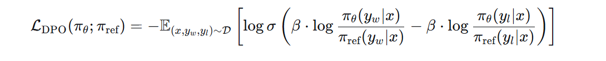{.ocr-src}

价关系：这个过程完美地证明了，优化 DPO 损失函数，等价于在 Bradley-Terry 偏好模型下，直接优化一个隐式定义的奖励函数，并且该奖励函数自动满足了带 KL 约束的最优策略条件。DPO 用一个巧妙的数学变换，将强化学习问题转化为了一个标准的分类任务。

---

#### DPO 对比 RLHF，最大的优势是什么？它在哪些场景下可以取代 RLHF？

DPO 最大的优势可以总结为一句话：化繁为简，稳如泰山。它将一个复杂的、多阶段的在线强化学习过程，转变为一个简单、稳定、完全离线的监督学习任务。

DPO 相对于 RLHF (PPO) 的主要优势：

- 训练极为稳定：RLHF 的 PPO 阶段由于其在线策略、多模型协同的特性，是一个出了名的难以收敛、对超参数极其敏感的“噩梦”。DPO 则完全避免了这些问题，其损失函数是标准的交叉熵，优化过程平稳可控，几乎不需要复杂的调参技巧。

- 工程实现极其简单：RLHF 需要同时维护和更新 Actor、Critic、Reference、Reward 四个巨型模型，这对 GPU 显存和分布式训练框架是巨大的挑战。DPO 只需要两个模型（策略模型和参考模型，甚至参考模型都可以用旧检查点替代），计算开销和显存占用大幅降低。这意味着团队可以用更少的资源、更短的时间完成训练。

- 无奖励模型，避免了奖励黑客：RLHF 的阿克琉斯之踵是其独立训练的奖励模型，它可能被策略模型利用而导致奖励黑客行为。DPO 没有显式的奖励模型，它直接利用偏好数据优化策略，从根本上消除了这一风险。

- 理论优雅，一步到位：DPO 通过数学推导证明了其训练目标与带 KL 约束的奖励最大化完全等价。它不再需要像 RLHF 那样分三阶段进行，而是直接在偏好数据上一步完成对齐，流程简洁优美。

DPO 可以在哪些场景下取代 RLHF？

DPO 的出现，已经在绝大多数应用场景中取代了 RLHF，成为业界新的标准：

- 通用模型的偏好对齐：如 Mistral、Zephyr、Qwen 等众多开源模型都采用 DPO 进行对齐训练，证明了其在通用场景下的有效性。

- 资源受限的团队：对于无法负担 RLHF 高昂的计算和人力成本的中小型公司或研究机构，DPO 是进行偏好对齐的理想选择。

- 快速迭代的实验场景：DPO 的简单高效使得研究人员可以快速验证新的偏好数据、新的对齐策略，极大地加速了实验周期。

目前，DPO 尚不能完全取代 RLHF 的场景是：

- 需要极强在线探索的任务：在某些复杂推理或创造性任务中，RLHF 的在线探索机制可能使其在探索更优回复方面具有理论上的优势，而 DPO 受限于离线数据的质量。不过，最新的在线 DPO 变体正在弥合这一差距。

---

#### DPO 训练是否需要奖励模型或 Critic？它需要 Reference 模型吗？

DPO 不需要奖励模型，也不需要 Critic 模型。 这正是其革命性所在。DPO 利用巧妙的数学重构，将奖励函数内化为了策略的一部分。

- **奖励模型**：在 DPO 的损失函数中，只有策略模型 $\pi_\theta$ 和参考模型 $\pi_{\text{ref}}$，没有奖励模型 $r_\phi$。偏好信号是通过比较策略模型分配给 $y_w$ 和 $y_l$ 的概率差异来直接驱动的。

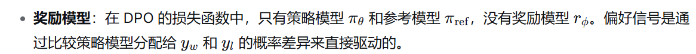{.ocr-src}

- **Critic 模型：**DPO 是完全离线的训练，不涉及在线交互和优势函数的计算，因此也不需要 Critic 模型。

DPO 需要 Reference 模型。 参考模型 $\pi_{ref}$ 在 DPO 中扮演着两个至关重要的角色：

1. 防止策略偏离的“定海神针”：如果没有参考模型，DPO 损失函数会退化为单纯最大化正确回复的概率，这可能会导致模型丧失多样性。参考模型作为约束，确保优化后的策略不会与最初的 SFT 模型相差太远，从而保留了 SFT 阶段学到的广泛能力。

2. **定义奖励函数基准的“参照系”**：从 DPO 的推导公式 $r(x, y) = \beta \cdot \log \frac{\pi_\theta(y|x)}{\pi_{\text{ref}}(y|x)}$ 可以看出，参考模型是计算隐式奖励的基准。它为策略模型的更新提供了一个对比的参照系，使得优化方向是“相对于初始状态有了多少提升”，而不是盲目地追求高概率。

**实践中如何使用 Reference Model?**

- $\pi_{\text{ref}}$ 通常是 SFT 阶段的模型，在 DPO 训练开始前就被完全冻结，其参数在训练过程中不发生变化。我们只需要用它来计算一次对数概率，然后作为常数用于 DPO 损失的梯度计算中。

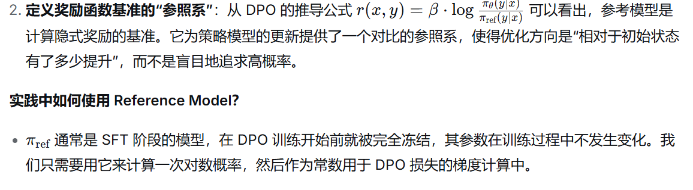{.ocr-src}

---

#### DPO 损失中参数 β 的作用是什么？它与 RLHF 中的 KL 惩罚系数有何对应关系？

DPO 损失函数中的参数 $β$ 是一个关键的温度或缩放因子，它与 RLHF 中 PPO 目标函数里的 KL 惩罚系数 $β$ 在数学上完全等价，扮演着相同的角色。

DPO 中 β 的作用：

$\beta$ 控制了策略模型 $\pi_\theta$ 与参考模型 $\pi_{\text{ref}}$ 的偏离程度，直接决定了偏好优化的强度。

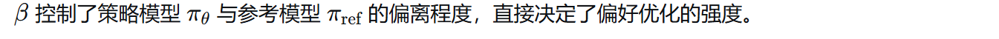{.ocr-src}

- β 值较小时：策略模型“更敢冒险”。在 DPO 损失中，`log` 项前乘以一个较小的 $β$，相当于放大了策略模型对 $y_w$ 和 $y_l$ 概率比的影响。优化会更激进，模型会更大胆地提升高奖励回复的概率。这容易获得更高的奖励，但也增加了偏离参考模型、导致过拟合和语言能力退化的风险。

- β 值较大时：策略模型“更加保守”。乘上较大的 $β$ 会抑制概率比的变动幅度，优化更温和，模型更贴近参考模型的行为。这使得训练过程更加稳定，但可能导致模型在偏好对齐上的改进不够明显。

与 RLHF 中 KL 惩罚系数 β 的对应关系：

在 RLHF 的 PPO 目标函数中，其优化目标是 $\mathbb{E}[r(x, y)] - \beta \cdot \text{KL}(\pi_\theta, \pi_{\text{ref}})$。这里的 $\beta$ 与 DPO 损失中的 $\beta$ 是**同一个超参数**，具有完全一致的功能和数学意义。两者的目标函数可以证明是等价的，DPO 的推导正是从这个 PPO 目标出发。因此，在这两个框架下，$\beta$ 都充当着“优化强度”和“保真度”之间的调节旋钮。

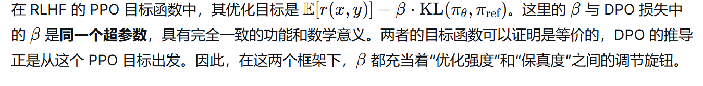{.ocr-src}

---

#### DPO 训练时，策略模型通常从哪个模型初始化？为什么推荐使用 SFT 模型？

DPO 训练的策略模型，必须、且总是从 SFT 模型初始化。这不仅是推荐，更是 DPO 算法理论和实践上的必然要求。

原因一：理论上的严格一致性

DPO 的整个推导过程都基于一个核心假设：**参考模型 $\pi_{\text{ref}}$ 就是优化过程的起点，并且它已经是一个具备强大语言能力的模型**。SFT 模型 $\pi_{\text{SFT}}$ 正是扮演这个起点的最佳角色。如果我们使用 SFT 模型来初始化 $\pi_\theta$ 和 $\pi_{\text{ref}}$，那么在训练开始时，$\pi_\theta = \pi_{\text{ref}}$，隐式奖励 $r(x, y) = 0$，模型处于一个完美的中性、稳定状态。优化过程可以平稳地展开。

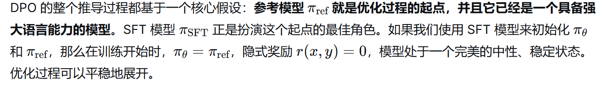{.ocr-src}

原因二：防止灾难性遗忘

对齐训练的前提是模型已经具备强大的通用能力。如果从预训练基座模型直接进行 DPO 训练，模型将同时面临“学习对齐偏好”和“保持基础语言能力”的双重挑战，极易导致基础能力的崩溃。DPO 假设参考模型已经是一个足够好的模型，优化是在这个基础之上进行的微调。

原因三：实现“单阶段”对齐的高效路径

最优雅的 DPO 实践是：预训练模型 → **SFT (得到 $\pi_{\text{SFT}}$)** → **DPO (用 $\pi_{\text{SFT}}$ 初始化并作为参考模型)**。在 SFT 阶段，模型学会了基本的指令遵循能力；在 DPO 阶段，模型在此基础上进一步学习人类偏好。这种顺序不仅流程清晰，而且效果卓著。因此，使用 SFT 模型初始化 DPO，是经过理论推导和实践检验的、能够最大化对齐效果并最小化副作用的唯一正确路径。

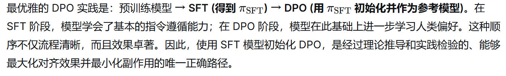{.ocr-src}

---

#### DPO 数据格式与 RLHF 奖励模型训练数据格式有何异同？

核心相同点：

两者使用的数据在最顶层形式上是完全一样的，都是偏好对比数据。每一组数据都必须包含以下核心要素：

- $x$: 提示。

- $y_w$: 人类认为更好的回复。

- $y_l$: 人类认为更差的回复。

关键不同点：

虽然数据格式相同，但它们在两个框架中的使用方式和地位有本质区别。

- 在 RLHF 中：偏好数据是中间产物，用于训练奖励模型。奖励模型是独立于生成模型之外的一个评分模型。PPO 训练时使用的是大量的提示（无需偏好标注），由奖励模型在线打分。

- 在 DPO 中：偏好数据是最终训练数据，直接用于更新策略模型的参数。DPO 不再需要奖励模型这个中间环节，因此也不需要 PPO 所需的那些无标注的提示数据。

标注质量要求的差异：

这个差异至关重要。在 RLHF 中，奖励模型训练数据的质量间接影响最终模型，其误差可能会被 PPO 放大或扭曲。而在 DPO 中，偏好数据的质量直接决定了最终模型的行为，因为 DPO 是在此数据上直接拟合。因此，DPO 对偏好数据中的噪声、标注不一致性更为敏感。

对比总结：RLHF 将偏好数据作为奖励模型的“教材”，再通过 PPO 这个“教练”去训练策略模型；而 DPO 直接将偏好数据作为策略模型的“教材”，一步到位。DPO 的成功与否，更大程度上依赖于这本“教材”本身的质量。

---

#### DPO 训练过程中，是否可能出现对 chosen 过拟合？如何检测和缓解？

是的，DPO 训练中非常容易出现对 chosen 过拟合的问题。这是因为 DPO 的目标是最大化 $y_w$ 相对于 $y_l$ 的概率比。如果训练不当，模型可能会学会简单地“死记硬背” $y_w$，而不是学习背后的通用偏好。

如何检测过拟合？

1. 监控验证集损失：这是最基础的指标。如果在训练集上损失持续下降，而在一个独立的验证偏好数据集上损失反而上升，就是过拟合的典型信号。

2. 监控生成质量：在训练过程中，定期用模型进行实际的生成评估。如果发现模型的回复开始变得重复、缺乏创意，或者仅仅是在复述训练集中 $y_w$ 的模式，这比看任何曲线都更直接地反映了过拟合。

3. 监控 KL 散度：计算当前策略模型与参考模型在验证集上的 KL 散度。如果 KL 散度持续、不受控地攀升，表明模型正在远离其语言基础，很可能在过拟合偏好数据。

4. **监控 chosen 和 rejected 的概率比**：观察损失函数内部的核心部分——$\log(\pi_\theta(y_w)/\pi_{\text{ref}}(y_w)) - \log(\pi_\theta(y_l)/\pi_{\text{ref}}(y_l))$ 的分布。如果这个差值变得异常巨大，说明模型在 $y_w$ 和 $y_l$ 上分配的概率失衡，是过拟合的表现。

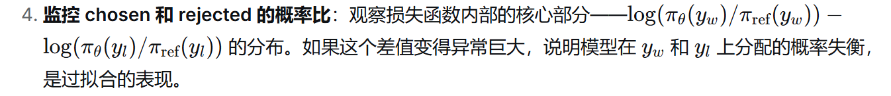{.ocr-src}

缓解过拟合的方法：

1. 增大超参数 β：这是最直接、最有效的方法。增大 β 相当于加强了对参考模型的约束，限制策略模型的偏离程度。

2. 数据增强：对同一偏好对，可以对 $y_w$ 进行同义改写，构造出多个不同的正样本，让模型学习更通用的“好”的模式，而不是死记一个特定表述。

3. 早停 (Early Stopping)：在模型性能达到最佳时及时停止训练。

4. 加入 SFT 数据作为正则化：在 DPO 的损失函数中，可以混合一部分 SFT 数据（即优质的指令-回复对）的交叉熵损失。这类似于 PPO-ptx，强迫模型在偏好对齐的同时，不忘记它最初的语言建模能力。

5. 降低学习率：使用更小的学习率进行更平稳的微调。

---

#### 为什么 DPO 被认为是“离线”偏好优化方法？其优缺点是什么？

为什么 DPO 是“离线”的？

“离线”指的是模型训练所需的经验数据（即偏好对）是在训练开始之前就已经全部收集好的，形成一个固定、静态的数据集。在训练过程中，模型不再与环境进行任何交互，也不需要生成新的回复并获取反馈。

- 在 RLHF 的 PPO 中，模型需要在线地生成回复，然后将回复送给奖励模型打分，再用这个即时的分数去更新自己。这是一个动态的、循环的交互过程。

- 而在 DPO 中，所有的偏好对都在训练前标注完毕，训练仅仅是在这个静态数据集上进行监督学习。它不像 PPO 那样需要与一个外部世界（即奖励模型）进行持续交互。

优点：

1. 极高的稳定性和可复现性：离线训练避免了在线 RL 中因探索、奖励漂移等带来的不稳定性。只要固定数据集和超参数，多次训练的结果非常一致。

2. 极低的计算成本和工程复杂度：不需要在训练过程中实时调用多个大型模型（如 Reference、Critic）。整个流程就是一个标准的监督微调，在 Hugging Face 上几行代码即可实现。

3. 数据一次性标注，重复利用：偏好数据集标注完成后，可以在后续的多次实验和模型迭代中重复使用，降低了长期的标注成本。

4. 安全可控：所有训练数据在训练前都可进行安全审查和清洗，避免了模型在在线探索中生成不可控的危险内容。

缺点：

1. 无法超越标注数据的质量上限：模型的性能完全受限于已有的离线偏好数据。如果数据中的“好回复”本身质量不高，模型就无法学到比这更好的行为。RLHF 的在线探索则有可能发现并奖励那些超越人类标注者的回复。

2. 缺乏在线探索：DPO 无法通过试错去发现新的、更高明的回复策略。它只能模仿数据中已有的模式。这对于需要高度创造性和策略性的复杂任务来说，可能是一个天花板。

3. 对数据集质量和分布非常敏感：如果离线数据集与真实应用场景存在分布偏差，DPO 模型的表现会大打折扣。而在线方法可以通过持续与环境交互来适应动态变化的需求。

---

#### 对比 DPO 与 RLHF 在训练稳定性、计算开销和实现复杂度上的差异。

| 维度 | DPO | RLHF (PPO) |
| --- | --- | --- |
| 训练稳定性 | 极高。本质上是一个标准的监督学习任务，使用交叉熵损失，优化过程平稳可控。 | 极低。在线强化学习阶段非常敏感，容易出现奖励黑客、策略崩溃和 KL 散度爆炸等问题。 |
| 计算开销 | 较低。只需要加载策略模型和参考模型即可完成训练。 | 极高。需要同时维护 Actor、Critic、Reference 和 Reward 四个大型模型，显存和计算消耗巨大。 |
| 实现复杂度 | 非常简单。一个标准的微调流程，在 Hugging Face 上几行代码即可实现。 | 极其复杂。需要实现 PPO 算法、GAE 优势估计、多模型协同调度等多个组件，工程挑战巨大。 |

总结：DPO 在稳定性和效率上具有压倒性优势，而 RLHF 在线探索的能力在理论上更为强大。在实际应用中，DPO 已成为绝大多数场景的首选。

---

#### DPO 在训练时，如何利用 reference model 限制策略偏离？写出相关项。

DPO 通过损失函数中的一个“隐式惩罚项”来限制策略偏离。当策略模型 $\pi_\theta$ 试图给某个回复赋予过高或过低的概率时，参考模型 $\pi_{\text{ref}}$ 的对数概率会起到平衡作用，防止 $\pi_\theta$ 偏离太远。

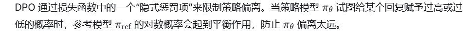{.ocr-src}

DPO 损失函数的梯度具有如下形式：

$$
\nabla_\theta \mathcal{L}_{\text{DPO}}(\pi_\theta; \pi_{\text{ref}}) = -\beta \mathbb{E}_{(x, y_w, y_l) \sim \mathcal{D}} \left[ w(x, y_w, y_l) \cdot \left( \nabla_\theta \log \pi_\theta(y_w|x) - \nabla_\theta \log \pi_\theta(y_l|x) \right) \right]
$$

其中 $w(x, y_w, y_l)$ 是权重项，它本身就依赖于 $\pi_\theta$ 和 $\pi_{\text{ref}}$ 的差值。这个梯度项表明，DPO 的更新方向是同时“提升” $\pi_\theta(y_w|x)$ 和“降低” $\pi_\theta(y_l|x)$。而参考模型 $\pi_{\text{ref}}$ 隐式地出现在权重 $w$ 中，从而影响每次更新的强度。当策略模型试图偏离参考模型太远时，权重项会自适应地调整，形成一个软性的、动态的约束，这比 PPO 中显式的 KL 惩罚更为优雅。

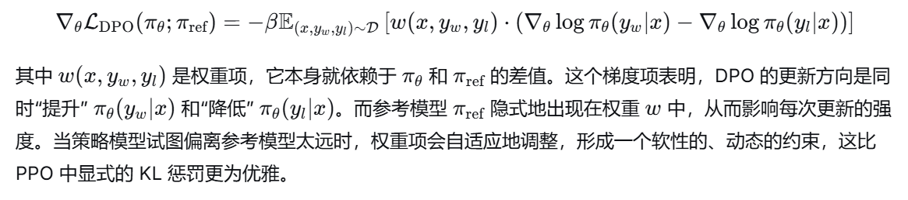{.ocr-src}

---

#### 如果缺少负样本（rejected）而只有正向数据，能否直接使用 DPO？如何变通？

不能直接使用标准的 DPO，因为 DPO 损失函数的核心是比较 chosen 和 rejected 回复。如果只有正向数据，DPO 将退化为一个毫无意义的优化任务。但可以通过以下变通方法将其转化为可用的偏好学习任务：

1. 从 SFT 模型或早期检查点生成负样本：使用当前的 SFT 模型或更早期的训练检查点，对正向数据中的提示生成回复。这些生成回复的质量通常低于人工标注的 chosen 回复，因此可以作为天然的负样本，构造出偏好对。

2. 使用“退化策略”构造负样本：对已有的高质量 chosen 回复，通过添加噪声、随机截断、替换关键词或改变风格等方式，人为构造出质量较低的负样本。

3. 使用其他奖励信号：如果能够获取到用户的行为数据（如点赞、点踩），可以将点踩的回复作为负样本，点赞的作为正样本。

---

#### 解释 DPO 中 implicit reward 的概念，以及如何用它评估训练进展。

**Implicit Reward（隐式奖励）** 是 DPO 推导中自然产生的一个关键概念。它指的是利用策略模型 $\pi_\theta$ 和参考模型 $\pi_{\text{ref}}$ 的对数概率比，可以隐式地表示出当前策略认为一个回复有多“好”。其定义公式为：

$$
\hat{r}_\theta(x, y) = \beta \cdot \log \frac{\pi_\theta(y|x)}{\pi_{\text{ref}}(y|x)}
$$

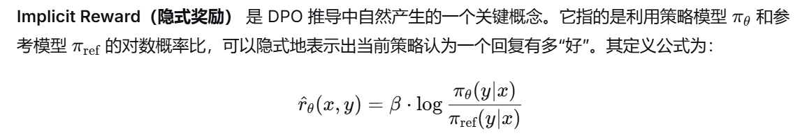{.ocr-src}

这个值不需要额外的奖励模型就能计算出。在训练过程中，它可以作为一个核心指标来评估进展：

- 正负样本的分数差：一个健康的训练过程，chosen 回复的隐式奖励分数应该持续高于 rejected 回复的分数。两者之间的差距越大，说明模型越能准确区分好坏。

- 分数的整体趋势：chosen 回复的隐式奖励应逐步上升，代表模型认为好回复的质量越来越高。

---

#### DPO 训练后，模型有时出现输出重复或退化，可能是什么原因？

DPO 训练后模型出现输出退化，通常是由于偏好数据与模型原始分布不匹配，或优化强度过大导致的。

1. 过拟合到偏好数据：这是最常见的原因。DPO 的目标是最大化 chosen 回复的相对概率。如果训练过度，模型会死记硬背 chosen 回复的模式，丧失泛化能力和语言多样性。解决方案是采用早停、增大 β 值或混入 SFT 数据进行联合训练。

2. KL 散度失控：虽然 DPO 隐式地包含了对偏离的约束，但如果 β 值设置得过小，这个约束就会失效。策略模型会为了最大化奖励而偏离太远，最终导致语言能力崩溃。

3. 训练数据的偏差：如果偏好数据中的 chosen 回复存在某种系统性偏差（如都特别长、都使用了某种模板），DPO 会放大这种偏差，导致模型只会生成这种风格的文本，从而表现为重复和退化。

---

#### 如何结合 DPO 与指令微调？是否可以先 SFT 再 DPO？

是的，标准且最优的实践流程就是“先 SFT，再 DPO”。这是目前业界公认的最有效的对齐路径。其逻辑非常清晰：

1. SFT 阶段：使用高质量的指令-回复对数据，将预训练基座模型微调为一个能够理解指令、进行流畅对话的 SFT 模型。此阶段的目的是为后续优化提供一个强大且稳定的起点。

2. DPO 阶段：使用由人类或强大模型标注的偏好数据，对 SFT 模型进行直接偏好优化。DPO 在此阶段进一步微调模型，使其行为与人类价值观对齐。DPO 训练时，将 SFT 模型同时作为初始策略模型和参考模型。

这种串行方案的每一阶段都目标明确、训练稳定，能够最大化地将预训练模型的“知识”转化为对齐后的“能力”。

---

#### 多轮对话偏好数据如何应用于 DPO？简述 DPO 对多轮数据的处理方式。

DPO 处理多轮对话偏好的方式非常直观，它将整个对话历史作为输入，将最终的完整助手回复作为输出。具体来说：

1. 数据格式化：一个多轮对话偏好数据样本由两部分组成：一个包含多轮历史的完整提示 $x$，以及在这段历史之后模型生成的 chosen 回复 $y_w$ 和 rejected 回复 $y_l$。

2. 损失计算：DPO 会将整个对话历史 $x$ 作为上下文，分别计算模型生成 $y_w$ 和 $y_l$ 的概率，并将这些概率代入到标准的 DPO 损失函数中。

3. 关键处理：仅对最后一轮计算损失。与 SFT 类似，在计算对数概率时，我们只计算最后一轮助手回复部分的 token 损失，而忽略对话历史中所有用户提问和之前轮次助手回复的贡献。这确保了优化的目标是“如何根据对话历史给出更好的当前回复”。

---

#### DPO 是否适用于安全对齐？与 RLHF 安全训练相比效果如何？

是的，DPO 不仅适用于安全对齐，而且在实践中表现出色，通常是比 RLHF 更优的选择。

在安全对齐场景中，偏好数据由安全提示和对应的安全/不安全回复对构成。DPO 的目标就是最大化安全回复相对于不安全回复的概率，从而让模型学会拒绝有害请求。

与 RLHF 安全训练的对比：

- DPO 的优势：RLHF 需要训练一个独立的“安全奖励模型”，这本身就是一个难题。而 DPO 可以直接在安全偏好数据上优化策略，流程更简单，且效果通常优于或等同于 RLHF。Anthropic 等机构的研究已经证明了 DPO 在安全对齐方面的有效性。

- RLHF 的理论优势：在线 RLHF 可能通过不断探索新的不安全回复并给予惩罚，从而覆盖更广泛的安全边界。但这一点在实际中往往被其训练不稳定、奖励黑客等问题所抵消。

结论：DPO 是目前进行安全对齐的首选方法之一，它兼具了稳定性和有效性。

---

#### DPO 训练时，是否需要使用 on-policy 采样或只需离线数据？这对收敛有何影响？

DPO 的最大特点之一就是它是完全离线的偏好优化方法。这意味着，标准的 DPO 训练只需要一个预先收集好的、静态的离线偏好数据集，而不需要像 RLHF 的 PPO 阶段那样，在训练过程中不断与奖励模型进行在线交互来生成新的样本。

为什么 DPO 可以用离线数据？

DPO 的推导过程将偏好对齐问题直接转化为一个在固定数据集上的分类问题。其损失函数只依赖于当前策略模型 $\pi_\theta$ 和参考模型 $\pi_{\text{ref}}$ 对于给定提示 $x$ 和回复 $y$（包括 chosen $y_w$ 和 rejected $y_l$）的对数概率。这些提示和回复都是在训练开始之前就已经生成并标注好的，无需在训练过程中实时生成。因此，DPO 可以完全离线运行。

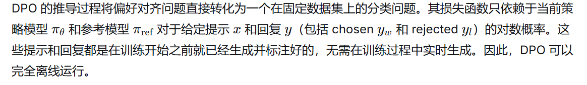{.ocr-src}

离线数据对收敛的影响：

- 优势：
  1. 极高的稳定性和可复现性：由于数据集固定，训练过程可以被精确复现，这对于研究和产品迭代至关重要。
  2. 计算效率高：避免了复杂的在线 rollout 和多模型协同，训练速度更快，对硬件资源的要求更低。

- 潜在问题与局限性：

1. **分布漂移**：这是离线方法的固有挑战。DPO 使用的偏好数据通常是由初始的 SFT 模型或其他早期版本生成的。随着 DPO 训练的进行，策略模型 $\pi_\theta$ 的输出分布会逐渐发生变化，与离线数据的分布产生偏差。此时，数据的奖励信号对于新策略来说可能已经“过时”，导致梯度估计不准确，限制了模型进一步优化的上限。

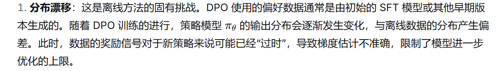{.ocr-src}

2. 探索不足：由于无法在线探索，模型只能模仿数据中已有的 chosen 回复模式，很难去发现超越数据标注质量的、全新的更优回复。这可能导致模型能力的天花板较低。

为了缓解这些问题，学术界提出了在线 DPO 或迭代式 DPO。其核心思想是：在每一轮 DPO 训练后，使用最新的模型生成新的回复，并重新收集偏好数据（通常由更强的模型或人类进行标注），然后使用这个“在线”生成的数据集进行下一轮 DPO 训练。这种方法可以有效解决分布漂移问题，并提升模型性能上限。

结论：标准 DPO 仅需离线数据即可有效训练，但结合在线策略的迭代式 DPO 往往能取得更好的最终效果。

---

#### 为什么在 DPO 中，通常要在计算损失时 detach reference model 的 logits？

在 DPO 训练的代码实现中，对参考模型输出的对数概率（logits/log probabilities）使用 `.detach()` 操作，是一个绝对必要的步骤。这是由参考模型在 DPO 中所扮演的角色决定的。

**参考模型的角色是“固定标尺”，而非“可训练参数”**。在 DPO 的损失函数中，参考模型 $\pi_{\text{ref}}$ 的作用是提供一个稳定的、不随训练改变的基准。其对数概率 $\log \pi_{\text{ref}}(y|x)$ 在损失函数中是作为一个**常数项**存在的，用于计算隐式奖励。

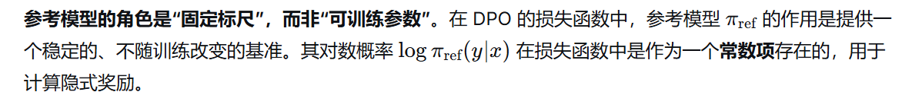{.ocr-src}

如果我们不对其进行 detach，会发生以下严重问题：

1. 优化目标完全错乱：反向传播的梯度会流向参考模型的参数，并试图更新它。这完全违背了 DPO 的设计初衷——参考模型应当是优化前的“快照”，用于衡量策略的偏离程度。如果参考模型也随训练改变，它就失去了作为“参照系”的意义。

2. **训练崩溃和过拟合**：如果不 detach，整个优化目标就会变成让 $\pi_\theta$ 和 $\pi_{\text{ref}}$ 同时、同方向地变化。这会导致模型迅速找到一条“捷径”：通过同时改变两个模型的输出概率来最小化损失，而不是真正地学习区分偏好。结果通常是模型陷入平凡解或完全崩溃。

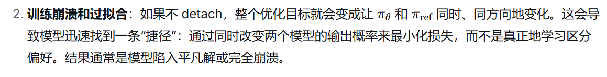{.ocr-src}

正确的做法：在 DPO 训练开始时，将 SFT 模型的权重加载为参考模型，并在整个训练过程中完全冻结其参数。在计算损失时，对从参考模型得到的 tensor 调用 `.detach()`，切断其梯度流。这保证了优化信号只

更新策略模型 $\pi_\theta$，而参考模型始终保持不变。

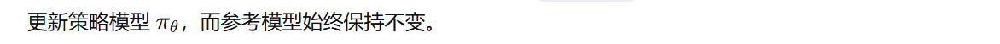{.ocr-src}

---

#### 大 batch size 对 DPO 训练效果有什么影响？经验法则是什么？

在 DPO 训练中，batch size 的选择对训练的稳定性和最终效果有显著影响。由于 DPO 的损失函数是在一个 batch 内对偏好对进行优化的，batch size 的大小直接关系到模型能否学到鲁棒的偏好。

大 batch size 的影响：

- 正面影响：
  1. 梯度估计更稳定：更大的 batch size 能提供更准确、方差更小的梯度估计，使训练过程更加平稳，loss 曲线更光滑。
  2. 偏好学习更鲁棒：DPO 本质上是在学习一个“相对好坏”的概念。在一个更大的 batch 中，模型有机会看到更多样化的 chosen 和 rejected 回复，这有助于它学到更通用、更微妙的偏好区分能力，而不是仅仅过拟合到个别样本的特殊模式上。
  3. 有利于捕捉长尾偏好：小 batch 可能只包含少数几种类型的偏好，导致模型对某些不常见的偏好模式学习不足。大 batch 覆盖的类型更广，效果更全面。

- 负面影响：
  1. 计算资源要求高：DPO 需要同时加载策略模型和参考模型，batch size 过大会导致显存不足，尤其是在全参数微调大型模型时。
  2. 可能降低收敛速度：在固定步数下，过大的 batch size 可能导致模型更新的次数变少，如果学习率没有同步调整，可能收敛得更慢。

经验法则：

- 尽可能使用能塞进显存的最大 batch size。这是最常用的策略。通过梯度累积，我们可以将有效 batch size 扩展到数百甚至上千。

- 在资源允许的范围内，有效 batch size 通常设置为 128 到 1024 个偏好对。对于 7B 左右的模型，使用 LoRA 微调时，单张 80G A100 能实现的有效 batch size 通常可以做到 256-512。

- 如果发现训练 loss 震荡剧烈，或验证集上的表现波动很大，增大 batch size（或通过梯度累积实现）通常是首要的调优方向之一。

---

#### 如何构建包含多维偏好的 DPO 数据集？如何在损失中对不同维度加权？

人类的偏好是多维度的，例如一个回复可能既“有用”又“不安全”。仅仅标注一个总体的“更好/更差”会丢失这些细微的信息。构建多维偏好数据集并进行加权，可以让对齐过程更加精细和可控。

1. 构建多维偏好数据集的方法：

最直接的方法是在标注偏好时，同时记录每个维度的判断。例如，对于一对回复，标注者不仅指出哪个更好，还需要对每个维度的优劣进行标记。

- 数据格式：一个多维度的数据样本可能如下所示：

```json
{
    "prompt": "...",
    "chosen": "...",
    "rejected": "...",
    "preference_dimensions": {
        "helpfulness": "chosen",
        "honesty": "chosen",
        "safety": "rejected"  // 注意：chosen 回复在安全性上反而更差
    }
}
```

- 数据标注：这需要标注者（或强大的标注模型）进行更细致的判断。成本会比单一维度标注高，但能提供更有价值的信息。

- 利用模型辅助：可以先训练一个多维度奖励模型，然后用它对大量回复进行自动评分，构造出多维度偏好数据。

2. 在损失中对不同维度加权的方法：

一旦拥有了多维度的偏好标签，我们可以在 DPO 的损失函数中，为不同维度的偏好对赋予不同的权重。总损失可以是各个维度损失的加权和。

例如，假设我们有三个维度的偏好数据：有用性 $D_{help}$、诚实性 $D_{honest}$ 和安全性 $D_{safe}$。那么，最终的训练损失可以定义为：

$$
\mathcal{L}_{\text{total}} = \lambda_{help} \cdot \mathcal{L}_{\text{DPO}}(D_{help}) + \lambda_{honest} \cdot \mathcal{L}_{\text{DPO}}(D_{honest}) + \lambda_{safe} \cdot \mathcal{L}_{\text{DPO}}(D_{safe})
$$

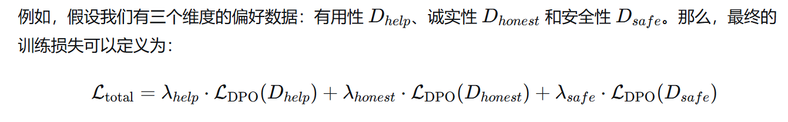{.ocr-src}

其中，$λ$ 是各个维度的权重系数。

通过调整这些系数，我们可以实现精准的行为调控：

- 提高 *λ safe*：增强模型的安全对齐，即使可能会牺牲一些有用性。

- 降低 *λ help*：让模型在创造性任务上探索更多可能性，而不只追求四平八稳的回答。

这种方法将一个复杂的多目标优化问题，转化为简单的多数据集加权混合训练，是实践中非常有效且灵活的策略。

---

#### 讨论 DPO 的局限性：在何种情况下 RLHF 可能优于 DPO？

尽管 DPO 拥有巨大的优势，但它并非万能，在某些特定场景下，RLHF (PPO) 仍然具有不可替代的价值。

DPO 的主要局限性：

1. 完全依赖于离线数据的质量，存在“天花板效应”：DPO 的性能上限被其使用的离线偏好数据所限制。如果数据集中的 chosen 回复本身就不是最优的，DPO 无法探索出比这更好的回复。而 PPO 通过在线探索和奖励模型的引导，有可能“创造”出超越数据标注者水平的回复，实现自我突破。

2. 缺乏在线探索，泛化能力受限：DPO 是纯离线方法。当模型被部署到真实世界，面对与训练数据分布不同的新提示时，它可能会表现不佳。PPO 的在线交互特性使其能够持续从新的探索中学习，理论上能更好地适应开放世界的变化。

3. 对噪声和稀疏奖励不够鲁棒：在一些复杂任务（如多轮对话）中，一个好的回复的好坏可能需要很长的上下文才能体现，即奖励是稀疏和延迟的。RL 算法天生就是为了处理这类长期回报问题而设计的。而 DPO 本质上是监督学习，直接对最终回复进行打分和优化，可能无法很好地捕捉过程中的细微策略。

4. 可能被“表面偏好”所迷惑：如果偏好数据中存在系统性偏差（如所有 chosen 回复恰好都比 rejected 回复更长），DPO 可能会学习到这个简单的长度偏差，而不是真正的内容质量。PPO 因为需要奖励模型对每一步都进行评判（即使是通过 Value 网络），有时对这种表面偏差有更强的抵抗力。

结论：如果你拥有一个极其强大的、可以不断在线打分的奖励模型，并且追求模型的极限推理和创造力，那么投入巨大的资源进行在线 RLHF 可能是值得的。对于绝大多数追求性价比、稳定性和可复现性的应用场景，DPO 是毫无疑问的最佳选择。

