# 49.大模型（LLMs）ORPO

#### ORPO 的全称和核心思想是什么？它试图解决 DPO/RLHF 的什么问题？

ORPO 的全称是 Odds Ratio Preference Optimization（比值比偏好优化）。

核心思想：ORPO 认为，一个对齐好的模型，应该同时具备两种能力：一是知道“好回复”是什么样子的，二是知道“坏回复”是什么样子的，并且要主动地、强烈地远离坏回复。它将这两种能力的学习统一到一个单一的、带惩罚项的交叉熵损失函数中，无需参考模型，也无需单独的 SFT 预热阶段。其核心创新在于引入了一个基于 Odds Ratio（比值比） 的惩罚项，用来直接惩罚模型对“坏回复”（rejected）的生成概率。

它试图解决 DPO/RLHF 的什么问题？

1. 流程复杂和计算开销大的问题：DPO 和 RLHF 都强依赖于一个单独的 SFT 阶段来初始化策略，以及需要一个冻结的参考模型来防止遗忘。ORPO 通过一个损失函数、一个训练阶段，同时完成了指令微调和对齐，彻底消除了对 SFT 预热和参考模型的依赖，极大地简化了训练流程，降低了计算和显存开销。

2. 对“负样本”的利用不够直接和强烈：在 DPO 中，是通过对比对来间接提升 chosen 的概率。ORPO 认为，仅仅提升 chosen 是不够的，还需要主动地、显著地惩罚模型分配给 rejected 的概率。它通过 Odds Ratio 惩罚项，给 rejected 回复一个非常强的、将其生成概率推向零的梯度信号，使模型在“不做坏事”方面表现得更加鲁棒。

---

#### ORPO 如何将指令微调损失与偏好对齐损失结合在一个训练目标中？

ORPO 的巧妙之处在于，它没有设计两个独立的损失项，而是在 SFT 损失的输出端，直接附加了一个基于同一批数据计算出的、无参考模型的惩罚项。

- SFT 损失 (L *SFT*)：这是传统的指令微调损失，使用典型的“指令-回复”对数据进行训练。它的目标是最大化 chosen 回复中每个 token 的生成概率，教会模型基础的指令遵循能力。计算时只对回复部分的 token 计算交叉熵损失。

- 对齐损失 (L *OR*)：这是一个全新的、基于 Odds Ratio 的损失项。它使用“指令-对比对”数据，利用模型当前对 chosen 和 rejected 回复的输出概率，计算出一个惩罚值。这个惩罚值直接加在 L *SFT* 上，形成最终的总损失。

最终，ORPO 的总损失函数为：

$$
\mathcal{L}_{ORPO} = \mathcal{L}_{SFT} + \lambda \cdot \mathcal{L}_{OR}
$$

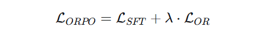{.ocr-src}

其中 λ 是一个超参数，用于控制对齐惩罚的强度。这两个损失共享同一个模型参数，并在一次前向传播中即可被同时计算，实现了真正的“一步到位”。

---

#### 写出 ORPO 的整体损失函数，并解释各项的物理意义。

ORPO 的整体损失函数由两部分组成。

第一部分：SFT 损失 (L *SFT*)

$$
\mathcal{L}_{SFT} = -\frac{1}{m} \sum_{t=1}^{m} \log P(y_t|x, y_{<t})
$$

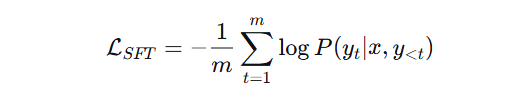{.ocr-src}

这是标准的自回归交叉熵损失，计算模型生成 chosen 回复序列中每个 token 的对数概率的均值。它的物理意义是最大化模型生成“正确答案”（chosen）的概率，让模型具备基本的指令遵循能力。

第二部分：OR 损失 (L *OR*)\
这是 ORPO 的核心创新。它基于模型对 chosen 回复 $y_w$ 和 rejected 回复 $y_l$ 的序列级生成概率。

$$
\mathcal{L}_{OR} = -\log \sigma \left( \log \frac{\text{odds}_\theta(y_w|x)}{\text{odds}_\theta(y_l|x)} \right)
$$

其中，$\text{odds}_\theta(y|x)$ 定义为：

$$
\text{odds}_\theta(y|x) = \frac{P_\theta(y|x)}{1 - P_\theta(y|x)}
$$

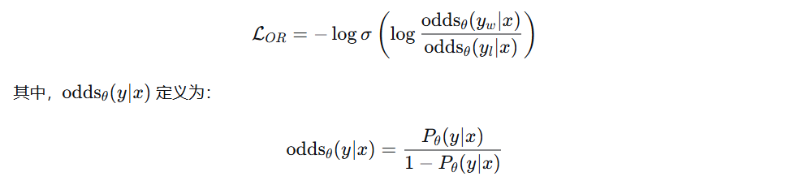{.ocr-src}

而 $σ$ 是 sigmoid 函数。

这个损失项的物理意义极其直观：

- **内部分数**：$\log \frac{\text{odds}_\theta(y_w|x)}{\text{odds}_\theta(y_l|x)}$ 计算了模型对 chosen 回复的“发生比”相对于 rejected 回复的“发生比”的比值，再取对数。如果模型更倾向于生成 chosen（即其 odds 更高），这个差值就为正且越大越好。
- **损失优化**：通过最小化 $-\log \sigma(\cdot)$，等价于最大化这个内部分数。因此，$\mathcal{L}_{OR}$ 的物理意义就是**最大化模型对 chosen 回复的相对偏好，同时最小化模型生成 rejected 回复的可能性。**

**总损失**：

$$
\mathcal{L}_{ORPO} = \mathcal{L}_{SFT} + \lambda \cdot \mathcal{L}_{OR}
$$

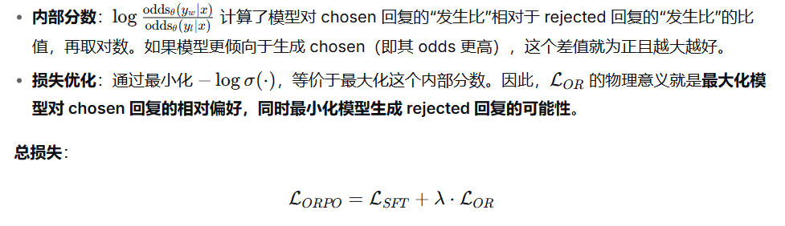{.ocr-src}

通过一个超参数 $λ$，实现了在“学习指令”和“远离坏回复”两个目标之间的平衡。

---

#### ORPO 中，“odd ratio”是如何定义的？为什么引入 odd ratio？

在 ORPO 中，Odds Ratio（比值比） 是核心的数学工具。

一个回复 $y$ 在给定提示 $x$ 下的 Odds 定义为：

$$
\text{odds}_\theta(y|x) = \frac{P_\theta(y|x)}{1 - P_\theta(y|x)}
$$

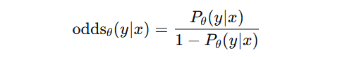{.ocr-src}

它代表了“模型生成 $y$ 的概率”与“模型不生成 $y$ 的概率”的比值。Odds 值越高，说明模型越“确信”要生成这个回复。

而 Odds Ratio 则是两个 Odds 的比值，也就是 chosen 回复 $y_w$ 和 rejected 回复 $y_l$ 之间的 Odds 比：

$$
\text{Odds Ratio} = \frac{\text{odds}_\theta(y_w|x)}{\text{odds}_\theta(y_l|x)}
$$

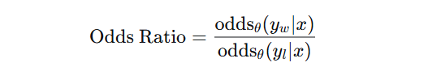{.ocr-src}

为什么引入 Odd Ratio？

引入 Odds Ratio 的根本原因在于，它无需外部参考模型，就能天然地提供一个“自我惩罚”的机制。这是 ORPO 能够省去 Reference Model 的关键。

- 惩罚被拒绝的回复：Odds 的计算天然地惩罚了被拒绝的回复。因为 rejected 回复的生成概率越低，其 Odds 值也就越低，整体的 Odds Ratio 就越高，损失函数也就越小。

- 无需参考模型：与 DPO 需要参考模型来提供“基线”不同，Odds Ratio 直接比较了模型自身对两个回复的“确信度”。它利用模型自己的预测概率，构建了一个内部的、动态的对比基准，从而以一种更简洁的方式实现了偏好对齐。

---

#### 为什么 ORPO 可以省略 SFT 阶段或 Reference Model？

ORPO 能够省略这些组件的秘诀在于，它的 L *SFT* 和 L *OR* 两个损失项在功能上完美互补。

为什么可以省略 SFT 预热阶段？

- 在 ORPO 中，L *SFT* 部分就是指令微调。它直接最大化 chosen 回复的生成概率。这部分损失确保模型在偏好对齐的过程中，从头到尾都在学习如何生成更好的回复，不会发生灾难性遗忘。因此，不需要一个单独的 SFT 阶段来先让模型“学会说话”。

为什么可以省略 Reference Model？

- 在 DPO 中，Reference Model 的作用是提供一个“基准”，计算隐式奖励 $r = \beta \cdot \log \frac{\pi_\theta}{\pi_{\text{ref}}}$，从而将优化限制在参考模型附近。

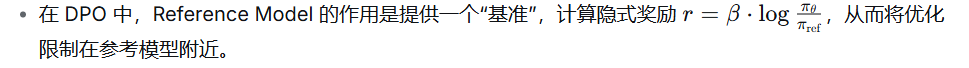{.ocr-src}

- 在 ORPO 中，这个“基准”被 Odds Ratio 的惩罚机制 巧妙地替代了。Odds Ratio 直接惩罚模型对 rejected 回复的生成概率。当一个模型试图通过“奖励黑客”手段去最大化 chosen 的概率时，它很可能也会无意中提高 rejected 的概率，而这会受到 L *OR* 的强力惩罚。这种内在的、自我惩罚的特性，使得 ORPO 无需外部 Reference Model 也能保持策略的稳定，防止模型“跑偏”。

因此，ORPO 用一个统一的损失函数，同时处理了 DPO 中需要由 SFT 和 Reference Model 承担的两大职责。

---

#### ORPO 与 DPO 相比，在训练流程上有何简化？对数据和计算资源的影响。

训练流程的简化：

- **DPO 流程**：预训练 → SFT（得到 $\pi_{\text{SFT}}$）→ DPO（以 $\pi_{\text{SFT}}$ 为初始化和参考模型，用偏好数据微调）。

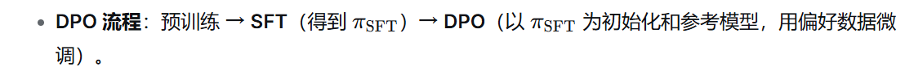{.ocr-src}

- ORPO 流程：预训练 → ORPO（直接在一个包含偏好信号的数据集上，一步训练到位）。\
  ORPO 将标准的“两步走”流程，简化为“一步到位”的极简流程，极大地提升了研发迭代效率。

对数据和计算资源的影响：

- 数据方面：ORPO 需要一种“混合数据”。在一个训练 batch 中，必须同时包含带有 chosen 标签的指令微调数据和带有 chosen/rejected 标签的偏好对齐数据。这需要对现有的数据集进行重新组织和采样，数据格式与 DPO 略有不同，但数据总量上并无增加。

- 计算资源方面（巨大优势）：这是 ORPO 最大的优势所在。
  - 显存占用减半：ORPO 完全不需要加载 Reference Model，因此在训练时 GPU 中只需要维护一个模型。相比之下，DPO 需要同时加载策略模型和参考模型。这使得 ORPO 的显存占用降低了约 50%，或者可以在同样的硬件上训练更大的模型。
  - 训练速度更快：由于只需要一次模型前向传播即可完成计算，ORPO 的训练速度比 DPO 快得多，吞吐量显著提升。
  - 工程实现更简单：无需管理双模型的复杂逻辑，代码实现简洁明了。

---

#### 在 ORPO 中，偏好数据如何影响 SFT 部分的梯度？

这是一个关键问题。如果偏好数据中的 rejected 回复质量也很高，会不会错误地引导 SFT 部分去学习它？

答案是：偏好数据不直接污染 SFT 的梯度，而是通过共享参数施加间接影响。

具体机制如下：

1. SFT 损失的梯度：在计算 L *SFT* 时，模型只看 chosen 回复。它会计算 chosen 回复中每个 token 的交叉熵损失，并反向传播梯度。因此，SFT 的梯度始终指向“最大化 chosen 回复概率”的方向，绝不会要求模型去学习生成 rejected 回复。

2. 共享参数的交互：虽然 SFT 的梯度方向是确定的，但模型参数是共享的。L *OR* 损失同时也在起作用，它会计算模型对 chosen 和 rejected 回复的生成概率，并产生一个将 rejected 回复概率推向零的惩罚梯度。

3. 协同效应：这两个梯度在共享参数上被加权求和。最终，模型参数更新方向是两者的合力：
  - 一个力（来自 SFT）在“提升”好回复。
  - 另一个力（来自 OR）在“拉低”坏回复，并且同时也在加固好回复。

因此，偏好数据通过 OR 损失项，辅助和强化了 SFT 的学习。它不仅让模型学得更快、更好，还通过惩罚机制，防止模型在学习 chosen 时“不小心”也提升了类似的、但不好的回复的概率，从而提升了模型的鲁棒性。

---

#### ORPO 中的超参数 λ（对齐损失权重）如何选取？有什么调参经验？

超参数 $λ$ 是 ORPO 中控制模型在“指令学习”和“偏好对齐”之间平衡的最重要旋钮。它决定了模型是更偏向于模仿 chosen 回复，还是更主动地远离 rejected 回复。

调参经验：

- λ 值太小（例如 < 0.1）：OR 损失的影响微乎其微。模型行为接近于纯粹的 SFT，偏好对齐效果不明显。它可能会生成更像 chosen 的回复，但对 rejected 模式没有足够的“抵抗力”。

- $λ$ 值太大（例如 > 2.0）：对齐惩罚过于强势，主导了训练过程。模型会花费大量精力去“压扁”rejected 的概率，可能导致其生成概率的分布过于极端，丧失多样性。同时，过强的 OR 梯度可能会干扰 SFT 的学习，导致模型在基础指令跟随能力上受损。

- 最优范围：根据原论文和社区实践，$λ$ 的最优值通常落在 0.5 到 2.0 之间。1.0 是一个非常安全且效果出色的默认起始点。

如何确定最优 $λ$？\
最好的方法是通过小规模实验。可以设置 λ∈[0.1,0.5,1.0,2.0]，分别训练几个 epoch，然后在验证集上同时评估：

1. 基础指令遵循能力（如 MMLU 得分）。

2. 偏好对齐效果（如 AlpacaEval 2.0 胜率或 reward model 得分）。

理想的 $λ$ 应该在两个指标上都取得较高的分数，而不是偏废其一。同时，在训练过程中监控 $L_{OR}$ 的值，它应该平稳下降，不能出现梯度爆炸。

---

#### ORPO 训练是否稳定？与 DPO 相比，有无新的不稳定因素？

ORPO 训练总体上非常稳定，甚至在某些方面比 DPO 更稳定。这是因为 ORPO 的损失函数由两部分组成：传统的监督微调损失（SFT Loss）和基于 Odds Ratio 的偏好对齐损失（OR Loss）。SFT 损失是一个极其成熟、稳定的交叉熵损失，它为整个训练过程提供了一个稳健的优化基础。OR 损失则是在这个稳定基础上施加的额外约束，其数学形式（基于 Odds Ratio 的对数 sigmoid 函数）也具有良好的数值特性。

与 DPO 相比的稳定性分析：

- **DPO 的潜在不稳定因素**：DPO 的损失函数中，策略模型 $\pi_\theta$ 和参考模型 $\pi_{\text{ref}}$ 的对数概率差被乘以一个参数 $\beta$。当 $\beta$ 设置不当或训练数据存在噪声时，这个差值可能会剧烈波动，导致梯度不稳定。此外，DPO 完全依赖于偏好数据进行训练，如果偏好数据质量不高或分布偏差较大，模型可能会学到错误的偏好。

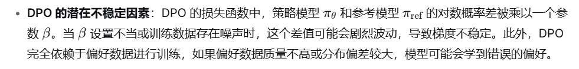{.ocr-src}

- ORPO 的稳定性优势：
  1. SFT 损失提供了稳定的“压舱石”：ORPO 的核心设计理念是将对齐任务“寄生”在一个强大的 SFT 任务之上。SFT 损失始终在引导模型学习正确的指令-回复映射，这保证了模型在最基础的层面上不会发生退化或崩溃。即使 OR 损失在训练初期产生了一些波动，SFT 损失也会将模型拉回正轨。
  2. 内在的自我惩罚机制更平滑：ORPO 的 Odds Ratio 惩罚项无需外部参考模型，它直接比较模型自己对 chosen 和 rejected 回复的生成概率。这种比较是在模型“自身坐标系”内进行的，因此更新信号更加平滑、内洽，不会像 DPO 那样因为外部参考模型的介入而引入额外的方差。

- ORPO 可能出现的新不稳定因素：
  1. 超参数 $λ$ 的平衡问题：虽然 SFT 损失增加了稳定性，但 $λ$（对齐损失权重）的选择至关重要。如果 $λ$ 设置过大，OR 损失的梯度会压倒 SFT 的梯度，导致模型在偏好对齐上“用力过猛”，反而可能损害其基础语言能力。这需要我们在训练初期仔细监控 SFT 损失和 OR 损失的相对大小。
  2. Odds Ratio 的数值溢出风险：在计算 Odds Ratio 时，如果模型对某个回复的生成概率极低（接近于 0）或极高（接近于 1），会导致 `odds = P/(1-P)` 的计算出现数值溢出或产生 `inf`/`NaN`。不过，这个问题可以通过数值稳定性处理来解决（见下题）。

---

#### 解释 ORPO 损失中 log odds 的运算，以及其数值稳定性处理。

在 ORPO 的损失函数中，核心运算是计算一个回复的 log odds，其定义为：

$$
\log \text{odds}_\theta(y|x) = \log \frac{P_\theta(y|x)}{1 - P_\theta(y|x)}
$$

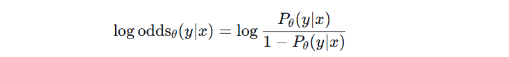{.ocr-src}

其中 Pθ(y∣x) 是模型在给定提示 x 下，生成整个回复序列 $y$ 的累积概率。在自回归语言模型中，这通常是序列中所有 token 的条件概率的乘积。

数值稳定性问题：\
在实际计算中，Pθ(y∣x) 可能是一个极小的小数（因为长序列的概率连乘），直接计算 `P / (1 - P)` 可能会导致数值下溢（`P` 被当作 0）或除法溢出。尤其是在训练初期，模型对某些回复的预测概率可能极不稳定。

稳定性处理方法：

为了避免直接计算概率和除法，实践中通常使用 Log-Sigmoid 和 Log-Sum-Exp 技巧，将对数空间的计算转换为稳定形式。

1. 直接使用对数概率：我们不会显式计算 $Pθ$ 和 odds，而是直接使用模型输出的对数概率（log probabilities），这是深度学习框架中非常自然的操作。

2. 计算 log odds 的稳定公式：\
   我们可以将 log odds 重写为：

$$
\log \text{odds}_\theta(y|x) = \log P_\theta(y|x) - \log(1 - P_\theta(y|x))
$$

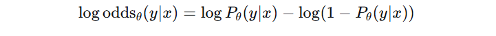{.ocr-src}

但 `log(1 - P)` 在 $P$ 很小时仍然可能数值不稳定。一个更稳定的方式是利用 Log-Sigmoid 函数。实际上，log odds 可以等价地表示为：

$$
\log \text{odds}_\theta(y|x) = \log P_\theta(y|x) - \text{log\_sigmoid}(-\log P_\theta(y|x))
$$

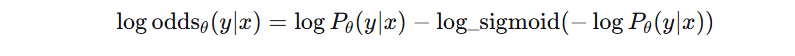{.ocr-src}

但更常见的工程实现是：不单独计算 log odds，而是直接计算 ORPO 损失中所需的整个表达式。

3. 直接计算 OR 损失项的稳定形式：\
   ORPO 的 L *OR* 损失项为：

$$
\mathcal{L}_{OR} = -\log \sigma \left( \log \frac{\text{odds}_\theta(y_w|x)}{\text{odds}_\theta(y_l|x)} \right)
$$

我们可以将其展开为：

$$
\mathcal{L}_{OR} = -\log \sigma \left( \log \text{odds}_\theta(y_w|x) - \log \text{odds}_\theta(y_l|x) \right)
$$

进一步，设 $A = \log P_\theta(y_w|x)$，$B = \log P_\theta(y_l|x)$。那么：

$$
\log \text{odds} = A - \log(1 - e^A)
$$

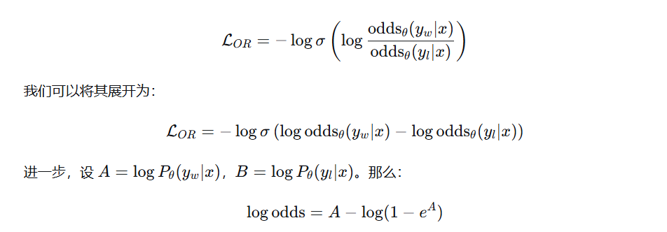{.ocr-src}

1. 而 `log(1 - e^A)` 可以通过 `torch.log1p(-torch.exp(A))` 或 `torch.log(-torch.expm1(A))` 来稳定计算。最终，整个 OR 损失的计算都可以在 log-space 中完成，从而彻底避免概率值的直接计算和除法，确保数值稳定性。

此外，一些实现还会对最终计算出的 `log odds` 差值进行裁剪（clamping），以防止其在 sigmoid 函数的饱和区产生梯度消失问题。

---

#### ORPO 在哪些基准上展示了优于 DPO 或 RLHF 的性能？其宣称的优势是否普适？

在 ORPO 的原始论文中，作者在多个主流基准上进行了评估，并展示了其在多个维度上的优越性。

展示优越性的基准：

1. AlpacaEval 2.0：这是评估指令遵循能力的最重要基准之一。ORPO 在 AlpacaEval 2.0 上的胜率（Win Rate）显著优于相同条件下的 DPO，甚至超过了 PPO。这表明 ORPO 训练出的模型能更好地遵循人类指令。

2. MT-Bench：这是一个多轮对话能力评估基准。ORPO 在 MT-Bench 上的总分同样优于 DPO，尤其在某些需要深度推理的类别上表现突出。

3. HuggingFace Open LLM Leaderboard：在包含 ARC, HellaSwag, MMLU, TruthfulQA 等任务的综合性榜单上，ORPO 在同等模型规模和训练数据下取得了有竞争力的分数。

优势是否普适？

ORPO 宣称的核心优势——省去 SFT 预热阶段和 Reference Model、用一个统一目标简化训练——在理论上是普适的。然而，其性能优势并非在所有场景下都绝对普适，这取决于具体条件：

- 对数据分布的敏感性：ORPO 的成功很大程度上依赖于其训练数据的混合方式。它需要一个精心平衡的数据集，其中同时包含高质量的指令数据（用于 SFT）和可靠的偏好对数据（用于 OR 损失）。如果两者比例失衡，效果会大打折扣。DPO 和 RLHF 则对数据分布有更强的鲁棒性，因为它们通常是分阶段进行的。

- 模型规模的缩放定律：目前 ORPO 的有效性主要在 7B 到 13B 参数的模型上得到充分验证。对于更大规模（如 70B）的模型，其行为是否仍然稳定、优势是否依然存在，还需要更多社区实践来证实。而 RLHF/DPO 在大模型上已有非常成熟的 scaling 经验。

- 任务特定性：在对安全性要求极高、需要非常精细地控制对齐强度的场景下，分阶段的 RLHF/DPO 可能因为其可解释性和可控性更强而更有优势。ORPO 的“黑盒”联合优化在某些极端安全场景下可能需要更谨慎的调优。

因此，可以说 ORPO 的优势在资源受限、追求训练效率、中等规模模型的场景下是普适且显著的。但在超大参数量或极高安全要求的场景下，它更多的是作为 DPO/RLHF 的一个强力替代方案，而非完全的“碾压者”。

---

#### ORPO 如何保证模型在偏好对齐的同时不丢失基本指令遵循能力？

ORPO 之所以能够保证这一点，其秘诀就在于其损失函数的二元结构。

核心机制：SFT 损失作为“能力锚”

ORPO 的总损失是 $\mathcal{L}_{ORPO} = \mathcal{L}_{SFT} + \lambda \cdot \mathcal{L}_{OR}$。其中 $\mathcal{L}_{SFT}$ 部分，正是标准的指令微调交叉熵损失。这个损失的存在，为模型提供了一个强大且持续的梯度信号，强制模型去最大化 chosen 回复（即“好回复”）中每个 token 的生成概率。

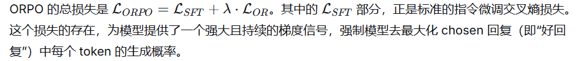{.ocr-src}

- 持续的正向引导：无论 OR 损失如何惩罚模型的行为，SFT 损失始终在告诉模型：“请学习生成这些高质量的回复”。这就像在教一个学生，一边给他看正确的解题步骤（SFT），一边纠正他的错误解法（OR）。SFT 保证了学生至少学会了正确答案的样子。

- 避免灾难性遗忘：在纯粹的 DPO 或 RLHF 中，如果没有 SFT 损失的约束，模型可能会为了最大化奖励而“不择手段”，甚至抛弃它最初学到的语言能力。ORPO 中的 SFT 损失则充当了一个“能力锚”，将模型牢牢地固定在它最初的指令遵循能力之上。它确保模型的参数更新不会偏离那个能够生成高质量指令回复的基本状态太远。

与 DPO 的对比：

DPO 是通过一个冻结的 Reference Model 来实现这一点：策略模型不能偏离参考模型太远。而 ORPO 则用 SFT 损失直接替代了 Reference Model 的功能。这是一种更直接、更优雅的解决方案：我们不要求模型“不要偏离过去的自己”，而是直接要求它“持续学习正确的做法”。因此，ORPO 是在强化正确行为的过程中，间接抑制错误行为，而不是简单地在探索和保底之间权衡。

---

#### 如果用 ORPO 训练多轮对话模型，数据应该如何构造？

用 ORPO 训练多轮对话模型，关键在于如何在一个训练样本中同时承载“指令微调”和“偏好对齐”两重信息。数据构造需要遵循 ORPO 的核心理念：同一个样本必须同时包含 chosen 的完整对话和 rejected 的完整对话。

数据构造格式：

一个标准的多轮对话 ORPO 训练数据样本，结构如下：

```json
{
  "prompt": [
    {"role": "system", "content": "你是一个有用的助手。"},
    {"role": "user", "content": "你好，请问北京的首都是哪里？"},
    {"role": "assistant", "content": "北京是中国的首都。"},
    {"role": "user", "content": "那上海呢？"}
  ],
  "chosen": [
    {"role": "assistant", "content": "上海是中国的一个直辖市，不是首都。"}
  ],
  "rejected": [
    {"role": "assistant", "content": "上海也是中国的首都之一。"}
  ]
}
```

关键设计原则：

1. 共享 Prompt 前缀：`prompt` 字段包含了直到模型需要生成回复之前的所有对话历史。这个前缀对于 chosen 和 rejected 回复是完全相同的。在训练时，这个前缀会被用来作为上下文，模型需要分别计算在它之后生成 chosen 和 rejected 序列的概率。

2. **Chosen 回复的双重身份**：chosen 回复 $y_w$ 在这个样本中扮演着双重角色。在计算 $\mathcal{L}_{SFT}$ 时，它是模型要去模仿学习的“标准答案”；在计算 $\mathcal{L}_{OR}$ 时，它又是偏好对中的“正样本”。
3. **Rejected 回复的惩罚对象**：rejected 回复 $y_l$ 只参与 $\mathcal{L}_{OR}$ 的计算，作为“负样本”被惩罚。

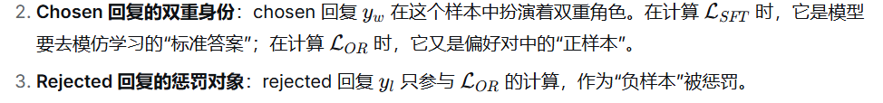{.ocr-src}

损失掩码处理：\
与标准 SFT 训练一样，在计算 chosen 和 rejected 回复的对数概率时，我们仍然需要应用损失掩码。只对回复部分的 token 计算损失，而忽略所有属于 `prompt`（包括用户输入、系统提示和历史助手回复）的 token。这确保了我们优化的目标始终是“如何根据对话历史生成更好的当前回复”，而不是去学习生成用户的问题或历史对话。

---

#### ORPO 是否需要在训练中加载多个模型？显存占用与 DPO 相比如何？

ORPO 不需要加载多个模型。 这是 ORPO 相对于 DPO 和 RLHF 最显著的优势之一。

在 ORPO 的整个训练过程中，GPU 显存中只需要存在**一个模型**，即正在被优化的策略模型 $\pi_\theta$。它既作为 SFT 的学习者，也作为 OR 损失的执行者和惩罚对象。

**与 DPO 的显存占用对比**：

- **DPO 的显存占用**：DPO 必须同时加载两个完整的模型——策略模型 $\pi_\theta$ 和参考模型 $\pi_{\text{ref}}$。即使参考模型的参数被冻结，它们仍然需要占用大量显存。对于一个 7B 的模型，这大约需要额外的 14GB (FP16) 的显存。

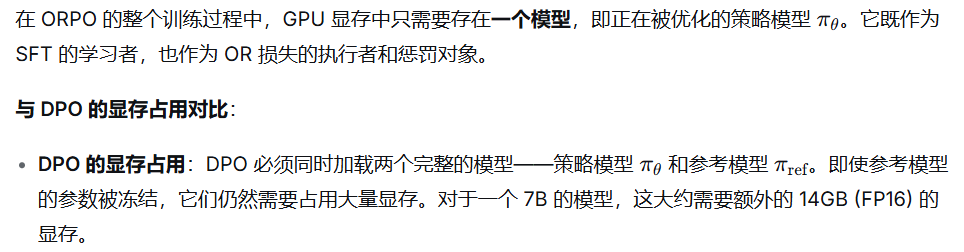{.ocr-src}

- ORPO 的显存占用：ORPO 仅需加载一个模型，省去了参考模型。这意味着显存占用直接降低了约 40%-50%。节省下来的显存可以用于增大 batch size、处理更长的序列，或者在更小的 GPU（如消费级显卡）上运行同样规模的模型。

计算效率对比：

除了显存，ORPO 的计算效率也更高。DPO 需要对两个模型都进行前向传播来计算对数概率，而 ORPO 只需要一次前向传播。这使得 ORPO 的训练速度比 DPO 更快，吞吐量更高。

---

#### 分析 ORPO 的梯度更新，如何理解它对“好回复”与“坏回复”的不同对待？

ORPO 的梯度更新可以从其损失函数的两部分分别来理解，它们对“好回复”（chosen）与“坏回复”（rejected）施加了截然不同但协同一致的影响。

1. SFT 损失对“好回复”的梯度：温柔的鼓励\
   SFT 损失 L *SFT* 的目标是最小化 chosen 回复的交叉熵。它的梯度会直接作用于模型参数，提升 chosen 回复中每个 token 在给定上文下的预测概率。这个过程是温和的、构建性的。它引导模型一步步地贴近“好回复”的分布，学会了正确的语言模式和知识。

2. OR 损失对“好回复”与“坏回复”的梯度：强力的奖惩

OR 损失 $\mathcal{L}_{OR}$ 的核心是最小化 $-\log \sigma(\Delta)$，其中 $\Delta = \log \text{odds}_\theta(y_w|x) - \log \text{odds}_\theta(y_l|x)$。

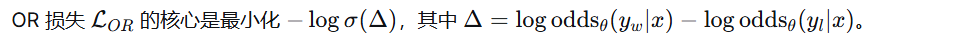{.ocr-src}

- 对“好回复”的梯度：由于 OR 损失希望最大化 Δ，它的梯度会进一步推高 chosen 回复的生成概率，特别是其 log odds。这相当于在 SFT 损失的基础上，对模型认为“好”的行为给予额外的奖励。如果说 SFT 损失是“鼓励”，那么 OR 损失对好回复的这部分梯度就是“重奖”。

- 对“坏回复”的梯度：这是 ORPO 最独特、最关键的部分。由于 OR 损失希望最大化 Δ，它同时会强力压低 rejected 回复的生成概率。其梯度方向与提升 chosen 的方向相反，它主动地将模型参数推离那些可能产生 rejected 回复的区域。这相当于对模型认为“坏”的行为施以重罚。

核心理解：ORPO 的梯度更新实现了一种“胡萝卜+大棒”的完美结合。SFT 损失递出胡萝卜，温和地引导模型走向正道；而 OR 损失则挥舞着大棒，对走偏到“坏回复”区域的行为进行强力惩罚，并同时为走在“好回复”区域的行为给予重奖。这种机制使得模型不仅学会了如何生成好回复，更深刻地刻下了“绝不生成坏回复”的行为边界。

---

#### ORPO 训练时，是否需要 warmup 步骤？训练曲线有什么特点？

是否需要 warmup？

是的，强烈建议使用 warmup 步骤，尤其是在训练初期。

虽然 ORPO 的 SFT 损失部分提供了稳定性，但在训练开始时，模型的参数几乎是随机的，其对 chosen 和 rejected 回复的预测概率都非常低且不稳定。此时，L *OR* 项中的 log odds 计算会产生巨大的噪声和极高的梯度，可能导致训练初期的不稳定。因此，使用一个较短的学习率 warmup 阶段（如占总训练步数的 5%-10%）是标准且有效的做法。在 warmup 期间，学习率从 0 线性增加到预设值，可以帮助模型平稳地度过初始的不稳定期。

训练曲线的特点：

- SFT 损失曲线：由于 ORPO 的核心任务之一是模仿 chosen 回复，其 SFT 损失曲线通常会呈现出平稳下降、并趋于收敛的典型特征。只要模型容量足够、学习率合适，SFT 损失会是一条非常健康的、持续向下的曲线。

- OR 损失曲线：OR 损失的曲线则可能相对“颠簸”一些。在训练初期，随着模型快速学会区分 chosen 和 rejected，OR 损失可能会迅速下降。但在后期，它可能会在一个区间内持续震荡。这是正常现象，因为模型在探索如何进一步拉开 chosen 和 rejected 的差距时，其预测概率的微小变化都可能导致 OR 损失的较大波动。

- 奖励/胜率曲线：如果我们在训练过程中用 AlpacaEval 等基准进行评估，会看到模型的胜率或奖励得分呈现出稳定上升的趋势。

典型曲线特征：SFT 损失稳步下降，OR 损失初期快速下降后震荡，评估得分稳步上升。如果 SFT 损失突然上升，可能意味着 λ 过大，OR 损失干扰了基础学习；如果 OR 损失完全没有下降，可能需要检查数据质量或 $λ$ 是否过小。

---

#### 为什么 ORPO 可以视为一种“无参考”的对齐方法？

ORPO 被称为“无参考”（reference-free）的对齐方法，其根本原因在于，它的损失函数中**不存在一个独立的、需要被冻结的参考模型（$\pi_{\text{ref}}$）**。

在 DPO 和 RLHF (PPO) 中，参考模型是必不可少的组件：

- **在 DPO 中**，参考模型用来计算隐式奖励 $r = \beta \cdot \log \frac{\pi_\theta}{\pi_{\text{ref}}}$，为策略模型的更新提供基准。
- **在 RLHF 中**，参考模型（$\pi_{\text{ref}}$）被用来计算 KL 散度惩罚项，防止策略模型偏离太远。

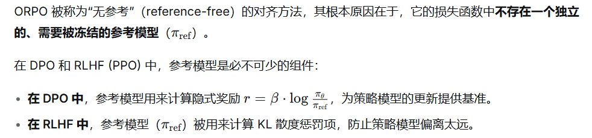{.ocr-src}

ORPO 巧妙地绕开了对参考模型的需求。它通过引入 Odds Ratio 这个概念，利用模型当前的预测概率，直接比较了它对 chosen 和 rejected 回复的“确信度”（odds）。这个比较完全不依赖任何外部基准，而是模型自身内部的“自省”。

“无参考”的实现机制：\
ORPO 的 L *OR* 项为：

$$
-\log \sigma \left( \log \frac{\text{odds}_\theta(y_w|x)}{\text{odds}_\theta(y_l|x)} \right)
$$

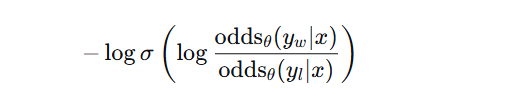{.ocr-src}

这里的核心是，对 chosen 回复的鼓励和对 rejected 回复的惩罚，都只与模型当前的预测概率有关。odds 值天然地惩罚了 rejected 回复（因为其概率越低，odds 越低），同时奖励了 chosen 回复。这种内在的奖惩机制使得 ORPO 无需一个外部的 Reference Model 来告诉它“你的起点在哪里”，它自己就能通过比较两种回复的概率，判断出优劣并进行自我修正。

因此，ORPO 的“无参考”特性不仅简化了架构，更代表了一种哲学上的转变：模型的对齐，不再需要与“过去的自己”进行对比，而是可以直接通过“明辨是非”来实现。

---

#### 在 ORPO 框架下，能否同时使用多个偏好对（如不同维度的好坏）？如何扩展？

可以，而且这是 ORPO 框架的一个非常灵活且强大的扩展方向。

ORPO 的核心思想——用 Odds Ratio 惩罚项来惩罚不想要的生成概率——是通用的。我们可以很容易地将其扩展到处理多个维度的偏好。

扩展方法一：多维损失加权求和

这是最直接的方法。假设我们有三个维度的偏好：有用性（help）、安全性（safe）、简洁性（concise）。我们可以为每个维度构造单独的偏好对数据，然后为每个维度定义一个独立的 OR 损失。

总损失可以写为：

$$
\mathcal{L}_{total} = \mathcal{L}_{SFT} + \lambda_{help} \cdot \mathcal{L}_{OR}^{help} + \lambda_{safe} \cdot \mathcal{L}_{OR}^{safe} + \lambda_{concise} \cdot \mathcal{L}_{OR}^{concise}
$$

通过调整各个维度的 $\lambda$ 权重，我们可以精确地控制模型在这些维度上的表现。例如，提高 $\lambda_{safe}$ 可以增强模型的安全性，即使这可能会稍微降低有用性的优化强度。

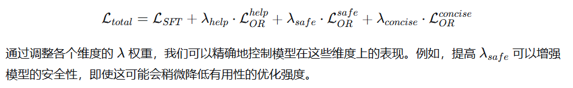{.ocr-src}

扩展方法二：统一的多维度标注与分层惩罚

我们可以在数据标注时，为每个偏好对打上多个维度的标签。例如，对于一对回复，标注者不仅判断谁更好，还会指出 chosen 在“有用性”上更好，但 rejected 在“安全性”上更差。

在训练时，我们不是简单地用一个总体的 OR 损失，而是分层地应用惩罚：

- 对于安全性维度，我们确保模型在安全性上的 odds ratio 是正的（即 chosen 比 rejected 更安全）。

- 对于有用性维度，我们确保模型在有用性上的 odds ratio 也是正的。

这可以通过在损失函数中增加额外的条件或正则化项来实现。例如，我们可以将 OR 损失项修改为：

$$
\mathcal{L}_{OR}^{multi} = \sum_{d \in D} -\log \sigma \left( \log \frac{\text{odds}_\theta(y_w|x)}{\text{odds}_\theta(y_l|x)} \right)
$$

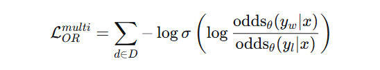{.ocr-src}

其中 $D$ 是所有需要考虑的偏好维度。

结论：ORPO 的框架非常自然地支持多目标偏好对齐，这是它相对于 DPO 的另一个优势。因为 DPO 的多目标扩展通常需要训练多个奖励模型或进行多阶段训练，而 ORPO 可以直接在损失函数中通过加权和实现。

---

#### ORPO 中的 odd ratio 项是否可以替换为其他对比度量？探讨可能的变化。

是的，ORPO 中的 Odds Ratio 项在理论上是可以被替换的，但这会改变模型的内在奖惩机制。

1. 替换为简单的概率差 (Probability Difference)

我们可以将 OR 损失中的 log odds ratio 替换为简单的概率差：$\Delta = \log P_\theta(y_w|x) - \log P_\theta(y_l|x)$。

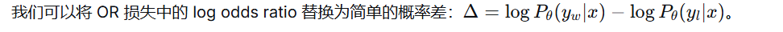{.ocr-src}

- 效果：这样会得到一个形式更简单的损失函数，类似于 DPO 但没有参考模型。

- 优缺点：形式简单，但失去了 Odds Ratio 对低概率事件（尤其是 rejected 回复）的强力惩罚特性。Odds Ratio 在 rejected 回复的概率已经很低时，仍然能施加有效的梯度将其推向 0，而简单的概率差在这时的梯度可能非常微弱。

2. 替换为 Margin Ranking Loss

可以使用成对排名损失：$\mathcal{L}_{OR} = \max(0, \text{margin} - (\log P_\theta(y_w|x) - \log P_\theta(y_l|x)))$。

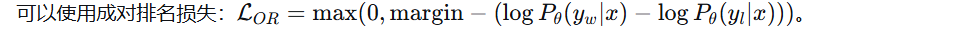{.ocr-src}

- 效果：这会让模型只关注那些 chosen 比 rejected 优势不明显的样本，而对已经轻松区分的样本不再施加惩罚。

- 优缺点：训练可能更稳定，但可能无法将 rejected 的概率压到极低，导致模型在面对对抗性攻击时仍然可能生成有害内容。

3. 替换为 DPO 风格的隐式奖励差

可以替换为：$\Delta = \beta \cdot \left( \log \frac{P_\theta(y_w|x)}{P_{\text{freezed\_old}}(y_w|x)} - \log \frac{P_\theta(y_l|x)}{P_{\text{freezed\_old}}(y_l|x)} \right)$，其中分母是一个冻结的旧模型。

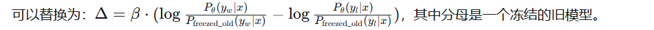{.ocr-src}

- 效果：这就退化回了 DPO。

- 优缺点：有了参考模型的约束，可能更稳定，但也失去了“无参考”的优势。

核心权衡：任何替换都是在“惩罚力度”、“训练稳定性”和“对负样本的压制程度”之间进行权衡。ORPO 的 Odds Ratio 项之所以有效，正是因为它找到了一种不需要参考模型就能实现强惩罚的优雅方式，其内在的数值特性（对低概率事件敏感）恰好能满足对齐任务的需求。

---

#### 如何用 ORPO 对已经 SFT 过的模型进行后续对齐？是否需要混合原始 SFT 数据？

是的，强烈建议在后续对齐中混合原始 SFT 数据。

尽管 ORPO 设计之初是为了省去单独的 SFT 阶段，但它同样可以作为一个强大的工具，对已经完成 SFT 的模型进行后续对齐。此时，ORPO 的角色就从一个“全栈”方法变为了一个纯粹的“偏好对齐”方法。

操作步骤：

1. 准备对齐数据：按照 ORPO 的格式要求，构建包含 chosen 和 rejected 回复的偏好数据。这些数据应当与你的对齐目标（如安全性、特定风格）紧密相关。

2. 混合原始 SFT 数据（关键步骤）：这是防止灾难性遗忘的核心。在对齐过程中，模型很容易因为过度追求新偏好而忘记它在 SFT 阶段学到的广泛能力。因此，在训练 batch 中，必须混入一部分（例如 20%-50%）高质量的、你希望模型保留的原始 SFT 数据。对于这部分数据，只计算其 L *SFT* 损失，而不计算 L *OR* 损失（因为它们没有 rejected 对）。

3. 设置合适的 λ 和 β：对一个已经很强的 SFT 模型进行后续对齐，通常需要更谨慎的优化强度。建议从一个较小的 $λ$（如 0.5）开始，让模型平稳过渡，避免过大的更新破坏了已有的语言能力。

为什么必须混合 SFT 数据？

如果用 ORPO 做后续对齐时不混合原始 SFT 数据，就相当于只使用了一个“偏好增强”数据集。此时，ORPO 的 SFT 部分只会学习新的偏好数据中的 chosen 回复，而 OR 部分会惩罚 rejected 回复。这会导致模型逐渐遗忘它在原始 SFT 阶段学到的、未在新数据中出现的知识和指令遵循能力。混合原始 SFT 数据，就是为了持续强化这些基础能力，确保对齐过程是一个“加法”而不是“替换”。

总结：ORPO 非常灵活，既可以作为从头开始的一体化训练方案，也可以作为对已 SFT 模型的后续对齐方案。但无论哪种场景，保留高质量 SFT 数据的持续学习，都是确保模型不退化、对齐效果稳健的关键。

