# 50.大模型（LLMs）SimPO

#### SimPO 的核心贡献是什么？它如何简化偏好优化？

SimPO 的核心贡献可以概括为“长度归一化的隐式奖励”和“无参考的对齐优化”。它用两个关键创新，将偏好优化推向了一个新的简洁高度：

1. 用“平均对数概率”作为隐式奖励：SimPO 发现，直接使用模型生成的序列的平均对数概率（即序列总对数概率除以序列长度）作为衡量回复质量的指标，不仅天然地解决了“长回复更容易获得高奖励”的偏差问题，而且完全不需要外部奖励模型。这个指标就是策略模型自身的输出，可以即时计算。

2. 引入“目标奖励边际” (γ, gamma)：SimPO 不仅希望模型认为好回复 ($y_w$) 的奖励高于坏回复 ($y_l$)，还要求这个高出部分至少达到一个指定的阈值 $γ$。这个$γ$作为一个额外的强化信号，强制模型在好回复和坏回复之间拉开一个明显的分数差距，从而让偏好学习更加鲁棒和高效。

如何简化偏好优化？

与 DPO 相比，SimPO 彻底移除了对参考模型 (Reference Model) 的需求。DPO 需要一个冻结的 SFT 模型作为参考基准来计算隐式奖励，而 SimPO 则完全在策略模型自身输出的平均对数概率上操作。这使得训练流水线极其简洁：你不需要加载、维护一个额外的庞大模型，显存占用和计算开销几乎减半。

---

#### SimPO 中，为什么使用序列平均 log 概率作为隐式奖励，而不用显式的 reward model？

这个问题触及了偏好优化中一个核心的矛盾：奖励模型的偏差与成本。

1. 解决长度偏差 (Length Bias)：在 RLHF 和 DPO 中，一个众所周知的陷阱是奖励模型（无论是显式的还是隐式的）倾向于给更长的回复打出更高的分数。这会导致模型在训练中学会“说废话”来骗取高奖励。SimPO 使用 平均对数概率（即 `序列总对数概率 / 序列长度`），它在数学上天然地对长度进行了归一化。这使得无论回复是长是短，模型比较的是它们每个 token 的平均质量，从而从根本上避免了长度偏差。

2. **无需额外模型，成本极低**：显式的奖励模型需要独立训练，这是一个复杂且易出错的额外步骤。DPO 的隐式奖励则依赖于一个冻结的参考模型，这增加了显存和计算开销。SimPO 的隐式奖励直接来自于策略模型 $\pi_\theta$ 自身，是训练过程中自然产生的“副产品”。这个设计真正实现了奖励与策略的无缝融合，极大降低了系统的复杂度。

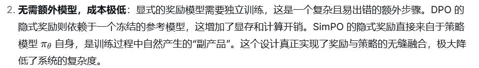{.ocr-src}

3. 奖励与策略高度一致：外部奖励模型可能会与策略模型产生“认知偏差”，即策略模型认为好的回复，奖励模型不买账。SimPO 的奖励直接源于策略，保证了奖励信号与策略优化目标完全一致。

---

#### SimPO 相比 DPO，为什么不需要 Reference Model？这对训练有何好处？

SimPO 不需要 Reference Model，源于它对“隐式奖励”的重新定义。

- **DPO 的隐式奖励**：$r_\theta = \beta \cdot \log \frac{\pi_\theta(y|x)}{\pi_{\text{ref}}(y|x)}$。这个定义天然地需要一个参考模型 $\pi_{\text{ref}}$ 来提供基准。其目的是通过 KL 散度约束策略不要偏离太远。
- **SimPO 的隐式奖励**：$r_\theta = \frac{\beta}{|y|} \sum \log \pi_\theta(y|x)$。这个定义完全只依赖于策略模型 $\pi_\theta$ 自身的输出，不需要任何外部参照物。

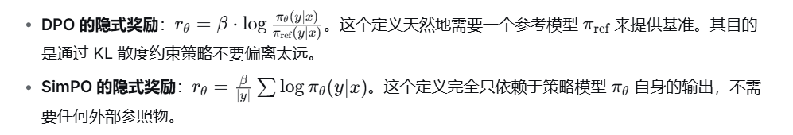{.ocr-src}

SimPO 通过“平均对数概率”和“目标边际 $γ$”这两个机制，巧妙地替代了 Reference Model 的“保底”功能。平均对数概率本身就是一个稳健的指标，而 $γ$ 作为额外的约束，可以防止模型输出概率的异常波动。

对训练的好处是巨大的：

1. 显存占用降低 40%-50%：无需加载和存储一个完整的冻结模型，可以直接腾出大量 GPU 显存，用于支持更大的 batch size 或更长序列的训练。

2. 训练速度显著提升：省去了一次完整的前向传播计算，每一步迭代的时间更短，吞吐量更高。

3. 工程实现极度简化：代码逻辑从管理双模型变为管理单模型，出错概率和调试难度都大大降低。

---

#### 在 SimPO 中，如何通过平均 log 概率解决回复长度带来的偏差？

长度偏差是偏好对齐中一个根深蒂固的问题：模型倾向于给那些更长、更啰嗦的回复打出更高的总对数概率，从而获得更高的奖励。

SimPO 通过一个极其简单的数学操作解决了这个问题：从“总和”变为“平均”。

- **总对数概率（DPO 隐式使用）**：对于一段长度为 $L$ 的回复，其总对数概率是 $\sum_{t=1}^{L} \log P(y_t)$。由于 $\log P(y_t)$ 通常是一个负数，长度 $L$ 越大，这个总和的负值就越大。如果不进行归一化，模型和奖励模型都会潜意识地将“长度”视为质量的标志，导致“废话连篇”的奖励黑客行为。
- **平均对数概率（SimPO 使用）**：SimPO 将总对数概率除以长度 $L$，得到 $\frac{1}{L} \sum_{t=1}^{L} \log P(y_t)$。这个指标衡量的是“生成这段文本时，模型在每个 token 上的平均确信度”。一段高质量的短文，其每个 token 的预测概率都很高，因此平均对数概率很高；而一段冗长的水文，虽然总概率可能不低，但平均到每个 token 上，其质量就会原形毕露。

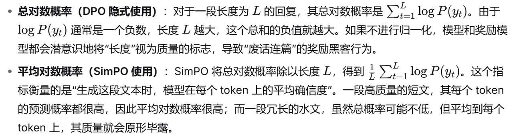{.ocr-src}

通过这种长度归一化，SimPO 将模型优化的焦点从“能写多长”成功转移到了“每个词写得多好”，从根本上抑制了长度偏差。

---

#### SimPO 提出的“目标奖励边际” γ 的作用是什么？怎样设置？

γ 的作用是定义一个“显著优于”的边界。

在标准的 DPO 中，只要 chosen 回复的隐式奖励略大于 rejected 回复（哪怕只大 0.01），损失项就会接近 0，模型就认为已经学会了。这种“刚刚好”的区分在面对复杂、细微的偏好时可能不够鲁棒。

γ 的引入改变了这一状况。它要求模型必须让 chosen 回复的平均对数概率比 rejected 回复的高出至少一个固定的阈值 $γ$。这就好比考试，DPO 只要求及格（60 分），而 SimPO 要求达到良好（80 分）。它把一条模糊的分界线，变成了一个宽阔的“隔离带”。

如何设置 γ？

- $\gamma = 0$：损失函数退化为要求 $\bar{p}_w > \bar{p}_l$，是一种弱约束。
- **$\gamma$ 过大（例如 > 2.0）**：要求过于严苛，可能导致模型为了强行拉开差距而扭曲自己的概率分布，甚至可能损害好回复本身的生成概率，造成训练不稳定。

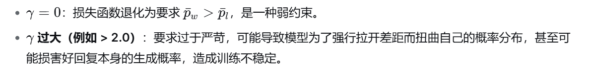{.ocr-src}

- 经验法则：$γ$ 的典型值通常设置在 0.1 到 1.0 之间。一个常用的起始点是 0.5。最佳值取决于你的偏好数据中 chosen 和 rejected 回复的平均质量差距。如果两者差距本身就很明显，$γ$ 可以设小一些；如果两者很相似（都是不错的回复，只有细微差别），则需要一个稍大的 $γ$ 来强制模型学习这些细微的差异。

---

#### 分析 SimPO 与 ORPO 的异同，两者都试图去除参考模型，但方法有何本质区别？

SimPO 和 ORPO 都是 DPO 之后涌现的、旨在移除参考模型的优秀方法，但它们的核心思想和对“好/坏”回复的定义方式截然不同。

相同点：

- 目标一致：都试图简化 DPO，彻底移除对参考模型的依赖，用更简洁、更高效的方式实现偏好对齐。

- 单模型训练：在训练时都只需要加载并更新一个策略模型。

本质区别：

- 奖励的定义与计算：
  - SimPO 使用的是 “平均对数概率”。它直接计算模型自身对回复序列的生成概率，并除以长度。它回答的问题是：“模型平均每个词有多确信要生成这个回复？”
  - ORPO 使用的是 “比值比 (Odds Ratio)”。它计算的是模型“愿意生成该回复的概率”与“不愿意生成该回复的概率”之比。它回答的问题是：“模型有多大概率会选这个回复，而不是其他所有可能？”

- 惩罚机制与目标函数结构：
  - SimPO 的损失函数是 DPO 的一个变体，是一个单层优化目标。它通过比较平均对数概率并引入边际 $γ$ 来直接优化。
  - ORPO 的损失函数是 SFT 损失 + OR 损失的二元结构。它将对齐任务“寄生”在指令微调任务之上。SFT 部分负责“鼓励”好回复，OR 部分负责“惩罚”坏回复。其惩罚机制源于 Odds Ratio 对低概率事件的天然敏感性。

- 对齐的驱动方式：
  - SimPO 是比较驱动。它的核心是比较 chosen 和 rejected 回复的平均对数概率，并强制拉开差距。
  - ORPO 是惩罚驱动。它通过 Odds Ratio 项，给 rejected 回复施加一个极其强大的、将其概率推向 0 的惩罚梯度，从而让模型主动远离“坏”行为。这种方式对负样本的压制比 SimPO 更为激进和直接。

总结：SimPO 走的是“精益求精”的路线，通过精细化地优化生成概率的均值来对齐；而 ORPO 走的是“刮骨疗毒”的路线，通过强力惩罚来根除坏行为。SimPO 形式上更接近 DPO，而 ORPO 则是一种全新的范式。

---

#### SimPO 训练过程是否稳定？其梯度与 DPO 的梯度形式有何不同？

SimPO 的训练过程非常稳定，甚至在某些方面优于 DPO。

稳定性来源：

1. 无参考模型：消除了因参考模型质量不佳或与策略模型不协调而引入的额外方差和偏差。

2. 长度归一化：平均对数概率是一个数值上更稳定的信号。它避免了因序列长度不同而导致的总对数概率的大幅波动，使损失曲线更加平滑。

3. 目标边际 γ：γ 为优化提供了一个明确的、稳定的目标。在 DPO 中，一旦 chosen 的概率略高于 rejected，梯度就会迅速消失。而 SimPO 的 γ 机制使得模型在达到目标边际之前，都能接收到持续、稳定的更新梯度，从而推动模型进行更充分的学习，而不是过早收敛。

梯度形式的区别：

DPO 的梯度形式为（简化）：

$$
\nabla_\theta \mathcal{L}_{\text{DPO}} \propto -\nabla_\theta \left( \log \frac{\pi_\theta(y_w)}{\pi_{\text{ref}}(y_w)} - \log \frac{\pi_\theta(y_l)}{\pi_{\text{ref}}(y_l)} \right)
$$

其中，$\pi_{\text{ref}}$ 的对数概率在梯度计算中作为常数被减去，但它会影响梯度的尺度和方向。

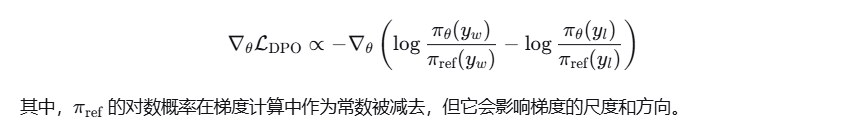{.ocr-src}

SimPO 的梯度形式为（简化）

$$
\nabla_\theta \mathcal{L}_{\text{SimPO}} \propto -\nabla_\theta \left( \bar{p}_w - \bar{p}_l - \gamma \right)
$$

{.ocr-src}

与 DPO 相比，SimPO 的梯度不包含参考模型的项，它纯粹来自于策略模型自身对 chosen 和 rejected 回复的平均对数概率的差值。这使得梯度信号更加“纯净”，完全聚焦于提升 $y_w$ 相对于 $y_l$ 的优势，不受外部参考模型“噪音”的影响。

---

#### 如果使用 SimPO，数据准备与 DPO 有哪些不同？需要对概率做特殊预处理吗？

数据准备：与 DPO 完全相同，无需特殊预处理。

这是一个非常方便的特性。SimPO 和 DPO 使用完全相同的训练数据格式：你只需要准备好标准的偏好数据集，其中包含 `prompt`、`chosen` 和 `rejected` 三个字段。SimPO 可以直接复用你为 DPO 或 RLHF 准备的任何数据集，无需进行任何额外的数据处理或概率预处理。

与 DPO 相比，唯一的“不同”在于训练时的计算方式：

- DPO 需要在训练前或训练初期，用冻结的参考模型对整个数据集的 chosen 和 rejected 回复计算并保存其对数概率（log probabilities），或者采用在线计算并 detach 的方式。

- SimPO 则完全不需要这一步。它所需的一切信息，都来自于策略模型在当前参数下的实时前向传播。

总结：从 DPO 切换到 SimPO，你的数据管道不需要做任何改动，你只需要修改训练脚本中的损失函数，并移除参考模型即可。这种无缝的迁移特性，也是 SimPO 的一个重要实用优势。

---

#### 为什么 SimPO 能够更好地匹配推理时的贪婪解码行为？

这是一个关于“训练目标”与“推理行为”一致性的问题。SimPO 的设计天然地弥合了这两者之间的鸿沟。

在推理时，我们通常使用贪婪解码（Greedy Decoding），其目标是生成一个完整的序列 $y$，使得该序列的整体概率 Pθ(y∣x) 最大化。然而，传统的偏好对齐方法（如 DPO）在训练时优化的是“奖励最大化”，而这个奖励是通过一个外部的、独立的奖励模型来定义的。这就产生了一个不一致：模型在训练时追求高分，在推理时追求高概率，这两个目标可能指向不同的回复。

SimPO 如何解决这个问题？

SimPO 直接使用 “序列的平均对数概率” 作为隐式奖励。这意味着，一个回复的“奖励”高低，直接取决于模型自身生成该回复时，对其中每个 token 的平均确信度。因此：

- 在训练中，模型被要求去最大化 chosen 回复的平均对数概率（并拉开与 rejected 的差距）。

- 在推理中，贪婪解码的目标也正是生成一个总概率最高（即平均对数概率最高）的序列。

这就使得训练目标和推理目标在数学形式上达到了完美的统一。DPO 则不同，其隐式奖励 $r = \beta \cdot \log \frac{\pi_\theta}{\pi_{\text{ref}}}$ 依赖于一个冻结的参考模型 $\pi_{\text{ref}}$。推理时的生成完全由 $\pi_\theta$ 决定，但训练时却被要求去最大化相对于 $\pi_{\text{ref}}$ 的增益，这种不一致性可能导致模型在训练时学到了“如何在参考模型面前表现得更好”，而不是“如何真正生成更好的内容”。SimPO 的单模型、自对比特性，正是其能更好地匹配贪婪解码行为的根本原因。

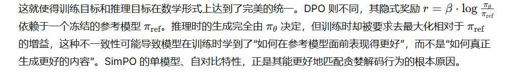{.ocr-src}

---

#### SimPO 在哪些任务上比 DPO 有明显提升？其优势的可能原因是什么？

在 SimPO 的原始论文和后续社区实践中，其在以下任务上展现了相对于 DPO 的明显提升：

1. AlpacaEval 2.0：这是衡量指令遵循能力的核心基准。SimPO 训练的模型在胜率（Win Rate）上显著优于同等条件下的 DPO，尤其是在处理需要深度理解和创新性回复的开放式提示时。

2. MT-Bench：在多轮对话能力的评估中，SimPO 的表现也更优。尤其是在“推理”、“写作”等需要复杂思维链条的类别上，优势更为突出。

优势的可能原因：

- 解决了长度偏差：这是最关键的因素。DPO 及其他很多对齐方法都容易产生“越长越好”的偏差，导致模型在 AlpacaEval 2.0 等基准上通过生成冗长的回复来刷分。SimPO 的长度归一化从根本上抑制了这种作弊行为，迫使模型将优化重心放在提升每个 token 的生成质量上，因此所取得的性能提升是更真实、更扎实的。

- 更好的训练-推理一致性（见第9题）：训练目标和推理目标的统一，避免了 DPO 中可能存在的优化错位问题，使得训练过程中的改进能更直接地转化为推理时的生成质量提升。

- **无参考模型的“自由”探索**：DPO 的参考模型 $\pi_{\text{ref}}$ 在防止模型偏离太远的同时，也可能成为限制其进一步优化的“枷锁”。SimPO 移除了这个枷锁，并结合目标边际 $\gamma$ 提供了更积极的引导，使得模型可以在一个更广阔的空间中寻找最优解。

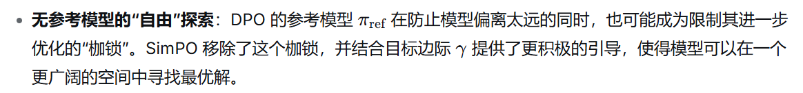{.ocr-src}

- 梯度信号更集中：SimPO 的梯度纯粹来自于提升 $y_w$ 相对于 $y_l$ 的优势，而无需考虑与参考模型的复杂交互。这使得优化方向更加明确和高效，模型可以更快地收敛到更优的偏好分布上。

---

#### 解释 SimPO 中“长度归一化”的动机和数学形式。

动机：消除语言模型偏好对齐中的“长度偏差”。

在自回归语言模型中，一个序列的总对数概率是序列中所有 token 对数概率的总和。由于对数概率通常是负数，因此序列越长，累加的负值就越多，总对数概率也就越低（负得越多）。当这个值被用作奖励信号时，会引入一个致命的偏差：模型会发现，即使生成的内容质量不高，只要把回复写得更长，就能获得更高的奖励分数。这就是所谓的“长度偏差”或“奖励黑客”行为。

数学形式：

SimPO 的隐式奖励不采用总对数概率，而是采用平均对数概率，其数学形式为：

$$
\bar{p}(y|x) = \frac{1}{|y|} \sum_{t=1}^{|y|} \log \pi_\theta(y_t|x, y_{<t})
$$

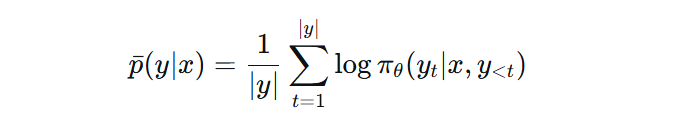{.ocr-src}

其中 ∣$y$∣ 是回复 $y$ 的序列长度（token 数）。这个公式将总对数概率除以了序列长度，从而实现了长度归一化。它衡量的是模型在生成这段文本时，对每个 token 的平均“确信度”或“质量”。一个简短但高质量的回复，其每个 token 的预测概率都很高，因此平均对数概率也会很高；而一个冗长、啰嗦的回复，其平均质量则会原形毕露。通过这种方式，SimPO 从数学上杜绝了模型通过堆砌长度来获取高奖励的可能性。

---

#### SimPO 训练时，是否需要像 DPO 那样小心处理 β 和 reference 的分离？

完全不需要，因为 SimPO 根本没有 Reference Model。

在 DPO 中，超参数 $β$ 和 reference model 是紧密耦合的。$β$ 的大小直接决定了模型在多大程度上受到 reference model 的约束。开发者需要非常小心地平衡 $β$ 值，既要防止模型偏离太远（$β$ 太小），又要防止优化力度不够（$β$ 太大）。

在 SimPO 中，由于移除了 reference model，$\beta$ 的角色也发生了变化。它不再是 KL 散度惩罚的系数，而是更多地作为一个**温度参数**，用于调节损失函数中 logit 部分的尺度。虽然它仍然会影响训练，但其作用变得更加纯粹和可预测。在 SimPO 中，调参的注意力更多地从“平衡 $\pi_\theta$ 和 $\pi_{\text{ref}}$”转移到了如何设置**目标边际 $\gamma$** 上。这使得调参过程更加解耦和简洁。

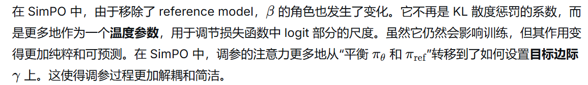{.ocr-src}

---

#### SimPO 在多轮对话或长文本偏好数据上的表现如何？

SimPO 在多轮对话和长文本场景下的表现尤为突出，其优势主要源于长度归一化。

在多轮对话中：

多轮对话的偏好数据中，chosen 和 rejected 回复的长度可能差异巨大。DPO 很容易因为长度偏差而错误地奖励那些更长的回复，而忽略了其内容质量。SimPO 的平均对数概率则能公平地比较不同长度的回复，让模型真正学会如何生成内容更丰富、逻辑更连贯的多轮回复，而不是简单地增加对话轮次或重复客套话。在 MT-Bench 这类多轮对话基准上，SimPO 能显著提升模型的表现。

在长文本偏好数据上：

对于摘要、长文生成等任务，长度归一化同样至关重要。它能鼓励模型生成信息密度高、表述精炼的长文本，而不是注水冗长的内容。同时，由于 SimPO 移除了参考模型，它不会对长文本中可能出现的、与 SFT 模型风格不完全一致的创新表达施加过强的 KL 惩罚，从而为模型的创造性提供了更大的空间。

数据构造注意事项：SimPO 的数据格式与 DPO 完全一样，需要包含 `prompt`、`chosen` 和 `rejected` 字段。在处理多轮对话时，通常将整个对话历史作为 `prompt`，而 `chosen` 和 `rejected` 只包含最后一轮的助手回复。这样可以确保模型学习的是在特定对话历史下如何做出更好的最终回复。

---

#### 如何在 SimPO 损失中加入安全或特定维度的偏好权重？

我们可以通过多维损失加权求和的方式，非常自然地将安全或其他特定维度的偏好权重融入 SimPO 框架。

假设我们有两组偏好数据：一组是通用的有用性偏好数据 *D help*，另一组是专门的安全偏好数据 *D safe*。

总损失函数可以定义为：

$$
\mathcal{L}_{total} = \mathcal{L}_{\text{SimPO}}(D_{help}) + \lambda_{safe} \cdot \mathcal{L}_{\text{SimPO}}(D_{safe})
$$

其中：

- $\mathcal{L}_{\text{SimPO}}(D_{help})$ 是在有用性数据上计算的标准 SimPO 损失。
- $\mathcal{L}_{\text{SimPO}}(D_{safe})$ 是在安全性数据上计算的 SimPO 损失，它会鼓励模型提升安全回复（如拒答）的生成概率，并降低不安全回复的概率。
- $\lambda_{safe}$ 是我们为安全性维度设定的权重。通过增大 $\lambda_{safe}$，我们可以显著增强模型的安全对齐行为，即使这可能会稍微牺牲一些在其他任务上的有用性。

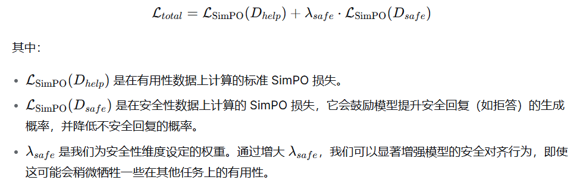{.ocr-src}

这种方法的优势在于其简单和灵活。我们可以为不同的偏好维度（如诚实性、无害性、特定风格等）创建独立的数据集和 SimPO 损失项，然后通过调整它们的权重，像调音台一样精确地“混音”，最终得到我们期望的模型行为。

---

#### 实现 SimPO 时，如何高效计算序列的平均 log 概率？

在自回归语言模型中，我们通常已经计算了每个 token 的交叉熵损失。实现 SimPO 的平均对数概率计算可以非常高效，无需复杂的额外操作。

高效实现方法：

1. 利用模型的 `forward` 方法：当我们将 `labels` 参数传递给模型（如 HuggingFace 的 `model(input_ids, labels=labels)`）时，它内部会自动计算每个 token 的交叉熵损失，并返回一个形状为 `(batch_size, seq_len)` 的 token-level loss 张量。

2. 应用损失掩码：对于回复中的每个 token，我们对其 loss 应用掩码，只保留我们关心的 token（如 chosen/rejected 回复部分的 token）。

3. 计算总和与平均：
  - 对掩码后的 token-level loss 在序列维度上进行求和，得到序列的总损失（Total Loss）。
  - 对掩码求和，得到有效 token 的数量 $L_{valid}$（即序列长度）。
  - 序列的平均损失 = `总损失 / 有效token数`。\
    由于交叉熵损失 $L_{CE} = -\log P(y_t|x, y_{<t})$，所以**平均对数概率 $\bar{p}$ = −平均损失**。

{.ocr-src}

代码示例 (PyTorch)：

```python
# logits: shape (batch_size, seq_len, vocab_size)
# labels: shape (batch_size, seq_len)，非目标位置为 -100

loss_fct = torch.nn.CrossEntropyLoss(reduction='none')
token_losses = loss_fct(logits.permute(0,2,1), labels)  # (batch_size, seq_len)

# 创建掩码：有效token位置为1，忽略位置（-100）为0
loss_mask = (labels != -100).float()

# 计算总损失和平均损失
total_loss = (token_losses * loss_mask).sum(dim=-1)  # (batch_size,)
num_valid_tokens = loss_mask.sum(dim=-1)             # (batch_size,)
avg_loss = total_loss / num_valid_tokens

# chosen 回复的平均对数概率
avg_log_prob = -avg_loss
```

这种方法完全复用了 SFT 训练中已有的计算，性能极高，无需额外开销。

---

#### SimPO 训练中是否会出现“奖励崩塌”或 chosen/rejected 区分度不够的问题？

通常不会，SimPO 的设计本身就包含了对这些问题的防御机制。

- “奖励崩塌” 是指模型为了最大化奖励而不择手段，导致输出质量崩溃。在 DPO 中，这通常是因为 KL 约束过松导致的。SimPO 虽然移除了 Reference Model，但其 “平均对数概率” 指标本身就是一个强有力的“质量锚”。因为模型很难通过简单的“欺骗”手段（如重复废话）来提高平均对数概率，这需要模型在几乎每个 token 的生成上都表现良好。这个特性使得 SimPO 的训练天然地比 DPO 更稳定，不易崩塌。

- “区分度不够” 是指在训练后期，chosen 和 rejected 回复的得分过于接近，导致模型无法继续从偏好数据中学习。DPO 可能在 chosen 得分略高于 rejected 时，梯度信号就变得非常微弱。\
  SimPO 的 目标边际 $γ$ 机制正是为了解决这个问题而设计的。它明确要求模型不仅在得分上区分 chosen 和 rejected，还要拉开一个至少为 $γ$ 的显著差距。只要这个差距没有达到 $γ$，损失函数就会持续产生梯度，推动模型进一步优化。这就像一个要求严格的教练，在运动员达到“优秀”标准之前，会持续给予指导和压力，从而确保了模型能学到清晰、明确的偏好。

---

#### 如果策略模型的输出概率分布很不平滑，SimPO 的隐式奖励是否可靠？

这个问题的答案是 “在大多数情况下可靠，但极端不平滑会带来风险”。SimPO 的隐式奖励是序列的平均对数概率，这个定义本身就赋予了它一定的鲁棒性，但也存在短板。

**为什么通常可靠（平均化的平滑效应）**

SimPO 的隐式奖励定义为 $\bar{p} = \frac{1}{L} \sum_{t=1}^{L} \log \pi_\theta(y_t|x, y_{<t})$。这是一个**序列级的平均量**。即使模型在个别 token 上的预测概率极低（如出现了罕见词），导致该点的对数概率是一个非常大的负数，但由于它是被所有 token 的平均所稀释的，因此对整体分数的影响是可控的。一个或几个异常点不会像在基于总和的指标中那样，完全左右整个序列的得分。这种平均化的过程，天然地对局部的概率波动起到了平滑作用。

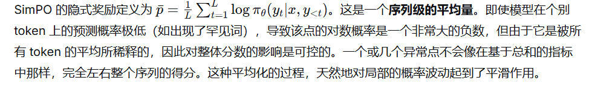{.ocr-src}

何时不可靠（方差过大与离群值）

当模型的输出概率分布全局性地非常不平滑时，SimPO 的隐式奖励会变得不可靠。这通常发生在以下情况：

- 训练初期或模型崩溃时：模型对大量 token 的预测极度不确定，概率分布近似均匀，或者对某些 token 的预测概率趋近于 0（对数概率趋向负无穷）。此时，平均对数概率的方差极大，无法准确反映回复之间的真实质量差异。

- 离群值主导：即使有平均化，如果回复中出现了概率极低的长尾词（比如生僻字），该点的对数概率会成为一个巨大的负值，将整个序列的平均分大幅拉低。这会导致模型错误地惩罚一个仅仅因为使用了一个生僻词的高质量回复。

提升可靠性的改进方法

可以通过以下方式增强 SimPO 在概率不平滑时的鲁棒性：

1. 温度缩放（Temperature Scaling）：在计算隐式奖励之前，对 logits 应用一个大于 1 的温度 $T$。这能平滑概率分布，避免极端概率值的出现，从而使对数概率信号更稳定。

2. 裁剪对数概率：对单步的对数概率设定一个最小值（如 -20），防止个别极低概率的 token 对平均分产生不成比例的巨大影响。

3. Top-p 掩码后计算：只在模型通过 Top-p 采样认为合理的 token 集合上计算对数概率，但这种方式会改变原始的生成概率定义，需要谨慎使用。

总结：SimPO 的隐式奖励在模型正常训练阶段是可靠的，其平均化机制能有效平滑局部噪声。但在训练初期、模型分布极度异常时，可能需要配合温度缩放等技巧来保证信号的稳定性。

---

#### 比较 SimPO 与 KTO，在对非成对偏好数据的适用性上有何区别？

这是一个关于数据需求和算法适用范围的核心区别。SimPO 必须使用成对偏好数据，而 KTO 可以天然地处理非成对偏好数据。

- **SimPO 的数据需求**：SimPO 的损失函数本质上是比较 chosen 回复和 rejected 回复的隐式奖励。它必须依赖于一个三元组 $(x, y_w, y_l)$，即对于同一个提示 $x$，必须同时存在一个“更好”的回复 $y_w$ 和一个“更差”的回复 $y_l$。这是一种**相对偏好**的学习。

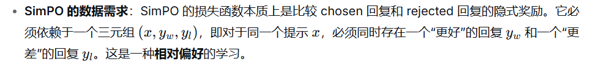{.ocr-src}

- KTO 的数据需求：KTO（Kahneman-Tversky Optimization）的灵感来源于前景理论，它不直接比较成对的回复，而是为每个回复设定一个独立的、绝对的渴望程度（desirability）。这个渴望程度可以来源于多种形式的反馈：
  - 二分类的评分（好/坏）
  - 连续的评分（如 1-5 星）
  - 甚至是用户的行为数据（如点击、点赞）\
    因此，KTO 可以直接利用这些非成对的、单点的偏好数据进行训练，无需为每个提示都构造出对比对。这在实践中非常灵活，因为收集“A 比 B 好”的成本远高于收集“A 是好是坏”。

- 适用性区别总结：
  - 如果你有高质量的成对偏好数据（例如，由强大的标注模型生成的大量对比对），SimPO 和 KTO 都可以使用，且 SimPO 可能因其直接对比的设计而更加高效。
  - 如果你的数据是非成对的（例如，从用户反馈中收集的点赞/点踩记录、不同质量的评分数据集），那么 KTO 是唯一的选择。SimPO 无法直接处理这种数据格式。

- SimPO 如何变通处理非成对数据？\
  如果只有评分数据，SimPO 必须进行变通：人为构造对比对。例如，将评分最高的回复作为 $y_w$，将评分最低的回复作为 $y_l$。这种构造方法虽然可行，但会引入偏差，且构造出的对比对质量受限于评分系统的准确度。

---

#### SimPO 论文中的 γ 如何与 DPO 的 β 在作用上进行类比？

两者的角色都是控制优化强度和行为约束的关键超参数，但它们的作用机制和哲学理念截然不同。

- DPO 中的 β：β 是一个温度或缩放因子。它直接乘以 chosen 和 rejected 回复的对数概率比。β 越小，这个比值在损失函数中的作用就越被放大，优化力度越强，模型越“激进”；β 越大，比值的作用被缩小，优化越“保守”。β 还间接地与参考模型的 KL 约束强度关联，决定了策略模型可以偏离多远。

- SimPO 中的 γ：γ 是一个目标边际。它不缩放隐式奖励本身，而是设定了一个必须达到的“分数线”。优化目标从“只要 $y_w$ 比 $y_l$ 好就行”变成了“$y_w$ 必须比 $y_l$ 好出至少 γ 这么多”。γ 设得越大，模型就需要在好回复和坏回复之间拉开更大的差距，这是一个更强的约束，鼓励模型进行更彻底的学习。

类比理解：

可以把隐式奖励的差距想象成一场考试的成绩差。

- DPO 的 β 就像是在调整考试的分数标尺。β 越小，一分之差在最终评价中被放得越大，学生更有动力去争取每一分。

- SimPO 的 γ 则直接规定了一个分数线差。例如，γ=0.5 意味着你必须比另一份考卷高出 5 分才算成功。这给学生设定了一个明确、必须达成的目标。

作用上的共同点：它们都防止了模型在“差不多好”的样本上停滞不前。DPO 的 β 通过放大差距来强化信号，而 SimPO 的 γ 则通过强制要求最小差距来实现。γ 的这种“硬性标准”在某些情况下能提供比 β 的“柔性缩放”更稳定的学习信号，因为模型始终清楚自己离目标有多远。

---

#### 能否将 SimPO 与 SFT 损失结合，形成一个无需 SFT 预热的一阶段训练方案？

完全可以，并且这种方法非常有价值。这正是 ORPO 的核心思想，而 SimPO 同样可以完美地融入这种架构，形成一个“SimPO 版本的一阶段训练方案”。

设计方案：

我们只需要将标准 SFT 的交叉熵损失与 SimPO 的偏好对齐损失直接相加，形成一个联合损失函数：

$$
\mathcal{L}_{total} = \mathcal{L}_{SFT}(D_{chosen}) + \lambda \cdot \mathcal{L}_{SimPO}(D_{pref})
$$

- $\mathcal{L}_{SFT}(D_{chosen})$：在 chosen 回复数据上计算的标准交叉熵损失，负责监督模型学习如何生成正确的回复。
- $\mathcal{L}_{SimPO}(D_{pref})$：在偏好数据上计算的 SimPO 损失，负责教会模型区分好坏回复的偏好。
- $\lambda$：一个用于平衡两项损失的超参数。

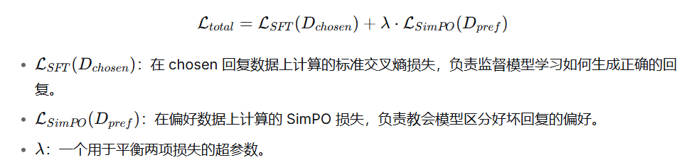{.ocr-src}

为什么这是一种高效的方案？

1. 一步到位：它彻底消除了“先 SFT 预热，再 DPO/SimPO 对齐”的两阶段流程，简化了训练管线。

2. 防止遗忘：SFT 损失在整个训练过程中持续存在，为模型提供了强大的“能力锚”，确保模型在对齐过程中不会丢失其基础的指令遵循能力。

3. 更稳定的训练：SFT 损失为整个优化提供了一个非常稳定、平滑的基准，可以有效抑制 SimPO 损失在训练初期可能引起的波动。

与 ORPO 的关系：ORPO 是将 SFT 损失与基于 Odds Ratio 的 OR 损失结合。而我们这里描述的是将 SFT 损失与 SimPO 损失结合。两者可以看作是同一思想（一阶段联合训练）下的不同算法实现。因此，答案是肯定的，这种方案兼具了 SimPO 的简洁性和 ORPO 的稳定性优势。

---

#### 设计实验验证 SimPO 相比 DPO 在训练速度和内存上的优势。

设计实验的核心是控制变量法：确保 SimPO 和 DPO 在模型架构、训练数据、优化器等方面完全一致，唯一不同的就是训练方法。

实验设计：

1. 模型与数据：
  - 选择一个基座模型，如 LLaMA-7B。
  - 使用相同的 SFT 模型作为共同的起点。
  - 准备一个固定的偏好数据集。

2. 环境设置：
  - 在相同的硬件上进行训练，记录 GPU 型号、驱动和 CUDA 版本。

3. 实验组与对照组：
- **DPO 组**：加载 SFT 模型作为策略模型 $\pi_\theta$ 和参考模型 $\pi_{\text{ref}}$（冻结）。配置 DPO 训练循环。
- **SimPO 组**：仅加载 SFT 模型作为策略模型 $\pi_\theta$。配置 SimPO 训练循环。

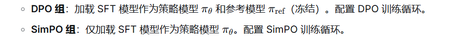{.ocr-src}

4. 固定变量：
  - 设置完全相同的 global batch size、序列长度和优化器（如 AdamW）。
  - 将 DPO 的 $β$ 和 SimPO 的 $β$ 设为相同值，SimPO 的 $γ$ 设为 0，以尽可能对齐条件。

5. 核心观测指标：
  - 显存占用：通过 `nvidia-smi` 或 PyTorch 的 `torch.cuda.memory_allocated()` 在训练过程中稳定后，记录峰值显存。
  - 单步训练时间：在一个固定的 batch 上，运行 100 个训练步，取平均时间，并计算出每秒处理样本数（Throughput）。
  - 收敛速度：在一个独立的验证集上（如使用 reward model 打分），绘制训练步数-性能曲线。比较两者达到相同性能水平所需的训练步数和时间。

预期结果：

- 显存占用：SimPO 的峰值显存应比 DPO 低约 40%-50%，因为少了参考模型。

- 训练速度：SimPO 的吞吐量（tokens/秒）应显著高于 DPO，因为每步只有一次模型前向传播。

- 收敛效率：SimPO 达到同等奖励水平所需的步数可能更少，或相同步数下性能更高。

通过这样的实验，可以清晰地量化 SimPO 在资源效率和训练速度上的双重优势。

---

#### SimPO 是否适用于仅解码器模型和编码器-解码器模型？

是的，SimPO 对两者都适用，但均需适配其输出计算方式。

- 仅解码器模型（如 GPT、LLaMA）：\
  这是 SimPO 最直接的应用场景。模型在给定前缀 $x$ 后，自回归地生成回复 $y$。SimPO 所需的序列平均对数概率，正是该模型在生成回复序列时，对每个 token 的条件对数概率的平均值。计算方式完全符合 SimPO 的定义。

- 编码器-解码器模型（如 T5, BART）：\
  SimPO 同样适用，但计算平均对数概率的位置是解码器。具体来说：
  - 编码器处理输入 $x$，产生一个隐藏状态表示。
  - 解码器根据这个隐藏状态和已生成的 token，自回归地生成输出序列 $y$。

- SimPO 所需的 $\bar{p}(y|x)$，就是这个解码器在生成序列 $y$ 时的平均对数概率。
- 它的计算逻辑与仅解码器模型在解码阶段完全一致。因此，SimPO 可以直接应用于任何标准的 seq2seq 模型，只需将重点放在解码器的自回归生成过程上。

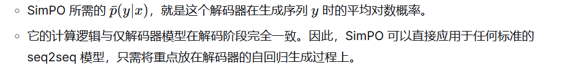{.ocr-src}

---

#### SimPO 的梯度分析：模型在训练中如何学习拉大 good 和 bad 之间的边际？

对 SimPO 损失函数 $\mathcal{L}_{SimPO}=-\log\sigma\left(\beta(\bar{p}_w-\bar{p}_l)-\gamma\right)$ 求关于策略模型参数 $\theta$ 的梯度，可以清晰地揭示其学习机制。

其梯度形式为：

$$
\nabla_\theta\mathcal{L}_{SimPO}=-\underbrace{\left[1-\sigma\left(\beta(\bar{p}_w-\bar{p}_l)-\gamma\right)\right]}_{\text{权重 }w}\cdot\beta\cdot\left(\nabla_\theta\bar{p}_w-\nabla_\theta\bar{p}_l\right)
$$

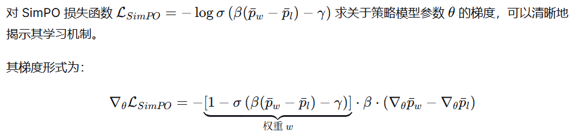{.ocr-src}

这个梯度公式蕴含着三层关键的学习机制：

1. **明确的更新方向**：梯度中的 $(\nabla_\theta\bar{p}_w-\nabla_\theta\bar{p}_l)$ 项表示，参数的更新方向是**提升 chosen 回复的平均对数概率，同时降低 rejected 回复的平均对数概率**。这清晰地定义了“何谓好，何谓坏”。
2. **自适应权重的“差距驱动”**：权重项 $w=\left[1-\sigma\left(\beta(\bar{p}_w-\bar{p}_l)-\gamma\right)\right]$ 是理解 SimPO 如何“拉大边际”的关键。
   - 当模型对 chosen 和 rejected 的区分度不够，即 $\bar{p}_w-\bar{p}_l$ 远小于 $\gamma$ 时，`sigmoid` 的输出接近 0，那么 $w\approx1$。此时，模型会以**最大的权重**进行更新，强力地拉开两者的差距。
   - 当模型已经很好地学会了区分，即 $\bar{p}_w-\bar{p}_l$ 接近或超过 $\gamma$ 时，`sigmoid` 的输出接近 1，那么 $w\approx0$。此时，梯度权重几乎为零，更新停滞。

   正是这个自适应的权重机制，让模型专注于那些它还“分不清好坏”的硬样本，持续施压，直到 chosen 的优势达到我们设定的 $\gamma$ 标准为止。
3. **γ 作为“及格线”**：参数 $\gamma$ 直接参与了权重的计算。它设定了一个清晰的目标。模型不会因为仅仅略好于 rejected 就停止学习，而是会被持续驱动，直到达到这个预设的安全边际。

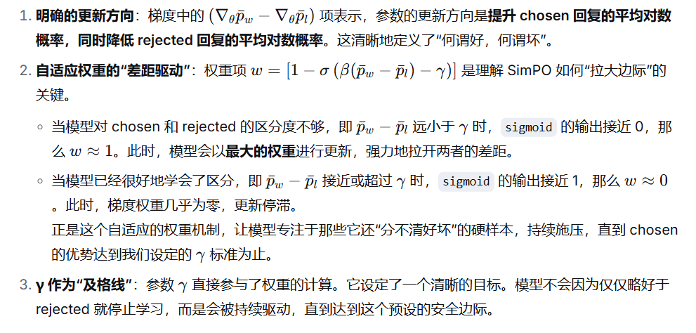{.ocr-src}

---

#### SimPO 对负例来源的依赖性如何？使用随机采样负例是否可行？

SimPO 对负例的质量高度敏感，随机采样负例通常不可行。

为什么依赖高质量负例？\
SimPO 的目标不仅仅是让模型觉得 chosen 比 rejected 好，而是要求拉开一个显著的差距。如果 rejected 回复本身太差（例如，语法不通、完全答非所问），模型在训练初期就能轻松地将它和 chosen 

回复区分开，此时 $\bar{p}_w-\bar{p}_l$ 已经非常大，梯度权重 $w$ 几乎为零。这意味着，这些过于简单的负例**无法为模**

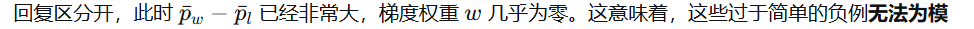{.ocr-src}

**型提供有效的学习信号，**模型从它们身上学不到任何关于“细微偏好”的知识。这就像让一个大学生去做小学算术题，对他能力的提升毫无帮助。

随机采样负例会带来什么问题？

随机采样的负例质量参差不齐，绝大多数可能都属于上述“太差”的类别。用这样的数据训练出的模型，在面对两个质量相近、但存在微妙偏好的回复时（例如，一个更简洁，一个更详细），往往会表现得很糟糕。因为它从未被要求去学习如何分辨这种“难例”。

最优的负例来源是什么？

最有效的负例是所谓的 “hard negatives” 。它们具有以下特征：

- 与 chosen 回复相似但稍差：例如，由早期版本的模型生成的回复，或者与 chosen 回复主题相同但包含事实错误、逻辑漏洞或风格不佳的回复。

- 模型当前难以区分的：让当前策略模型对一批回复打分，选择那些得分与 chosen 很接近的作为 rejected。这正是 DPO 等算法常用的构造偏好对的方法。

总结：SimPO 的成功在很大程度上依赖于一个精心构造的、包含足够多“难例”的偏好数据集。使用随机负例会严重稀释数据质量，导致模型无法学习到精细的偏好，最终效果会大打折扣。因此，在准备训练数据时，投入资源构造高质量的负例，是发挥 SimPO 潜力的关键前提。

