# 51.大模型（LLMs）KTO

#### KTO 的全称和核心思想是什么？它主要解决 DPO/RLHF 的什么痛点？

全称：KTO 的全称是 Kahneman-Tversky Optimization（卡尼曼-特沃斯基优化）。它直接以两位著名心理学家丹尼尔·卡尼曼和阿莫斯·特沃斯基的名字命名，因为他们提出的前景理论（Prospect Theory） 是 KTO 算法的核心思想来源。

核心思想：KTO 的核心思想是，模型对齐的过程不应该只依赖于“成对”的偏好数据（A 比 B 好），而应该能够直接利用更常见、更易获取的“单点”反馈数据，例如一个回复被标记为“好”或“坏”。它将这种对齐过程建模为一个相对于参考点的价值最大化问题，并且根据前景理论的“损失厌恶”原理，对“坏回复”（undesirable）施以比对“好回复”（desirable）更强的惩罚力度，从而让模型在追求高质量回复的同时，更深刻地去规避那些糟糕的回复。

它主要解决 DPO/RLHF 的什么痛点？

1. 对昂贵的成对偏好数据的依赖：DPO 和 RLHF 强依赖于成对偏好数据（对于一个提示，需要知道回复 A 优于回复 B）。这种数据获取成本高昂，需要精心设计标注任务。KTO 可以直接使用非成对的、单点的反馈数据进行训练，例如二分类的好坏标记、用户点赞/点踩、星级评分等。这些数据在真实世界中无处不在，获取成本极低。

2. 数据利用率低下：标准 RLHF/DPO 无法处理那些“只有一个回复被标记为好坏，但没有对比对象”的海量数据。KTO 则可以将这些数据变废为宝，极大拓宽了可用的对齐数据范围。

3. 对“好/坏”的不对称处理需求：传统方法往往将“鼓励好回复”和“惩罚坏回复”视为对称的目标。KTO 则通过前景理论，显式地引入了不对称性，允许模型对“坏行为”施以更严厉的惩罚，这更符合人类在进行道德或质量判断时的真实心理。

---

#### KTO 与 DPO 最大不同在于对数据的需求，KTO 如何利用非成对偏好数据？

KTO 与 DPO 数据需求的核心区别：

- **DPO 的数据格式**：必须是三元组 $(x,y_w,y_l)$。对于同一个提示 $x$，必须同时存在一个“更好”的回复 $y_w$ 和一个“更差”的回复 $y_l$。这是一种**相对偏好**，需要标注者进行比较判断。
- **KTO 的数据格式**：可以是二元组 $(x,y,label)$，其中 $label\in\{desirable,undesirable\}$。这个标签独立地描述了该回复是好是坏，**不需要与任何其他回复进行对比**。它甚至可以利用连续的评分（如 1-5 星），将其转化为对好坏的概率判断。

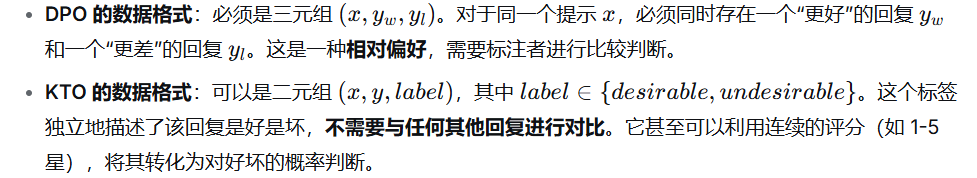{.ocr-src}

KTO 如何利用非成对偏好数据？

KTO 的核心机制在于，它为 desirable 和 undesirable 样本设计了独立但互补的损失函数。对于一个给定的提示-回复对 ($x$,$y$)，它会利用一个隐式奖励函数 rθ(x,y) 来评估该回复的质量。这个隐式奖励与 DPO 中的定义相同：

$$
r_\theta(x,y)=\beta\cdot\log\frac{\pi_\theta(y|x)}{\pi_{\mathrm{ref}}(y|x)}
$$

然后，KTO 不再比较 $y_w$ 和 $y_l$ 的奖励谁高谁低，而是将单个回复的奖励与一个预设的**参考点（reference point）** $z_{\mathrm{ref}}$ 进行比较：

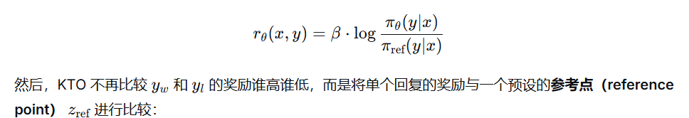{.ocr-src}

- 如果该回复是 desirable 的，KTO 希望其隐式奖励 $r_\theta$ 能够**显著高于** $z_{\mathrm{ref}}$。
- 如果该回复是 undesirable 的，KTO 希望其隐式奖励 $r_\theta$ 能够**显著低于** $z_{\mathrm{ref}}$。

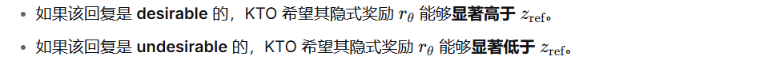{.ocr-src}

通过这种设计，每个独立的、带有标签的回复都能直接产生训练信号，驱动模型参数更新，完全不需要等待它的“对比对象”出现。

---

#### 写出 KTO 的损失函数，并解释其中对“desirable”和“undesirable”样本的不同处理。

KTO 的损失函数是一个结合了逻辑回归（Logistic Regression）和前景理论价值函数的形式。对于一个给定的批次数据，其损失函数定义为所有样本损失的总和。

令 rθ=rθ(x,y) 为隐式奖励，Z ref为参考点。

对于 desirable 样本，损失函数为：

$$
\mathcal{L}_D=-\mathbb{E}_{(x,y)\sim D_{desirable}}\left[\lambda_D\cdot\log\sigma\left(\beta(r_\theta-z_{\mathrm{ref}})\right)\right]
$$

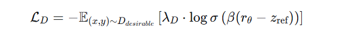{.ocr-src}

对于 undesirable 样本，损失函数为：

$$
\mathcal{L}_U=-\mathbb{E}_{(x,y)\sim D_{undesirable}}\left[\lambda_U\cdot\log\sigma\left(-\beta(r_\theta-z_{\mathrm{ref}})\right)\right]
$$

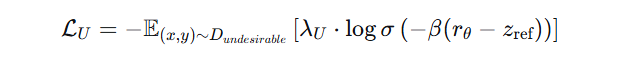{.ocr-src}

总损失为两者之和：

$$
\mathcal{L}_{KTO}=\mathcal{L}_D+\mathcal{L}_U
$$

{.ocr-src}

**各项解释：**

1. **隐式奖励** $r_\theta$：$r_\theta(x,y)=\beta\cdot\log\frac{\pi_\theta(y|x)}{\pi_{\mathrm{ref}}(y|x)}$。它衡量的是，相较于参考模型 $\pi_{\mathrm{ref}}$，当前策略模型 $\pi_\theta$ 在多大程度上“更偏好”生成这个回复 $y$。
2. **参考点** $z_{\mathrm{ref}}$：这是一个核心参数，代表“中性”奖励的基准。通常，$z_{\mathrm{ref}}$ 被设置为数据集中所有回复的平均隐式奖励，或者简单地设为 0。它的作用是为“好/坏”的判断提供一个“锚点”。
3. **对 Desirable 样本的处理**：损失函数 $\mathcal{L}_D$ 的形式是 $-\log\sigma(\beta(r_\theta-z_{\mathrm{ref}}))$。我们希望最小化这个损失，就需要最大化 $\sigma(\beta(r_\theta-z_{\mathrm{ref}}))$，即最大化 $r_\theta-z_{\mathrm{ref}}$。换句话说，模型被鼓励去**提升好回复的隐式奖励，使其远高于参考点**。
4. **对 Undesirable 样本的处理**：损失函数 $\mathcal{L}_U$ 的形式是 $-\log\sigma(-\beta(r_\theta-z_{\mathrm{ref}}))$。我们希望最小化它，就需要最大化 $\sigma(-\beta(r_\theta-z_{\mathrm{ref}}))$，即最小化 $r_\theta-z_{\mathrm{ref}}$。换句话说，模型被鼓励去**降低坏回复的隐式奖励，使其远低于参考点**。
5. **不对称权重** $\lambda_D,\lambda_U$：这两个超参数允许我们对 desirable 和 undesirable 样本施加不同强度的优化。根据前景理论的“损失厌恶”，我们通常会设置 $\lambda_U>\lambda_D$，这意味着模型因为生成一个“坏回复”而受到的惩罚，要大于它因为生成一个“好回复”而获得的奖励。这能更有效地塑造模型的“底线”。

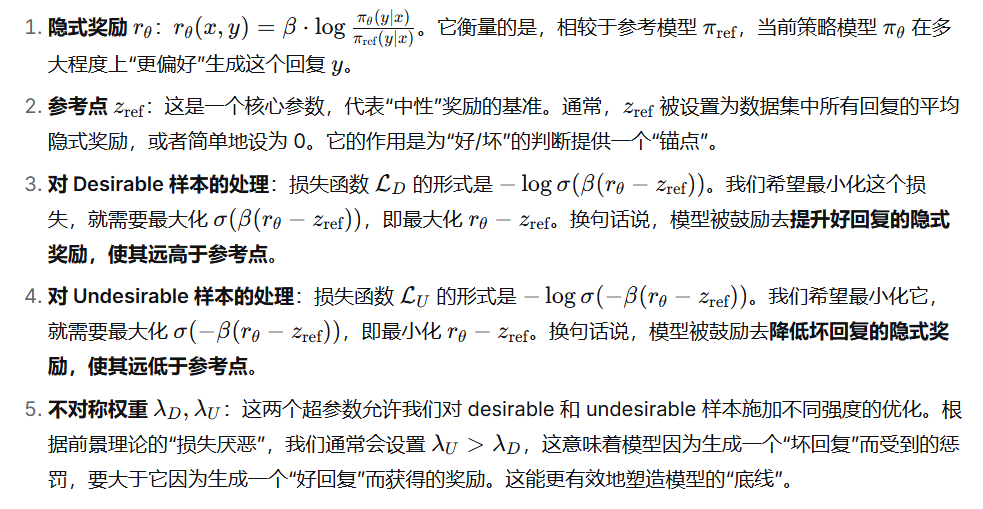{.ocr-src}

---

#### KTO 中的前景理论（prospect theory）是如何启发损失函数设计的？

前景理论是行为经济学中描述人们在不确定条件下如何做出决策的理论，它有两个核心观点直接启发了 KTO：

1. 参考点依赖（Reference Dependence）：人们不是根据绝对的财富水平来评估结果，而是根据相对于某个参考点（通常是现状）的收益或损失来评估。在 KTO 中，参考点 Z ref 正是这一思想的体现。模型对一个回复的评估，不是看它绝对的生成概率，而是看它相对于一个“中性”期望的偏离程度。

2. 损失厌恶（Loss Aversion）：同等数量的损失带来的痛苦，远大于同等数量的收益带来的快乐。这启发 KTO 在损失函数中引入了不对称性。通过对 undesirable 样本（损失）使用更大的权重 λU 和不同的损失函数形式，KTO 让模型对“坏回复”的惩罚比对“好回复”的奖励更加敏感。这比 DPO 那种对称地拉大 chosen 和 rejected 差距的方式，更贴近人类真实的价值判断，也更能有效地让模型学会“趋利避害”。

设计体现：

- 参考点 $z_{ref}$：明确划定了“收益”（desirable， rθ>Z ref）和“损失”（undesirable， rθ<Z ref）的边界。

- 不对称损失权重：$λ_D$ 和 $λ_U$ 的独立设置，允许我们实践“损失厌恶”，让模型在犯错时受到更大的惩罚。

- 价值函数的形状：虽然 KTO 的损失函数最终表现为逻辑回归的交叉熵形式，但其内在目标——鼓励好回复远离参考点，惩罚坏回复至参考点之下——正是前景理论中 S 形价值函数的核心理念。

---

#### KTO 如何在没有成对偏好数据（只有一个 good 或 bad 标记）的情况下进行训练？

这正是 KTO 的独到之处。它的训练过程完全不依赖于回复之间的相互比较。

**训练流程：**

1. **数据准备**：只需要收集格式为 $(x,y,label)$ 的数据，其中 $label$ 可以是二元的（如 `desirable` / `undesirable`）或者连续的（如 1-5 星评分，通过阈值转化为好坏标签，或直接用于计算期望）。
2. **计算隐式奖励**：对于每一个样本，使用策略模型 $\pi_\theta$ 和参考模型 $\pi_{\mathrm{ref}}$，计算出该回复 $y$ 的隐式奖励 $r_\theta(x,y)$。

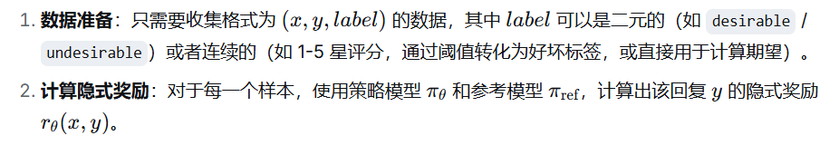{.ocr-src}

1. 计算损失：
  - 如果标签是 `desirable`，则将该样本的损失计算为 LD，目标是将 $rθ$ 推向高于 Z ref 的方向。
  - 如果标签是 `undesirable`，则将该样本的损失计算为 LU，目标是将 $rθ$ 推向低于 Z ref 的方向。

2. 参数更新：将所有样本的损失聚合后，反向传播更新策略模型 $πθ$ 的参数。

关键点：这个过程没有用到任何关于“哪个回复更好”的对比信息。模型只是被训练去“抬高”所有好回复的分数，同时“压低”所有坏回复的分数。参考点 $z_{ref}$ 充当了那个隐式的“比较对象”，提供了一个统一的参照系。

---

#### KTO 中引入的超参数（如 λ_D, λ_U, 参考点等）的作用和典型设置。

- $λ_D$,$λ_U$ (desirable / undesirable 损失权重)：
  - 作用：控制模型对“好回复”的鼓励程度和对“坏回复”的惩罚程度。它们的比值 λU/λD 直接体现了“损失厌恶”的强度。
  - 典型设置：通常设 $λ_D$=1.0，而 $λ_U$ 的取值在 1.0 到 2.0 之间。一个常用的出发点是 $λ_U$=1.5，意为对坏行为的惩罚力度是对好行为奖励力度的 1.5 倍。如果数据集噪声较大，可以适当降低 $λ_U$。

- $z_{ref}$ (参考点)：
  - 作用：定义“中性”奖励的基准线。它决定了模型如何区分“好”与“坏”。
  - 典型设置：有两种主流方法。方法一：在训练开始时，用参考模型计算整个数据集的平均隐式奖励，并将其固定为 Z ref。方法二：直接将 Z ref 设为 0，这是一种简单且效果通常不错的启发式设置。我们的目标是让好回复的奖励 > 0，坏回复的奖励 < 0。

- $β$ (奖励缩放因子)：
  - 作用：与 DPO 中的 $β$ 类似，控制隐式奖励 $rθ$ 的整体尺度，从而影响优化强度。$β$ 越小，奖励的波动就越被放大，优化越激进。
  - 典型设置：与 DPO 类似，通常在 0.1 到 1.0 之间调整。可以从 0.5 开始尝试。

---

#### KTO 训练中是否需要 Reference Model？为什么？

是的，KTO 训练中需要 Reference Model。

**原因：**

KTO 的隐式奖励与 DPO 的定义完全相同：$r_\theta(x,y)=\beta\cdot\log\frac{\pi_\theta(y|x)}{\pi_{\mathrm{ref}}(y|x)}$。这个定义天然地需要一个冻结的参考模型 $\pi_{\mathrm{ref}}$。

- **提供基准**：参考模型为隐式奖励提供了一个“起点”或“参照系”。如果没有它，隐式奖励就变成了简单的序列对数概率 $\log\pi_\theta(y|x)$。这会带来两个问题：一是模型会通过提高所有常见回复（包括坏回复）的概率来作弊；二是无法区分“因为对齐做得好而提升概率”和“因为模型本身变得更强大而提升概率”。

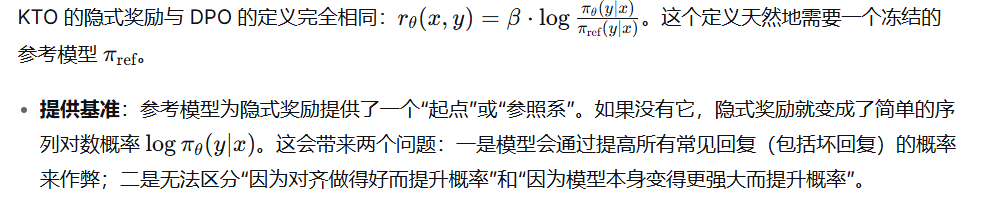{.ocr-src}

- **稳定训练：**参考模型起到了一种类似 KL 散度约束的作用，将策略模型的更新限制在它的附近，防止策略模型为了优化隐式奖励而崩溃。

- 与 DPO 保持一致：这种设计使得 KTO 和 DPO 的底层奖励信号机制是统一的，便于比较和迁移。

因此，虽然 KTO 能处理非成对数据，但它并没有放弃 Reference Model 带来的稳定性和理论基础。与 ORPO、SimPO 等“无参考”方法相比，KTO 选择了保留参考模型，以换取更稳健的训练过程。

---

#### 为什么 KTO 宣称能更有效地利用大规模的不成对反馈数据？举例说明应用场景。

能有效利用的原因：

KTO 的核心设计目标就是将反馈数据的标注成本和形式限制降到最低。成对偏好数据需要标注者进行深思熟虑的比较，这在大规模上极其昂贵。而不成对反馈数据是数字世界的“自然产物”，它们以各种形式大量存在，获取成本几乎为零。KTO 能够直接“消化”这些自然数据，从而在数据规模和多样性上获得巨大优势。

应用场景举例：

1. 用户反馈驱动的聊天机器人优化：\
   在一个智能客服系统中，每个对话结束后，用户都可以进行“点赞”或“点踩”的操作。这是典型的非成对数据：你只知道用户对这一次回复满意或不满意，但没有另一个回复作为对比。通过 KTO，我们可以直接将这些海量的用户反馈作为训练数据，强化那些受到好评的回复模式，并惩罚那些被点踩的回复模式，实现持续、在线的模型优化。

2. 利用公开评分数据进行文本生成对齐：\
   在互联网上存在大量带有评分的数据，例如电影评论、产品评价、问答社区的答案等。这些数据天然地带有质量标签（如 5 星好评或 1 星差评）。使用 KTO，我们可以将这些数据直接用于训练，而无需组织昂贵的专家团队去进行“这条好评比那条差评好在哪”的精细标注。

3. 从“红队测试”中学习安全策略：\
   安全团队进行红队测试时，会产生大量提示和模型的回复，并由专家将其标记为“安全”或“不安全”。这是一个典型的单标签分类数据集。KTO 可以完美地利用这些数据，强化模型生成“安全”回复的能力，并严厉惩罚生成“不安全”回复的倾向，直接对齐安全目标。

---

#### KTO 与 RLHF、DPO、ORPO、SimPO 的主要区别对比，用表格总结。

| 特性 | RLHF (PPO) | DPO | ORPO | SimPO | KTO |
| --- | --- | --- | --- | --- | --- |
| 数据格式 | 偏好对 (A > B) | 偏好对 (A > B) | 偏好对 (A > B) | 偏好对 (A > B) | 非成对单点数据 (好/坏 标签) |
| 是否需要参考模型 | 是 (π_ref) | 是 (π_ref) | 否 | 否 | 是 (π_ref) |
| 是否需要奖励模型 | 是 (独立的 RM) | 否 (隐式奖励) | 否 (隐式奖励) | 否 (隐式奖励) | 否 (隐式奖励) |
| 是否需要 Critic 模型 | 是 | 否 | 否 | 否 | 否 |
| 训练范式 | 在线强化学习 | 离线监督学习 | 离线监督学习 | 离线监督学习 | 离线监督学习 |
| 核心思想 | 最大化奖励并约束KL | 直接优化偏好概率 | SFT + Odds Ratio惩罚 | 长度归一化的平均对数概率 | 前景理论，对好坏不对称处理 |
| 主要优势 | 强大的在线探索能力 | 稳定、高效的离线对齐 | 无需参考模型，流程极简 | 无参考模型，解决长度偏差 | 能利用大规模非成对反馈 |
| 主要劣势 | 训练不稳定，工程复杂 | 依赖昂贵的成对偏好数据 | 对数据混合与超参敏感 | 隐式奖励在模型不平滑时可能不稳 | 仍然需要参考模型 |

---

#### KTO 在“好评”和“差评”数据比例悬殊的情况下表现如何？

在真实世界的反馈数据中，好评（desirable）与差评（undesirable）的比例常常是极度不平衡的（例如，一个成熟的对话系统可能收获 95% 的好评和 5% 的差评）。KTO 对于这种数据不平衡表现出良好的鲁棒性，这主要归功于其损失函数中两个不对称设计的协同作用。

鲁棒性来源：

1. 损失厌恶（Loss Aversion）与不对称权重 $λ_D$,$λ_U$：KTO 可以显式地通过超参数 $λ_U$ 对差评样本赋予比好评样本更高的权重。即使差评数据量很少，由于每个差评样本在损失函数中的“话语权”更大，模型依然会对这些少数但关键的负面反馈给予高度重视。这使得模型不会因为数据量悬殊而忽视对错误行为的纠正。

2. 不同损失函数的优化目标差异：KTO 对 desirable 和 undesirable 样本采用了完全不同的损失函数形式。对于 desirable 样本，目标是将其隐式奖励提升到高于参考点；对于 undesirable 样本，目标是将其隐式奖励压低到低于参考点。即使差评样本很少，但只要它们能被正确标记，模型就会被明确地告知这些回复是“禁区”，并施加一个强大的推力将其概率降低。

极端不平衡下的潜在风险与缓解：

- 风险：如果差评数据的比例极低（如 0.1%），模型可能会因为样本的随机性而对个别差评样本过拟合，导致其在类似的 safe case 上也过度保守，出现“宁可错杀一千，不放过一个”的拒答行为，损害帮助性。

- 缓解策略：
  1. 调整 $λ_U$ 和 $λ_D$：在验证集上通过实验找到一个合适的权重比值，使得模型在安全对齐和帮助性之间达到平衡。
  2. 数据重采样：在训练时对少数的 undesirable 样本进行上采样，或对多数的 desirable 样本进行下采样，以平衡每个 batch 中两类样本的出现频率。
  3. 使用 Class-balanced Loss：除了 KTO 本身的损失，可以结合类别平衡的损失函数（如 Focal Loss）来进一步让模型关注那些难以分类的 minority 样本。

结论：KTO 的架构天然地比对称性的方法（如 DPO）更能处理数据不平衡，因为它赋予了开发者独立控制“奖励”和“惩罚”力度的工具。通过合理设置 $λ_U$>$λ_D$，即使在好评如潮的环境中，模型也能从稀少的差评中学习到宝贵的安全边界。

---

#### KTO 训练时如何平衡 desirable 和 undesirable 损失的权重？

平衡 desirable ($L_D$) 和 undesirable ($L_U$) 损失的权重，是 KTO 训练中最核心的调优艺术。这直接决定了模型是更偏向于“乐于助人”，还是更偏向于“小心谨慎”。KTO 提供了一套多层次的平衡机制。

1. 超参数 $λ_D$ 和 $λ_U$：最直接的权重调节\
   这是最基础的杠杆。总损失通常写为：

$$
\mathcal{L}_{KTO}=\lambda_D\cdot\mathcal{L}_D+\lambda_U\cdot\mathcal{L}_U
$$

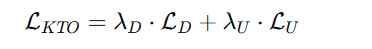{.ocr-src}

- 经验法则：通常固定 $λ_D$=1.0，然后调整 $λ_U$。根据前景理论的“损失厌恶”原理，$λ_U$ 通常设为大于 1 的值（如 1.5, 2.0, 甚至 5.0）。

- $λ_U$ 较大（> 2.0）：模型对生成“坏回复”的恐惧远超对生成“好回复”的渴望。它会变得极其安全，但可能过度拒答，对边界模糊的问题也倾向于回答“我不知道”。

- $λ_U$ 较小（< 1.0）：模型更关注如何生成好回复，对负面反馈的重视程度不够，可能导致安全性对齐不足。

- 调优方法：通过小规模实验，监控模型在安全基准和有用性基准上的表现，寻找帕累托最优的比值 $λ_U$/$λ_D$。

2. 参考点 Z ref：隐式的全局调节器\
   参考点 Z ref 的选取，会间接地影响两类样本的损失贡献。如果 Z ref 设置得过高，大部分 desirable 样本的隐式奖励都难以超越它，模型就会受到持续的“催促”，去提升所有好回复的质量；而坏回复可能已经远低于参考点，损失很小，模型就不再关注它们。反之亦然。因此，Z ref 可以看作是一个全局的“难度调节器”。

3. 数据层面的平衡（Batch 内采样）

除了在损失函数中加权，我们还可以在构造训练 batch 时，通过分层采样来平衡两类样本的出现频率。例如，我们可以确保每个 batch 中 desirable 和 undesirable 样本的数量保持一个固定的比例（如 1:1 或 2:1）。这种方法可以防止模型在某个 epoch 内只看到一种数据而产生偏差。

4. 自适应权重 (Adaptive Weighting)\
   对于一些更高级的应用，我们可以不固定 $λ_D$ 和 $λ_U$，而是让它们根据训练过程中的指标动态变化。例如，我们可以监控模型在验证集上对坏回复的平均隐式奖励，如果该奖励值开始抬头，就自动增大 $λ_U$ 以加强打压。

最佳实践：通常的调参路径是，先固定 Z ref 为一个简单值（如 0.0），然后通过网格搜索找到一个在 helpness 和 harmlessness 之间平衡的 $λ_U$/$λ_D$ 比值。

---

#### KTO 对于噪声标签（如错误的 desirable/undesirable 标记）的鲁棒性如何？

KTO 对噪声标签的鲁棒性相对较强，这主要归功于其非对称的损失函数设计以及 $β$ 和 $λ$ 参数提供的调节空间。

KTO 对噪声标签的鲁棒性相对较强，这主要归功于其非对称的损失函数设计以及 $β$ 和 $λ$ 参数提供的调节空间。

鲁棒性分析：

1. **对单个噪声样本的不敏感性：**KTO 的损失是基于每个样本独立计算的，不对样本进行比较。因此，一个被错误标记为“好”的坏回复，只会产生一个要求提升其分数的“鼓励”信号。这个信号会被 batch 中其他正确标记的样本（尤其是正确标记的坏回复）的“惩罚”信号所稀释和对抗。相比 DPO（一个噪声标签会污染整个对比对，直接影响 chosen/rejected 的相对关系），KTO 的这种独立性使其更能容忍个别数据的错误。

2. **损失厌恶带来的“天然抗噪”：**如果我们设置 $λ_U$>$λ_D$，那么模型对负样本的标记错误会更加敏感。一个被错误标记为“坏”的好回复，会受到严厉的惩罚，这是非常危险的。因此，实践中如果数据标签可能存在噪声，我们通常会适当降低 $λ_U$，让模型不要对单一的负面标签太过当真。这使得 KTO 的鲁棒性可以通过超参数来调控。

3. **隐式奖励 $r_\theta$ 的平滑性**：由于隐式奖励是通过参考模型 $\pi_{\mathrm{ref}}$ 的比值来定义的，它具有一定的平滑性。一个噪声标签样本，即使被错误地要求降低其奖励，其对应的隐式奖励值可能本身就很高（因为策略模型和参考模型都认为它是个好回复）。这会导致梯度很小，从而减轻了错误标签的破坏力。

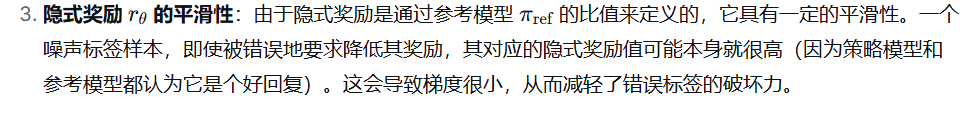{.ocr-src}

面临的风险与缓解：

- 风险：标签噪声的主要风险在于错误地惩罚了高质量回复（即一个 good 回复被错标为 bad）。这可能会“误伤”模型的正常能力，导致模型在正确的事情上变得犹豫或不自信。

- 缓解策略：
  1. 降低 $λ_U$：如前所述，这是最直接、最有效的方法。
  2. 使用标签平滑 (Label Smoothing)：对于那些不确定的标签，不将其标记为绝对的 1.0 (desirable) 或 0.0 (undesirable)，而是赋予一个软标签（如 0.9 或 0.1）。
  3. 基于置信度的样本过滤：使用一个额外的模型对标签的置信度进行评估，只使用高置信度的样本进行 KTO 训练，丢弃或降权低置信度样本。

结论：KTO 的架构对噪声标签具有一定的天然免疫力，尤其是与需要精确对比的 DPO 相比。开发者可以通过调整 $λ_U$，在“防止误伤”和“有效惩罚”之间进行精准的权衡，这使得 KTO 在处理真实世界中的脏数据时非常灵活。

---

#### 在仅有正向样本（如点赞数据）时，KTO 如何工作？与仅有负向样本时的区别。

KTO 的魅力之一在于它可以灵活地应对仅包含单一类型标签的数据集。

仅有正向样本（Desirable-only）时：

- 工作原理：此时，KTO 的总损失退化为只有 $L_D$ 项：$L_{KTO}=\lambda_D\cdot L_D$。模型的目标变为无条件地、单一地提升所有被标记为 desirable 回复的隐式奖励，使其远高于参考点 $z_{ref}$。

- 效果：这相当于在 SFT 的基础上，对高质量的回复进行“强化学习”式的鼓励。模型会学习到“好的行为模式”，并更加自信地去生成类似风格和质量的回复。这是一种纯粹的正向增强（Positive Reinforcement）。

- 潜在风险：模型可能会过度自信，甚至在某些情况下“发明”出一些看似高质量但缺乏根据的回复，因为它只学会了“如何做得更好”，没有学会“什么是不能做的”。

仅有负向样本（Undesirable-only）时：

- 工作原理：此时，KTO 的总损失退化为只有 $L_U$ 项：$L_{KTO}=\lambda_U\cdot L_U$。模型的目标变为无条件地、单一地降低所有被标记为 undesirable 回复的隐式奖励，使其远低于参考点 $z_{ref}$。

- 效果：这是一种纯粹的负向惩罚（Negative Punishment）。模型被训练去主动规避那些被标记为“不好”的回复模式。这非常适合安全对齐场景，教会模型“不要做什么”，例如不要生成有害内容、不要产生幻觉。

- 潜在风险：模型可能变得过度保守，为了避免犯错，它可能会拒绝回答一些原本可以处理的问题，导致帮助性大幅下降。

核心区别与协同：

两者是相反方向的优化。仅用正向数据是在“拔高”，仅用负向数据是在“压低”。最佳实践通常是将两者结合，利用正向数据保持模型的帮助性和创造性，利用负向数据为模型建立安全底线和行为边界。KTO 的优雅之处在于，它允许我们独立控制这两股力量，就像一个既可以加油又可以刹车的驾驶系统。

---

#### KTO 是否适用于 Likert 评分这种多级反馈数据？如何扩展？

是的，KTO 可以非常自然地扩展到 Likert 评分（如 1-5 星）这类多级反馈数据。 这种扩展的核心在于将离散的好/坏二元标签，转化为对“好”的概率或连续强度，从而更精细地指导模型训练。

扩展方法：

1. 方法一：映射为连续渴望值\
   我们可以直接将 Likert 评分（例如 1-5 星）线性或非线性地映射到一个 0 到 1 之间的渴望值（desirability） d∈[0,1]。例如，5 星映射为 d=1.0，1 星映射为 d=0.0，中间星级按比例转换。\
   然后，将每个样本的损失定义为其原本的 $L_D$ 或 $L_U$ 的加权形式。对于一个渴望值为 d 的样本，它的总损失可以看作是其作为 desirable 和 undesirable 损失的插值。\
   一个更直接的方式是，我们可以修改损失函数，让模型直接拟合这个渴望值。但这可能会比较复杂。更简单的做法是设定阈值，将高于某个分（如 4-5 星）的归为 desirable，低于某个分（如 1-2 星）的归为 undesirable，然后对中间评分的样本赋予较低的损失权重或直接丢弃。

2. 方法二：基于阈值的分层加权

这是一个工程上更实用的方案。设定两个阈值：$T_{good}$ 和 $T_{bad}$。

- 评分 $\ge T_{good}$（如 4-5 星）：标记为 desirable，计算 $\mathcal{L}_D$。
- 评分 $\le T_{bad}$（如 1-2 星）：标记为 undesirable，计算 $\mathcal{L}_U$。
- 评分在 $T_{bad}$ 和 $T_{good}$ 之间（如 3 星）：这些中评可以被视为弱信号。我们可以选择忽略它们，或者对它们分别计算 $\mathcal{L}_D$ 和 $\mathcal{L}_U$，但赋予一个很小的权重 $\lambda_{neutral}$。

这种方法简单、可解释，且能有效地利用评分中的高置信度信息，同时避免了中评带来的噪声。

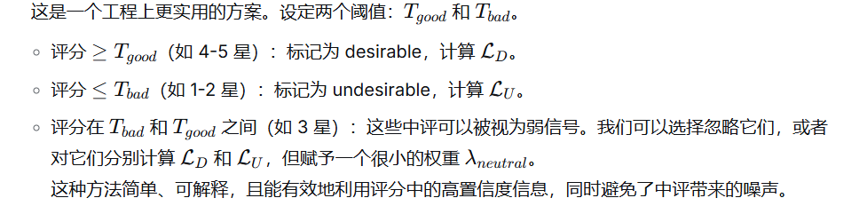{.ocr-src}

3. 方法三：基于偏好的成对构造\
   如果同一个提示下有多个不同评分的回复，我们可以将它们转化为成对偏好数据。例如，将 5 星回复作为 $y_w$，1 星回复作为 $y_l$。但这样就退化成了 DPO 的数据格式，没有完全发挥出 KTO 处理单点数据的优势。

结论：Likert 评分数据是 KTO 的理想用武之地。推荐使用方法二，即通过阈值划分和权重调整，既能利用多级反馈的丰富信息，又能保持 KTO 损失函数的简洁和稳定。

---

#### KTO 中的参考点（reference point）通常如何选择？对训练有什么影响？

参考点 Z ref 是 KTO 训练中一个至关重要的超参数，它定义了“好”与“坏”的基准线。其选择直接影响模型的对齐方向和强度。

通常的选择方法：

1. **静态零点**（$z_{\mathrm{ref}}=0$）：这是最简单、最常用的方法。因为隐式奖励 $r_\theta=\beta\cdot\log\frac{\pi_\theta}{\pi_{\mathrm{ref}}}$ 在训练开始时（$\pi_\theta=\pi_{\mathrm{ref}}$）恰好为 0。选择 0 作为参考点，意味着我们要求模型在对齐后，认为好的回复的奖励应大于 0，坏的回复的奖励应小于 0。这个目标非常直观、自然。
2. **数据平均奖励**（$z_{\mathrm{ref}}=\mathbb{E}_{(x,y)\sim\mathcal{D}}[r_\theta(x,y)]$）：训练开始时，使用初始模型计算整个数据集的平均隐式奖励，并将其固定为 $z_{\mathrm{ref}}$。这个做法将参考点锚定在数据集的“平均质量”上，让对齐目标变为：好的回复要优于平均水平，坏的回复要差于平均水平。
3. **移动平均或自适应参考点**：在训练过程中，随着策略模型的更新，数据集的平均奖励也在变化。我们可以使用指数移动平均（EMA）来动态地更新 $z_{\mathrm{ref}}$。这种方法更具适应性，但实现稍复杂，且可能引入不稳定因素。

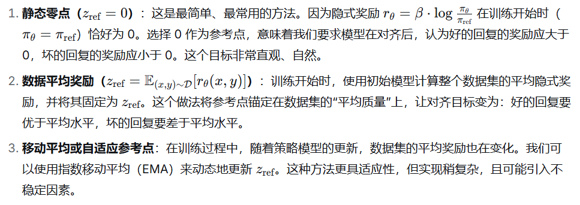{.ocr-src}

对训练的影响：

- Z ref 设置过高：如果 Z ref 远大于初始模型的平均奖励，那么在训练初期，绝大多数 desirable 回复的奖励都低于参考点，模型会接收到一个极其强烈的“提升”信号。这可能导致模型为了快速越过参考点而用力过猛，引发训练震荡或崩溃。反之，如果 Z ref 过低，则对模型的驱动力不足。

- Z ref 与 $λ$ 的协同：Z ref 和损失权重 $λ$ 共同决定了训练的“难度”和“强度”。一个合理的组合应该让模型在训练初期有一个平缓的启动阶段。如果发现训练初始损失极大或出现 NaN，首先应考虑调整 Z ref 或 $β$。

经验法则：对于大多数场景，从一个简单的静态零点（Z ref=0）开始是非常有效的。如果发现训练过于激进或过于缓慢，再考虑调整 Z ref 或与其他超参数（如 $β$）进行联动调节。

---

#### 分析 KTO 损失函数的梯度，理解它是如何推动模型偏好变化的。

分析 KTO 的梯度可以帮助我们深入理解其内部的工作机制。我们分别对 desirable 和 undesirable 样本的损失进行求导。

设 $r=r_\theta(x,y)$，$z=z_{\mathrm{ref}}$。对于单个样本，其损失对 $r$ 的梯度为：

- **对于 Desirable 样本**：

$$
\frac{\partial\mathcal{L}_D}{\partial r}=-\lambda_D\cdot\beta\cdot\left(1-\sigma(\beta(r-z))\right)
$$

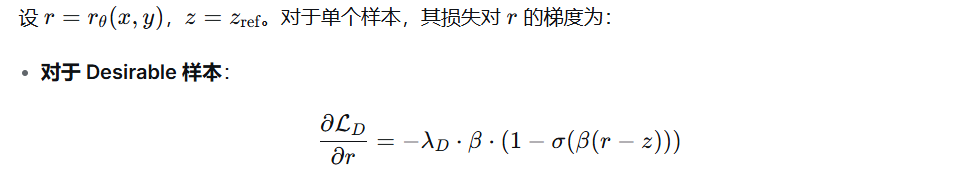{.ocr-src}

- 这个梯度始终为负。在反向传播时，一个负的梯度意味着会增加隐式奖励 $r$。梯度的大小由 1−σ(β(r−z)) 决定：当 $r$ 远低于 $z$ 时，σ 接近 0，梯度最大，模型会强力提升该回复的奖励。当 $r$ 已经远高于 z 时，$σ$ 接近 1，梯度趋近于 0，模型基本停止对该样本的学习。

- 对于 Undesirable 样本：

$$
\frac{\partial\mathcal{L}_U}{\partial r}=\lambda_U\cdot\beta\cdot\sigma(-\beta(r-z))
$$

这个梯度始终为**正**。一个正的梯度意味着会**减少**隐式奖励 $r$。同样，梯度大小由 $\sigma(-\beta(r-z))$ 决定：当 $r$ 远高于 $z$ 时，$\sigma$ 接近 1，惩罚力度最大；当 $r$ 远低于 $z$ 时，$\sigma$ 接近 0，模型认为安全，停止惩罚。

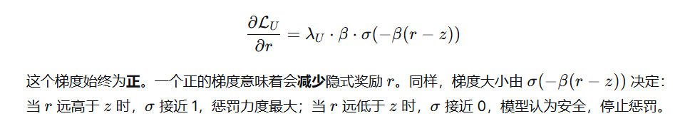{.ocr-src}

如何推动模型偏好变化？

这个梯度机制非常精妙。模型被推动着，将 desirable 回复的奖励推高，将 undesirable 回复的奖励压低。更重要的是，梯度的强度是自适应的。模型会将主要的学习精力集中在那些“还没有对齐好”的样本上——即那些奖励还在参考点“错误”一侧的样本。对于那些已经正确归位的样本，梯度自动消失，避免了过度的优化。这种机制使得 KTO 的训练过程非常高效，它像一个聪明的教练，只在你犯错时严厉纠正，在你做对时则不再打扰。

---

#### KTO 训练是否稳定？与 DPO 相比，有无独特的训练 trick 需要注意？

KTO 的训练整体上非常稳定，甚至在某些方面比 DPO 更稳定。因为它的优化目标不是最大化一个对比差（这可能在好坏回复都提升概率时也实现），而是分别为好回复和坏回复设定绝对的、朝向参考点的目标，优化方向更加明确和单一。

与 DPO 相比的稳定性优势：

DPO 的损失函数中，如果 chosen 和 rejected 回复的概率同时上升，loss 也可能下降，这有时会导致优化方向模糊。KTO 则不会，因为它的两个优化方向是解耦的：提升好回复的奖励和降低坏回复的奖励是两个独立的目标。

独特的训练技巧和需要注意的点：

1. 参考模型质量至关重要：KTO 和 DPO 一样依赖参考模型。如果参考模型本身是一个质量很差的模型，那么其定义的隐式奖励基线将毫无意义，KTO 的训练效果会大打折扣。因此，KTO 的起点必须是一个经过良好 SFT 的模型。

2. 参考点 Z ref 的初始检查：在训练开始前，务必使用初始模型计算一下数据集中 desirable 和 undesirable 样本的平均隐式奖励。确保你选择的 $z_{ref}$ 是合理的。例如，如果平均奖励已经远高于 0，那么将 Z ref 设为 0 可能就没什么挑战性了。

3. Batch 内数据混合：在一个 batch 中，建议同时包含 desirable 和 undesirable 样本。这能让模型在一个统一的梯度更新中同时接收到“鼓励”和“惩罚”的信号，有助于训练稳定。

4. 监控隐式奖励的分布：训练时，不要只看 loss，更要定期可视化 desirable 和 undesirable 样本的隐式奖励分布。理想情况是，随着训练进行，两个分布逐渐分离，好的奖励变高，坏的奖励变低。如果两者分布混杂，说明模型没有学到有效的偏好。

---

#### KTO 能否与 SFT 联合训练，实现一步到位？

可以，这是一种非常强大且推荐的实践方式。 将 KTO 的损失函数与 SFT 的交叉熵损失结合起来，可以形成一个端到端的联合训练框架，同时解决指令遵循和偏好对齐两个问题。

联合训练方案：

总损失可以定义为：

$$
\mathcal{L}_{total}=\mathcal{L}_{SFT}+\mathcal{L}_{KTO}
$$

{.ocr-src}

其中 L *SFT* 在包含 chosen/desirable 回复的数据上计算，而 L $KTO$ 则在所有带标签（desirable 和 undesirable）的数据上计算。

为什么这种方案有效？

1. SFT 提供“能力锚”：SFT 损失的存在确保了模型始终在学习生成正确的、高质量的回复。这为整个训练过程提供了一个稳定的基础，防止模型在对齐过程中“跑偏”或遗忘其基础语言能力。

2. KTO 提供“偏好驱动”：KTO 损失则负责驱动模型去区分好坏，主动提升好回复的概率并抑制坏回复。它将偏好信息直接注入到模型的参数更新中。

3. 一步到位，流程简化：这种方法省去了“先 SFT 预热，再 KTO 对齐”的两阶段流程，大大简化了训练管线，并可能因为两个目标的协同优化而取得更好的效果。

数据构造：在训练数据中，需要同时包含无标签的 chosen 数据（用于 SFT 损失）和有标签的 desirable/undesirable 数据（用于 KTO 损失）。它们可以在同一个 batch 中混合。

---

#### KTO 在 safety 对齐上有什么优势或案例？

KTO 在安全对齐上具有独特的优势，这主要源于其对负样本（unsafe 样本）的独立、强力惩罚机制。

优势分析：

1. 不对称惩罚符合安全需求：安全对齐的核心是“不犯错”。KTO 通过设置 $λ_U$>$λ_D$，可以实现比单纯鼓励安全回复更强的对齐效果。模型会因为害怕产生不安全回复而受到更强的约束，这完美契合了“安全优先”的原则。

2. 高效利用红队数据：安全红队测试产生的数据格式恰好是“提示-回复-安全/不安全标签”。这正是 KTO 最擅长的非成对数据。我们可以直接将海量的红队测试数据作为 undesirable 样本，将经过安全审核的高质量数据作为 desirable 样本，对模型进行直接的对齐训练。无需构造复杂的对比对。

3. 精确打击特定不安全模式：如果发现模型在某类不安全问题上表现不佳（如泄露隐私），我们可以有针对性地收集这类 undesirable 样本，形成一个子集，并在训练时对这一子集施加更高的权重 $λ_U$，进行定向、精确的安全增强。

应用案例：

例如，为了训练一个能够拒绝回答有害问题、并且不会产生歧视性言论的客服机器人。我们可以收集两类数据：一类是人工撰写的安全、有帮助的客服回复（desirable），另一类是模型之前生成的各种有害回复（undesirable）。通过 KTO，模型会主动学习去远离那些有害的回复模式，同时被鼓励去生成安全友好的回复。相较于 DPO，KTO 不需要为每个有害提示都找到一个对应的“更好的安全回复”，它只需要知道“这个回复是有害的”就足够了。

