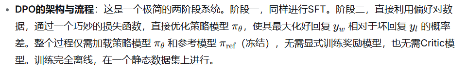
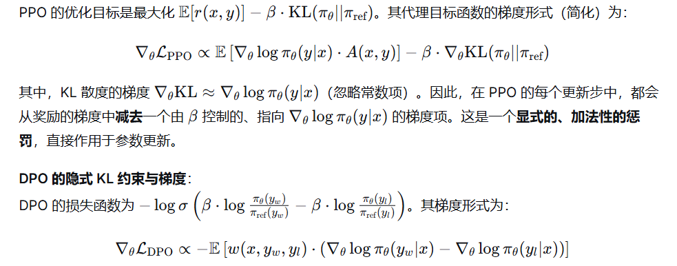
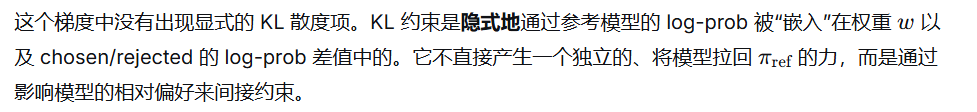
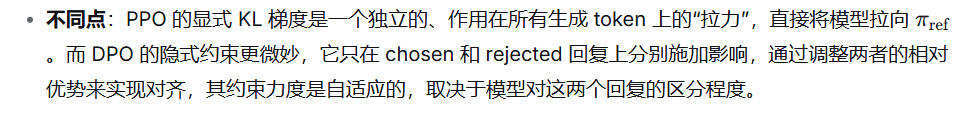

# 52.大模型（LLMs）RLHF 与 DPO 对比

#### 从模型架构和训练流程角度，详细对比 RLHF（PPO）与 DPO。

- RLHF（PPO）的架构与流程：这是一个典型的三阶段复杂系统。阶段一，对预训练基座进行监督微调（SFT），得到具备基本指令遵循能力的模型。阶段二，用SFT模型为大量提示生成回复对，由人类标注偏好（A好于B），然后训练一个奖励模型来学习这种偏好。阶段三，用PPO算法进行强化学习微调，需要同时维护四个模型：Actor（策略模型，从SFT初始化）、Critic（价值模型，常从奖励模型初始化）、Reference模型（冻结的SFT模型，用于约束）和Reward模型（冻结的奖励模型，用于打分）。Actor与环境交互生成回复，由Reward打分，Critic评估价值，结合KL惩罚后，通过GAE和PPO-clip更新Actor和Critic。

- **DPO的架构与流程**：这是一个极简的两阶段系统。阶段一，同样进行SFT。阶段二，直接利用偏好对数据，通过一个巧妙的损失函数，直接优化策略模型 $\pi_\theta$，使其最大化好回复 $y_w$ 相对于坏回复 $y_l$ 的概率差。整个过程仅需加载策略模型 $\pi_\theta$ 和参考模型 $\pi_{\mathrm{ref}}$（冻结），无需显式训练奖励模型，也无需Critic模型。训练完全离线，在一个静态数据集上进行。

{.ocr-src}

核心区别：RLHF将偏好知识外化为一个显式的奖励模型，再用强化学习算法去“追求”这个奖励。DPO则通过数学重构，将偏好知识直接内化到策略模型的更新中，将强化学习问题转化为监督学习。

---

#### RLHF 和 DPO 对标注数据的需求有何本质不同？哪种更依赖高质量偏好对？

- 数据需求本质不同：RLHF的数据需求是分层的，标注数据用于训练奖励模型，格式为“提示-好回复-差回复”的偏好对。PPO阶段则需要海量无标注提示进行在线探索。DPO的数据需求极其单一，全部训练仅依赖标注好的偏好对，无需任何无标注数据。

- 对高质量偏好对的依赖程度：DPO远比RLHF更依赖高质量偏好对。原因有三：其一，RLHF的偏好数据是奖励模型的训练数据，其质量影响奖励模型质量，而奖励模型的偏差可通过PPO的在线探索进行一定程度的纠偏。其二，DPO的偏好数据是直接优化策略的唯一信号，数据中的噪声、偏差、不一致性会直接、100%地映射到最终模型的行为上，没有在线探索作为缓冲。其三，对于DPO，偏好数据就是全部。一个低质量的偏好数据集可以直接毁掉一个DPO模型，而它可能只让RLHF的奖励模型稍差，但PPO训练仍能继续。因此，DPO对偏好数据质量的要求极为苛刻。

---

#### 分析 RLHF 的在线样本生成与 DPO 的纯离线数据训练各自的优劣。

- RLHF的在线训练（PPO阶段）：
  - 优势：强大的在线探索能力。模型在训练中不断生成新回复并获取奖励反馈，能探索出超越SFT的、奖励模型认为更好的回复，实现自我突破。此外，模型能根据最新策略实时调整，理论上可适应动态环境。
  - 劣势：工程极其复杂，训练极不稳定。需维护和同步四个大型模型，消耗巨大显存和计算资源。强化学习对超参数极度敏感，易出现奖励黑客和策略崩溃。

- DPO的离线训练：
  - 优势：极简、稳定、高效。作为一个标准监督学习任务，无需在线交互、奖励模型和Critic模型。训练平稳可控，对硬件需求低，易于复现和规模化。
  - 劣势：性能天花板受限于离线数据质量。无法超越数据中chosen回复的上限，缺乏对未知的探索。当模型部署环境与训练数据分布不一致时，泛化能力可能受限。

---

#### 为什么说 DPO 更简单、更稳定，但 RLHF 在某些情况下可能上限更高？

- DPO更简单稳定：根源在于它将复杂的在线强化学习问题转化为一个标准的、完全离线的监督学习任务。其损失函数是交叉熵，优化过程平稳可控，无需多个模型协同，对超参数不敏感，调试成本极低。

- RLHF上限可能更高：根源在于其在线探索机制。在线PPO训练允许模型通过与奖励模型交互，去发现和创造那些人类标注者未曾见过、但奖励模型认为质量极高的全新回复，从而突破初始数据分布的限制。这种“创造性”的对齐是纯离线DPO难以企及的。因此，当拥有一个极其强大的奖励模型，且目标是追求极限智能时，RLHF的潜力更大。

---

#### 比较 RLHF 和 DPO 的计算开销：包括显存、时间、模型数量。

- 模型数量：RLHF的PPO阶段需同时维护Actor、Critic、Reference和Reward Model四个完整模型；DPO仅需维护Actor和Reference两个模型。

- 显存占用：DPO比RLHF节省约50%以上的显存，因为它省去了奖励模型和Critic模型。这使得在相同硬件下可训练更大模型或使用更大batch。

- 训练时间与吞吐量：DPO每步训练仅需一次Actor前向传播，省去了在线生成、Critic评估和多次模型前向的时间，吞吐量（tokens/秒）显著高于RLHF。RLHF的总耗时是DPO的数倍甚至数十倍。

---

#### 在奖励建模方面，RLHF 显式训练奖励模型，DPO 隐式建模，这对可解释性和复用性有何影响？

- 可解释性：RLHF拥有独立的奖励模型，可对任意回复打分。这个分数是对“好坏”的显式、可解释的量化。同时，奖励模型可作为自动化评估工具，对后续模型进行持续评测。DPO的“奖励”是瞬时的数学构造，无法可视化或解释。

- 复用性：RLHF的显式奖励模型具有极高的复用价值，可作为一个通用评估器用于不同模型、不同训练阶段，形成统一度量标准。而DPO的隐式奖励无法复用，其“奖励函数”内嵌于特定训练快照中，无法提取或迁移到其他模型。因此，在需要构建通用评估器的复杂系统中，RLHF的架构优势显著。

---

#### RLHF 中的 PPO 训练容易出现哪些问题，而 DPO 恰好可以避免？

- 奖励黑客：PPO模型可能学会用废话骗高分。DPO直接从偏好对学习，没有中介奖励模型可钻空子，从根本上消除了此类风险。

- 训练不稳定与崩溃：PPO对超参数敏感，优势函数和策略更新易剧烈波动，导致语言能力崩溃。DPO的监督学习范式极为稳定，几乎不存在训练崩溃问题。

- Critic模型估计不准：价值网络作为辅助却容易成为瓶颈。DPO完全不需要价值网络，避免了这一麻烦。

- KL散度失控：PPO中约束策略偏离的项可能失效。DPO通过隐式奖励和参考模型更优雅地处理了这个问题。

---

#### DPO 能否处理多轮交互式的在线学习？RLHF 在这方面有什么优势？

DPO不能直接处理多轮交互式的在线学习。

标准的DPO是纯离线算法，依赖固定数据集进行训练，学习多轮交互需在每轮结束时收集完整偏好数据，这改变了其离线性质，无法实现在交互过程中的实时调整。

RLHF在在线学习方面的优势在于其天生的在线强化学习架构。 PPO允许模型在新数据上实时探索、即时获得反馈并更新策略，自然地支持持续学习和多步决策优化。在与环境持续交互的场景中，RLHF的灵活性是离线方法难以比拟的。

---

#### 为何在实际产品中，许多团队从 RLHF 转向或同时采用 DPO 及变体？

- 工业落地的最强动力：极致的成本与效率。DPO将训练成本（硬件、时间、人力）降低了一个数量级，显著提升了迭代速度和产品开发效率。

- 稳定可复现，降低风险。商业产品对模型行为一致性要求极高。DPO的稳定、可复现特性大大降低了因PPO训练崩溃导致上线计划延误的风险。

- 工程复杂度低，易于维护。DPO无需复杂的多模型协同流水线，代码实现和维护难度骤降。

- 效果足够好，性价比极高。在绝大多数应用场景下，精心构造偏好数据训练出的DPO模型，其性能与RLHF相当甚至更优，且成本仅为后者零头。ROI极高。

- 安全可控，审计方便。所有训练数据可在事前清洗审计，避免了RLHF在线探索时生成不可控有害内容的合规风险。

结论：DPO及变体（ORPO, SimPO）凭借其极高的性价比、稳定性和简洁性，已成为当前对齐技术的主流。RLHF因其在线探索的独特优势，在追求极致性能上限或需要处理复杂在线交互的顶级模型训练中仍占有一席之地。两者互补，共同构成了对齐技术生态。

---

#### 当偏好数据质量很高且成对时，DPO 是否能完全替代 RLHF？为什么？

当偏好数据质量非常高（例如，由领域专家精心标注、一致性极高、覆盖全面）且格式为标准偏好对时，DPO 在最终性能上可以极其逼近、甚至在许多评测指标上超越 RLHF，但尚不能在所有维度上完全替代 RLHF。

DPO 可以实现几乎完美替代的方面：

- 理论等价性：从数学推导看，DPO 的最优解与带 KL 约束的奖励最大化问题完全相同。在高质量数据下，DPO 能非常精准地逼近这个理论最优点。

- 性能表现：大量研究和实践（如 Zephyr、Qwen2 等）表明，用精心构造的偏好数据集训练出的 DPO 模型，在 AlpacaEval 2.0、MT-Bench 等主流基准上，得分可与 RLHF 模型持平甚至更高。

- 稳定性和效率：DPO 的训练过程远比 RLHF 简单、稳定和高效。在数据质量有保障的前提下，DPO 是更经济、更可预测的选择。

DPO 无法完全替代 RLHF 的方面：

- 在线探索与自我超越的能力：RLHF 的 PPO 阶段允许模型通过在线生成和奖励反馈，去探索并发现那些超出人类标注数据分布的、全新的、更优的回复。这是一种“创造性”的对齐。DPO 完全依赖离线数据，其性能天花板被限制在数据集里 chosen 回复的质量。如果数据集中没有那种“神来之笔”的回复，模型就永远学不到。

- 对动态环境的适应：RLHF 的在线交互特性使其能持续从新反馈中学习，适应不断变化的用户偏好或任务需求。DPO 则需要重新收集数据并训练，迭代周期更长。

结论：如果你追求的是在固定数据分布下的最佳表现、成本控制和工程稳定性，DPO 几乎就是银弹。但如果你拥有一个极其强大的奖励模型，且目标是探索模型智能的极限、实现自我进化，那么在线 RLHF 的探索潜力仍无法被完全替代。

---

#### RLHF 在迭代式优化（如 iterated RLHF）上的能力，DPO 如何弥补？

RLHF 的迭代式优化是指“采样-训练-再采样-再训练”的循环过程，例如经典的 Iterated RLHF。其核心优势在于能不断利用最新策略模型生成的新数据，进行自我提升。DPO 虽然是离线算法，但同样可以通过迭代式的变体来弥补这一能力。

Iterated RLHF 的能力：

1. 分布漂移的补偿：每次迭代，都用最新模型生成回复，并用（更新的）奖励模型打分，从而保证训练数据始终与当前策略的分布一致。

2. 持续的能力拔高：随着模型变强，其生成的回复质量也更高，奖励模型可以从这些更优的回复中筛选出新的“冠军”，作为下一轮训练的 chosen 数据，推动模型螺旋式上升。

DPO 如何弥补：

DPO 同样可以通过 Iterated DPO（迭代式DPO） 或 Online DPO（在线DPO） 来模拟这一过程。

- 流程：
  1. 初始对齐：使用初始偏好数据集，进行第一轮 DPO 训练，得到模型 $M_1$。
  2. 在线采样：用 $M_1$ 对一个大型提示集生成多个候选回复。
  3. 重新标注或筛选：使用一个强大的奖励模型（或人类专家）对这些新生成的回复进行打分或排序，构造出新一轮的、来自当前模型分布的偏好对。
  4. 再次训练：用这个新的偏好数据集对 M1 进行第二轮 DPO 训练，得到 $M_2$。

- 效果：这种方法使 DPO 也能享受到在线探索和迭代提升的好处。通过每一轮都用最新模型的数据进行训练，Iterated DPO 可以有效解决离线 DPO 的分布漂移问题，并在多个迭代中持续提升性能。

两者对比：

- Iterated RLHF：通常需要持续维护和更新奖励模型，流程更复杂。

- Iterated DPO：更简洁，只需要一个可打分的奖励模型（用于筛选数据），而无需将奖励模型集成到复杂的 PPO 训练流程中。这种“采样-过滤-DPO”的模式已成为业界主流。

---

#### 从优化目标上分析：RLHF 的 KL 约束与 DPO 的隐式 KL 约束在梯度流上有何异同？

两者的梯度流都蕴含着 KL 约束，但表现形式和实现机制不同。我们可以简化分析，忽略优势函数和裁剪，关注核心的奖励和 KL 部分。

RLHF (PPO) 的显式 KL 约束与梯度：

PPO 的优化目标是最大化 $\mathbb{E}[r(x,y)]-\beta\cdot\mathrm{KL}(\pi_\theta||\pi_{\mathrm{ref}})$。其代理目标函数的梯度形式（简化）为：

$$
\nabla_\theta\mathcal{L}_{\mathrm{PPO}}\propto\mathbb{E}\left[\nabla_\theta\log\pi_\theta(y|x)\cdot A(x,y)\right]-\beta\cdot\nabla_\theta\mathrm{KL}(\pi_\theta||\pi_{\mathrm{ref}})
$$

其中，KL 散度的梯度 $\nabla_\theta\mathrm{KL}\approx\nabla_\theta\log\pi_\theta(y|x)$（忽略常数项）。因此，在 PPO 的每个更新步中，都会从奖励的梯度中**减去**一个由 $\beta$ 控制的、指向 $\nabla_\theta\log\pi_\theta(y|x)$ 的梯度项。这是一个**显式的、加法性的惩罚**，直接作用于参数更新。

**DPO 的隐式 KL 约束与梯度**：

DPO 的损失函数为 $-\log\sigma\left(\beta\cdot\log\frac{\pi_\theta(y_w)}{\pi_{\mathrm{ref}}(y_w)}-\beta\cdot\log\frac{\pi_\theta(y_l)}{\pi_{\mathrm{ref}}(y_l)}\right)$。其梯度形式为：

$$
\nabla_\theta\mathcal{L}_{\mathrm{DPO}}\propto-\mathbb{E}\left[w(x,y_w,y_l)\cdot\left(\nabla_\theta\log\pi_\theta(y_w|x)-\nabla_\theta\log\pi_\theta(y_l|x)\right)\right]
$$

{.ocr-src}

这个梯度中没有出现显式的 KL 散度项。KL 约束是**隐式地**通过参考模型的 log-prob 被“嵌入”在权重 $w$ 以及 chosen/rejected 的 log-prob 差值中的。它不直接产生一个独立的、将模型拉回 $\pi_{\mathrm{ref}}$ 的力，而是通过影响模型的相对偏好来间接约束。

{.ocr-src}

异同点：

- 相同点：都包含了对策略偏离的约束，且最终效果都是将优化后的策略限制在参考模型附近，防止语言能力崩溃。

- **不同点**：PPO 的显式 KL 梯度是一个独立的、作用在所有生成 token 上的“拉力”，直接将模型拉向 $\pi_{\mathrm{ref}}$。而 DPO 的隐式约束更微妙，它只在 chosen 和 rejected 回复上分别施加影响，通过调整两者的相对优势来实现对齐，其约束力度是自适应的，取决于模型对这两个回复的区分程度。

{.ocr-src}

---

#### DPO 是否能像 RLHF 一样灵活地加入多维奖励（如 helpfulness + safety）？如何实现？

是的，DPO 可以非常灵活地加入多维奖励，而且在实现上可能比 RLHF 更加简洁。

RLHF 的多维奖励实现：

通常是训练多个独立的奖励模型（如有用性RM和安全RM），然后在 PPO 训练时，将最终的奖励信号定义为这些模型分数的加权和：

$$
r_{total}=\alpha\cdot r_{helpful}+\beta\cdot r_{safe}
$$

{.ocr-src}

通过调整 $α$ 和 $β$，可以控制模型在不同维度上的表现。

DPO 的多维奖励实现：

DPO 无需训练多个奖励模型，而是直接在数据层面和损失函数层面进行多维融合。主要有两种方法：

1. 数据集加权法（最简单）：为不同维度（如有用性、安全性）分别构造独立的偏好数据集。在训练时，在一个 batch 中混合这些数据，并通过不同的采样权重来控制其影响。例如，每个 batch 中 70% 的数据来自有用性数据集，30% 来自安全性数据集。这种方法简单直观，但无法对同一条数据的多个维度进行精细权衡。

2. 多维损失融合法（更优雅）：如果一条数据同时包含多维度的偏好标签（例如，chosen 回复在有用性上更好，但 rejected 回复更安全），我们可以为每个维度定义一个独立的 DPO 损失。总损失是这些维度损失的总和：

$$
\mathcal{L}_{total}=\mathcal{L}_{DPO}^{helpful}+\gamma\cdot\mathcal{L}_{DPO}^{safe}
$$

{.ocr-src}

这相当于要求模型在一个回复中同时优化多个维度的偏好。这种方法更精细，但对标注的要求也更高。

结论：DPO 在添加多维奖励时，流程更简单。它无需训练和维护多个奖励模型，只需在数据准备和损失函数层面进行组合即可，极大降低了系统复杂度。

---

#### 比较 RLHF 与 DPO 训练后模型在输出多样性和创意性方面的表现。

这是一个关于探索与利用的经典权衡。

RLHF 的表现：通常具有更高的多样性和创意性。

- 原因：PPO 阶段的在线探索机制。为了最大化奖励，Actor 模型会尝试各种不同的生成路径（通过温度采样等方式），并从中发现一些概率不高但奖励极高的“创意性”回复。奖励模型会对这些探索给予正向反馈，从而鼓励模型进行更大胆的尝试。这使得 RLHF 模型更容易产生令人惊喜的、跳出常规思维的回复。

DPO 的表现：可能趋向保守，多样性稍逊。

- 原因：DPO 是纯粹的离线模仿学习。它的最高目标就是尽可能地模仿偏好数据中的 chosen 回复。它没有被鼓励去探索数据之外的未知区域。如果训练数据本身缺乏多样性，或者 chosen 回复的风格比较单一，DPO 模型会忠实地学习这种单一的风格，导致生成的内容四平八稳，缺乏惊喜。此外，DPO 对 chosen 的过拟合也会导致模式坍塌。

如何弥补 DPO 的这个缺陷？

- 在线/迭代 DPO：通过让模型在线生成数据并筛选，注入探索性。

- 调整 β 和采样策略：在数据生成阶段，使用高温度采样来增加 chosen 回复的多样性。

- 混合 SFT 数据：在 DPO 训练中混入通用的 SFT 数据，帮助模型保持语言的多样性和创造性。

结论：RLHF 因其内在的探索机制，在多样性和创意性上有着天然的优势。DPO 如果设计不当，容易让模型变得“枯燥”。将 DPO 与在线探索相结合是解决这一问题的关键。

---

#### 为什么 DPO 更少地出现“奖励黑客”问题？仍有相关风险吗？

为什么 DPO 更少出现奖励黑客？

奖励黑客的根本原因是模型利用了奖励函数与真实目标之间的差异。在 RLHF 中，这个奖励函数是一个独立的、可能存在缺陷的奖励模型。PPO 算法会无情地寻找奖励模型的漏洞并加以利用。DPO 没有独立的奖励模型，它的优化信号直接来源于人类标注的偏好数据，是“真实目标”的直接体现。因此，DPO 从根本上消除了“利用奖励模型漏洞”这一类的奖励黑客行为。

DPO 仍有相关风险，称为“过拟合到偏好数据”或“策略过优化”：

- 表现：模型可能会过度学习数据集中 chosen 回复的表面模式，而非内在质量。例如，如果 chosen 回复普遍比 rejected 回复更长，模型就会学会“写长文”，即使内容空洞；如果 chosen 回复都使用了某种礼貌的模板，模型就会刻板地重复这个模板。

- 原因：这是离线学习固有的“分布外泛化”问题。当训练数据存在系统性偏差时，DPO 会忠实地放大这种偏差。它和奖励黑客的根源都是优化了一个存在缺陷的代理目标，只不过这个缺陷在 RLHF 中是显式的奖励模型，在 DPO 中是存在偏差的数据集。

缓解策略：包括使用在线/迭代 DPO 注入探索性、构造高多样性的数据集、通过早停防止过拟合，以及结合 SFT 损失进行正则化。

---

#### 在超参敏感性方面，RLHF 与 DPO 各自的调参难度如何？

RLHF 的调参难度极高，是一个著名的“噩梦”：

- 超参数众多：PPO 阶段至少包括 Actor 和 Critic 的学习率、PPO-clip 的 $ϵ$、KL 惩罚系数 $β$、GAE 的 $λ$ 和 $γ$、mini-batch大小、PPO epoch 数量、奖励归一化参数等。此外，奖励模型的训练也有其独立的超参。

- 高度耦合与敏感：这些参数相互影响，且对最终效果影响巨大。例如，$β$ 稍微大一点，模型可能就保守不前；稍微小一点，可能就迅速崩溃。调参需要在巨大的搜索空间中寻找一个脆弱的平衡点，任何一个参数设置不当都可能导致训练完全失败。

DPO 的调参难度极低，非常友好：

- 超参数极少：最核心的超参数就是 $β$（控制偏离程度）和训练学习率。有时还包括训练 epoch 数。

- 稳定性高：DPO 是标准的监督学习，其训练曲线通常非常平滑。$β$ 的作用相对独立，调整它不会引发训练的剧烈震荡。开发者可以用少得多的时间和资源找到一组有效的超参数。

结论：从调参角度看，DPO 是远比 RLHF 工程友好的选择。这也是它能够在工业界迅速普及的重要原因之一。

---

#### 在 RLHF 中，奖励模型的过优化是一个问题；DPO 中是否存在类似的“策略过优化”？

是的，DPO 中存在与奖励模型过优化本质相似的“策略过优化”问题，主要体现在两个方面：

1. 对 Chosen 回复的过拟合：RLHF 的过优化是模型去疯狂追求奖励模型的高分。DPO 的过优化则是模型去疯狂模仿 chosen 回复的模式。当模型在 chosen 回复上的生成概率被推到极高时，它会丧失泛化能力，输出变得单一、重复，丧失处理长尾或新颖问题的能力。这与 RLHF 中模型为了高奖励而说废话的后果如出一辙。

2. 对数据偏差的过拟合：如果偏好数据本身有偏差（如 chosen 回复普遍更长、更书面化），DPO 会过度学习这种表面特征，而忽略了回复的真实质量。这本质上就是一种“奖励黑客”，只不过黑客攻击的对象不是奖励模型，而是有缺陷的数据集。两者都是代理目标（奖励模型/离线数据）与真实目标（人类价值观）不一致导致的。

监控与缓解：通过监控 KL 散度和生成多样性来及时发现，并使用早停、增大 β、混合 SFT 数据等策略来缓解。

---

#### 如果只有单边反馈（如仅有点赞），RLHF 和 DPO 分别如何应对？KTO 是更好的选择吗？

这是一个关于数据适用性的核心问题。

- RLHF 的应对：非常困难，通常无法直接使用。标准的 RLHF 依赖奖励模型，而奖励模型需要偏好对来训练。仅有单边反馈时，需做变通：例如，将点赞的回复作为 chosen，再通过启发式规则（如随机采样、旧模型生成）构造一个 rejected 回复，形成伪偏好对。这种方法引入的噪声极大，效果难以保证。或者，直接训练一个二分类模型作为奖励模型，但以此作为 PPO 的优化目标极易被攻击，风险很高。

- DPO 的应对：同样无法直接使用。DPO 的损失函数严格要求输入是偏好对 (yw,yl)。如果只有点赞（正向）数据，它无法工作，因为缺乏对比对象。常见的变通方法也是构造伪负样本，但这同样会损害对齐的准确度。

- KTO：更优的选择：KTO 正是为了解决这个问题而设计的，它是处理单边反馈的理想选择。
  - 原理：KTO 的损失函数独立处理渴望（desirable）和非渴望（undesirable）样本，无需对比。点赞数据可直接作为 desirable 样本，让模型提升其奖励至参考点以上。
  - 优势：KTO 完美匹配了单边反馈数据的特性，无需构造噪声负样本，能更直接、更有效地利用这类数据的信号。它比 RLHF 和 DPO 的变通方案更加鲁棒和高效。

结论：在仅有单边反馈的场景下，KTO 是比 RLHF 和 DPO 更专业、更强大的工具。它将这种非成对反馈数据的价值发挥到了极致。

---

#### 对于大型模型（100B+），RLHF 和 DPO 在可行性和工程挑战上有何差异？

当模型参数规模达到千亿级别（100B+）时，RLHF 和 DPO 在可行性和工程挑战上的差异被急剧放大，DPO 几乎是唯一经济可行的选项，而 RLHF 则变成了一个需要极高技巧和资源的“工程奇迹”。

- RLHF 的可行性挑战（极其困难）：
  1. 显存占用是天文数字：PPO 训练需要同时加载 Actor、Critic、Reference 和 Reward 四个巨无霸模型。即使使用最先进的显存优化（如 ZeRO-3、张量并行、流水线并行），所需的 GPU 集群规模也是 DPO 的数倍。例如，训练一个 175B 的模型，RLHF 可能需要数百张 A100 甚至更多，而 DPO 仅需其一半或更少。
  2. 分布式训练的复杂性爆炸：协同四个模型的训练涉及复杂的流水线并行和数据并行策略，通信开销巨大，极易出现死锁或效率低下问题。
  3. 训练时间漫长，成本惊人：即使有充足的硬件，PPO 的在线生成和多次前向/后向传播使其单步计算成本远高于 DPO。这意味着训练同样数量的 steps，RLHF 的耗时和云服务成本是 DPO 的数倍。
  4. 调试和调优极为困难：在如此庞大的规模下，PPO 训练的不稳定性被无限放大。一个微小的超参数设置不当或数据异常，可能导致整个昂贵的训练过程瞬间崩溃，且难以回溯原因。

- DPO 的可行性优势（相对容易）：
  1. 显存需求减半：DPO 只需要两个模型（Actor 和 Reference），显存开销直接降低约 50%。这使得同样的硬件可以训练更大的模型，或使用更大的 batch size。
  2. 计算和工程复杂度骤降：作为一个标准的监督学习任务，DPO 可以完美适配现有的、成熟的大规模训练框架（如 FSDP、DeepSpeed），无需实现复杂的在线 RL 循环。
  3. 训练更稳定，可复现：DPO 的训练曲线平滑，可预测性强，极大地降低了训练失败的风险和试错成本。

结论：对于 100B+ 的模型，RLHF 是一个系统性工程难题，其成功的门槛极高，通常只有极少数顶尖机构有能力实施。而 DPO 则将这一门槛降低了一个数量级，使得更多团队和公司能够负担得起顶级模型的对齐训练。从商业可行性角度看，DPO 是大模型对齐的必然选择。

---

#### 如何根据具体业务场景（对话系统、代码生成、摘要等）选择 RLHF 还是 DPO？

选择 RLHF 还是 DPO，本质上是权衡“探索-利用”的能力与“成本-效率”的关系，并匹配具体业务场景的对齐需求。

- 对话系统/角色扮演（推荐 DPO 及变体）：
  - 对齐目标：高度风格化、个性鲜明、安全有边界。
  - 数据特点：可以相对容易地通过标注团队或先进模型构造出大量高质量的、体现角色风格的偏好对。
  - 选择理由：DPO 在此类任务上非常高效。它可以将标注者对角色的理解和偏好精准地注入模型。例如，要训练一个“幽默风趣”的客服，只需在偏好数据中将幽默的回复标记为 chosen，将呆板的回复标记为 rejected。DPO 的稳定和高效使其成为快速迭代角色扮演模型的理想选择。

- 代码生成（RLHF 可能更具潜力，DPO 是稳健选择）：
  - 对齐目标：代码的逻辑正确性、执行效率、可读性和安全性。
  - 数据特点：代码的逻辑正确性可以通过编译器或单元测试进行客观验证。这使得构造高质量的偏好对变得相对容易且成本较低。
  - 选择理由：DPO 可以高效利用通过测试和排序的代码偏好对。然而，RLHF 的在线探索可能带来独特优势：模型可以在在线生成中尝试多种算法实现，奖励模型（基于测试通过率）可以给那些更高效、更巧妙的解法打出更高分，从而推动模型去发现超越训练数据的、更优的代码模式。对于追求算法极限的场景，RLHF 的探索能力可能带来惊喜。

- 文本摘要（DPO 更具优势，尤其是 SimPO）：
  - 对齐目标：事实一致性（不编造）、简洁性、信息覆盖度。
  - 数据特点：摘要任务深受“长度偏差”之苦，模型倾向于生成长摘要来骗分。
  - 选择理由：带有长度归一化的变体（如 SimPO）是摘要任务的最佳选择。它能从根本上避免模型生成冗长的摘要。此外，对事实一致性的高要求，也使得构造“忠实摘要 vs. 幻觉摘要”的偏好对非常有效。DPO 和 SimPO 在此场景下更稳定，效果更可控。

