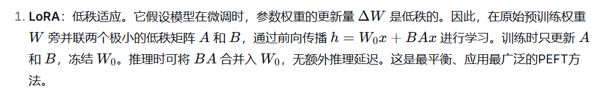
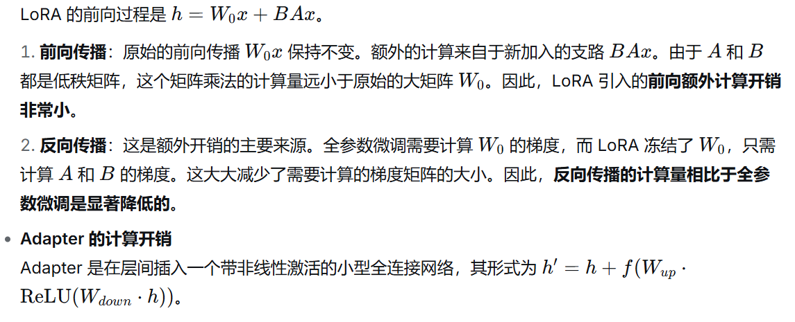
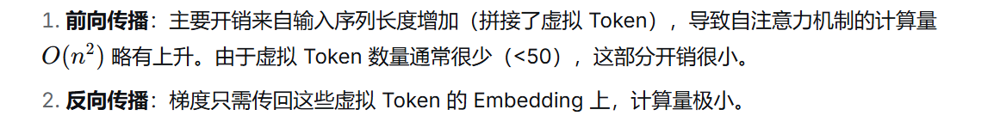
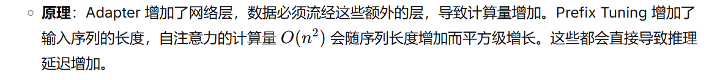
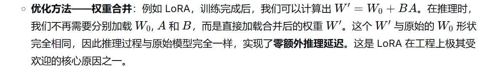
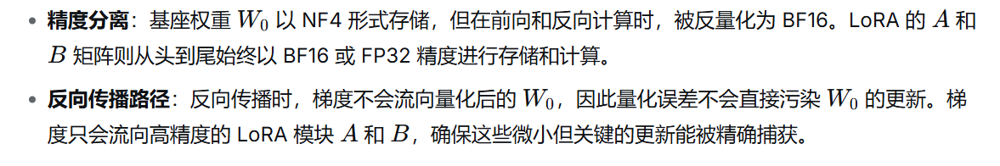
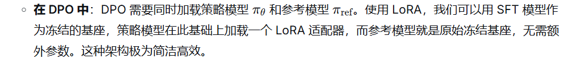
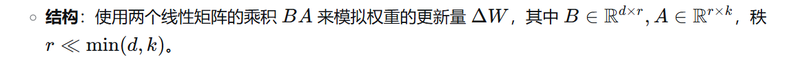
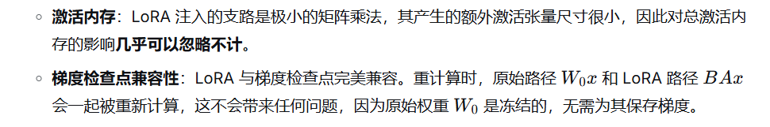

# 53.大模型（LLMs）参数高效微调（PEFT）

#### 什么是参数高效微调？它与全参数微调相比的核心优势是什么？

参数高效微调是一种在微调大语言模型时，仅更新模型中极小一部分参数，而将绝大多数预训练参数冻结不变的技术。其核心思想是：预训练基座模型已经通过海量数据学习到了强大的通用语言能力，我们只需要通过调整少量参数来“唤醒”或“重定向”这些能力到特定的下游任务，而不需要去修改整个模型的基础知识库。

与全参数微调相比，其核心优势体现在四个维度：

1. 存储成本数量级降低：全参数微调需要为每个下游任务保存一份完整的模型副本（例如，一个 7B 的模型需要约 14GB 空间）。PEFT 方法（如 LoRA）只需保存额外注入的、参数量极少的适配器权重（通常只有几兆到几十兆字节）。这使得为成百上千个不同任务定制模型成为可能，而不会造成存储灾难。

2. 显存占用与计算开销骤降：全参数微调需要存储所有参数的梯度和优化器状态，这通常会占用比模型参数本身大 3-4 倍的显存。PEFT 通过冻结基座模型，只需计算和存储极少量可训参数的梯度和优化器状态，这使得在消费级显卡（如 RTX 3090/4090）上微调 65B 甚至更大的模型成为现实。

3. 极致的部署灵活性：你只需要在内存中维护一个基座模型，然后根据不同任务的热插拔需求，动态加载不同的轻量级 PEFT 适配器。这为构建高效的“模型即服务”平台提供了技术基石。

4. 有效缓解灾难性遗忘：全参数微调在更新大量参数以适应新任务时，极易覆盖和破坏模型在预训练阶段学到的通用知识，尤其在训练数据规模较小的情况下。PEFT 通过冻结原始参数，从根本上抑制了模型对通用语言知识的遗忘，使其在微调后依然能保持强大的泛化能力。

---

#### 列举至少 5 种 PEFT 方法，并简要说明其基本原理。

以下是五种代表性 PEFT 方法的原理剖析：

1. **LoRA**：低秩适应。它假设模型在微调时，参数权重的更新量 $\Delta W$ 是低秩的。因此，在原始预训练权重 $W$ 旁并联两个极小的低秩矩阵 $A$ 和 $B$，通过前向传播 $h=W_0x+BAx$ 进行学习。训练时只更新 $A$ 和 $B$，冻结 $W_0$。推理时可将 $BA$ 合并入 $W_0$，无额外推理延迟。这是最平衡、应用最广泛的PEFT方法。

{.ocr-src}

2. Prefix Tuning：在输入序列前，拼接上一系列可学习的、任务特定的“虚拟Token”向量。这些连续的向量不来自词表，而是随机初始化并通过训练进行优化。它们的作用是作为“软提示”，引导冻结的语言模型在生成回复时偏向特定的任务或风格。需要存储和优化的参数就是这几组连续的向量。

3. P-Tuning：类似于 Prefix Tuning，但只在输入层的Prompt Embedding上添加可学习的连续向量，并且通常结合离散的Prompt一起使用。它主要解决的是如何更好地构建Prompt的问题，将Prompt从离散的文本转化为可优化的连续向量。

4. Adapter：在 Transformer 的层之间插入小型、可训练的神经网络模块（通常是一个带瓶颈层的双层全连接网络）。微调时，只训练这些新插入的 Adapter 模块，而原始的 Transformer 层全部被冻结。Adapter 是一种结构化的PEFT方法，通过增加网络深度来适配新任务。

5. IA3：一种极简的PEFT方法。它只引入两组可学习的、逐元素的缩放向量 lk 和 $l_v$，分别对自注意力机制中的 Key 和 Value 向量进行缩放。可训练参数量极少，效果却出奇地好。

---

#### PEFT 为什么能在减少可训参数的同时，保持接近全参数微调的性能？

这个问题的答案触及了深度学习的一个核心洞察：预训练模型本身已经是一个高度过参数化、蕴含了解决大量任务所需知识的“万能工具箱”。PEFT 并不是在学习新知识，而是在学习如何从工具箱中选用最合适的工具。

具体可以从两个理论视角来理解：

1. 内在低秩性假说：LoRA 的成功证明了，大模型在适应下游任务时，其权重的变化量 $\Delta W$ 虽然维度很高，但其“有效信息量”很低，可以被一个低秩空间所表征。换句话说，模型不需要大幅调整所有参数，只需在某个关键的、低维的子空间内进行调整，就能实现对新任务的有效适配。PEFT 方法正是通过不同的方式（低秩矩阵、连续向量等）找到了这个子空间并进行操作。

2. 激活干预视角：像 Prefix Tuning 和 IA3 这类方法，可以被看作是“软提示”或“激活调控器”。它们不修改模型自身的权重，而是通过改变模型接收到的输入（添加虚拟Token）或调控模型内部的激活流（缩放Key/Value向量），来引导模型的注意力机制和处理流程朝向任务特定的方向。这就像给一个知识渊博的专家（基座模型）下达了清晰、精准的指令，从而高效地完成了任务。

因此，PEFT 的高效性并非魔法，而是精准地利用了预训练模型的冗余特性和强大的上下文学习能力。

---

#### 如何评估一种 PEFT 方法的好坏？列出常用的比较维度。

评估一种 PEFT 方法不仅看最终任务得分，更要看其综合的工程价值。常用的比较维度包括：

- 性能：在下游任务（如GLUE、MMLU）或特定生成任务上的指标（如准确率、困惑度、ROUGE、BLEU）。

- 可训练参数量：额外引入的、需要训练的参数数量。通常用百万（M）或千万为单位，以及占原始模型参数的百分比来衡量。这是衡量“效率”的核心。

- 推理延迟：在完成微调后，模型进行推理时是否增加了额外的计算负担。例如，LoRA可以合并回原始权重，实现零延迟推理，这是其巨大优势。而Adapter等方法则会增加推理延迟。

- 显存占用：微调过程中所需的 GPU 显存峰值。这决定了该方法能否在消费级硬件上运行。

- 训练速度：完成微调所需的时间（吞吐量，tokens/s）。

- 存储效率：微调后需要额外保存的模型文件大小。

- 灾难性遗忘的缓解能力：在适配新任务的同时，模型在通用基准（如语言理解）上的性能是否有显著下降。

- 任务可组合性：是否支持多个任务的Adapter/Prompt进行即插即用。

---

#### 在什么场景下全参数微调仍然不可替代？举例说明。

尽管 PEFT 十分强大，但在以下场景中，全参数微调仍然是更优或必需的选择：

1. 需要知识注入的场景：当我们要教会模型一个预训练时完全没见过的、全新的知识领域时，PEFT 可能会力不从心。例如，对模型进行持续预训练，注入某个冷门小语种的语言能力，或注入某个公司内部独有的、全新的术语体系。此时，需要大规模更新模型的词嵌入层和底层表示能力，这通常需要全参数更新。

2. 极端风格或人格重塑的场景：如果要将模型从一个严谨的学者，彻底改造为一个用词夸张、个性鲜明的脱口秀演员，这种根本性的行为模式转变，可能需要触及模型的深层表示，全参数微调能够提供更强大的拟合能力。

3. 追求极致性能，且数据量极大、资源无上限的场景：像 OpenAI、Google 等顶尖机构在训练其旗舰模型时，拥有近乎无限的算力和海量数据，在此条件下，全参数微调能够榨干模型的最后一点性能潜力，达到 PEFT 可能无法企及的性能上限。这是一种不计成本追求极限的策略。

---

#### PEFT 方法在存储和部署上的优势具体如何体现？

PEFT 的优势在工程实践中会转化为巨大的商业价值：

1. 共享基座，热插拔适配器：这是 PEFT 最酷的工程应用。服务端只需加载一个基座模型，然后根据用户需求或任务类型，动态地从硬盘加载对应的、微小的 PEFT 适配器。这就像一个手机可以安装无数个 App 一样，一个 LLM 可以被赋予无数种特定能力，而内存占用几乎不变。

2. 极低的离线存储成本：一个全参数微调的 7B 模型大约需要 14GB 的磁盘空间。而一个 LoRA 适配器可能只有 10MB。理论上，你在同样大小的硬盘上，可以存储一百万个不同任务的 LoRA 模型。这对于需要同时提供大量定制化服务的云平台来说，是无与伦比的成本优势。

3. 极快的模型切换速度：加载一个 14GB 的全量模型可能需要数秒到数十秒。而加载一个 10MB 的 LoRA 适配器几乎可以在毫秒级完成。这使得实时、动态地切换模型任务成为可能。

4. 边缘计算的赋能者：PEFT 使得在算力、存储和电量都受限的移动设备或嵌入式系统上部署和个性化 LLM 成为可能。设备出厂时可内置一个量化的基座模型，后续的个性化功能可以通过下载微小的 PEFT 适配器来实现。

---

#### 解释“灾难性遗忘”在 PEFT 中的表现：PEFT 是否天然具有更好的抗遗忘能力？

是的，PEFT 天然具有更好的抗遗忘能力，因为它从根源上抑制了遗忘的发生。

- 灾难性遗忘的根本原因：在深度学习中，遗忘是指模型在学习新任务 B 时，为了优化新目标而调整了大量的网络参数，这些参数恰好覆盖了模型在旧任务 A 上习得的关键知识，导致模型在任务 A 上的性能断崖式下跌。这本质上是一种参数干扰。

- PEFT 的抗遗忘机制：大多数 PEFT 方法（如 LoRA, Adapter）的核心操作是将预训练的原始参数全部冻结。微调过程不会对模型 99.9% 以上的、已经学成的通用语言知识参数造成任何干扰。新的任务知识被独立地编码在新增的、极小的参数模块中。这就好比在原有的、庞大的图书馆（基座模型）之外，为某个新课题专门建立了一个小书架（PEFT模块），丝毫没有改动图书馆的原有藏书。因此，模型原本强大的知识储备得到了完整的保留。

- PEFT 中遗忘的表现：PEFT 并非绝对不会遗忘。如果微调数据极度偏向于一个极其狭窄的领域（例如，全都是医疗对话），那么新增的 PEFT 模块可能会“过拟合”到这个领域，导致模型在输出通用对话时，风格和内容被带偏。但这种“遗忘”是由于新增模块的信号过强导致的，而非原始参数被破坏。

结论：PEFT 是目前解决灾难性遗忘问题最有效、最简洁的技术路径之一，因为它遵循了一个简单而深刻的工程哲学：如果不想破坏旧东西，就不要去动它。

---

#### PEFT 与持续学习（continual learning）的关系是什么？

PEFT 与持续学习之间存在天然的、深层次的联系。它们共同指向一个核心目标：让模型在不断学习新知识的同时，不遗忘旧知识。

- 持续学习的核心挑战：在标准深度学习中，灾难性遗忘是持续学习的头号敌人。当模型按顺序学习任务 A、任务 B、任务 C 时，学习新任务的过程会覆盖和破坏模型在旧任务上学到的知识。传统方法试图通过正则化（如EWC）、动态架构扩展或记忆回放来解决这个问题，但都有各自的局限性。

- PEFT 如何天然地支持持续学习：大多数 PEFT 方法（如 LoRA, Adapter, Prefix Tuning）的操作核心是将预训练基座模型的参数完全冻结。当面对新任务时，模型的核心知识库不会被修改，而是在原始模型之上或旁边，附加一个极小的、任务特定的参数模块。这彻底规避了灾难性遗忘的根本原因——对旧参数的干扰。这种机制可以被看作是完美的参数隔离。

- PEFT 作为持续学习的完美工具箱：在持续学习的场景中，PEFT 方法的优势体现在多个方面。
  1. 任务独立存储：每个新任务都可以拥有自己独立的 PEFT 适配器（例如，一套 LoRA 权重）。这些适配器之间物理隔离，互不干扰。一个适配器的训练不会影响另一个。
  2. 零遗忘：由于基座模型不变，切换到旧任务时，只需加载该任务的适配器，即可保证性能与刚训练完时完全一致，实现了理论上的零遗忘。
  3. 极低的存储成本：为每个任务保存一个完整的模型副本是极其昂贵的。但保存一个 PEFT 适配器（通常只有几兆字节）的成本极低，使得为成千上万个任务维护独立的模型状态成为可能。
  4. 热插拔与模型复用：这催生了“模型即服务”的灵活架构。服务端只需加载一个基座模型，然后根据任务需求动态加载不同的 PEFT 适配器，无需重启服务或切换大型模型文件。

- PEFT 在持续学习中的高级应用：
  1. 顺序微调：模型按顺序学习任务 A、B、C。为每个任务分别训练一个 LoRA 适配器。推理时，根据任务 ID 加载对应的适配器。这是最直接的应用。
  2. 知识融合与合并：可以将多个任务上独立训练的 LoRA 适配器进行算术合并（例如，LoRA 的权重相加），从而创建一个能够同时处理多个任务的新适配器，而无需访问原始训练数据。这为持续学习中的知识迁移提供了新的可能。
  3. 参数生成式持续学习：更高级的框架中，可以使用一个超网络（Hypernetwork）根据任务描述动态生成 PEFT 模块的参数，实现无限任务的持续学习。

结论：PEFT 为持续学习提供了一套优雅、高效且工程友好的解决方案。它不是持续学习的某个具体算法，而是一种使能技术，通过其固有的参数隔离特性，将解决灾难性遗忘这个复杂问题，简化为了文件系统的管理问题。

---

#### 如何为特定任务选择合适的 PEFT 方法？给出决策流程或经验法则。

选择合适的 PEFT 方法需要权衡任务需求、模型规模、可用资源和性能目标。以下是一个实用的决策流程和经验法则。

- 第一步：任务类型与核心需求分析
  - 任务是否需要注入全新知识？ 如果需要让模型掌握大量它从未见过的领域知识（如特定公司的内部文档），简单的 PEFT 方法可能力不从心。此时可能需要考虑全参数微调，或者结合RAG，或使用 Adapter 等结构性更强的方法。
  - 任务是否为简单的指令遵循或风格转换？ 如果只是让模型遵循特定指令格式或改变回复风格，LoRA 及其变体（如 QLoRA）通常是最优选择，因为这类任务不需要改变模型的核心知识，只需调整其行为即可。
  - 模型规模有多大？ 对于小型模型（如 <1B），全参数微调的成本尚可接受，且有时能获得比PEFT更好的效果。对于大型模型（>7B），PEFT 几乎是唯一经济可行的选项。
  - 对推理延迟是否有严格要求？ 如果需要零额外推理延迟，LoRA 是唯一的选择，因为它可以合并回原始权重。Adapter 等方法则会在推理时引入轻微但可测的额外延迟。

- 第二步：资源约束评估
  - 显存瓶颈：如果显存极度受限，需要选择可训练参数量最少、显存占用最低的方法。QLoRA（通过将基座模型量化为 4-bit）是极致省显存的方案。其次是 LoRA 和 IA3。
  - 存储成本：如果需要为成百上千个任务训练模型，那么适配器的存储体积至关重要。LoRA 和 IA3 的适配器文件最小，Adapters 次之，Prefix Tuning 的文件与序列长度相关。
  - 训练速度：一般来说，可训参数越少，训练速度越快。IA3 和 LoRA 的训练速度非常快。Adapter 由于增加了网络深度，训练可能会稍慢。

- 第三步：经验法则与推荐
  - 黄金首选：LoRA (Low-Rank Adaptation)：如果你不确定选哪个，就从 LoRA 开始。它在性能、可训参数量、推理延迟、存储成本和实现便捷性上达到了目前最好的平衡。它的变体（如 QLoRA）还解决了显存限制问题。
  - 极致效率：IA3：如果你追求极致的可训参数量（例如，为海量用户进行超个性化微调），IA3 是比 LoRA 更轻量级的选择。
  - 需要调整模型“认知”而非“行为”：Prefix Tuning 和 P-Tuning 通过修改输入的连续提示来影响模型，对于需要调整模型整体“心态”或“角色”的任务可能更直接。
  - 结构性适配与跨架构迁移：Adapter 模块提供了一种结构化的适配方式，在跨模型架构（如从BERT到RoBERTa）的微调中，有时能提供更稳定的表现。

决策流程总结：

```plain text
任务需求 -> 需要注入大量新知识？
    |-- 是 -> 全参数微调 / RAG / 大容量 Adapter
    |-- 否 -> 模型规模 > 7B?
        |-- 是 -> 对推理延迟零容忍？
            |-- 是 -> LoRA
            |-- 否 -> Adapter / LoRA
        |-- 否 -> 追求极致效率？
            |-- 是 -> IA3
            |-- 否 -> LoRA / Prefix Tuning
```

#### 在 LLM 中，PEFT 通常作用于哪些模块？Attention、FFN 还是全部？

PEFT 方法的应用位置，是其设计中至关重要的决策，它直接影响着模型的适配能力和泛化效果。目前的研究和实践表明，PEFT 主要作用于 自注意力模块，部分也会扩展至 前馈网络（FFN）。

- 核心作用点：自注意力模块\
  这是绝大多数 PEFT 方法（尤其是 LoRA 和 Adapter）的首选位置。原因在于：
  1. 注意力是信息路由的核心：Transformer 模型的精髓在于其自注意力机制，它决定了模型在生成每个词时，应该“关注”输入中的哪些部分。PEFT 通过干预这一机制，可以最高效地调整模型的行为。
  2. LoRA 的具体应用：在 LoRA 的实践中，通常会将低秩矩阵注入到自注意力层的查询（Q）、键（K）、值（V）以及输出投影（O）的权重矩阵上。其中，对 Q 和 V 的适配是最常见且最有效的。调整 Q 改变了模型“寻找什么”的策略，调整 V 则改变了模型“提取什么”的内容。

- 扩展作用点：前馈网络（FFN）\
  一些研究和实践发现，仅仅调整注意力可能不足以完成某些复杂的适配任务。
  1. FFN 是知识存储的关键：有观点认为，Transformer 的 FFN 层扮演着“键值记忆体”的角色，存储了大量的世界知识和事实信息。
  2. 何时需要适配 FFN：当微调任务需要模型注入全新的领域知识或调整其事实性认知时，对 FFN 层应用 PEFT（如注入 LoRA 或 Adapter）可以提供更强的表达能力，获得更好的效果。但代价是可训练参数量的增加。
  3. 权衡：对 FFN 应用 PEFT 能提升模型容量，但也会增加显存和计算开销。大多数情况下，只对注意力层应用 PEFT 就足够了。只有当任务特别复杂或数据量巨大时，才考虑将 PEFT 扩展到 FFN 层。

- 全部应用\
  在极端情况下，可以对模型的所有线性层（包括 Attention 和 FFN）都应用 PEFT。这会最大化模型的微调能力，使其非常接近全参数微调的效果。但代价是牺牲了 PEFT 在参数量和效率上的优势。

总结：只对自注意力层应用 PEFT，是在效率与效果之间取得的最佳平衡点，也是社区中最通用的做法。当需要更强的模型容量来吸收新知识时，可以优先考虑将 PEFT 扩展到 FFN 层。

---

#### 为什么大部分 PEFT 方法不修改 embedding 层或最后的 lm_head？

这是一个非常实际的工程考量。大部分 PEFT 方法（如 LoRA, Adapter）强烈建议不修改 embedding 层和 lm_head 层，即使它们在技术上是可以被修改的。原因如下：

- 灾难性的参数量膨胀：Embedding 层的形状是 [词表大小,隐藏维度][词表大小,隐藏维度]，而 lm_head 层的形状是 [隐藏维度,词表大小][隐藏维度,词表大小]。在 LLM 中，词表大小通常非常大（例如，32000, 64000 甚至 100000+）。以 LLaMA-7B 为例，其词表大小为 32000，隐藏维度为 4096。仅 Embedding 层就有 32000×4096≈1.3 亿个参数，这与 LLaMA-7B 整个模型 70 亿的参数相比似乎不大，但已经是典型 LoRA 可训参数（约几百万）的数十倍。对其应用 PEFT 会彻底破坏其“参数高效”的特性。

- 任务泛化能力的核心锚点：Embedding 层是模型理解语言的基础，它将离散的 token 映射到连续的语义空间。这个映射关系是预训练阶段最重要的成果之一，具有极强的泛化能力。在微调时修改它，极其容易导致灾难性遗忘，并且可能会破坏模型对语言的底层理解。保留原始 Embedding 层，相当于保留了一个强大的、通用的语义基底。

- 增益与成本的权衡：在绝大多数下游任务中，冻结 Embedding 和 lm_head 层对最终性能的影响微乎其微。因为下游任务通常不涉及创造全新的词汇，而是在已有的语义空间中进行操作。解冻它们所带来的微小性能提升，远远无法弥补其带来的参数量、显存和潜在遗忘风险的巨大代价。

- 避免过拟合：Embedding 层参数量巨大但训练信号相对稀疏（仅与样本中出现的 token 相关）。在小数据集上微调时，更新 Embedding 层极易导致过拟合，使得模型对微调数据中的词汇分布过于敏感。

结论：这是一种基于工程经验和成本效益分析的理性选择。冻结 Embedding 和 lm_head 层，是保证 PEFT 方法真正“高效”的前提。

---

#### 分析 PEFT 方法的计算效率：前向和反向传播中，额外计算开销主要来自哪里？

PEFT 方法的计算开销虽然远小于全参数微调，但仍然存在。分析其来源有助于我们进行优化。我们以最典型的 LoRA 和 Adapter 为例。

- LoRA 的计算开销

LoRA 的前向过程是 $h=W_0x+BAx$。

1. **前向传播**：原始的前向传播 $W_0x$ 保持不变。额外的计算来自于新加入的支路 $BAx$。由于 $A$ 和 $B$ 都是低秩矩阵，这个矩阵乘法的计算量远小于原始的大矩阵 $W_0$。因此，LoRA 引入的**前向额外计算开销非常小**。
2. **反向传播**：这是额外开销的主要来源。全参数微调需要计算 $W_0$ 的梯度，而 LoRA 冻结了 $W_0$，只需计算 $A$ 和 $B$ 的梯度。这大大减少了需要计算的梯度矩阵的大小。因此，**反向传播的计算量相比于全参数微调是显著降低的**。

- **Adapter 的计算开销**

  Adapter 是在层间插入一个带非线性激活的小型全连接网络，其形式为 $h'=h+f(W_{up}\cdot\mathrm{ReLU}(W_{down}\cdot h))$。

{.ocr-src}

1. 前向传播：由于 Adapter 增加了网络的深度，数据必须串行地流经 Adapter 模块。这直接增加了前向传播的计算开销，虽然单个 Adapter 计算量不大，但在数十上百层网络中累积，就会带来可观的额外延迟。

2. 反向传播：与 LoRA 类似，梯度只需计算并传播回 Adapter 模块内部，以及从 Adapter 输出端流向其输入端（影响上一层），而不需要计算原始 Transformer 层的参数梯度。

- Prefix Tuning / P-Tuning 的计算开销

1. **前向传播**：主要开销来自输入序列长度增加（拼接了虚拟 Token），导致自注意力机制的计算量 $O(n^2)$ 略有上升。由于虚拟 Token 数量通常很少（<50），这部分开销很小。
2. **反向传播**：梯度只需传回这些虚拟 Token 的 Embedding 上，计算量极小。

{.ocr-src}

总结：PEFT 方法的额外计算开销，在前向传播中，LoRA < Prefix Tuning < Adapter；在反向传播中，所有 PEFT 方法的开销都远小于全参数微调。LoRA 之所以备受青睐，一个重要原因就是它在前向和反向都极为高效，且推理时可合并权重，实现零额外开销。

---

#### 多任务学习时，使用 PEFT 如何实现任务间模块隔离与复用？

在多任务学习场景中，PEFT 展现出了惊人的灵活性，能够轻松实现任务间的模块隔离、复用甚至是算术组合。这主要归功于其将任务特定知识外化到极小模块中的设计。

- 方案一：完全隔离 (One Adapter per Task)\
  这是最直接、最干净的方法。为每个下游任务（如翻译、摘要、代码生成）分别训练一个独立的 PEFT 适配器。基座模型则被冻结并共享。在推理时，根据任务需求动态加载对应的适配器。这种方法实现了完美的任务隔离，一个新任务的训练完全不会影响其他任务。

- 方案二：混合隔离 (Hybrid Isolation)\
  在更复杂的场景中，我们可能希望对一个任务的不同方面进行独立控制。例如，一个对话模型，我们可能希望其“回答风格”和“安全策略”是可以独立调整的。我们可以设计一个多适配器架构，其中一个适配器专门负责风格，另一个专门负责安全。在训练时，每个适配器使用不同的数据集进行独立训练；在推理时，两个适配器可以同时被激活，实现功能的叠加。

- 方案三：知识复用与组合 (Knowledge Reuse & Composition)\
  这是 PEFT 多任务学习中最具魔力的一环。由于适配器是独立的参数实体，我们可以对它们进行类似软件模块的操作。
  1. 多任务微调：可以将多个任务的数据混合在一起，训练一个单一的适配器。这个适配器将学会处理所有这些任务。
  2. 适配器融合：可以将两个分别在任务 A 和任务 B 上独立训练好的 LoRA 适配器，进行算术组合。例如，`W_new = W_base + α * B_A * A_A + β * B_B * A_B`。通过调整权重α和β，我们可以实现任务的“切换”甚至“插值”，创造出兼具两种能力的新模型。这种操作无需任何重新训练。

这种能力为构建模块化、可组合的AI系统开辟了道路。你可以想象一个“适配器市场”，用户可以像安装手机App一样，为他们的基座模型选择和组合不同的能力模块。

---

#### PEFT 是否会影响模型的推理速度？如果会，如何优化？

答案是：取决于具体的 PEFT 方法。

- 会影响推理速度的方法 (如 Adapter, Prefix Tuning)：

- **原理**：Adapter 增加了网络层，数据必须流经这些额外的层，导致计算量增加。Prefix Tuning 增加了输入序列的长度，自注意力的计算量 $O(n^2)$ 会随序列长度增加而平方级增长。这些都会直接导致推理延迟增加。

{.ocr-src}

- 影响程度：对于 Adapter，延迟增加通常是线性的，与插入的模块数量成正比。对于 Prefix Tuning，增加少量虚拟 Token 时影响较小，但过多时会成为瓶颈。

- 不影响推理速度的方法 (如 LoRA, IA3)：
  - 原理：LoRA 和 IA3 的设计非常巧妙。它们只是在原始预训练权重旁，以并联（加法）或缩放（乘法）的方式引入了少量参数。在训练完成后，这些额外的参数可以被计算并直接合并到原始的预训练权重矩阵中。

- **优化方法——权重合并**：例如 LoRA，训练完成后，我们可以计算出 $W'=W_0+BA$。在推理时，我们不再需要分别加载 $W_0$, $A$ 和 $B$，而是直接加载合并后的权重 $W'$。这个 $W'$ 与原始的 $W_0$ 形状完全相同，因此推理过程与原始模型完全一样，实现了**零额外推理延迟**。这是 LoRA 在工程上极其受欢迎的核心原因之一。

{.ocr-src}

结论：如果你的应用场景对延迟非常敏感，例如在线对话系统，那么选择 LoRA 或 IA3 这类可以合并权重的 PEFT 方法至关重要。这让你能够在不增加任何推理成本的情况下，享受到 PEFT 带来的所有其他好处。

---

#### 在分布式训练中，PEFT 如何与数据并行、模型并行结合？

PEFT 在分布式训练中同样表现出色，它与现有的并行策略能够无缝结合，并带来额外的优势。

- 与数据并行 (Data Parallelism, DP) 结合：这是最自然、最直接的结合方式。在数据并行中，每个 GPU 都有一个完整的模型副本，但处理不同的数据批次。
  1. 标准结合：所有 GPU 共享并冻结同一个基座模型。PEFT 的可训练参数在每个 GPU 上初始化副本，并行训练。
  2. 梯度同步的优化：由于 PEFT 的可训练参数（如 LoRA 的 $A$ 和 $B$）极小，分布式训练中需要同步的梯度数据量也相应变得极小。相比于全参数微调时需要同步整个模型的梯度，PEFT 极大地降低了数据并行中的通信瓶颈，显著提升了分布式训练的效率。

- 与模型并行 (Model Parallelism) 结合：当模型太大，无法放入单个 GPU 时，需要使用模型并行。PEFT 的策略取决于模型并行的类型。
  1. 与张量并行 (Tensor Parallelism, TP) 结合：模型被切分到不同 GPU 上，每个 GPU 持有模型一部分层的参数副本。PEFT 参数也需要相应地被切分和同步。
  2. 与流水线并行 (Pipeline Parallelism, PP) 结合：模型按层切分到不同设备。PEFT 的可训参数只存在于其被注入的层。PEFT 的优势在于，它不需要像全参数微调那样对冻结的基座模型进行梯度计算和通信。这大大减少了模型并行，尤其是流水线并行中跨设备通信的负担。

- 与 FSDP/ZeRO 结合：FSDP 和 ZeRO 通过分片模型状态来降低显存占用。当与 PEFT 结合时，通常我们只需要对 PEFT 的可训练参数进行梯度同步和状态分片，而庞大的基座模型参数可以保持冻结、不分片（或者以最廉价的分片方式存储），进一步节约了通信和计算资源。

---

#### 量化与 PEFT 结合的挑战：低精度下，插入的可训参数如何保持数值稳定性？

量化与 PEFT 结合是极致节省显存的关键，其代表技术是 QLoRA。它的核心挑战在于：基座模型（$W_0$）的精度极低（如 4-bit），导致数值误差大，而插入的可训参数（如 LoRA 的 $A$,$B$）必须以高精度训练和更新，其微小的更新量容易被量化噪声淹没。

QLoRA 通过以下关键技术解决了这个问题：

1. NF4 量化：使用一种名为 NormalFloat 4-bit 的数据格式。这种格式假设数据服从正态分布，从而在 4-bit 空间中提供比 INT4 更高精度的表示，尤其适合预训练权重的分布。

2. 双重量化：量化本身需要存储缩放因子。双重量化将存储缩放因子的开销也进行了量化压缩，进一步榨取每一分显存。

3. 分页优化器：利用 NVIDIA 的统一内存，在 GPU 显存不够时，自动将优化器状态分页到 CPU 内存，防止 OOM。

在低精度环境下保持数值稳定性的具体做法：

- **精度分离**：基座权重 $W_0$ 以 NF4 形式存储，但在前向和反向计算时，被反量化为 BF16。LoRA 的 $A$ 和 $B$ 矩阵则从头到尾始终以 BF16 或 FP32 精度进行存储和计算。
- **反向传播路径**：反向传播时，梯度不会流向量化后的 $W_0$，因此量化误差不会直接污染 $W_0$ 的更新。梯度只会流向高精度的 LoRA 模块 $A$ 和 $B$，确保这些微小但关键的更新能被精确捕获。

{.ocr-src}

这种设计巧妙地隔离了量化的误差，保证了 LoRA 模块在低精度环境下仍然能够稳定地进行学习。

---

#### 举例说明在 HuggingFace PEFT 库中如何加载和使用一种 PEFT 方法。

以最流行的 LoRA 为例，在 HuggingFace `peft` 库中，这是一个极其简化的流程。以下代码展示了如何使用 QLoRA（量化 + LoRA）加载一个 70 亿参数的模型并进行微调。

```python
import torch
from transformers import AutoModelForCausalLM, AutoTokenizer, BitsAndBytesConfig
from peft import LoraConfig, get_peft_model, prepare_model_for_kbit_training

# 1. 配置量化 (QLoRA)
bnb_config = BitsAndBytesConfig(
    load_in_4bit=True,
    bnb_4bit_use_double_quant=True,
    bnb_4bit_quant_type="nf4",
    bnb_4bit_compute_dtype=torch.bfloat16
)

# 2. 加载模型并应用量化
model = AutoModelForCausalLM.from_pretrained(
    "meta-llama/Llama-2-7b-hf",
    quantization_config=bnb_config,
    device_map={"": 0}
)

# 3. 为 k-bit 训练准备模型
model = prepare_model_for_kbit_training(model)

# 4. 配置 LoRA
lora_config = LoraConfig(
    r=8,                          # 秩，低秩矩阵的秩，决定了可训参数量
    lora_alpha=32,                # 缩放因子，通常设置为 r 的 2-4 倍
    target_modules=["q_proj", "v_proj"], # 应用 LoRA 的目标模块，这里只作用于注意力的 Q 和 V
    lora_dropout=0.05,            # LoRA 层的 Dropout 概率
    bias="none",                  # 不训练额外的 bias 参数
    task_type="CAUSAL_LM"         # 任务类型
)

# 5. 获取 PEFT 模型
peft_model = get_peft_model(model, lora_config)

# 6. 打印可训参数量，感受 PEFT 的极致效率
peft_model.print_trainable_parameters()
# 输出示例: trainable params: 4,194,304 || all params: 6,742,609,920 || trainable%: 0.0622

# 7. 开始正常的训练循环...
# peft_model 可以直接用于训练，就像使用一个普通的 PyTorch 模型一样。
```

代码解析：

1. 量化配置：定义了 4-bit 量化的详细参数。

2. 模型加载：加载预训练模型时，直接应用了量化配置。

3. k-bit 训练准备：`prepare_model_for_kbit_training()` 是一个关键步骤，它会对模型进行微调，使其在低精度环境下也能正确进行梯度和优化器状态的更新。

4. LoRA 配置：这是核心。我们指定了秩 `r`、应用的目标模块 `target_modules` 等。`target_modules` 的选择是影响性能和参数量的关键超参数。

5. 模型替换：`get_peft_model` 将原始的 `model` 转换为一个可训练的 `peft_model`，它内部的 LoRA 模块已经就绪。

6. 打印参数：`print_trainable_parameters()` 函数可以让你立刻看到，只有极少一部分参数需要被训练。

通过以上几个步骤，你就将训练一个 7B 模型所需的显存从数百 GB 降低到了单张消费级显卡可承受的范围，并可以开始微调了。这就是 PEFT 带来的革命性效率提升。

---

#### 讨论 PEFT 在 RLHF 或 DPO 对齐阶段的应用：哪些 PEFT 方法更受欢迎？为什么？

在 RLHF（基于人类反馈的强化学习）或 DPO（直接偏好优化）的对齐阶段，PEFT 方法已成为主流选择，其核心驱动力是大幅降低对齐训练的成本和工程复杂度，使得即使是资源有限的团队也能进行模型对齐。

1. 最受欢迎的 PEFT 方法：LoRA

在 RLHF/DPO 对齐阶段，LoRA 及其变体（如 QLoRA）是绝对的主导者。原因如下：

- 模型规模的对齐需求：对齐阶段通常是在已经非常强大的 SFT 模型（如 7B、13B、70B）上进行。这类模型的全参数微调需要巨大的计算资源，而 LoRA 通过只训练极少量低秩矩阵，将可训练参数量减少了上千倍，使得在消费级硬件上进行对齐成为可能。

- 与多模型架构的完美适配：
  - 在 RLHF 的 PPO 阶段：需要同时维护 Actor、Critic、Reference 和 Reward 四个模型。如果这四个模型都是全参数的大模型，显存将直接爆炸。使用 LoRA，我们可以将 Actor 和 Critic 共享一个冻结的基座模型，每个只拥有自己独立的 LoRA 适配器，而 Reference 和 Reward 模型保持冻结。这使得 PPO 训练可以在可接受的显存内完成。
- **在 DPO 中**：DPO 需要同时加载策略模型 $\pi_\theta$ 和参考模型 $\pi_{\mathrm{ref}}$。使用 LoRA，我们可以用 SFT 模型作为冻结的基座，策略模型在此基础上加载一个 LoRA 适配器，而参考模型就是原始冻结基座，无需额外参数。这种架构极为简洁高效。

{.ocr-src}

- 训练稳定性：对齐训练，尤其是 PPO，是出了名的不稳定。LoRA 通过限制可训参数的量级和范围，起到了天然的正则化作用，使得训练过程更加平稳，减少了策略崩溃的风险。

- 迭代式对齐的便利性：在对齐过程中，我们经常需要进行多轮“采样-筛选-训练”的迭代。LoRA 适配器体积极小，可以快速保存和加载。你可以轻松地为每一轮迭代保存一个独立的 LoRA 适配器，方便进行回滚、比较和模型融合。

2. 其他 PEFT 方法的角色

虽然 LoRA 占据主导，但其他 PEFT 方法在特定场景下也有应用。

- Adapter：在需要更强大适配能力的场景下，Adapter 可能被用于 Critic 模型，帮助其更好地学习价值函数。但其额外的推理延迟使其不如 LoRA 受欢迎。

- Prefix Tuning：在对齐阶段，可以通过训练一组虚拟 Token 来引导模型的行为，尤其在需要快速切换多种对齐模式（如不同的安全等级）时，可以热插拔不同的 Prefix。但 Prefix Tuning 的效果往往不如 LoRA 稳定。

结论：在对齐阶段，LoRA 凭借其极致的参数效率、零推理延迟（合并后）、与多模型架构的完美适配以及带来的训练稳定性，成为了 RLHF 和 DPO 对齐中不可动摇的首选方案。

---

#### 如何通过 PEFT 实现“个性化”模型，例如为每个用户训练一个轻量适配器？

PEFT 是实现模型大规模个性化的核心技术。它通过将用户特定知识外化到极小的适配器中，完美解决了“为成千上万用户定制模型”的成本和效率难题。

实现方案：共享基座 + 用户特定适配器

这是一个经典的架构，包含两个层次：

1. 共享基座模型：一个强大的、预训练好的通用大语言模型。它提供了通用的语言能力、世界知识和推理能力。这个模型只需要在内存中维护一份。

2. 用户特定 PEFT 适配器：为每一个用户（或每一类用户群体）独立训练一个轻量的 PEFT 模块（如 LoRA 适配器）。这个适配器捕捉了该用户的独特偏好、语言风格、知识背景和交互历史。

工作流程：

- 数据收集：为每个用户收集其个性化数据。这可以包括该用户过去的对话历史、点赞/点踩记录、个人资料、特定文档等。

- 独立训练：对于每一个用户，基于共享的基座模型，仅使用该用户的数据，训练一个独立的 LoRA 适配器。训练过程完全独立，互不干扰。例如，可以只将用户在过去聊天中“点赞”的回复作为 chosen 数据，使用 DPO 训练其适配器，让模型更倾向于生成该用户喜欢的风格。

- 推理时动态加载：当用户发起请求时，系统首先识别用户身份，然后从模型仓库中动态加载该用户对应的 LoRA 适配器。将这个适配器应用到共享的基座模型上，即可得到一个为该用户量身定制的个性化模型。请求处理完成后，可以卸载该适配器，或根据内存情况缓存高频用户的适配器。

巨大优势：

- 极低的存储成本：为一个用户存储一个 14GB 的全量模型是不可能的。但存储一个 10MB 的 LoRA 适配器，成本几乎为零。

- 毫秒级的模型切换：加载一个 10MB 的小文件，速度极快，完全可以实现实时动态切换。

- 隐私保护的可能性：由于用户数据仅用于训练其个人的适配器，如果结合联邦学习，甚至可以实现“数据不出本地，只上传适配器参数”，从而保护用户隐私。

- 轻松实现遗忘：如果用户要求删除其数据，只需销毁其对应的 PEFT 适配器即可，而无需重新训练整个模型。

总结：PEFT 将“模型即服务”的理念推向了“个人模型即服务”的新高度。它使得为每一位用户创建一个专属的、终身学习、不断演进的 AI 助手成为可能。

---

#### PEFT 中，可训参数的结构（低秩、向量、卷积等）如何影响其表达能力？

PEFT 方法的设计核心是选择一个合适的参数结构，这个结构直接决定了该方法的表达能力上限、参数效率和计算开销。

- 低秩矩阵 (LoRA)

- **结构**：使用两个线性矩阵的乘积 $BA$ 来模拟权重的更新量 $\Delta W$，其中 $B\in\mathbb{R}^{d\times r}$，$A\in\mathbb{R}^{r\times k}$，秩 $r\ll\min(d,k)$。

{.ocr-src}

- 表达能力：这种结构强制 $\Delta W$ 的秩不超过 $r$。这代表了模型更新被限制在一个低维子空间内。对于许多下游任务来说，这种低秩更新已经足以捕捉任务所需的行为变化。$r$ 越大，表达能力越强，但参数量也越大。LoRA 的表达能力在于它能在原始权重的全维度空间内，找到最重要的几个方向进行更新。

- 向量/软提示 (Prefix Tuning, P-Tuning, IA3)
  - 结构：这些方法注入可训练的向量，而不是矩阵。例如，Prefix Tuning 在输入前拼接可训练的 Token 向量；IA3 使用逐元素的缩放向量来调控 Key 和 Value。
  - 表达能力：这种结构的表达能力天然较弱，因为它们通过修改模型的“输入”或“中间激活的强度”来间接影响输出，而不是直接修改模型的“计算权重”。它的能力在于引导和调控，而不是重塑。它非常适合风格转换、角色扮演等不需要改变模型核心知识库的任务。其优点是参数量可以做到极低。

- 小网络/卷积 (Adapter)
  - 结构：Adapter 在 Transformer 层中插入一个完整的小型神经网络（通常是带瓶颈层的 MLP），它有自己的非线性激活函数。
  - 表达能力：由于引入了非线性变换和更多的参数，Adapter 的表达能力强于低秩矩阵和向量方法。理论上，一个足够宽的 Adapter 可以逼近任意复杂的函数。但其代价是显著增加了网络深度，导致推理延迟增加，并且参数量相对较大。

- 结构对表达能力的影响总结：
  - 低秩矩阵：在高维空间中寻找最重要的几个更新方向，是“精准手术刀”。
  - 向量：通过调控信号强度来引导行为，是“指挥棒”。
  - 小网络：添加了一个新的非线性映射模块，是“功能扩展坞”。

结论：结构的复杂度与其表达能力和计算开销成正比。LoRA 之所以成为最佳平衡点，在于它用极少的参数，实现了在原始权重空间中直接进行“精准修正”的强大表达能力。

---

#### 对 PEFT 方法进行消融实验时，关键变量有哪些？

对 PEFT 方法进行消融实验，旨在量化每个设计选择对最终性能的贡献，并找到最优配置。以下是针对 LoRA（最典型）的关键消融变量，其他方法的变量类似。

1. 可训参数量/秩 (Rank, `r`)
  - 这是 LoRA 最核心的变量。通过设置不同的秩（如 r=1, 2, 4, 8, 16, 32, 64），观察模型性能的变化。目标是找到性能达到饱和点的最小秩，从而在效果和效率之间取得最优平衡。通常，性能随 $r$ 增加而提升，但边际效益递减。

2. 目标模块 (Target Modules)
  - 这是另一个至关重要的变量。测试将 LoRA 注入到模型的不同部分的效果：
    - 仅注入自注意力的 Query (Q) 和 Value (V)。
    - 注入所有自注意力的 Q, K, V, O。
    - 注入前馈网络 (FFN) 的线性层。
    - 注入所有线性层。
  - 消融目标是找出对下游任务贡献最大的模块组合。一般规律是：对 Attention 适配 > 对 FFN 适配；对 Q 和 V 适配 > 对 K 和 O 适配。

3. LoRA 的缩放因子 (`lora_alpha`)
  - `lora_alpha` 与 `r` 共同决定了 LoRA 输出的缩放比例。其实际缩放因子为 `alpha / r`。在固定 `r` 的情况下，调整 `alpha` 相当于调整 LoRA 模块的更新幅度。这个超参数与学习率协同作用，对训练稳定性和最终效果有显著影响。

4. Dropout 概率
  - 测试 LoRA 模块中 Dropout 层的效果。合适的 Dropout 可以防止小数据集上的过拟合，但过高会损害模型的学习能力。

5. 可训参数总量 (Total Trainable Parameters)
  - 这是一个聚合变量，通过组合上述变量来观察模型性能如何随总参数量变化。可以绘制“参数量-性能”曲线，用于评估不同 PEFT 方法的参数效率。

6. 方法本身的消融
  - 对比“LoRA vs Adapter vs Prefix Tuning vs 全参数微调”在相同任务、相同数据下的表现，以评估哪种 PEFT 范式更适合该任务。

实验设计要点：在进行消融实验时，必须采用控制变量法，即每次只改变一个变量，其他变量保持在最优或默认状态。同时，所有实验的基座模型、训练数据、优化器和评估指标必须完全相同，以保证结果的可靠性。

---

#### 如何利用 PEFT 在不暴露全参数的情况下进行多方协作或联邦学习？

在数据隐私法规日益严格的今天，多个机构想在不共享原始数据的情况下共同训练一个强大的模型，这就是联邦学习（Federated Learning）的需求。PEFT 与联邦学习是天生一对，因为它解决了一个核心痛点：通信成本和隐私暴露风险。

传统联邦学习（全参数）的痛点：

- 通信成本巨大：每一轮训练都需要上传和下载整个模型的参数或梯度，对于 LLM 而言，这是 GB 级别的数据传输，网络开销极大。

- 隐私风险：攻击者可以通过模型梯度反推部分原始数据。

PEFT 驱动的联邦学习方案：

- 基座模型共享，适配器本地训练：
  1. 中心服务器将一个统一的、预训练好的基座模型分发给所有参与的客户端。
  2. 每个客户端在各自的本地私有数据上，只训练一个轻量级的 PEFT 适配器（如 LoRA）。基座模型在所有客户端上保持冻结不变。
  3. 每个客户端只将自己训练好的PEFT 适配器参数（而非整个模型）上传到中心服务器。

- 巨大优势：
  - 通信效率提升数千倍：上传一个 10MB 的 LoRA 适配器，相比于上传整个 14GB 的模型参数，数据量减少了超过 99.9%，这使得实时、高频的联邦学习迭代成为可能。
  - 增强隐私保护：上传的 PEFT 参数是经过高度压缩的任务特定信息，远不如全量梯度那样容易泄露原始数据。此外，可以更轻松地结合差分隐私等技术，在PEFT参数上添加噪声。
  - 模型聚合简单有效：服务器端收到的是一批来自不同客户端的 LoRA 权重。由于这些 LoRA 都作用于同一个冻结的基座模型，它们天然处于相同的参数空间。可以对它们进行简单加权平均，得到一个全局的、融合了多方知识的 LoRA 适配器。这个聚合的适配器可以分发给所有客户端，用于下一轮训练或部署。

结论：PEFT + 联邦学习 = 一种高效、安全、低成本的协作式 AI 模型构建方案。它使得多个机构可以在不共享核心数据的情况下，共同训练出能力强大的个性化或领域模型，尤其适用于金融、医疗等高隐私要求行业。

---

#### PEFT 方法在跨模态（如视觉-语言）大模型中有哪些独特应用？

跨模态大模型（如 LLaVA, BLIP-2, GPT-4V）通常包含一个视觉编码器、一个语言模型和一个跨模态连接器。在这种复杂架构上应用 PEFT 具有独特的挑战和机遇。

1. 选择性微调不同模块：
  - 只微调跨模态连接器：这是最轻量的方案。冻结视觉编码器和 LLM，只对负责将视觉特征映射到语言空间的对齐模块（通常是一个线性层或 Q-Former）进行全参数或 PEFT 微调。适用于基本的图文对齐任务。
  - 对 LLM 应用 PEFT (LoRA)：这是最主流的方案。冻结视觉编码器，使用 LoRA 对 LLM 进行适配。这使得 LLM 能够学习如何更好地遵循包含视觉信息的指令，同时保留其强大的语言和推理能力。这是让多模态模型进行复杂对话和推理的关键。
  - 对视觉编码器应用 PEFT (Adapter/LoRA)：如果下游任务的图像分布与预训练数据差异巨大（如医学影像、卫星图），可以对冻结的视觉编码器插入 Adapter 或应用 LoRA，使其能提取出更适合新领域的视觉特征。
  - 全部微调：在某些极端情况下，需要同时对视觉编码器、连接器和 LLM 进行适配，此时可以对所有组件应用 PEFT，以最少的成本实现最大的适应性。

2. 跨模态迁移与融合：
  - 模态特定的 Adapter：可以为文本任务和视觉任务分别训练独立的 Adapter，然后在推理时根据需要激活其中一个或同时激活两个，实现模态间的无缝切换。
  - 知识解耦与再利用：通过 PEFT，我们可以将模型学到的“视觉知识”（适配器 A）和“语言风格”（适配器 B）分离。在需要时，可以将适配器 A 和适配器 B 同时加载到模型上，实现能力的组合，而无需重新训练。

3. 高效的多任务学习：
  - 在多模态场景下，往往存在多个下游任务（如VQA、图像描述、视觉推理）。可以为每个任务训练一个独立的 LoRA 适配器，它们共享一个巨大的多模态基座模型。这比训练多个不同的全参数模型要经济和高效得多。

结论：PEFT 使得对昂贵、庞大的跨模态大模型进行下游适配变得可行和灵活。通过对不同组件（视觉、连接器、语言）进行选择性、模块化的微调，开发者可以以最小的成本探索出最优的适配策略。

---

#### 分析不同 PEFT 方法对梯度检查点和激活内存的影响。

梯度检查点（Gradient Checkpointing）是一种用计算换显存的技术，它不存储某些层的中间激活，在反向传播时再重新计算。PEFT 方法的引入，会微妙地影响这一过程。

- LoRA：
- **激活内存**：LoRA 注入的支路是极小的矩阵乘法，其产生的额外激活张量尺寸很小，因此对总激活内存的影响**几乎可以忽略不计**。
  - **梯度检查点兼容性**：LoRA 与梯度检查点完美兼容。重计算时，原始路径 $W_0x$ 和 LoRA 路径 $BAx$ 会一起被重新计算，这不会带来任何问题，因为原始权重 $W_0$ 是冻结的，无需为其保存梯度。

{.ocr-src}

- Adapter：
  - 激活内存：Adapter 在层间插入了一个完整的非线性模块，会显著增加需要保存的中间激活张量。这是 Adapter 方法的一个主要缺点，它直接增加了显存压力，尤其是当 Adapter 的瓶颈维度较大时。
  - 梯度检查点兼容性：Adapter 层本身也会成为梯度检查点的一部分。重计算时，Adapter 层的内部激活也需要被重建，这会增加重计算的计算量。

- Prefix Tuning：
  - 激活内存：由于增加了输入序列的长度，会导致自注意力矩阵的尺寸 $n$×$n$ 增大，从而显著增加激活内存。这是影响最大的，尤其是在长序列任务中。
  - 梯度检查点兼容性：梯度检查点作用于 Transformer 层，Prefix 的虚拟 Token Embedding 不受影响。重计算时，这些虚拟 Token 的 Embedding 不需要重新生成，但其参与的计算（自注意力）需要被重算。

总结：从显存效率角度看，LoRA 是最优的，它既不增加推理延迟，也不显著增加激活内存，且与梯度检查点完美兼容。Adapter 会增加激活内存，而 Prefix Tuning 会增加因序列长度导致的激活内存。在选择 PEFT 方法时，如果显存是首要瓶颈，应优先考虑 LoRA。

---

#### 在 SFT 中使用 PEFT，指令微调效果是否会受限于可训参数量？

这个问题的答案不是简单的“是”或“否”，它存在一个理论饱和点，但在实践中几乎不会成为瓶颈。

- 理论上的“受限度”：PEFT 方法（如 LoRA）的理论表达能力确实受限于其可训参数量，可训练参数越多，所能拟合的函数就越复杂。因此，存在一个理论上的“受限度”，当任务复杂度超过这个限度时，PEFT 的性能可能无法完全追平全参数微调。

- 实践中的“非受限度”：在绝大多数指令微调场景中，PEFT 的性能并不会受限于可训参数量。原因如下：
  1. 指令微调的本质是“对齐”，而非“知识注入”。指令微调的目标是教会模型如何遵循指令格式、如何调用已有知识，而不是让模型学习大量它原本不知道的新事实。这种“行为重塑”对参数容量的需求远低于“知识记忆”。
  2. LoRA 的“精准手术刀”效应：LoRA 通过低秩更新，能够高效地找到影响模型行为的关键参数子空间。大量实验证明，在标准的指令微调基准（如 AlpacaEval, MT-Bench）上，LoRA（r=8或16）与全参数微调的性能差距极小，几乎可以忽略不计。
  3. 饱和点：研究表明，LoRA 的性能增益在秩 `r` 很小时（如 r=8）就基本达到饱和。继续增大 `r` 带来的提升非常微小，这表明 LoRA 的可训参数量已经足够覆盖指令微调所需的变化空间。

- 何时会真正受限？
  - 知识注入式微调：当你希望模型掌握一个全新的、预训练时完全没见过的知识领域（例如，公司内部全新的代码库、某个冷门学科的知识）时，低秩的 LoRA 可能会力不从心。此时需要增加 `r`，将 LoRA 扩展到 FFN 层，甚至考虑全参数微调。
  - 极端复杂的任务：某些需要复杂多步推理、且推理模式与预训练分布差异巨大的任务，可能需要更高的参数容量。

结论：对于标准的指令微调任务，你几乎不需要担心 PEFT 的可训参数量会成为瓶颈。LoRA 的默认配置（r=8 或 16）已经非常强大。只有在进行大规模知识注入时，才需要考虑是否需要突破这个上限。

