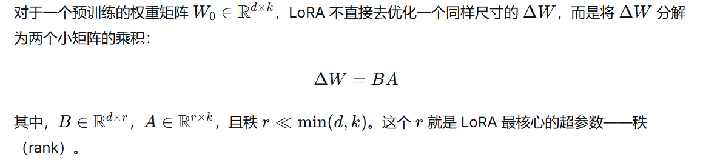
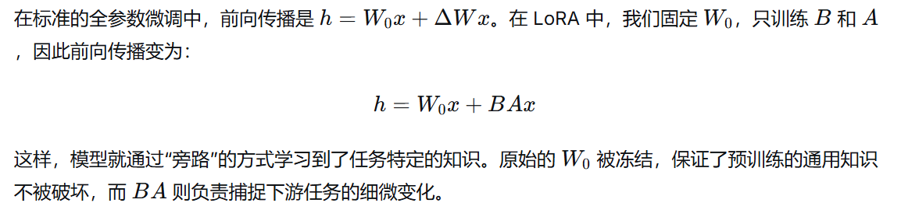
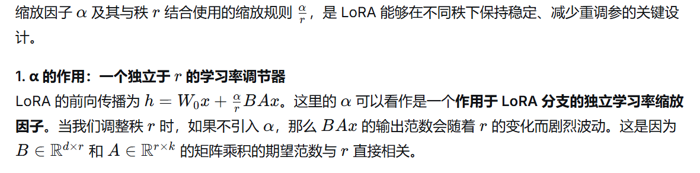
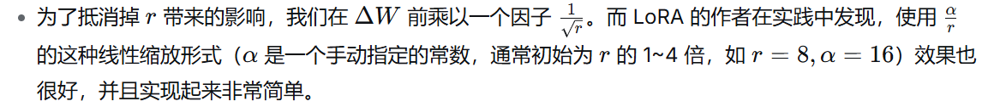
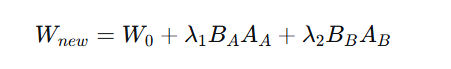
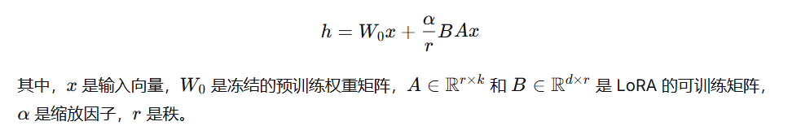
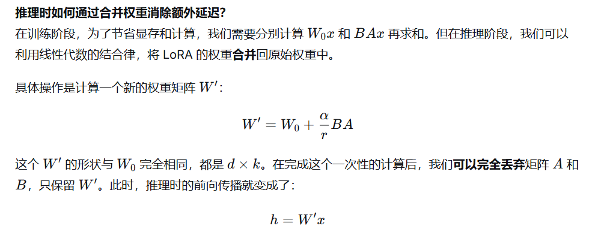

# 54.大模型（LLMs）LoRA（低秩适应）

#### 详细推导 LoRA 的低秩分解：如何将权重更新表示为 BA，并解释 B、A 的维度。

LoRA 的核心思想基于一个深刻洞察：大模型在适应下游任务时，其参数权重的更新量 $\Delta W$ 是低秩的。也就是说，尽管 $\Delta W$ 和原始权重 $W_0$ 一样是一个巨大的稠密矩阵，但它所携带的“信息量”或“变化幅度”可以被压缩到一个非常小的子空间中。

1. 低秩分解的假设

对于一个预训练的权重矩阵 $W_0\in\mathbb{R}^{d\times k}$，LoRA 不直接去优化一个同样尺寸的 $\Delta W$，而是将 $\Delta W$ 分解为两个小矩阵的乘积：

$$
\Delta W=BA
$$

其中，$B\in\mathbb{R}^{d\times r}$，$A\in\mathbb{R}^{r\times k}$，且秩 $r\ll\min(d,k)$。这个 $r$ 就是 LoRA 最核心的超参数——秩（rank）。

{.ocr-src}

例如，一个 4096×4096 的权重矩阵拥有约 1600 万个参数。如果选择 $r$=8，那么 $B$ 的尺寸为 4096×8，$A$ 的尺寸为 8×4096。两者相加的总参数量仅为 65,536，是原矩阵参数量的约 1/250。这就是参数高效性的根源。

2. 如何更新权重：从 $\Delta W$ 到 *BA*

在标准的全参数微调中，前向传播是 $h=W_0x+\Delta Wx$。在 LoRA 中，我们固定 $W_0$，只训练 $B$ 和 $A$，因此前向传播变为：

$$
h=W_0x+BAx
$$

这样，模型就通过“旁路”的方式学习到了任务特定的知识。原始的 $W_0$ 被冻结，保证了预训练的通用知识不被破坏，而 $BA$ 则负责捕捉下游任务的细微变化。

{.ocr-src}

1. 矩阵 $A$ 和 $B$ 的维度与初始化

- 矩阵 $A$：形状为 r×k。它将输入 $x$ 从 $k$ 维降维到 $r$ 维。A 通常使用随机高斯分布进行初始化，这样做是为了在训练开始时，确保 $A$ 是一个满秩的、能够捕捉丰富信息的矩阵。

- 矩阵 $B$：形状为 $d$×$r$。它将低维表示升维回 $d$ 维。$B$ 使用零初始化。这是一个至关重要的技巧。因为 $B$ 初始为 0，所以在训练的最开始，ΔW=BA=0，模型的输出与原始的预训练模型完全一致。这保证了微调过程从一个绝对稳定和正确的起点开始，模型不会因为随机初始化而“跑偏”。

2. LoRA 的缩放因子 $α$\
   在实践中，LoRA 的前向公式通常写为：

$$
h=W_0x+\frac{\alpha}{r}BAx
$$

{.ocr-src}

其中 $α$ 是一个常数缩放因子。引入 $α$/$r$ 的好处在于，当调整秩 $r$ 时，可以保持 *BA* 输出的总方差大致不变，从而降低了重新调参的代价。这一点将在第 4 题中详细展开。

---

#### LoRA 中为什么通常对 A 进行随机高斯初始化，对 B 进行零初始化？

这个设计是 LoRA 稳定性和有效性的关键。其背后有深刻的数学和工程考量。

1. 保证训练起点的稳定性：$\Delta W$=0 的美妙起点\
   对 $B$ 进行零初始化，意味着在微调最开始，$B$=0，因此 ΔW=BA=0。模型的输出与原始的预训练模型完全一致。这带来了三个巨大好处：

- 消除初始噪声：如果 $B$ 是随机初始化的，那么$\Delta W$ 一开始就是一个随机的、可能很大的扰动。这个扰动会立刻破坏预训练模型已经学到的良好表示，导致训练初期非常不稳定，甚至可能使得模型在错误的方向上走得太远而无法恢复。

- 与全参数微调的公平对比：全参数微调的起点是预训练权重本身。LoRA 通过 $B$=0 的设置，使得微调的起点在数学上等价于全参数微调，保证了比较的公平性。

- 更平滑的优化路径：模型的优化从一个最优解（预训练模型）开始，只需学习少量的“修正”参数，这使得优化路径更短、更平滑。

2. A 的高斯初始化为低秩空间注入多样性\
   虽然 $\Delta W$ 整体为 0，但 A 的初始化决定了模型将沿着哪个方向进行探索。随机高斯初始化确保了矩阵 $A$ 在开始时是满秩的，并且具有对称性，为后续的梯度下降提供了一个无偏的、对称的搜索空间。如果没有这个随机性，所有的低维子空间可能从同一方向开始，限制了模型探索多样化解决方案的能力。

3. 类比：从“原图”出发添加“细节”\
   可以把预训练权重 W0 想象成一张高清照片，全参数微调就是在整张照片上进行像素级的重绘。LoRA 则是在这张照片上，用一个几乎全透明的图层（因为 $B$=0，图层初始透明）去作画。$A$ 决定了画笔的颜色和笔触的多样性（随机初始化），而 B 则决定了如何将这些笔触最终显影到画布上。从全透明开始，逐步添加细节，确保了最终作品（微调后模型）是在原图（预训练模型）基础上渐进改良的，而不是推翻重来。

---

#### LoRA 的秩 r 如何选择？r 太小或太大会导致什么？

秩 r 是 LoRA 的核心超参数，它直接决定了可训参数的数量和模型的表达能力。选择 $r$ 是一个在效率与性能之间权衡的艺术。

1. 如何选择 $r$：经验法则与实验

- 经验起点：对于大多数大型语言模型（如 LLaMA 系列）的指令微调或对齐任务，$r$=8 或 $r$=16 是一个非常好的起点。这个值通常能在不损失显著性能的前提下，达到极高的参数效率。

- 任务复杂度：任务越复杂、越需要注入新知识或改变模型行为，理论上需要的 $r$ 就越大。但对于标准的“指令遵循”任务，一个小的 $r$ 已经足够。

- 饱和现象：社区的大量实验表明，LoRA 的性能增益在 r 较小时增长很快，但会迅速进入一个边际效益递减的平台期。将 $r$ 从 1 提升到 8 带来的提升，远大于从 8 提升到 64。在很多基准测试中，$r$=8 就能达到全参数微调 95% 以上的性能。

2. r 太小会怎么样？—— 欠拟合\
   如果 r 设置得过小（例如 $r$=1 或 2），低秩矩阵 $BA$ 的表达能力会受到严重限制。它将无法捕捉下游任务所需的复杂模式，导致模型微调不足，性能无法达到最优，出现欠拟合。

3. r 太大会怎么样？—— 收益递减与过拟合风险

- 收益递减：当 $r$ 超过一个临界点后，继续增加 $r$ 带来的性能提升会非常微小，甚至可能因为引入了过多参数而导致过拟合，损害模型的泛化能力。

- 失去参数高效性：一个非常大的 $r$（例如 $r$=512）可能使得 LoRA 的可训参数量与全参数微调相当，从而失去了 PEFT 方法在存储和计算上的优势。

- 结论：在实践中，我们通常会通过小规模网格搜索（例如，测试 r=4, 8, 16, 32）来寻找一个“甜蜜点”——即刚刚达到性能饱和的最小 $r$ 值。这既能保证模型效果，又能最大限度地保持参数高效性。

---

#### LoRA 的缩放因子 α 的作用是什么？α/r 的缩放规则是如何产生的？

缩放因子 $\alpha$ 及其与秩 $r$ 结合使用的缩放规则 $\frac{\alpha}{r}$，是 LoRA 能够在不同秩下保持稳定、减少重调参的关键设计。

**1. α 的作用：一个独立于 r 的学习率调节器**

LoRA 的前向传播为 $h=W_0x+\frac{\alpha}{r}BAx$。这里的 $\alpha$ 可以看作是一个**作用于 LoRA 分支的独立学习率缩放因子**。当我们调整秩 $r$ 时，如果不引入 $\alpha$，那么 $BAx$ 的输出范数会随着 $r$ 的变化而剧烈波动。这是因为 $B\in\mathbb{R}^{d\times r}$ 和 $A\in\mathbb{R}^{r\times k}$ 的矩阵乘积的期望范数与 $r$ 直接相关。

{.ocr-src}

2. $α$/$r$ 缩放规则的产生原理：保持输出方差稳定\
   这个规则源自一个直观的想法：当我们改变 $r$ 时，我们希望 LoRA 模块的初始输出，以及后续的更新幅度，保持在一个稳定的范围内。

- 如果我们把 A 和 B 的元素看作是独立同分布的随机变量，那么 *BA* 的期望方差会随着 $r$ 的增大而线性增大。

- 为了抵消掉 $r$ 带来的影响，我们在 $\Delta W$ 前乘以一个因子 $\frac{1}{\sqrt{r}}$。而 LoRA 的作者在实践中发现，使用 $\frac{\alpha}{r}$ 的这种线性缩放形式（$\alpha$ 是一个手动指定的常数，通常初始为 $r$ 的 1~4 倍，如 $r=8,\alpha=16$）效果也很好，并且实现起来非常简单。

{.ocr-src}

- 本质：这个缩放规则将 r 的调整对优化过程的影响降到了最低。这意味着，当你把 $r$ 从 8 调整到 16 时，只要 $α$ 设置为 $r$ 的固定倍数（如 $α$=$2r$），你通常不需要再大幅调整学习率。这极大地简化了 LoRA 的调参过程，使得工程师可以专注于调整 $r$ 这一个核心超参数。

---

#### 在 Transformer 中，LoRA 通常应用到哪些权重矩阵？Q、K、V、O，还是也包括 FFN？为什么？

在 Transformer 架构中，LoRA 的应用位置是经过精心设计和广泛实验验证的，其选择直接影响微调的效果和效率。

1. 核心作用点：自注意力模块的 Q 和 V

目前社区的主流实践是，优先且最广泛地将 LoRA 应用于自注意力层的查询（Q）和值（V）的权重矩阵上。这是效果与效率的绝佳平衡点，原因如下：

- 注意力是信息路由的核心：Transformer 的精髓在于其自注意力机制。调整 Q 的权重，相当于改变了模型“寻找什么”的能力；调整 V 的权重，则改变了模型在找到后“提取什么信息”的能力。对这两者进行联合微调，可以用极少的参数最高效地调整模型的行为。

- K 和 O 的角色：对键（K）和输出投影（O）应用 LoRA 也能带来增益，但实验表明，将可训练参数预算集中在对 Q 和 V 的适配上是性价比最高的方案。同时对所有四个矩阵（Q, K, V, O）应用 LoRA 会增加参数量，但性能提升往往不明显。

2. 扩展作用点：前馈网络 (FFN)

- 何时需要适配 FFN？ FFN 层被认为是模型存储事实性知识和进行大规模非线性变换的“记忆库”。如果你的下游任务需要模型学习大量全新的领域知识（比如一个新的编程语言或一个封闭的领域知识库），那么仅仅调整注意力机制可能不够。此时，将 LoRA 扩展到 FFN 的线性层可以提供更强的学习容量，获得更好的效果。

- 代价：FFN 层的参数量通常非常巨大（例如，其隐藏维度往往是模型维度的 4 倍）。对 FFN 应用 LoRA 会显著增加可训练参数的总量。因此，这是一个“容量换性能”的权衡。

3. 不建议的位置：归一化层和Embedding层

- LayerNorm / RMSNorm：这些层的参数量极少，且它们的作用是稳定训练。微调它们风险高、收益低，极易导致训练不稳定，因此绝不应用 LoRA。

- Embedding 层和 lm_head：如前所述，这些层参数量巨大且承载着模型的通用语义基础。微调它们会彻底破坏 PEFT 的“参数高效”特性，并带来严重的过拟合和灾难性遗忘风险。

---

#### LoRA 是否可以用在 embedding 层或 lm_head？会有什么影响？

技术上可以，但实践中强烈不建议，因为这会带来灾难性的后果。

1. 用在 Embedding 层和 lm_head 上的影响

- 参数量爆炸：以 LLaMA-7B 为例，其词表大小 V=32000，隐藏维度 d=4096。仅 Embedding 层就有 V×d≈130M 个参数。即使使用极小的 LoRA 秩 r=8，可训参数量也会达到 130M×8/4096≈250K，虽然绝对值不大，但已远超只应用于 Attention 的 LoRA 参数量。

- 灾难性遗忘：Embedding 层是模型所有语言知识的基石。在小数据集上微调这一层，会迅速扭曲其预训练学到的通用语义映射，导致模型在未见过的数据上性能断崖式下跌。

- 过拟合风险极高：Embedding 层的参数量大，但训练信号只来自下游任务中出现的词汇。这种稀疏的信号极易导致模型对训练数据的分布过拟合。

- 工程实现复杂：对 Embedding 层应用 LoRA 需要在词表维度上进行低秩分解，这在工程实现上比在标准线性层上更复杂，且收益甚微。

2. 为什么通常冻结它们？

将 Embedding 和 lm_head 冻结，相当于保留了一个强大的、通用的语义基座。它为模型提供了一个稳定的语言理解基础，使得上游的 PEFT 模块可以专注于学习任务特定的行为适配，而不是从头学习如何表示词汇。

结论：除非是进行极其特殊的、需要模型学习全新词表的任务，否则应永远冻结 Embedding 层和 lm_head 层。这是保证 LoRA 方法真正“参数高效”和“防遗忘”的前提。

---

#### 如何组合多个 LoRA 适配器以解决多任务问题？举例说明部署时的切换或融合。

LoRA 在解决多任务问题时展现出了惊人的灵活性，这得益于其适配器文件的轻量性和可操作性。

1. 部署时动态切换 (Hot-Swapping)

这是最直接的“一模型多用”方案。架构如下：

- 共享基座：在 GPU 显存中只加载一个冻结的基座模型。

- 任务特定适配器：为每一个下游任务（如翻译、摘要、情感分析）分别训练一个独立的 LoRA 适配器。

- 工作流程：当 API 请求到达时，服务调度器根据请求中的 `task_type` 参数，从硬盘或内存缓存中动态加载对应的 LoRA 适配器到基座模型上，然后执行推理。请求完成后，可卸载或保留该适配器。切换过程是毫秒级的，因为只需加载一个极小的文件。

2. 模型融合：创造新的能力组合

LoRA 的魔力在于，它的权重可以与基座模型或其他 LoRA 权重进行算术运算，从而创造出全新的模型，而无需任何重新训练。

- 加权融合：你可以将两个分别在任务 A 和任务 B 上独立训练好的 LoRA 适配器，通过线性插值合并成一个。新模型的权重为：

$$
W_{new}=W_0+\lambda_1B_AA_A+\lambda_2B_BA_B
$$

{.ocr-src}

- 通过调整 $\lambda_1$ 和 $\lambda_2$，你可以控制模型同时具备两种能力的强弱程度。例如，让一个模型同时拥有“代码编写”和“中文翻译”的能力。

- 算术组合：LoRA 权重还可以进行加减法。如果你有一个在通用对话数据上训练的 LoRA，和一个去除了某种有害模式的 LoRA，理论上可以通过“通用 LoRA - 有害 LoRA”来得到一个初步安全对齐的模型。

举例说明：

想象一个云服务商，用户可以选择不同的 AI 能力。底层是一个强大的 LLaMA 基座模型。当用户调用“代码解释”API 时，服务器动态加载“代码 LoRA 适配器”；当用户调用“小红书文案生成”API 时，服务器无缝切换到“小红书 LoRA 适配器”。更高级的用户甚至可以购买“代码能力插件”和“幽默风格插件”，系统通过 LoRA 融合技术，动态生成一个“会写代码并且风格幽默”的专属模型。

---

#### 写出 LoRA 的前向公式：h = W0 x + BA x，并解释推理时如何合并权重以消除额外延迟。

LoRA 的前向传播公式是其优雅性的集中体现。其数学形式如下：

$$
h=W_0x+\frac{\alpha}{r}BAx
$$

其中，$x$ 是输入向量，$W_0$ 是冻结的预训练权重矩阵，$A\in\mathbb{R}^{r\times k}$ 和 $B\in\mathbb{R}^{d\times r}$ 是 LoRA 的可训练矩阵，$\alpha$ 是缩放因子，$r$ 是秩。

{.ocr-src}

**推理时如何通过合并权重消除额外延迟？**

在训练阶段，为了节省显存和计算，我们需要分别计算 $W_0x$ 和 $BAx$ 再求和。但在推理阶段，我们可以利用线性代数的结合律，将 LoRA 的权重**合并**回原始权重中。

具体操作是计算一个新的权重矩阵 $W'$：

$$
W'=W_0+\frac{\alpha}{r}BA
$$

这个 $W'$ 的形状与 $W_0$ 完全相同，都是 $d\times k$。在完成这个一次性的计算后，我们**可以完全丢弃**矩阵 $A$ 和 $B$，只保留 $W'$。此时，推理时的前向传播就变成了：

$$
h=W'x
$$

{.ocr-src}

这完全等同于标准神经网络中的一次线性层运算，没有任何额外的分支、加法或矩阵乘法。因此，LoRA 可以实现零额外推理延迟。这是 LoRA 相对于 Adapter 等方法的巨大优势，也是它成为工业界主流的决定性因素之一。

---

#### LoRA 与全参数微调相比，训练显存和速度有何提升？给出理论分析。

LoRA 的核心优势在于对训练资源需求的极致降低，以下通过理论分析来量化这种提升。

1. 训练显存分析

全参数微调的显存占用主要由四部分组成：模型参数、梯度、优化器状态和激活值。对于 AdamW 优化器，一个典型的 7B 参数模型（以 FP16 计算）：

- 模型参数 (FP16)：2×7B=14GB

- 梯度 (FP16)：14GB

- 优化器状态 (FP32)：AdamW 需要存储 FP32 的主权重、一阶动量、二阶动量，总计 3×4×7B=84GB

- 总计（不含激活）：约 112 GB。这还未包含巨大的激活显存，远超单张 GPU 的极限。

当使用 LoRA 时，由于基座模型被冻结：

- 模型参数和优化器状态：冻结的基座模型只需存储其 FP16 参数 (14GB)。其梯度和对应的优化器状态完全不需要存储。

- LoRA 的可训参数：假设秩 r=8，可训参数通常为模型总参数的 0.1%-0.5%。其参数本身、对应的梯度和优化器状态均极小（通常 < 1GB）。

- 显存节省：主要节省了冻结基座模型的梯度（14GB）和巨量的优化器状态（84GB）。因此，LoRA 可将微调所需的总显存降低 70%-90%，使得在单张消费级显卡上微调 7B 甚至 13B 模型成为可能。

2. 训练速度分析

LoRA 的训练速度提升同样显著，主要来自两个环节：

- 反向传播速度：由于只计算一小部分参数的梯度，反向传播的计算量大幅减少。这减少了每个训练步的耗时。

- 通信开销：在分布式训练中，需要跨 GPU 同步的参数梯度从整个模型的大小（GB 级）骤降到 LoRA 模块的大小（MB 级）。这使得通信几乎不再是瓶颈。

总结：LoRA 并不是直接减少了模型前向的计算量（实际上略增），而是通过大幅削减反向传播和优化器状态的负担，将训练从“算力密集型”转变为“显存友好型”，从而极大地降低了硬件门槛和训练时间。

---

#### 解释为什么 LoRA 能在极低秩下依然表现良好，这与预训练权重的内在低秩性有关吗？

LoRA 在极低秩下（如 r=1, 2, 8）就能达到接近全参数微调的性能，这一现象并非偶然，其背后有多重理论支撑。

1. 预训练权重的内在低秩性（Intrinsic Dimensionality）\
   这是最根本的原因。研究表明，预训练语言模型在适应下游任务时，其参数更新量 $\Delta W$ 具有极低的“内在维度”。换句话说，尽管模型有数十亿参数，但驱动其行为改变的有效自由度（degrees of freedom）非常少。LoRA 通过低秩分解，恰好捕捉了这些关键的少数自由度。可以这样理解：将一个预训练模型微调到新任务，不需要重写整个“百科全书”（所有参数），而只需修改“索引目录”（低秩矩阵 A 和 $B$）中少数关键条目。LoRA 的极低秩之所以有效，是因为它本质上是在一个由预训练模型已经构建好的、高度结构化的低维流形上进行搜索，而非在高维空间中盲目探索。

2. 过度参数化模型的冗余性\
   大型预训练模型是高度过参数化的，其参数矩阵中存在大量冗余信息。全参数微调会在这些冗余维度上产生许多微小且无意义的更新，而这些更新并不会显著影响模型行为，甚至可能引入噪声。LoRA 通过强制 $\Delta W$ 为一个低秩矩阵，天然地过滤掉了这些冗余方向上的噪声更新，起到了一种隐式的正则化作用。它迫使模型只在最重要的、对损失下降有最大贡献的几个方向上进行更新，从而避免了在全参数空间中“迷失”，实现了更高效、更鲁棒的学习。

3. 预训练权重的强大表征能力\
   预训练权重 $W_0$ 本身已经学习到了极其丰富和通用的语言表征。下游任务所需的变化，往往只是对这些已有的、强大的特征进行重新组合和微调。例如，一个模型已经知道“情感”和“积极/消极”的语义空间，要让它学会对电影评论进行情感分析，只需要在其 Q 和 V 的权重上引入微小扰动，调整其注意力机制去重点关注情感词，而不需要重塑其整个知识体系。LoRA 的旁路设计完美地实现了这一点：W0 保持原样，*BA* 学习的是一个“残差”或“修正项”，这个修正项天然地比从头学习一个新的 $W$ 要简单得多，因此可以用极少的参数实现。

结论：LoRA 在极低秩下的有效性，并非因为它“创造”了一个低秩解，而是因为它巧妙地“发现”并利用了预训练模型自身在适应新任务时的内在低秩特性。

---

#### LoRA 训练时，学习率和优化器通常如何设置？是否需要区分 LoRA 参数与其他参数的优化器？

LoRA 训练的学习率和优化器设置与全参数微调有所不同，核心在于对可训参数“小而精”的特性的适应。

1. 学习率设置（通常高于全参数微调）\
   由于 LoRA 只训练极少量参数，且这些参数是从零初始化的（$B$=0），它们需要相对较大的步长来快速收敛到合适的值。因此，LoRA 的学习率通常比全参数微调高 1 到 2 个数量级。

- 典型范围：对于 LLM 的 LoRA 微调，常见的学习率范围是 1e-4 到 5e-4（例如 2e-4），而全参数微调通常使用 1e-5 到 5e-5。

- 学习率调度：通常配合余弦退火（Cosine Annealing）学习率调度，并带有少量的 warmup 步数（如总步数的 3%-10%），以稳定训练初期。

2. 优化器选择与参数分组

- 优化器：AdamW 依然是首选的优化器。

- 参数分组：强烈建议在优化器中对 LoRA 参数和其他参数（如果有的话）进行分组，并设置不同的学习率。
  - LoRA 参数：学习率设为上述的较高值（如 2e-4）。
  - 其他可训参数：如果还解冻了其他层（如分类头），应将它们的学习率设为与全参数微调相似的较低值（如 2e-5）。
  - 权重衰减：通常只对 LoRA 参数应用非常小的权重衰减（如 0.01 或 0.001），或完全不应用权重衰减。对于冻结的基座参数，自然无需权重衰减。对于偏置项和 LayerNorm 参数，通常不施加权重衰减。

3. 是否需要区分优化器？\
   不需要使用不同的优化器，但必须在同一个优化器实例中，为不同的参数组定义不同的超参数（主要是学习率和权重衰减）。PyTorch 的优化器天然支持 `param_groups` 参数，可以轻松实现这一点。

示例代码 (PyTorch):

```python
optimizer = torch.optim.AdamW([
    {'params': model.lora_A.parameters(), 'lr': 2e-4, 'weight_decay': 0.01},
    {'params': model.lora_B.parameters(), 'lr': 2e-4, 'weight_decay': 0.01},
    {'params': model.classifier.parameters(), 'lr': 2e-5} # 其他可训参数
])
```

这种精细化的分组设置能确保 LoRA 模块高效学习，同时防止其他参数过拟合，是 LoRA 训练的最佳实践。

---

#### 如何对 LoRA 中的 dropout 和正则化进行设置？LoRA 本身有无正则化效果？

1. LoRA 中的 Dropout 设置\
   LoRA 支持在低秩矩阵 $A$ 之后添加一个 Dropout 层，以增强泛化能力。

- 配置：在 `LoraConfig` 中通过 `lora_dropout` 参数设置，例如 `lora_dropout=0.1`。

- 经验法则：
  - 在小数据集上进行微调时，设置较小的 Dropout（如 0.05 或 0.1）可以有效防止 LoRA 模块过拟合。
  - 在大数据集上微调时，Dropout 的作用通常不明显，有时甚至会略微损害性能，因为数据本身的多样性已经足够。此时可以将其设为 0.0。

- 与基座模型中 Dropout 的关系：LoRA 的 Dropout 是独立于基座模型原有的 Dropout 层的。最佳实践是同时关闭基座模型中残留的 Dropout（大多数现代 LLM 在预训练后已经移除了 Dropout），并只在 LoRA 模块中谨慎使用。

2. LoRA 本身的正则化效果

是的，LoRA 本身具有强大的隐式正则化效果。

- 低秩约束 (Low-Rank Constraint)：这是 LoRA 最根本的正则化形式。通过强制更新矩阵 $\Delta W$ 为低秩，模型被限制在一个极小的子空间内进行优化。这极大地减少了模型过拟合的风险，尤其是在训练数据有限的情况下。

- 参数冻结 (Parameter Freezing)：冻结 99.9% 以上的原始参数，本身就是一种极其强大的正则化。它防止了模型为了拟合下游任务而“遗忘”其预训练阶段学到的宝贵通用知识（灾难性遗忘）。

3. 其他正则化策略

- 权重衰减 (Weight Decay)：如第 11 题所述，对 LoRA 参数使用极小的权重衰减。

- 早停 (Early Stopping)：在验证集性能不再提升时停止训练，是防止过拟合的经典且有效的方法。

结论：在 LoRA 中，应优先依赖其自身的低秩和冻结机制进行正则化。只有在数据量极小、出现过拟合迹象时，才考虑引入额外的 Dropout。滥用正则化可能会抑制 LoRA 有限的学习能力。

---

#### LoRA 在不同模型规模（如 7B vs 70B）上的效果变化趋势如何？

LoRA 的性能表现与模型规模密切相关，总体趋势是：模型越大，LoRA 与全参数微调的性能差距越小，LoRA 的性价比越高。

1. 小模型（<1B）：全参数微调可能仍有优势

对于参数量较小的模型（如 BERT-base, GPT-2 small），模型参数的冗余度相对较低。此时，用 LoRA 的极低秩（如 r=8）可能无法完全覆盖任务所需的参数更新，全参数微调有时能达到更高的性能上限。不过，LoRA 依然能提供不错的 baseline，且训练成本低。

2. 中型模型（1B-7B）：LoRA 的甜蜜区

在这个规模下，模型已经展现出较高的参数冗余性。LoRA（r=8~16）通常能够实现与全参数微调极为接近的性能（如达到 95%-99% 的效果），同时训练成本降低超过 70%。这是 LoRA 应用最广泛、性价比最高的规模区间。QLoRA 的出现更是使得在消费级显卡上微调 7B 模型成为可能。

3. 大型模型（>13B）：LoRA 的优势进一步扩大

当模型规模达到 70B、130B 甚至更大时，其内在的低秩特性更加明显。此时，LoRA 的优势被放大到极致：

- 效果逼近：极小的 LoRA 秩（如 r=4 或 r=8）就能达到与全参数微调几乎无差别的效果。有研究表明，在 175B 模型上，LoRA 的 r=1 甚至都能在某些任务上取得不错的效果。

- 成本优势巨大：全参数微调 70B+ 模型需要天文数字的计算资源，而 LoRA 使其在单机或小型集群上成为可能。这是巨大的工程跨越。

- 生态适应性：LoRA 的轻量化使得多任务适配、个性化模型、联邦学习等场景在超大模型上变得可行。

结论：LoRA 是一个“遇强则强”的技术。模型的规模越大、预训练越充分，其适应新任务所需的内在维度就越低，LoRA 的效率和相对性能就越高。这是 LoRA 能够成为大模型时代微调主流方案的根本原因之一。

---

#### 讨论 LoRA 对灾难性遗忘的缓解效果，以及其在持续预训练中的潜力。

1. 对灾难性遗忘的缓解效果

LoRA 对灾难性遗忘具有天然且强大的缓解能力，这是其设计哲学的直接体现。

- 根本原因：灾难性遗忘的本质是在学习新任务时，模型参数被更新，覆盖了预训练学到的通用知识。LoRA 的解决方案极其简单而深刻：冻结预训练参数，完全不更新它们。

- 效果：由于基座模型的原始权重 W0 被原封不动地保留，模型在预训练阶段学到的所有知识、推理能力、世界模型都得到了 100% 的完整保留。新的任务知识被独立地编码在 LoRA 的旁路模块 *BA* 中。这就像在一本巨著（基座模型）上贴上了几张便利贴（LoRA），而巨著本身未被修改。

- 工程意义：这使得模型的“能力”可以被模块化。你可以为不同的下游任务训练不同的 LoRA 适配器，然后根据需要热插拔。模型本身不会因为学习新任务而退化，这为持续学习提供了一个完美的、无遗忘的解决方案。

2. 在持续预训练（Continual Pretraining, CPT）中的潜力与局限性

LoRA 在持续预训练（即用全新领域的海量数据继续训练模型，以注入新知识）中，具有独特的潜力和局限性。

- 潜力：
  - 低成本知识注入：可以使用 LoRA 对一个大模型进行领域适应，例如，用医学文献数据训练一个“医学 LoRA”，用法律文书训练一个“法律 LoRA”。这比全参数 CPT 的成本低得多。
  - 高效的多领域适配：通过训练多个并行的 LoRA 适配器，一个基座模型可以被快速适配到不同领域，而不会造成领域间的知识干扰。

- 局限性：
  - 容量限制：持续预训练通常需要注入大量全新的知识（如新的词汇、语法、事实），而不仅仅是调整行为风格。LoRA 的低秩参数空间的容量可能不足以“消化”如此海量的新信息。此时，模型的性能会受限于 LoRA 的容量上限。
  - 解决方法：在这种情况下，需要增大 LoRA 的秩 $r$，或将 LoRA 应用到包括 FFN 在内的所有线性层，以增加可训参数容量。如果仍然不足，则可能需要考虑全参数 CPT 或混合方案（如 LoRA + 部分参数解冻）。

结论：LoRA 是缓解灾难性遗忘的完美方案，并适用于轻量级的领域适应。但在需要进行大规模知识注入的持续预训练场景中，需要谨慎评估其容量上限，并在必要时使用更大容量的变体或全参数方法。

---

#### LoRA 的变体有哪些？如 AdaLoRA、LoRA+、DoRA 等，并简要说明改进点。

LoRA 的成功催生了大量变体，旨在进一步提升其参数效率、性能或自动化程度。

1. AdaLoRA (Adaptive Low-Rank Adaptation)

- 核心思想：标准 LoRA 对所有层使用固定的秩，但不同层对下游任务的贡献不同。AdaLoRA 会根据参数的重要性动态分配每个权重矩阵的秩。

- 改进点：
  - 参数重要性评估：在训练过程中，AdaLoRA 会计算每个参数（或参数组）对损失函数的敏感度，以此作为重要性指标。
  - 动态剪枝与重分配：它会自动剪掉不重要的参数，并将节省下来的参数预算重新分配给更重要的层或矩阵。这实现了在总参数量固定的前提下，模型效果的最大化。它本质上是一种自动化的、自适应的神经架构搜索（NAS），寻找最优的 LoRA 配置。

2. LoRA+ (LoRA Plus)

- 核心思想：标准 LoRA 对矩阵 $A$ 和 $B$ 使用相同的学习率。LoRA+ 发现，使用不同的、差异化的学习率（通常是 $lr_B\gg lr_A$）能显著加速收敛并提升性能。

- 改进点：通过理论分析和实验验证，将 $B$ 的学习率设置为 $A$ 的学习率的 2 到 4 倍，可以在相同训练步数下达到更低的损失，几乎没有任何额外成本。这是一个极其简单的优化技巧。

3. DoRA (Weight-Decomposed Low-Rank Adaptation)

- 核心思想：将预训练权重 $W_0$ 分解为幅度（magnitude）和方向（direction）两个分量。DoRA 然后冻结方向分量，只对幅度分量应用 LoRA 的低秩更新。

- 改进点：DoRA 提出，标准 LoRA 会同时改变权重的幅度和方向，这可能不是最优的。DoRA 的解耦方式更像全参数微调的学习模式，实验证明它能更好地逼近全参数微调的性能上限，尤其在复杂推理任务上。

4. QLoRA (Quantized LoRA)

- 核心思想：将基座模型 $W_0$ 量化为 4-bit (NF4)，然后在此基础上训练 LoRA 模块。

- 改进点：这是对 LoRA 训练显存的极致优化，使得在单个消费级显卡（如 24GB 显存的 RTX 3090）上微调 65B 模型成为现实。

5. LoRA-FA (LoRA with Frozen-A)

- 核心思想：在训练过程中冻结矩阵 $A$，只更新矩阵 $B$。

- 改进点：这几乎将可训练参数量又减少了一半，并且由于 A 被冻结，其输出可以预计算并缓存，进一步提升了训练速度。在某些任务上，其性能可以与标准 LoRA 媲美。

---

#### AdaLoRA 如何根据重要性动态分配秩？简述其核心思想。

AdaLoRA 的核心思想是：不是所有的权重矩阵都同等重要，也不是一个矩阵中的所有参数都同等重要。 它通过一种优雅的机制，让模型在训练中自动学习哪些地方需要更多的参数预算。

1. 参数重要性评估\
   AdaLoRA 在 LoRA 的 $A$ 和 $B$ 矩阵基础上，引入了类似奇异值分解（SVD）的结构。它将权重更新表示为 PΛQ，其中 $P$ 和 Q 是正交矩阵，Λ 是对角矩阵，其对角线上的值就代表了对应维度的重要性。在训练过程中，AdaLoRA 会计算每个对角元素（即每个“伪奇异值”）对损失函数下降的贡献度。这个贡献度就是其重要性得分。

2. 动态剪枝与重分配

在计算出所有参数的重要性后，AdaLoRA 会在一个给定的总参数量预算下，执行一个动态调整过程：

- 剪枝：对于重要性得分低于一个全局阈值的参数，将其对应的秩裁剪掉。

- 重分配：将因剪枝而“节省”下来的参数预算，重新分配给那些重要性得分高的矩阵，即增加它们的秩。\
  这个过程会周期性地进行，使得模型的参数配置逐渐从均匀分配演变为一种“好钢用在刀刃上”的状态。

3. 效果

通过这种方式，AdaLoRA 在总可训参数量不变的前提下，实现了更好的性能。它不需要人工去猜测每个层的最佳秩，而是通过算法自动发现最优配置。这就像一个有经验的资源管理者，会根据各个项目（模型层）的回报率，动态地将资金（参数预算）从低效项目转移到高效项目，从而最大化整体的投资回报率（模型性能）。

---

#### 在 QLoRA 中，LoRA 是如何与 NF4 量化结合工作的？量化误差如何影响 LoRA 训练？

QLoRA 通过精巧的设计，让极低精度存储与高精度学习和平共处，其核心原则是低精度存储、高精度计算、高精度更新。

- 结合方式。基座模型 $W_0$ 被量化为 4-bit NF4 格式，带来 4 倍显存压缩。LoRA 模块保持 BF16/FP16 高精度。前向计算时，需先将 $W_0$ 即时反量化为高精度，再与 LoRA 输出求和。反向传播时，梯度不会流向量化且冻结的 $W_0$，而是直接流向高精度的 LoRA 模块，用于更新其自身。量化误差因此被完全隔离在 LoRA 的优化循环之外。

- 量化误差的影响。它不直接污染参数更新。主要影响在于前向传播时，使用近似值计算可能导致模型基础表示轻微失真。这种微小误差有时可充当有益的正则化噪声。关键在于 NF4 这种专为服从正态分布权重设计的量化格式，能在 4-bit 下极大程度保留原始信息，将误差降至最低。

结论：QLoRA 通过隔离策略，让 LoRA 学习不受量化误差干扰，这是其成功的关键。它是在有限硬件上释放大模型微调潜力的完美答案。

---

#### 如果将 LoRA 用于偏好对齐（如 DPO），相比全参数 DPO 效果如何？

LoRA 与 DPO 的结合，已成为业界进行高效、高质量偏好对齐的黄金范式。

- 性能高度可比。在 AlpacaEval 2.0、MT-Bench 等主流评测中，LoRA-DPO 与全参数 DPO 的性能差距极小。LoRA 强大的内置正则化效果，甚至在某些情况下能防止过拟合，带来略优的表现，展现出极高的性价比。

- 工程优势碾压。DPO 需同时加载策略和参考两个大模型，显存消耗巨大。LoRA-DPO 让两者共享基座，策略模型仅额外挂载微小适配器，显存需求骤降。迭代式 DPO 是不断突破性能极限的关键，LoRA 适配器轻量的特性使得保存、切换、融合多轮训练的快照变得极其高效。

- 最佳实践。一个高效的范式是：“SFT 基座 + 全参数（或大秩LoRA）SFT 微调 + LoRA-DPO 对齐”。在 DPO 阶段引入 LoRA，是实现高性能、低成本、快迭代对齐任务的最优解。

