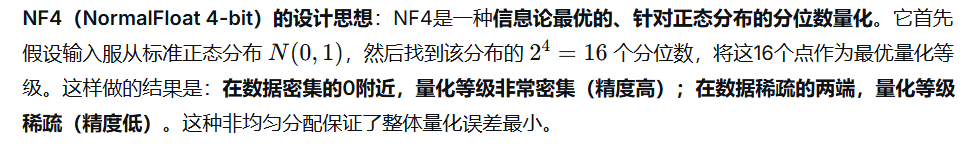
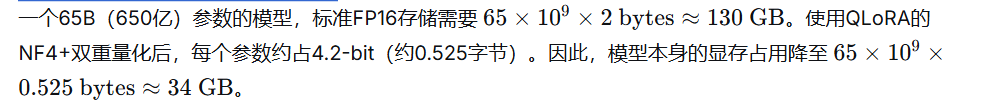
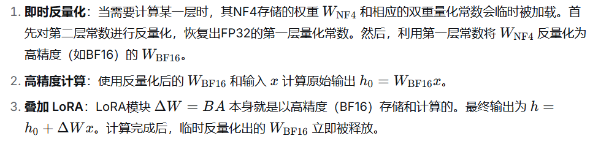

# 55.大模型（LLMs）QLoRA（量化 LoRA）

#### QLoRA 是如何在保持 LoRA 效果的同时，大幅降低显存占用的？核心技术有哪些？

QLoRA能在保持LoRA效果的同时大幅降低显存，其本质是实现了一次“精度与成本的解耦”。它将模型参数的存储和计算分离：参数以极低精度（4-bit）存储，极大节省显存；但在前向和反向传播时，将其反量化为高精度（如BF16）进行计算。这使得模型的核心计算精度几乎没有损失，而存储成本却降至原来的1/4。

其核心技术栈由三大组件构成：

1. NF4量化：一种为服从正态分布权重专设的4-bit量化格式，能以极高精度保留预训练权重中的信息。

2. 双重量化：将量化过程中产生的、本可忽略不计的“量化常数”也进行了量化压缩，进一步榨出显存空间。

3. 分页优化器：一种内存管理技术，在显存接近极限时，利用CPU内存作为后备，自动将部分优化器状态分页到CPU，防止训练因OOM而崩溃。

这三大技术的结合，使得基座模型占用的显存降至原来的四分之一，同时LoRA模块以高精度进行训练，确保了微调效果与标准LoRA相当。

---

#### QLoRA 中使用的 NF4 量化与标准 INT4/INT8 量化有何不同？为什么要专门设计？

标准INT4/INT8是均匀量化，假设数据在一个固定范围内均匀分布。这种设计对大多数数据有效，但对语言模型中的预训练权重并非最优。

预训练权重的分布特性：大量研究发现，语言模型预训练后的权重近似服从均值为0的正态分布（高斯分布）。这意味着，靠近0的权重值极多，而远离0的极值权重非常少。信息密集区在0附近，而不是在两端。

标准均匀量化的缺陷：它将量化区间均匀划分，导致大量量化等级浪费在几乎没有数据点的长尾极值区域，而数据高度密集的0附近却只能分配到很少的量化等级，产生巨大舍入误差，严重破坏模型性能。

**NF4（NormalFloat 4-bit）的设计思想**：NF4是一种**信息论最优的、针对正态分布的分位数量化**。它首先假设输入服从标准正态分布 $N(0,1)$，然后找到该分布的 $2^4=16$ 个分位数，将这16个点作为最优量化等级。这样做的结果是：**在数据密集的0附近，量化等级非常密集（精度高）；在数据稀疏的两端，量化等级稀疏（精度低）**。这种非均匀分配保证了整体量化误差最小。

{.ocr-src}

因此，专门设计NF4，是为了让量化过程本身与模型权重的内在分布完美匹配，从而在极限的4-bit精度下，最大程度保留模型“智慧”。

---

#### 什么是双重量化（Double Quantization）？它在 QLoRA 中如何进一步节省内存？

双重量化是QLoRA在显存优化上的“精益求精”，其目标是对量化过程中产生的额外开销进行二次压缩。

量化常数的开销：标准量化将一个高精度张量转换为低精度，但同时需要为每64个权重（一个block）存储一个高精度的“量化常数”（通常是FP32的缩放因子）。这些常数虽然单个很小，但对一个175B的模型，累积起来也会占用数GB的显存。

双重量化的工作流程：

1. 第一次量化：对模型权重进行NF4量化，产生NF4权重和第一层FP32量化常数。

2. 第二次量化：将这些第一层FP32量化常数收集起来，作为新的待量化对象。然后，对它们进行第二次量化——通常是量化为FP8。同时，产生更小的第二层量化常数。

通过这种“连环压缩”，存储量化常数的显存开销被再次大幅降低。最终，一个参数的实际显存占用，从标准的FP16的2字节，降到了约4.2-bit的极致水平，其中4-bit是权重，约0.2-bit是经过双重量化压缩后的量化常数。

---

#### QLoRA 为什么能将 65B 模型在单张 48GB GPU 上微调？给出显存分析。

这归功于QLoRA将基座模型的显存压缩了4倍，而LoRA微调本身又避免了保存基座模型的梯度和优化器状态。以下是详细分析。

1. 基座模型参数显存（极致压缩后）

一个65B（650亿）参数的模型，标准FP16存储需要 $65\times10^9\times2\text{ bytes}\approx130\text{ GB}$。使用QLoRA的NF4+双重量化后，每个参数约占4.2-bit（约0.525字节）。因此，模型本身的显存占用降至 $65\times10^9\times0.525\text{ bytes}\approx34\text{ GB}$。

{.ocr-src}

2. LoRA 可训参数开销（极小）

假设使用秩 r=16 的LoRA，可训参数量约为模型总参数的0.1%-0.5%。这部分参数及其对应的梯度和优化器状态（BF16/FP32），总计约需 2-5 GB。

3. 其他开销

激活值、临时缓冲区等约需 5-8 GB。

总显存占用 = 34 GB (量化基座) + 4 GB (LoRA) + 7 GB (激活等) ≈ 45 GB。

这个峰值显存完全在单张48GB显存的GPU（如RTX A6000）所能承受的范围内。若使用分页优化器，还可进一步降低峰值风险。相比之下，标准LoRA（FP16基座）微调65B模型需要约130GB（基座）+ LoRA开销，远超单卡极限。

---

#### QLoRA 分页优化器（Paged Optimizer）如何利用统一内存来避免 OOM？

分页优化器是一种软件层面的内存管理技术，它不节省总内存，但能通过内存交换，防止GPU在内存峰值时溢出（OOM）。

“统一内存”机制：现代NVIDIA驱动允许GPU在自身显存不足时，自动将暂时不用的数据分页交换到CPU内存中，当GPU需要时再换入。这就像一个缓冲区。

分页优化器的工作原理：在深度学习训练中，显存占用存在波动。模型参数和激活值在大部分时间是稳定的，但优化器在更新步骤时会瞬间需要大量额外显存来处理梯度统计量。分页优化器会监控GPU显存使用情况。当检测到优化器更新操作可能导致显存溢出时，它会主动将当前优化器状态的一部分（例如某些层的动量值）自动分页到CPU内存。更新完成后，再将它们换回GPU。

价值：这项技术为训练过程提供了一个“安全气囊”。它不提升训练速度，也无法压缩模型，但能在显存濒临极限时防止程序崩溃，让原本刚好处于OOM边缘的训练任务得以平稳运行。对于在单卡上微调65B模型这种近乎“极限运动”的场景，分页优化器是保证任务成功的关键保障。

---

#### 使用 QLoRA 训练时，前向和反向传播过程中，量化参数是如何反量化计算的？

QLoRA的前向和反向计算遵循“即时反量化，高低精度分离”原则，以保证计算精度。

前向传播过程：

1. **即时反量化**：当需要计算某一层时，其NF4存储的权重 $W_{\mathrm{NF4}}$ 和相应的双重量化常数会临时被加载。首先对第二层常数进行反量化，恢复出FP32的第一层量化常数。然后，利用第一层常数将 $W_{\mathrm{NF4}}$ 反量化为高精度（如BF16）的 $W_{\mathrm{BF16}}$。
2. **高精度计算**：使用反量化后的 $W_{\mathrm{BF16}}$ 和输入 $x$ 计算原始输出 $h_0=W_{\mathrm{BF16}}x$。
3. **叠加 LoRA**：LoRA模块 $\Delta W=BA$ 本身就是以高精度（BF16）存储和计算的。最终输出为 $h=h_0+\Delta Wx$。计算完成后，临时反量化出的 $W_{\mathrm{BF16}}$ 立即被释放。

{.ocr-src}

反向传播过程：\
反向传播时，梯度的计算路径与标准LoRA一致。由于原始权重 $W_0$ 被冻结，反向传播的梯度只会流经并更新高精度的 LoRA 参数 $A$,$B$，不会流向量化后冻结的 W NF4 及其常数。这完美地保护了LoRA参数学习的纯度，使其不受量化误差的干扰。

---

#### QLoRA 的 NF4 量化如何设置分块大小（block size）？对精度和内存的影响。

分块大小是NF4量化中一个重要的权衡超参数。它定义了量化时将权重矩阵切分为多少个连续元素为一组。

- 分块的必要性：权重矩阵中每64个连续元素为一组，共享一个量化常数。这是因为一个超大矩阵中不同区域的权重分布可能差异巨大，全局共享一个量化常数会导致巨大误差。分块让量化能更好地适应当地数据分布。

- 对精度的影响：分块越小，量化精度越高。更小的块意味着量化常数能更精细地捕捉局部数据的统计特征，重构误差更小。但分块过小（如16）也会带来风险，因为组内样本太少，统计量（如最大值）不稳定，可能导致量化常数本身成为噪声。

- 对内存的影响：分块越小，内存开销越大。因为更多的块意味着需要存储更多的量化常数。例如，一个4096×4096的矩阵，分块大小为64时需存储262,144个常数；若分块大小降为16，则常数数量增至1,048,576，是原来的4倍。

- 业界标准：Block Size = 64 是经过大量实验验证的、在精度与开销之间的最佳平衡点。它既能提供足够精细的局部适应性以保持模型精度，又不至于让量化常数的存储开销显著影响到4-bit压缩带来的巨大收益。

---

#### QLoRA 中，基本权重保持 4-bit 量化存储，而 LoRA 参数通常以什么精度训练？为什么？

在QLoRA中，LoRA的可训练参数通常以BF16或FP32的高精度进行训练和存储。这是为了保证微调效果与标准LoRA一致的核心设计决策。

原因一：精确捕捉微小更新。LoRA的目标是学习一个低秩的“修正量” $\Delta W$。这个修正量相比于基座权重本身就非常微小。如果用低精度（如FP8）去训练LoRA参数，梯度更新的微小变化极易因舍入误差而丢失，导致LoRA学习失败或严重退化。

原因二：隔离量化误差。QLoRA的核心哲学是“低精度存储，高精度计算，高精度更新”。基座模型的量化误差被限制在它自身的前向计算中，不能污染到需要高保真度的参数更新过程。保持LoRA参数的高精度，确保了优化器是在一个“干净”、“精确”的信号上进行微调。

原因三：与标准LoRA保持一致性。这确保了QLoRA的研究者们在微调时，可以复用标准LoRA的超参数经验（如学习率、优化器配置），而无需为适应低精度参数更新而重新调参。这使得QLoRA的迁移成本极低。

---

#### 比较 QLoRA 和标准 LoRA 在训练速度、内存占用和最终性能上的差异。

| 维度 | 标准 LoRA | QLoRA | 分析 |
| --- | --- | --- | --- |
| 内存占用 | 很高 (1x) | 极低 (约1/4) | QLoRA通过NF4+双重量化将基座模型压缩至约4.2-bit，是其最核心的优势。 |
| 训练速度 | 较快 (1x) | 较慢 (约0.5x-0.7x) | 主要瓶颈在于每一步前向传播都需要实时反量化FP16权重，引入了额外计算开销。 |
| 最终性能 | 优秀 (基线) | 几乎无损 (与基线可比) | 大量实验表明，QLoRA在多数任务上可以达到与标准LoRA近乎相同的性能。其内置的随机量化噪声有时甚至能起到正则化效果，略微提升泛化能力。 |

结论：

- 标准LoRA：是“性能优先”的选择，适用于显存充裕的场景。

- QLoRA：是“效率优先”的王者。它用大约30%-50%的训练速度损失，换来了约75%的显存占用降低。这使得在消费级硬件上微调超大模型成为可能，是单卡或资源受限环境下的终极解决方案。在内存瓶颈远大于时间瓶颈的大模型时代，QLoRA是不可或缺的利器。

---

#### 如何配置 QLoRA 的 bitsandbytes 参数？写出关键配置项。

QLoRA 的核心依赖库是 `bitsandbytes`。在使用 Hugging Face `transformers` 时，通过 `BitsAndBytesConfig` 类进行配置。以下是关键配置项的详细说明和典型示例。

```python
from transformers import BitsAndBytesConfig

bnb_config = BitsAndBytesConfig(
    # 1. 核心：加载模型的基本精度
    load_in_4bit=True,                      # 必须设为True，启用4-bit量化加载
    bnb_4bit_quant_type="nf4",              # 指定量化数据类型为 NormalFloat 4-bit
    bnb_4bit_compute_dtype=torch.bfloat16,  # 计算时反量化为何种高精度。BF16是首选，兼容性好

    # 2. 双重量化：进一步压缩量化常数
    bnb_4bit_use_double_quant=True,         # 启用双重量化，显著节省显存，几乎无损

    # 3. 加载与设备映射
    device_map="auto",                      # 自动将模型层分配到可用GPU上
    # 或者手动指定: device_map={"": 0}
)
```

关键配置项解释：

- `load_in_4bit`：这是开启QLoRA大门的钥匙。设为`True`，模型权重将以4-bit格式加载，显存占用直接降至FP16的1/4。

- `bnb_4bit_quant_type`：指定量化的数据类型。必须设为`"nf4"`。NF4是专门为预训练权重的正态分布设计的信息论最优量化格式，其精度远超标准INT4。

- `bnb_4bit_compute_dtype`：这是计算精度。权重在存储时是4-bit，但在执行矩阵乘法等运算时，会被实时反量化为这里指定的高精度（通常为`torch.bfloat16`或`torch.float16`）。强烈推荐使用BF16，因为它的动态范围与FP32相同，训练更稳定，不易出现梯度溢出/下溢。

- `bnb_4bit_use_double_quant`：是否启用双重量化。设为`True`后，量化过程本身产生的“量化常数”会被再次量化（FP8），进一步节省约0.4 bytes/param的内存。这是QLoRA的标配。

- `device_map`：在多卡或大模型场景下至关重要。`"auto"`能利用accelerate库自动将模型各层分配到不同GPU上，实现基本的流水线并行，解决单卡显存不足的问题。

---

#### QLoRA 训练中，梯度检查点和混合精度如何配合？需要注意什么？

QLoRA、梯度检查点（Gradient Checkpointing）和混合精度训练这三项技术是“黄金三角”，共同作用可以最大化显存节省。它们配合良好，但需要注意配置顺序和数值稳定性。

- 配合方式：QLoRA解决模型参数的显存；梯度检查点解决激活值的显存；混合精度（如BF16）解决计算速度和数值稳定性。三者是互补关系，可以同时开启。推荐使用`torch.cuda.amp.autocast(dtype=torch.bfloat16)`包裹前向传播，并在模型上调用`model.gradient_checkpointing_enable()`。

- 关键注意事项：
  1. 启用顺序：必须先完成QLoRA的量化模型加载和LoRA适配器注入，再调用`model.gradient_checkpointing_enable()`。因为梯度检查点需要知道完整的模型结构。
  2. 训练精度选择：绝对推荐使用BF16作为计算和训练精度。QLoRA的4-bit反量化数值范围大，BF16拥有与FP32相同的8位指数，能完美覆盖，有效防止溢出。FP16由于其窄动态范围，在QLoRA训练中更容易出现数值不稳定。
  3. 优化器状态精度：即使计算是BF16，优化器状态（如AdamW的动量和方差）通常仍保持FP32。这是为了精确累积微小的更新。
  4. 随机性处理：在使用梯度检查点时，如果模型包含Dropout等操作，务必确保`preserve_rng_state=True`（PyTorch默认），以保证重计算时随机掩码与首次前向一致，避免引入噪声。

---

#### QLoRA 是否支持分布式训练？在多卡环境下如何配置？

QLoRA 完全支持分布式训练，并且在多卡环境下，其配置方式与标准分布式训练高度兼容。

- 数据并行 (DDP/FSDP)：这是最常用的方式。每张卡加载一份完整的QLoRA模型副本，处理不同的数据。由于LoRA可训参数极少，数据并行中的梯度通信开销非常小，效率很高。

- 模型并行 (Tensor/Pipeline Parallelism)：当模型太大，单卡连4-bit权重都放不下时，需要模型并行。QLoRA可以与这些策略配合。通常使用`device_map="auto"`或DeepSpeed ZeRO-3的`offload`功能，将模型层的4-bit权重分片到不同GPU上。

- 多卡环境配置示例（使用HuggingFace `accelerate`库）：

```python
# accelerate config
# 选择多GPU配置，通常使用 "Multi-GPU" 或 "DeepSpeed"
# 无需特殊配置，accelerate 会自动处理量化模型的加载和分发
```

- 多机多卡：配置流程相同，需要指定`--num_machines`, `--main_process_ip`等分布式参数。

- 潜在挑战与解决：
  - 量化常数通信：在模型并行中，双重量化的常数也需要跨设备同步。`bitsandbytes`库内部已处理好这些细节，用户通常无需干预。
  - 负载均衡：在流水线并行中，不同层参数量不同，可能导致负载不均。可通过微调节点分区策略来优化。

---

#### 量化误差累积是否会影响 QLoRA 微调的收敛性和最终效果？如何缓解？

理论上，量化误差会累积。但在QLoRA的架构下，这种误差被精心设计的机制所控制，对收敛性和最终效果的影响微乎其微。QLoRA能成功的关键在于以下设计：

- 误差隔离机制：QLoRA的梯度不会流向量化冻结的基座模型，只流向高精度的LoRA模块。这意味着，量化误差不会污染模型参数的更新过程。模型学习到的“修正量”是基于一个虽然有微小误差但总体正确的基底之上的。

- NF4的极小误差：NF4量化是信息论最优的，它将量化误差最小化。同时，分块量化（block-wise）使得量化能适应局部数据分布，进一步降低了重构误差。

- 内置正则化效应：微小的、零均值的量化噪声，在某些情况下可以起到类似Dropout的正则化作用，有助于提升模型的泛化能力，防止过拟合。

缓解策略（通常不需要）：

如果发现训练异常（如损失震荡、不收敛），可以考虑：

1. 减小学习率：确保学习率适合LoRA的更新幅度。

2. 使用更大的秩 `r`：更强的LoRA容量可能有助于补偿基底模型的轻微误差。

3. 切换为BF16：确保反量化后的计算精度足够，避免FP16动态范围不足导致的额外误差。

---

#### 使用 QLoRA 时，learning rate 等超参是否需要特殊调整？经验法则是什么？

QLoRA超参设置的核心原则是：LoRA参数的学习率可完全复用标准LoRA的经验，而与量化相关的部分（基底模型）无需学习率。

- LoRA 可训参数学习率：这是唯一需要设置的学习率。经验法则与标准LoRA完全相同，通常取 1e-4 到 5e-4 的范围。这个值比全参数微调要高1-2个数量级。可以从`2e-4`开始，结合学习率调度器（如cosine）和warmup（占总步数的5%-10%）使用。

- 量化基底参数学习率：无需设置，因为这些参数已被冻结。

- 其他超参数：
  - 优化器：仍首选AdamW。`betas`等参数保持默认(0.9, 0.999)通常就很好。
  - Batch Size：由于单卡显存大幅节省，通常可以尝试更大的`batch_size`，这有助于稳定训练。
  - 权重衰减：对LoRA参数，通常设一个极小值（如0.001）或直接设为0。不要对量化基底应用权重衰减。

结论：QLoRA 没有引入“QLoRA特定”的超参数。它的调参过程几乎与标准LoRA一样简单。你只需要专注于调整LoRA的秩 `r`、`lora_alpha` 和 `learning_rate` 即可。

---

#### 什么是“量化适配器”？QLoRA 训练后，如何将适配器与量化基础模型结合使用？

“量化适配器”是在 QLoRA 训练后，我们将独立于量化基座模型的 LoRA 适配器称为“量化适配器”。

结合使用方式：

1. 动态加载（标准做法）：服务部署时，首先加载量化后的4-bit基座模型，然后动态加载对应的 LoRA 适配器。这正是 PEFT 库的 `PeftModel.from_pretrained` 方法所做的事情。这种方法灵活，可以随时切换适配器，但每次前向传播时都要计算 LoRA 分支。

2. 合并后使用（推荐，若追求零额外推理延迟）：你可以将训练好的 LoRA 权重合并回其对应的反量化后的高精度基座权重中，然后将合并后的完整模型重新量化并保存。具体步骤为：
  - a. 加载4-bit基座模型和LoRA适配器。
  - b. 执行 `model.merge_and_unload()`。此操作会将所有LoRA权重合并到对应的基座层中，并卸载LoRA模块。此时得到一个完整的高精度模型。
  - c. 将这个高精度模型再次量化为4-bit（或8-bit）并保存。推理时直接加载这个新的量化模型，完全无需LoRA分支，实现了零额外推理延迟，同时保留了QLoRA微调的知识。

---

#### 在推理时，QLoRA 训练的模型如何部署？能否合并权重后转为标准精度？

是的，有这两种部署方式，且各有优劣。

- 方式一：在线合并部署 (LoRA 热插拔)
  - 操作：部署一个4-bit基座模型服务，加载不同LoRA适配器实现“热插拔”。
  - 优点：极其灵活，存储成本低，一个基座可服务无数任务。
  - 缺点：每次推理都有LoRA计算开销，且无法享受纯量化模型的全部加速。

- 方式二：离线合并部署 (合并后量化)
  - 操作：
    1. `model = PeftModel.from_pretrained(base_model, lora_adapter_path)`
    2. `merged_model = model.merge_and_unload()`，得到完整的FP16/BF16模型。
    3. 使用`bitsandbytes`将`merged_model`量化为4-bit或8-bit，保存。
  - 优点：推理时延迟更低，内存更省，可完全享受量化加速。
  - 缺点：失去了LoRA的灵活性。

结论：推荐方式一用于需要服务多个微调任务的动态场景，方式二用于对延迟和成本要求极致的单一任务部署场景。

---

#### QLoRA 对不同模型架构（仅解码器、编码器-解码器）的兼容性如何？

QLoRA 对这两种主流架构都有良好的兼容性，但应用中各有侧重。

- 仅解码器模型 (如 GPT, LLaMA, Mistral)：这是 QLoRA 应用最广泛、最成熟的领域。LoRA 通常作用于自注意力层的 Q、K、V、O 矩阵，以及部分FFN层。得益于仅解码器模型的统一架构，适配过程非常直接。

- 编码器-解码器模型 (如 T5, BART)：QLoRA 同样适用，但需要分别考虑编码器和解码器的适配。
  - 适配器位置：可以为编码器和解码器分别指定不同的 `target_modules`。通常，对编码器和解码器的自注意力和交叉注意力层应用LoRA是常见的做法。
  - 训练目标：在微调此类模型时，通常只对解码器输出的目标序列计算损失，这与标准微调一致。LoRA的参数更新也仅限于这个优化目标。

结论：无论哪种架构，只要你能在 HuggingFace 中使用 `model.named_modules()` 找到需要注入的线性层名称，就能对其应用 QLoRA。

---

#### 分析 QLoRA 的计算开销：反量化操作对训练吞吐的影响有多大？

QLoRA 的训练吞吐量低于标准 LoRA，其主要瓶颈就是前向传播中的实时反量化操作。

- 额外开销来源：对于模型中每一个被量化的线性层，在每次前向传播时，都需要执行一个自定义的 CUDA 内核，将4-bit权重和双重量化的常数动态反量化为计算精度。这个操作是计算密集型的，会导致训练变慢。

- 影响幅度：通常，QLoRA 的训练吞吐量是标准 LoRA 的 50% 到 70%。换句话说，训练速度会慢 30% 到 50%。具体数值取决于模型大小、硬件性能和 batch size。

- 影响因素：
  - 模型大小：模型越大，需要反量化的层和参数越多，开销越大。
  - 硬件性能：在更快的 GPU（如 H100）上，计算速度更快，反量化的相对开销占比可能会降低。
  - Batch Size：较大的 batch size 能更好地隐藏延迟，提高吞吐。

结论：QLoRA 的核心是用时间换空间。它牺牲了约 30%-50% 的训练速度，换取了高达 75% 的显存压缩。这是一种极具性价比的权衡。

---

#### 在 RLHF/DPO 等偏好对齐任务中，使用 QLoRA 进行 Actor 训练有哪些注意事项？

将 QLoRA 用于对齐阶段（RLHF/DPO）是节省成本的绝佳实践，但需要注意以下事项。

- 多模型管理：RLHF 的 PPO 阶段需要同时维护Actor、Critic、Reference和Reward四个模型。QLoRA可以将Actor和Critic的基座进行量化，并共享同一个冻结的4-bit基座，而各自加载独立的LoRA适配器。Reference和Reward模型可以保持高精度。这可以极大地降低对齐阶段的显存峰值。

- 数值稳定性：RLHF/PPO 训练本身对数值就非常敏感。QLoRA 引入的量化噪声可能会加剧这种不稳定性。强烈建议：
  - 计算精度务必使用 BF16，避免 FP16 的动态范围不足。
  - 谨慎设置学习率，PPO 的学习率通常远低于 SFT，需要精确调整。
  - 密切监控 KL 散度，防止策略偏离过远导致崩溃。

- DPO 的天然优势：DPO 不需要 Critic 和在线采样，与 QLoRA 结合更为稳定和简单。只需量化 Actor 基座和参考模型基座即可，与标准 QLoRA SFT 的复杂度相当。

---

#### QLoRA 中的双重量化节省了多少内存？理论值与实际值对比。

双重量化是针对量化常数的二次压缩，其内存节省量清晰且可计算。

- 理论节省量：以 Block Size = 64 为例，一个 FP32 的量化常数是 4 字节，分摊到块内 64 个 4-bit（0.5字节）的权重上，每个参数分摊的常数开销是 `4 bytes / 64 = 0.0625 bytes`。双重量化将这些 FP32 常数量化为 FP8（1字节），此时每个参数分摊的常数开销变为 `1 byte / 64 ≈ 0.0156 bytes`。因此，每个参数节省了约 `0.0625 - 0.0156 = 0.0469 bytes`。对于一个 65B 的模型，理论节省为 `65 × 10^9 × 0.0469 bytes ≈ 2.8 GB`。

- 实际值与对比：
  - 无量化 (FP16)：`65B × 2 bytes = 130 GB`。
  - 标准4-bit量化 (NF4 only)：`65B × 4 bits = 260 Gb / 8 = 32.5 GB`。外加 FP32 量化常数开销约 `65B × 0.0625 bytes ≈ 4 GB`。总计约 36.5 GB。
  - 4-bit + 双重量化 (NF4 + DQ)：权重仍是 32.5 GB。双重量化常数开销约 `65B × 0.0156 bytes ≈ 1 GB`。总计约 33.5 GB。
  - 实际节省：双重量化相比标准NF4，额外节省了约 3 GB 的显存。在一个48GB的显卡上，这3GB可能就是你能否成功加载模型并留下足够空间给激活值的关键。因此，双重量化是一项“精益求精”的关键优化。

