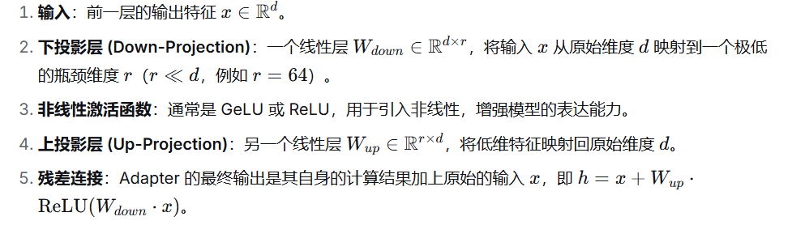
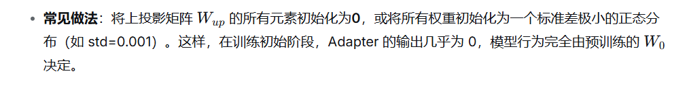

# 56.大模型（LLMs）Adapter

#### Adapter 层的典型结构是什么？画出插入到 Transformer 中的位置。

Adapter 的典型结构是一个带有瓶颈层的双层全连接网络，它被插入到 Transformer 的各个层之间。

典型结构（自底向上）：

1. **输入**：前一层的输出特征 $x\in\mathbb{R}^d$。
2. **下投影层 (Down-Projection)**：一个线性层 $W_{down}\in\mathbb{R}^{d\times r}$，将输入 $x$ 从原始维度 $d$ 映射到一个极低的瓶颈维度 $r$（$r\ll d$，例如 $r=64$）。
3. **非线性激活函数**：通常是 GeLU 或 ReLU，用于引入非线性，增强模型的表达能力。
4. **上投影层 (Up-Projection)**：另一个线性层 $W_{up}\in\mathbb{R}^{r\times d}$，将低维特征映射回原始维度 $d$。
5. **残差连接**：Adapter 的最终输出是其自身的计算结果加上原始的输入 $x$，即 $h=x+W_{up}\cdot\mathrm{ReLU}(W_{down}\cdot x)$。

{.ocr-src}

插入到 Transformer 中的位置（经典 Houlsby 风格）：

每个 Adapter 模块被放置在 Transformer 层的两个特定位置，紧跟在多头自注意力和前馈网络（FFN）的残差连接之后。一个标准的 Transformer 层结构如下：

```plain text
输入 x
  ├──→ 多头自注意力 (Multi-Head Self-Attention)
  ├──→ 残差连接 + 层归一化 (LayerNorm)
  ├──→ 【Adapter 模块 1】 ← 插入在此处
  ├──→ 前馈网络 (FFN)
  ├──→ 残差连接 + 层归一化 (LayerNorm)
  ├──→ 【Adapter 模块 2】 ← 插入在此处
  └──→ 输出 h
```

这种设计使得 Adapter 成为一个独立的“插件”，能够对每一个 Transformer 层的输出进行微调，但又不会破坏原有模型的计算流。Pfeiffer等人提出了更高效的变体，只在 FFN 之后插入一个 Adapter，也能达到与 Houlsby 风格相近的效果，并且推理延迟更低。

---

#### Adapter 中的瓶颈（bottleneck）设计是如何减少参数量和计算量的？

瓶颈（Bottleneck）设计是 Adapter 实现参数高效的核心，其原理是将一个大的线性变换分解为两个连续的、维度更小的线性变换。

**数学原理**：

一个标准的全连接层（无瓶颈）的权重矩阵大小为 $d\times d$，其参数量为 $d^2$。Adapter 将这个变换分解为：

{.ocr-src}

1. 下投影：$d$×$r$ 矩阵，将维度从 $d$ 降到 $r$。

2. 上投影：$r$×$d$ 矩阵，将维度从 $r$ 升回 $d$。\
   其中 $r$≪$d$ 是瓶颈维度。Adapter 模块的总参数量为 d×r+r×d=2dr

效率分析：\
以一个 d=768 的 Transformer 层为例。

- 一个标准全连接层的参数量约为 768×768=589,824。

- 一个瓶颈维度 $r=64$ 的 Adapter，其参数量为 2×768×64=98,304。\
  Adapter 的参数量仅为标准全连接层的 16.7%。这种设计不仅大幅减少了需要存储和更新的参数，也显著降低了计算量，使得微调过程可以在资源受限的环境下高效进行。

---

#### 为什么 Adapter 需要残差连接？去掉残差连接会有什么影响？

Adapter 中的残差连接 h=x+f(x)是其能够稳定、有效工作的重要保障。其作用和去掉它的影响可以从以下几个方面理解：

1. 提供恒等映射，保证训练起点的正确性：在微调开始时，Adapter 的参数通常被初始化为一个近似恒等映射（例如，通过将下投影和上投影的权重初始化为接近0的值）。残差连接确保此时 Adapter 的输出 h≈x，模型的初始状态与原始预训练模型完全一致。这为微调提供了一个极其稳定的起点。

2. 缓解梯度消失，加速训练收敛：深层网络的梯度需要通过多层反向传播。残差连接为梯度提供了一条“高速公路”，使其能绕过Adapter模块直接流向浅层，有效缓解了梯度消失问题，使得深层网络中的Adapter也能被有效训练。

3. 实现增量学习，防止灾难性遗忘：残差连接允许Adapter学习的是相对于原始特征 x 的一个“修正项” f(x)，而不是直接替代它。原始特征 x 中包含的通用知识被完整保留。即使Adapter更新了参数，也只是在对原始知识进行微调或补充，而不是覆盖，因此能天然地防止灾难性遗忘。

如果去掉残差连接，Adapter 的输出就变成了 h=f(x)。此时，Adapter 必须从零开始学习一个全新的表示来替代 x。这会导致训练初期极其不稳定，极易破坏预训练模型已学到的良好特征，引发灾难性遗忘，并且使优化变得更加困难。

---

#### Adapter 与 LoRA 在注入位置、参数形式和训练方式上有何异同？

| 维度 | Adapter | LoRA |
| --- | --- | --- |
| 注入位置 | 串行插入 Transformer 的子层之后（如注意力和FFN之后），作为独立的处理模块。 | 并行应用于 Transformer 的子层内部，与原始的权重矩阵（如Q, K, V, O）并联。 |
| 参数形式 | 结构化的小网络，通常包含下投影、非线性激活和上投影。 | 两个低秩矩阵的乘积 BABA，是纯线性变换。 |
| 训练方式 | 基座模型被冻结，只训练 Adapter 模块的所有参数。 | 基座模型被冻结，只训练低秩矩阵 A 和 B。 |
| 推理延迟 | 会增加额外的推理延迟，因为数据必须串行地流经新增的 Adapter 层。 | 可以实现零额外推理延迟。因为训练后可以将 BA 合并回原始权重 W 中。 |
| 模型容量 | 相对更大，表达能力更强，可以学习更复杂的非线性变换。 | 相对更小，参数效率更高，但表达能力受限于低秩假设。 |

本质区别：Adapter 是在模型外部添加了完整的函数单元，而 LoRA 是在模型内部对权重的更新量进行低秩分解。前者是一种结构化的“插件”方法，后者是一种非结构化的“权重修正”方法。

---

#### 比较 Adapter 和全参数微调在训练稳定性和最终性能上的差异。

训练稳定性：Adapter的训练稳定性远高于全参数微调。因为Adapter的初始状态是一个近似的恒等映射，模型的优化起点与原始预训练模型完全相同，因此训练过程非常平滑。相比之下，全参数微调在训练初期由于所有参数都可变，会面临更大的损失波动风险。

最终性能：全参数微调由于释放了整个模型的表达能力，在追求极致性能的上限时仍然具有优势。Adapter通过在每一层注入非线性模块，其理论表达能力非常强。在很多任务上，Adapter可以达到与全参数微调非常接近，甚至在某些场景下持平的性能。尤其是在数据量充足、瓶颈维度 r 设置得当时，Adapter的表现十分优异。

结论：Adapter 提供了一种介于 LoRA 的极简和全参数微调的高成本之间的优质选择。它通过牺牲少量的推理延迟和增加一定的参数量，换取了强大的表达能力和接近全参数微调的性能上限。

---

#### 串联式 Adapter（如 Houlsby）与并联式 Adapter 有什么区别和优劣？

两种设计在数据流和计算并行性上有本质区别。

串联式 Adapter (Houlsby)：

- 位置：串行地插入在注意力层和FFN层之后。

- 数据流：`x -> Layer -> LayerNorm -> Adapter -> 下一阶段`。

- 优势：设计直观，表达能力强。

- 劣势：显著增加推理延迟。因为Adapter模块必须在层的输出计算完成后才能被调用，增加了网络的串行深度。

并联式 Adapter (Parallel Adapter)：

- 位置：与 Transformer 的注意力层或FFN层并行放置。

- 数据流：`h = W_0 x + f(x) + Adapter(x)`。Adapter 模块与原始分支同时计算，最终进行求和。

- 优势：可以实现几乎零额外推理延迟。因为Adapter分支的计算可以与原始分支的计算完全重叠，在GPU等并行计算硬件上，这部分额外计算的延迟几乎可以被完美隐藏。

- 劣势：表达能力和对原始特征流的“调控”能力可能略弱于串联式。

总结：串联式 Adapter 是功能的“增强器”，效果上限更高但速度慢；并联式 Adapter 是计算的“并行加速器”，效率更高但可能效果稍逊。在对延迟敏感的部署环境中，并联式 Adapter 是更优的选择。

---

#### 如何在 Transformer 的不同层使用共享或独立的 Adapter？

这是一个可以灵活配置的设计选择，需要在参数效率和模型容量之间进行权衡。

1. 独立 Adapter (Per-Layer Adapter)：

- 配置：为Transformer的每一层都分配一个独立的 Adapter模块。这是最标准、效果最好的配置。

- 优势：每个Adapter可以专门学习其所在层所需的特定特征变换，表达能力最强，性能上限最高。

- 劣势：总参数量随层数线性增长（但远小于全参数微调）。

2. 共享 Adapter (Shared Adapter / Across-Layer Adapter)：

- 配置：整个模型中所有层共享同一个 Adapter模块（或一组）。Adapter必须学会处理来自不同层的、语义差异巨大的输入。

- 优势：参数量极其小，与模型深度无关。

- 劣势：表达能力受限，可能成为一个性能瓶颈。

3. 混合策略 (Grouped Adapter)：

- 配置：将模型深度划分为几个组（如浅层组、中层组、深层组），每个组共享一个Adapter。

- 优势：在参数效率和性能之间取得良好的平衡。这是实践中非常有效的一种方案。

实现方式：在代码实现中，只需在定义 Adapter 层时，决定是为每个 Transformer 层创建一个新的 Adapter 实例，还是让它们引用同一个 Adapter 实例即可。

---

#### Adapter 的多任务学习：如何为每个任务训练单独的 Adapter，并实现任务间的知识迁移？

Adapter 在多任务学习中是功能强大且灵活的组件，可以实现任务间的完全隔离，也能实现高效的知识共享。

1. 任务隔离 (Task Isolation)：这是最直接的应用。为每个下游任务（如翻译、摘要）独立训练一个 Adapter 模块，所有任务共享一个冻结的基座模型。

- 部署：在服务时，根据任务需求动态加载对应的 Adapter。由于 Adapter 参数极小（几MB），切换几乎是瞬时的。

- 优势：完美避免了灾难性遗忘，不同任务间的 Adapter 完全物理隔离。

2. 知识迁移 (Knowledge Transfer)：

- Adapter 微调 (Adapter-Tuning on a New Task)：可以先在一个源任务上训练一个 Adapter，然后将这个 Adapter 作为初始化，在目标新任务上进行微调。这能有效利用源任务学到的知识，加速目标任务的收敛。

- Adapter 融合 (AdapterFusion)：这是一个高级概念。可以训练一个“融合层”，学习如何将多个独立任务的 Adapter 的输出进行组合，以解决一个全新的、更复杂的任务。这实现了真正的知识融合与复用。

举例：在金融领域，你可以先训练一个通用的金融文本理解 Adapter，然后为“情绪分析”和“风险识别”这两个具体任务分别训练各自的 Adapter。在部署时，可以灵活切换。未来出现“金融诈骗预警”任务时，可以基于通用的金融 Adapter 快速微调，或者融合前面两个任务的 Adapter 来初始化新 Adapter。

---

#### Adapter 的初始化和激活函数如何选择？常见做法是什么？

Adapter 的初始化和激活函数的选择直接关系到训练的稳定性和最终效果。

1. 初始化策略 (Initialization Strategy)：\
   目标：确保 Adapter 在训练开始时表现为一个近似的恒等映射，即 $h$≈$x$。这是保证微调从一个稳定的起点开始的关键。

- **常见做法**：将上投影矩阵 $W_{up}$ 的所有元素初始化为**0**，或将所有权重初始化为一个标准差极小的正态分布（如 std=0.001）。这样，在训练初始阶段，Adapter 的输出几乎为 0，模型行为完全由预训练的 $W_0$ 决定。

{.ocr-src}

2. 激活函数 (Activation Function)：

- 常见选择：GeLU 或 ReLU。

- GeLU：在Transformer类模型（如BERT）中更常见，因为它提供了平滑的非线性，性能通常略优。

- ReLU：计算更简单，也是一种有效选择。

- SwiGLU (门控变体)：在一些现代变体中，会使用带门控的激活函数（如 SwiGLU）来进一步增强 Adapter 的表达能力。

- 关键点：激活函数必须放置在下投影层之后、上投影层之前，以引入必要的非线性。

---

#### 推理时，Adapter 是否增加延迟？如果会，如何通过结构优化或计算优化减少开销？

是的，标准的串行 Adapter 会不可避免地增加推理延迟。这是因为 Adapter 层被插入到 Transformer 的残差路径上，导致网络深度增加，数据必须串行流经 Adapter 模块。每一层的额外计算叠加起来，就会产生可观的延迟。

为了减少这种开销，可以从结构和计算两个层面进行优化：

- 结构优化（改变 Adapter 的拓扑结构）：
  1. 并联式 Adapter (Parallel Adapter)：将 Adapter 模块与原始层的计算并行放置。公式变为 `h = W_0 x + Adapter(x)`。由于 Adapter 分支与主分支的计算互不依赖，在 GPU 等并行硬件上，这两个分支的计算可以完全重叠执行。主分支计算完成时，Adapter 分支也基本完成，最终的加法操作开销极小，从而实现几乎零额外推理延迟。
  2. 移除或合并层：最简单的策略是只在最后几层插入 Adapter，而不是全部层。这直接减少了 Adapter 模块的数量。或者，对已经训练好的 Adapter 进行网络剪枝，移除贡献小的参数，让模块变得更稀疏。

- 计算优化（保持结构不变，加速计算本身）：
  1. 内核融合 (Kernel Fusion)：利用深度学习编译器（如 TensorRT）或手写 CUDA 内核，将 Adapter 的“下投影 -> 激活 -> 上投影”这一系列连续操作，连同其残差连接，融合为一个单一的、优化的 GPU 内核。这极大地减少了 GPU 内核启动开销和数据在显存中的频繁读写，是推理引擎中常用的加速手段。
  2. 量化与低精度计算：对 Adapter 模块自身的权重进行 INT8 量化，并将其计算也置于低精度下，可以加速其推理速度，同时不影响已经量化的基座模型。

---

#### Adapter 与 Prefix Tuning 的原理对比：都是插入额外参数，根本区别在哪？

虽然两者都是在冻结基座模型上添加少量可训参数，但它们的作用部位和调控机制完全不同，这导致了它们在效果和应用上的巨大差异。

- Adapter：调控模型的“内部计算”。\
  Adapter 被插入到 Transformer 层的内部。它直接干预每一层处理过的特征表示。这相当于给每一层模型都配备了一个微调工具，可以对特征进行复杂的非线性变换。Adapter 学到的是一种“通用任务技能”，其效果是全局性的。

- Prefix Tuning：调控模型的“外部输入”。\
  Prefix Tuning 在输入序列的最前端拼接上一系列可训练的“虚拟 Token”。这些 Token 的 Key-Value 向量会作用于自注意力机制，以一种持续的、上下文式的方式引导模型的注意力焦点和生成方向。它并不修改每一层的内部计算，而是为模型提供一个“持久的任务上下文”。Prefix Tuning 学到的是一种“任务引导”，其效果是连续性的。

根本区别：

- Adapter 是“结构内嵌”，它对模型的修改是结构性的、深度耦合的。这使得它表达能力强，但会显著改变模型结构，增加推理延迟。

- Prefix Tuning 是“输入增强”，它对模型的修改是输入层的、松耦合的。它更容易实现多任务的热插拔，且不改变模型结构，但表达能力相对较弱。

---

#### 为什么 Adapter 在 BERT 时代非常流行，但在现代大模型 SFT 中逐渐被 LoRA 取代？

这是一个技术演进与工程需求相互作用的结果。Adapter 在 BERT 时代成功，正是因为解决了当时的痛点；而在 LLM 时代被 LoRA 取代，则是因为 LLM 带来了新的、更严苛的需求。

- BERT 时代的适配需求与 Adapter 的契合：\
  BERT 通常被用于分类、序列标注等理解任务。这类任务对推理延迟的要求相对宽松（几十毫秒的差异不明显）。Adapter 额外增加的网络深度导致的延迟，在此场景下并非主要矛盾。同时，Adapter 在实验中展现出了与全参数微调可比的效果，成为了一个很好的选择。

- LLM 时代的核心挑战与 LoRA 的优势：
  1. 对推理延迟的零容忍：LLM 的核心应用是自回归生成，推理延迟是决定用户体验的核心指标。LoRA 最革命性的优势在于，其权重可以合并回原始模型，从而在部署时实现零额外推理延迟，这是 Adapter 无法比拟的。
  2. 极致的参数效率与存储成本：LLM 的规模动辄数十亿甚至万亿参数。LoRA 通过低秩分解，将可训参数量控制在一个极低的水平（例如，可以只占模型的 0.1%），生成的适配器文件体积极小。而 Adapter 由于其结构性的存在，要达到同样的性能通常需要更多的参数和更大的适配器文件。
  3. 与注意力机制的天然适配：LLM 的能力极度依赖于其自注意力机制。LoRA 直接作用于 Q、K、V 等注意力矩阵，能够以最直接、最高效的方式调整模型的信息检索和聚合行为，这是 Adapter 这种间接干预方式难以企及的。

结论：Adapter 是“功能优先”时代的优秀产物，而 LoRA 是“效率优先”时代的最佳选择。LoRA 的零推理延迟、极致的参数效率和与 LLM 核心机制的完美适配，使其成为了现代 SFT 中近乎标准的技术方案。

---

#### 在视觉 Transformer 或扩散模型中，Adapter 有哪些应用？

Adapter 的思想在视觉领域同样大放异彩，因为它能高效地将大型预训练视觉模型适配到各种下游任务。

- 在视觉 Transformer (ViT) 中的应用：
  1. 多任务学习与分类：一个在 ImageNet 上预训练的 ViT 基座，可以通过为不同任务（如细粒度分类、目标检测、语义分割）训练独立的 Adapter 模块，来实现“一模型多用”。
  2. 密集预测任务：Adapter 在目标检测和语义分割等任务中表现出色。这类任务需要从图像中提取高分辨率的空间特征，而 ViT 原始的分类特征图分辨率较低。通过在 ViT 层间插入 Adapter，可以有效地调整其特征表示，使其更好地适应密集预测任务的需求。
  3. 多模态学习：在视觉-语言模型（VLM）中，可以在视觉编码器（ViT）中插入 Adapter，使得大型语言模型（LLM）能够更高效地理解视觉特征。这种方法比微调整个 ViT 或 LLM 更具参数效率。

- 在扩散模型 (Diffusion Models) 中的应用：
  1. 可控图像生成与风格化微调：这是 Adapter 在 AIGC 中最成功的应用之一。开发者可以为特定的风格、对象或角色训练一个小型 Adapter 模块，并将其插入到预训练的扩散模型（如 Stable Diffusion）中。这使得模型能够生成包含特定元素的图像，而无需重新训练或修改庞大的基座模型。
  2. LoRA 的视觉版：在 Stable Diffusion 的微调中，社区通常使用的“LoRA 模型”在概念上非常接近 Adapter，其原理都是插入并训练少量额外参数来控制生成结果。这证明了 Adapter 及其思想在跨模态领域的强大生命力。

---

#### 如何通过合并或压缩多个 Adapter 形成一个多能力模型？

合并多个 Adapter 的能力是实现“多任务统一模型”的关键，主要有以下几种策略：

- Adapter 集成 (Ensemble)：这是最简单的方法。在推理时，同时激活多个任务的 Adapter，并将它们的输出结果进行聚合（如投票、求平均等）。这种方法直接但计算开销较大，且各 Adapter 之间缺乏协作。

- Adapter 融合 (AdapterFusion)：这是一种更高级的技术。它不直接使用单一 Adapter，而是学习一个专门的“融合”模块。该模块会学习如何根据输入的任务或上下文，动态地、有选择性地组合多个 Adapter 的输出来完成新任务。这实现了真正的知识复用和迁移，但需要额外的训练数据。

- 模型蒸馏 (Distillation)：另一种思路是，用多个单独训练的 Adapter（作为“教师”）在一个大型数据集上生成标注，然后用这些标注数据去微调一个新的、单一的大模型，将多个 Adapter 的集体智慧“蒸馏”到一个模型中。

- 参数平均 (Weight Averaging)：对于相同的基座模型，可以对多个 Adapter 的权重进行直接的算术平均（如 Souping）。这种方法简单粗暴，但有时能产生意想不到的好效果，因为它结合了多个微调模型的鲁棒性。

---

#### 讨论 Adapter 的稀疏激活方案，如 MoE 风格的 Adapter。

将混合专家（MoE）的思想与 Adapter 结合，可以实现模型的动态路由和更大的适配容量，同时保持推理效率。

- 核心思想：在每一层，不是只有一个 Adapter，而是维护一个 Adapter 池。引入一个轻量级的门控网络，对每一层的输入进行评估，然后动态地决定激活池中的哪一个（或哪几个）Adapter。

- MoE-Adapter 的工作流程：
  1. 一个 token 的表示 `x` 进入该层。
  2. 门控网络 `G(x)` 计算一个概率分布，决定如何路由到专家。
  3. 对于 Top-k 路由，只有得分最高的 k 个 Adapter 被激活，它们的输出根据门控得分进行加权求和。其他 Adapter 保持休眠。

- 优势：
  - 巨大的模型容量：可容纳数百甚至数千个专家，总参数量巨大，但每次推理计算量几乎不变。
  - 任务专精与自动路由：不同的专家可以专精于不同类型的数据（如“法律专家”、“医疗专家”）。模型可以在推理时自动判断用户提问，并路由到正确的专家模块。
  - 灵活性与扩展性：可以随时添加新的专家来适应新任务，而不会影响已有专家。

---

#### 分析 Adapter 在序列任务（如序列标注、生成）中的表现是否与分类任务一致。

Adapter 在这两类任务上都能取得很好的效果，但因其任务特性的不同，优化的重点和面临的挑战有所差异。

- 在分类任务中：\
  代表：情感分析、文本分类。Adapter 在这里的表现非常稳定和优秀，因为它可以直接基于 `[CLS]` token 的最终表示进行工作，能够很好地捕捉任务特定的特征。

- 在序列标注任务中：\
  代表：命名实体识别 (NER)。Adapter 同样表现出色。因为它对每一层的输出都进行了微调，这有助于保留对定位实体边界至关重要的细粒度 token 级信息。重点：Adapter 的精细特征微调能力在此是关键。

- 在生成任务中：\
  代表：文本摘要、机器翻译。Adapter 在此领域也有效，但面临一个核心挑战：推理延迟。生成任务需要自回归地逐个 token 产生输出，对推理延迟非常敏感。因此，在此任务中，并联式 Adapter 或 LoRA 等几乎不增加延迟的方法更具优势。尽管如此，Adapter 的结构化插拔特性使得为不同领域定制生成模型变得非常方便。

---

#### Adapter 是否可以与 LoRA 叠加？如果这样做，潜在的问题是什么？

技术上完全可以，两者是正交关系，可以直接叠加使用。但实践中需要谨慎处理，以避免问题。

- 叠加方式：在同一个线性层，可以同时注入 Adapter（插入在其后）和 LoRA（并联在其旁）。两者的训练梯度完全独立。

- 优势：
  - 表达能力互补：Adapter 提供非线性的特征变换，LoRA 提供低秩的权重修正，两者结合可能会带来超出单一方法的性能上限。
  - 模块化分工：可以用 Adapter 学习通用领域知识，用 LoRA 学习具体任务的指令遵循能力，两者互不干扰。

- 潜在问题与缓解：
  1. 训练不稳定：两种模块同时训练，可能导致优化目标冲突，梯度震荡。建议分阶段训练：先训练一个模块，冻结后再训练另一个。
  2. 显存占用增加：同时存在两个模块，会消耗更多显存。对于资源敏感场景，需评估性价比。
  3. 推理延迟叠加：如果 Adapter 是串行的，它会额外增加延迟，而 LoRA 可以合并。推荐：使用并联式 Adapter 与 LoRA 结合，最大化隐藏推理延迟。
  4. 超参数调节更复杂：两者的学习率、初始化等需要更精细的协调。可以沿用各自的标准配置作为起点。

---

#### 训练 Adapter 时，学习率通常如何设置？是否需要比全参数微调更大的学习率？

是的，Adapter 的学习率通常需要比全参数微调大，但幅度不如 LoRA 那样显著。

- 原理：Adapter 模块是从头开始训练的，而全参数微调的起点是已经训练好的预训练权重。因此，Adapter 需要相对较大的学习率来快速学习有效的任务表示。同时，Adapter 强大的残差连接和接近于0的初始化，也为使用更大的学习率提供了安全保障，避免了训练初期的巨大扰动。

- 经验法则：对于 AdamW 优化器，一个典型的起点是 1e-4 到 5e-4。这比全参数微调的典型学习率（1e-5 到 5e-5）大约高一个数量级。比 LoRA 的学习率（常为 2e-4 到 1e-3）范围稍窄。实践中，可以先从 2e-4 开始尝试，并配合余弦退火和 warmup 来稳定训练。

- 注意事项：如果只使用 Adapter 进行分类任务，学习率可以设置在推荐范围内；如果将它插入较深层的模型或者与其他模块共用，则可能需要适当降低学习率。

---

#### 在 Adapter 训练中，如何避免“死 Adapter”现象（即输出始终为零）？

“死 Adapter” 是指 Adapter 模块的输出始终为零或接近于零，导致它完全不参与模型推理，成为无效参数。这通常发生在训练初期或使用了不当的初始化/学习率。

- 现象原因：
  1. 学习率过大：过高的学习率可能导致参数在优化早期被推向一个“死区”。
  2. 初始化不当：虽然零初始化是标准做法，但如果训练信号过弱，参数可能无法被有效激活。
  3. 梯度消失：在极深网络中，流向 Adapter 的梯度可能消失，使其无法更新。

- 避免方法：
  1. 适当提高学习率：与直觉相反，有时需要稍微加大学习率，以提供更强的梯度信号，将 Adapter 从“沉寂”中拉出来。
  2. 改进初始化：如果标准零初始化无效，可以尝试使用极小方差的正态分布（如 std=1e-4）来初始化，为参数提供微小的初始扰动。
  3. 监控 Adapter 参数范数：在训练时，监控 Adapter 模块的权重范数。如果发现范数长时间维持在极低水平且波动极小，就可以判断为“死亡”，需要调整策略。
  4. 梯度裁剪：防止某些异常样本产生极大的梯度，将 Adapter 的参数推向极端值。

---

#### 如何评价 Adapter 的模块化特性？这对模型更新和 A/B 测试有何价值？

Adapter 的模块化是其除参数高效性之外，最具工程价值和应用前景的特性。它将模型能力与模型主体解耦，为 AI 系统的开发和运维带来了革命性的便利。

- 模块化特性本身：Adapter 将“任务知识”外化到了独立的、微小的、即插即用的模块中。这使得一个通用的基座模型可以被无数次复用，只需要组合不同的 Adapter 就能实现不同的功能。

- 对模型更新的价值：
  1. 独立更新，快速迭代：需要提升某个特定能力（如减少幻觉）时，只需更新对应的 Adapter，而无需重新训练或部署整个大模型。这使模型迭代速度发生质变。
  2. 故障隔离，影响可控：一个 Adapter 的更新出现问题，只会影响它自己负责的那部分功能，而不会导致整个模型崩溃。这种故障隔离机制极大降低了上线风险。
  3. 轻松实现“模型遗忘”：只需删除对应的 Adapter，就能完全移除模型在特定任务上的能力，而无需进行昂贵的反学习训练。

- 对 A/B 测试的革命性价值：
  1. 低成本的并行测试：可以同时为同一个模型开发 A、B 两个版本的 Adapter，并在生产流量中轻松进行 A/B 测试。由于它们共享一个基座模型，测试的成本极低。
  2. 精细化的灰度发布：新功能可以先对一小部分用户开放，只需为他们加载新 Adapter 即可。
  3. 无限的回滚能力：如果新版本效果不佳，可以瞬间切换回旧版本的 Adapter，实现毫秒级的无损回滚。

结论：Adapter 的模块化，将模型开发从“构建巨石”转变为“组装乐高”。它为 AI 系统带来了软件工程中梦寐以求的敏捷性和灵活性。

---

#### Adapter 的容量由瓶颈维度控制，如何选择合适的维度？过小或过大有什么后果？

瓶颈维度 `r` 是控制 Adapter 容量的核心超参数，其选择直接影响模型性能和效率。

- 如何选择 `r`：
  - 任务复杂度：复杂任务（如对话生成）需要更大的 `r`（如 64-256），简单任务（如文本分类）用小 `r`（如 8-32）就足够。
  - 基座模型规模：大模型预训练权重蕴含的信息更丰富，通常可以选用更小的 `r`。
  - 数据量：数据量越大，越需要更大的容量来防止欠拟合。
  - 经验法则：从一个较小的 `r`（如 32）开始实验。通过小规模网格搜索（例如，测试 r=16, 32, 64, 128），观察性能的饱和点。选择那个刚刚达到性能平台期的最小 `r` 值，就是你的最优解。

- `r` 太小的后果（欠拟合）：\
  如果瓶颈维度设置得过小，Adapter 模块的表达能力会受到严重限制。它将无法捕捉下游任务所需的复杂模式，导致模型微调不足，性能无法达到最优，出现欠拟合。

- `r` 太大的后果（收益递减与过拟合）：\
  当 `r` 超过一个临界点后，继续增加 `r` 带来的性能提升会非常微小，甚至可能因为引入了过多参数而导致过拟合，损害模型的泛化能力。同时，过大的 `r` 也意味着更多的参数量和更高的计算开销，会逐渐丧失 Adapter 的参数高效优势。

