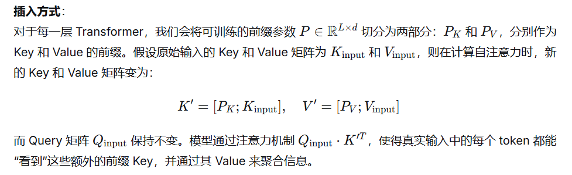
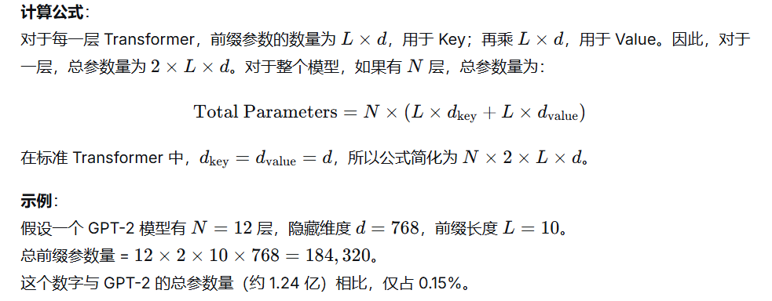
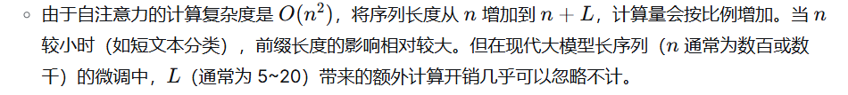
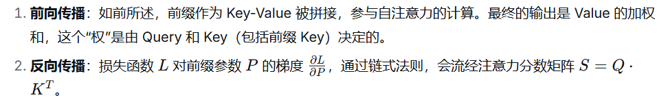

# 57.大模型（LLMs）Prefix Tuning

#### . 解释 Prefix Tuning 的核心思想：什么是可训练的“前缀”？

Prefix Tuning 的核心思想源于一个洞察：给语言模型一个合适的“上下文”，就能引导它完成特定的任务。

传统的微调方法（如全参数微调）会改变模型内部的权重来适配新任务。而 Prefix Tuning 不修改模型本身的任何参数，它只是在输入文本之前，拼接上一系列可训练的、连续的高维向量。这些向量就像是给模型的一个“软提示”或“任务指令”，它们的作用是在每一层自注意力机制中，持续地影响模型对后续真实输入（如用户问题）的关注方式和信息聚合方式。

这些可训练的向量就是所谓的“前缀”（Prefix）。它不是由词表中的词组成的离散文本，而是一组在连续空间中任意取值的“虚拟 Token”。通过优化这组前缀，模型学会了如何针对特定任务去“解读”输入，从而完成生成或理解任务。这就像给一位专家（基座模型）提供了一份详细的任务说明书（前缀），他就能出色地工作，而不需要被重新培训。

---

#### 在 Prefix Tuning 中，prefix 是如何插入到模型每一层的？只插入 key-value 还是包括 query？

前缀向量的插入位置非常关键，它被设计为只作用在每一层 Transformer 的 Key 和 Value 矩阵上，而不直接作用于 Query 矩阵。

**插入方式**：

对于每一层 Transformer，我们会将可训练的前缀参数 $P\in\mathbb{R}^{L\times d}$ 切分为两部分：$P_K$ 和 $P_V$，分别作为 Key 和 Value 的前缀。假设原始输入的 Key 和 Value 矩阵为 $K_{\mathrm{input}}$ 和 $V_{\mathrm{input}}$，则在计算自注意力时，新的 Key 和 Value 矩阵变为：

$$
K'=[P_K;K_{\mathrm{input}}],\quad V'=[P_V;V_{\mathrm{input}}]
$$

而 Query 矩阵 $Q_{\mathrm{input}}$ 保持不变。模型通过注意力机制 $Q_{\mathrm{input}}\cdot K'^T$，使得真实输入中的每个 token 都能“看到”这些额外的前缀 Key，并通过其 Value 来聚合信息。

{.ocr-src}

为什么只插入 Key 和 Value？

这源于自注意力机制的数学原理。Query 代表“我在寻找什么”，Key 代表“我可以提供什么信息”，Value 代表“我实际含有的信息”。前缀的作用是为真实输入提供一个持久的“任务上下文”。通过在 Key 和 Value 中添加虚拟 Token，我们相当于告诉模型：“在执行这个任务时，请时刻记得参考这些背景信息”。而 Query 保持不变，意味着模型仍然根据真实输入的内容去进行查询和推理。这种设计使得前缀能够在不干扰模型原有推理逻辑的前提下，高效地调控其行为。大量的实验也证明，只插入到 Key 和 Value 的效果最好，插入到 Query 或同时插入所有矩阵反而可能导致性能下降。

---

#### Prefix Tuning 的 prefix 参数数量如何计算？与序列长度和隐藏维度是什么关系？

前缀参数量完全由两个因素决定：前缀的序列长度（$L$） 和模型的隐藏维度（$d$）。

**计算公式**：

对于每一层 Transformer，前缀参数的数量为 $L\times d$，用于 Key；再乘 $L\times d$，用于 Value。因此，对于一层，总参数量为 $2\times L\times d$。对于整个模型，如果有 $N$ 层，总参数量为：

$$
\mathrm{Total\ Parameters}=N\times\left(L\times d_{\mathrm{key}}+L\times d_{\mathrm{value}}\right)
$$

在标准 Transformer 中，$d_{\mathrm{key}}=d_{\mathrm{value}}=d$，所以公式简化为 $N\times2\times L\times d$。

**示例**：

假设一个 GPT-2 模型有 $N=12$ 层，隐藏维度 $d=768$，前缀长度 $L=10$。

总前缀参数量 $=12\times2\times10\times768=184,320$。

这个数字与 GPT-2 的总参数量（约 1.24 亿）相比，仅占 0.15%。

{.ocr-src}

关系：参数量与 序列长度成正比，与 隐藏维度成正比。在实际操作中，前缀长度是核心超参数，其影响显著。在一般任务中，前缀长度设得很小（例如 L=5∼20）就能获得良好的效果。若设得太长，不仅会增加参数量和计算成本，还可能导致过拟合，因为前缀占据了过多上下文空间。通常，我们会根据任务复杂度和可用资源，在小规模实验中寻找效果饱和的最小 $L$ 值。

---

#### 为什么 Prefix Tuning 通常使用一个重参数化技巧（MLP 网络）来生成 prefix，而不是直接学习？

直接学习前缀参数（即直接存储并优化 $P$ 矩阵）在高维、非凸的优化空间中会面临极大挑战。引入一个重参数化网络（通常是小型 MLP）是解决这一问题的关键。

直接学习的困境：\
如果直接优化 $P$ 矩阵，优化器需要在一个 N×2×L×d的高维空间中找到一个最优解。这种高维空间的损失曲面极度崎岖，优化过程会非常不稳定，且极易陷入局部最小值，导致前缀的训练效果不佳。

重参数化技巧的工作原理：\
我们引入一个小型 MLP 网络 fθ，它接收一个随机初始化的输入，然后生成前缀矩阵 P=fθ(z)。这个 MLP 是实际的被训练对象。训练完成后，我们丢弃这个 MLP，只保存其生成的最终前缀矩阵 $P$ 用于推理。

- 平滑优化曲面：MLP 网络起到了一个“正则化器”或“编码器”的作用。它将高维空间中直接优化 $P$ 的难题，转化为训练一个容量更小的网络 fθ 去学习如何生成好的 $P$。这极大地平滑了优化曲面，使得梯度下降更加稳定和高效。

- 知识压缩与泛化：MLP 强制将不同层的、高维的前缀参数压缩到一个低维的网络参数空间中。这种压缩有助于过滤掉噪声，学习到不同层之间共通的、更本质的任务模式，从而提升了泛化能力。

- 类比理解：这就像直接画一幅复杂的画（直接学习）很难，但如果给你一套绘画技巧和模板（MLP），你再去画就简单得多。最终我们只保留画作本身，丢弃技巧指南。

---

#### Prefix Tuning 与 Prompt Tuning 的主要区别是什么？为什么需要插入到每一层？

两者的核心区别在于插入的深度和作用的机制。

- Prompt Tuning：只在模型的输入层拼接可训练的 Embedding。它的作用深度很浅，相当于只给模型一个初始的“软提示词”。这个提示词经过一层层的 Transformer 处理后，其影响力会逐渐减弱。它主要适用于规模极大（>10B）的模型，因为大模型有更强的能力去理解这个浅层提示。

- Prefix Tuning：在模型的每一层都插入可训练的 Key-Value 向量。它的作用深度很深，是一个贯穿整个模型的、持续的调控信号。这使得它能够有效干预模型在每一个抽象层次上的信息处理过程。

为什么 Prefix Tuning 需要插入到每一层？

这是为了让前缀能够像人类的“任务意识”一样，持续引导模型的行为。语言模型在浅层处理语法，在深层处理语义和逻辑。如果只在输入层添加前缀，经过多层抽象后，原始的任务指令可能被稀释甚至扭曲。通过将前缀注入到每一层，我们相当于在每个处理阶段都提醒模型：“别忘了，你现在是在做这个任务”。这种深层、持续的调控是 Prefix Tuning 在模型规模较小、或处理复杂任务时，效果显著优于 Prompt Tuning 的根本原因。可以说，Prefix Tuning 是“深度引导”，而 Prompt Tuning 是“浅层提示”。

---

#### 训练 Prefix Tuning 时，需要注意哪些数值稳定性问题？

是的，由于前缀是在连续空间中任意取值的向量，其数值可能不受控，因此在训练中容易出现稳定性问题。以下是关键点及其解决方案：

1. 前缀数值范围失控：直接优化的前缀向量，其绝对值可能会变得非常大。当这些大向量作为 Key 和 Value 时，会主导注意力分数的计算，导致 softmax 输出极度尖锐（接近 one-hot），从而引发梯度消失。
  - 解决方案：通常会在生成前缀的 MLP 网络的最后一层使用 Tanh 激活函数，将输出限制在 [−1,1] 范围内。这有效防止了数值爆炸。

2. 训练初期的不稳定性：在训练开始时，随机初始化的前缀可能会严重“污染”原始输入的表示，导致损失剧烈波动。
  - 解决方案：学习率预热是必不可少的。在训练的前几百步，将学习率从 0 缓慢提升到设定值，让模型平稳度过初始的适应期。同时，使用合适的学习率（通常比全参数微调高，如 1e-4 到 5e-4）和梯度裁剪。

3. MLP 网络的退化：用于重参数化的 MLP 可能自身训练困难。
  - 解决方案：对 MLP 应用标准的正则化（如 Dropout）、合理的初始化以及梯度裁剪。

---

#### Prefix Tuning 对生成任务（如摘要、对话）和自然语言理解任务的适用性如何？

Prefix Tuning 在生成任务和 NLU 任务上都表现出色，但由于其机制特点，其优势领域和效果略有不同。

- 生成任务（摘要、对话、翻译）：这是 Prefix Tuning 的核心优势领域。生成任务通常需要模型具备一个“全局意识”，例如摘要的风格、对话的个性或翻译的目标语言。Prefix Tuning 通过向每一层注入持续的信号，天然地为模型提供了一个“任务身份的锚点”，能够很好地控制生成内容的风格、领域和逻辑。在低资源场景下，它能够高效地利用少量数据就教会模型以特定的模式进行生成。

- 自然语言理解任务（分类、NER）：Prefix Tuning 同样适用，但其效果可能不如在生成任务中那样具有压倒性优势。对于简单的分类任务，只需要在输入层添加少量前缀就足够了。对于需要细粒度 token 级别判断的任务（如 NER），深层的前缀可以帮助模型更好地定位关键信息，效果通常会优于 Prompt Tuning。但通常，在拥有充足标注数据的情况下，Adapter 或 LoRA 等方法在 NLU 任务上的综合效果和调参便利性可能更好。

---

#### 为什么 Prefix Tuning 在某些任务上效果优于全参数微调，尤其是低资源场景？

这背后有两个核心原理：参数效率带来的天然正则化和对预训练知识的完美保留。

1. 极强的正则化，防止过拟合：全参数微调拥有巨大的参数空间，当训练数据稀缺时，模型极易记住训练集中的噪声和表面模式，导致严重过拟合。而 Prefix Tuning 只优化极少量参数（通常不到模型总参数的 1%），模型的搜索空间被极大地限制。这种限制本身就是一种极强的正则化，迫使模型必须学习数据中通用的、本质的模式，而不是死记硬背。因此，它在低资源场景下的泛化能力远超全参数微调。

2. 完美保留预训练知识，避免灾难性遗忘：全参数微调会修改整个模型的参数，极易破坏模型在预训练阶段学到的宝贵的语言知识和推理能力。而 Prefix Tuning 完全冻结基座模型，其内部的所有知识库都原封不动。前缀模块只是学会了如何“调用”或“引导”这些已有的知识。因此，微调后的模型不仅在新任务上表现良好，其强大的通用能力也得以完整保留。

结论：Prefix Tuning 就像一个稳健的“统帅”，用极少的新信息（前缀）去指挥一支强大的、原封不动的“军队”（基座模型），从而在小规模的局部战争中取得胜利。而全参数微调则是将整支军队进行重组和再训练，极容易在数据不足时导致军队“水土不服”和“遗忘技能”。

---

#### Prefix Tuning 的推理开销：相比无 prefix 的模型，增加了多少计算量？

Prefix Tuning 的推理开销主要来自于自注意力机制的输入序列变长，以及由此引发的计算量增加。这笔开销通常很小，且可以忽略不计。

计算量增加来源：

在标准的自注意力机制中，计算复杂度是 $O(n^2\cdot d)$，其中 $n$ 是序列长度。Prefix Tuning 在每一层都将序列长度从 $n$ 增加到 $n+L$（$L$ 是前缀长度）。因此，单层注意力的计算量增长比例大约为 $\left(\frac{n+L}{n}\right)^2$。

{.ocr-src}

开销分析：

1. 实际增加极小：在典型的推理场景中，用户输入的序列长度 $n$ 通常很大（例如，几百到几千个 token），而前缀长度 $L$ 非常小（通常为 5 到 20）。因此，长度增加的比例极低，计算量增加几乎可以忽略不计。

2. 无额外模块：与需要增加网络层数的 Adapter 不同，Prefix Tuning 没有引入任何新的计算模块。它只是“借用”了原有的注意力机制。

3. 高效的缓存：在自回归生成中，我们可以预先计算好前缀的 Key 和 Value，并将其缓存，后续解码时直接复用，无需重复计算。

结论：Prefix Tuning 的推理开销是线性且可控的，远低于 Adapter 等串行方法。其核心代价是占用了一小部分 KV 缓存空间，而对总计算延迟的影响微乎其微，是一种“高性价比”的微调方法。

---

#### 如何选择 prefix 长度？长度对模型性能和训练速度有何影响？

前缀长度 $L$ 是 Prefix Tuning 最核心的超参数，它直接决定了可训参数量的大小，并影响模型的性能和效率。

- 对模型性能的影响：
  - $L$ 过小：表达能力不足。前缀提供的“任务上下文”信息量太少，无法有效引导模型完成复杂任务，导致性能不佳，表现为欠拟合。
  - $L$ 过大：收益递减，且存在风险。增加长度带来的性能提升会进入一个平台期，边际效益急剧下降。同时，过长的前缀会占据有限的上下文窗口，挤占真实输入的空间，反而可能损害模型对长文本的处理能力。更重要的是，过大的参数量增加了过拟合风险，尤其是在数据量较少的情况下。

- 对训练速度的影响：

- 由于自注意力的计算复杂度是 $O(n^2)$，将序列长度从 $n$ 增加到 $n+L$，计算量会按比例增加。当 $n$ 较小时（如短文本分类），前缀长度的影响相对较大。但在现代大模型长序列（$n$ 通常为数百或数千）的微调中，$L$（通常为 5~20）带来的额外计算开销几乎可以忽略不计。

{.ocr-src}

- 选择策略：
  - 任务特性：复杂的生成任务（如多轮对话）通常比简单分类任务需要更长的前缀来捕捉足够的任务信息。
  - 模型规模：更大的模型（如 70B）由于其内在表示能力更强，往往可以用比小模型（如 7B）更短的前缀达到同等效果。
  - 经验法则：可以从一个较小的值（如 $L$=10）开始实验。通过小规模网格搜索（例如，测试 L=5, 10, 20, 50），观察验证集性能的饱和点。选择那个刚好达到性能平台期的最小 $L$ 值，这是效率与效果的最佳平衡点。

---

#### 在解码器中，prefix 会同时影响自回归生成的每一步吗？分析其工作机制。

是的，前缀会持续影响解码器自回归生成的每一步，并且这种影响是贯穿始终的。

工作机制分析：

在解码器的自回归生成中，模型的输入序列会随着新 token 的不断生成而动态增长。前缀被固定地拼接在输入序列的最前端。因此，无论生成进行到哪一步，在每一层 Transformer 计算自注意力时，当前生成的 token（Query）都会“看见”所有历史 token，包括那个始终处于序列最前端的前缀（Key, Value）。

这意味着，前缀作为一个恒定的、持久的信号源，参与了每一轮新 token 的生成决策。它为整个生成过程提供了一个“背景色”或“目标导向”，确保了最终生成的文本在风格、内容和逻辑上都能与最初的任务指令保持一致。这解释了为什么 Prefix Tuning 在控制生成质量方面非常有效。

---

#### Prefix Tuning 与 LoRA 能否结合？设计一种组合方案。

完全可以，而且这种强强联合的方案通常能取得超越单一方法的效果。

- 核心思想：将 Prefix Tuning 的“全局任务引导”能力与 LoRA 的“局部权重修正”能力相结合。Prefix 负责设定任务的整体上下文和风格，LoRA 则负责精细调整模型内部的信息处理逻辑。

- 组合方案设计：
  1. 独立训练，联合推理：这是最灵活的方案。首先，为下游任务分别训练一个 Prefix 模块和一个 LoRA 模块。然后，在推理时将它们同时加载到冻结的基座模型上。由于两者作用的机制和位置不同，它们可以协同工作且互不干扰。
  2. 联合训练：将 Prefix 和 LoRA 参数同时设为可训练状态，进行端到端微调。这种方式可能会让两者产生更好的协同效应，达到更优的性能，但需要协调好两者的学习率等超参数，避免优化冲突。

- 分工优势：
  - Prefix 擅长处理“软件”指令，如控制生成风格、完成特定对话任务等。
  - LoRA 擅长处理“硬件”升级，如注入新的领域知识、优化对特定数据结构的理解等。

---

#### 在多任务学习中，如何用 Prefix Tuning 实现任务特定的前缀共享和差异化？

Prefix Tuning 在多任务学习中非常灵活，可以轻松实现从完全隔离到广泛共享的各种策略。

- 完全独立：为每个任务训练一个完整、独立的前缀。这保证了任务间的完全隔离，不会产生干扰，但参数量随任务数量线性增长。

- 完全共享：所有任务共享同一个前缀。这迫使前缀学习一个通用的任务表示，参数量最小，但可能无法完全满足特定任务的需求。

- 混合共享（最推荐）：将前缀矩阵沿特征维度 $d$ 拆分为两部分：一个维度较小的共享前缀 P shared，和一个维度较大的任务特定前缀 P task_i。每一层的最终前缀是两者的拼接。这种设计既能通过共享部分学习跨任务的通用知识，又能通过独立部分保留每个任务的独有特性，在参数效率和模型能力之间取得了极佳的平衡。

---

#### 实现 Prefix Tuning 的代码：如何修改 HuggingFace 模型的 attention 计算以纳入 prefix？

实现 Prefix Tuning 的核心在于修改模型每一层的自注意力计算，将可训练的前缀向量拼接在原始输入的 Key 和 Value 之前。

核心代码逻辑 (以 PyTorch 为例)：\
你不需要重写整个 `attention` 层，只需在 HuggingFace 模型的前向传播中，在调用 `attention` 之前，对你的 Query, Key, Value 矩阵进行修改即可。

```python
# 假设你有一个可训练的参数 self.prefix_keys 和 self.prefix_values
# 其形状为 (batch_size, num_heads, prefix_len, head_dim)
# 你的原始输入经过线性层后，得到的 Q, K, V 矩阵形状分别为 (batch_size, num_heads, seq_len, head_dim)

def modified_attention_forward(Q, K, V, prefix_keys, prefix_values):
    # 1. 将前缀 Key 和 Value 与原始的 Key 和 Value 沿序列维度（dim=2）拼接
    # 注意：需要先将前缀扩展到与原始输入相同的 batch_size
    batch_size = K.shape[0]
    prefix_keys = prefix_keys.expand(batch_size, -1, -1, -1)
    prefix_values = prefix_values.expand(batch_size, -1, -1, -1)

    K_prime = torch.cat([prefix_keys, K], dim=2)
    V_prime = torch.cat([prefix_values, V], dim=2)
    # Q 保持不变

    # 2. 使用拼接后的 K' 和 V' 以及原始的 Q 执行标准的缩放点积注意力
    attention_scores = torch.matmul(Q, K_prime.transpose(-2, -1)) / math.sqrt(Q.size(-1))
    attention_probs = torch.softmax(attention_scores, dim=-1)
    attention_output = torch.matmul(attention_probs, V_prime)

    return attention_output
```

关键点：你需要确保在训练时，只有 `prefix_keys` 和 `prefix_values` 的梯度被计算，基座模型的其他所有参数都保持冻结。

---

#### 分析 prefix 在注意力机制中的梯度流动，为什么 prefix 能有效控制模型行为？

前缀之所以能有效控制模型行为，是因为它的梯度信号能够直接引导模型在每一层的注意力分布。

梯度流动机制：

1. **前向传播**：如前所述，前缀作为 Key-Value 被拼接，参与自注意力的计算。最终的输出是 Value 的加权和，这个“权”是由 Query 和 Key（包括前缀 Key）决定的。
2. **反向传播**：损失函数 $L$ 对前缀参数 $P$ 的梯度 $\frac{\partial L}{\partial P}$，通过链式法则，会流经注意力分数矩阵 $S=Q\cdot K^T$。

{.ocr-src}

为什么能有效控制行为：

梯度信号会精确地调整前缀 Key 的向量表示，使得在计算注意力分数时，模型能够根据任务需求，学会“何时”以及“多大程度”地去关注前缀。同时，梯度也会调整前缀 Value 的向量表示，使其学会“应该向模型提供什么样的信息”。这种双向优化，使得前缀能够精准地调控模型在每一层的信息聚合，从而实现对模型行为的有效控制。

---

#### 比较 Prefix Tuning 与 P-tuning v2 的异同，后者为何在 NLU 上表现更强？

P-tuning v2 本质上是 Prefix Tuning 在自然语言理解任务上的一个优化和适配版本。它们的根本原理都是在每一层注入可训练的连续向量。

| 特性 | Prefix Tuning | P-tuning v2 |
| --- | --- | --- |
| 核心机制 | 在每一层插入可训练的 Key-Value 前缀 | 与 Prefix Tuning 完全相同 |
| 主要应用领域 | 生成任务（GPT类模型） | 自然语言理解任务（BERT类模型） |
| 注入细节 | 只注入 Key 和 Value | 注入 Key、Value，有时也包括 Query 前缀 |
| 性能表现 | 在生成任务上表现出色 | 经过微调，在 NLU 任务上效果显著优于 Prompt Tuning 和 Prefix Tuning |

为何 P-tuning v2 在 NLU 上表现更强？

这主要是因为它针对 NLU 任务和 BERT 类模型的特性进行了专门优化。

1. 更深的适配：NLU 任务往往需要模型对输入进行深层的语义理解，持续性的深层引导比浅层的提示更重要。P-tuning v2 通过对每一层的干预，完美满足了这一需求。

2. 任务特定的微调：P-tuning v2 通过调整前缀长度、是否作用于 Query 等配置，能够更好地适应各种 NLU 子任务，如文本分类、句子匹配等。

3. 对比实验的充分性：P-tuning v2 的作者在 NLU 任务上进行了充分的消融实验，证明了在每一层添加前缀对于 NLU 任务的重要性，从而确立了其在 NLU 领域的优势地位。

---

#### Prefix Tuning 对 batch size 的敏感性如何？

总的来说，Prefix Tuning 对 batch size 的敏感性低于全参数微调，但高于一些结构化的 PEFT 方法（如 LoRA）。

- 相较于全参数微调：全参数微调由于其巨大的参数空间，在面对不同 batch size 时的训练动态变化剧烈，对 batch size 非常敏感。Prefix Tuning 只优化极少量参数，优化问题的复杂度极大降低，因此它的收敛过程和最终性能在不同 batch size 下表现得更为稳健。

- 相较于 LoRA：LoRA 的优化更直接，可训参数（A, B 矩阵）以线性方式参与前向传播，其梯度流更稳定。而前缀向量因其拼接后参与注意力 softmax 计算，其梯度信号受 softmax 饱和区的影响，对 batch size 的变化可能稍显敏感。

- 实践建议：虽然对 batch size 不极端敏感，但在资源允许的情况下，选择一个适中的 batch size（如 16, 32）通常是稳定训练和获得好效果的保障。过小的 batch size 可能导致训练震荡，过大的 batch size 可能导致模型泛化能力下降。

---

#### 能否使用学到的前缀作为对抗攻击或控制模型输出的工具？

是的，前缀本质上就是一组可以控制模型行为的“软指令”，因此它既能被用于正面优化，也存在被滥用的风险。

- 作为控制工具（正面应用）：可以训练一个“幽默”前缀和一个“严谨”前缀，实现对同一基座模型生成风格的切换。这也是 Prefix Tuning 作为模块化任务适配器的本意。

- 作为对抗攻击工具（负面应用）：既然前缀能引导模型行为，那么恶意攻击者就可以训练一个“越狱”前缀，专门用于诱导模型输出有害内容、泄露隐私或产生幻觉。这种攻击模式被称为“前缀注入攻击”或“软提示攻击”。由于前缀是连续向量，它们甚至比离散的文本提示词更难被传统的基于关键词的安全过滤器发现。

结论：这是一种技术中立的工具，其价值取决于使用者。Prefix Tuning 既带来了前所未有的模型控制灵活性，也引入了新的、更隐蔽的模型安全风险。这要求我们在开发和部署此类模型时，必须建立针对连续特征空间的新的安全检测和防御机制。

---

#### 在持续预训练中，利用 Prefix Tuning 注入新知识的效果如何？

效果有限，不建议将其作为大规模知识注入的主要手段。

原因在于 Prefix Tuning 的模型容量限制。

- 知识存储位置不同：语言模型的知识被认为主要存储在 Transformer 的 FFN 层的庞大权重矩阵中。全参数微调通过更新这些权重来存储新知识。

- Prefix Tuning 的局限：前缀向量主要调控的是注意力机制，即“模型从哪里提取信息”。它擅长的是改变模型的“行为模式”或“信息检索方式”，而不是增加模型“记忆库”中的事实知识。它的可训参数数量级太小，无法承载海量的新知识。

结论：Prefix Tuning 可以用来微调模型，使其更好地利用外部知识库（如 RAG），或者适应一个新领域的语言风格，但无法将一个领域的大量全新事实“写入”模型的参数记忆中。对于知识注入，全参数微调或 LoRA 是更合适的选择。

---

#### 不同层的 prefix 是否可以不同？设计实验验证层间 prefix 共享 vs 独立的影响。

可以，这也是 P-tuning v2 等工作的默认做法（独立前缀）。 是否使用独立前缀是一个需要在参数量与表达能力之间进行权衡的设计选择。

- 共享前缀 (Shared Prefix)：整个模型的所有层都引用同一个前缀张量。
  - 优势：参数量极小，与模型深度无关。
  - 劣势：表达能力受限，无法针对不同层的抽象层次进行精细调控。

- 独立前缀 (Layer-wise Prefix)：为模型的每一层都分配一个独立的前缀张量。
  - 优势：表达能力最强，允许每一层学习到最适合其功能的前缀，是效果最好的配置。
  - 劣势：总参数量与层数 $N$ 成正比（即 N×2×L×d）。

验证实验设计：

1. 任务：选择一个需要深层理解的复杂任务，例如 XSum 摘要生成。

2. 模型：使用 GPT-2-Large (36层, 1280维) 作为基座模型。

3. 配置：
  - 方案 A (共享)：所有层使用同一套可训练的前缀参数，长度 L=10。
  - 方案 B (独立)：每一层都使用独立的前缀参数，长度也为 L=10。
  - 方案 C (混合/分组)：将36层分为浅、中、深三组，每组12层共享一个前缀。

4. 评估指标：ROUGE-L, BERTScore。

5. 预期结果：
  - 性能：方案 B (独立) 最佳，方案 C 次之，方案 A (共享) 最差。
  - 参数量：方案 B 的可训参数量是方案 A 的 36 倍。
  - 结论分析：通过比较性能差距与参数开销，可以量化“每层独立适配”带来的价值。如果方案 B 相比方案 A 提升巨大，说明该任务需要深层的差异化调控；如果提升微小，则说明共享前缀已能胜任，可以采用更经济的方案。

