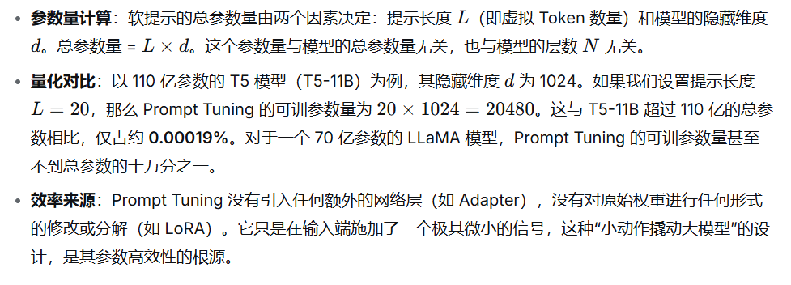
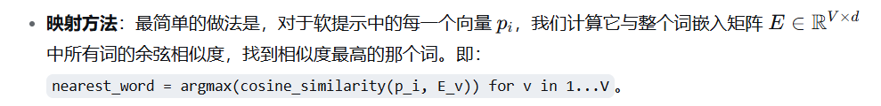

# 58.大模型（LLMs）Prompt Tuning

#### 什么是 Prompt Tuning？与传统的离散 prompt 工程有何本质区别？

Prompt Tuning 的核心思想，是在输入文本的词嵌入（Embedding）之前，拼接上一系列可训练的、连续的、与任务相关的“软提示”向量，然后通过反向传播仅优化这些提示向量，而保持整个预训练模型完全冻结。

它与离散提示工程的本质区别体现在以下三个层面：

1. 优化空间与方法的革命：从“离散搜索”到“连续优化”

离散提示工程是在一个由自然语言词汇构成的离散空间中，通过人类尝试、直觉或启发式搜索来寻找最优提示词。这个过程不可微分，无法利用梯度下降进行高效优化。而 Prompt Tuning 直接在连续的高维向量空间中操作，提示词是“浮点数字”而不是“文字”。这使得优化过程与整个深度学习框架无缝兼容，可以高效地利用梯度下降找到最优解。

2. 提示的表征形式：从“词汇符号”到“连续向量”

离散提示最终会转化为模型词表中的 Token，其表示是模型学好的、固定的词嵌入向量。而 Prompt Tuning 的“软提示”是一组完全自由的、不受任何词汇约束的连续向量。它们可以存在于词嵌入空间的任何位置，甚至可以是人类语言中完全不存在的“概念”。这种自由赋予了模型极大的表达潜力。

3. 知识的来源：从“人类知识注入”到“数据驱动学习”

离散提示完全依赖于人类用自然语言表达任务知识的能力，这是一种“知识注入”。而 Prompt Tuning 完全从下游任务的数据中学习，是一种“数据驱动”的方法。软提示向量通过学习，捕捉到了完成任务所需的最优信号模式，这些模式可能超出了人类语言的表达能力。

---

#### 在 Prompt Tuning 中，软提示（soft prompt）通常加在什么位置？输入嵌入层还是每一层？

在标准的 Prompt Tuning 中，软提示向量只被添加在模型的输入嵌入层。

具体做法是，在将原始输入文本送入模型的第一层之前，在它的词嵌入序列的前面，直接拼接上可训练的软提示向量。这相当于给原始输入添加了一个纯粹的“前缀”信号。然后，这个被扩充过的序列会进入模型的所有后续层进行处理。

这种“只在输入端注入”的设计，与需要在模型每一层都插入额外参数的 Prefix Tuning 形成了鲜明对比。它最大的优势是极致的轻量化和极快的推理速度，因为不改变模型内部任何层的结构和计算。

---

#### Prompt Tuning 只训练一段连续的向量，这些向量如何与词嵌入交互？

这些软提示向量一旦被拼接到输入序列前，它们的交互方式就完全遵循标准的自注意力机制。

我们可以把拼接后的整个输入序列看作一个整体。在 Transformer 的每一层，模型都会计算自注意力分数。原始输入中的每一个词（作为 Query），都会去“看”所有其他词（作为 Key），同时，也会去看所有的软提示向量（作为 Key）。最终每个词的输出表示，是整个序列中所有 Value（包括软提示的 Value）的加权和。

从端到端训练的角度看，软提示向量的梯度更新，会受到它之后所有词和层的影响。反向传播的梯度流会精确地告诉每一个软提示向量：“你应该调整自己的值，以便在后续的注意力计算中，更好地引导模型完成任务”。通过这种数据驱动的方式，软提示向量学会了在连续的向量空间中扮演最优“指令”的角色。

---

#### 为什么 Prompt Tuning 在大型模型上效果接近全参数微调，而在小型模型上效果较差？

这个现象的根本原因在于，不同规模的模型对“指令”的理解能力和依赖程度是不同的。

大型模型（>10B）：拥有巨大的参数容量和强大的表征能力。它们对输入的任何微小扰动都非常敏感，能够从极少量信息（如几个软提示向量）中推断出复杂的任务意图，并调用其内部已存储的丰富知识来完成。此外，大模型的词嵌入空间更平滑、语义更丰富，使得软提示向量更容易找到最优解。

小型模型（<1B）：其参数容量和表征能力有限。仅凭几个软提示向量，可能无法完全“撬动”小模型内部相对匮乏的知识库来执行复杂任务。当模型能力不足时，它需要更大量的参数更新来重塑其内部表示以学习新任务，这正是全参数微调所擅长的。

结论：Prompt Tuning 是一个典型的“遇强则强”的技术，其有效性与模型规模高度正相关。

---

#### Prompt Tuning 的 prompt 长度如何选择？过长或过短各有什么影响？

软提示的长度 $L$ 是 Prompt Tuning 的核心超参数，需要在表达能力和效率之间权衡。

1. 过短：提供的信息太少，无法充分指导模型完成复杂任务，性能会受限。

2. 过长：首先，会占据有限的输入序列长度，对于长文本任务会造成信息丢失。其次，参数更多，优化难度增加，在数据量不足时容易过拟合。最终，性能达到瓶颈，再增加长度收益极低。

选择策略：

- 模型规模：大模型（>10B）只需要很小的长度（例如 5-20），小模型可能需要更长。

- 任务复杂度：复杂任务需要更长的提示。

- 经验法则：从 20 开始，逐步增加，直到验证集性能饱和。对于现代超大模型，100 以内的长度通常就足够了。

---

#### 如何初始化软提示？随机初始化与从词嵌入采样初始化的效果差异。

初始化方法对于训练稳定性和最终性能至关重要。

1. 随机初始化：最常见的高斯分布初始化。简单直接，参数从头学起。

2. 从词嵌入采样：从模型的词嵌入矩阵中，随机采样一些 token 的嵌入向量作为软提示的初始值。这相当于给优化一个“更好的起点”。

效果差异与选择：

- 收敛速度：词嵌入采样初始化通常收敛更快，因为它从一个语义合理的区域开始优化。

- 最终效果：在多数任务上，词嵌入采样初始化能带来更优或可比的效果。但对于一些无法用自然语言很好描述的任务（如特定格式转换），随机初始化可能提供更大的自由度。

- 推荐：为了稳定和快速收敛，优先使用从词嵌入采样初始化。

---

#### Prompt Tuning 与 Prefix Tuning 的核心区别在于插入的位置和层数，请详细对比。

| 特性 | Prompt Tuning | Prefix Tuning |
| --- | --- | --- |
| 核心思想 | 输入端注入可训练的向量 | 每一层注入可训练的 Key-Value 向量 |
| 插入位置 | 仅在输入嵌入层 | 在模型每一层的自注意力模块 |
| 注入组件 | 虚拟 Token 的 Embedding | Key 和 Value 的额外前缀 |
| 参数量 | 极少（L×d） | 相对较多（N×2×L×d） |
| 推理开销 | 几乎为零（仅增加极短输入长度） | 线性增加（在每一层增加计算量） |
| 适用模型 | 极佳（>10B），极简高效 | 广泛适用（各种规模），效果稳定 |
| 本质 | 为模型提供一个“任务软指令” | 为模型提供一个“持久的任务上下文” |

本质区别：Prompt Tuning 是浅层引导，而 Prefix Tuning 是深度调控。这也决定了 Prompt Tuning 更轻量、更快，而 Prefix Tuning 在中小模型和复杂任务上可能效果更强。

---

#### 在分类任务中，Prompt Tuning 如何通过设计 verbalizer 将输出映射到标签？

在分类任务中，仅靠 Prompt Tuning 还不够，还需要一个 Verbalizer，将模型在 `[MASK]` 位置生成的词汇映射回我们预设的类别标签。

工作原理：

1. 构造 Prompt 模板，例如 `[软提示]这是一部[MASK]的电影`，让模型在 `[MASK]` 位置进行预测。

2. 设计 Verbalizer：为每个类别定义一组标签词。例如，将“正面”类别映射为 `{“棒”，“好”，“优秀”}`，将“负面”类别映射为 `{“差”，“烂”，“糟糕”}`。

3. 计算类别概率：模型在 `[MASK]` 位置输出整个词表的概率分布。一个类别的最终得分是该类别所有标签词概率的加权和（或最大值）。

4. 训练与推理：训练时，通过优化软提示向量，让模型输出正确的标签词。推理时，直接根据 Verbalizer 计算出的得分最高类别作为预测结果。

设计要点：标签词应多样且能覆盖不同表达；确保模板自然流畅，让 `[MASK]` 处非常适合填入这些词。

---

#### 多任务 Prompt Tuning：如何为不同任务学习多个软提示，并在推理时灵活切换？

Prompt Tuning 的极轻量特性使得它在多任务场景中如鱼得水，因为任务特定的知识被外化到了极小的参数文件中。

1. 独立软提示：为每个下游任务独立训练一个软提示文件（例如 `prompt_A.pt`, `prompt_B.pt`），所有任务共享一个冻结的基座模型。

2. 推理时灵活切换：当新任务到来时，只加载对应的软提示文件，将其拼接到输入文本前，即可使用。切换几乎瞬时，成本极低，因为不需要加载或移动大型模型文件。这与为每个任务保存完整模型副本的旧范式相比，是革命性的进步。

3. 软提示组合：更进一步，可以尝试对软提示进行线性插值组合。例如，将任务A和任务B的软提示按比例 wA+wB 相加，有时能产生一个兼具两种能力的新模型，实现零样本任务迁移。

---

#### Prompt Tuning 训练需要多少数据？在 few-shot 场景下表现如何？

Prompt Tuning 的数据需求与其方法特性高度相关，它是所有微调方法中对数据量要求最低的方法之一，尤其在 few-shot 场景下具有显著优势。

- 数据需求极低：由于 Prompt Tuning 只优化极少量参数（通常仅数千个），模型的优化空间极小，这本身就构成了极强的正则化。它不需要海量数据来约束参数更新，因此非常适合数据稀缺的场景。即使只有几十或几百个样本，Prompt Tuning 也能有效工作，而全参数微调在这种数据量下早已严重过拟合。

- few-shot 场景表现卓越：在 few-shot 场景下，Prompt Tuning 的优势被发挥到极致。通过精心设计初始化的软提示（如从任务描述词汇的嵌入中采样），模型可以快速收敛到令人满意的性能。实验表明，在只有 32 个训练样本的极端情况下，Prompt Tuning 的性能可以远超同等条件下的全参数微调。这是因为全参数微调的巨大参数空间在 few-shot 下极易过拟合，而 Prompt Tuning 则能保持很好的泛化能力。

- 大规模模型的加持：随着基座模型规模增大（>10B），Prompt Tuning 的 few-shot 能力进一步增强。大模型强大的内在知识使得它能够从极少的软提示信号中“悟出”任务意图，从而用更少的参数和数据完成适配。

---

#### 为什么 Prompt Tuning 被认为是一种极其参数高效的方法？参数量计算。

Prompt Tuning 的极致参数效率源于其极其简单的设计：所有任务知识仅被压缩进一小段连续的软提示向量中。

- **参数量计算**：软提示的总参数量由两个因素决定：提示长度 $L$（即虚拟 Token 数量）和模型的隐藏维度 $d$。总参数量 $=L\times d$。这个参数量与模型的总参数量无关，也与模型的层数 $N$ 无关。
- **量化对比**：以 110 亿参数的 T5 模型（T5-11B）为例，其隐藏维度 $d$ 为 1024。如果我们设置提示长度 $L=20$，那么 Prompt Tuning 的可训练参数量为 $20\times1024=20480$。这与 T5-11B 超过 110 亿的总参数相比，仅占约 **0.00019%**。对于一个 70 亿参数的 LLaMA 模型，Prompt Tuning 的可训练参数量甚至不到总参数的十万分之一。
- **效率来源**：Prompt Tuning 没有引入任何额外的网络层（如 Adapter），没有对原始权重进行任何形式的修改或分解（如 LoRA）。它只是在输入端施加了一个极其微小的信号，这种“小动作撬动大模型”的设计，是其参数高效性的根源。

{.ocr-src}

---

#### Prompt Tuning 的优化难点是什么？训练过程中常见的稳定性问题及解决方法。

Prompt Tuning 的优化难点在于，它的学习目标是在一个高维、非凸的连续空间中寻找最优解，同时要克服梯度信号衰减的问题。

- 常见稳定性问题：
  1. 损失波动与收敛缓慢：由于软提示是从随机状态开始优化的，它在初期会严重“污染”输入表示，导致模型输出混乱，损失值剧烈震荡。
  2. 梯度信号微弱：软提示位于输入层最前端，梯度需要经过整个深层网络才能传回。在极深的模型中，传回的梯度可能过于微弱，导致训练停滞。
  3. 数值溢出：在 FP16 混合精度训练中，如果软提示的数值范围不加控制，进入后续层后可能引发数值溢出。

- 解决方法：
  - 学习率预热：在训练初期使用线性预热，将学习率从 0 缓慢提升到目标值，可以有效缓解损失波动。
  - 合适的优化器与学习率：通常使用 AdamW 优化器。Prompt Tuning 的学习率需要比全参数微调高 1-2 个数量级（如 0.1 到 1.0 的范围），以补偿微弱的梯度信号。
  - 从词嵌入采样初始化：不从随机高斯分布初始化，而是从模型词嵌入矩阵中采样常见词的向量作为软提示的初始值。这为优化提供了一个语义上更合理的起点，显著提升收敛速度和稳定性。
  - 梯度裁剪：对软提示的梯度进行范数裁剪，防止因某一步的极端梯度而破坏训练。
  - 使用 BF16 精度：BF16 的动态范围远大于 FP16，可以有效避免数值溢出问题。

---

#### 如何将任务描述等先验知识融入软提示的初始化？

将人类的先验知识（如任务描述、标签词）融入软提示的初始化，是提升其收敛速度和最终效果的关键技术。这相当于给优化过程一个“专家指导”的起点，而不是从零开始“盲人摸象”。

- 方法一：基于关键词嵌入的初始化。这是最直接有效的方法。假设我们有一个情感分析任务，我们会对任务描述“判断这段话的情感是正面还是负面”进行分词，提取关键词（如“判断”、“情感”、“正面”、“负面”）。然后，从模型的词嵌入矩阵中取出这些词的嵌入向量，作为软提示向量的初始值。如果提取的词多于 $L$ 个，则截断；如果少于，则可以重复或随机采样补足。

- 方法二：基于标签词嵌入的初始化。对于分类任务，我们可以直接将任务标签对应的词（如“好评”、“差评”）的嵌入向量，或者它们的平均/拼接，作为软提示的初始值。这在分类任务中非常有效，因为它直接将软提示锚定在了与最终决策最相关的语义空间附近。

- 方法三：复用相关任务的预训练软提示。如果有一个在类似任务上已经训练好的软提示，可以直接用它来初始化新任务的软提示，或者进行线性插值，实现知识的跨任务迁移。

- 效果：与随机初始化相比，基于知识的初始化通常能带来更快的收敛速度和更高的最终性能，尤其在 few-shot 场景下，这种提升是决定性的。

---

#### 软提示的可解释性：能否将学到的连续向量映射回离散词汇？

软提示的可解释性是一个有趣的开放问题。理论上，我们可以尝试将学到的连续向量映射回最接近的自然语言词汇，但这种映射的精度和意义有限。

- **映射方法**：最简单的做法是，对于软提示中的每一个向量 $p_i$，我们计算它与整个词嵌入矩阵 $E\in\mathbb{R}^{V\times d}$ 中所有词的余弦相似度，找到相似度最高的那个词。即：`nearest_word = argmax(cosine_similarity(p_i, E_v)) for v in 1...V`。

{.ocr-src}

- 挑战与局限：
  1. “语义空洞”：软提示向量可能位于词嵌入空间中词汇分布稀疏的“空洞”区域。它学到的是对多个词汇概念的聚合或折中，其最近的词可能是一个语义上不相干或不准确的选择。
  2. 上下文依赖性：一个软提示向量代表的不只是一个孤立的词，而是在特定上下文中的功能。它最近的自然语言词，可能无法完全表达其复杂的上下文功能。
  3. 映射结果不连贯：将一串软提示向量分别映射回词汇，得到的通常是一串语法不通、意义不明的词序列。这恰恰证明了软提示学习到的是超越人类自然语言的“超语言”指令。

- 结论：我们可以通过“逆向映射”窥探软提示的部分语义，但它学习的是一种高度抽象的、连续的、上下文相关的“任务指令”，无法被精确转译为离散的人类语言。它的“可解释性”在于其效果，而非其形式。

---

#### Prompt Tuning 在生成式任务（如对话、翻译）上的应用与挑战。

Prompt Tuning 在生成式任务上同样适用，并因其参数高效性而备受关注，但也面临独特的挑战。

- 应用方式：在生成任务中，软提示被拼接到输入序列前，模型根据带软提示的输入自回归地生成目标序列。软提示在这里扮演了“生成风格”和“任务导向”的调控者角色。

- 面临的挑战：
  1. 生成质量控制的挑战：生成任务比分类任务对模型的控制要求更高。仅靠一段短提示，可能难以精细地控制长文本生成的一致性、逻辑性和事实准确性。
  2. 极长生成中的遗忘：在生成长序列（如一篇长文）时，位于序列最前端的软提示，其影响力可能会随着生成步数的增加而逐渐衰减，导致生成后半段偏离任务要求。
  3. 与解码策略的协同：生成任务需要复杂的解码策略（如 Beam Search, Top-p sampling）。软提示的优化目标（最大化似然）可能与最终的解码效果不完全一致，需要更细致的联合调优。
  4. 性能差距：在大多数生成任务上，参数效率更低的 LoRA 或 Adapter 等方法由于能更深度地干预模型计算，通常能取得比 Prompt Tuning 更好的效果。Prompt Tuning 的优势在于成本，但性能上限可能不是最高的。

---

#### 比较 Prompt Tuning 和 LoRA 在实际部署中的存储和推理开销。

这是一个关乎最终工程决策的核心对比。

| 特性 | Prompt Tuning | LoRA |
| --- | --- | --- |
| 额外存储 | **极低**（保存一个 $L\times d$ 的张量，通常 <1MB） | **很低**（保存所有低秩矩阵 $A,B$，通常 <10MB） |
| 额外推理延迟 | **几乎为零**（仅输入序列增加 $L$ 个 Token，自注意力计算量 $O(n^2)$ 增加极小） | **零延迟（若合并）**（训练后可合并回原权重，与原始模型完全一致） |
| 部署方式 | 极简。加载基座模型 + 将软提示拼接到输入 | 灵活。可热插拔适配器，也可合并后部署 |

{.ocr-src}

- Prompt Tuning：其优势在于极致的轻量和简单。它不需要修改模型结构，推理时就是标准的前向传播。缺点是它对模型行为的控制力相对较弱，性能上限可能不如 LoRA。

- LoRA：其优势在于性能上限更高且部署极其灵活。如果你需要零额外推理延迟，可以将 LoRA 权重合并回基座模型，这使其成为对延迟敏感的在线服务的最佳选择。

- 如何选择：
  - 选 Prompt Tuning：当你需要在大量、不同的任务上快速实验，且对单一任务的极致性能要求不高时。它的极低存储和快速切换特性是巨大的优势。
  - 选 LoRA：当你需要为特定关键任务追求最优性能，并且要求推理时零额外延迟或极低延迟时。LoRA 是工业级应用的首选。

---

#### 当基座模型更新时，已学习的软提示能否复用？需要注意什么？

这是一个非常实际的持续学习问题。答案是：可以尝试复用，但效果无法保证，需要进行验证。

- 复用的可能性：软提示本质上是为特定基座模型学习的一个“功能补丁”。如果新模型只是旧模型的微调版本（如数据更新、少量持续预训练），其内部表征空间变化不大，旧的软提示大概率仍能有效工作，至少比随机初始化要好得多。

- 需要注意和验证的关键点：
  1. 评估性能衰退：必须在新模型上用旧软提示重新评估其在下游任务上的性能。重点关注核心指标，确保没有显著衰退。
  2. 重训练或微调：如果性能下降，最好的办法是使用旧软提示作为起点，在新模型上用小学习率进行少量步数的重新训练或微调。这能快速适应新模型，成本远低于重新训练。
  3. 架构不兼容性：如果新旧模型的隐藏维度 $d$ 或词表大小 $V$ 发生了变化，旧的软提示将无法直接加载。此时，旧提示只能丢弃或尝试通过维度变换算法进行迁移。

- 最佳实践：不要假设旧的软提示在新模型上依然完美。始终在部署前进行充分的评估和必要的适应性微调。

---

#### 如何利用 Prompt Tuning 实现模型的快速领域适应？

Prompt Tuning 是实现模型快速领域适应的“天然利器”。其核心在于可以为每个新领域快速、低成本地训练一个专门的“软提示适配器”。

- 实施步骤：
  1. 领域数据准备：收集目标领域（如法律、医疗）的文本数据。
  2. 构造任务：将领域适应任务形式化。例如，继续使用预训练任务（如下一个词预测），或者构造一个领域的微调任务（如法律文本分类）。
  3. 训练领域软提示：基于冻结的通用大模型，使用领域数据训练一个全新的软提示。这个软提示将学习如何引导模型更好地理解和生成该领域的文本。
  4. 推理时切换：当用户输入一个法律问题时，系统自动为其加载“法律软提示”，模型瞬间变身为法律专家。

- 巨大优势：
  - 成本极低：为每个领域存储一个软提示的成本可以忽略不计。
  - 避免灾难性遗忘：通用基座模型的能力被完美保留。
  - 迭代敏捷：当领域知识更新时，只需重新训练或微调该领域的软提示，而无需动整个模型。

---

#### 分析软提示长度与任务复杂度之间的关系。

软提示长度 $L$ 直接决定了可训参数量，它和任务复杂度之间存在一种“容量-需求”的对应关系。

- 任务复杂度越高，通常需要越大的 $L$。简单的情感分析任务，可能用极短的提示（$L$=5）就能准确引导模型。复杂的多轮对话、创意写作或需要深度推理的任务，则需要更长的提示（$L$=100+）来容纳足够的“任务上下文”。

- 饱和点：对于任何给定的任务和模型，性能会随 L 的增加而提升，但存在一个饱和点。超过这个点，再增加 $L$，性能提升微乎其微，甚至可能因为引入过多参数导致过拟合而下降。

- 经验规律：
  - 大型模型（>10B）通常只需要很短的提示就能处理复杂任务，因为其内部能力更强。
  - 小型模型往往需要相对更长的提示来补偿其表达能力的不足。

- 本质：可以把 $L$ 看作是软提示的“记忆容量”。你需要根据任务的“信息量需求”来匹配这个容量。容量太小会欠拟合，容量太大则是一种浪费，且有过拟合风险。

---

#### Prompt Tuning 是否容易过拟合？如何处理？

Prompt Tuning 由于其极少的可训参数量，理论上天然具有较强的抗过拟合能力，但在特定条件下依然可能发生。

- 容易过拟合的场景：
  1. 提示过长：当 $L$ 设置得过大，而训练数据量又相对不足时，就会过拟合。
  2. 训练数据极度稀缺且有偏：即使参数很少，如果训练样本只有几条且高度雷同，模型依然可能死记硬背。
  3. 训练步数过多：在极小数据集上过度训练。

- 处理方法：
  1. 减少提示长度 $L$：这是最直接有效的调整。
  2. 早停：在训练时监控验证集性能，一旦性能不再提升或开始下降，立即停止训练。
  3. Dropout：对软提示向量应用微小的 Dropout，增加鲁棒性。
  4. 数据增强：对原始输入文本进行同义词替换等数据增强。
  5. 标签平滑：对分类任务中的硬标签进行软化，防止模型对标签过拟合。

---

#### 在 RLHF 中，Prompt Tuning 能否用于对齐？可能性与局限。

理论上可行，但实践中充满挑战，远不如 LoRA/Adapter 流行。

- 可能性：可以将软提示视为策略的“对齐适配器”。在 RLHF 的 PPO 阶段，冻结模型，只更新软提示向量。PPO 的奖励信号将引导软提示学会如何使模型生成更符合人类偏好的回复。

- 局限与挑战：
  - 在线探索能力受限：RLHF 的 PPO 阶段需要在线生成新回复并进行探索。而软提示的控制力相对较弱和粗糙，可能限制了模型探索更优回复的空间。
  - 奖励信号微弱：PPO 的奖励信号通常基于整个序列的好坏。要通过这个稀疏的信号，将梯度传回给仅有的几个软提示向量，优化过程会极其困难和不稳定。
  - 对齐效果的局限性：软提示擅长控制宏观的风格和任务导向，但可能难以处理对齐任务中微妙的安全性问题（如反偏见、防幻觉），这些问题往往需要更深层的参数调整。
  - 社区实践：目前，在对齐阶段，社区更倾向于使用 LoRA 等表达能力更强的方法来训练 Actor 和 Critic 模型。Prompt Tuning 更多地被用来在对齐后，实现特定风格或行为的快速切换。

结论：Prompt Tuning 更适合作为对齐后模型的一种“轻量级行为开关”，而不是执行繁重的对齐训练本身。

