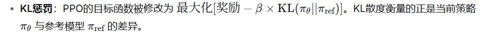
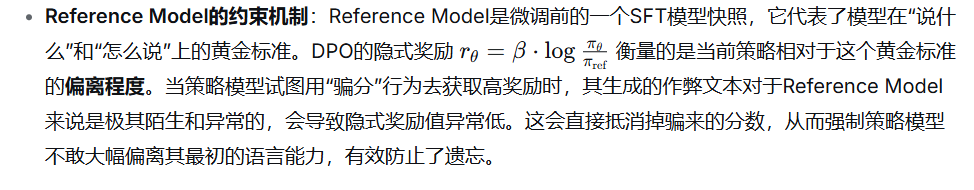

# 59.大模型（LLMs）灾难性遗忘

#### 什么是灾难性遗忘？在 LLM 微调中，它具体指什么现象？

灾难性遗忘，是连接主义模型（神经网络）的一个根本性挑战。它指的是模型在学习新任务或新数据时，会迅速、严重地忘记之前学到的知识和能力。这并非简单的“记性不好”，而是新知识的学习过程覆盖了存储旧知识的神经网络连接。

在LLM微调中，这个现象表现为一种能力退化。一个在万亿Token上预训练的强大模型，拥有推理、编程、多语言等通用能力。当我们用某个特定领域的数据（如医疗问答）对它进行微调后，它可能在医疗任务上表现优异，但在数学、代码、多语言翻译等基准上的表现却断崖式下降，甚至丧失流畅的对话能力。这种“捡了芝麻，丢了西瓜”的现象，就是灾难性遗忘在LLM中的具体体现。其核心矛盾在于，微调过程定向地、不可逆地重塑了模型原本通用的参数空间。

---

#### 解释为什么神经网络在顺序学习任务时会遗忘先前任务的知识。

神经网络遗忘先前任务的知识，根源在于其分布式、纠缠的表示和面向特定目标的优化过程。

1. 分布式表示与参数纠缠

神经网络的知识存储在所有连接的权重中，形成一种高度纠缠的表示。同一个参数、同一个神经元，可能同时参与了“语法分析”、“事实记忆”、“逻辑推理”等多个不同功能。当针对新任务进行优化时，梯度更新会“无情地”调整这些共享参数。为提高新任务的表现而修改某个权重，可能会破坏它同时承载的其他旧功能，这种破坏是牵一发而动全身的。

2. 优化目标的冲突

微调时，优化器唯一的目标是最小化当前任务数据的损失函数。它完全“不关心”模型在其他旧任务上的表现，因为旧任务的数据和损失函数不在当前的优化视野中。因此，梯度下降会沿着加剧这种冲突的方向更新参数，最终导致模型的参数空间被重塑，只为单一新任务服务。

3. 缺乏对旧任务的回顾

人类的记忆可以通过反复复习来巩固，但在标准的序列学习设置中，模型在接触新任务后，就“回不去”了。它没有机会重新温习旧任务的数据，那些不再被激活的、服务于旧任务的连接，就逐渐被新任务的更新所覆盖和侵蚀。

---

#### 在 SFT 和偏好对齐（DPO/RLHF）中，灾难性遗忘的表现有何不同？

两者都会导致灾难性遗忘，但由于训练目标和数据性质不同，其表现有显著差异。

- 在 SFT 中的表现：明确的“能力遗忘”\
  SFT使用大量特定领域的“指令-回复”对进行训练。遗忘表现为模型具体能力的显著衰退。
  - 知识边界收缩：模型在微调领域外的知识（如历史、地理）准确性下降，开始“胡编乱造”。
  - 推理能力下降：在需要复杂推理的基准（如数学题）上表现变差。
  - 格式过拟合：模型学会了微调数据的对话格式，但面对格式不同的用户提问时，可能因困惑而输出不完整或格式错乱的内容。\
    根源是SFT数据通常领域集中，造成训练分布与预训练分布严重偏离。

- 在偏好对齐（DPO/RLHF）中的表现：微妙的“行为扭曲”或“能力稀释”\
  对齐阶段的数据量通常远小于SFT，其目标也不是注入新知识，而是调整模型的行为风格和价值观。遗忘表现为一种更隐蔽的能力漂移。
  - “对齐税”：模型安全性提升后，却变得过度拒答，对“如何制作炸弹”和“如何制作蛋糕”都回答“我不知道”，这本质上是遗忘了“正常回答”的能力。
  - 多样性丧失：模型学会了迎合人类偏好的某种“安全”或“冗长”的风格，却遗忘了如何生成多样、精炼、有创意的文本。\
    根源是对齐数据中的偏好信号被过度放大，压制了模型原有的生成能力。RLHF的遗忘还体现在PPO训练中的探索与利用失衡，模型为了最大化奖励，放弃了那些奖励不高但合理的探索路径。

---

#### 如何量化评估微调过程中的灾难性遗忘程度？设计一套评估方案。

量化评估遗忘，需要建立一个多维度、基准化的评估体系，在微调前后进行对比。

1. 评估数据准备

需要三类数据集：

- 新任务数据集：用于微调的领域数据，衡量微调收益。

- 通用旧任务数据集：用于评估遗忘，应覆盖预训练模型的核心能力，如语言理解、知识问答、数学推理、代码生成、多语言能力等。

- 安全与偏见数据集：如TruthfulQA、BOLD等，用于评估对齐后的安全性和偏见。

2. 评估指标设计

- 新任务性能变化（ΔP_new）：衡量微调收益。

- 旧任务性能变化（ΔP_old）：衡量遗忘程度，是核心指标。可以计算微调后所有旧任务平均得分相对于基座模型的变化百分比，定义为遗忘率。

- 综合能力分数：如Chatbot Arena的人类偏好评分，或MT-Bench的LLM-as-Judge评分，以评估综合能力的变化。

- 安全与公平性指标：确保模型在安全性和偏见上的表现没有退化。

3. 实验流程

- 使用各基准测试集，对原始基座模型进行零样本或小样本评估，记录基线分数 $S_{base}$。

- 使用新任务数据对基座模型进行微调。

- 使用完全相同的基准测试集，对微调后的模型进行评估，记录分数 $S_{ft}$。

- 计算各指标的变化，绘制微调前后的“能力雷达图”。雷达图上旧任务区域的面积“萎缩”，就直接可视化了遗忘程度。

通过这套方案，可以精确诊断模型在哪些维度上发生了遗忘，为后续优化提供数据支持。

---

#### 为什么参数高效微调（PEFT）通常比全参数微调更能缓解遗忘？

PEFT方法之所以能有效缓解灾难性遗忘，其根本原因在于它遵循了一个朴素但极其有效的工程哲学：如果不想破坏旧东西，就不要去动它。

1. 核心机制：物理隔离

以LoRA为代表的PEFT方法，其核心操作是将预训练模型的所有原始参数冻结。微调过程只更新额外注入的、参数量极少（通常不到模型总参数的1%）的适配器模块。这意味着，模型在预训练阶段学到的海量通用知识，被原封不动地、物理隔离地保存在冻结的参数中。新知识的学习完全发生在外挂的、任务特定的参数空间里，从根本上避免了对原始参数的干扰和覆盖。

2. 隐式正则化

PEFT极小的参数空间构成了极强的隐式正则化。它限制了模型为了拟合新任务而彻底重塑自身的能力，迫使模型必须在强大的通用基座之上进行微小的调整，而不是“重头来过”。这天然地保护了预训练知识。

3. 对比分析

全参数微调则会无差别地更新所有参数。这相当于为了装修一个房间，而把整栋房子的地基和承重墙都改造了。房间变漂亮了，但房子的结构安全性（通用能力）被严重破坏了。

结论：全参数微调是“大拆大建”，而PEFT是“在精装修好的房间里添加软装”。前者容易破坏房屋结构，后者则能在不改变结构的前提下，快速改变房间的风格和功能。因此，PEFT是目前解决灾难性遗忘问题最简洁、最有效的技术路径之一。

---

#### 重放（replay）策略：如何在微调中混合预训练数据来防止遗忘？比例如何确定？

重放是一种直接有效的策略，其思想是在微调时，不仅学习新任务的数据，还“复习”一部分预训练时见过的旧数据，以提醒模型“不要忘记旧知识”。

实现方法：

在构造每个微调batch时，不仅包含新任务的数据，还按比例混入一部分高质量的通用预训练数据。损失函数也相应地在这个混合数据上计算。通用数据会在模型过度拟合新任务时提供一个相反的梯度，将其参数拉回一个对通用能力更友好的区域。

混合比例的确定（经验法则）：

这是一个需要根据新任务数据量与遗忘风险动态调整的超参数，没有绝对最优值。

- 基准比例：5%~20%的旧数据通常是一个安全的起点。

- 高风险场景（高比例）：新任务数据量极小（few-shot）、新数据与预训练分布差异巨大（如垂直领域语料）、或使用全参数微调时，建议提高到20%~50%。

- 低风险场景（低比例）：新任务数据量大且多样、使用PEFT方法时，比例可低至1%~5%。

- 动态调整：监控训练过程中旧任务验证集的损失。如果该损失持续上升（遗忘信号），就动态增加旧数据的采样比例；如果稳定，则可维持当前比例。

---

#### 弹性权重巩固（EWC）等正则化方法能否用于 LLM 微调？有何挑战？

理论上可以，但在LLM微调中面临巨大的计算挑战。

1. EWC原理简述

EWC是一种基于贝叶斯理论的经典抗遗忘算法。它通过计算每个参数对旧任务的重要性，并在学习新任务时，对重要参数的更新施加一个二次惩罚项，从而将优化限制在对旧任务不造成显著破坏的区域内。参数重要性通常由Fisher信息矩阵的对角线来近似。

2. 在LLM微调中的巨大挑战

- 灾难性的计算开销：计算一个拥有数十亿甚至数千亿参数模型的Fisher信息矩阵，其计算量和存储量都是天文数字。即使是计算其对角线近似，也需要在大型数据集上运行完整的梯度计算，成本极其高昂。这使得标准EWC在大型LLM上几乎不具备可行性。

- 无法解决“语义漂移”：EWC是基于参数粒度的约束，它假设重要参数的位置是固定的。但在LLM的表示空间中，即使参数被物理约束，其学到的语义表示也可能随着整个模型的更新而发生“漂移”，导致功能依然受损。EWC无法捕捉这种高层语义的遗忘。

结论：标准EWC无法直接应用于LLM微调。它催生了后续更高效的变体（如Online EWC），但在LLM时代，其计算复杂度和效果上限，使得它在与PEFT方法的竞争中并不占优。目前，PEFT是更直接、更轻量的抗遗忘首选方案。

---

#### 多任务微调是否能天然减轻灾难性遗忘？为什么？

可以，多任务微调是减轻灾难性遗忘最有效的手段之一，但它并不能“天然”地完全解决问题。

1. 作用机制：多目标联合优化

多任务微调的核心在于，它将多个任务（包括旧任务和新任务）的数据混合，形成一个统一的训练集，并联合优化多个目标。这直接解决了“优化目标冲突”的根源：

- 共享表示学习：模型被强制要求学习一种能够同时服务于多个任务的、更通用、更鲁棒的表示，而不是只适用于某个单一任务的狭隘表示。

- 梯度正则化：不同任务的梯度在参数更新时相互约束和折中。某个任务将参数向A方向拉，另一个任务会向B方向拉，最终的更新方向是所有任务的“合力”。这有效防止了模型被某个单一任务带偏。

2. 局限性：并非“天然”的万灵药

- 需要保留旧任务数据：如果你只有新任务的数据，就无法进行真正的多任务微调。这依然是一个基于有限数据的问题。

- 任务间的干扰：如果新旧任务的目标截然相反（如一个要求生成极度安全的文本，另一个要求生成极度开放的创意文本），它们的梯度会剧烈冲突。此时，多任务学习可能无法找到最优平衡点，导致所有任务都表现平平。

- 容量限制：对于小型模型，其容量可能不足以支撑多个复杂任务的同时学习，最终会顾此失彼。

结论：多任务微调通过同时优化多个目标，极大地缓解了遗忘问题。但它不能保证“零遗忘”，尤其当任务间存在根本性冲突或模型容量不足时。它更像是一种稳健的训练策略，而不是一种万无一失的保障。

---

#### 在 RLHF 的 PPO 训练中，为什么需要 KL 惩罚和 reference model 来防止遗忘？

在RLHF的PPO阶段，KL惩罚和Reference Model（参考模型）是防止策略模型发生灾难性遗忘、确保其基础语言能力不被破坏的“安全锚”。

1. 问题根源：奖励黑客与策略崩溃

PPO的目标是最大化奖励，但这个奖励来自一个有缺陷的代理——奖励模型。如果不加约束，强化学习算法会无情地利用奖励模型的漏洞。策略模型会发现，通过生成重复的、空洞的、格式漂亮但内容荒谬的文本，或者直接放弃回答问题，可以骗取极高的奖励。在最大化这种畸形奖励的过程中，模型会迅速遗忘SFT阶段学到的如何流畅、正确地说话，导致输出崩溃，即灾难性遗忘。

2. Reference Model 与 KL 惩罚的机制

- Reference Model：它是PPO训练开始前的一个冻结的SFT模型快照，代表了模型在语言能力上的“黄金标准”。

- **KL惩罚**：PPO的目标函数被修改为 最大化[奖励 $-\beta\times\mathrm{KL}(\pi_\theta||\pi_{\mathrm{ref}})$]。KL散度衡量的正是当前策略 $\pi_\theta$ 与参考模型 $\pi_{\mathrm{ref}}$ 的差异。

{.ocr-src}

3. 如何防止遗忘：

当策略模型试图通过“奖励黑客”行为来获取高分时，它生成这些奇特文本的概率分布，与正常的SFT参考模型的语言分布差异会非常大，导致KL散度急剧增大。这个巨大的惩罚项会直接抵消掉它骗来的奖励。这会强制策略模型不敢偏离其最初的、强大的语言能力太远，确保它在追求高分的同时，依然保留着预训练和SFT阶段学到的所有知识。

结论：KL惩罚和Reference Model是在RL这个“疯狂追求奖励”的引擎上，安装的一个“制动系统”。它保证了模型的行为始终在一个安全的、语言流畅的信任域内进行优化，从而有效防止了对基础语言能力的灾难性遗忘。

---

#### 解释 DPO 中 reference model 如何帮助约束策略，减缓遗忘。

在DPO中，Reference Model（参考模型）是防止策略模型发生灾难性遗忘、维持其基础语言能力的“定海神针”。它的核心作用是通过定义一个稳定的基线，来约束策略模型的优化方向，防止其为了迎合偏好而“跑偏”。

- 提供优化的“参照系”：DPO的损失函数目标是最大化好回复相对于坏回复的概率差。如果直接优化这个目标，模型可能会找到一个“作弊”的方法：它只需要学会机械地提升所有好回复中常见词汇的概率，甚至通过生成某种特定模式（如不断重复礼貌用语）来骗过高分。这会严重损害模型的多样性和基础语言能力。

- **Reference Model的约束机制**：Reference Model是微调前的一个SFT模型快照，它代表了模型在“说什么”和“怎么说”上的黄金标准。DPO的隐式奖励 $r_\theta=\beta\cdot\log\frac{\pi_\theta}{\pi_{\mathrm{ref}}}$ 衡量的是当前策略相对于这个黄金标准的**偏离程度**。当策略模型试图用“骗分”行为去获取高奖励时，其生成的作弊文本对于Reference Model来说是极其陌生和异常的，会导致隐式奖励值异常低。这会直接抵消掉骗来的分数，从而强制策略模型不敢大幅偏离其最初的语言能力，有效防止了遗忘。

{.ocr-src}

---

#### 指令微调后模型在知识密集型任务上性能下降，这是否属于灾难性遗忘？如何缓解？

这属于灾难性遗忘的范畴，但其内在原因可能比单纯的“忘记”更复杂。

- 定性分析：指令微调后，模型在MMLU、TriviaQA等知识密集型任务上的准确率下降，毫无疑问是灾难性遗忘的一种表现，即模型遗忘了预训练阶段学到的宝贵事实知识和推理能力。

- 深层原因：
  1. 知识覆盖：指令微调数据如果过于集中于某些特定领域或指令格式，模型参数会朝着适应这些新数据的方向偏移，覆盖掉原本用于存储其他知识的参数空间。
  2. 输出分布偏移：指令微调强制模型学习一种“一问一答”的特定格式。这可能干扰模型对原始文本的理解能力，导致其在需要从复杂上下文中检索知识的任务上表现退化。

- 缓解策略：
  1. 数据混合：在指令微调数据中，混入一定比例（如10-20%）的高质量、多样化的知识密集型预训练数据或长文本理解任务。这是最直接有效的方法。
  2. 多任务微调：将指令微调与知识密集型任务（如阅读理解、开放域问答）联合训练，强制模型在遵循指令的同时保持其知识记忆和推理能力。
  3. 使用PEFT方法：这是非常有效的策略。通过冻结基座模型参数，可以完美保留其全部知识。新指令的适配完全由极小的LoRA等适配器完成，从物理上隔离了新任务学习和旧知识存储。

---

#### 持续预训练（继续训练）与灾难性遗忘的关系：如何在新数据上训练而不忘旧知识？

持续预训练（CPT）的目标就是用新数据为模型“更新知识库”，这恰恰是灾难性遗忘发生的高风险场景，因为你需要对模型参数进行“大手术”。如何在注入新知识的同时，不破坏旧知识，是持续学习的核心挑战。常用策略如下：

- 知识蒸馏：这是CPT中最有效的方法之一。在训练时，不仅要最小化新数据的语言模型损失，还要让当前模型的输出概率分布，去模仿旧模型（训练前的模型）在同一批数据上的输出分布。这通过KL散度实现。它像一个“记忆老师”，时刻提醒模型“你以前是怎么认为的”，有效防止过度遗忘。

- 数据回放：这是最根本的保障。在CPT的新数据中，必须持续混入一定比例（如5%-20%）的、多样化的通用预训练数据。这些旧数据就像“复习资料”，时刻提醒模型不要忘记其广博的通用知识。

- 弹性权重巩固（EWC）：在理论上是可行的，但如前所述，它需要计算参数对旧任务的重要性矩阵，这对LLM计算成本过高，实践中应用较少。

- 增量式学习与模型融合：可以将新旧知识分别学习到独立的LoRA适配器中，然后通过适配器融合或加权的方式，得到一个兼具新旧知识的模型，而无需直接修改基座模型。

---

#### 如何设计“遗忘曲线”实验，监测模型在多个领域上的性能随微调步数的变化？

设计“遗忘曲线”实验可以直观地揭示模型在不同训练阶段的能力退化过程。

- 设计框架：
  1. 基线评估：在微调开始前，使用多个基准测试集（覆盖不同能力维度）对基座模型进行完整评估，记录基线分数 $S_{base}$。
  2. 设定评估检查点：在微调过程中，每隔固定步数（如每100步）保存一次模型检查点。
  3. 并行评估：对每一个检查点，都在所有基准测试集上进行评估，得到分数 $S_{step}$。

- 绘制遗忘曲线：\
  以训练步数为X轴，以相对于基线的性能变化百分比为Y轴（`(S_step - S_base) / S_base * 100%`）。图中可以画出多条线，每条线代表一个评测任务。
  - 理想曲线：新任务的曲线（如指令遵循得分）迅速上升并趋于稳定，而所有旧任务的曲线（如知识问答得分）始终在0%附近平稳波动。
  - 遗忘曲线：旧任务的曲线从某个训练步数开始，持续、显著地向下偏离0%线。曲线下降的斜率，就代表了遗忘的速度。通过观察不同任务的曲线分离点，可以判断模型对不同类型知识的遗忘先后顺序。

---

#### 遗忘与模型容量的关系：更大模型是否更抗遗忘？

是的，更大规模的模型通常表现出更强的抗遗忘能力。

- 参数冗余与过参数化：大模型拥有海量的参数，远远超过拟合其训练数据所需的量。这种过参数化意味着，存在许多不同的参数配置可以达到相同的性能。当学习一个新任务时，大模型更容易找到一个既能满足新任务需求，又对原有知识干扰最小的“子空间”进行参数更新，因为它的“容错空间”更大。

- 知识的分布式存储：在大模型中，知识被极度分布式地存储。一个概念可能由成千上万个神经元共同编码。这种高度冗余的存储方式使得，即使一部分与旧知识相关的参数被修改，其他冗余参数仍然能维持旧知识的完整表示。这就像记忆被备份了无数次，破坏其中几份并不影响整体记忆。

- 但绝非免疫：大模型只是更“抗”遗忘，而不是“不”遗忘。如果新任务数据量极大、训练步数极多，或者新任务与旧任务本质上存在冲突，再大的模型也终将发生遗忘。

---

#### 比较不同 PEFT 方法（LoRA, Adapter, Prefix Tuning）的抗遗忘能力，为何 LoRA 表现优异？

所有PEFT方法因其冻结基座参数的核心机制，抗遗忘能力都远超全参数微调。但它们之间仍有差异。

| PEFT 方法 | 抗遗忘能力 | 优异原因分析 |
| --- | --- | --- |
| LoRA | 最强 | 1.完全物理隔离：新知识被独立存储在旁路的低秩矩阵中，基座模型保持不变。 2. 隐式正则化极强：极低秩约束限制了它对基座模型表征能力的影响，是天然的防过拟合和防遗忘机制。 3. 最终可合并：训练后可合并权重，不影响推理，但知识隔离性在训练阶段已发挥关键作用。 |
| Adapter | 强 | 1.物理隔离：新知识被编码在新增的Adapter层中，基座参数冻结。 2. 潜在风险：由于Adapter是新增的网络层，在极深网络中，其输出可能会逐渐放大，对最终的输出分布产生较大影响，存在轻微的“覆盖”风险。 |
| Prefix Tuning | 较强 | 1.输入端隔离：新知识以“软提示”形式存在于输入层，基座参数冻结。 2. 风险：由于它直接修改了每层的注意力计算，对模型行为的“入侵”程度较深。在长序列生成中，其影响力可能衰减，导致对后续生成的控制变弱，但对模型整体行为的“扭曲”风险依然存在。 |

LoRA表现最优异的根本原因：它在参数效率和结构侵入性之间找到了一个完美的平衡点。它既不像Adapter那样永久性地增加了网络结构，也不像Prefix Tuning那样深度干预了注意力计算，而是以一种极其轻量、非破坏性的方式，精确地调整了模型的核心计算权重。

---

#### 为什么直接使用小学习率微调不能完全避免灾难性遗忘？

小学习率只是减缓了遗忘的速度，但并不能改变遗忘的本质。

- 从“小手术”到“累积效应”：全参数微调即使学习率极小，每一步更新都很微小，但这个微小的更新是针对模型所有参数的。经过成千上万步的迭代，这些微小扰动的累积效应是巨大的，最终足以彻底改变整个模型的参数空间，从而覆盖旧知识。

- 优化目标的单一性：遗忘的根本原因是优化目标的冲突。无论学习率多小，梯度下降的唯一目标都是最小化当前任务数据的损失，而不会主动去保留旧知识。小学习率只是让它沿着这个冲突方向走得更慢、更精细而已，最终还是会到达同一个目的地——一个遗忘旧知识的参数空间。

- 结论：小学习率是“温水煮青蛙”，它不能解决优化目标冲突这个根本问题。只有像PEFT这样的物理隔离方法，或者数据回放、多任务学习等策略，才能真正从根源上缓解灾难性遗忘。

---

#### 微调数据分布对遗忘的影响：如果微调数据与预训练数据分布差异巨大，遗忘会加剧吗？

是的，差异越大，遗忘通常会越严重。 这是一个直观且符合逻辑的结论。

- 分布偏移：当微调数据的风格、领域、任务格式与预训练数据相差甚远时（例如，用全是法律文书的数据微调一个通用对话模型），这种巨大的分布偏移会导致梯度信号异常强烈。优化器会得到一个非常明确的指令：必须将整个模型的参数空间，从一个通用语言空间，彻底拉向一个狭窄的垂直领域空间。这种“暴力”的梯度更新，会不加区分地破坏掉所有未被新数据激活的参数连接，导致灾难性遗忘。

- 激活模式冲突：预训练数据覆盖面广，激活了模型中丰富多样的连接。而单一的垂直领域数据只会反复激活其中一小部分连接，其他连接因长期不被使用和受到反向更新的干扰，会逐渐萎缩和退化。这就像一个只会练二头肌的人，时间长了，全身的其他肌肉都会萎缩。

- 缓解策略：在这种场景下，必须在微调数据中大量混入通用预训练数据，或者使用PEFT方法。

---

#### 如何利用知识蒸馏缓解遗忘？例如用旧模型约束新模型。

知识蒸馏是一种强大的抗遗忘策略，它通过让旧模型（教师）来监督新模型（学生）的学习，强制新模型“记住”旧知识。

- 核心机制：在微调新模型（学生）时，除了计算标准的任务损失外，还引入一个蒸馏损失。这个损失衡量了学生模型的输出概率分布与教师模型（微调前的基座模型）的输出概率分布之间的差异，通常使用KL散度。总损失为：`L_total = L_new_task + λ * KL(π_student || π_teacher)`。

- 如何防止遗忘：当学生模型为了拟合新数据而试图修改其参数时，蒸馏损失会惩罚它“偏离”教师在相同输入下的输出。这就像一个监督者时刻在提醒：“别忘了你以前是怎么回答的，不要改得太离谱”。这使得模型在学习新任务的同时，被迫保留其原有的语言模式和知识。

- 与RLHF中Reference Model的联系：这正是RLHF和DPO中Reference Model防遗忘机制的原理。它们都是基于蒸馏的思想，用一个冻结的旧模型来约束新模型的更新。

---

#### 介绍 L2 正则化（权重衰减）在微调中对抗遗忘的作用和局限。

L2正则化在微调中是一种通用的正则化技术，但作为抗遗忘的工具，它远不如PEFT等方法有效。

- 作用机制：L2正则化在损失函数中增加了所有参数的平方和惩罚项：`L_total = L_task + (λ/2) * Σ(w_i)^2`。它的作用是鼓励模型学习出更小的权重值，防止某些权重变得过大。直观上，它倾向于让模型使用更多的参数来共同决定输出，而不是依赖少数几个有巨大影响力的参数。这种分散性使得模型在面对新任务时，不会因为过度依赖少数几个节点而导致旧知识被迅速覆盖。

- 局限性：
  1. 无差别惩罚：它对所有权重一视同仁，无法区分哪些参数对保留旧知识至关重要，哪些无关紧要。因此，它会在限制遗忘的同时，也限制了模型对新知识的学习能力。
  2. 无法解决目标冲突：它只是在原有损失上添加了一个全局的“限制力”，而没有像数据回放那样提供一个指向旧知识的明确“引导力”。它不能告诉模型“哪些旧知识是重要的”。
  3. 杯水车薪：对于LLM庞大的参数规模，L2正则化提供的约束力相对有限。它只能作为辅助手段，而无法作为主要的抗遗忘策略。

---

#### 在 RLHF 中，除了 KL 惩罚，还有哪些方法可以保持模型多样性、防止遗忘？

RLHF训练极易导致模式崩溃和多样性丧失，除了KL惩罚外，还有多种策略可以协同作用。

- PPO-ptx (混合预训练梯度)：这是InstructGPT和后续工作中使用的一项关键技术。在PPO的目标函数中，直接混合进预训练数据的语言建模损失（交叉熵）。这相当于在RL训练中强行加入了“数据回放”的效果，直接告诉模型：“别忘了怎么说话！”

- 因果熵奖励：在奖励函数中增加一项“策略熵奖励”，鼓励Actor模型生成更不确定、更具多样性的回复。这直接对抗了PPO训练中策略过于确定性的趋势。

- 多奖励模型集成：使用一组多样化的奖励模型进行打分，并取其均值或最小值。这可以平滑掉单个奖励模型的偏好尖峰，防止策略模型为迎合某个特定偏好而过拟合。

- 动态调整KL惩罚系数 $β$：自适应地根据KL散度的变化来调整$β$。当KL散度过大时，自动增大$β$以加强约束；当KL散度过小时，减小$β$以允许更积极的优化。

---

#### 分析模型在忘记旧知识时，内部表示发生了什么变化？可利用哪些可解释性工具？

当模型遗忘时，其内部表征会经历一种“覆盖”与“扭曲”的过程。

- 内部表示的变化：
  1. 知识神经元的活动模式改变：存储旧知识的特定神经元（尤其是在FFN层）的激活模式被改变。它们可能不再对旧知识的输入产生响应，或者被新任务重新“征用”，去表示新知识。
  2. 表示空间的扭曲：旧知识原本在模型内部形成了结构清晰的子空间。随着遗忘的发生，这些子空间的结构被破坏、挤压，或者被新知识的表示子空间所淹没和覆盖。原本用余弦相似度可以清晰区分的两个旧知识概念，其向量可能会变得彼此靠近，难以区分。

- 可解释性工具：
  1. 探针：在模型的关键层（如FFN之后）训练线性分类器，用于检测特定的旧知识概念（如“巴黎”）。对比微调前后探针的准确性，可以量化知识的遗忘程度。
  2. 表示相似性分析 (RSA)：计算微调前后，同一个旧知识概念在不同上下文下的表示向量（如 `[CLS]` token）之间的余弦相似度。如果相似度普遍下降，说明表示空间发生了扭曲。
  3. 注意力权重可视化：分析微调前后，模型在处理旧任务时的注意力模式变化。可以观察到，微调后模型可能不再关注那些对旧知识至关重要的关键词。
  4. 因果追踪/激活修补：通过干预特定神经元的激活值，观察其对模型输出旧知识的影响。可以精确定位哪些神经元对旧知识的遗忘负有“责任”。

通过这些工具，我们可以从“观察现象”深入到“诊断病因”，更精确地理解遗忘发生的内部机制。

