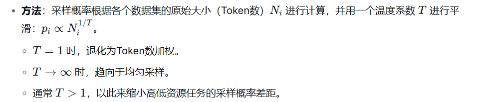
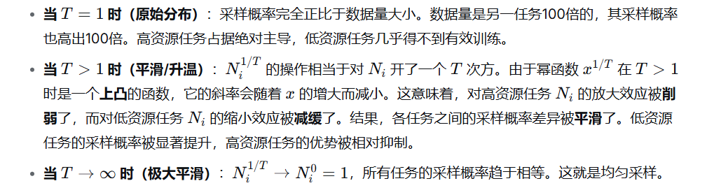
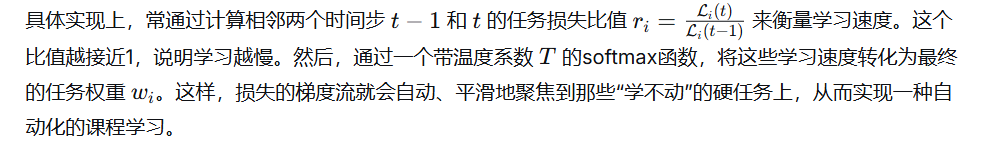
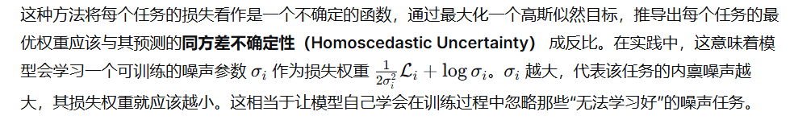
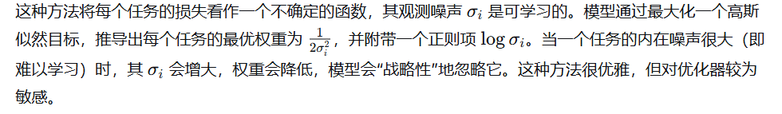
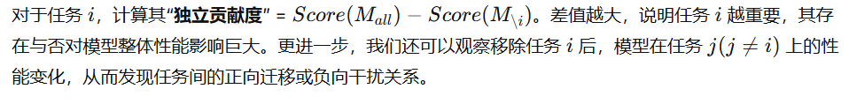

# 60.大模型（LLMs）数据混合与多任务微调

#### 什么是数据混合？在微调中为何需要进行多任务数据混合？

数据混合，是指在微调大语言模型时，将来自不同领域、不同任务类型、不同格式（如对话、代码、数学题）的多个数据集，按照一个精心设计的比例进行组合，形成一个统一的训练语料库。这个比例不仅仅指数据量的多少，更体现在训练过程中，每个数据源被采样到的概率。

在微调中，需要进行多任务数据混合的根本原因，是为了解决单一任务微调带来的三个核心问题：

- 避免灾难性遗忘与能力坍缩：如果只用对话数据微调一个强大的基座模型，它会迅速遗忘预训练阶段学到的代码、数学、推理等能力，变成一个只会聊天的“话痨”。多任务混合可以为模型提供一个更接近预训练数据分布的、多样化的“营养餐”，确保它在学习新技能的同时，不丢失原有的广博知识。

- 实现能力迁移与正向涌现：不同任务的数据并非孤立的。研究表明，在微调中混合高质量的代码数据，能显著提升模型的逻辑推理和逐步思考能力；混合数学数据能增强模型的工具使用能力。这种能力在不同任务间的“迁移”和“涌现”，是单一任务微调无法实现的。多任务混合本质上是让模型在多个相关的认知维度上同时进化。

- 提升模型的泛化性和鲁棒性：单一任务微调容易让模型过拟合到该任务的特定格式和浅层模式上，对于未见过的指令或风格则表现不佳。多任务混合迫使模型学习一种更底层、更通用的“问题解决”能力，而不是死记硬背特定任务的答案。这使得模型在应对真实世界中千奇百怪的用户提问时，更加稳健。

因此，数据混合是在模型“专精”和“通才”之间寻找完美平衡点的关键杠杆。

---

#### 多任务微调时，不同任务的数据如何混合？列举至少三种混合策略，并分析优劣。

多任务数据的混合策略直接决定了模型在不同能力上的投入产出比。以下是三种主流的混合策略：

策略一：均匀采样 (Uniform Sampling)

- 方法：无论某个任务的数据集有多大，每个数据集的采样概率完全相等。例如，你有100万条代码数据和1万条数学数据，那么在构造每个训练batch时，从代码集和数学集中各抽取一半样本。这意味着数学数据会被反复重复使用（过采样）。

- 优势：
  - 完美平衡长尾任务：能确保数据量极少的、但重要的任务（如特定安全任务）获得充分的训练信号，不会因为数据量少而被忽略。
  - 实现简单：无需复杂的计算，直接在数据加载器中配置即可。

- 劣势：
  - 对巨型数据集不公平：对于代码这样拥有海量数据的任务，均匀采样意味着模型只用了其中极小部分，造成了大量数据的浪费。
  - 过拟合风险：数据量极少的任务会被反复训练，极易导致模型死记硬背该数据集，产生严重过拟合。

策略二：Token数加权/按自然分布采样 (Token-Weighted Sampling)

- 方法：每个数据集的采样概率正比于其总Token数。数据集越大，被采样到的概率越高。这直接反映了数据集的“天然”比例。

- 优势：
  - 最大化数据利用率：充分利用了所有数据，没有浪费。
  - 符合预训练分布：这种混合方式与模型预训练时的数据分布类似，能较好地保留模型的原有能力。

- 劣势：
  - 长尾任务被淹没：如果一个任务的数据量是另一个的100倍，那么小任务在训练中几乎“隐身”，模型无法有效学习。最终模型的能力将完全由最大的几个数据集主导，导致严重的“偏科”。

策略三：温度采样 (Temperature Sampling)

- **方法**：采样概率根据各个数据集的原始大小（Token数）$N_i$ 进行计算，并用一个温度系数 $T$ 进行平滑：$p_i\propto N_i^{1/T}$。
  - $T=1$ 时，退化为Token数加权。
  - $T\to\infty$ 时，趋向于均匀采样。
  - 通常 $T>1$，以此来缩小高低资源任务的采样概率差距。

{.ocr-src}

- **优势：**
  - 提供灵活的平衡：可以通过调整一个简单的超参数 $T$，在均匀采样和Token数加权之间平滑过渡，兼顾长尾任务的训练和大数据集的利用。
  - 技术成熟：已被XLM-R等跨语言模型广泛验证，是多语言和多领域平衡的经典方法。

- **劣势：**
  - T值需要实验确定：最佳温度系数依赖于具体的数据集构成，需要额外的调参成本。

---

#### 解释“温度采样”混合策略，温度系数如何影响高低资源任务的采样概率。

温度采样是当前多任务数据混合中应用最广泛、效果最稳健的策略之一。其核心公式为：

$$
p_i=\frac{N_i^{1/T}}{\sum_jN_j^{1/T}}
$$

{.ocr-src}

其中，$N_i$ 是第 $i$ 个任务数据集的原始大小（通常以Token数计），$T$ 是温度系数。

温度系数 $T$ 的作用机制：$T$ 的作用是“压缩”或“放大”各任务数据量之间的差异

- **当 $T=1$ 时（原始分布）**：采样概率完全正比于数据量大小。数据量是另一任务100倍的，其采样概率也高出100倍。高资源任务占据绝对主导，低资源任务几乎得不到有效训练。
- **当 $T>1$ 时（平滑/升温）**：$N_i^{1/T}$ 的操作相当于对 $N_i$ 开了一个 $T$ 次方。由于幂函数 $x^{1/T}$ 在 $T>1$ 时是一个**上凸**的函数，它的斜率会随着 $x$ 的增大而减小。这意味着，对高资源任务 $N_i$ 的放大效应被**削弱**了，而对低资源任务 $N_i$ 的缩小效应被**减缓**了。结果，各任务之间的采样概率差异被**平滑**了。低资源任务的采样概率被显著提升，高资源任务的优势被相对抑制。
- **当 $T\to\infty$ 时（极大平滑）**：$N_i^{1/T}\to N_i^0=1$，所有任务的采样概率趋于相等。这就是均匀采样。

{.ocr-src}

直观理解：可以把各任务想象成大小不一的“蛋糕”，$T$ 就是我们切蛋糕时对“公平”的偏好程度。$T$=1 是按劳分配（谁家大谁吃得多）；$T$=∞ 是绝对平均主义；$T$=2 或 $T$=3 则是“劫富济贫”，让小任务获得了远超其体量的采样机会，同时也没让大任务颗粒无收。

实践案例：XLM-R在100多种语言上训练时，使用了 $T$=0.3（注意这里是$T$<1，是为了进一步放大高资源语言的优势），这取决于特定的平衡目标。对于大多LLM微调，平衡目标是提升长尾能力，因此常使用 $T$>1 的设置。

---

#### 如何设置多任务微调中每个任务的损失权重？等权重还是基于任务难度动态调整？

损失权重的设置是多任务优化的核心难点，它决定了不同任务的优化信号对模型参数的“话语权”。

**方法一：等权重/基于数据量的损失归一化**

这是最基础的方法。不是指每个任务的最终损失值乘以1.0，而是通过损失平均来消除数据量差异的影响。通常的做法是，对每个任务的数据分别计算其平均损失，然后将这些平均值求和或取平均。这保证了每个任务对梯度的贡献在量级上是公平的，不会因为某个任务的Token数特别多而在梯度中占据压倒性优势。

方法二：基于任务难度的动态调整 (Dynamic Weight Average, DWA)

这是一种更高级的自适应策略。它不预定义固定权重，而是根据模型在各个任务上的学习进展，动态地调整每个任务的损失权重。其核心思想是：对于学习缓慢、损失下降困难的任务，给予更高的权重，让优化器更多地关注它。

具体实现上，常通过计算相邻两个时间步 $t-1$ 和 $t$ 的任务损失比值 $r_i=\frac{\mathcal{L}_i(t)}{\mathcal{L}_i(t-1)}$ 来衡量学习速度。这个比值越接近1，说明学习越慢。然后，通过一个带温度系数 $T$ 的softmax函数，将这些学习速度转化为最终的任务权重 $w_i$。这样，损失的梯度流就会自动、平滑地聚焦到那些“学不动”的硬任务上，从而实现一种自动化的课程学习。

{.ocr-src}

**方法三：基于不确定性的加权 (Uncertainty Weighting)**

这种方法将每个任务的损失看作是一个不确定的函数，通过最大化一个高斯似然目标，推导出每个任务的最优权重应该与其预测的**同方差不确定性（Homoscedastic Uncertainty）**成反比。在实践中，这意味着模型会学习一个可训练的噪声参数 $\sigma_i$ 作为损失权重 $\frac{1}{2\sigma_i^2}\mathcal{L}_i+\log\sigma_i$。$\sigma_i$ 越大，代表该任务的内禀噪声越大，其损失权重就应该越小。这相当于让模型自己学会在训练过程中忽略那些“无法学习好”的噪声任务。

{.ocr-src}

**选择依据：**对于任务数量少、难度差异明显的场景，DWA通常表现优异。对于任务数量极多、且存在大量噪声标签的场景，不确定性加权更为稳健。如果没有明确的调优需求，基于数据量的损失归一化是简单有效的基线。

---

#### 什么是“梯度冲突”？多任务微调中如何处理不同任务梯度方向不一致的问题？

梯度冲突是多任务优化中的核心挑战。当两个或多个任务的优化目标存在根本性矛盾时，它们对模型参数的梯度会指向相反或近乎相反的方向。例如，一个任务要求模型用风格A回复，另一个任务要求用相反的B风格。如果直接将这些梯度加在一起，它们会相互抵消，最终导致所有任务的训练都陷入停滞。

处理方法：

1. PCGrad (Project Conflicting Gradients)

这是处理梯度冲突的经典方法。在更新参数前，它会依次检查每两个任务的梯度向量。如果它们的余弦相似度为负（即存在冲突），则将一个任务的梯度投影到另一个任务梯度的法平面上，得到一个去除了冲突分量的、修正后的梯度。最终，对所有修正后的梯度求和进行更新。这确保了最终的更新方向不会因任务间的直接冲突而停滞。

2. CAGrad (Conflict-Averse Gradient Descent)

PCGrad只处理两两冲突，CAGrad则更为全局。它在进行梯度更新前，会先为每个任务寻找一个最优的梯度组合。它的目标是找到一个联合的最终更新方向，使得所有任务的损失都尽可能下降，同时最小化最差情况下的损失退化。其核心思想是找到一个所有任务都能接受的“最大公约数”方向。

3. 梯度手术 (Gradient Surgery)

这是一种更直接的方法。在反向传播后，优化器更新前，主动修改或移除那些会导致某个旧任务损失显著上升的梯度分量。这种方法通常用于持续学习，防止灾难性遗忘。

在大模型微调中的简化实践：

对于十亿级以上的大模型，上述复杂算法计算开销巨大。实践中更常用的是更工程化的方案：

- 优化数据混合比例：从源头减少冲突。通过小规模实验，找到一组冲突最小、协同增益最大的数据配比。

- 梯度累积/小学习率：通过多次累积求平均，可以平滑掉一些突发的冲突信号。较小的学习率则限制每一步的更新幅度，防止模型因某一次的冲突被带偏。

- PEFT方法的隐式解耦：使用LoRA等PEFT方法，不同的任务可以训练独立的LoRA适配器，从物理上隔离了可能发生冲突的梯度更新。

---

#### 多任务微调与单任务微调相比，在泛化性、抗遗忘方面有何优势？

多任务微调相较于单任务微调，在提升模型综合能力上具有压倒性优势，尤其体现在泛化性和抗遗忘能力上。

一、泛化性优势：从“窄域专家”到“泛能通才”

单任务微调容易让模型陷入“舒适区”，过拟合到该任务的特定格式和浅层统计模式，面对未见过的指令或任务时，表现会急剧下降（“窄域专家”）。多任务微调则迫使模型学习一种更底层、更通用的“问题解决”能力。模型必须学会从多样化的指令中抽象出通用的意图、逻辑和知识调用方式。这种训练方式下，模型在面对一个全新的、从未见过的任务格式时，也更有可能调用其内部相关的知识进行泛化，表现更加稳健（“泛能通才”）。

二、抗遗忘优势：从“被动遗忘”到“主动巩固”

单任务微调是灾难性遗忘的主要诱因，因为模型参数被单向地拉向新任务分布，覆盖了旧知识。多任务微调则构建了一个天然的抗遗忘“护城河”。通过在训练中持续混入来自不同领域的旧任务数据，这些数据的梯度会形成一个“反向拉力”，阻止模型参数朝着单一任务方向过度偏移。这相当于在训练过程中嵌入了持续的数据回放和联合优化，极大地巩固了模型的原有知识。即使面对一个全新的任务，由于模型内部的知识是结构化、相互关联的，它也能更稳健地适应，而不会轻易丢失其他相关领域的知识。

---

#### 如何通过小规模代理实验，搜索多任务微调的最佳混合比例？

在直接对千亿大模型进行昂贵的全局搜索之前，小规模代理实验是找到最优混合比例的经济高效途径。其核心思想是：利用小模型和少量训练步数，模拟大模型在长期训练下的相对表现。

实验设计步骤：

1. 定义搜索空间：选定要调整的关键数据域（如A, B, C三类），并确定每个域的比例范围（如A在20%-60%，B在20%-40%，C在10%-30%），总比例和为100%。

2. 构建代理模型：选择一个足够小的模型架构（如100M或300M参数），它训练速度快，但其在不同配比下的性能排序应与目标大模型高度相关。

3. 设定固定计算预算：为每一个配比实验设定完全相同的总训练Token数（例如，都训练5B Token）。这是最关键的控制变量，必须保持一致。

4. 控制其他超参数：使用相同的学习率调度、相同的warmup步数、相同的批次大小，并严格固定随机种子或多次实验取平均，以排除随机性干扰。使用完全一致的验证集。

5. 网格搜索或贝叶斯优化：在搜索空间中选择若干组配比，对每组都从头训练一个代理模型，并记录其在验证集上的验证损失或下游任务准确率。

6. 结果分析与验证：绘制性能随配比变化的曲线。找到在验证集上表现最好的配比，或者更常见的是一个“帕累托最优”区域，使得多个能力维度都相对平衡。最后，将找到的最优配比应用于更大规模的模型（如1B参数），在更大计算预算下验证效果，确保代理实验的结论能够迁移。

通过这种严格控制的代理实验，能以相对低廉的成本，快速筛选出最有潜力的数据配比，为大模型训练提供决策依据。

---

#### 数据混合中的“数据集重复”问题：当不同任务数据集存在重叠时，如何影响模型？

数据集重叠在多任务混合中是普遍存在的问题，如果处理不当，会悄无声息地扭曲模型的行为。

影响机制：

- 隐性过采样与数据偏差放大：当某个特定样本（或其高度相似的变体）同时出现在多个子数据集中时，它在每个训练epoch中被采样的概率会显著高于其他样本。模型会过度学习这些重复样本的模式，导致在该类数据上过拟合，而在其他未见过的数据上泛化能力下降。更严重的是，如果重复数据本身带有某种偏见（如某种特定的回答风格），这种偏见会被不成比例地放大。

- 奖励黑客与目标冲突的诱导：在DPO等多目标优化中，重叠数据可能引发严重的奖励黑客行为。例如，一段包含“详细解释”的回答，在“有用性”和“安全性”两个维度的偏好数据中可能都是正样本。模型会学会通过堆砌细节来同时获得两个维度的高分，而不是真正去提升回答的准确性和安全性。如果数据集中存在大量此类重复的正样本，模型会找到一个“多目标奖励黑客”的捷径。

- 对“数据效率”的虚假评估：开发者可能会因为重复数据带来的、在特定基准上的虚高分数，而误判数据混合策略的有效性。实际上，模型只是在“背诵”答案，而非学到了真正的能力。

解决方案：

- 核心原则：按数据集进行全局去重。在微调之前，必须在整个混合数据集上执行严格的数据去重。不仅要进行精确的文本匹配，还应使用MinHash或SimHash等算法进行模糊去重，以识别高度相似的样本。

- 元数据标注与溯源：为每一条数据打上其来源数据集的标签。在训练时，如果某个样本在多个数据集中出现，可以根据其来源决定其采样权重或重复次数上限。

- 构造高质量、非重叠的评估集：确保用于验证和测试的数据与所有微调数据均无重叠。评估基准（如MMLU）中的样本绝不应出现在任何微调数据集中。

---

#### 多任务微调时，batch 内如何进行任务采样？温度采样 vs 均匀采样 vs 按比例采样。

在一个batch内混合不同任务的数据，是通过数据加载器的采样策略实现的。

- 按比例采样：首先确定各任务数据集的采样概率，这可以是基于Token数的自然比例、手工设定的比例或温度采样比例。然后，在数据加载器中，根据这些概率，随机选择从哪个数据集中抽取下一条样本。一个batch内各任务数据的比例，在期望上等于其设定的采样概率。这种方法的batch构成是随机的，能有效防止模型“串行”地学习不同任务。

- 均匀采样：所有任务在batch内的期望数据量相等。这对于少量但重要的任务（如安全任务）是一种强力保障，能确保它们在每个batch中都占据一席之地。

- 温度采样：与前两者并非互斥，而是决定前两者中“比例”如何设定的方法。通过调整温度 $T$，你可以平滑地控制各任务在batch中的期望比例，实现更精细的平衡。

效率考量：为了实现高效的分布式训练，通常会将数据加载与模型计算流水线化，并利用梯度累积技术模拟更大的batch size。

---

#### 在混合代码与自然语言任务时，需要注意哪些特殊问题？

代码数据和自然语言文本在本质上有巨大差异，混合训练时需要特别处理。

1. 格式与语法的结构性偏差：代码具有严格的语法结构（缩进、括号、分号），而自然语言相对自由。模型极易学习到代码的“冷启动”模式（如以`def`开头）并将其错误地应用于对话回复中，导致输出混乱。建议：在训练数据中，为代码块明确添加特殊标记（如`python\n...\n`），教会模型区分代码和文本。

2. 逻辑与语义的深度冲突：代码是精确的、确定性的逻辑，而自然语言是模糊的、概率性的表达。混合训练可能导致两种能力相互干扰：模型可能在回答常识问题时，也开始进行不合时宜的逻辑推演，变得刻板或“非人化”。建议：确保自然语言数据中，尤其是在推理任务（如数学）中包含清晰的、接近代码逻辑的思维链。

3. 长度分布与注意力偏差：代码文件通常很长，而对话数据相对较短。如果直接混合，长的代码序列会占用巨大的显存，并可能导致模型在处理短对话时，其注意力模式被长代码污染。建议：对超长代码数据进行细粒度的、基于AST（抽象语法树）的切分，并严格控制数据集的总Token数比例，而非简单按文件数混合。

4. 隐私与安全问题：训练代码可能包含API密钥、内部路径等敏感信息。必须在训练前进行严格的PII过滤。

---

#### 解释“Task-level Curriculum Learning”：如何安排不同任务出现的顺序以利于学习？

任务级课程学习是一种高级训练策略，它模仿人类由易到难的学习过程，通过动态调整不同任务在训练过程中的采样权重，来最大化学习效率和最终性能。

- 目标：不是让模型“先学A，再学B”，而是让模型在不同阶段“重点关注”不同的学习目标。例如，在训练初期，模型如同一张白纸，需要广泛接触基础任务（如语言流畅性、基本问答），以构建稳固的能力基石。此时，这类简单任务的采样权重应较高。随着训练进行，当模型基础稳固后，再逐步提升高难度任务（如复杂推理、长文本生成、安全性对抗）的权重，对其进行精细优化。

- 实现方法：
  1. 人为定义阶段与规则：根据经验将训练分为“基础-进阶-拔高”三个阶段，为每个阶段设定不同的数据混合比例。这是一种简单直接、可解释性强的方案。
  2. 基于信号的自适应调整：监控模型在各个任务上的验证损失或其他性能指标。如果模型在某个复杂任务上的损失下降停滞，而简单任务损失已经很低，则自动增加复杂任务的采样权重。

- 应对遗忘：当高难度任务的采样权重被提高时，基础任务的训练信号会相应减弱。为防止模型遗忘基础能力，需要保留一个基础任务的采样权重“底线”，或周期性地重新引入基础任务数据进行回放，以巩固已有知识。

---

#### 多任务微调中，如何监控单个任务的学习进度？是否需要为每个任务设置单独的验证集？

是的，必须为每个关键任务设置单独的验证集。这是诊断多任务微调健康状态的唯一有效方式。仅看一个总体的平均验证损失会掩盖掉许多严重问题，例如一个任务的性能提升可能掩盖了另一个任务的灾难性遗忘。

监控体系设计：

1. 分类组织验证集：将验证集按任务类型（如对话、代码、数学、安全）组织起来。对于每个任务，独立计算其验证损失和核心指标（如准确率、ROUGE-L等）。

2. 绘制分任务学习曲线：在训练过程中，定期（如每100步）在所有验证集上评估模型，绘制出每个任务性能随训练步数变化的曲线。通过观察曲线的相对变化，可以直观地看到哪些任务在持续进步，哪些任务已经过拟合，哪些任务发生了遗忘。

3. 设定预警机制：为每个重要任务设定一个性能下限。如果某个任务的验证损失持续上升，或核心指标跌破下限，则触发告警，提示需要调整混合比例或优化策略。

---

#### 当某任务数据量远大于其他任务时，如何平衡以防止该任务主导训练？

这是一个经典的长尾分布问题，在数据混合中非常普遍。一个拥有数十亿Token的通用对话数据，很容易淹没一个只有数百万Token的特定任务数据。解决方案如下：

- 温度采样上采样：如前所述，使用温度采样（$T$>1）可以有效地提高低资源任务的采样概率，同时不完全浪费高资源任务的数据。

- 硬性比例截断：对高资源任务设置一个采样概率的“天花板”（例如，无论它多大，采样概率最高不超过40%）。对低资源任务设置一个“地板”（例如，采样概率最低不低于5%）。

- 数据分桶与重采样：将数据按任务分桶，在构造每个batch时，确保各个桶的样本比例符合预设值。对于小数据集桶，通过数据重采样（重复使用数据）来满足比例要求。

- 调整梯度累积步数：这并非直接调整数据比例，而是通过控制优化器更新的频率来间接影响。可以理解为，对不同任务使用不同的“有效学习率”。

---

#### 多任务微调对模型对话能力、推理能力、安全性等不同维度的影响是否一致？

不一致，甚至经常是冲突的。 多任务微调是一个多目标优化过程，不同的能力维度对数据混合策略的反应截然不同。

- 对话能力与创造性：通常对数据量非常敏感，容易从海量的、多样化的对话数据中受益。但也容易被某些特定风格的重复数据带偏，导致风格单一。

- 推理能力：对数据质量的要求极高，而非数据量。少量高质量的代码或数学逻辑数据，就能带来显著的提升。然而，过多低质量的、与推理无关的闲聊数据，可能会稀释其效果，因为模型可能学会通过“聊天”来回避需要深度思考的问题。

- 安全性与对齐：这是最敏感、也最容易与其他能力发生冲突的维度。安全对齐数据（如拒绝有害请求）本质上是在“反训练”，即教会模型不要做某事。如果安全数据比例过高，模型可能过度拒答，损害其帮助性（对话能力）。如果比例过低，又无法有效对齐。安全对齐的提升通常伴随着其他能力（如创造力）的一定程度损失，这被称为“对齐税”。

结论：不存在一个能让所有维度都达到最优的“万能配比”。多任务微调是在绘制一条“帕累托前沿”，我们需要根据业务需求，在多个相互冲突的目标之间做出权衡。

---

#### 在多轮对话任务中融入单轮指令微调数据，混合时有何最佳实践？

将单轮指令数据融入多轮对话训练，是利用高质量静态数据提升模型通用能力的有效手段。关键在于数据格式的统一。

- 核心方法：格式统一化。将单轮指令数据“伪装”成多轮对话的格式。具体做法是，将单轮数据的指令、输入和输出，填充到一个多轮对话模板的最后一轮中。例如，原始单轮数据为 `(instruction, input, output)`。我们可以将其组织为：

```plain text
[{"role": "system", "content": "You are a helpful assistant."},
 {"role": "user", "content": instruction + "\n" + input},
 {"role": "assistant", "content": output}]
```

- 这样，这些数据就可以无缝地与真正的多轮对话数据混合训练，模型会平等地看待它们。

- 应用注意力掩码：训练时，必须确保损失函数只在最后的`assistant`回复上计算。对于前面构造的`system`和`user`部分，应用掩码使其不贡献梯度，确保单轮数据的作用是教会模型“如何根据指令和输入给出回答”，而不是“如何提问”。

- 混合比例权衡：单轮指令数据通常质量较高，有助于提升模型的指令遵循能力。但如果比例过高，可能会削弱模型处理复杂多轮上下文的能力，使其变得“健忘”。一个典型的混合比例是在多轮对话数据中混入20%-50%的单轮数据。

---

#### 如何利用元学习（如 MAML）的思想动态调整多任务微调的参数更新？

传统的多任务微调通过调整数据混合比例来间接影响优化过程。而利用元学习的思想，我们可以在优化器层面直接干预参数更新，实现更动态、更精细的调控。

- 核心思想：MAML（Model-Agnostic Meta-Learning）的目标是学习一个良好的参数初始化，使其能在少量新任务数据上经过几步梯度下降就快速适应。在多任务微调中，我们借用其思想，不是为了快速适应，而是为了寻找一个对多个任务都“友好”的参数空间平坦区域。在这个区域，任何单一任务的梯度更新都不会导致其他任务的性能大幅下降。

- 动态调整机制：在训练中，我们不直接使用计算出的联合梯度进行更新，而是为每个任务学习一个“元学习率”或者梯度调制器。这个调制器可以是一个小型的门控网络，它观察当前的参数状态和任务梯度，然后输出一个系数，对每个任务的梯度进行缩放或组合，以最小化所有任务在更新一步之后的期望损失。这相当于在优化器内部实现了一个动态的、任务感知的“交通警察”，协调着不同任务的梯度流，避免冲突和遗忘。这种方法比手动调整损失权重更细粒度、更自动化，但计算开销也更高。

---

#### 分析 Flan-T5、T0 等模型的数据混合策略，并讨论其可借鉴之处。

Flan-T5和T0是指令微调领域的里程碑式工作，它们的数据混合策略深刻影响了后续几乎所有大模型的训练。它们的成功可以被概括为一条核心原则：通过极致的任务多样性和格式统一化，激发模型最强的泛化能力。

- Flan-T5 的策略：其核心是“规模驱动”的多样性，将超过1800个NLP任务通过统一的“Text-to-Text”格式进行混合。它不刻意设定每个任务的精确比例，而是基于自然的数据量进行混合，但通过极大规模和多样化的任务池，确保了长尾任务也能获得足够的训练信号。可借鉴之处在于：无需过度纠结于初始的精确配比，当任务数量足够多、覆盖面足够广时，多样性的红利会远超精调配比带来的收益。Flan-T5证明了多任务微调是提升模型泛化能力的“免费午餐”。

- T0 的策略：其核心是“质量驱动”的泛化。T0更侧重于评估模型的零样本泛化能力。它的数据混合策略极其讲究，会将高度相似的任务（如不同形式的蕴含任务）归入同一个训练簇，并确保在评估某个任务时，其所有变体都从未在训练中出现过。这种严格的数据隔离策略，迫使模型学习真正通用的任务解决能力，而不是记忆特定数据集的模式。可借鉴之处在于：任务的“语义去重”比简单的数据去重更重要，能有效防止模型在评估时“作弊”。

核心借鉴点：

1. 指令的多样性：为同一个任务编写成百上千种不同的Prompt模板，这比简单地增加数据量更能提升模型的泛化能力。

2. 思维链数据的注入：Flan-T5在后期混入了CoT数据，极大提升了推理能力。这证明了在通用指令微调中，加入少量高质量的、展示中间推理过程的数据是提升模型推理能力的“催化剂”。

3. 格式的统一：所有任务都被统一为Text-to-Text格式，这为模型提供了一个简洁、一致的学习接口，降低了学习的复杂度。

---

#### 在多任务 SFT 中，如何结合偏好数据（DPO）进行对齐？数据混合次序如何安排？

将多任务SFT与DPO对齐结合，是当前最主流且高效的模型训练范式。其核心在于训练阶段的解耦和次序安排。

训练次序的安排（至关重要）：

经验法则和大量实践表明，先进行多任务SFT，再进行DPO对齐，是效果最好、最稳定的方案。

- 第一阶段：多任务SFT (知识注入与格式适应)。在此阶段，使用包含代码、数学、对话、翻译等多样化任务的高质量数据，对基座模型进行监督微调。这相当于让模型“学会各种技能”。

- 第二阶段：偏好对齐 (行为校准与价值观对齐)。在此阶段，使用由人类或先进模型标注的、体现“有用、诚实、无害”偏好的数据，对SFT模型进行DPO训练。这相当于对已经学会技能的模型进行“上岗培训”，校准其行为，使其输出更符合人类期望。

为什么这个次序有效？

- 能力是基础，对齐是优化：一个没有掌握基本推理能力的SFT模型，即使经过DPO对齐，也无法进行复杂的逻辑推演。DPO的作用是“纠偏”和“拔高”，而不是“从零教学”。

- 目标一致性的保证：DPO需要使用Reference Model来防止策略偏离。这个Reference Model最好是第一阶段训练出的、能力均衡的SFT模型。如果次序反过来，先做DPO再做SFT，SFT的数据会覆盖掉DPO学习到的微妙偏好，导致对齐效果前功尽弃。

- 数据混合的艺术：在多任务SFT阶段，偏好数据不应该被“提前泄露”。SFT阶段只关注“如何完成任务”，而DPO阶段才关注“如何完成得更好、更符合人类期望”。将两者解耦，使得每个阶段的优化目标都单一且清晰。

---

#### 如果多任务中包含翻译任务和推理任务，混合训练是否可能互相促进？解释原因。

是的，翻译任务和推理任务在混合训练中可以产生显著的正向迁移和相互促进。 这种现象并非简单的叠加，而是源于它们在认知过程和表征需求上的深层共同点。

促进机制分析：

1. 共享的逻辑与解算核心：翻译，尤其是复杂长句的翻译，本质上是一个多步推理过程。译者需要解析源语言的句法结构（A是B的C），理解其语义关系，然后在目标语言中重新组织和表达。这个过程与解决一个多步数学应用题或逻辑推理题高度相似——都需要拆解问题、识别关系、执行转换、得出结果。因此，模型在学会“中译英”的同时，也强化了其内部的逻辑解析和结构转换能力，这种能力会直接溢出到纯粹的推理任务中。

2. 增强的语义鲁棒性：推理任务常常涉及同义词替换、逻辑陷阱等，考验模型对深层语义的把握。翻译任务则天然要求模型对同一个语义概念，学习到多种不同的语言表达方式（源语言和目标语言）。这种训练极大地增强了模型表示空间的语义对齐性和鲁棒性，使其在进行推理时，不易被表面的词汇扰动所迷惑，能更精准地抓住逻辑的本质。

3. 代码/数学语言的“桥梁”作用：如果将翻译、推理、以及代码或数学任务三者混合，促进作用会更加显著。代码和数学可以被看作是一种高度结构化、逻辑严密的“形式语言”。学习将自然语言翻译为形式语言，或者理解形式语言，为模型提供了一个极佳的“逻辑训练场”。反过来，翻译任务为模型提供了灵活的语言表达空间，防止其因过度学习形式语言而变得刻板。

实验证明：大规模实验（如PaLM、LLaMA的工作）已经反复验证，增加代码或翻译数据的比例，能有效提升模型在MMLU、GSM8K等推理基准上的表现，即使这些基准本身并不包含代码或翻译任务。

---

#### 如何使用数据集标识 token 来辅助多任务学习？对训练和推理有何影响？

数据集标识Token是一种显式的任务指令注入技术。其做法是在每个训练样本的输入序列中，拼接上一个用于标识其数据来源或任务类型的特殊Token或简短的自然语言前缀。

如何使用：\
例如，对于数学任务，在输入前添加 `[Math]` 或 `Solve the following math problem:`；对于代码任务，添加 `[Code]` 或 `Write a python function:`。这些标识符被加入模型的词表（如果是特殊Token）或直接作为文本前缀，从而在输入的最前端就明确告知模型当前的“工作模式”。

对训练的影响：

- 显式任务路由：它降低了模型学习的模糊性。模型不再需要从任务样本的统计特征中隐式地推断任务类型，而是可以根据这个明确的标识符，快速激活其内部相关的知识和能力模块。这相当于为不同的任务建立了不同的“思维通道”，能够加速收敛。

- 缓解梯度冲突：由于任务标识符的存在，模型的不同参数区域可能被不同任务更明确地“征用”，这有助于缓解不同任务梯度在共享参数上的冲突。

对推理的影响（关键）：

- 行为开关：在推理时，开发者可以通过显式地添加或修改这些数据集标识Token，来精确控制模型的行为模式。例如，在回答需要高安全标准的问题时，添加 `[Safe Mode]` Token；在需要创意时，添加 `[Creative Mode]` Token。这为模型的可控生成提供了极大的便利。

- 潜在风险：但如果训练数据中这些标识符的分布与推理时的使用不匹配，可能导致模型行为异常。此外，过长的自然语言前缀会占用宝贵的上下文窗口。

---

#### 多任务微调时，学习率调度是否需要特殊考虑？

需要。 多任务微调的学习率调度策略比单任务微调更为复杂，因为它需要在模型的稳定性和可塑性之间找到一个动态的平衡点，以适应多个不同的学习目标。

关键考量与策略：

1. 更大的初始学习率与更长的预热：由于需要同时学习多个任务，模型需要更大的更新步长来快速逃离初始的、对多任务并不友好的参数空间。因此，初始学习率可以设得比单任务微调稍高（如提高20%-50%）。同时，也需要更长的线性预热阶段，让模型平滑过渡到大规模多任务学习中，避免因初始梯度过大而导致训练初期的不稳定。

2. 任务特定的学习率调度：如果不同任务的参数量、损失规模差异巨大，可以考虑对模型的不同部分或不同任务使用分层学习率。例如，对模型通用的底层表示使用较小的学习率进行微调，而对新增的任务特定头或LoRA模块使用更高的学习率。

3. 余弦退火与重启：余弦退火是标准做法，能在训练末期精细收敛。可以考虑结合热重启技术，在训练过程中周期性地提高学习率，帮助模型跳出可能陷入的局部最优解，探索更优的、对所有任务都更友好的参数空间。

4. 基于遗忘信号的动态调整：监控验证集上各任务的性能。当某个任务的性能出现显著下降（遗忘信号）时，可以临时冻结该任务的学习率，或降低整个模型的学习率，以防止进一步的遗忘。

---

#### 混合不同语言的微调数据，能否实现零样本跨语言迁移？如何设计实验验证？

可以，而且这是实现模型多语言能力的重要手段。 混合不同语言的微调数据，能够促使模型学习到语言无关的语义表示和任务解决能力，从而在未见过的语言上执行任务。

实现机制：

当模型通过英语、中文、法语的指令-回复对进行微调时，它被强制学习“如何遵循指令”和“如何调用知识”的通用能力，而不是将某种特定语言的形式与任务能力绑定。这种通用能力一旦建立，就可以泛化到训练时未见过的语言（如日语）上。

验证实验设计：

1. 训练数据：准备一个包含多种语言（例如英语、中文、法语）的指令微调数据集，这些数据格式统一，任务类型多样。

2. 测试数据：准备一个完全独立的、仅包含目标语言（例如日语）的指令测试集。确保这些日语任务和数据从未出现在训练集中。

3. 基线设置：
  - 零样本迁移组：使用混合多语言数据训练出的模型，直接在日语测试集上评估。
  - 对照组：使用只在单一语言（如英语）数据上训练的模型，在日语测试集上评估。
  - Oracle组（可选）：使用在包含日语的多语言数据上训练的模型，作为性能上限。

4. 评估指标：使用双语评估替补（如BLEU、ROUGE），或更准确的、能判断语义等价的自动化指标（如BERTScore），或直接使用GPT-4作为裁判进行打分。

5. 结论分析：如果零样本迁移组的性能显著优于对照组，且与Oracle组的性能差距不大，则证明了跨语言迁移的成功。通过分析不同任务类型（如翻译、推理、生成）的迁移效果差异，可以进一步洞察这种迁移的机制和局限。

---

#### 讨论多任务微调中引入软提示（soft prompt）来编码任务信息的方法。

在多任务微调中，可以将“数据集标识Token”的思想推向极致——使用软提示（Soft Prompt）来编码任务信息。这是一种更高效、更灵活的任务适配方式。

实现方法：

不采用离散的自然语言词作为任务标识符，而是为每个任务分配一组可训练的、连续的向量，即软提示。在进行某个任务的训练时，将这组软提示向量拼接到该任务的输入序列之前。这些向量的维度与模型的词嵌入维度相同，可以直接被模型处理。最重要的是，基座模型的参数保持冻结，只训练这些软提示向量。

优势：

- 极致的参数效率：每个任务只需要额外存储和加载一个极小的向量文件（通常<1MB），可以实现无数任务的“热插拔”。推理时，只需根据任务需求动态地为输入拼接上对应的软提示向量即可。

- 避免格式过拟合：软提示没有具体的词义，模型会更专注于学习它们所代表的抽象任务模式，而不是学习某个具体的任务关键词（如`[Math]`），因此抗遗忘和抗过拟合能力更强。

挑战：

- 训练的不稳定性：从头训练这些连续向量，对优化器和学习率的要求较高，容易出现震荡或不收敛。

---

#### 多任务微调后，模型在单一任务上的性能是否会低于专门单任务微调？如何弥补？

是的，这几乎是必然的，这被称为“多任务稀释”效应。 多任务微调的目标是追求“综合得分最高”，而不是“每个单项都拿满分”。因此，在某个单项任务上输给专门针对该任务“卷”到极致的单任务模型，是完全正常的。

原因分析：

- 容量竞争：模型的参数容量是有限的。同时学习多个任务意味着这些任务必须共享模型的表示空间。一个任务学到的“好”模式，可能恰好是另一个任务的“坏”模式，这会导致相互干扰和性能折衷。

- 优化目标的冲突：不同任务的损失函数梯度可能指向不同的、甚至相反的方向。最终的更新方向是所有任务的“妥协”，对某个特定任务而言并非最优。

弥补策略：

1. PEFT：这是最佳弥补方案之一。使用LoRA或Adapter，为每个任务独立训练一个极小的适配器。这样，模型99.9%的共享参数是经过多任务训练的，具备了良好的通用基础，而每个任务的适配器则专门用于弥补该任务的“最后一点”性能。这在效果和效率之间取得了极佳的平衡。

2. 模型融合：训练一个多任务模型和一个单任务模型，然后通过权重插值的方式融合两者。例如：`W_final = (1-α) * W_multitask + α * W_single`。通过调整 α，可以在多任务泛化性和单任务精度之间找到一个折中。

---

#### 如何利用动态损失加权（如 Uncertainty Weighting, GradNorm）自动调整任务权重？

手动调节多任务权重是一项繁琐的工作。动态损失加权技术通过在训练过程中自动、实时地调整每个任务的损失权重，可以显著提升训练效率和最终效果。

1. Uncertainty Weighting (不确定性加权)

这种方法将每个任务的损失看作一个不确定的函数，其观测噪声 $\sigma_i$ 是可学习的。模型通过最大化一个高斯似然目标，推导出每个任务的最优权重为 $\frac{1}{2\sigma_i^2}$，并附带一个正则项 $\log\sigma_i$。当一个任务的内在噪声很大（即难以学习）时，其 $\sigma_i$ 会增大，权重会降低，模型会“战略性”地忽略它。这种方法很优雅，但对优化器较为敏感。

{.ocr-src}

1. GradNorm (梯度归一化)\
   这种方法直接作用于梯度。它不关心损失值的大小，而是关心不同任务梯度的大小是否平衡。它会动态地调整每个任务的权重 $w_i$，使得所有任务的梯度范数趋向于一个统一的尺度。这可以防止某个任务的梯度完全主导参数更新。同时，GradNorm还能根据任务的学习速度自动调节权重，让学习快的任务权重降低，将优化焦点转移到学习慢的任务上。

核心价值：这两种方法都将研究人员从繁重的手动调参中解放出来，实现了更自适应、更精细的训练过程。

---

#### 对多任务微调进行消融分析时，如何设计 leave-one-out 实验？

Leave-One-Out (留一法) 实验是量化每个任务对模型综合能力贡献度的黄金标准。其核心思想是：通过观察“移除”某个任务后模型性能的下降程度，来反推该任务的“不可替代性”。

实验设计：

1. 训练全量基线模型：使用包含所有N个任务的数据集，训练出一个性能最优的模型 $M_{all}$。

2. 构建消融数据集：创建N个新的混合数据集。在第 $i$ 个数据集中，我们完全移除任务 $i$ 的数据，但保持总的数据量（Token数）不变，通过增加其他任务的数据量来填充。

3. 训练消融模型：在这N个数据集上，使用与基线模型完全相同的超参数，分别训练出N个模型 $M_i$。唯一的不同是数据集的构成。

4. 全面评估：在包含所有任务（包括任务 $i$）的测试集上，对基线和所有消融模型进行严格评估。

核心分析：

对于任务 $i$，计算其“**独立贡献度**” $=Score(M_{all})-Score(M_{\setminus i})$。差值越大，说明任务 $i$ 越重要，其存在与否对模型整体性能影响巨大。更进一步，我们还可以观察移除任务 $i$ 后，模型在任务 $j$（$j\neq i$）上的性能变化，从而发现任务间的正向迁移或负向干扰关系。

{.ocr-src}

---

#### 在持续学习中，如何顺序地增加新任务并更新数据混合物，同时保持旧任务性能？

这是一个极具挑战性的现实问题。在模型部署后，我们总需要为它注入新能力。如何在“做加法”的同时不“做减法”，是持续学习的核心。

关键技术路径：

1. 数据回放 (Experience Replay)：这是最简单、最有效的方法。在训练新任务的数据混合物中，强制混入一小部分（如5%-20%）具有代表性的、来自所有旧任务的高质量数据。这些旧数据就像“复习资料”，时刻提醒模型不要忘记过去学到的知识。关键在于如何选择和动态更新这个“回放池”。

2. PEFT (参数高效微调)：这是最具前途的方案。将所有的旧任务能力都保留在冻结的基座模型中。每增加一个新任务，只为其训练一个独立的、极小的PEFT适配器（如一个10MB的LoRA模块）。这使得新任务的学习被物理隔离在独立的参数空间中，从根本上杜绝了对旧知识的干扰。在推理时，根据任务需求动态加载对应的适配器即可。

3. 元学习与模型融合：更高级的方案是利用元学习（如MAML）思想，寻找一个对多任务不敏感的参数初始化点，使得新任务的学习能够快速收敛，同时对旧任务干扰最小。或者，可以通过模型融合技术，将新训练的模型（偏向新任务）与旧模型（偏向旧任务）进行巧妙的参数融合，以形成一个兼顾新旧能力的最终模型。

