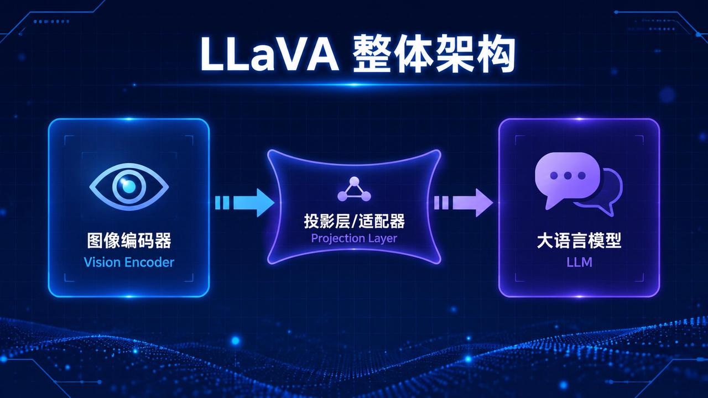
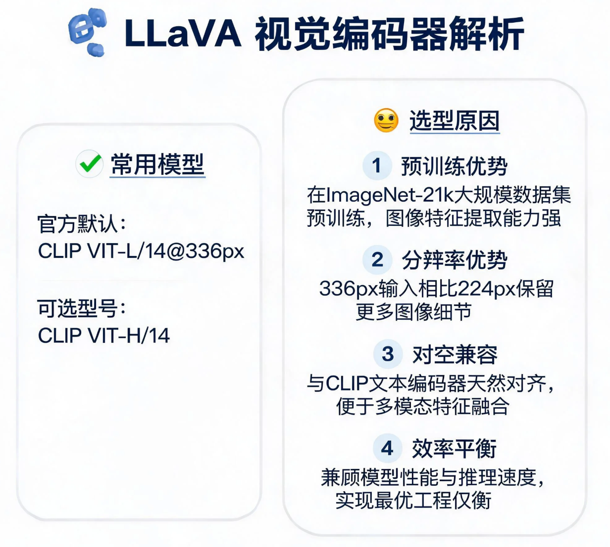
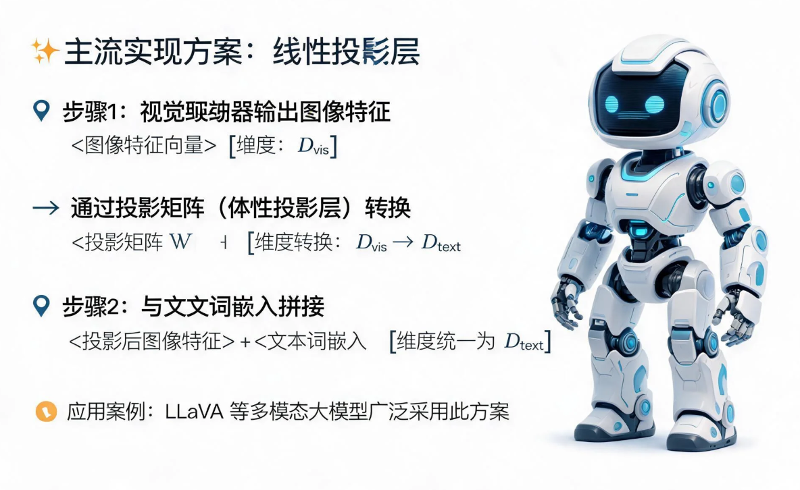
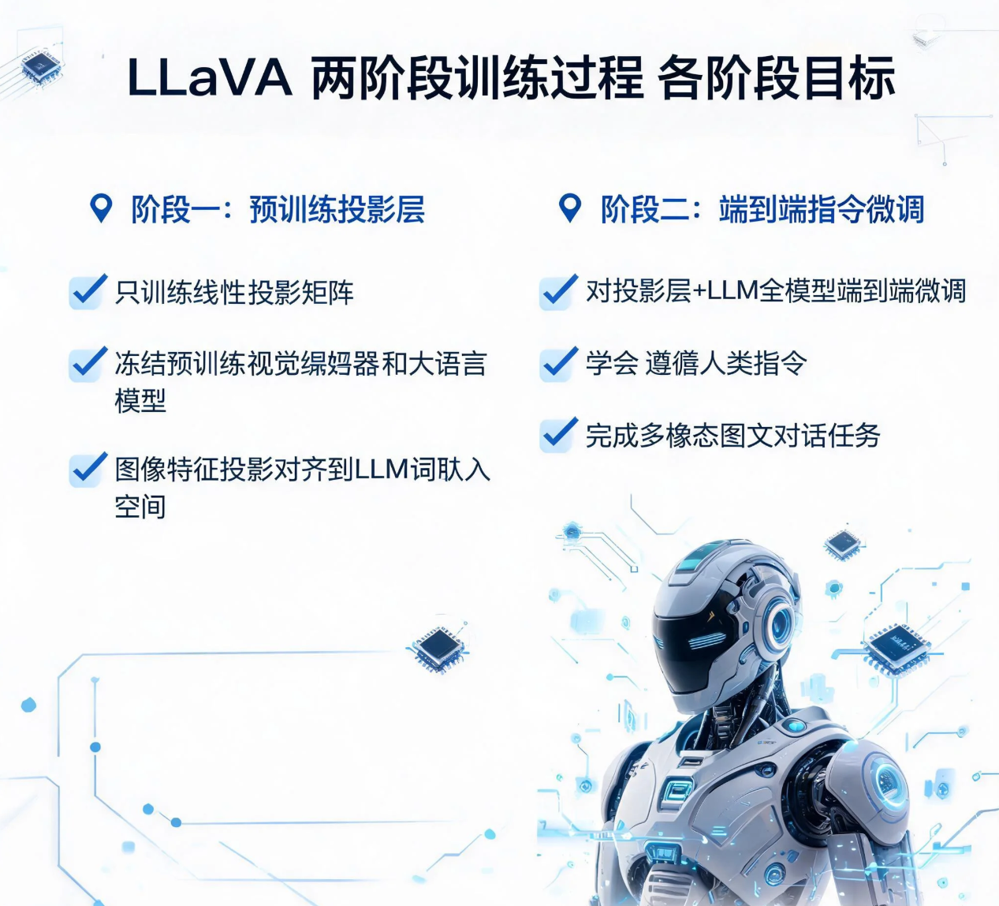

# 117.大模型（LLMs）多模态大模型（LLaVA 等）

#### 请简述 LLaVA 的整体架构。



LLaVA（Large Language and Vision Assistant）的架构哲学是“大道至简”，它用最直接的方式将视觉感知与语言理解连接起来，形成了一个端到端的多模态对话模型。其核心可以概括为三个组件和两条路径。

三个核心组件：

1. 视觉编码器（Vision Encoder）：一个预训练的视觉Transformer模型，通常是CLIP的视觉部分。它负责将输入的原始图像转换成一组高维的视觉特征向量。

2. 跨模态连接器（Cross-modal Connector）：这是一个极其轻量的模块，通常就是一个简单的线性投影层。它的作用极其纯粹：将视觉特征向量的维度，映射到语言模型词嵌入空间的维度，实现物理上的对齐。没有复杂的注意力或门控机制，就是一个“翻译层”。

3. 大语言模型（Large Language Model）：一个强大的、预训练好的自回归语言模型，例如Vicuna、LLaMA。它是整个系统的“大脑”，负责接收“翻译”后的视觉信号和文本指令，进行跨模态的推理和文本生成。

两条信息流路径：

- 视觉路径：图像经过视觉编码器提取特征，再通过线性投影层映射，得到的是一系列“视觉词元”。

- 语言路径：用户的文本指令被分词为“文本词元”。

这两条路径的信息最终在序列维度拼接成一个统一的输入序列，送入语言模型。语言模型以自回归的方式逐个生成回复中的文本词元。这种极简设计让LLaVA可以完全复用预训练视觉模型和语言模型的强大能力，只需极少的可训练参数（仅连接器）就能进行高效的跨模态学习和推理。

---

#### LLaVA 中视觉编码器通常选用哪个模型？为什么？



LLaVA的视觉编码器通常选用的是基于CLIP（Contrastive Language–Image Pre-training）训练出来的视觉Transformer，具体配置为ViT-L/14，即采用Large规模的ViT，输入图像的patch大小为14×14。

选择CLIP ViT作为视觉编码器的原因非常深刻，它不仅是一个性能考量，更是一次思想实验的成功验证：

- 语义对齐的预训练：CLIP本身是通过对比学习，在4亿图文对上进行训练的，其视觉编码器已经学会将图像内容映射到一个与自然语言描述高度对齐的语义空间。这一点至关重要。直接将CLIP的视觉特征喂给语言模型，意味着语言模型“看到”的不是原始的像素或低级纹理，而是已经被预结构化、富含高层语义的表示。这极大地降低了语言模型理解视觉信息的门槛。

- 强大的表征能力：ViT-L/14是当时社区中广泛使用且性能顶尖的视觉骨干网络。它在众多视觉理解和分类任务上表现出色，能提取出细粒度的、具有强判别力的视觉特征。14×14的patch大小提供了一个良好的精度和计算效率的平衡。

- LLaVA论文的核心实验结论：作者在论文中系统地对比了不同的视觉编码器，发现其选择直接决定了多模态模型的能力天花板。他们的结论是：仅需一个强大的、语义对齐的视觉编码器，再加上一个极简的线性连接器，就足以让语言模型获得强大的多模态能力。这推翻了当时一些认为需要更复杂跨模态融合模块（如BLIP-2的Q-Former）的观点，证明了预训练视觉模型的质量本身就是最关键的。

---

#### 如何将图像特征映射到语言模型的词嵌入空间？

将图像特征映射到语言模型空间，本质上是要解决一个维度和语义双重不匹配的问题。LLaVA使用的核心工具是一个极其简洁的线性投影层，通常被称为“连接器”。



技术实现过程：

1. 特征提取：对于输入图像，CLIP视觉编码器输出一组形状为 `(N, D_v)` 的特征向量。其中`N`是图像被分割成的patch数量加上一个全局的`[CLS]` token（共257个），`D_v`是视觉编码器的输出维度（例如1024维）。

2. 维度转换：这个线性投影层就是一个形状为 `D_v × D_l` 的矩阵`W`，其中`D_l`是语言模型的词嵌入维度（例如4096维）。通过简单的矩阵乘法 `X_v · W`，N个视觉patch特征的维度就变成了 `D_l`。

3. 序列化与拼接：经过投影后，我们就得到了N个形状为`D_l`的向量，它们可以与语言模型词表中的每个词的嵌入向量处于同一个空间中了。它们被视为一种特殊的“视觉词元”。在输入语言模型时，只需将这些“视觉词元”序列与经过词嵌入映射的“文本词元”序列拼接起来，形成一个完整的输入序列。

不选用更复杂模块的原因：

这个线性投影层之所以有效，是因为它完全依赖了CLIP预训练带来的语义对齐优势。因为CLIP的视觉特征和文本特征已经在对比学习中被拉近到同一个语义空间，所以一个线性变换就足以进行物理上的维度对齐，无需复杂的非线性变换网络。若使用如Q-Former等可学习的查询网络，反而可能因为训练数据不足或架构复杂，破坏CLIP学到的良好预训练特性。LLaVA的实践证明了，在优秀的预训练模型之上，简单就是美，Simple is the best。

---

#### LLaVA 的两阶段训练过程是什么？各阶段的目标是什么？



LLaVA采用了一个精心设计的、分两阶段的课程学习策略，让语言模型能循序渐进地“睁开眼睛看世界”。

第一阶段：特征对齐预训练

- 目标：教会语言模型什么是“视觉词元”。此阶段的核心任务是让语言模型理解，那些通过线性投影层映射过来的、原本不属于其词表的向量，是代表图像内容的有效信息，并将其与特定的语义概念初步关联。

- 训练方法：冻结视觉编码器和语言模型的绝大部分参数，只更新线性投影连接器的权重。训练数据使用的是静态的、简短描述的图像-文本对（如CC3M数据集）。训练任务非常纯粹：给定一张图和它的简单描述（如“一只猫在沙发上”），模型需要根据图像和“描述该图像”的指令，去重建这段描述文本。

- 原理：此阶段相当于对连接器进行“热身”，让映射后的视觉特征与语言空间中特定的单词（如“猫”、“沙发”）建立起初步的关联，为后续复杂的指令跟随打下基础。

第二阶段：视觉指令微调

- 目标：教会语言模型如何进行多模态对话和推理。此阶段的核心任务是让模型具备指令跟随能力，能处理各种复杂的、开放式的多模态任务（如详细的场景描述、基于图像的逻辑推理、多轮对话等）。

- 训练方法：保持视觉编码器冻结，同时更新连接器和语言模型的参数（或对语言模型使用LoRA等高效微调方法）。训练数据是高质量的、多轮对话形式的视觉指令数据，涵盖“详细描述”、“复杂问答”、“外部知识推理”等多种任务类型。训练时，损失函数只计算在模型生成的那部分文本上。

- 原理：此阶段将模型在第一阶段学到的基础对齐能力，泛化到各种真实的用户交互场景中。语言模型被微调以遵循包含图像和复杂指令的上下文，学会了如何根据视觉信息进行推理、解释、比较和创作。

这种两阶段策略被证明是极其高效的，它完美地将“对齐”和“推理”两个学习目标解耦，避免了因目标冲突而导致的训练不稳定。

---

#### 什么是视觉指令微调（Visual Instruction Tuning）？

视觉指令微调是LLaVA工作的第二大核心创新，它将纯文本大模型的“指令遵循”能力，成功地复制到了多模态领域。

核心思想：传统的图文模型在训练时，数据格式通常是“图像-文本对”，模型被训练成“看图说话”的模式，这限制了其进行复杂交互的能力。视觉指令微调打破了这种模式，将所有多模态任务统一为一种“视觉对话”的形式。

具体实现方法：

1. 对话模板：将数据组织成多轮对话的格式，包含明确的角色（`USER` 和 `ASSISTANT`）。用户的问题（指令）可以指向图像中的任何内容，而助理的回答则可以是任何形式的文本。

2. 指令数据多样性：指令数据不局限于一问一答，而是包含了单轮问答、多轮指代对话、详细描述、复杂推理、开放世界知识问答等，所有类型的数据都统一使用上述模板进行格式化。

3. 训练过程：模型被训练来根据图像和用户指令，自回归地生成助理角色的回复。训练目标只计算在`ASSISTANT`生成的部分，确保模型学会的是如何“遵循指令并生成答案”，而不是“预测用户的提问”。

它带来的转变：

视觉指令微调使得模型不再是一个只会给图片写标题的机器，而是一个能遵循人类意图、通过对话进行交互的多模态智能体。你可以问它关于图片细节的问题，可以要求它基于图片写故事，甚至可以让它用特定风格（如使用表情符号）来回答，极大丰富了人机交互的方式。

---

#### LLaVA-1.5 相比原版做了哪些关键改进？

LLaVA-1.5是原版的“工程优化成熟版”，它在不改变架构哲学（极简连接器）的前提下，通过一系列数据和训练技巧的改进，实现了约10%的综合性能提升。其关键改进包括：

- 视觉编码器与分辨率的升级：将视觉编码器从CLIP ViT-L升级到更强的CLIP ViT-L-336px，这意味着输入图像的分辨率从224提升到336，允许模型“看”到更多细节。同时，将简单的线性投影层替换为一个两层的MLP，以更平滑地将视觉特征从ViT空间映射到语言模型空间。

- 开放世界知识的注入：在第二阶段的视觉指令微调中，显式地加入了专注于外部知识和OCR（光学字符识别） 的任务数据。这有效缓解了多模态大模型常见的“幻觉”问题，并要求模型在回答问题时，能结合图像内容和其内置的参数化知识给出更有信息量的答案。

- 模型容量的扩展：将语言模型从7B扩展到13B，更强的语言基座为多模态推理提供了更坚实的底座。

- 数据集与训练策略的优化：使用了一个更大、更高质量、类别更丰富的指令微调数据集。并调整了训练超参数，如调整了学习率和训练的轮数。此外，LLaVA-1.5采用了响应式提示格式，使模型能更好地处理不同长度的指令和上下文。

这些改进都是渐进式的，但组合在一起就产生了质变。它证明了，在正确的架构方向下，数据质量和训练细节的打磨是模型能力提升的关键。

---

#### 多模态大模型中的“幻觉”现象是什么？如何缓解？

多模态大模型的“幻觉”是指模型生成的文本描述，忠实于其参数化知识而非输入的视觉内容。具体表现为：描述出图像中不存在的物体（对象幻觉）、虚构人物关系、或给物体赋予错误的属性。其根本原因在于模型在训练时，严重依赖了语言模型强大的先验知识和模式补全能力，而忽视了当下的视觉证据。

缓解方法体系：

1. 数据层面：
  - 引入反事实数据：在训练集中加入成对的、带有细微差别的图片和描述，迫使模型必须仔细观察图像才能回答正确。
  - 增强OCR与空间推理数据：让模型在含有复杂文字和空间关系的任务上进行专门训练，强化其对图像局部信息的关注。
  - 偏好对齐：收集包含幻觉的回复，并使用DPO（直接偏好优化）等强化学习方法，将不产生幻觉的、忠实于图像的回复作为偏好进行训练。

2. 训练层面：
  - 更强的视觉编码与对齐：升级视觉编码器，或使用更强大的连接器，确保图像信息能被更完整、更精确地传递到语言模型中。
  - 动态调整训练策略：在训练时，对图像文本对应用更强的数据增强，迫使模型从视觉信号中学习更鲁棒的表征。

3. 推理与后处理层面：
  - 视觉对比解码（VCD）：这是当前一种非常有效的去幻觉技术。在推理时，同时运行原始模型和一个“盲”版本（即大幅削弱图像输入信号，或输入纯黑图）。将原始模型的输出概率减去“盲”模型的输出概率，放大了真正由视觉信息驱动的那部分输出，有效抑制了语言模型自身的先验知识所导致的编造。
  - 检索增强生成（RAG）：对于事实性知识，可以通过外部检索获取权威知识，然后与视觉信息结合，减少模型对内在知识的依赖。
  - 约束性解码：在输出过程中，强制模型在提及关键实体时，必须能回溯到图像中对应的区域，否则就拒绝生成。

---

#### BLIP-2 中的 Q-Former 起什么作用？它是如何训练的？

与LLaVA的极简线性投影不同，BLIP-2采用了一个更复杂的方案来弥合视觉-语言之间的模态鸿沟，其核心就是Q-Former（Querying Transformer）。它的角色是一个信息瓶颈和翻译官。

Q-Former 的作用：

Q-Former位于一个冻结的视觉编码器和一个冻结的语言模型之间。它不直接将视觉特征输入语言模型，而是通过一组可学习的“查询向量”，从视觉特征中“提取”出与文本最相关的信息，再将提取后的紧凑表示输入语言模型。

Q-Former 的训练机制（两阶段）：

第一阶段：冻结视觉编码器，训练Q-Former进行视觉-语言表征学习。 此阶段的目标是让Q-Former学会如何从图像中提取有意义的视觉-语言信息。它通过同时优化三个共享自注意力层的目标来实现：

- 图文对比学习（ITC）：对齐Q-Former输出的整体图像表示（`[CLS]`对应的查询输出）与图像的对应文本描述的整体表示。这与CLIP的思想类似，用于全局粗粒度的对齐。

- 基于图像的文本生成（ITG）：让Q-Former将提取到的视觉信息作为前缀，自回归地生成图像的文本描述。这迫使查询向量提取出的视觉信息必须足够丰富，才能支撑文本生成。

- 图文匹配（ITM）：一个二分类任务，判断一对图像和文本是否匹配。这是一种细粒度的对齐任务。

第二阶段：将Q-Former接入冻结的语言模型，进行全模型的视觉-语言生成学习。 此阶段，Q-Former将第一阶段学到的、从图像中提取的紧凑视觉表示，作为“软视觉提示”喂给冻结的大语言模型。语言模型根据这些提示和文本指令，学习生成相应的文本描述。训练时，只更新Q-Former的参数。

Q-Former通过这种方式，充当了视觉和语言两大模型之间的“万能适配器”，使得两个冻结的模型无需直接交互，就能通过一个可学习的信息瓶颈高效地协同工作。

---

#### 请对比 LLaVA 与 BLIP-2 的跨模态对齐方式。

LLaVA和BLIP-2代表了两种截然不同的跨模态对齐哲学，它们的核心分歧在于：应该由谁来承担“翻译官”的角色，以及这个翻译官应该有多复杂？

LLaVA：极简主义的线性投影

LLaVA选择了一条极其直接的道路。它使用一个简单的线性投影层（或其变体MLP），将CLIP视觉编码器提取的图像特征直接映射到语言模型的词嵌入空间。这种做法的精妙之处在于：

- 依赖高质量的预训练对齐：LLaVA完全信赖CLIP预训练带来的视觉-语言对齐效果。因为CLIP的视觉特征已经和文本特征处于相似的语义空间，一个线性变换就足以完成维度匹配，无需复杂的非线性网络。

- 信息无损传递：线性投影是一种保信息操作。所有CLIP提取的视觉patch特征都被完整地、不加选择地传递给语言模型。这意味着语言模型能够接触到最原始的视觉信息，由它自己来决定哪些信息重要、哪些不重要。

- 训练高效：连接器只有极少量参数，在第一阶段对齐预训练时收敛极快，计算开销非常小。

BLIP-2：智能代理的Q-Former

BLIP-2则采用了一个更复杂的中间模块——Q-Former。它的设计思路是：

- 可学习的瓶颈：Q-Former通过一组可学习的查询向量，从冻结的视觉编码器输出中“主动提取”与语言最相关的视觉信息。它充当了一个智能代理，将视觉特征“翻译”成语言模型更容易理解的“软提示”。

- 压缩与过滤：Q-Former输出的视觉token数量远少于原始patch数量（通常从257压缩到32），这大大降低了语言模型的计算负担，同时也起到了信息过滤的作用。

- 模块化与复用：Q-Former使得两个预训练模型（视觉和语言）都能保持冻结，只有Q-Former本身需要训练。这实现了极致的模块化，理论上可以为任意组合的视觉和语言模型训练适配器。

核心差异总结：

| 特性 | LLaVA | BLIP-2 |
| --- | --- | --- |
| 对齐模块 | 线性投影/MLP | Q-Former（Transformer） |
| 参数量 | 极少（百万级） | 较多（千万级） |
| 视觉token数 | 不变（257个） | 大幅压缩（32个） |
| 信息传递 | 无损传递 | 有损压缩+筛选 |
| 对预训练的依赖 | 高度依赖CLIP对齐质量 | 通过Q-Former自己学习对齐 |
| 训练成本 | 低 | 较高，需要两阶段复杂训练 |

LLaVA的思路被后续工作证明更加有效，因为它尊重了预训练模型的原始能力，不做过度干预。

---

#### 如何评测多模态大模型的视觉理解能力？列举几个基准。

评测多模态大模型的能力是一个多维度的系统工程，需要覆盖从基础感知到高阶推理的各个层面。以下是一些关键的评测基准：

1. 综合能力评测

- MMBench：设计精良的多维度评测集，包含20个细粒度能力维度，采用多选题形式，评估模型在感知、推理等各方面的表现。它的优势在于层次化评估和抗作弊设计。

- SEED-Bench：大规模生成式评测基准，包含1.4万道题目，覆盖12个评估维度。它使用GPT-4等强模型作为裁判来评判开放式答案的正确性，更贴近真实交互场景。

- MMMU：多模态多学科理解基准，涵盖大学水平的6个学科、30个科目，考察模型在专业知识领域的跨模态推理能力。

2. 幻觉与忠实度评测

- POPE（Polling-based Object Probing Evaluation）：专门检测“物体幻觉”的评测方法。它向模型提出简单的二元问题（“图中是否存在XXX？”），通过统计模型对存在/不存在物体的误判率来量化幻觉严重程度。POPE能够精准诊断模型是否在“睁眼说瞎话”。

- MMHal-Bench：评估模型在多模态对话中产生幻觉的倾向，涵盖了对象、属性、关系等多种幻觉类型。

3. 文本理解评测

- TextVQA：评估模型对图像中文字信息的理解能力。模型需要读懂图中的文字，并回答相关问题。

- OCRBench：一个更大规模、更综合的OCR评估基准，包含文字识别、场景文字检测、文档理解等任务。

4. 数学与科学推理评测

- MathVista：专门评估多模态模型的数学推理能力，题目涵盖几何、代数、逻辑推理等多种类型，需要模型结合图表和文字进行解答。

- ScienceQA：一个大规模的多模态科学问答基准，覆盖自然科学、社会科学等领域，考察模型利用图像和文本知识进行科学推理的能力。

这些基准从不同角度揭示了模型的优劣，一个优秀的多模态模型应当在幻觉率低、感知准确的前提下，展现出强大的推理和知识运用能力。

---

#### 动态分辨率策略解决了什么问题？举例说明。

动态分辨率策略旨在解决多模态模型中图像分辨率固定导致的细节丢失与计算成本之间的矛盾。

传统做法是将输入图像统一缩放到一个固定尺寸（如224×224或336×336）。这种暴力缩放会带来严重问题：对于高分辨率图像，细节被丢失；对于低分辨率图像，计算资源被浪费。更重要的是，语言模型接收到的视觉token数量是固定的，无法根据图像的实际信息量进行动态调整。

动态分块策略（如LLaVA-NeXT采用）是当前的主流解决方案。其核心思想是：

1. 自适应分割：将输入图像根据其原始长宽比，分割成若干个较小的、分辨率固定的子图像块。

2. 多尺度编码：每个子图像块被独立编码，同时还会编码一个全局缩略图，以保持整体上下文。

3. 动态token数：视觉token的总数不再固定，而是根据图像大小和分割的块数动态变化。

举例说明：假设我们有一张宽高比为3:1的超宽全景照片。传统的固定分辨率策略会将其压缩成一个正方形，图像中的细节被严重扭曲。而动态分块策略会将这张图切成三个并排的正方形块。每个块都保持了足够的分辨率来保留细节。最终，视觉token数量变为原来的三倍，但每个token所承载的信息密度大大提高。

这种策略使得模型能够：

- 处理任意宽高比的图像，不再受限于正方形输入。

- 保留高分辨率图像的细节，这对于OCR、小物体识别等任务至关重要。

- 有效利用计算资源，对于简单图像使用更少的token，对于复杂图像使用更多的token。

动态分辨率策略是多模态模型迈向实用化的关键一步。

---

#### 在 LLaVA 中，图像 token 与文本 token 是如何组合并送入 LLM 的？

LLaVA的处理方式非常直接，它将图像token视为一种“外语”，通过特殊的“语法标记”与文本token拼接，形成一个统一的序列。

具体步骤：

1. 图像特征提取与投影：输入图像经过视觉编码器和线性投影层，得到一系列视觉特征向量，每个向量的维度与LLM的词嵌入维度相同。这些向量就是“图像token”。

2. 文本分词与嵌入：用户的文本指令被分词，并通过LLM的词嵌入矩阵映射为对应的“文本token”。

3. 序列拼接：LLaVA使用一种特殊的提示模板来组织图像和文本token。典型的模板如下：

```plain text
<image> USER: <image>\n 请描述这张图片。 ASSISTANT:
```

这里的`<image>`是一个特殊的占位符，在代码实现中，它会被替换为第一步生成的所有图像token。最终的输入序列结构为：

```plain text
[图像token序列] [文本token序列]
```

图像token总是被放置在文本token之前，形成一个“视觉上下文”。

4. 送入LLM：这个拼接后的二维张量（shape为`[1, total_tokens, embedding_dim]`）直接输入到LLM的Transformer解码器中。LLM通过因果自注意力机制，使得生成的每个文本token都能关注到所有图像token和之前的文本token，从而实现跨模态推理。

关键点：LLaVA没有为图像设计任何特殊的结构，它只是简单地将图像token“嵌入”到了LLM原本的序列处理流程中。这种极简设计意味着LLM的现有能力（如注意力机制、上下文学习）可以直接应用于视觉信息。

---

#### 多模态大模型如何处理视频输入？

视频的处理是当前多模态大模型的前沿方向，其核心挑战在于时序信息的建模和计算成本的控制。主流方法可分为以下几类：

1. 固定帧采样：这是最直接的方法。从视频中均匀采样固定数量的帧（如8帧或16帧），将每一帧作为独立图像送入视觉编码器。得到的多组图像token直接拼接，或通过简单的池化操作降维，然后与文本token一起送入LLM。这种方法简单有效，但会丢失帧间的精细运动信息，且无法处理长视频。

2. 时序压缩：为了处理更长的视频，需要更高效的压缩方法。例如，使用3D卷积或时空Transformer，将连续的多帧在时间维度上进行融合和压缩，生成包含时序信息的“视频token”。这样可以大大减少送入LLM的token数量。

3. 记忆与检索：对于极长视频（如电影），将所有帧一次性处理是不现实的。此时需要引入记忆机制。例如，将视频分段处理，每一段生成一个摘要表示，存入外部记忆库。在需要回答问题时，根据问题检索相关的片段进行精细分析。这种方法类似于人类的“快速浏览+重点回看”。

4. 混合架构（如Video-LLaMA）：一些模型专门设计了用于视频理解的组件。例如，使用ViT提取每帧的空间特征，然后使用一个额外的Transformer（如Q-Former）来对这些帧级特征进行时序建模，生成包含时序信息的查询向量。这种方法更显式地处理了时间维度的依赖关系。

视频处理的核心矛盾是“信息量”与“计算量”的平衡，未来的方向必然是更智能的自适应采样和更高效的时序压缩。

---

#### 请解释多模态模型中的“物体幻觉”评测（如 POPE）。

物体幻觉是多模态模型最常见的“谎言”之一。当模型被问到图像中是否存在某个物体时，它可能会自信地给出“存在”的错误回答。POPE（Polling-based Object Probing Evaluation）是一种极其巧妙且严格的量化评测方法。

POPE的原理：

POPE将幻觉评测转化为一个简单的“是/否”问答游戏。它的核心思想是：如果模型声称看到了一个物体，那么这个物体必须真实存在于图像中。

构造探测问题：

对于一个图像，POPE会构造三种类型的“探测问题”，询问模型：“Is there a [物体] in the image? Please answer yes or no.”

1. 真实物体（存在）：问一个图像中确实存在的物体（如“狗”）。正确答案应为“Yes”。

2. 常见但不在图中的物体（不存在）：问一个生活中常见但此图中不存在的物体（如“汽车”，但图是室内场景）。正确答案应为“No”。这测试模型是否因语言先验（高频词）而胡说。

3. 对抗性物体（不存在）：问一个与图中真实物体类别相近或常共现，但实际不存在的物体（如真“猫”，问“狗”）。正确答案应为“No”。这是最难的测试，专门检测模型是否在混淆相似概念。

核心指标：

- 准确率：在所有问题上回答正确的比例。

- 召回率（对存在物体）：真实存在物体被回答“Yes”的比例。

- 虚警率（对不存在物体）：在不存在的物体上，模型回答“Yes”的比例。这是衡量对象幻觉的核心——虚警率越高，幻觉越严重。

- F1-Score：综合考虑对存在和不存在物体的判别能力。

为什么POPE有效：

POPE极其严格且客观，不需要复杂的人工判断。它通过精心设计的对抗性问题，能够精准地“刺破”模型的语言先验气泡，暴露出模型是否在真正“看”图，还是在根据学到的语言模式“猜”。

---

#### 多模态大模型与传统的视觉-语言预训练模型（如ViLBERT）的主要区别是什么？

这是一个从“专才”到“通才”的范式革命。两者的核心区别体现在以下几个方面：

| 特性 | 传统视觉-语言模型 (ViLBERT) | 多模态大模型 (LLaVA, GPT-4V) |
| --- | --- | --- |
| 架构 | 双塔/双流，独立的视觉编码器和文本编码器，通过交叉注意力或拼接进行交互。 | 单塔/单流，通常是一个强大的LLM作为核心，视觉信息作为输入token序列。 |
| 预训练任务 | 设计的代理任务，如Masked Language Modeling (MLM)、Masked Region Modeling、图文匹配 (ITM)。 | 自回归语言建模（预测下一个Token），将所有任务统一为文本生成。 |
| 核心能力 | 特征抽取和表示学习，擅长分类、检索、VQA等“判别式”任务。 | 文本生成和指令遵循，擅长开放式描述、推理、对话等“生成式”任务。 |
| 任务适配 | 需要为每个下游任务添加特定的分类头并进行微调。 | 通过提示词（Prompt）或极少样本进行上下文学习，一个模型解决多种问题。 |
| 参数规模 | 相对较小（Base/Large，百万-亿级），不可扩展。 | 极大规模（十亿-千亿级），遵循Scaling Law，能力随规模增长。 |
| 涌现能力 | 无 | 具备强大的上下文学习、思维链推理等涌现能力。 |

根本区别：传统模型是“视觉-语言理解器”，其目标是学习多模态的通用表征；而多模态大模型是“视觉-语言生成器/推理器”，其目标是构建一个能看、能听、能思考、能创造的通用智能体。

---

#### 在多模态大模型的高效微调中，通常使用哪些技术？

高效微调的核心目标是在不显著增加计算负担的前提下，让预训练模型适应新的任务或领域。在多模态大模型中，常用技术包括：

1. LoRA（Low-Rank Adaptation）：这是目前最主流的微调方法。它不改变原始模型的权重，而是在需要微调的层（通常是语言模型的自注意力层）旁路添加一对低秩矩阵`A`和`B`。训练时只更新`A`和`B`，训练后可将`A·B`合并回原权重。对于多模态模型，通常对LLM部分使用LoRA，视觉编码器保持冻结。

2. 适配器（Adapter）：在Transformer的层间插入小型神经网络模块（通常是两层MLP）。训练时只更新适配器参数。适配器比LoRA稍慢，但可以实现更复杂的领域适配。

3. 前缀提示与软提示（Prefix/Prompt Tuning）：在输入序列前添加一些可学习的“虚拟token”。这些token不来自词表，而是随机初始化的向量，通过训练来学习如何“引导”模型生成期望的输出。这种方法参数量极小，但效果可能不如LoRA稳定。

4. 冻结视觉编码器，只训连接器和部分LLM：这是多模态微调的常用策略。因为视觉编码器的预训练成本极高，且其提取的通用视觉特征通常足够鲁棒。我们只需微调轻量的连接器（对齐模块）和LLM的顶层或使用LoRA微调LLM，就可以实现高效的领域适配。

5. 量化微调（QLoRA）：在LoRA的基础上，将基座模型量化为4-bit精度，进一步降低显存需求，使得在消费级显卡上微调大模型成为可能。

这些技术可以灵活组合，例如使用QLoRA微调LLM，同时更新一个轻量适配器，以适应特定任务。

---

#### 使用 GPT-4 等大模型生成多模态指令数据的流程和优势是什么？

这是当前多模态模型训练中最重要的一环。由于人工标注多模态对话数据成本极高，利用GPT-4V等强模型来生成训练数据已经成为标准做法。

流程：

1. 图像收集与预处理：收集大量目标领域的图像，并对其中的关键视觉信息（如物体、文字、场景）进行自动标注，生成图像元数据。

2. 提示词设计与数据生成：
  - 将图像元数据（如“一张包含两个人和一只狗的室内照片”）输入给GPT-4V，并配以精心设计的提示词，要求它生成特定类型的对话数据。
  - 提示词可以要求GPT-4V生成详细的图像描述、基于图像的复杂问答、多轮指代对话、甚至从特定角色视角出发的叙述。

3. 数据清洗与筛选：
  - 使用规则或模型对生成的数据进行过滤，剔除掉低质量、重复或不安全的样本。
  - 进行事实一致性校验，尽量减少幻觉数据的引入。

4. 格式化：将筛选后的数据格式化为标准的指令对话格式（如ChatML），用于后续的模型训练。

优势：

- 成本与效率：极大地降低了人工标注成本，并且生成速度极快，可以轻松构造出百万级的数据集。

- 多样性与复杂性：通过巧妙设计的提示词，可以生成远超人工标注范围的、高度多样化和复杂的指令，例如“用苏格拉底式的提问风格讨论这张图片中的社会问题”。

- 可扩展性：只要有新的图像或新的领域需求，就可以快速生成对应的训练数据，实现模型的持续进化。

- 语言一致性：生成的文本指令和回复天然具有高质量的语言风格，与强模型的输出分布一致。

这种方法本质上是一种“知识蒸馏”，将GPT-4V的多模态理解和对话能力蒸馏到目标小模型中。

---

#### 多模态大模型部署到端侧的主要挑战有哪些？

将多模态大模型部署到端侧（手机、PC、边缘设备）是一个系统工程难题，面临多重挑战：

1. 模型体积与存储限制：多模态模型包含视觉编码器和语言模型两部分，参数量动辄数十亿，即使经过压缩，模型文件大小也远超普通应用。如何在有限的设备存储空间内承载模型是首要问题。常用的解决方法是模型量化和剪枝。

2. 推理延迟与实时性要求：端侧应用对实时性要求极高（如拍照识物）。庞大的模型在移动端芯片上运行，前向推理时间可能长达数秒，完全无法满足用户体验。这需要软硬件协同优化，如使用高效的推理引擎、算子融合、以及利用NPU（神经网络处理单元）进行加速。

3. 功耗与发热问题：推理密集计算会迅速消耗电量并导致设备发热，这对于手机等电池供电的设备是致命问题。需要在模型精度、推理速度和功耗之间找到一个平衡点。

4. 内存带宽瓶颈：多模态模型的KV Cache和中间激活会占用大量内存，而移动设备的内存带宽远低于服务器GPU。这导致大模型的生成速度极慢，尤其在长序列生成时。分组查询注意力（GQA）和FlashAttention等技术可以有效缓解此问题。

5. 跨平台适配与碎片化：不同的端侧设备（iOS、Android、不同厂商的芯片）具有不同的硬件架构和计算能力，需要针对每种平台进行适配和优化，工作量大且复杂。

解决这些挑战需要从模型侧（设计更高效的轻量化架构，如MobileLLaMA）和推理侧（使用llama.cpp、MLC-LLM等高效推理框架）共同发力。

---

#### 什么是“视觉抽象”能力？为什么对大模型重要？

视觉抽象能力是指模型超越对图像中具体像素和物体的识别，提取其背后隐含的逻辑关系、空间结构、物理规律或象征意义的能力。它分为多个层次：

- 空间抽象：理解物体的三维空间关系、深度、透视等，能够根据语言描述在脑海中构建或修改空间布局。

- 逻辑抽象：从图表、流程图、示意图中理解数据趋势、逻辑关系、系统结构等，并进行推理和预测。

- 概念抽象：理解图标、路标、表情包等抽象符号的含义，以及艺术作品、漫画中的隐喻、讽刺、情感等非写实信息。

为什么重要：

大模型的终极目标是成为能够理解和改造世界的通用智能体，而这离不开对世界的抽象建模。如果只具备“看图识字”的能力，模型就无法：

- 看懂一个电路图并分析其功能（逻辑抽象）。

- 理解一张X光片并判断病灶位置（空间与医学抽象）。

- 欣赏一幅现代艺术画并给出评析（概念抽象）。

- 根据一张草图生成对应的UI代码（跨模态抽象生成）。

视觉抽象能力是连接视觉感知与高级认知的桥梁，是衡量多模态大模型是否具备“真实世界理解力”的关键指标。

---

#### 多模态大模型在医学影像分析中面临哪些特殊困难？

医学影像分析是一个高风险的垂直领域，多模态大模型在此面临一系列独特的挑战：

1. 数据稀缺与隐私壁垒：高质量的医学影像数据（如CT、MRI）获取成本极高，且标注需要昂贵的专家知识。同时，医疗数据涉及严格的隐私保护（如HIPAA法规），不同医疗机构之间难以共享数据形成大规模训练集，这与大模型依赖海量数据的基本规律相悖。

2. 幻觉的零容忍：在通用领域，幻觉可能只是一个小错误。但在医学影像分析中，一个错误的诊断建议（如将良性结节误判为恶性肿瘤）可能导致灾难性的医疗后果。因此，对模型输出的可解释性、置信度校准和事实准确性要求达到了极致。

3. 图像特征的高度特异性与复杂性：

- 模态差异：不同成像技术（CT、MRI、X光、超声）生成的图像灰度、对比度和空间结构完全不同，模型需要具备跨模态的理解能力。

- 异常检测的难度：很多病变区域与正常组织在纹理、边界上差异极其微小，且在整幅图中占比极小，要求模型具备极高的细粒度识别能力。

- 三维上下文：CT/MRI数据本质是三维的，而大多数多模态大模型目前是基于二维图像设计的。如何高效地处理三维体数据并捕捉空间结构是一个难题。

4. 报告生成的专业性与规范性：医学影像报告需要遵循严格的医学术语和结构，描述必须精准、无歧义。模型生成的自然语言需要符合这些专业规范，并且能够将影像发现与患者的病史、化验结果等其他模态数据整合起来，进行综合诊断。

5. 法规与伦理的严格监管：任何用于临床辅助诊断的AI系统都需要通过FDA或CE等监管机构的严格审批，其算法的透明度、鲁棒性和公平性都需要经过广泛验证。

这些困难使得医学影像分析成为检验多模态大模型能力的“终极试金石”，要求模型在知识精度、安全性和专业理解能力上都达到前所未有的高度。

