# 118.大模型（LLMs）新架构（Mamba、RWKV、Mamba-2）

#### 大模型（LLMs）新架构（Mamba、RWKV、Mamba-2）面

#### 什么是状态空间模型（SSM）？它的基本方程是什么？

状态空间模型（State Space Model, SSM）是描述动态系统的一种经典数学框架，广泛应用于控制论、信号处理和现代递归神经网络。在深度学习语境中，SSM 被用来建模序列数据，其核心思想是：通过一个潜在的隐状态（hidden state）随时间的演化，来捕捉序列中的长期依赖关系。

SSM 的基本方程由两个部分构成：状态方程和观测方程。

连续时间形式：

$$
\begin{aligned}
\dot{h}(t)&=\mathbf{A}h(t)+\mathbf{B}x(t)\\
y(t)&=\mathbf{C}h(t)+\mathbf{D}x(t)
\end{aligned}
$$

其中：

- $x(t)\in\mathbb{R}$ 是输入信号（在深度学习中通常是输入序列在时刻 $t$ 的一个特征维度）。
- $h(t)\in\mathbb{R}^N$ 是系统的隐状态，$N$ 是状态的维度。
- $\mathbf{A}\in\mathbb{R}^{N\times N}$ 是状态转移矩阵，描述了系统内部状态的演化规律。
- $\mathbf{B}\in\mathbb{R}^{N\times1}$ 是输入矩阵，控制输入 $x(t)$ 如何影响状态。
- $\mathbf{C}\in\mathbb{R}^{1\times N}$ 是输出矩阵，将隐状态映射到输出 $y(t)$。
- $\mathbf{D}\in\mathbb{R}$ 是直接传输矩阵（通常可忽略或视为残差连接）。

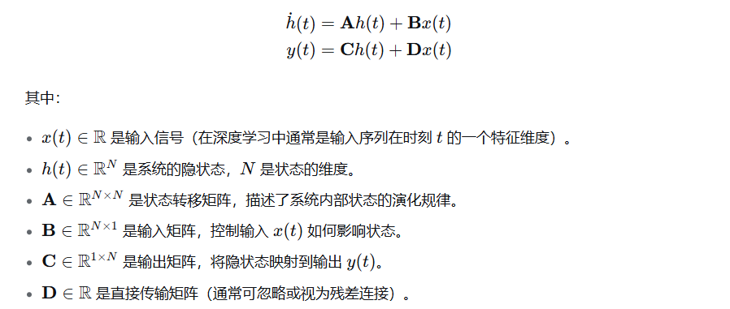{.ocr-src}

离散时间形式：

为了在计算机上处理离散序列，需要将连续SSM离散化。给定一个步长（或采样间隔）Δ，常用的离散化方法有双线性变换、零阶保持等。离散化后得到：

为了在计算机上处理离散序列，需要将连续SSM离散化。给定一个步长（或采样间隔）Δ，常用的离散化方法有双线性变换、零阶保持等。离散化后得到：

$$
\begin{aligned}
h_t&=\overline{\mathbf{A}}h_{t-1}+\overline{\mathbf{B}}x_t\\
y_t&=\mathbf{C}h_t+\mathbf{D}x_t
\end{aligned}
$$

其中 $\overline{\mathbf{A}}=f(\mathbf{A},\Delta)$ 和 $\overline{\mathbf{B}}=g(\mathbf{B},\mathbf{A},\Delta)$ 是离散化后的矩阵，包含了步长信息。在S4等结构化SSM中，$\mathbf{A}$ 被设计为特定的形式（如HiPPO矩阵），以捕捉长期记忆，并通过高效的卷积计算实现并行训练。

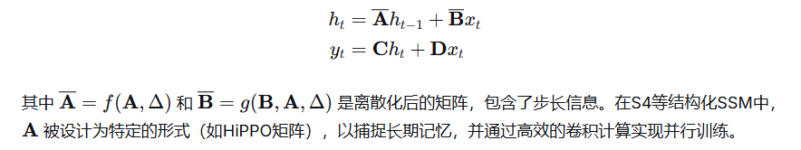{.ocr-src}

SSM的吸引力在于，它既能像RNN一样在推理时以恒定的内存和计算量逐token递归生成，又能在训练时通过卷积模式或并行扫描实现高效的并行化，避免了标准RNN的串行瓶颈。

---

#### Mamba 的核心创新“选择性扫描”是如何工作的？

Mamba 的核心创新是选择性状态空间模型，它打破了过去SSM（如S4）的一个根本限制：状态转移矩阵 **A**、输入矩阵 **B** 和步长 Δ 是与输入内容无关的固定参数。在S4中，这些参数是时不变的，意味着模型对每个输入token都以相同的方式处理，无法根据输入内容动态调整其行为。

Mamba 的“选择性扫描”机制使得 **B**、**C** 和 Δ 都依赖于当前输入 $x_t$：

$$
\mathbf{B}_t=s_B(x_t),\quad\mathbf{C}_t=s_C(x_t),\quad\Delta_t=\mathrm{softplus}(s_\Delta(x_t))
$$

其中 $s_B,s_C,s_\Delta$ 是简单的线性投影层。这使得SSM变为**时变系统**：

$$
h_t=\overline{\mathbf{A}}(\Delta_t)h_{t-1}+\overline{\mathbf{B}}(\Delta_t,x_t)x_t
$$

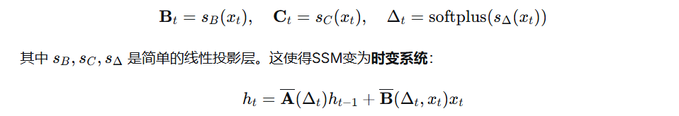{.ocr-src}

**工作原理与意义：**

- 当步长 $\Delta_t$ 被动态调整时，模型可以有选择性地“关注”或“忽略”当前输入。若 $\Delta_t$ 很小，状态更新很弱，模型几乎跳过该token（类似注意力中的低权重）；若 $\Delta_t$ 很大，则状态被大幅更新。
- $\mathbf{B}_t$ 和 $\mathbf{C}_t$ 的输入依赖性使得模型能够对每个token学习不同的输入-输出映射，这与Transformer中基于内容的注意力机制异曲同工。
- 这种选择性扫描让Mamba实现了“内容感知”的记忆。它不再是一个固定的、无选择的递归，而是一个能够根据当前token的重要程度动态调整状态更新的智能过滤器。

从实现角度，选择性扫描带来了一个挑战：由于 $\overline{\mathbf{B}}_t$ 和 $\Delta_t$ 依赖于输入，SSM不能再表示为一个固定卷积，因此S4的训练加速策略失效。Mamba通过**硬件感知的并行化**（如高效的并行扫描）解决了这一问题，使得训练仍然保持线性复杂度。

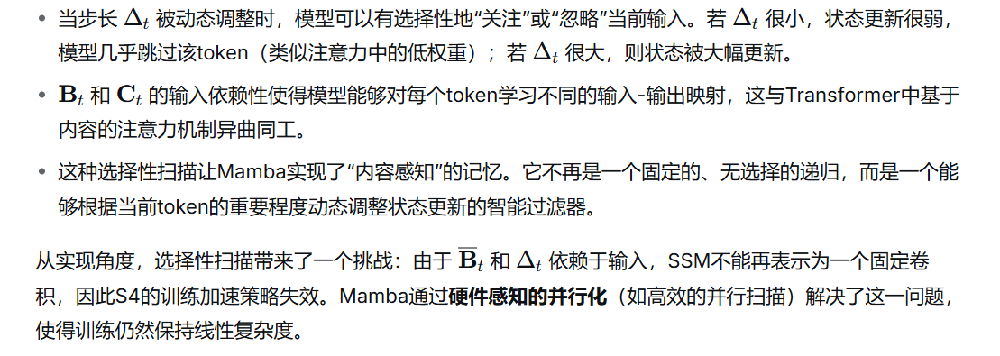{.ocr-src}

---

#### 与传统 SSM 相比，Mamba 的选择性机制带来了什么优势？

传统SSM（如S4）的主要缺陷是时不变性，这导致它在处理需要内容感知推理的任务（如语言建模中的上下文依赖、序列复制等）时表现不佳。Mamba的选择性机制带来了根本性的改善：

1. 内容感知推理：模型可以根据输入token的语义重要性，动态决定是“记住”还是“遗忘”。例如，在处理一个长文档时，对于关键的实体和事件，模型可以选择性地保留其信息更久；对于无意义的填充词，则可以迅速遗忘。这种能力是Transformer成功的关键之一，Mamba通过选择性机制获得了类似的能力。

2. **高效的信息过滤**：选择性步长 $\Delta_t$ 赋予了模型一个动态的门控机制。当 $\Delta_t$ 趋向于0时，状态更新极小，相当于跳过该输入；当 $\Delta_t$ 较大时，状态被显著更新。这类似于RNN中的门控（如LSTM的输入门和遗忘门），但更为简洁，且直接内建于SSM的离散化过程中。

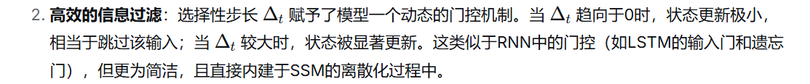{.ocr-src}

3. 线性复杂度的灵活推理：与Transformer的固定上下文窗口不同，Mamba在推理时可以以固定内存和计算量逐token递归，同时由于选择性，它不会像传统RNN那样轻易遗忘关键信息。这使得它在长序列处理上既有Transformer的建模能力，又有RNN的效率。

4. 性能的显著提升：在语言建模、DNA序列建模等任务上，Mamba以更低的计算代价超越了同等规模的Transformer和之前的SSM变体。其选择性机制被证明是弥补了SSM与Transformer之间性能差距的关键。

简言之，选择性让SSM从一种“静态的、强制性的”序列压缩器，变成了一个“动态的、智能的”序列建模器。

---

#### Mamba 为何能实现线性时间复杂度？请对比 Transformer 的复杂度。

Transformer的自注意力机制计算复杂度为 $O(n^2d)$，其中 $n$ 是序列长度，$d$ 是特征维度。这是因为需要计算每一对token之间的注意力分数，即构建一个 $n\times n$ 的注意力矩阵。这导致长序列下的计算和内存开销急剧增长。

Mamba能够实现 $O(nd)$ 的线性复杂度，根本原因在于它采用了**递归的序列处理方式**：

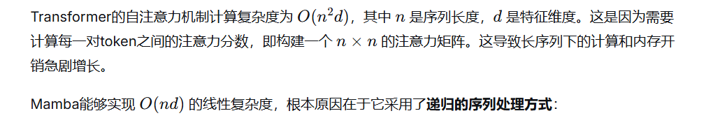{.ocr-src}

Mamba能够实现 O(nd) 的线性复杂度，根本原因在于它采用了递归的序列处理方式：

- 核心计算是状态转移方程 $h_t=\overline{\mathbf{A}}h_{t-1}+\overline{\mathbf{B}}x_t$。这个计算是**逐token**进行的，每个新token只需与前一个状态交互。
- 在每个时间步，计算量是 $O(N^2)$ 或 $O(Nd)$（取决于实现，通常 $N$ 为状态维度且远小于 $d$），与序列长度 $n$ 无关。因此总计算量为 $O(nNd)$，即与序列长度线性相关。

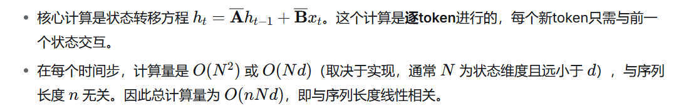{.ocr-src}

- 在训练时，Mamba通过并行扫描算法实现并行化，避免了RNN的串行瓶颈，但复杂度仍然是 O(n)。这在底层是通过将递归计算转化为前缀和操作来实现的，可以在GPU上高效执行。

对比Transformer：

- Transformer在训练时虽然可以并行，但必须计算整个 $n\times n$ 注意力矩阵，因此具有二次方复杂度。在推理时，每生成一个token都需要与之前所有token计算注意力（通过KV Cache优化后仍为 $O(n^2)$ 计算量，但逐token的带宽开销很大）。

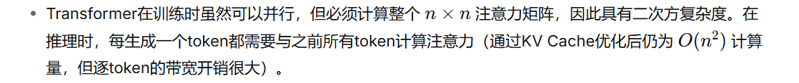{.ocr-src}

- Mamba在推理时是真正的 O(1) 每token计算和内存（因为状态大小固定），能够高效处理超长序列。

因此，Mamba从根本上避开了Transformer的二次方瓶颈，为极长序列（如百万token）的建模开辟了道路。

---

#### 解释 Mamba 中的硬件感知算法设计及其意义。

Mamba的硬件感知算法设计的核心目标，是在GPU等现代硬件上高效实现选择性扫描的并行计算。由于选择性机制使得SSM变为时变系统，无法直接用卷积加速，而纯粹的递归又会让GPU利用率极低。Mamba借鉴了FlashAttention的IO感知思想，设计了一个定制化的CUDA内核，主要通过以下技术实现加速：

1. 内核融合与分块处理：将离散化、状态更新和输出计算等步骤融合到单个CUDA内核中，避免将中间状态写回显存（HBM）。将序列分成块，每个块在SRAM内部执行递归计算，只在块间传递必要的状态信息（如最后的 $h$），大大减少了HBM的读写。

2. **并行扫描（Parallel Scan）**：将递归计算重写为前缀和问题。对于状态更新方程 $h_t=\bar{A}_th_{t-1}+\bar{B}_tx_t$，其展开形式为 $h_T=\sum_{i=1}^{T}\left(\prod_{j=i+1}^{T}\bar{A}_j\right)\bar{B}_ix_i$。这种形式可以通过高效的并行扫描算法（如Blelloch scan）在GPU上并行计算所有时刻的输出 $y_t$，从而在训练时实现完全的并行化，同时保持线性复杂度。
3. **避免实例化大型矩阵**：在计算 $\overline{\mathbf{A}}$ 和 $\overline{\mathbf{B}}$ 时，并不真正构造大小为 $N\times N$ 的稠密矩阵（$N$ 可达16或更大），而是利用HiPPO矩阵的低秩结构和对角化，将计算简化为元素级操作，从而大幅减少计算量。

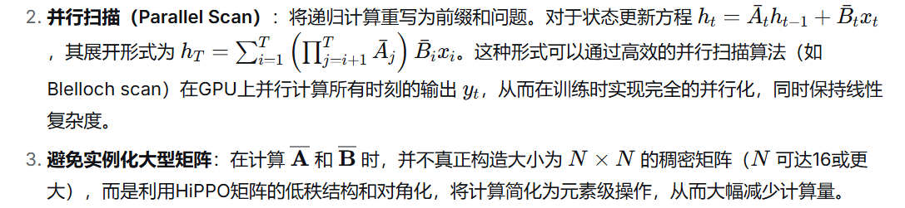{.ocr-src}

意义：这种硬件感知的设计使得Mamba在训练时既拥有Transformer的并行高效性，又保留了RNN在推理时的线性复杂度和恒定内存。它实现了与高度优化的Transformer（如FlashAttention）相当的训练吞吐量，同时在推理时能处理比Transformer长得多的序列。这为构建真正可扩展的长上下文模型提供了可行的蓝图。

---

#### RWKV 如何同时兼顾 RNN 的推理效率和 Transformer 的并行训练？

RWKV（Receptance Weighted Key Value）是一个精妙的混合架构，它同时继承了RNN和Transformer的优点。其核心在于将Transformer的注意力机制重新参数化为一个时间递归形式，从而在不同阶段采用不同的计算模式。

- 训练时（Transformer模式）：RWKV将注意力计算写成卷积形式或并行扫描形式，可以像Transformer一样，一次性输入整个序列，通过元素级运算和矩阵乘法在GPU上高度并行地计算所有token的隐状态和输出。这完全规避了RNN的串行瓶颈。

- 推理时（RNN模式）：RWKV将计算展开成RNN的形式。对于每个新token，模型只需更新并存储一个固定大小的隐藏状态（类似RNN的 $h_t$），然后计算出输出。这个过程是逐token进行的，内存和计算量不随序列长度增长，效率极高。

这种“双重身份”是通过一个巧妙的设计实现的：RWKV的核心是一个线性注意力变体，其注意力分数可以分解为时间衰减因子的乘积，使得序列的全局交互可以被压缩进一个固定大小的状态中。具体来说，RWKV的“WKV”注意力类似于一个带有指数衰减的门控线性递归，它充当了Transformer中的自注意力和RNN中状态更新的角色。因此，模型既能在训练时利用并行计算，又能在推理时以恒定的内存运行。

---

#### RWKV 中的 WKV 注意力机制与标准 self-attention 的本质区别是什么？

标准自注意力机制的核心公式是 $\mathrm{softmax}(QK^T)V$，它本质上是**全局、内容相关、无记忆压缩**的交互。每个新token需要与所有历史token进行显式的相似度计算，因此复杂度为 $O(n^2)$。它对信息的筛选是极度非线性的（softmax导致赢家通吃）。

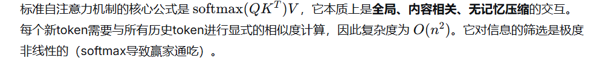{.ocr-src}

RWKV的WKV注意力机制则完全不同，它是一种线性、时间衰减、有状态压缩的注意力。其核心思想是：当前token的输出是历史所有token的value的加权和，权重由两部分决定：一是当前query与历史key的线性内积，二是一个固定的、随时间指数衰减的位置偏置。公式可简化为：

$$
y_t\approx\frac{\sum_{i=1}^{t}e^{-(t-i)w+k_i}v_i}{\sum_{i=1}^{t}e^{-(t-i)w+k_i}}
$$

但更关键的是其RNN形式，它维护一个状态矩阵 $S_t$ 和归一化因子 $Z_t$，通过递归更新：

$$
S_t=e^{-w}S_{t-1}+e^{k_t}v_t^T,\quad Z_t=e^{-w}Z_{t-1}+e^{k_t}
$$

输出 $y_t=(r_t\odot\mathrm{sigmoid}(q_t))\cdot S_t/Z_t$，其中 $r_t$ 是接受门。

**本质区别**：

- **复杂度**：标准自注意力是 $O(n^2)$，WKV是 $O(n)$。

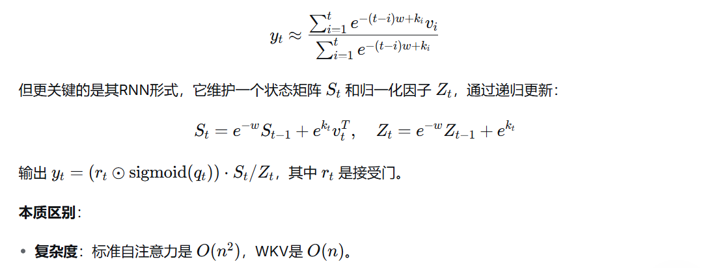{.ocr-src}

- 信息聚合方式：标准自注意力对每个token都平等地计算与所有历史token的相似度；WKV通过指数衰减，天然具备“越近越重要”的局部偏置，远处的信息会逐渐被遗忘。

- 状态表示：WKV将历史信息压缩进一个固定大小的矩阵 $S_t$，标准自注意力则保留所有历史token的Key-Value对，没有显式的状态压缩。

- 非线性：标准自注意力使用softmax进行非线性归一化和竞争；WKV使用sigmoid门控和线性加权，其非线性来自门控和激活，而不是注意力聚合本身。

WKV可以看作是标准自注意力在时间维度的“有损压缩”版本，牺牲了部分全局精确交互能力，换取了极高的推理效率。

---

#### 请描述 RWKV 的时间混合块和通道混合块结构。

RWKV模型由一系列相同的Block堆叠而成，每个Block包含两个核心子层：时间混合块和通道混合块，它们各自都有残差连接。

1. 时间混合块（Time Mixing）：

这是RWKV的核心，负责在时间维度上融合信息，相当于Transformer中的自注意力层。其结构如下：

- 输入：上层的输出 $x_t$。

- 首先，通过三个可学习的权重矩阵将 $x_t$ 投影为接受向量 $r_t$、键向量 $k_t$ 和价值向量 $v_t$。

- 然后，利用当前token的 $k_t$ 和 $v_t$，以及一个可学习的时间衰减参数 $w$，通过WKV的递归形式更新全局状态 $S_t$ 和归一化状态 $Z_t$。

- 最后，计算输出：$y_t=(r_t\odot\mathrm{sigmoid}(r_t\text{ or }k_t\text{? actually: }o_t))\cdot S_t/Z_t$。具体而言，输出是门控后的结果与归一化后的状态相乘，其中门控信号通常由 $r_t$ 和 $q_t$ 等交互产生。更准确的实现是：$w_t=\exp(-w)$（或更复杂的衰减），然后更新状态，最终输出通过一个输出投影 $W_o$ 并与残差相加。

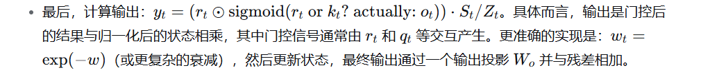{.ocr-src}

2. 通道混合块（Channel Mixing）：

这个块类似于Transformer中的前馈网络（FFN），负责在特征维度上对每个token独立地进行非线性变换。

- 输入：时间混合块的输出 $y_t$。

- 通过两个线性投影分别生成接收向量 $r_t'$ 和键向量 $k_t'$（这里的命名沿用了RWKV的风格，但含义不同）。
- 进行门控线性变换：$z_t=\mathrm{sigmoid}(r_t')\odot\text{激活函数}(k_t')^2$ 或类似的平方操作。常见的实现是 $z_t=r_t'\odot\mathrm{sigmoid}(k_t')$ 或 $z_t=r_t'\odot(\max(k_t',0))^2$。

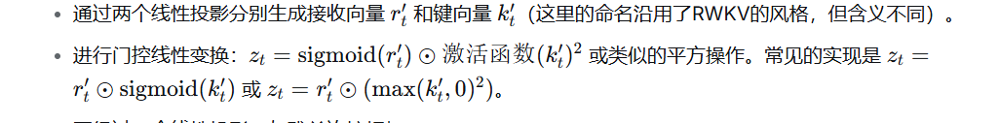{.ocr-src}

这种解耦设计（时间混合+通道混合）既保证了序列的全局交互能力，又提供了足够的非线性变换能力，是RWKV能够高效运行的关键架构。

---

#### Mamba-2 提出的“结构化状态空间对偶”揭示了什么理论联系？

Mamba-2的核心理论贡献是结构化状态空间对偶（Structured State Space Duality, SSD），它揭示了线性注意力机制与一类特殊的线性时变SSM在数学上的严格等价性。这个发现是深刻且富有启发性的。

SSD 框架的核心内涵：

- 它证明了一个带有特定结构的状态空间模型，其输入-输出映射可以精确地表示为一个线性注意力（Linear Attention）计算。具体地，如果我们将SSM中的状态转移矩阵 **A** 设计为一个标量（即对角矩阵且所有对角元相等，为 $a_t$），那么这种SSM（称为1-半可分矩阵）就可以被重写为一种带门控的线性注意力：

$$
y_t=\sum_{i=1}^{t}\left(\prod_{j=i+1}^{t}a_j\right)b_ic_tx_i
$$

这正是一个带有衰减因子 $\prod_{j=i+1}^{t}a_j$ 的线性注意力形式，且其掩码矩阵是一个1-半可分矩阵。

- 反过来，任何形如 $L\circ(QK^T)$ 的线性注意力，其中 $L$ 是一个1-半可分矩阵（如因果衰减掩码），都可以等价地用一个SSM来实现，其状态维度就是多头注意力的头数。

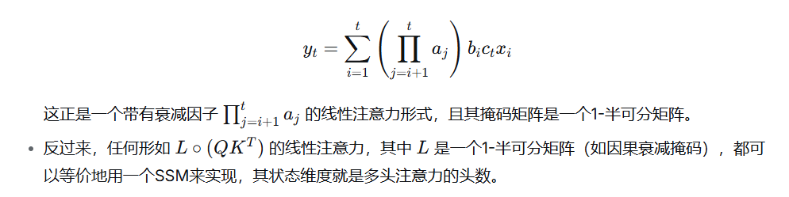{.ocr-src}

揭示的理论联系：

这个对偶性直接指出了SSM和注意力机制是同一枚硬币的两面。过去我们认为SSM和Attention是两种截然不同的序列建模范式，前者基于递归状态，后者基于自注意力。SSD证明，我们可以在递归模式（SSM）和注意力模式（矩阵乘法）之间自由切换，这取决于计算效率和实现的便利性。

- 在训练时，可以使用并行的矩阵乘法（注意力模式）来最大化硬件利用率。

- 在推理时，可以切换到递归模式（SSM模式）以实现线性复杂度和恒定内存。

Mamba-2的架构正是基于这一洞见进行简化设计的，它去掉了Mamba中复杂的线性投影（如 **B** 和 **C** 的输入依赖性体现在更简单的形式上），使得模型更接近一种多头线性注意力变体，同时保留了选择性SSM的动态门控能力。

---

#### Mamba-2 相比 Mamba-1 在架构上有哪些主要改进？

Mamba-2在SSD理论框架的指导下，对Mamba的架构进行了精简和增强，主要改进包括：

1. 简化了输入依赖性：Mamba-1中，**B**、**C** 和 Δ 都通过各自的线性层从输入 $x$ 生成。Mamba-2将其简化为一个统一的投影，然后产生A步长（即 Δ）和B、C。更关键的是，它引入了一个“头”维度（多头设计），使得不同头可以有独立的衰减率和选择性，增加了模型的表达能力。

2. 引入了多头注意力模式：在SSD框架下，Mamba-2显式地将模型的头结构组织为类似注意力的Query、Key、Value。它引入了旋转位置编码（RoPE）等位置信息，并且采用了类似FlashAttention的tiling策略来高效计算。

3. 采用了更标准的归一化和残差连接：Mamba-2采用了与Transformer更类似的Pre-Norm结构和残差连接方式，使得训练更稳定，也更容易在现有框架中实现和迁移。

4. 更大的状态维度与更高效的计算：由于SSD揭示了注意力模式可以处理更大的有效状态维度（头数），Mamba-2能够在不显著增加计算负担的情况下扩大状态空间，进一步提升了建模能力。

5. 训练和推理的统一内核：Mamba-2设计了一个全新的CUDA内核，可以在训练时高效执行注意力模式的矩阵乘法，在推理时高效执行递归模式，无需在两套算法之间切换，且支持tiling和recomputation以节省显存。

总体而言，Mamba-2通过理论突破，成功地融合了SSM的高效递归特性和Transformer的强大建模能力，将两者结合进一个简洁、可扩展的架构中。它不仅在语言建模上表现出色，也为构建下一代基础模型提供了新的范式。

---

#### 比较 Mamba 与 Transformer 在长序列任务上的吞吐量和显存占用。

在长序列任务中，Mamba和Transformer的表现呈现出根本性的差异，这种差异源于它们完全不同的计算模式。

**Transformer的瓶颈**：标准Transformer的自注意力机制计算复杂度为 $O(n^2d)$，其中 $n$ 是序列长度，$d$ 是特征维度。这意味着计算量与序列长度的平方成正比。在训练时，需要存储 $n\times n$ 的注意力矩阵，显存占用也是 $O(n^2)$。尽管FlashAttention等优化技术通过分块计算显著降低了显存带宽压力，但根本上并没有改变 $O(n^2)$ 的复杂度。当序列长度从1K增长到128K时，计算量会增长约16000倍。这会迅速耗尽GPU的计算能力和内存。在推理时，虽然KV Cache可以将单步计算降为 $O(n)$，但KV Cache本身的显存占用随 $n$ 线性增长，在超长序列（如百万token）下成为最大的瓶颈。

**Mamba的线性优势**：Mamba基于状态空间模型，其核心操作是递归的状态更新 $h_t=\overline{\mathbf{A}}h_{t-1}+\overline{\mathbf{B}}x_t$。这

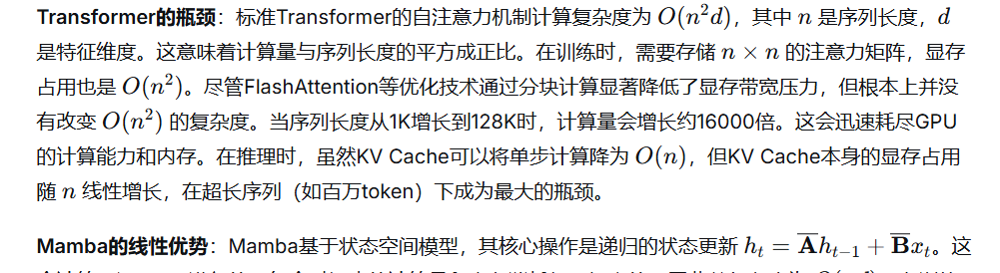{.ocr-src}

个计算是逐token进行的，每个时间步的计算量和内存消耗都是恒定的，因此总复杂度为 O(nd)。在训练时，Mamba通过并行扫描算法实现并行化，避免了递归的串行等待，同时仍然保持线性复杂度。在推理时，Mamba只需维护一个固定大小的状态向量 $h_t$，不需要像Transformer那样缓存所有历史token的Key和Value，因此其推理显存占用是 O(1) 相对于序列长度。

直观对比：对于一个100层的175B参数模型，处理128K长度序列，Transformer的KV Cache可能需要数百GB的显存，即使是8路GQA也仍然压力巨大。而Mamba只需为每层存储一个状态向量（例如维度为16×4096），总状态大小可能只有几十MB。计算速度方面，Mamba在长序列上吞吐量几乎恒定，而Transformer则急剧下降。Mamba的出现使得在单张GPU上处理百万token的序列成为可能，这在Transformer上几乎无法实现。

---

#### 在流式推理场景下，RWKV 相比 Transformer 有何优势？

流式推理（Streaming Inference）是指在持续不断的输入流上实时生成输出，如语音助手、自动驾驶、实时翻译等。在这种场景下，RWKV相比Transformer具有压倒性优势。

Transformer的局限：Transformer的自回归推理需要维护一个不断增长的KV Cache。随着对话的持续，历史信息越来越多，KV Cache占用的显存和每次计算需要读取的带宽也随之线性增长。对于无限长的流式输入，这最终会耗尽硬件资源。此外，Transformer的注意力计算虽然单步复杂度为 O(n)，但当 $n$ 极大时，每一步都需要重新计算所有历史Key和Value的注意力分数，计算代价也在累积。

RWKV的恒定状态优势：RWKV在推理时表现为一个纯RNN，它维护的是一个固定大小的隐藏状态 $S_t$。无论序列已经持续了多长时间，每处理一个新token，模型只需

1. 利用当前输入和固定状态 $S_t$ 计算出新的状态 St+1。

2. 输出当前token的预测。

3. 将状态更新为 St+1。

这个过程的内存占用、计算量、推理延迟都是恒定的，与历史长度完全无关。这意味着RWKV可以在理论上处理无限长的流式数据，而不会出现显存耗尽或推理变慢的问题。这种特性使得RWKV非常适合于需要长时间运行、资源受限的端侧设备和实时交互应用，例如在微控制器上部署一个永不遗忘的对话助手。

此外，RWKV的训练也完全并行，因此它兼得了Transformer的训练效率和RNN的推理效率，是流式场景下的理想选择。

---

#### Mamba 模型中通常不使用显式位置编码，它是如何处理位置信息的？

Mamba确实没有显式的位置编码（无论是绝对位置嵌入还是旋转位置编码RoPE），但它仍然能够捕捉序列中的位置信息。其奥秘在于选择性扫描机制本身。

隐式位置信息的编码：

Mamba的核心递归方程是：

$$
h_t=\overline{\mathbf{A}}(\Delta_t)h_{t-1}+\overline{\mathbf{B}}(\Delta_t,x_t)x_t
$$

其中步长 $\Delta_t$ 是输入 $x_t$ 的函数。在离散化过程中，$\Delta_t$ 直接影响状态转移矩阵 $\overline{\mathbf{A}}$ 的“遗忘速率”。如果 $\Delta_t$ 很小，$h_{t-1}$ 的贡献就小，模型更多地关注当前输入；如果 $\Delta_t$ 很大，则历史信息被更大程度地保留。

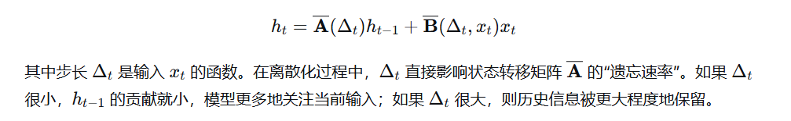{.ocr-src}

这种机制本质上在状态空间中创建了一种内容依赖的时间衰减。由于不同的token会学习到不同的 $\Delta t$，序列中的位置信息被隐式地编码在状态的演化和衰减模式中。例如，一个位于句子开头的关键实体可能会产生一个很大的 $\Delta t$，使得其信息在整个序列中被长期记忆；而句子中间的某个标点符号可能产生很小的 $\Delta t$，其信息迅速被遗忘。

实证与理论支持：Mamba论文的实验表明，即使不加任何位置编码，模型在语言建模等任务上表现优异。从理论上看，SSM本身是有序的（递归天然带有时间顺序），而且选择性机制赋予了模型动态调整这种顺序依赖的能力。这与Transformer不同，后者因为自注意力本身是无序的，必须依赖位置编码来打破对称性。因此，Mamba通过其递归本质和选择性，已经内建了一种强大的、动态的位置信息处理能力，无需外部位置编码。

---

#### 请解释 Mamba-2 中的多头 SSM 设计与 Transformer 的多头注意力的相似性。

Mamba-2通过结构化状态空间对偶（SSD）框架，揭示了SSM与线性注意力之间的等价关系，其多头SSM设计正是这一理论洞见的直接产物，它使得Mamba-2的架构与Transformer的多头注意力在多个层面产生了深刻的相似性。

多头设计的引入：Mamba-1中，每个输入特征维度独立应用一个SSM，这类似于一种“单头”或“无头”设计。Mamba-2则显式地将特征分组为多个头，每个头拥有自己独立的SSM状态，其状态转移标量 $a$（即A的简化形式）可以不同。这等价于在多头注意力中，每个头有独立的参数。

与线性注意力的等价：SSD证明，Mamba-2的递归形式可以重写为：

$$
y_t=\sum_{i=1}^{t}\left(\prod_{j=i+1}^{t}a_j\right)b_ic_tx_i
$$

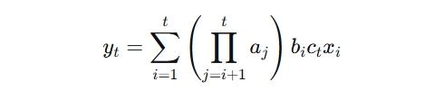{.ocr-src}

这正是因果掩码下的线性注意力，其中 $a_j$ 相当于一个内容依赖的门控衰减因子，$b_i$ 和 $c_t$ 分别对应注意力中的Value和Query。进一步引入多头后，Mamba-2的计算可以完全用矩阵乘法形式表示为：

$$
Y=\left(L\circ(QK^T)\right)V
$$

其中 $L$ 是一个由 $a_j$ 决定的1-半可分掩码矩阵，$Q,K,V$ 由输入 $x$ 通过投影得到。这与Transformer的多头注意力公式 $\mathrm{softmax}(QK^T)V$ 仅在归一化方式（softmax vs. 门控线性）和掩码矩阵的精细结构上有所不同。

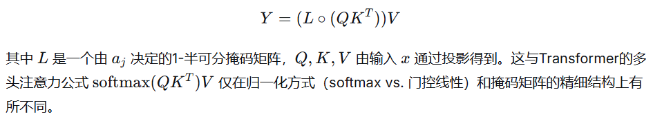{.ocr-src}

相似性总结：

- 分组独立参数：两者都通过多头（组）设计来增加模型的表达能力和多样性。

- 查询-键值交互：Mamba-2的 $b_i$ 和 $c_t$ 充当了类似Key和Query的角色，决定信息如何被检索和利用。

- 并行矩阵计算：在训练时，Mamba-2可以像Transformer一样使用高效的矩阵乘法，而不是逐token的递归，从而充分利用GPU。

- 注意力模式的可解释性：由于可以写成注意力矩阵形式，Mamba-2的内部工作机制更容易被可视化和解释，与Transformer相似。

这种相似性意味着Mamba-2在保留SSM高效推理能力的同时，吸收了Transformer强大的建模和可扩展能力，成为一个更统一的架构。

---

#### RWKV 的训练并行性是如何实现的？它的时间复杂度是多少？

RWKV的核心魅力在于它能够以RNN的形式进行推理，同时以Transformer的形式进行并行训练。这得益于其注意力机制的巧妙设计。

训练并行性的实现：\
RWKV的WKV注意力可以展开为卷积形式或直接使用并行扫描。在训练时，给定整个序列，RWKV不采用逐token的递归，而是将整个序列的WKV计算视为一个大规模的矩阵-向量运算。具体来说，RWKV的注意力可以写成一个带衰减的因果掩码矩阵 $M$ 作用于 $V$ 的结果，其中 Mij=exp⁡(−(i−j)w+kj)（经过归一化）。这个矩阵 M 是下三角的，并且由于其指数衰减结构，它可以被高效地并行计算，无需显式地构建 $n$×$n$ 矩阵，而是利用前缀积等技巧在 O(nd) 时间内完成。

在实际代码实现中，RWKV的训练使用了高度优化的CUDA内核，将时间混合和通道混合的计算都并行化到序列长度的维度上。整个序列的每个token的隐状态可以同时计算，没有顺序依赖。这意味着RWKV可以利用GPU的并行能力，像Transformer一样高效地处理长序列。

**时间复杂度：**

- **训练**：RWKV的训练时间复杂度为 $O(nd)$，其中 $n$ 是序列长度，$d$ 是特征维度。因为每个token的通道混合是 $O(d^2)$，时间混合是 $O(d^2)$，总复杂度与序列长度线性相关。这与Transformer的 $O(n^2d)$ 形成鲜明对比。
- **推理**：推理时，每步计算为 $O(d^2)$，与历史长度无关。因此总推理复杂度为 $O(nd^2)$，但由于 $d$ 固定，可以视为线性。

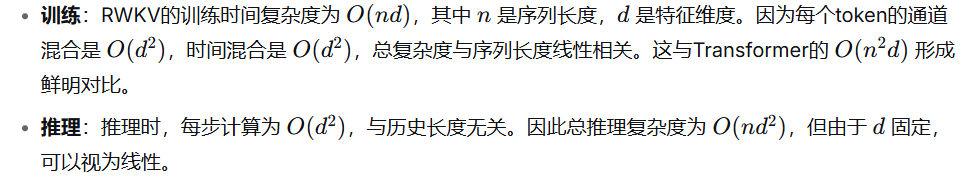{.ocr-src}

总之，RWKV巧妙地将一个带有位置偏置的线性注意力设计为可并行化的卷积/扫描模式，从而在训练时彻底摆脱了RNN的串行限制，实现了线性复杂度的高效训练。

---

#### 在哪些场景下你会优先选择 Mamba/RWKV 而非传统 Transformer？

Mamba/RWKV并非要完全替代Transformer，而是在特定场景下展现出压倒性优势。我会在以下场景优先选择它们：

1. 超长序列建模：当序列长度达到数十万甚至百万token时，Transformer的二次方复杂度已完全不可行。例如，DNA序列比对、长时间音频处理、天文信号分析等。Mamba的线性复杂度使其成为这类任务的自然选择。

2. 流式实时推理：在语音助手、自动驾驶、实时对话系统等需要无限长流式处理且延迟极低的场景，RWKV/Mamba的恒定状态推理优势无可替代。Transformer的KV Cache增长会最终导致延迟恶化或内存溢出。

3. 资源受限的端侧部署：在手机、嵌入式设备上，内存和算力极度有限。RWKV的固定小状态使其非常适合这类场景。一个预训练的RWKV模型可以在几乎不消耗内存的情况下处理任意长度的对话，这是Transformer无法做到的。

4. 需要高效训练的长序列任务：即使训练预算充足，但如果任务本身是长序列（如长文档摘要、代码库级理解），使用Transformer的训练成本极高。Mamba可以用更低的训练成本达到同等或更优的性能。

5. 探索新范式的学术研究：SSM和线性注意力代表了序列建模范式的一条新路径。在研究高效架构、状态空间理论、以及构建下一代基础模型时，Mamba和RWKV是极具价值的基线和探索方向。

6. 连续信号处理：SSM天然起源于连续系统，在处理连续时间信号（如音频波形、EEG脑电信号）时，其连续-离散转换框架比离散的Transformer更加自然。

---

#### Mamba 的“选择性”如何使模型具备一定的上下文过滤能力？

Mamba的选择性机制，本质上就是一个动态的门控过滤器，它使模型能够根据当前token的内容和重要性，自动决定哪些历史信息应该被保留、更新或遗忘，从而实现了高效的上下文过滤。

这种过滤能力体现在三个层面：

1. 步长 $\Delta t$ 的选择性：$\Delta t$ 是SSM离散化中的步长，它直接控制着状态转移矩阵 $\bar{A}$ 中历史信息的衰减速率。一个内容依赖的 $\Delta t$ 意味着：对于关键token（如实体名），模型可以学会输出一个很大的 $\Delta t$，使得其状态更新更倾向于保留历史信息；对于无关紧要的token（如停用词），模型输出一个很小的 $\Delta t$，相当于“跳过”这个token，不让它污染历史状态。这就好比一个智能的、动态的遗忘门。

2. 输入矩阵 **B***t* 和输出矩阵 **C***t* 的选择性：**B***t* 控制输入 $x_t$ 如何写入状态，**C***t* 控制状态如何被读出到输出。它们都是输入的函数。模型可以学会只把重要的信息写入长时记忆（状态 $h_t$），而忽略瞬时噪声。这类似于注意力机制中的“内容感知”权重。

3. 整体效果：结合上述两点，Mamba的状态 $h_t$ 不是对历史序列的无差别压缩，而是一个经过了内容感知筛选的、有重点的摘要。例如，当模型阅读一个长文档时，它会在遇到关键人物时更新状态中的相应维度，并在后续遇到该人物的代称时，通过状态中的信息正确消解指代。而那些广告文本或无关段落，则被选择性遗忘。这种能力让Mamba在不计算全局注意力的前提下，仍能高效地建模长程依赖，过滤掉上下文噪声。

---

#### 简述 Mamba 在 DNA 序列、音频等长序列建模中的应用潜力。

Mamba在DNA序列、音频等长序列建模中展现了巨大的应用潜力，其根本原因是这些领域的数据天然具有极长的序列长度和复杂的长期依赖，传统Transformer难以胜任。

DNA序列建模：

- 序列特性：人类基因组包含超过30亿个碱基对，即使一个基因也可能长达数万个碱基。DNA序列中的功能元件（如增强子、启动子）可能相距极远，存在远距离的调控作用。这意味着需要捕捉跨越超长距离的依赖关系。

- Mamba的优势：Mamba的线性复杂度使其可以直接以单核苷酸的分辨率处理长达百万碱基的序列，而无需像之前的方法那样将序列切分成短片段。这能够学习到更全局的基因组结构和功能。例如，Mamba可以用来预测基因表达水平、识别非编码RNA、分析宏基因组数据，其速度和精度都远超基于Transformer或CNN的方法。

音频与音乐生成：

- 序列特性：原始音频波形的采样率极高（如16kHz或44.1kHz），一分钟的音频就包含数十万个采样点。生成高质量的长时音频需要模型能捕捉秒级甚至分钟级的时序结构。

- Mamba的优势：Mamba能高效处理这种超长序列，其状态空间能够学习音频信号的连续演化规律。在语音合成、音乐生成、音频超分辨率等任务上，Mamba可以生成比Transformer更长、更连贯的音频，同时训练和推理成本大幅降低。

其他长序列任务：

- 时间序列预测：在金融、气象、工业传感器数据中，时间序列往往长达数万个时间步，且存在周期性和趋势。Mamba的选择性机制能动态适应时序变化，进行精准的长期预测。

- 视频理解：视频可以看作图像帧的长序列。Mamba可能为视频分析提供一种更高效的时空建模方案，替代计算昂贵的3D卷积或时空注意力。

---

#### RWKV 的推理状态大小是固定的，这对长文本生成意味着什么？

RWKV推理状态大小的恒定性，对长文本生成意味着一个质的飞跃：从“记忆受限”到“无限记忆”。

在传统Transformer中，生成长文本（如一本小说）必须使用KV Cache，该缓存随生成文本的长度线性增长。这意味着：

- 生成到第10000个token时，显存中已保存了10000个token的Key和Value对。

- 继续生成到第100000个token时，KV Cache将占据大量显存，甚至导致OOM。

- 即使显存足够，每一步的注意力计算也需要扫描整个缓存，速度越来越慢，生成效率低下。

RWKV则完全不同。它的推理状态 $S_t$ 是一个固定大小的矩阵（大小约为 `头数 × 头维度 × 头维度` 或类似的维度）。无论已经生成了10个token还是10万个token，这个状态的大小永远不会变。新token的生成只需：

1. 读取当前状态 $S_t$。

2. 根据当前token更新状态得到 $S_t$+1。

3. 预测下一个token。

这意味着RWKV可以持续不断地生成任意长度的文本，其生成速度和内存占用始终保持恒定。这对于写长篇小说、生成无限的对话、或者持续生成音乐等应用场景是革命性的。它彻底消除了因显存耗尽而导致生成中断的风险，实现了真正的“无限流”文本生成。虽然状态大小固定意味着它对极远距离的精确信息检索能力可能不如理论上可以回溯整个上下文的Transformer，但通过增大状态维度或模型容量，这一缺陷已被大幅弥补。

---

#### Mamba-2 中的 SSD 算法解决了什么问题？

Mamba-2中的SSD（Structured State Space Duality）算法，核心是解决了一个长期困扰SSM架构的根本性问题：如何在保持线性推理效率的同时，在训练时也实现与现代Transformer同等的硬件利用率和可扩展性。

具体而言，SSD解决了两大难题：

1. 统一了SSM的递归模式与注意力模式：在SSD之前，Mamba（S6）的训练依赖于硬件感知的并行扫描内核，虽然高效但实现复杂，且与现有的FlashAttention等Transformer优化生态不兼容。SSD从数学上严格证明了，一类特定的SSM（带有输入依赖门控的线性SSM）可以等价地重写为一个因果线性注意力。这个理论突破意味着：

- 训练时，Mamba-2可以直接使用注意力模式，利用高度优化的FlashAttention-2内核进行分块矩阵乘法，最大化GPU吞吐。这解决了Mamba-1中需要定制CUDA内核的问题，使其更容易被集成到各种框架中。

- 推理时，Mamba-2仍然使用高效的递归模式，享受恒定状态和线性复杂度。两种模式在数学上等价，可以无缝切换。

2. 简化了架构并提升了扩展性：基于SSD，Mamba-2将Mamba-1中复杂的多个独立投影（$s_B$, $s_C$, $s_\Delta$）简化为一个统一的投影生成A、B、C，并自然地引入了多头设计。这不仅减少了参数量，还使得模型更易于扩展。SSD的注意力模式可以像Transformer一样方便地应用GQA（分组查询注意力）和滑动窗口等技术，进一步提升了在长序列上的效率。

总言之，SSD通过揭示SSM和线性注意力的对偶性，将Mamba从需要复杂定制的硬件实现，解放到了当前主流的注意力优化生态中，同时保留了其固有的递归效率，为构建下一代更强大、更可扩展的基础模型铺平了道路。

