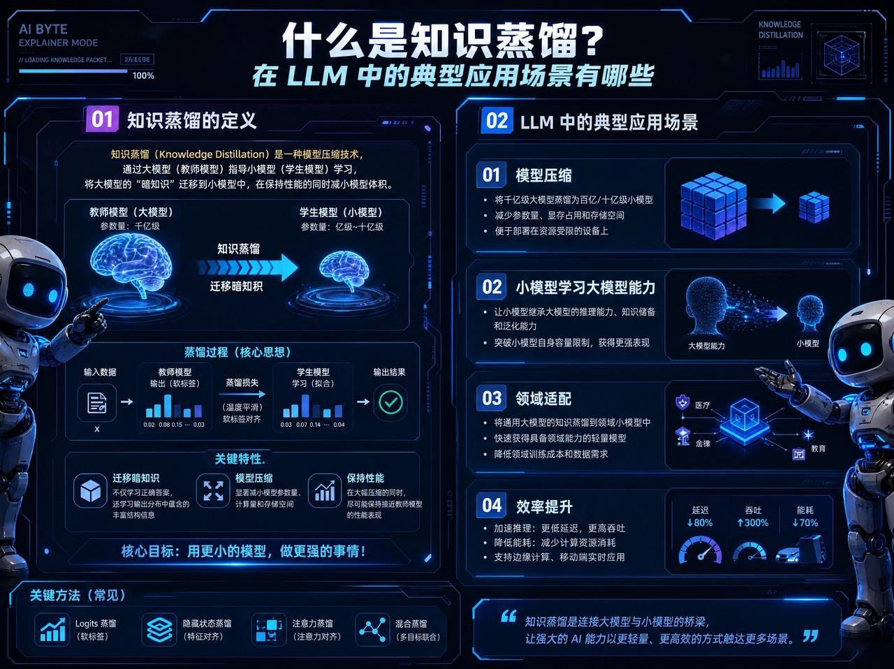
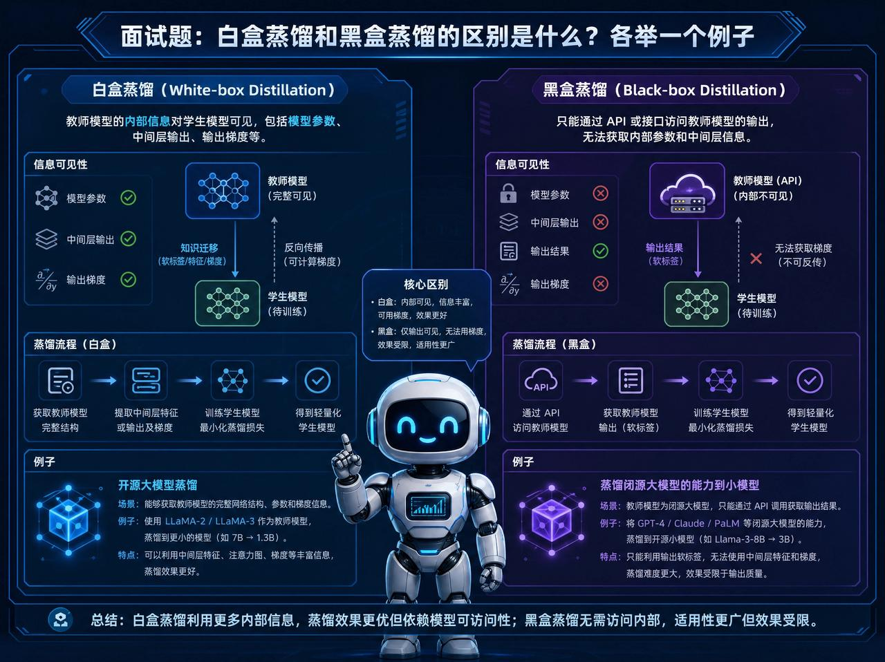
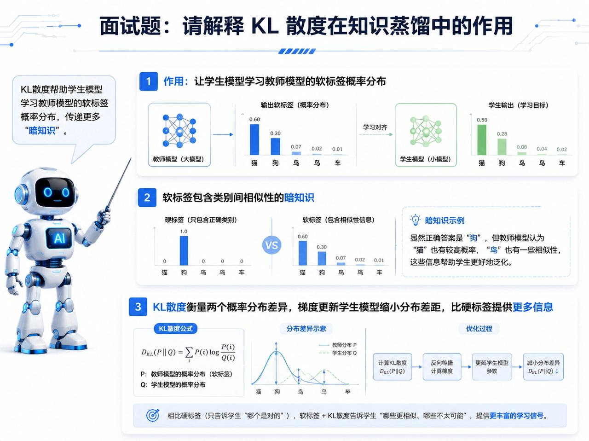
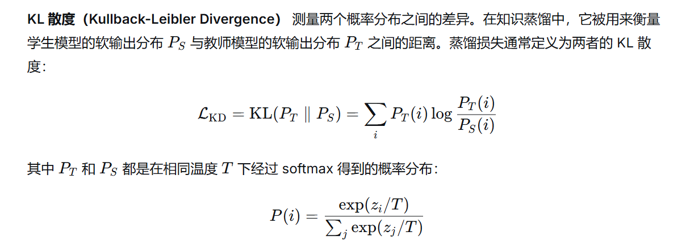
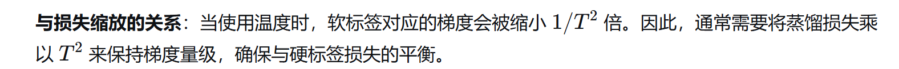
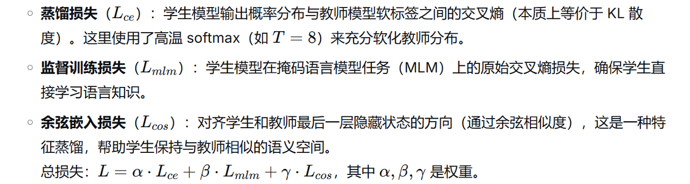
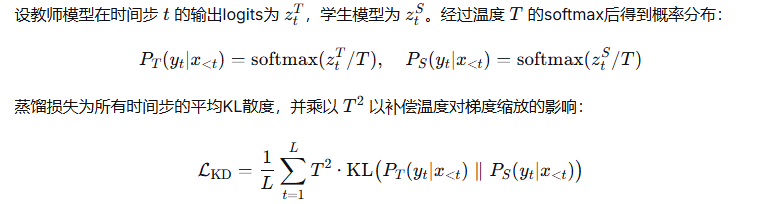
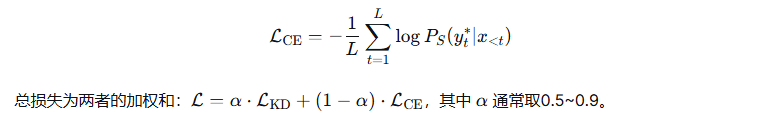
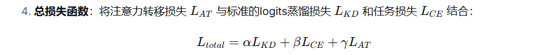

# 120.大模型（LLMs）知识蒸馏面

#### 什么是知识蒸馏？在 LLM 中的典型应用场景有哪些？

> **知识蒸馏由 Hinton** 等人在 2015 年正式提出。其核心思想是：让学生模型不仅学习训练数据中的“硬标签”（ground truth），更要去拟合教师模型在输出层产生的“软标签”（soft labels）——即教师对每个类别的概率分布。这个概率分布中蕴含了教师从数据中学到的“暗知识”（dark knowledge），例如类别之间的相似性、非标签类别的相对概率等。软标签相比硬标签包含更丰富的信息，能够指导学生用更少的参数达到接近教师的泛化能力。
>

**在 LLM 中，知识蒸馏的典型应用场景包括：**

1. **通用模型压缩**：将数百亿、数千亿参数的庞然大物（如 GPT-4、PaLM）的能力蒸馏到几亿到几十亿参数的小模型上，以便在端侧或低资源环境中部署。例如，**用 GPT-4 的输出来微调一个 7B 的学生模型。**

2. **任务特化蒸馏：**将通用大模型在特定任务上的表现蒸馏到一个小模型上。比如，将 LLM 的数学推理、代码生成、翻译等能力通过收集特定任务的教师输出，训练出专精于该任务的小模型。

3. **指令跟随与对齐蒸馏：**将大模型经过 RLHF 后的对齐行为（如安全性、有用性、风格）传递给小模型。典型做法是用教师模型生成大量的指令-回复对，然后用这些数据监督微调学生模型（即 SFT 蒸馏），有时还会进一步用教师的评分作为奖励信号进行 RL 蒸馏。

4. **多模态和跨语言蒸馏：**将大型多模态模型或跨语言模型的能力蒸馏到单一模态或特定语言的模型中，降低多模态推理成本。

5. **渐进式蒸馏与自蒸馏：**采用多次迭代，将大模型的知识逐步蒸馏到更小的模型，或者让模型以自身的历史版本作为教师进行蒸馏，以提升数据效率和泛化性。。



---

#### 白盒蒸馏和黑盒蒸馏的区别是什么？各举一个例子。



白盒蒸馏指学生模型可以完全访问教师模型的内部结构和参数，从而利用教师的中间表示（如隐藏层状态、注意力矩阵、嵌入等）作为额外的监督信号，而不仅仅是最终输出。学生模型的中间层被训练去模仿教师模型对应层的特征，这种通常称为“特征蒸馏”或“中间层蒸馏”。

- 例子：TinyBERT。它从 BERT-base 蒸馏时，不仅学习教师最后一层的 logits，还学习教师嵌入层的输出、各 Transformer 层的隐藏状态以及自注意力矩阵。通过缩小对应层之间的 MSE 损失，TinyBERT 获得了超越单纯 logits 蒸馏的效果。

黑盒蒸馏则只能通过查询教师模型的输入-输出接口来获取知识，无法访问内部参数或中间表示。教师模型就像被封装在 API 后面的“黑盒”。这是目前 LLM 蒸馏的最主要形式，因为最强大的商业模型（如 GPT-4、Claude）只能通过 API 访问。

- 例子：用 GPT-4 API 生成大量的高质量对话或推理数据，然后使用这些数据直接通过监督微调（SFT）训练一个较小的开源模型（如 LLaMA-7B）。这就是典型的黑盒蒸馏，因为学生只看到了教师生成的最终文本。

核心区别：

| 维度 | 白盒蒸馏 | 黑盒蒸馏 |
| --- | --- | --- |
| 教师访问权限 | 内部参数、中间层输出 | 仅输入-输出（API或模型生成的文本） |
| 可迁移的知识 | logits、隐藏状态、注意力 | 输出文本、logits（如果API提供） |
| 训练信号丰富度 | 高（多维度的特征模仿） | 较低（主要是行为克隆） |
| 实现难度 | 需要修改模型结构并访问内部 | 简单，类似普通微调 |
| 典型例子 | TinyBERT, MiniLM, DistilBERT | 用 GPT-4 蒸馏 LLaMA, Alpaca |

---

#### 请解释 KL 散度在知识蒸馏中的作用。



**KL 散度（Kullback-Leibler Divergence）** 测量两个概率分布之间的差异。在知识蒸馏中，它被用来衡量学生模型的软输出分布 $P_S$ 与教师模型的软输出分布 $P_T$ 之间的距离。蒸馏损失通常定义为两者的 KL 散度：

$$
\mathcal{L}_{\mathrm{KD}} = \mathrm{KL}(P_T \parallel P_S) = \sum_i P_T(i) \log \frac{P_T(i)}{P_S(i)}
$$

其中 $P_T$ 和 $P_S$ 都是在相同温度 $T$ 下经过 softmax 得到的概率分布：

$$
P(i) = \frac{\exp(z_i/T)}{\sum_j \exp(z_j/T)}
$$

{.ocr-src}

KL 散度的作用：

1. **捕捉暗知识：**通过拟合教师的完整概率分布，而不仅仅是最高概率的类别，学生可以学到教师关于类别间相似性的知识。例如，在语言模型中，教师可能会给“高兴”和“快乐”都分配较高概率，这种相似性通过 KL 散度传递。

2. **提供更丰富的梯度：**相比仅仅匹配硬标签（交叉熵损失），KL 散度提供了更平滑的梯度信号，帮助学生模型在参数空间中更稳定地收敛，避免过拟合。

3. **温度调控：**通过调整温度 $T$，可以控制软标签的“软度”。高温让教师分布更平滑，类间概率差异缩小，更多地揭示暗知识；低温则更接近原始硬标签。

在 LLM 的 token 级蒸馏中，KL 散度被广泛应用于让学生模型的逐 token 输出概率分布对齐教师。通常总损失是蒸馏损失和标准交叉熵损失的加权组合：

$$
\mathcal{L} = \alpha \cdot \mathcal{L}_{\mathrm{KD}} + (1-\alpha) \cdot \mathcal{L}_{\mathrm{CE}}
$$

{.ocr-src}

通过这种组合，学生既能学习教师的泛化模式，又能保持对真实标签的忠实。

---

#### 使用 LLM 的 logits 进行蒸馏时，温度参数如何影响软标签？

在蒸馏中，温度参数 $T$ 被引入到 softmax 函数中：

$$
P(i) = \frac{\exp(z_i/T)}{\sum_j \exp(z_j/T)}
$$

{.ocr-src}

它的作用机制和影响如下：

- $T$=1：这是标准的 softmax。教师的输出分布比较“尖锐”，即正确标签的概率接近 1，其他标签的概率非常小。这种情况下，软标签提供的额外信息（暗知识）很有限，因为这些非标签类别的概率被极度压缩，几乎为 0，梯度很小。

- $T$>1：软化分布。较大的温度值会使 softmax 的输出变得更“软”、更平滑。原本微小的概率差异被放大，各类别之间的相对关系变得清晰。这是蒸馏中最关键的操作。它能让教师模型关于非标签类别之间的相似性信息充分暴露出来。例如，预测“猫”时，教师可能认为“狗”的概率也较高（虽然远低于猫），通过高温，这个“狗”的概率被提升，学生就能学到“猫和狗在某些特征上是相似的”这一暗知识。

- $T$ 非常大：分布接近均匀分布，虽然保留了类别间的相对顺序，但所有概率都变得非常接近，梯度信号变得很弱，蒸馏效率降低。

- 0<T<1：分布变得更尖锐，强化了最高概率的类别。这在知识蒸馏中不常用，因为它反而会抑制暗知识的传递。

典型实践：

- 教师和学生在蒸馏时使用相同的温度。

- 学生训练完成后，推理时不使用温度（即 $T$=1）。

- 常见的温度范围是 2 到 20，具体取决于任务和教师模型的置信度。语言模型蒸馏中常用 $T$=2∼5。

**与损失缩放的关系**：当使用温度时，软标签对应的梯度会被缩小 $1/T^2$ 倍。因此，通常需要将蒸馏损失乘以 $T^2$ 来保持梯度量级，确保与硬标签损失的平衡。

{.ocr-src}

总结：温度是蒸馏中控制知识迁移粒度的旋钮。低温迁移稀疏、尖锐的知识；高温迁移丰富、平滑的类间关系，是知识蒸馏区别于传统标签学习的本质所在。

---

#### 什么是特征蒸馏？在 Transformer 模型中通常蒸馏哪些层的特征？

特征蒸馏（Feature Distillation） 是将教师模型中间层的隐藏表示作为学习目标，让学生模型的对应层去模仿这些表示。与仅使用输出 logits 相比，特征蒸馏能传递更细粒度的知识，帮助学生构建与教师相似的内部表征，从而获得更好的泛化能力。

在 Transformer 模型中，特征蒸馏通常涉及以下几个层面的匹配：

1. 嵌入层（Embedding Layer）：教师和学生输入 token 的嵌入向量进行对齐。这有助于学生获得与教师相似的词义空间，对后续层的影响很大。

2. Transformer 层的隐藏状态（Hidden States）：这是最主要的特征蒸馏对象。学生模型的每一层（或每隔几层）被训练去预测教师模型对应层或相关层的输出隐藏状态。损失通常采用均方误差（MSE）。由于学生和教师的隐藏维度可能不同，需要一个可学习的线性投影层将学生维度映射到教师维度。

3. 自注意力矩阵（Attention Matrices）：教师模型每个头的注意力权重矩阵（`softmax(QK^T/√d)`）包含了 token 之间的依赖关系，是非常有价值的知识。学生被训练去最小化其注意力矩阵与教师注意力矩阵之间的 KL 散度或 MSE。这能帮助学生快速建立正确的语法和语义依赖。

4. FFN 层的输出或中间表示：某些方法还会蒸馏前馈网络（FFN）的中间激活或输出，尤其是当 FFN 被视为知识存储的键值记忆时。

5. 最后层的特征：有时也会蒸馏最终输出层之前的特征，例如句向量 `[CLS]` 或平均池化表示，用于下游任务。

典型工作：

- TinyBERT：蒸馏了嵌入层、所有 Transformer 层的隐藏状态和注意力矩阵。

- MobileBERT：设计了特殊的师生层映射关系，通过逐层蒸馏隐藏状态和注意力来实现极致压缩。

- MiniLM：主要蒸馏了最后几层 Transformer 的自注意力矩阵（尤其是值-值点积），在不引入额外投影参数的情况下高效传递知识。

注意：由于教师和学生层数可能不同，需要定义一个层映射策略。常见的有均匀间隔映射（每隔几层选一层）或动态选择最相关的层对。

---

#### 请简述 DistilBERT 的蒸馏策略。

DistilBERT 是 Hugging Face 推出的一个轻量级 BERT 模型，通过知识蒸馏将 BERT-base 压缩为层数减半（6 层）的学生模型，同时保留了 97% 的语言理解能力，速度提升 60%。

其蒸馏策略可概括为以下核心要点：

1. 三元组损失函数：DistilBERT 的损失由三部分组成：

- **蒸馏损失**（$L_{ce}$）：学生模型输出概率分布与教师模型软标签之间的交叉熵（本质上等价于 KL 散度）。这里使用了高温 softmax（如 $T=8$）来充分软化教师分布。
- **监督训练损失**（$L_{mlm}$）：学生模型在掩码语言模型任务（MLM）上的原始交叉熵损失，确保学生直接学习语言知识。
- **余弦嵌入损失**（$L_{cos}$）：对齐学生和教师最后一层隐藏状态的方向（通过余弦相似度），这是一种特征蒸馏，帮助学生保持与教师相似的语义空间。

总损失：$L = \alpha \cdot L_{ce} + \beta \cdot L_{mlm} + \gamma \cdot L_{cos}$，其中 $\alpha, \beta, \gamma$ 是权重。

{.ocr-src}

2. 学生模型初始化：DistilBERT 的学生模型只有 6 层 Transformer（教师的一半）。一个关键技巧是使用教师模型的前 6 层权重来初始化学生，而不是随机初始化。这种“层继承”显著加速了收敛并提升了最终性能。

3. 去除 Token-type 嵌入和 NSP 目标：DistilBERT 移除了原始 BERT 中的 token-type 嵌入（segment embedding）和下一句预测（NSP）任务，仅保留 MLM 任务。这简化了模型结构，减少了参数，同时遵循了 RoBERTa 的发现——NSP 并非必要。

4. 与教师相同的其他设置：DistilBERT 使用与 BERT-base 相同的分词器、词汇表和隐藏维度（768），仅通过减少层数实现压缩。

总结：DistilBERT 成功的关键在于层初始化 + 软标签蒸馏 + 隐藏状态对齐的组合，它在当时开创了轻量级预训练模型的范式，证明了通过精心设计的蒸馏策略，小模型可以高度逼近大模型的性能。

---

#### 对于自回归语言模型，如何设计蒸馏时的训练损失？

自回归语言模型的核心是“预测下一个token”。在对其进行知识蒸馏时，训练损失的设计需要让学生模型在每个时间步上都尽可能模仿教师模型的行为。核心损失函数是逐token的KL散度，并结合温度参数 $T$ 来软化教师的概率分布。

设教师模型在时间步 $t$ 的输出logits为 $z_t^T$，学生模型为 $z_t^S$。经过温度 $T$ 的softmax后得到概率分布：

$$
P_T(y_t|x_{<t}) = \mathrm{softmax}(z_t^T/T), \quad P_S(y_t|x_{<t}) = \mathrm{softmax}(z_t^S/T)
$$

蒸馏损失为所有时间步的平均KL散度，并乘以 $T^2$ 以补偿温度对梯度缩放的影响：

$$
\mathcal{L}_{\mathrm{KD}} = \frac{1}{L}\sum_{t=1}^{L} T^2 \cdot \mathrm{KL}\left(P_T(y_t|x_{<t}) \parallel P_S(y_t|x_{<t})\right)
$$

{.ocr-src}

同时，学生还需要学习真实标签（硬标签），通常保留标准的交叉熵损失：

$$
\mathcal{L}_{\mathrm{CE}} = -\frac{1}{L}\sum_{t=1}^{L} \log P_S(y_t^*|x_{<t})
$$

总损失为两者的加权和：$\mathcal{L} = \alpha \cdot \mathcal{L}_{\mathrm{KD}} + (1-\alpha) \cdot \mathcal{L}_{\mathrm{CE}}$，其中 $\alpha$ 通常取0.5~0.9。

{.ocr-src}

除了逐token的KL蒸馏，还有一种更简单但略粗糙的方法是序列级蒸馏（SeqKD）：直接用教师模型生成完整的回复，然后让学生模型以标准的自回归交叉熵去拟合这些回复。这种方法丢弃了教师输出分布中的“暗知识”（如非标签类别的相对概率），但实现简单。通常，逐token的KL蒸馏能带来更好的泛化性能。

---

#### 在指令微调阶段，如何通过大模型蒸馏一个任务专用的学生模型？

指令微调阶段的蒸馏旨在将一个强大的通用大模型（如GPT-4）在特定任务上的指令跟随能力，迁移到一个轻量化的学生模型上。典型流程如下：

1. 任务数据收集与扩充：收集面向目标任务的少量高质量指令-回复对。如果数据不足，可以用教师模型对现有指令进行改写、扩充，或通过人工设计模板让教师模型生成更多样化的训练样本。

2. 教师回复生成（黑盒蒸馏）：使用强大的教师模型对每条指令生成回复。为了获取高质量的知识，可采用以下策略：
  - 高温度采样 + 拒绝采样：生成多个候选回复，用教师自身或奖励模型打分，保留高分回复。
  - 链式思考（CoT）：要求教师输出推理过程，让学生学习中间步骤。
  - 多轮交互：对于对话任务，让教师模拟整个对话过程。

3. 学生训练（监督微调）：将收集到的指令-回复对作为监督数据，用标准的自回归交叉熵损失训练学生模型。损失通常只计算在回复token上（mask掉指令部分）。

4. 偏好对齐（可选）：为进一步提升学生回复质量，可以进行偏好蒸馏。用教师模型对同一指令的多个学生回复打分，构建偏好对，然后通过DPO或RLHF优化学生。

5. 评估与迭代：在目标任务上评估学生，收集bad case，返回步骤2重新生成更好的教师数据，持续改进。

这种蒸馏方法属于典型的“黑盒蒸馏”，不要求访问教师内部结构，实践成本低，是目前最主流的LLM专用模型生产路径。

---

#### 如何利用对话数据蒸馏一个聊天小模型？

聊天模型蒸馏与指令蒸馏类似，但更注重多轮对话的一致性、角色扮演和安全性。

1. 对话数据构建：
  - 从真实用户-助手对话日志中筛选高质量对话（需脱敏）。
  - 使用大模型生成多轮对话数据。可通过设定角色卡、场景、对话历史来让教师模型扮演双方，生成完整的对话树。
  - 对真实对话进行“升级”：让教师模型修正劣质回复、补充拒绝不适当请求的正确方式。

2. 训练数据格式：将对话构造为标准的ChatML格式，例如：

```plain text
<|user|> 你好，请问...
<|assistant|> 您好！很高兴为您服务...
```

训练时只计算助手回复部分的损失，用户消息和系统提示部分mask掉。

3. 蒸馏训练：
  - SFT阶段：使用上述数据对学生模型进行监督微调。损失为标准的自回归交叉熵。
  - 偏好优化阶段：收集多个学生回复，让教师模型作为裁判进行打分或对比，使用DPO训练提升对话的有用性、安全性和风格。

4. 特殊处理：
  - 长期记忆与一致性：若需长期记忆，需在数据中包含相关历史，让学生学会处理长上下文。
  - 安全对齐：蒸馏时必须包含拒绝不当请求的示例，确保安全能力不丢失。
  - 角色扮演：若聊天模型需扮演特定角色，需要在系统提示中明确角色设定，并在训练数据中保持一致。

与通用蒸馏相比，对话蒸馏更强调交互感和安全边界的保留。

---

#### 什么是逐步蒸馏（Step-by-Step Distillation）？它为什么有效？

逐步蒸馏是一种增强小模型推理能力的方法。其核心是：让教师模型在给出最终答案前，先生成详细的、逐步的自然语言推理过程（Chain-of-Thought, CoT），然后用这些包含推理链的数据去训练学生模型。

为什么有效：

1. 分解复杂问题：将困难的多步推理任务转化为一系列较简单的子任务，降低了学习难度。学生可以逐步模仿教师的每一步思考，而不是直接学习一个从问题到答案的端到端映射。

2. 更丰富的监督信号：教师产生的推理链提供了比答案更密集、更细粒度的token级监督。学生可以学习到“如何思考”的策略，而不仅仅是记忆答案模式。

3. 知识外化：教师的推理过程显式地展示了其内部知识运用和逻辑关联，学生通过模仿这些过程，能更好地内化教师的推理能力。

4. 减少过拟合和捷径学习：如果只学最终答案，学生可能依赖统计关联（如问题中的某个词与答案直接相关）而学到“捷径”。学习推理链迫使学生关注问题本质和逻辑推导。

实验表明，逐步蒸馏在算术、常识推理等任务上，能用极小的模型达到与大模型相当的效果。

---

#### 知识蒸馏与剪枝、量化等其他压缩技术如何结合使用？

知识蒸馏、剪枝和量化是模型压缩的三大支柱，它们从不同维度减少模型复杂度和资源消耗，并且相互正交，可以叠加使用以获取最大压缩效果。

结合策略：

1. 蒸馏 + 剪枝：
  - 先蒸馏后剪枝：首先通过知识蒸馏训练一个结构更紧凑的学生模型（如减少层数或宽度），然后再对该学生模型应用结构化剪枝（移除不重要的注意力头、FFN神经元）。剪枝后可用原始教师模型再次提供软标签进行恢复蒸馏。
  - 先剪枝后蒸馏：先对大型教师模型剪枝（如稀疏化），然后用剪枝后的稀疏教师蒸馏一个密集小模型。这种方法可去除教师中的冗余，使蒸馏信号更精炼。

2. 蒸馏 + 量化：
  - 蒸馏后量化：训练得到轻量学生模型后，对其实施训练后量化（PTQ）或量化感知训练（QAT），将其权重和激活值降为INT8/INT4，进一步减少模型体积和推理延迟。
  - 量化教师蒸馏：教师模型也可被量化，然后用于蒸馏，以降低生成软标签的计算成本。

3. 三者结合：典型的端侧部署管线为：蒸馏训练一个小模型 → 结构化剪枝 → INT8/INT4量化。整个过程中可穿插使用微调（配合蒸馏）来恢复精度。

核心原则：各种压缩技术会累积精度损失，必须进行充分评估，并在每一步后使用校准数据集进行微调。合理顺序通常是蒸馏 → 剪枝 → 量化。

---

#### 在跨架构蒸馏中（如从 GPT 到 BERT），会面临哪些挑战？

跨架构蒸馏面临的最大挑战是模型结构的本质差异，导致无法直接对齐输出或中间表示。

1. 输出层不匹配：GPT（Decoder-only）的输出是一个概率分布，逐token预测下一个词；而BERT（Encoder-only）的输出是每个token的上下文表示，预训练任务为MLM（完形填空）。如果直接对齐logits，语义完全错位。解决方式：
  - 用GPT生成数据，训练BERT的MLM任务（黑盒蒸馏）。
  - 使用教师模型（GPT）生成的句子嵌入作为目标，训练学生（BERT）的句子表示（特征蒸馏）。

2. 注意力机制不同：GPT使用因果注意力（只看左侧），BERT使用双向注意力。如果蒸馏注意力矩阵，必须处理掩码差异。通常不直接蒸馏注意力。

3. 序列处理能力差异：GPT可以生成任意长度，BERT一次编码固定长度。要使BERT获得生成能力，通常需要添加解码器（如Encoder-Decoder架构）。

4. 模型容量与表征能力：GPT往往比BERT大得多，直接蒸馏可能导致欠拟合。需要仔细设计学生容量和蒸馏强度。

5. 应用场景不同：GPT擅长生成，BERT擅长理解。跨架构蒸馏通常是为了用BERT去模仿GPT的某些理解能力（如事实知识、常识推理），或者用GPT去提升BERT在下游任务的表现，而非完全复制。

实践中，大多采用数据生成+微调的黑盒方式，避免直接对齐的复杂性。

---

#### 如何评估蒸馏后学生模型的性能损失是否可接受？

评估学生模型需要从有效性（质量）和效率（资源）两个维度综合权衡，确保压缩的收益大于性能损失。

有效性评估：

1. 标准基准测试：在公开评测集（如MMLU、HellaSwag、HumanEval等）上对比学生与教师的表现。计算绝对得分和相对保留率（Retention Rate = 学生得分 / 教师得分）。通常保留率在95%以上视为优秀。

2. 任务特化评估：若蒸馏是针对特定任务，则重点评估该任务上的成功率、F1、BLEU、ROUGE等。

3. 生成质量评估：对于对话模型，进行人工评估或使用强模型（如GPT-4）作为裁判，在有用性、安全性、流畅度等维度打分。也可使用AlpacaEval、MT-Bench等自动化评估框架。

4. 鲁棒性与泛化性：检测学生模型在对抗样本、罕见输入、分布外数据上的表现，确保没有灾难性遗忘或脆弱性。

5. 安全对齐：用红队测试或安全benchmark（如ToxicChat）检查有害内容生成率，确保蒸馏未破坏安全护栏。

效率评估：

- 参数量压缩了多少倍。

- 在目标硬件上的推理吞吐量（tokens/s）和延迟（ms/token）。

- 部署所需的GPU显存或CPU内存。

权衡决策：通常设定一个可接受的性能损失上限（如核心指标下降不超过2%）。若在可接受范围内，学生模型即可上线；若超出，需分析原因（蒸馏数据不足、温度不当、学生容量过小等）并迭代优化。

---

#### 蒸馏数据的选择对最终模型有什么影响？

数据选择是决定蒸馏成败的关键因素之一，直接影响学生模型的知识覆盖度、泛化能力和偏见。

1. 知识覆盖与多样性：如果蒸馏数据仅来自某个狭窄领域，学生模型在其他领域的能力会严重退化（灾难性遗忘）。数据应尽可能覆盖教师模型所掌握的各种任务、语言和风格。使用原始预训练数据混合教师生成数据可缓解这个问题。

2. 数据质量：教师生成的回复并非全部完美。低质量、含幻觉或错误的教师输出会误导学生。需要用奖励模型、人类审核或教师自身的高置信度样本进行过滤，保留高质量样本。拒绝采样是常用手段。

3. 数据分布与偏差：如果教师模型本身存在偏见，蒸馏数据会继承这些偏见，甚至可能被学生放大。需要对数据进行去偏处理。此外，如果教师数据中某些模式过于频繁，学生可能死记硬背而无法泛化。

4. 数据量与规模：数据量不足，学生欠拟合；数据量过大，成本增加且收益递减。需要找到性价比最优的数据量。

5. 任务特定数据的比例：若希望学生擅长某任务，需提高该任务相关数据的比例，但同时要混入一定比例的通用数据以保持通用能力。

6. 数据格式与模板：如果数据过于单一化，学生会过拟合到该模板，生成能力僵化。应保证指令和回复格式的多样性。

最佳实践：通常采用“教师数据 + 高质量原始数据”混合的方式，确保多样性，并对教师数据进行清洗和重采样。

---

#### 什么是“反向蒸馏”？它在什么场景下使用？

反向蒸馏是指知识传递的方向与传统相反：由小模型（学生）向大模型（教师）转移知识，或者两个模型相互学习。

典型场景：

1. 领域自适应与提升：大模型（教师）是通用模型，但在某个特定垂直领域表现不佳。此时，可先训练一个在该领域数据上表现优异的小模型（专家），然后通过反向蒸馏将领域知识注入大模型，提升大模型在该领域的表现，同时不损害其通用能力。

2. 迭代自蒸馏（Self-Distillation）：在自蒸馏的循环中，学生模型经过多轮训练后可能在某些任务上超越原始的教师。此时，可将学生作为新教师去蒸馏下一代的模型，形成互相促进的闭环。

3. 隐私保护与联邦学习：在联邦学习中，多个客户端拥有本地数据，训练本地小模型。为了聚合知识，可以将这些小模型的知识蒸馏到中央大模型，这就是反向蒸馏。

4. 对抗性鲁棒性提升：小模型通常更容易被攻击，但通过训练鲁棒小模型并将其蒸馏回大模型，可以提升大模型的鲁棒性。

实现方式：反向蒸馏在操作上与正向蒸馏无异，只是角色互换。将小模型的输出作为软标签，训练大模型拟合之。

---

#### 在 RLHF 流程中，奖励模型是否可以被蒸馏？

可以，且在实际部署中非常有必要。 奖励模型本质上是一个对“人类偏好”进行打分的回归或分类模型。在PPO训练过程中，每一步生成都需要调用RM进行打分，计算开销巨大。蒸馏奖励模型可以在保证评分质量的同时大幅降低推理成本。

蒸馏方式：

1. 直接蒸馏RM（白盒/黑盒）：
  - 将原始大RM作为教师，一个更小的模型作为学生RM。
  - 使用大量无标签的prompt-回复对数据，让教师RM进行打分（输出标量分数或偏好概率）。
  - 用这些软标签训练学生RM，损失函数可以是MSE（回归分数）或KL散度（对齐分数分布）。
  - 蒸馏后的轻量RM可以显著加速PPO迭代。

2. 隐式蒸馏到策略模型（DPO）：
  - DPO方法完全绕过了显式RM，直接利用人类偏好数据优化策略模型。这相当于将奖励知识隐式地蒸馏到了策略模型的参数中，无需单独训练RM。

3. 数据增强与自蒸馏：
  - 使用大RM对海量数据进行评分，构建高质量的偏好数据集，然后用这个数据集训练小RM。这是一个典型的黑盒蒸馏过程。

核心挑战：蒸馏RM时，必须确保学生RM的打分与教师RM高度一致（Spearman相关系数通常要求>0.9），以保证PPO训练的稳定性和最终策略质量。如果学生RM与教师RM分歧过大，可能导致PPO优化方向错误，模型质量反而下降。

---

#### 如何对多模态大模型进行知识蒸馏？

多模态大模型的蒸馏比纯文本模型更复杂，需要同时考虑视觉和语言两个模态的知识迁移。主流策略包括：

1. 视觉-语言对齐知识的蒸馏：

- 视觉特征蒸馏：让学生模型的视觉编码器输出模仿教师模型的视觉特征。通常在中间层进行特征对齐，使用MSE损失或对比损失。

- 跨模态注意力蒸馏：将教师模型中文本对图像的注意力分布作为软标签，让学生模型学习如何正确地“看图”。这对于减少对象幻觉尤其有效。

2. 指令跟随与生成能力的蒸馏：

- 黑盒蒸馏：使用强大的教师MLLM（如GPT-4V）生成大量的多模态指令-回复对，然后用这些数据对学生MLLM进行监督微调。这是当前最主流的做法，因为闭源最强模型的内部参数无法访问。

- 序列级蒸馏：让学生模型直接拟合教师模型生成的完整回复序列。

3. 分阶段蒸馏：

- 第一阶段：仅蒸馏视觉-语言对齐部分，冻结语言模型，只训练视觉连接器和部分视觉编码器。

- 第二阶段：解冻语言模型，使用教师生成的指令数据进行端到端的指令微调。

4. 视觉抽象能力的迁移：

- 对于需要空间推理、图表理解等高级视觉能力的任务，可以专门设计训练数据，让教师模型展示其推理过程（CoT），学生模型学习模仿这些推理链。

核心挑战：多模态蒸馏中，学生模型往往因为视觉编码器容量较小，容易丢失细粒度视觉信息，导致幻觉增加。因此，蒸馏时需要特别关注视觉特征的保真度。

---

#### 蒸馏过程中如何保留教师模型的推理能力？

推理能力（如数学、逻辑推理）是教师模型最宝贵的资产，也是蒸馏中最容易丢失的“暗知识”。保留推理能力的关键在于让推理过程显式化。

核心方法：

1. 逐步蒸馏（Step-by-Step Distillation）：
  - 让教师模型在生成最终答案前，先输出详细的、逐步的自然语言推理过程（Chain-of-Thought）。
  - 用这些包含推理链的数据训练学生模型，强制学生也学习“先思考、后回答”的模式。
  - 训练时，损失函数同时计算在推理步骤和最终答案上，确保学生学到完整的推理逻辑。

2. 过程监督与奖励信号：
  - 训练一个过程奖励模型（PRM），对推理的每一步进行正确性评分。
  - 在蒸馏数据中，只保留那些推理步骤全部正确的样本，或者使用PRM对推理步骤进行加权，让学生更关注正确的推理路径。

3. 多路径推理与一致性蒸馏：
  - 对同一个问题，让教师模型生成多条不同的推理路径。
  - 使用自我一致性（Self-Consistency）选择最终答案一致的路径。
  - 将这些多样的推理路径都用于训练学生，增强其推理的鲁棒性。

4. 推理任务的专项数据增强：
  - 使用Evol-Instruct等方法，专门生成从简单到复杂的梯度推理数据，构成课程学习。
  - 确保蒸馏数据中推理类任务占据足够比例，避免被简单任务稀释。

本质：推理能力的保留，不是让学生“记住答案”，而是让学生“学会解题思路”。因此，蒸馏时必须将教师的思考过程作为训练信号的核心组成部分。

---

#### 在线蒸馏与离线蒸馏的区别是什么？

离线蒸馏（Offline Distillation）是传统范式：先用教师模型对一个预先收集好的数据集生成软标签（或直接生成回复文本），然后学生模型在这个静态数据集上进行训练。整个过程分为两个完全独立的阶段。这是目前最常用的方式，实现简单，教师生成一次数据即可反复使用。

在线蒸馏（Online Distillation）则是指在学生模型训练的过程中，教师模型实时参与。每次迭代，学生模型对当前训练样本进行预测，教师模型也同时对该样本输出软标签，两者实时比较并计算蒸馏损失。这种方法能让教师模型始终关注学生当前最需要学习的样本分布。

核心区别：

| 维度 | 离线蒸馏 | 在线蒸馏 |
| --- | --- | --- |
| 教师参与时机 | 训练前一次性生成数据 | 训练过程中实时参与 |
| 计算成本 | 较低，教师只需推理一次 | 极高，教师需持续在线服务 |
| 数据分布 | 静态，可能与学生学习动态脱节 | 动态，能实时适应学生学习状态 |
| 灵活性 | 可以混合多源数据 | 通常是同一批训练数据 |
| 典型场景 | 资源受限，追求效率 | 追求极致性能，资源充足 |

在LLM时代，由于教师模型通常极其庞大，离线蒸馏是绝对主流。在线蒸馏更多出现在师生模型规模差距不大的场景，或者用于持续学习、领域自适应等动态场景。

---

#### 数据增强在知识蒸馏中起到什么作用？

数据增强在知识蒸馏中扮演着放大教师知识价值和提升学生泛化能力的双重角色。它的核心作用是扩充和丰富教师模型生成数据的多样性和覆盖度。

具体作用：

1. 扩充蒸馏数据集规模：教师模型的推理成本高，无法对海量数据一一生成。通过对少量教师标注过的数据进行增强（如同义词替换、回译、随机删除等），可以低成本地获得更多样化的训练样本，让教师知识的价值被充分利用。

2. 提升学生鲁棒性：数据增强为训练数据注入了可控的噪声，迫使学生在学习教师知识的同时，也能适应输入的微小变化，避免过拟合到特定的措辞或格式。这对于指令微调尤其重要，因为用户的真实输入是多样且不完美的。

3. 缓解分布偏移：教师生成的数据可能存在风格偏向。通过回译、风格迁移等增强技术，可以生成不同表达方式但语义相同的数据，使训练集的分布更接近真实世界，减少训练和推理时的分布差异。

4. 定向增强长尾场景：对于某些出现频率低但重要的任务类型，可以针对性地对少量种子数据进行多重增强，扩增出足够的训练样本，提升学生模型在长尾任务上的表现。

本质：数据增强在蒸馏中相当于一个“杠杆”，用有限的高质量教师数据，撬动更大规模的、多样化的训练数据生成，从而最大化蒸馏的投入产出比。

---

#### 为什么有时蒸馏后的小模型在某些指标上反而优于教师模型？

这种现象被称为“学生超越教师”，看似反直觉，但其背后有深刻的理论和实证支持。原因主要包括：

1. 知识蒸馏的“暗知识”传递与正则化效应：

教师模型的软标签包含了丰富的“暗知识”——例如类别间的相似性、非标签类别的相对概率等。这些信息是独热标签所没有的，它们对学生模型的训练起到了强大的正则化作用，可以防止过拟合，提升泛化能力。学生虽然容量小，但学到了更平滑、更鲁棒的决策边界。

2. 学生模型结构的“后发优势”：

学生模型不一定要完全复制教师的结构。很多时候，学生模型可以采用更新的、更高效的架构设计，或者教师模型本身受限于历史原因存在一些架构缺陷。学生模型可以在架构上“站在巨人的肩膀上”，用更优的结构学习同样的知识。

3. 数据增强与训练策略的增益：

蒸馏过程中往往会使用精心构建的高质量数据集、更长的训练时间、更优的学习率调度等。这些训练策略上的精细打磨，加上教师知识的引导，可以让学生模型在特定任务上达到比教师模型更深的收敛程度。

4. 特定任务的“净化”效应：

教师模型是一个通用模型，在特定任务上可能受到其庞大知识库中相互矛盾的“记忆”干扰。蒸馏时，如果只使用与该任务相关的高质量数据进行训练，相当于对学生模型进行了一次“知识净化”，让它在该任务上更加专注，避免了无关知识的干扰。

5. 集成蒸馏的魔力：

当使用多个教师模型进行蒸馏时，学生模型实际上在学习一个“教师委员会”的集体智慧。这个集成信号往往比任何单一教师都更准确、更鲁棒，因此学生有可能超越任何一个单独的教师。

总结：学生超越教师，并不是学生比教师更“聪明”，而是它通过蒸馏这个“教学相长”的过程，结合更优的训练条件和数据，将教师的精髓发挥到了极致。

---

#### 请说明 Attention Transfer 在 Transformer 蒸馏中的实现。

Attention Transfer是一种典型的特征蒸馏方法，其核心思想是让学生模型在每一层Transformer的自注意力机制中，不仅学习最终的输出，也学习教师模型注意力权重矩阵的分布。这个矩阵包含了token之间如何关联的丰富信息，是Transformer理解语言结构的关键。

实现步骤：

1. 定义注意力矩阵：对于一个给定的输入，教师和学生模型的每个注意力头都会产生一个注意力权重矩阵 $A_T$ 和 $A_S$，其形状为 `[batch, heads, seq_len, seq_len]`，每个元素表示第i个token对第j个token的关注程度。

2. 定义对齐损失：计算教师和学生对应层（或层组）的注意力矩阵之间的差异。常用的损失函数有：
  - 均方误差（MSE）：直接计算两个矩阵的逐元素平方差。
  - KL散度：将注意力矩阵的每一行视为一个概率分布，计算学生分布相对于教师分布的KL散度。这更加符合注意力的概率解释。
  - 对于多头注意力，可以逐头对齐，也可以将所有头的注意力矩阵平均后再对齐，或者采用动态匹配策略找到师生头之间的最佳对应关系。

3. 层映射策略：由于教师和学生的层数可能不同，需要定义一个映射策略。常见做法有：
  - 均匀间隔映射：如果学生层数是教师的一半，则学生的第i层对应教师的第2i层。
  - 仅蒸馏特定层：只蒸馏底层和顶层的注意力，中间层不蒸馏。
  - 可学习的加权组合：学生的每一层可以由教师多层注意力的加权和来指导。

4. **总损失函数**：将注意力转移损失 $L_{AT}$ 与标准的logits蒸馏损失 $L_{KD}$ 和任务损失 $L_{CE}$ 结合：

$$
L_{total} = \alpha L_{KD} + \beta L_{CE} + \gamma L_{AT}
$$

{.ocr-src}

价值：注意力转移能让学生模型更快地学会正确的语法依赖、指代消解等语言结构，尤其在数据较少时，这种结构化的指导比仅靠输出logits的蒸馏更高效。

---

#### 蒸馏训练时，如何处理教师模型和学生模型词汇表不一致的问题？

词汇表不一致是跨模型蒸馏中常见的工程挑战。如果师生模型使用不同的分词器，它们的词表ID对应关系不匹配，无法直接对齐logits。解决方案分为两类：

方案一：最小化词汇差异（推荐）：

- 使用相同的分词器：在可能的情况下，让学生模型直接继承教师模型的分词器和词表。这是最干净、最有效的解决方案，避免了所有后续麻烦。

- 共享词表初始化：如果无法完全继承，可以让学生模型的词表尽可能包含教师词表的全部token，并将其嵌入初始化为教师词表中对应token的嵌入（对于新增token则随机初始化）。

方案二：处理不可避免的词汇差异：

- logits层面的对齐：只对齐两个词表交集部分的logits。对于教师词表中有而学生词表中没有的token，直接忽略其在蒸馏损失中的贡献；反之亦然。这是最简单粗暴但实际效果尚可的方法。

- 嵌入空间的映射：训练一个从学生词嵌入空间到教师词嵌入空间的线性映射矩阵。这个映射可以单独用少量数据训练，也可以作为蒸馏过程的一部分联合优化。通过映射后的嵌入，可以计算更精准的分布差异。

- 分布级别的对齐：不直接对齐logits，而是让学生模型去拟合教师模型输出的完整概率分布的形状。即使词表不同，分布的统计特征（如熵、集中度）也可以被模仿。这可以通过对抗蒸馏或分布匹配损失来实现。

最佳实践：在设计蒸馏方案时，优先考虑复用教师的分词器。这能从根本上避免词汇不匹配带来的性能损失和工程复杂度。如果必须更换分词器，则务必在训练初期对嵌入层进行充分的warmup。

---

#### 在极低资源条件下，如何进行少样本知识蒸馏？

极低资源意味着我们只有极少量的标注数据或教师查询预算。此时的蒸馏策略需要最大化每一个样本的价值。

核心策略：

1. 提示工程与上下文学习的数据生成：
  - 不直接让教师模型生成完整的训练数据，而是利用教师模型的上下文学习能力。构造一个包含详细任务描述和1-2个高质量示例的提示词，输入给学生模型，让学生模型“临场发挥”完成任务。
  - 这相当于将教师模型的知识以“提示模板”的形式传递，而非以“海量数据”的形式。

2. 数据增强的极限利用：
  - 对仅有的少量教师标注数据进行极致的增强。使用回译、同义词替换、实体替换、句式变换等多种手段，生成数十倍甚至上百倍的变体数据。
  - 利用Evol-Instruct思想，从一条简单指令出发，让教师模型将其进化为多条不同复杂度的指令。

3. 特征层面的高密度迁移：
  - 在数据极少时，只靠输出logits的蒸馏是不够的。必须利用特征蒸馏，让学生模型的中间层表示去对齐教师模型。注意力迁移、隐藏状态对齐等方法，每一条数据都能提供更强的监督信号。

4. 元学习与快速适应：
  - 训练学生模型具备“学会学习”的能力。构建一个元学习框架，让模型在多个小任务上训练，使其获得从少量样本中快速归纳出规律的能力。

5. 迭代自举：
  - 用少量数据训练一个初始学生模型。然后用这个学生模型去辅助教师生成更多数据——例如，学生生成初步答案，教师进行修正和打分。这种师生协同可以高效地扩充数据集。

本质：少样本蒸馏的核心在于“提高信息密度”，让教师知识的每一比特都发挥出最大的训练价值。

---

#### 知识蒸馏能否用于模型去毒化或遗忘特定知识？

可以，且这是知识蒸馏在安全对齐领域的重要应用。 其核心思想是通过设计一个“纯净”的教师模型或教师信号，引导学生模型“忘记”有害知识，同时保留有用能力。

去毒化蒸馏的具体方法：

1. 构建“净化教师”：
  - 使用一个经过严格安全对齐的模型（如Constitutional AI训练后的模型）作为教师。这个教师知道如何安全地回答各种问题。
  - 在有害提示上，教师模型的输出是安全的拒绝或纠正，而不是有毒内容。学生通过蒸馏学习这种安全行为。

2. 对比蒸馏（Contrastive Distillation）：
  - 对同一个有害提示，给出两个回复：一个是原始未对齐模型的“有毒回复”，一个是安全模型的“安全回复”。
  - 训练学生模型，不仅拟合安全回复（正例），还要主动远离有毒回复（负例）。这可以通过最大化学生输出与安全回复的相似度、最小化与有毒回复的相似度来实现。

3. 特定知识的遗忘：
  - 如果希望模型忘记某个特定的错误事实或有害知识，可以构造一个针对该知识的“去学习”数据集。
  - 让教师模型在面对相关问题时，输出“我不知道”或与该错误知识完全相反的正确答案。
  - 学生模型通过蒸馏，用正确的知识覆盖原有的错误记忆。

4. 联合训练：
  - 在蒸馏过程中，同时使用去毒化数据和通用的高质量数据。确保模型在“忘掉”有害内容的同时，不会“忘记”通用能力。

优势：相比直接修改模型参数或进行昂贵的RLHF，知识蒸馏提供了一种更高效、更可控的模型去毒化路径。

---

#### 如何将多个教师模型的知识同时蒸馏到一个学生模型？

多教师蒸馏旨在整合多个优秀模型的集体智慧，使学生模型能够博采众长，性能甚至超越任何单一教师。

核心方法：

1. 输出层面的聚合：
  - 平均法：将多个教师模型对同一输入的logits或概率分布进行算术平均，得到一个“集成软标签”。学生模型直接拟合这个平均分布。这是最简单也最常用的方法，适合各教师能力相近的情况。
  - 加权法：根据每个教师在不同任务类型上的专长，赋予不同的权重。例如，教师A擅长代码，教师B擅长对话。在生成代码数据时，让教师A的权重更高。权重可以是固定的，也可以通过一个门控网络动态学习。
  - 投票/选择法：对同一问题，让所有教师生成答案，然后用一个“裁判模型”（或人类）来选择最好的答案，或者取多数一致的答案。只将胜出的答案用于训练。

2. 特征层面的对齐：
  - 让学生模型的每一层或特定层，分别对齐不同教师的对应层特征。这要求学生模型能够学习到多个教师特征空间的“交集”或“并集”，通常需要一个可学习的映射层来融合多教师特征。

3. 分阶段/分任务蒸馏：
  - 课程式多教师：在训练初期，先用一个“温和”的教师（如输出更平滑的模型）进行基础蒸馏；在训练后期，再换用一个能力更强的教师进行拔高。
  - 分任务切换教师：在训练的不同数据子集上，使用不同的教师模型。例如，在处理代码数据时，用CodeLLaMA作为教师；在处理对话数据时，用GPT-4作为教师。学生模型在整个过程中持续学习。

4. 对抗式/博弈式多教师：
  - 让多个教师模型互相对抗。一个教师生成问题，另一个教师生成答案，第三个教师作为裁判。学生模型学习这种复杂交互，从而获得更深层次的能力。

核心原则：多教师蒸馏的关键在于聚合策略的选择。应确保教师之间的多样性（架构、训练数据、能力特长不同），这样集成起来的知识才更加丰富和鲁棒。如果教师同质化严重，多教师蒸馏的收益会非常有限。

