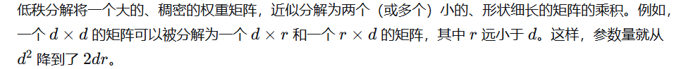
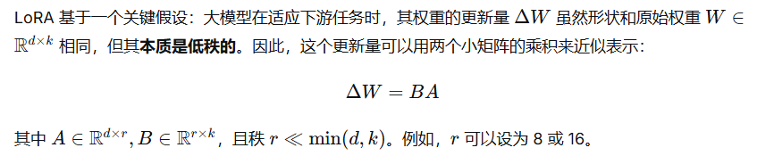
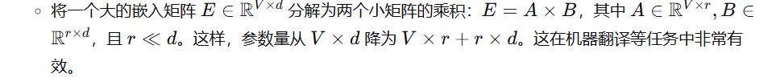

# 121.大模型（LLMs）模型压缩

#### 模型压缩的常用技术有哪几大类？

模型压缩的核心目标是在保持模型性能（准确率、生成质量）可接受的前提下，显著降低模型的存储体积、运行时显存和推理延迟。目前，主流的技术可以分为以下四大类，它们往往相互正交，可以组合使用以达到极致的压缩效果。

一、 量化

量化是最直接、应用最广的压缩技术。它的核心思想是将神经网络中原本用高精度浮点数（如32位浮点数 FP32）表示的权重和激活值，映射到更低比特的整型数（如8位整型 INT8、4位整型 INT4）上。这就像将一张高清照片压缩成一张普通画质的图片，虽然丢失了一些细节，但文件大小急剧缩小。量化的优势在于：

- 模型体积直接减半或更多：从 FP16 降到 INT4，模型文件大小变成原来的 1/4。

- 推理速度大幅提升：现代 CPU 和 GPU 对整型运算提供了专门的指令集优化，能以比浮点运算高得多的吞吐量进行处理。

- 降低内存带宽压力：由于模型参数变小，从显存中读取权重的速度更快，这对于生成式模型尤其关键。

二、 剪枝

剪枝受启发于生物神经元的“突触修剪”。它的核心思想是移除神经网络中“不重要”的连接或结构。

- 非结构化剪枝：将模型中权重绝对值接近于零的单个连接直接移除，得到一个稀疏矩阵。这能极大减少参数量，但得到的稀疏矩阵对硬件不友好，需要专门的软硬件支持才能加速。

- 结构化剪枝：直接移除整个神经元、注意力头、甚至整层网络。这种做法对硬件非常友好，因为剩下的模型仍然是一个稠密网络，可以直接在现有 GPU 上获得加速。

三、 低秩分解

低秩分解将一个大的、稠密的权重矩阵，近似分解为两个（或多个）小的、形状细长的矩阵的乘积。例如，一个 $d \times d$ 的矩阵可以被分解为一个 $d \times r$ 和一个 $r \times d$ 的矩阵，其中 $r$ 远小于 $d$。这样，参数数量就从 $d^2$ 降到了 $2dr$。

{.ocr-src}

最著名的应用就是 LoRA，它通过在原始预训练权重旁添加可训练的“低秩旁路”来微调模型。微调时只更新旁路参数，冻结原模型，极大降低了微调成本。虽然 LoRA 主要用于微调，但它也属于低秩分解的范畴，其思想可以直接用于模型本身的压缩。

四、 知识蒸馏

知识蒸馏是一种“教师-学生”学习模式。一个大型、复杂的“教师模型”将其学到的知识（暗知识）传递给一个结构更简单、参数更少的“学生模型”。

- 白盒蒸馏：学生可以访问教师的内部结构（如中间层特征、注意力矩阵）。

- 黑盒蒸馏：学生只能通过教师的输入-输出对（如生成的文本或 API 返回的 logits）来学习。这是当前 LLM 蒸馏的最主要形式，例如用 GPT-4 生成的数据去微调一个 LLaMA-7B 模型。

在实际应用中，这四大技术常常是流水线式地结合在一起的。例如，一个模型可以先经过剪枝去除大量冗余结构，然后进行量化以减小体积并加速，最后通过知识蒸馏将性能恢复甚至提升到接近原始模型的水平。

---

#### 什么是权重量化？常见的量化精度有哪些？

权重量化特指将模型存储的权重参数从高精度浮点数转换为低比特整型数的过程。需要明确的是，在 LLM 推理中，通常只对权重进行量化，而激活值（推理过程中产生的张量）则保持较高精度（如 FP16 或 BF16），这是因为激活值的分布非常动态且对精度敏感。

常见量化精度：

- FP32 (32位浮点数)：这是深度学习模型训练和存储的“黄金标准”。1 位符号位、8 位指数位、23 位尾数位。优点是精度极高，动态范围大，但缺点是占用内存和带宽极大，推理速度慢。

- FP16 (16位浮点数)：1 位符号、5 位指数、10 位尾数。相比 FP32，内存占用减半，计算速度显著提升（尤其是支持 Tensor Cores 的 GPU）。然而，其动态范围较小，容易导致数值溢出（梯度爆炸）或下溢（梯度为零），训练时通常需要损失缩放技术来稳定。

- BF16 (Brain Floating Point)：1 位符号、8 位指数、7 位尾数。由 Google 提出，专为深度学习设计。其指数位数与 FP32 相同，因此动态范围与 FP32 完全一致，基本不存在溢出/下溢问题，训练时无需损失缩放。代价是尾数精度（7位）低于 FP16（10位），但在实践中对模型收敛和最终性能的影响微乎其微，已成为大模型训练和推理的主流格式。

- INT8 (8位整型)：取值范围 [-128, 127]。理论速度是 FP16 的两倍，是当前工业界最成熟的量化方案，精度损失通常控制在 1% 以内，属于“无损量化”范畴。

- INT4 (4位整型)：取值范围 [-8, 7]。这是目前 LLM 部署的“甜点”精度，能将一个 7B 模型的显存占用从 14GB (FP16) 压缩到约 4GB，使得在消费级显卡甚至 CPU 上推理成为可能。其精度损失通常需要更复杂的量化方法（如 GPTQ）来弥补。

量化精度越低，模型体积越小、推理越快，但精度损失的风险也越高。如何在极限低比特下保持模型智能，是当前量化研究的核心挑战。

---

#### GPTQ 和 AWQ 量化方法的主要区别是什么？

GPTQ 和 AWQ 都是目前最主流的大语言模型训练后量化方法，专注于将 FP16 模型高效、准确地量化为 INT4/INT3 模型。它们的核心区别在于如何理解和处理权重的“重要性”。

GPTQ (GPT Post-Training Quantization)

- 核心思想：这是一次性、全局最优的量化方法。它基于最优脑外科医生（OBS） 理论，通过逐列循环处理权重矩阵，用海森矩阵的逆来估计每个权重的“重要性”，并在量化每一列之后，对剩余未量化的权重进行精确的补偿更新，以最小化整体输出误差。

- 工作流程：
  1. 使用一小部分校准数据（如 128 条文本）在模型上运行一次，记录各层的输入。
  2. 对每一层的权重矩阵，按照固定的顺序（逐列）进行量化。
  3. 当量化完一列后，通过一个复杂的数学公式，将这一列产生的误差“分摊”到该行后续尚未量化的权重上，最终使得该层的全局输出误差最小化。

- 特点：精度非常高，尤其在 4-bit 量化时能保持与原始模型几乎一致的性能。但由于每次量化后都要进行精细的误差补偿计算，其处理速度相对较慢，需要数小时才能完成一个 70B 模型的量化。它更倾向于一种“事后的、全局的优化”。

AWQ (Activation-aware Weight Quantization)

- 核心思想：它发现并非所有权重都对输出结果同等重要。权重的重要性与其对应的激活值的幅度强相关：激活值较大的“显著通道”（salient channels）对应的权重对最终输出影响更大，因此对这些权重的量化精度要求应该更高。

- 工作流程：
  1. 使用校准数据运行模型，记录每个通道（channel）激活值的平均幅度。
  2. 根据激活幅度，识别出最重要的约 1% 的“显著权重”。
  3. 不对这些显著权重进行复杂的数学补偿，而是直接将这些通道对应的权重按比例放大，这样在后续的 INT 量化取整步骤中，它们的有效精度得以保留。
  4. 在推理时，模型会对输入数据进行对应的反向缩放，保证了数学上的等价性。整个过程高效而简洁。

- 特点：AWQ 不进行复杂的误差补偿计算，只进行“缩放”和“量化”两步，因此处理速度极快，比 GPTQ 快数个数量级。同时，它保持了优秀的量化精度。它更倾向于一种“事前的、基于输入数据重要性的保护”。

对比总结：GPTQ 追求全局最优的误差补偿，计算代价高；AWQ 则发现并保护少数关键权重，以极低的计算代价实现了同样优秀的量化效果。两者都在实践中广泛应用，可根据对量化速度和精度的不同需求进行选择。

---

#### 量化感知训练与训练后量化有何不同？

这两者是模型量化的两种根本不同的路径，决定了模型是“生来如此”还是“后天改造”。

训练后量化 (Post-Training Quantization, PTQ)

- 概念：拿一个已经训练好的、采用 FP16/FP32 精度的高精度模型，直接对其权重进行低比特转换（如 GPTQ, AWQ 所做的）。模型本身未曾“意识到”它将要被量化，量化误差完全依赖于转换算法的精巧设计来弥补。

- 优点：
  - 简单快捷：无需重新训练或微调，仅需少量校准数据，几分钟到几小时即可完成。
  - 计算成本极低：不需要庞大的训练集群。

- 缺点：
  - 精度损失不可控：对于复杂任务或超低比特（如 INT3, INT2），量化误差可能过大，导致模型性能断崖式下跌，且无法通过算法完全修复。

- 适用场景：FP16 → INT8/INT4 的快速部署，适用于对精度要求不是极端苛刻的场景。

量化感知训练 (Quantization-Aware Training, QAT)

- 概念：在模型的训练（或微调）阶段，就模拟量化过程。具体来说，在前向传播时，将权重和激活值由高精度（FP16）转换为低精度（INT8），然后再转换回高精度；反向传播时则忽略这个“伪量化”的阶梯函数，使用直接的梯度（Straight-Through Estimator）来更新原始的高精度权重。这使得模型在训练过程中就逐步“适应”了量化带来的信息损失，并学会在低精度约束下调整权重，以保持性能。

- 优点：
  - 精度保持性好：能最大程度地保留甚至恢复模型的原始性能，是实现超低比特（如 INT4 以下）量化的关键手段。

- 缺点：
  - 成本极高：需要对模型进行完整的再训练或大规模微调，计算资源消耗巨大，相当于重训模型的一部分工作量。
  - 流程复杂：需要修改训练框架，插入伪量化节点。

- 适用场景：对模型体积和速度有极致要求，且愿意投入大量算力进行重新训练的场景，如端侧芯片的专用模型部署。

简而言之，PTQ 是“事后补救”，试图用算法弥补已造成的损失；QAT 是“事前锻炼”，让模型在训练过程中就学会如何对抗量化的影响。

---

#### 什么是结构化剪枝和非结构化剪枝？各自的优缺点？

剪枝技术根据其移除粒度，分为非结构化和结构化两大流派，它们的优缺点直接决定了其在实际部署中的可行性。

非结构化剪枝

- 定义：这是一种“微观”层面的剪枝。它遍历整个网络，直接移除那些数值接近零的单个神经元连接（权重）。剪枝后，权重矩阵从一个稠密矩阵变为一个稀疏矩阵，其中大部分元素为零。

- 优点：
  - 压缩率极高：理论上可以移除超过 90% 的权重而保持模型性能，因为神经网络中存在大量冗余连接。
  - 精度保持好：由于粒度极细，可以在不显著影响模型结构的情况下，只剔除最不重要的信息。

- 缺点：
  - 硬件不友好：现代 GPU 是为稠密矩阵乘法高度优化的。稀疏矩阵乘法的计算效率极低，其不规则的内存访问模式会严重拖慢推理速度。
  - 需要特殊软硬件支持：要利用非结构化剪枝加速，需要专用的稀疏计算库（如 cuSPARSE）甚至专门的 AI 芯片（如 NVIDIA 的 A100 中的稀疏张量核心），这限制了其通用性。

结构化剪枝

- 定义：这是一种“宏观”层面的剪枝。它直接移除模型的整个结构单元，例如整个神经元、整个注意力头、整个网络层，或整个滤波器（在 CNN 中）。剪枝后，模型的结构变得更“瘦”或更“浅”，但仍然是稠密网络。

- 优点：
  - 硬件极友好：剪枝后得到的模型仍然是稠密的，可以直接利用现有 GPU 进行高效推理，获得直接的延迟降低和吞吐量提升。
  - 工程实现简单：无需特殊的推理框架，标准的深度学习编译器和运行环境即可。

- 缺点：
  - 压缩率受限：为了保持模型的结构完整性，其剪枝粒度受限，通常压缩率不如非结构化剪枝。
  - 精度损失风险高：由于移除的是大块结构，对模型的计算图影响较大，更可能导致性能的显著下降，需要配合精细的恢复训练。

简单类比：非结构化剪枝像是从一本书中随机撕掉一些不重要的字，信息还在，但阅读起来磕磕绊绊，需要专门工具才能看懂。结构化剪枝则是直接撕掉整句、整段甚至整章，剩下的内容依然通顺流畅，但书的厚度和信息量大幅减少。

---

#### LLM 的宽度剪枝和深度剪枝分别指什么？

在 LLM 的 Transformer 架构中，结构化剪枝主要沿着两个维度进行：宽度和深度。

宽度剪枝

- 目标：减少模型的宽度，即每一层内部的表示维度。

- 常见操作：
  - 注意力头剪枝：移除多头注意力机制中某些贡献度低的“头”。每个头关注不同的模式，实践发现很多头是冗余的，可以被安全移除。
  - FFN 中间层剪枝：Transformer 的 FFN 层中有一个升维操作，其维度通常为 `d_model` 的 4 倍，包含大量参数。可以移除该中间层中不重要的神经元，缩小其维度。
  - 嵌入层维度剪枝：可以缩减 token 嵌入向量的维度。

- 效果：使模型每一层变得更“瘦”，计算量显著减少。它更侧重于降低模型的 FLOPS（计算量）。

深度剪枝

- 目标：减少模型的深度，即堆叠的 Transformer 层的数量。

- 常见操作：通过一定的评判标准，直接移除整个 Transformer 层。评判标准可以是该层输出的特征与输入特征的相似度（层是否近似于一个恒等映射），或者该层对最终任务的贡献度。

- 效果：使模型变得更“浅”，这直接减少了模型的序列化延迟，因为信息需要流经的层数变少了。它对降低延迟尤为有效。

通常，宽度剪枝和深度剪枝会结合使用，以在模型体积、计算量和延迟之间找到一个平衡点。例如，先通过深度剪枝快速减少层数，降低延迟，再通过宽度剪枝精细化地缩减每层的参数和计算量。

---

#### 如何评估剪枝后模型的性能恢复程度？

剪枝不是一次性完成的操作，而是一个迭代的、有损的过程。评估其效果的关键在于，不是看“剪掉了多少”，而是看“剪掉之后还能不能回到原来的水平”。评估体系通常包含以下几个层次：

1. 绝对性能恢复

这是最基础的指标。我们关心的是，经过剪枝和恢复微调后，模型在标准任务上的最终得分和原始未剪枝模型的得分差距有多大。

- 困惑度：这是语言模型最核心的指标，衡量模型对文本的预测能力。困惑度越低越好。

- 下游任务基准：在 MMLU, HellaSwag, HumanEval 等标准基准测试上进行评估。我们定义 “性能保留率” = 剪枝后模型得分 / 原始模型得分。通常，保留率在 95% 以上被认为是一个成功的压缩。

2. 压缩率与效率提升的权衡

性能评估必须与压缩效果一起看。我们需要绘制一条“性能-压缩率”曲线。

- 参数压缩比：剪枝后的模型参数 / 原始模型参数。

- 推理加速比：剪枝前后，在相同硬件上处理相同输入的实际推理时间之比。这是最终业务关心的指标。

3. 鲁棒性与泛化能力恢复

模型可能在标准测试集上分数不错，但在一些极端或分布外数据上表现异常。需要评估：

- 对抗性鲁棒性：剪枝可能会使模型对微小输入扰动更敏感。

- 长尾任务能力：剪枝容易丢失对低频知识（长尾）的记忆。需要构造专门的长尾知识测试集，评估模型在罕见场景下的表现是否严重退化。

- 偏见与安全性：剪枝是否意外放大了模型原有的某些偏见？需要用红队测试或偏见基准（如 BOLD）来检验。

4. 微调恢复的效率

评估一个剪枝方案的好坏，还要看它“多快能恢复”。一个好的剪枝方案应该用极少的训练步数和数据，就能使模型性能回到基线附近。如果一个剪枝方案虽然压缩率高，但需要非常昂贵的完整再训练才能恢复性能，那么它的整体价值就大打折扣。

---

#### LLM 中的低秩分解（如 LoRA）是如何压缩训练和微调成本的？

LoRA 及其相关技术是利用低秩分解思想来高效微调大模型的典范。它并没有压缩原始模型本身，而是极大地压缩了微调阶段的计算成本。

**核心原理：**

LoRA 基于一个关键假设：大模型在适应下游任务时，其权重的更新量 $\Delta W$ 虽然形状和原始权重 $W \in \mathbb{R}^{d \times k}$ 相同，但其**本质上是低秩的**。因此，这个更新量可以用两个小矩阵的乘积来近似表示：

$$
\Delta W = BA
$$

其中 $A \in \mathbb{R}^{d \times r}, B \in \mathbb{R}^{r \times k}$，且秩 $r \ll \min(d, k)$。例如，$r$ 可以设为 8 或 16。

{.ocr-src}

如何压缩训练和微调成本：

1. 冻结预训练权重：在整个微调过程中，原始的庞大权重 $W$ 保持不变，不需要计算其梯度，也不需要更新。

2. 仅训练低秩矩阵：我们只初始化并训练极小的矩阵 $A$ 和 $B$。可训练参数量从 $d$×$k$ 骤降为 (d+k)×r，减少了几个数量级。

3. 显存消耗骤降：由于不需要存储原始权重的梯度和优化器状态，微调所需的 GPU 显存降低了大约 2/3。这使得在单张消费级显卡上微调 70B 模型成为可能。

4. 训练速度加快：反向传播和优化器更新只作用于极少数的低秩参数，单步训练时间显著缩短。

5. 推理零延迟：训练完成后，我们可以直接将低秩矩阵的乘积 *BA* 加到原始权重 $W$ 上，得到一个合并后的新模型。这个新模型的结构与原始模型完全一致，推理时没有任何额外开销。

本质：LoRA 不是压缩模型，而是压缩了微调的过程，通过将昂贵的、对全量参数的更新，替换为廉价的、对低秩旁路的更新，从而以极低的成本实现大模型的个性化适配。

---

#### LoRA 的低秩矩阵通常插入在模型的哪些位置？为什么？

LoRA 的设计者通过在大量实验中发现，将低秩矩阵应用于 Transformer 的自注意力层效果最好，而在前馈网络（FFN）上的收益则相对较小。因此，其典型位置是：

1. 自注意力层的所有投影矩阵\
   这是 LoRA 最主要、最标准的应用位置。通常会对 Query ($W_Q$) 和 Value ($W_V$) 的投影矩阵添加 LoRA 旁路。

- $W_Q$：控制“要查询什么”，调整它能改变模型关注的焦点。

- $W_V$：控制“所关注的内容是什么”，调整它能改变模型提取信息的方式。

- 为什么是 $Q$ 和 $V$？因为注意力机制的核心是在不同子空间中对信息进行查询和聚合。对 $Q$ 和 $V$ 进行适配，能以最小的参数成本最直接地调整模型的注意力行为。通常，只对 $Q$ 和 $V$ 添加 LoRA 就足够了，加上 $K$ 和 $O$ 也能增加模型容量，但并非必须。

2. FFN 的投影矩阵（可选，容量更大）\
   在需要更强适配能力时，也可以对 FFN 层中的线性层（如 `gate_proj`, `down_proj`）添加 LoRA。这会增加一些可训练参数，但能进一步提升模型对下游任务的拟合能力。因为 FFN 层被认为是存储了大量事实性和概念性知识的地方，对这些层进行微调有助于注入领域知识。

为什么选择这些位置？

- 平衡效率与效果：注意力层负责“动态的信息检索和聚合”，FFN 负责“静态的知识存储”。在大多数情况下，只需要微调模型的信息检索方式（注意力）就足以适配新任务，因为预训练模型的知识通常是通用的。

- 最低显存消耗：只对 Q/V 加 LoRA 的可训练参数量极少，能将微调成本压缩到极致。

- 架构的天然适配：这些投影矩阵本身就是线性层，LoRA 的低秩分解可以无缝地以旁路形式嵌入，而不改变模型的其他任何部分。

总而言之，LoRA 的低秩旁路集中插入在模型负责核心运算（注意力）和记忆（FFN）的线性投影层，以最小的参数代价，实现了对模型行为的最大程度的调控。

---

#### 什么是 QLoRA？它如何结合量化和低秩适应？

QLoRA（Quantized Low-Rank Adaptation） 是一种在极低显存环境下微调大模型的突破性技术。它巧妙地将权重量化与低秩适应（LoRA） 结合在一起，使得在单张消费级显卡（如24GB显存的RTX 3090）上微调一个650亿参数（65B）的模型成为可能。

核心原理：

QLoRA并不是直接量化LoRA矩阵，而是对原始预训练模型的权重进行极致压缩，而LoRA旁路则保持较高精度进行训练。

1. NF4量化：QLoRA将原始的FP16模型权重量化为 4-bit NormalFloat (NF4) 格式。NF4是一种专为正态分布数据设计的最优量化格式，由于预训练权重的分布通常近似正态，NF4能比传统的INT4保留更多信息，从而在极致压缩下仍维持较低的量化误差。

2. 双重量化：为了进一步节省显存，QLoRA对量化过程中产生的缩放常数也进行了量化。这些缩放常数虽然体积不大，但在超大模型上也会占用可观的显存。双重量化将它们再次量化为FP8，实现“连环压缩”。

3. 分页优化器：当训练中偶发显存峰值时，QLoRA利用了NVIDIA的统一内存机制，将优化器状态自动分页（paging）到CPU内存中，避免GPU显存溢出（OOM），确保训练稳定。

工作流程：

- 推理前向时，冻结的NF4权重被反量化为BF16/FP16进行计算。

- 反向传播时，梯度仅计算并更新在LoRA的低秩矩阵（A和B）上，不经过量化后的基座模型。

- 这种“冻结量化权重 + 训练高精度旁路”的设计，使得显存占用的大头（模型本体）被压缩了4倍，而可训练参数（LoRA矩阵）极少，整体显存需求骤降。

效果：QLoRA在几乎不损失微调性能的情况下，将显存需求降低了约4倍，极大地降低了大模型微调和领域适配的门槛。

---

#### 模型压缩中，什么是“迭代式剪枝-重训”？

迭代式剪枝-重训（Iterative Pruning and Retraining） 是一种精细的、多阶段的剪枝策略，旨在以最小的性能损失达到极高的稀疏度或压缩率。它不试图“一步到位”地剪掉所有冗余结构，而是通过多次、小步长地剪枝和恢复训练，让模型在压缩过程中逐步适应结构的变化。

核心流程：

1. 初始训练：在原始数据集上训练出一个性能优越的稠密模型。

2. 剪枝阶段：选择一种剪枝标准（如权重的绝对值大小、对损失函数的影响等），从当前模型中移除一小部分（例如10%~20%）最“不重要”的结构（权重、神经元或层）。

3. 重训（恢复微调）阶段：将剪枝后的模型在原始数据上继续训练若干个epoch。这个阶段让剩余的权重有机会学习和调整，以补偿被剪掉的连接所丧失的功能，恢复模型的精度。

4. 迭代循环：重复步骤2和步骤3，每次都再剪掉一小部分，再微调恢复，直到达到目标压缩率。

为什么有效：

- 避免不可逆损伤：如果一次性剪掉大量权重，模型的计算路径可能被完全破坏，即使重训也难以恢复。迭代式剪枝将“大手术”分解为多次“微创手术”，每次只造成轻微的、可恢复的损伤。

- 动态重分配知识：在每一次的重训阶段，模型可以将被剪枝部分的知识，逐渐迁移和重新编码到剩余的权重中，实现知识的蒸馏式转移。

- 探索更好的稀疏子网络：这个过程类似于在复杂的权重空间中，逐步寻找一个能保持原始性能的高效稀疏子网络（这被称为“彩票假说”的实践应用）。

这种方法虽然效果好，但计算成本较高，因为它需要进行多轮完整的训练。

---

#### 如何对嵌入层进行压缩？常用方法有哪些？

在LLM中，嵌入层（Embedding Layer）的权重矩阵形状为 `[词汇表大小, 隐藏维度]`，通常包含数万个词，每个词有数百到数千维的向量。这使得嵌入层往往占据模型总参数的显著部分，尤其在小模型中占比更高。压缩嵌入层是模型轻量化的重要环节。

常用方法：

1. 权重共享：
  - 输入-输出嵌入共享：让模型的输入嵌入层和输出线性层共享同一个权重矩阵。这是LLaMA等许多模型的标准做法，可以直接将嵌入层的参数量减少一半。

2. 低秩分解：

- 将一个大的嵌入矩阵 $E \in \mathbb{R}^{V \times d}$ 分解为两个小矩阵的乘积：$E = A \times B$，其中 $A \in \mathbb{R}^{V \times r}, B \in \mathbb{R}^{r \times d}$，且 $r \ll d$。这样，参数量从 $V \times d$ 降为 $V \times r + r \times d$。这在机器翻译等任务中非常有效。

{.ocr-src}

3. 量化：
  - 直接对嵌入层的权重进行低精度量化（如INT8甚至INT4）。因为嵌入层本质上是一个查找表，其数值对微小扰动有一定鲁棒性。

4. 剪枝：
  - 词表剪枝：移除那些在整个训练语料中出现频率极低的、不重要的词条及其嵌入向量。这可以直接缩减词汇表大小。
  - 维度剪枝：移除嵌入向量中不重要的维度，相当于对嵌入矩阵进行结构化列剪枝。

5. 混合精度存储与计算：
  - 在推理时，将嵌入层以低精度（如INT8）存储和读取，但计算时将其反量化到FP16，以保证下游层计算的精度。这是一种常用的工程优化。

---

#### 什么是知识蒸馏与模型压缩的关系？

知识蒸馏是模型压缩技术谱系中的一种重要方法论，它与剪枝、量化等技术既有区别又有紧密联系。

关系定位：

- 知识蒸馏是一种独特的压缩范式：剪枝和量化是在一个已经训练好的给定模型上，直接削减其参数或精度。而知识蒸馏是通过训练一个全新的、结构更小的学生模型来模仿一个或多个大型教师模型的行为，从而实现压缩。它的出发点不是“削减”，而是“重训”。

- 互补与结合：蒸馏可以与剪枝、量化无缝结合，形成多层级的压缩流水线。例如，一个典型的LLM压缩流程可能是：
  1. 蒸馏：用大模型（教师）的知识训练一个小模型（学生），得到一个参数总量已大幅减少的稠密小模型。
  2. 剪枝：对这个蒸馏后的小模型再进行结构化剪枝，进一步移除其内部的冗余注意力头或FFN神经元。
  3. 量化：将剪枝后的模型量化为INT8或INT4，以减小体积并加速推理。

- 目标的一致性：无论是剪枝、量化还是蒸馏，它们的最终目标都是为了得到一个推理成本更低、部署更灵活的模型，同时最大限度地保留原始模型的性能。

本质区别：剪枝和量化是“物理压缩”，直接作用于模型参数；蒸馏是“知识压缩”，通过训练来传递模型的“智慧”。在追求极致效率的端侧部署中，三者往往缺一不可。

---

#### 在边缘设备上部署 LLM，通常会采取哪些压缩手段？

边缘设备（手机、嵌入式终端）的计算、内存和功耗都极其有限，部署LLM需要动用全方位的压缩与优化手段，形成一个“组合拳”。

核心压缩与优化技术栈：

1. 极致量化（第一优先级）：
  - 这是最关键的步骤。通常需要将模型权重量化到 INT4 甚至更低。常用技术包括GPTQ或AWQ。量化后的模型体积和运行时内存占用都呈倍率下降。

2. 模型蒸馏（源头缩减）：
  - 在可能的情况下，不直接压缩大模型，而是用一个大模型教师去蒸馏一个专门为端侧设计的、结构本就极简的“学生模型”（如MobileLLaMA）。这是釜底抽薪之策。

3. 结构化剪枝（加速利器）：
  - 对模型进行宽度剪枝（移除注意力头和FFN神经元）和深度剪枝（减少层数）。由于剪枝后的模型仍是稠密的，它可以直接在现有硬件上获得线性加速，同时减少内存占用。

4. 专用推理引擎与算子优化：
  - 使用专门为边缘设备优化的推理框架，如 llama.cpp（CPU/CUDA/Apple Silicon）、MLC-LLM（手机、WebGPU）。这些框架深度适配硬件指令集，并实现了内存池管理、算子融合和KV Cache量化。

5. KV Cache压缩：
  - 推理时，长序列的Key-Value缓存是内存大户。采用GQA（分组查询注意力）、MQA（多查询注意力）或滑动窗口注意力可以大幅减小KV Cache。对KV Cache进行INT8/INT4量化也是常用手段。

6. 混合精度与内存卸载：
  - 将模型中对精度不敏感的层（如FFN）权重量化到更低位，而对敏感层（如自注意力、LayerNorm）保留较高精度（FP16/BF16）。当模型过大时，将部分层卸载到CPU内存或闪存中，用时再加载。

这些技术通常组合使用，形成一个从模型设计、训练到部署推理的完整优化闭环。

---

#### 请说明量化的校准数据集对精度恢复的重要性。

在校准数据（Calibration Dataset）在训练后量化中扮演着“医生”的角色，它帮助量化算法诊断哪些权重和激活值是模型中的“要害”，从而在量化时进行针对性地保护或补偿，以最大限度地恢复精度。

校准数据的作用机理：

1. 确定动态范围：对于激活值（Activation），其数值范围在不同输入下变化巨大。量化需要确定每个通道或张量的缩放因子（scale）和零点（zero-point）。校准数据通过模拟真实推理过程，跑一遍前向传播，收集各层激活值的统计信息（如最大值、最小值或百分位数），以此来设定最优的量化区间。

2. 识别关键权重（AWQ）：在AWQ中，模型使用校准数据进行推理，自动记录每个通道激活值的平均幅度。激活幅度大的通道对应的权重被认为是“显著权重”，对模型输出影响巨大。AWQ根据这些信息，在量化前有选择性地放大这些权重，从而保护了关键信息不被量化噪声淹没。

3. 最小化全局误差（GPTQ）：GPTQ使用校准数据对模型进行逐层量化。它在量化每一层权重后，会使用校准数据的输入，计算该层输出相对于原始输出的误差。然后，它利用基于海森矩阵的算法，计算出剩余未量化权重的最优补偿值，以最小化该误差的全局累积。这个过程完全依赖于校准数据提供的真实输入分布。

如果校准数据质量差：

- 分布偏差：如果校准数据（如全是学术论文）与模型实际部署时遇到的输入（如社交媒体对话）分布完全不同，那么基于错误的统计信息设定的量化参数，将导致模型在实际使用中的精度大幅下降。

- 覆盖不全：校准数据未能覆盖长尾或边缘场景，那么在这些场景下，模型的量化误差将不受控制，可能产生灾难性的结果。

- 数据量不足：数据量太少，无法提供稳定的统计信息，会导致量化参数的估计不准确，增加噪声。

结论：校准数据集是连接模型“原生精度”与“量化后精度”的桥梁。一个高质量、多样化、且与部署场景分布一致的校准数据集，是量化成功的基石。

---

#### 混合精度推理中的 FP16、BF16 和 INT8 选择依据是什么？

在混合精度推理中，没有一种精度是万能的，通常需要在模型的不同部分、根据不同的任务需求动态选择。选择依据主要基于硬件能力、精度需求、速度和内存限制四个维度。

1. FP16 (16位半精度浮点数)

- 硬件：几乎所有现代GPU（包括老旧的V100）和CPU都支持。

- 精度：精度损失极小，对于绝大多数任务而言等同于“无损”。但其动态范围较窄，对于某些运算（如softmax中的大数值）有溢出风险。

- 选择依据：当模型需要最高的稳定性和精度，且硬件是较旧的架构，不原生支持BF16时，FP16是首选。在推理中，由于没有梯度计算，其溢出风险远低于训练，因此是“最安全的半精度选择”。

2. BF16 (Brain Floating Point)

- 硬件：需要较新的硬件支持（如NVIDIA Ampere架构及以上的A100、H100等）。

- 精度：其动态范围与FP32完全相同（8位指数），因此完全不存在溢出/下溢问题。但其尾数精度（7位）略低于FP16（10位）。实践中，两者在推理精度上几乎没有差异。

- 选择依据：当硬件支持时，BF16是更优的选择，因为它提供了最强的鲁棒性，无需担心数值不稳定。其与FP32的无缝转换也简化了部署流程。

3. INT8 (8位整型)

- 硬件：广泛支持，从服务器CPU到边缘NPU，且能提供成倍的吞吐量提升。

- 精度：属于“有损”量化，但在成熟的量化方案下精度损失可控（通常<0.5%）。

- 选择依据：当目标是最大化吞吐量和最小化延迟，且可以容忍微小的精度损失时，INT8是最佳选择。它也常用于量化权重，与FP16/BF16的激活值配合（即W8A16），以降低模型体积和内存带宽压力，同时保持计算的高精度。

混合精度的实践：

- 权重精度 vs 激活值精度：最常见的方案是使用INT4/INT8来存储和加载权重（节省内存和带宽），但在实际计算时，将激活值保持为FP16/BF16（保证计算精度）。

- 层间混合：对数值敏感层（如 `LayerNorm`, `Softmax`, 以及注意力分数计算）强制使用FP32或FP16/BF16，而对参数量大、对精度相对不敏感的 `Linear` 层使用INT8。这种精细化的混合精度是部署高性能模型的关键。

---

#### 如何在不显著降低性能的前提下，将 LLM 参数量压缩 50% 以上？

将LLM参数量压缩50%以上并保持性能，是一项系统工程，通常需要组合多种技术。以下是两种最可行、最高效的路径。

路径一：极致量化（最快、最经济）

- 方法：直接使用4-bit量化（如 GPTQ 或 AWQ）将FP16模型转换为INT4模型。

- 效果：参数量和模型文件大小直接从2字节/参数降至0.5字节/参数，压缩率高达75%。在7B、13B乃至70B模型上，经过良好校准的4-bit量化的性能损失通常可以控制在1%以内，甚至在某些任务上毫无损失。

- 优势：无需重新训练，仅需少量校准数据和几十分钟到几小时的计算时间，是性价比最高的方案。

路径二：结构化剪枝 + 恢复训练（更彻底）

- 方法：对一个预训练模型进行结构化剪枝，例如移除30%的注意力头和20%的FFN神经元，使模型总参数量下降50%。剪枝后，使用原始预训练数据对模型进行少量步数（例如完整训练的1-5%）的微调，让模型恢复性能。

- 效果：可以得到一个参数减半且计算量同比例下降的稠密模型。这意味着不仅体积缩小，推理速度也直接提升50%。

- 优势：同时压缩了模型体积和计算量，在推理延迟上的收益是纯量化无法比拟的。

组合路径（追求极致）：

1. 蒸馏：首先用原始大模型作为教师，蒸馏一个参数规模本身就只有原模型50%的学生模型。这个学生模型继承了教师的知识，是一个“先天高效”的稠密模型。

2. 剪枝：对这个学生模型进行更精细的迭代式剪枝，进一步移除10-20%的冗余结构。

3. 量化：最后，将这个剪枝后的模型进行4-bit量化，用于最终部署。

核心结论：只追求参数量压缩50%，4-bit量化几乎是最优解。如果要同时实现推理加速（减少FLOPs），则必须结合结构化剪枝或蒸馏。

---

#### 对于 MoE 模型，有哪些特定的压缩或精简方案？

混合专家（MoE）模型拥有巨大的总参数量，但每次推理只激活其中一小部分。其压缩方案主要针对“专家冗余”和“总存储量”这两个痛点。

1. 专家剪枝：
  - 利用率剪枝：在大量下游任务数据上统计每个专家被激活的频率。直接移除那些几乎从未被激活或贡献度极低的“冷门”专家。
  - 专家合并：通过分析专家权重的相似性（如计算两个专家的FFN权重的余弦相似度），将功能高度重叠的专家合并为一个，减少专家总数。

2. 知识蒸馏（MoE到Dense）：
  - 这是最彻底的精简方案。将一个大MoE模型（如Mixtral 8x7B）作为教师，蒸馏到一个结构紧凑的稠密学生模型（如一个标准7B模型）中。学生在训练时学习融合了所有专家智慧的教师输出，最终得到一个完全没有MoE路由开销的、高质量的单一模型。

3. 量化与专家分组：
  - 混合精度量化：对激活频率不同的专家采用不同的量化策略。高频专家使用较高精度（如INT8），以保持性能；低频冷门专家采用更低精度（如INT4），以节省存储。
  - 共享参数量化：DeepSeekMoE中的共享专家承载通用知识，可对其采用更高的量化精度或保留原始精度。

4. 推理时的专家卸载：
  - MoE模型显存占用大的一个原因是所有专家权重都必须加载。在推理时，可以根据门控网络的决策，预测即将需要哪些专家，并提前异步地将这些专家从CPU内存（甚至SSD）加载到GPU。当前不用的专家保持在CPU上，从而将GPU显存占用从“总模型大小”降低到“激活模型大小”。

5. 门控网络与路由优化：
  - 精简门控网络本身（通常是一个轻量级线性层，已较小）。
  - 采用更简洁高效的路由策略，减少top-k的选择，或对路由决策进行提前剪枝，降低计算开销。

---

#### 模型压缩可能带来哪些安全性或公平性问题？

模型压缩在追求效率的同时，可能无意中成为放大模型原有缺陷的“催化剂”，尤其是在安全性和公平性方面，其影响往往具有隐蔽性。

1. 边缘群体偏见的放大

- 机制：非结构化和结构化剪枝倾向于保留对高频数据模式有用的权重，而丢弃对低频（长尾）数据有用的权重。不幸的是，社会中边缘化群体的数据往往就属于长尾分布。因此，剪枝后的模型在这些群体相关的任务上，性能下降可能远超平均水平。

- 表现：一个被剪枝的对话模型，对主流文化梗的回应依然风趣幽默，但对少数族裔的文化话题却变得迟钝、错误频发，甚至输出冒犯性内容。

2. 幻觉问题的加剧

- 机制：量化，特别是低比特量化，会引入噪声并导致信息丢失。这种信息丢失可能会使模型在“记忆模糊”的情况下，更倾向于依靠其强大的语言生成能力进行“编造”，从而产生事实性错误。对于需要精确回忆的细节（如人名、地名、数字），压缩后的模型更容易出错。

- 表现：一个被极限压缩的LLM在回答历史事件时，可能会更自信地输出完全错误的日期和人物关系，而其浮点版本能正确回答。

3. 安全对齐的退化

- 机制：模型的安全对齐（如拒绝回答危险问题）通常是通过微调（SFT/RLHF）实现的，这些能力以较为脆弱的模式存储在参数中。压缩过程，尤其是剪枝，可能会优先将这些被认为“不重要”的、与语言流畅性无关的安全护栏能力给裁剪掉。

- 表现：一个经过精心对齐的模型在被压缩后，可能更容易被“越狱”提示词攻破，开始输出暴力、色情或仇恨内容。需要警惕的是，压缩后的模型可能在标准安全基准上表现依旧良好，但在更复杂的对抗攻击下却更脆弱。

4. 对抗鲁棒性的下降

- 机制：压缩减少了模型的参数冗余，而模型的鲁棒性很大程度上依赖于这种冗余来平均化噪声和对抗性扰动。一个更“精瘦”的模型对输入的微小恶意扰动（如故意拼错的单词）可能更敏感，更容易被误导。

- 表现：攻击者可能在用户输入中嵌入人眼不可见的特殊字符，使得压缩后模型输出完全偏离预期的结果，而原始模型却不受影响。

缓解策略：压缩后必须进行专项的公平性和安全性审计，使用更具包容性的测试集，并进行对抗性红队测试。在压缩后的恢复微调阶段，有意识地加入安全对齐数据和长尾数据，可以帮助模型在一定程度上重新“找回”丢失的能力。

