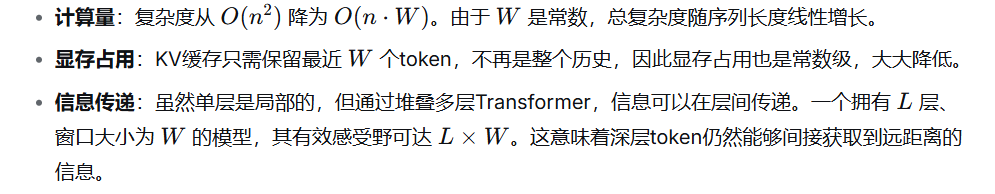

# 124.大模型（LLMs）成本与延迟优化

#### 推理延迟的两个关键指标是什么？请解释它们的含义。

在LLM推理中，用户感知的延迟并非单一数值，而是由两个关键指标共同构成。理解并优化这两个指标，是提升用户体验的核心。

- TTFT：指从客户端发送请求到接收到第一个生成的token所经历的时间。在TTFT期间，模型必须一次性处理整个输入Prompt。这个阶段是计算密集型，需要完成所有Prompt token的注意力计算，延迟与Prompt长度和模型大小成正比。在需要系统指令、长文档总结等场景中，TTFT是用户感知“模型开始响应”的直接指标。

- TPOT：指在流式输出过程中，除了首个token外，每个后续token生成之间的平均时间间隔。它直接决定了模型“吐出”剩余答案的速度。进入解码阶段后，每个新token的生成都只处理一个token，此时计算量很小，性能瓶颈不再是计算能力，而是内存带宽。KV Cache越大，每次生成需要读取的数据就越多，TPOT也就越高。

形象比喻：TTFT是打开水龙头后第一滴水落下的时间，TPOT是之后水流稳定流出的速度。一个优秀的推理系统，既要快速响应，也要在回答长问题时保持流畅。

---

#### 什么是 KV 缓存？它在自回归生成中如何节约计算？

KV缓存是Transformer模型在自回归推理时，为避免重复计算而引入的核心技术。

在标准自回归生成中，模型逐token生成序列。当生成第`t+1`个token时，需要基于所有`t`个历史token的Key和Value向量来计算注意力。如果没有KV缓存，模型每一步都需要重新计算整个序列所有token的K和V，其计算量与序列长度的平方成正比。

KV缓存的本质是用显存换时间。它在生成第一个token时，将Prompt中所有token的K和V向量计算并保存下来。此后每生成一个新token，只需计算这个新token的Q、K、V，并让它的Q去与缓存中所有历史的K进行注意力计算。这避免了为历史token反复进行昂贵的线性投影运算，将每一步的计算量从与总长度相关的平方级降低到仅与新token相关的线性级。

制约与代价：KV缓存的显存占用随序列长度和模型层数线性增长。在长序列场景中，它可能远超模型权重，成为最大的显存开销，因此对其管理（如PagedAttention）和压缩（如GQA、KV Cache量化）至关重要。

---

#### FlashAttention 的原理是什么？为何能加速推理和训练？

FlashAttention并非近似算法，而是一种精确的、IO感知的注意力加速算法，其目标是解决标准注意力计算中的显存带宽瓶颈。

原理：标准注意力在计算时会生成一个巨大的`序列长度 × 序列长度`的注意力矩阵，该矩阵必须被写入和读出GPU的高带宽显存。这个过程极其消耗带宽和时间。FlashAttention通过分块和重计算两种技术解决了这个问题。

1. 分块：将输入的Q、K、V矩阵切分成小块，使其能放入GPU片上高速的SRAM中。所有注意力计算，包括矩阵乘法、softmax等，都在SRAM内部完成，只在块间传递必要的统计量。

2. 重计算：前向传播时不将巨大的注意力矩阵写回显存，而是在反向传播时，利用保存的统计量在SRAM中快速重新计算一遍注意力矩阵。

通过将大量原本需要在HBM中进行的读写操作转移到SRAM内部，FlashAttention大幅减少了对显存带宽的依赖，使注意力计算从受限于显存速度转为受限于芯片本身的算力。这使得训练时能处理更长序列，推理时能显著降低延迟，并节省了存储完整注意力矩阵所需的巨量显存。

---

#### 如何利用模型量化来降低推理延迟和成本？

模型量化通过将模型参数从高精度浮点数转换为低精度整型数来压缩模型。其降低推理延迟和成本的原理是多方面的：

- 减小模型体积：这是最直接的好处。一个FP16的7B模型约占14GB显存，量化为4-bit后仅需约4GB。这使得模型可以在更廉价的硬件上运行。

- 降低内存带宽压力：大模型推理的性能瓶颈主要是内存带宽。量化后，每个参数的比特数减少，在相同带宽下可以更快地将参数加载到GPU核心进行计算，直接提升生成速度。

- 加速计算：现代CPU和GPU针对低精度整型运算提供了专门的指令集，能以比浮点运算高得多的吞吐量进行处理。

核心方法：

- GPTQ：一种高精度的训练后量化方法。它利用少量校准数据，通过逐层优化权重来最小化量化误差，可以在数小时内将一个模型量化为4-bit，几乎不损失精度。

- AWQ：发现仅1%的显著权重对模型性能至关重要。它通过分析激活值来识别这些权重，并在量化前对其进行保护性缩放，避免了复杂的误差补偿计算，速度比GPTQ快且效果相当。

- 量化感知训练：在模型训练阶段就模拟量化带来的信息损失，让模型提前适应低精度环境。精度最高，但需要完整的训练流程和大量计算资源。

---

#### 请解释“猜测解码”（Speculative Decoding）的工作流程。

猜测解码是一种无损加速推理的技术，其核心思想是“用小模型快速起草，让大模型并行验证”。

自回归推理慢的原因之一是必须逐个token生成。猜测解码解决了这个问题，其工作流程如下：

1. 草案生成：使用一个与目标大模型行为相似的、参数量极小的草案模型。给定相同的Prompt，草案模型以自回归方式快速生成连续的K个候选token。

2. 并行验证：将这K个候选token连同原始Prompt一起，一次性输入给目标大模型。大模型通过一次前向传播，就能并行地计算出对这K个token的预测概率分布。

3. 比对与接受：将草案模型的预测概率与目标模型的预测概率进行比对。如果目标模型认为某个候选token的概率很高，就接受它。一旦某个候选token被拒绝，目标模型会丢弃它及其后续所有候选token，并根据自己的预测生成一个正确的新token。

关键：这个过程保证了最终输出的分布与目标模型完全一致，因为所有生成的结果都由目标模型进行了校验和修正。由于验证过程是并行的，每次可以生成多个token，从而将延迟降低约2到3倍。

---

#### 批处理（Batching）如何影响吞吐量和延迟？怎样设置合适的 batch size？

批处理是提升GPU利用率和系统吞吐量的核心手段，但它与延迟之间存在根本性的权衡。

- 如何影响吞吐量：批处理将多个独立的推理请求组合成一个批次，一次性送入GPU。GPU的并行架构使得处理一个批次的时间远小于单独处理这些请求的时间总和。更大的batch size通常意味着更高的吞吐量。

- 如何影响延迟：更大的batch size也意味着每个请求可能需要等待更长的时间才能凑成一个批次。此外，同批次中不同长度的请求必须等待最长的那个生成完毕才能一起返回。因此，增大batch size会增加单个请求的延迟。

设置合适的batch size：

- 静态批处理：设定固定的batch size和最大等待时间。简单但效率较低，因为一个批次会因等待长序列而整体延迟。

- 连续批处理：这是当前主流推理引擎使用的技术。它不等待固定批次，而是在每次迭代时动态地将新请求插入到正在运行的批次中，并随时移出已完成的请求。这使得GPU利用率极高，同时缩短了请求的等待时间。

- 经验法则：batch size的选择取决于模型大小、硬件显存和延迟目标。通常从较小的值（如1, 2, 4）开始，逐步增加，直到吞吐量不再线性增长，或延迟超出目标。

---

#### 什么是前缀缓存（Prefix Cache）？哪些场景受益最大？

前缀缓存是一种专门为优化Prompt的KV缓存而设计的技术。其原理是：当多个请求共享一个相同的文本前缀时，推理引擎只对第一个请求计算并缓存该前缀的KV Cache。后续请求直接复用这个缓存，从而跳过对前缀的计算。

最大受益场景：

- 系统提示词：这是最典型的场景。在对话应用中，所有用户的请求通常都带有一个相同的、很长的`system` prompt。前缀缓存可以完全消除这部分重复计算。

- 少样本学习：Prompt中包含的大量示例是固定的前缀，可以被所有后续推理请求共享。

- 批量评估：对同一个长文档提问多个问题时，文档本身是固定的前缀，后续问题的推理可以直接复用文档的KV Cache。

- 多轮对话：对话历史部分是每轮请求的前缀。使用前缀缓存可以避免在新一轮对话时重新计算整个历史。

---

#### 如何通过模型剪枝或共享参数来减少推理成本？

模型剪枝和参数共享是降低模型计算量和内存占用的结构优化技术。

1. 模型剪枝通过移除模型中不重要的连接或结构来减少冗余。

- 非结构化剪枝：移除单个权重，理论上能极大减少参数量，但对硬件极不友好，难以直接加速。

- 结构化剪枝：直接移除整个神经元、注意力头或网络层。这使得模型变“瘦”或变“浅”，但仍然是稠密的，可以直接在现有GPU上获得加速。宽度剪枝主要减少计算量，深度剪枝主要降低推理的串行延迟。

2. 参数共享通过让模型的不同部分共用同一组权重来压缩模型。

- 输入输出嵌入共享：让模型的词嵌入层和最后的输出线性层共享权重。这可以直接将嵌入层的参数量减少近一半。

- 跨层参数共享：让多个Transformer层共享同一组权重。这极大地减少了模型的参数总量，但可能会降低模型的能力上限。

这些技术可以显著降低模型的存储和计算需求，尤其适合在资源受限的边缘设备上部署。

---

#### GPU 的 HBM 带宽如何限制 LLM 推理速度？如何缓解？

在LLM推理的解码阶段，每生成一个token都需要将整个模型的权重以及巨大的KV缓存从HBM加载到GPU的计算核心中。由于单个token的计算量相对较小，加载数据的时间远大于计算时间，导致99%以上的时间GPU计算核心都在等待数据。这就是内存带宽瓶颈。

缓解方案：

- 模型量化：通过降低每个参数的比特数，减少需传输的数据总量，直接缓解带宽压力。

- GQA/MQA：通过让多个查询头共享一组键值头，将KV缓存大小和读取量成倍减少。

- FlashAttention：通过IO优化，将注意力计算限制在高速SRAM中，显著减少对HBM的读写。

- KV缓存量化：将KV缓存量化为INT8/FP8，使其数据量减半。

- 增大batch size：让GPU在等待数据的间隙处理更多请求，从而提升总体吞吐量。

---

#### 请对比 AWQ 和 GPTQ 在推理延迟优化上的效果和差异。

AWQ和GPTQ都是目前最主流的训练后量化方法，它们都能将FP16模型压缩为INT4/INT3模型。虽然量化后的模型精度相似，但它们优化推理延迟的底层哲学截然不同。

核心思想对比：

- GPTQ 是一种全局最优的方法。它基于最优脑外科医生理论，逐列量化权重，并利用海森矩阵信息，将每一列的量化误差精确地补偿到该行剩余未量化的权重上，最终使得该层输出的全局误差最小化。它的优化目标是最小化量化误差。

- AWQ 则是一种关键保护的方法。它发现权重的重要性并不均匀，约1%的“显著权重”对输出影响巨大。它通过观察激活值的分布来识别这些关键权重，并在量化前按比例放大它们，以保护其精度。它的优化目标是保护关键信息。

推理延迟优化上的差异：

这个差异主要体现在实现复杂度和计算开销上。

- GPTQ 由于追求全局误差最小化，其量化过程本身计算量巨大，且生成的量化模型在推理时，通常需要依赖高度优化的、定制的矩阵乘法内核来高效处理其特殊的数据格式，否则延迟优化效果不明显。

- AWQ 的优势在于实现极其简单。它不改变权重的原始排布，仅在量化前后增加了简单的缩放和反缩放操作。这使得它生成的量化模型可以无缝利用现有的、高度优化的通用推理框架和算子库。由于不引入额外计算，其推理速度通常与GPTQ相当或更快，尤其在通用性上优势显著。

结论：在追求相同推理延迟的场景下，AWQ因其简洁性、通用性和高效的实现，往往更具优势，是目前更受青睐的方案。GPTQ在一些对精度有极致要求且需要定制化推理内核的场景下依然有价值。

---

#### 多查询注意力（MQA）和分组查询注意力（GQA）是如何降低 KV 缓存占用的？

KV缓存是推理时显存占用的主要来源之一，其大小与“键值头”的数量成正比。MQA和GQA正是通过减少独立的键值头数量来压缩KV缓存。

- MHA：每个查询头都有自己独立的键头和值头，KV缓存大小最大。

- MQA：所有查询头共享唯一的一组键头和值头。这将KV缓存大小直接缩减为原来的 1/H（H为头数），压缩效果最极致。但所有头共享可能会损失部分多样性，对模型性能有轻微影响。

- GQA：是MHA和MQA的折中方案。将查询头分为 $G$ 个组（1≤G≤H），同一组内的查询头共享一组键值头，不同组之间独立。这将KV缓存大小缩减为原来的 $G$/$H$。通过调整$G$，可以在效率和模型质量之间平滑权衡。例如LLaMA-2 70B模型使用 G=8，将KV缓存压缩到MHA的1/8，但性能与MHA几乎持平。

降低延迟的原理：更小的KV缓存不仅节省了显存，更重要的是在每次生成token时，需要从显存中读取的K和V数据量成倍减少。这直接缓解了内存带宽瓶颈，使得计算单元能以更快的速度处理数据，从而提升整体生成速度。

---

#### 如何选择推理框架（vLLM、TensorRT-LLM 等）？各自的优势是什么？

选择推理框架是在性能、通用性、易用性之间权衡。

- vLLM：当前最主流的开源推理框架。其核心优势是极高的吞吐量和显存利用率，这得益于PagedAttention技术，它几乎消除了KV缓存的内存碎片，并实现了高效的连续批处理。vLLM的另一个巨大优势是通用性强，支持众多开源模型，且提供了OpenAI兼容的API，部署和使用极为便捷。

- TensorRT-LLM：由NVIDIA开发，追求极致性能的终极选择。它通过图编译和一系列深度算子融合，对NVIDIA GPU进行了极致的优化。其内置的插件架构允许开发者编写高度定制的算子，功能强大。但代价是使用门槛高，对新模型架构的支持需要手动编写转换脚本，不够灵活。

- 其他框架：
  - Hugging Face TGI：像更贴近Hugging Face生态的vLLM，功能类似，提供原生支持。
  - llama.cpp：基于纯C/C++，无需Python环境，专注在消费级硬件上进行CPU和GPU推理，是本地部署的首选。

选择指南：追求快速部署、高吞吐和通用性，优先选vLLM；追求极致性能且有NVIDIA深度合作，选TensorRT-LLM；本地部署或在消费级显卡上运行，选llama.cpp。

---

#### 什么是算子融合？它在 LLM 推理中有什么作用？

算子融合是一种编译器优化技术，它通过将多个连续的、细粒度的GPU内核调用，合并成一个更大、更粗粒度的内核。在LLM推理中，其核心作用是减少内核启动开销和数据搬运。

在标准实现中，一个简单的运算（如 `x = x + F(x)`）可能需要多次调用独立的GPU内核。每次调用都有启动延迟，并且需要将中间结果写回和读出显存。算子融合通过编译器技术，自动将计算图中的多个节点合并为一个优化后的内核。例如，可以将残差连接、层归一化和注意力矩阵乘法等操作融合在一起。

具体效果：

- 降低延迟：一次内核调用比多次调用快得多。

- 减少显存带宽消耗：中间结果直接在高速的片上SRAM中传递，避免了频繁、缓慢的HBM读写。

- 提升吞吐量：GPU的计算核心被更高效地利用。

Transformer模型本身存在大量可以被融合的算子模式，这是FlashAttention和TensorRT-LLM等技术能够带来显著加速的根本原因之一。

---

#### 如何通过调整模型精度（FP16/BF16/INT4）来平衡精度与延迟？

模型精度是模型性能（延迟、吞吐量）和回答质量之间的直接调节旋钮。

- FP16：性能好，精度损失极小，对绝大多数任务等同于“无损”。但动态范围较窄，对硬件要求高。

- BF16：动态范围与FP32相同，鲁棒性最强，无需担心数值稳定性。但尾数精度略低。

- INT4：最大的性能飞跃。显存占用、内存带宽和推理延迟都大幅降低。但由于是有损压缩，使用不当会导致严重的性能下降。

平衡策略：

- 模型大小与硬件：7B以上模型在消费级显卡上部署，4-bit量化几乎是唯一选择。

- 任务精度要求：对事实准确性要求极高的任务，可能需要FP16/BF16；对创意性或容错性高的任务，可以大胆使用INT4。

- 混合精度是未来：现代推理引擎普遍支持权重和激活值使用不同精度。例如，将权重以INT4存储，但在计算时反量化为FP16，保持激活值为FP16。这种方式在延迟、显存和精度之间实现了最佳平衡。

---

#### 在服务化部署中，如何动态调整批处理策略以实现延迟 SLO？

SLO是服务的延迟目标，动态调整批处理策略的核心是在满足延迟目标的前提下，最大化系统吞吐量。

传统的静态批处理设置无法应对流量的动态变化。一个智能的调度器需要实时监控核心指标，并据此动态决策。

核心监控指标：请求在队列中的实际等待时间、每个请求生成的Token数（长度）、当前GPU的KV缓存使用率。

动态调整策略：

- 基于等待时间的强制出队：调度器不等待凑齐一个“完美”大小的批次。当一个请求的等待时间超过预设的阈值时，无论当前批次大小如何，都强制将其提交给GPU，以保证延迟。

- 动态调整最大并发数：调度器实时监控实例的KV缓存占用率。当缓存空间紧张时，暂停调度新请求，防止显存溢出；当缓存空间充裕时，增加并发请求数。

- Token级自适应批处理：对于必须满足低延迟SLO的高优先级请求，限制其与生成长度较短的请求组批；而对于后台批处理任务，则可以与长序列一起处理，以最大化吞吐。

先进的推理引擎已部分实现了上述策略，但在复杂场景中，通常需要在网关或调度层编写更复杂的逻辑。

---

#### 为什么在 LLM 推理中内存带宽常常是瓶颈而非计算？

在LLM自回归解码阶段，每生成一个token，模型需要将所有的权重参数以及庞大的KV缓存从GPU显存加载到计算核心中。然而，生成单个token所需的计算量其实很小。

这就导致了一个问题：加载数据的时间，远远超过了计算这些数据的时间。计算核心以极高的速度完成计算后，就必须等待下一批数据被加载进来。这种状况被称为内存带宽瓶颈。

这就像工厂产能很高，但物流跟不上，大部分时间都在等待零件送达。此时限制吞吐量的不再是工厂的加工速度，而是物流的速度。因此，几乎所有推理优化技术（量化、FlashAttention、MQA/GQA）的最终目标，都是减少需要搬运的数据量，从而缓解内存带宽瓶颈。

---

#### 请分析影响首 token 延迟（TTFT）的因素及优化方法。

TTFT主要受Prompt处理时间影响，这个阶段是计算密集型。

影响因素：

- Prompt长度：这是最主要因素。Prompt越长，模型需要进行的矩阵计算量就越大，TTFT几乎随Prompt长度线性增长。

- 模型大小：模型参数量直接影响计算时间。

- 硬件计算能力：GPU的算力越强，处理同样计算量的时间越短。

- 排队等待时间：在高负载时，请求可能需要排队等待调度。

优化方法：

- 提示词压缩：在发送请求前，通过摘要等方式缩短Prompt。

- 前缀缓存：对固定前缀进行KV缓存复用，是最有效的TTFT优化方法。

- 分块预填充：将长Prompt分块处理，与解码过程交织进行，可以显著降低峰值计算压力，从而降低首token延迟。

- 硬件升级：使用算力更强的GPU或CPU。

---

#### 如何量化并减少模型调用的网络传输延迟？

在服务化部署中，网络延迟是端到端延迟的重要组成部分，尤其在使用流式输出时，其影响不容忽视。

量化网络延迟：使用`curl`等工具或结合分布式追踪系统，可以精确测量请求在各个阶段的耗时：DNS解析时间、TCP握手时间、请求发送时间、等待首字节时间和整体传输时间。

减少网络延迟的策略：

- 使用流式传输：服务端生成token后立即发送，而不是等全部生成完毕再打包，用传输时间来掩盖推理时间。

- 启用HTTP压缩：为API网关开启Gzip或Brotli压缩，能极大减小文本数据（尤其是JSON格式的流式事件）的传输量。

- 使用更高效的协议：将应用层协议从HTTP/1.1升级到HTTP/2或gRPC，利用其多路复用、头部压缩等特性，减少连接开销。

- 物理距离与网络优化：将计算资源部署在离用户更近的边缘节点，或使用专线等高质量网络。

- 负载均衡器优化：负载均衡器自身也可能引入延迟，选择高性能的L4层负载均衡可以降低这部分开销。

- 减少输入数据：对Prompt进行压缩，或在应用层对会话历史进行摘要后再发送，以减少上传数据量。

---

#### 对于长序列输入，如何通过稀疏注意力或滑动窗口降低计算量？

处理长序列输入时，标准自注意力的计算量和显存占用随序列长度 $n$ 呈 $O(n^2)$ 增长，这是限制模型处理长文本的根本原因。稀疏注意力和滑动窗口注意力正是为了解决这个问题而设计的，它们通过强制每个token只关注部分历史，从而降低复杂度。

1. 滑动窗口注意力\
   这是最直观、最常用的方法。它为每个token设定一个固定的注意力范围，即一个大小为 $W$ 的局部窗口。在计算注意力时，每个token只能关注其前后各 $W$/2 个token（或因果场景下的前 $W$ 个token）。窗口外的token注意力权重被强制设为0。

- **计算量**：复杂度从 $O(n^2)$ 降为 $O(n \cdot W)$。由于 $W$ 是常数，总复杂度随序列长度线性增长。
- **显存占用**：KV缓存只需保留最近 $W$ 个token，不再是整个历史，因此显存占用也是常数级，大大降低。
- **信息传递**：虽然单层是局部的，但通过堆叠多层Transformer，信息可以在层间传递。一个拥有 $L$ 层、窗口大小为 $W$ 的模型，其有效感受野可达 $L \times W$。这意味着深层token仍然能够间接获取到远距离的信息。

{.ocr-src}

2. 其他稀疏注意力模式

除了规则的滑动窗口，研究者还提出了许多更灵活的稀疏模式，例如：

- 扩张滑动窗口：类似扩张卷积，让窗口以固定间隔采样，从而在不增加计算量的前提下扩大感受野。

- 全局注意力：指定少数几个token为“全局token”，它们可以关注整个序列，也被所有token关注。这为信息在长距离间传播提供了“高速公路”。

- 稀疏Transformer：使用预定义的固定稀疏模式，如跨步注意力或组合多种稀疏模式。

这些方法在长文本任务中能在模型性能和计算效率之间取得平衡。Mistral等模型正是通过滑动窗口注意力实现了高效的长文本外推。

---

#### 什么是“模型卸载”（Offloading）？如何利用 CPU 内存降低 GPU 成本？

模型卸载是一种用空间换显存的技术，其核心思想是将原本存储在昂贵的GPU显存（HBM）中的模型数据，临时转移到更大但更便宜的CPU内存甚至NVMe硬盘中，并在需要时再交换回GPU。

工作原理：在推理过程中，模型的层不是全部常驻GPU。推理引擎会根据计算顺序，提前将接下来需要计算的层从CPU内存异步拷贝到GPU显存，同时将不再需要的层从GPU显存中卸载。对于KV缓存，同样可以通过统一虚拟内存机制，让操作系统自动将不常用的缓存块分页到CPU内存。

如何降低成本：模型的推理成本主要由GPU数量、型号和使用时长决定。模型卸载直接降低了对昂贵GPU显存的刚性需求，使得原本需要高端GPU的模型能够在显存小得多的廉价GPU上运行，从而大幅降低单次推理的硬件门槛和总体拥有成本。

主要代价：引入数据传输延迟。CPU与GPU之间的PCIe带宽远低于GPU内部的HBM带宽。如果数据交换时间超过计算时间，GPU就会空等，导致推理延迟显著增加。因此，模型卸载通常适用于对延迟不敏感的批处理任务，或是在内存极度受限而无法运行模型时的最后选择。

---

#### 如何利用模型预热（Warmup）减少冷启动延迟？

模型冷启动延迟是指一个推理服务实例从启动到能够响应请求所经历的长时间等待。其根本原因在于模型推理服务的初始化过程极其耗时。预热机制通过模拟真实请求来触发并完成这些初始化步骤，从而缩短真实用户首次请求的响应时间。

1. 模型加载与反序列化：这是最耗时的步骤。模型权重文件通常以压缩格式存储在磁盘上，服务启动时需要将其加载到内存并进行反序列化。预热可以通过在服务启动脚本中直接触发模型加载，而不是在第一个请求到来时才加载。

2. GPU显存分配与上下文初始化：模型加载后，推理框架需要在GPU上为其分配显存，并初始化推理所需的上下文和缓冲区。通过预热，可以在服务就绪前完成所有显存分配。

3. 内核自动调优与编译缓存：现代推理引擎会在首次遇到某种计算图模式时，进行即时编译或自动调优来生成最优的GPU内核。这个过程非常耗时。预热的核心在于发送一组覆盖典型输入长度和参数配置的“假请求”。这可以强制框架提前编译并缓存所有必要的内核，并创建显存池。

最佳实践：编写一个预热脚本，在服务启动并加载模型后，自动使用本地数据向服务发送涵盖短、中、长不同长度和批量大小的预热请求，直到观察到推理延迟稳定在一个较低水平。完成后，服务才将健康检查状态切换为“Ready”。

---

#### 在分布式推理中，张量并行和流水线并行的延迟特点是什么？

分布式推理将模型切分到多个GPU上，以突破单卡显存和算力限制。张量并行和流水线并行是两种核心策略，它们对推理延迟的影响截然不同。

- 张量并行：将模型单个层内的参数矩阵切分到多张GPU上。每张卡执行部分矩阵乘法，然后通过高带宽的All-Reduce操作同步结果。其延迟特点是：单次推理的延迟最低。因为它在空间上分摊了计算量，并在所有GPU上并行处理。但代价是每层计算后都需要进行高带宽通信，对GPU间的互联要求极高。

- 流水线并行：将模型按层切分到多张GPU上。输入数据像流水线一样依次经过各GPU。其延迟特点是：单次推理的延迟可能更高。因为数据必须串行地流经所有设备，并且将任务拆分为微批次会在流水线启动和排空时引入计算气泡。

对比分析：对于对单次请求延迟要求极高的在线服务，张量并行是更优选择。而对于吞吐量优先的批处理任务，流水线并行可以支持更大的模型，但对延迟不敏感。

---

#### 如何通过预测用户输入长度来提前分配资源，以降低排队延迟？

在LLM推理中，如果能在请求真正到达之前预判其资源需求，就可以进行前瞻性调度，从而避免请求到来时才进行资源分配导致的等待。

预测方式：

- 应用层感知：利用业务逻辑预判。例如，系统内置的RAG流程会先检索文档并组装Prompt。在检索阶段，应用层就能知道即将发送给LLM的Prompt大致长度。

- 历史数据分析：对特定用户或API Key的历史行为进行分析，建立其输入长度分布模型，预测其后续请求的长度。

- 轻量级预处理模型：使用一个极小的BERT模型对用户文本进行快速编码，直接预测其token数，耗时远低于LLM推理。

资源分配与降延迟机制：

系统维护一个KV Cache预分配池。当预测到一个长Prompt即将到来时，请求调度器可以预先在显存中保留一块连续的KV缓存空间，而不是等到请求到达后再去寻找和分配。这直接将内存分配延迟隐藏在了前置流程中，避免了“请求来了还在找内存”的等待。

同时，通过预测模型对不同请求生成复杂度的判断，延迟SLO感知的调度器可以做出更智能的组批决策。它可以将预期生成较短的请求与长请求动态组合，避免长序列“拖累”短序列的响应时间。这些策略共同作用，让系统从被动响应转变为主动规划，显著减少了因资源分配和调度不当造成的排队延迟。

---

#### 为什么小型模型在特定硬件上可能比大模型批处理时吞吐更高？

这个现象的根本原因在于内存带宽瓶颈。

LLM推理的瓶颈通常不是GPU的计算能力，而是GPU显存带宽。吞吐量由“每秒能处理多少个Token”来衡量，这直接受限于模型权重和KV缓存数据从显存加载到计算核心的速度。

一个大型模型的参数量巨大，即使经过量化，每生成一个token需要从显存读取的权重数据量仍然远超小模型。在相同的显存带宽下，读取大模型权重所需的时间更长。因此，虽然大模型单次推理能力更强，但其更高的数据搬运成本导致其在处理高并发请求时，总吞吐量可能低于小模型。

此外，小模型的显存占用更少。在相同的硬件上，可以加载更多小模型实例，或者为每个请求分配更大的批处理空间。更高的并发度和更大的批处理能够更充分地利用GPU的计算核心，弥补小模型处理速度的不足。

结论：在显存带宽成为瓶颈的批处理场景中，一个高度优化的小模型凭借更低的权重加载成本和更高的并发度，其总体吞吐量很可能超过一个大模型。

---

#### 什么是“提前停止”（Early Stopping）或动态终止？如何在推理中节省计算？

提前停止是一种在推理时动态判断生成过程是否应该结束的技术，其目的是避免模型在已经生成足够信息后，继续生成无关紧要的内容，从而浪费计算资源和时间。

实现方式：

1. 基于EOS Token的概率：这是最基础的方式。模型每次生成新token时，都会输出一个概率分布。如果结束符（EOS）的概率显著高于其他所有token，就提前终止生成。

2. 基于置信度的策略：监控模型生成序列的整体置信度。如果连续多个token的生成概率都很低，或者困惑度急剧上升，说明模型对后续内容“不确定”，继续生成很可能产生胡言乱语。此时可以提前终止。

3. 小模型监控：使用一个极小的分类模型，专门用于判断当前生成序列是否已经构成一个“完整回复”。这个小模型和大模型并行运行，当它判断回答已完整时，就向大模型发出终止信号。

节省计算的原理：在自回归生成中，每生成一个token都需要一次完整的前向传播，消耗GPU资源。提前停止能直接减少生成的token总数，从而以最小的代价，在最恰当的时候结束生成过程，避免了无用计算。

---

#### 如何对嵌入模型或重排序模型进行延迟优化？

嵌入模型和重排序模型的推理负载与生成模型不同，其优化重点也各异。

对嵌入模型（Embedding Model）的优化：嵌入模型将文本转换为向量表示。其输入是文本，输出是一个或多个固定大小的向量。这通常是计算密集型任务，主要影响吞吐量。

- 批处理：将多个待编码的文本组合成一个批次，能极大提升GPU利用率和吞吐量。

- 量化：使用INT8量化，在不显著影响向量检索精度的前提下，提升计算速度。

- 模型蒸馏：用大模型作为教师，训练一个专门用于生成高质量嵌入的小模型，从源头降低计算量。

- 客户端缓存：对常见文本的嵌入向量进行缓存，避免重复计算。

- 算子融合：与LLM类似，嵌入模型中的Transformer层和池化层也可以通过算子融合加速。

对重排序模型（Reranker Model）的优化：重排序模型接收一个查询和一组候选文档，输出相关性的排序。其特点是需要处理查询-文档对，计算量随候选数量线性增长。

- 两阶段检索：先在粗排阶段用嵌入模型快速检索出Top-K，再用耗时的重排序模型对较少的候选集进行精排。这是最重要的优化策略。

- 量化与剪枝：对重排序模型本身进行INT8量化或结构化剪枝，降低计算量。

- 输入截断：重排序模型的最大输入长度通常有限。在送入模型前，对超长文档进行智能截断。

- 缓存文档表示：如果候选文档库相对稳定，可以提前用重排序模型将文档编码为向量，推理时只需编码查询，再进行交互计算，可以大幅降低计算量。

