# 26.大模型（LLMs）因果语言模型（CLM）

#### 写出因果语言模型的交叉熵损失函数，并解释自回归生成原理。

因果语言模型（Causal Language Model, CLM） 的核心是建模一个序列的联合概率分布，并通过最大似然估计进行训练。对于一个给定的文本序列 x=(x1,x2,…,xT，模型将其联合概率分解为条件概率的乘积：

$$
P(\mathbf{x}) = \prod_{t=1}^{T} P(x_t \mid x_{<t}),
$$

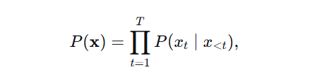{.ocr-src}

其中 x<t表示位置 $t$ 之前的所有 token，即历史上下文。这个分解天然遵循文本生成的因果性：当前 token 只依赖于过去，与未来无关。

交叉熵损失函数：在训练时，模型的目标是最大化对数似然，即最小化负对数似然损失。对于单个序列，损失函数为：

$$
\mathcal{L}(\theta) = -\frac{1}{T}\sum_{t=1}^{T} \log P_\theta(x_t \mid x_{<t}),
$$

其中 $P_\theta(x_t \mid x_{<t})$ 是模型在参数 $\theta$ 下，给定历史 $x_{<t}$ 预测 $x_t$ 的条件概率。通常我们会累加整个批次的损失并取平均。在实现中，模型最后一层输出 logits $\mathbf{z}_t \in \mathbb{R}^V$（$V$ 为词汇量大小），经过 softmax 得到概率分布 $\hat{y}_t = \mathrm{softmax}(\mathbf{z}_t)$，则 $P_\theta(x_t \mid x_{<t}) = \hat{y}_{t,x_t}$。损失函数等价于：

$$
\mathcal{L} = -\frac{1}{T}\sum_{t=1}^{T} \log \hat{y}_{t,x_t},
$$

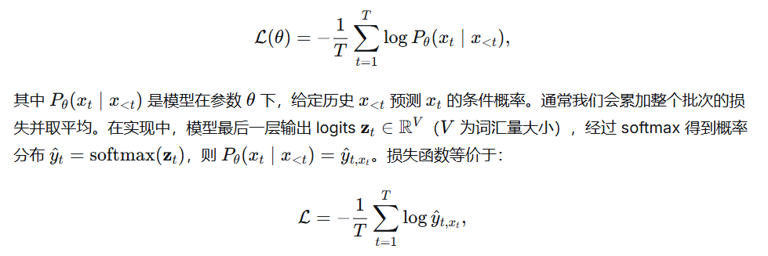{.ocr-src}

这正是真实标签 $x_t$ 与预测分布之间的交叉熵。优化该损失函数会迫使模型提高正确 token 的概率，降低其他 token 的概率。

自回归生成原理：在推理阶段，模型以自回归方式逐个生成 token。具体流程如下：

1. 给定一个起始序列（如 `<s>` 或用户输入的 prompt），模型计算下一个 token 的概率分布 P(x1∣prefix)。

2. 根据生成策略（贪心、采样等）从该分布中选择一个 token $x_1$，并将其拼接到序列末尾。

3. 将新的序列作为输入，重复上述过程：P(x2∣prefix,x1)，选择 $x_2$，以此类推。

4. 直到生成结束符号（如 `</s>`）或达到最大长度限制。

这种生成方式保证了序列的条件概率分解，且每一步仅依赖于已生成的历史。由于模型在训练时已经学会了根据历史预测下一个 token，推理时的行为与训练一致（忽略 teacher forcing 的影响），所以能产生连贯、上下文相关的文本。

#### 因果注意力掩码如何实现？在 Transformer 中怎样保证当前位置只能关注历史 token？

在 Transformer 的自注意力层中，因果掩码（Causal Mask）通过修改注意力分数矩阵来实现，使得每个位置只能注意到自身及之前的 token，而不能看到未来的信息。

自注意力计算公式为：

$$
\mathrm{Attention}(Q,K,V) = \mathrm{softmax}\left(\frac{QK^T}{\sqrt{d_k}} + M\right)V,
$$

其中 $Q, K, V \in \mathbb{R}^{T \times d_k}$ 分别是查询、键、值矩阵，$M$ 是掩码矩阵，$T$ 为序列长度。掩码 $M$ 的作用是：对于位置 $i$（查询），它只能关注位置 $j \le i$（键）。因此，对于 $j > i$ 的位置，我们希望注意力权重为 0。

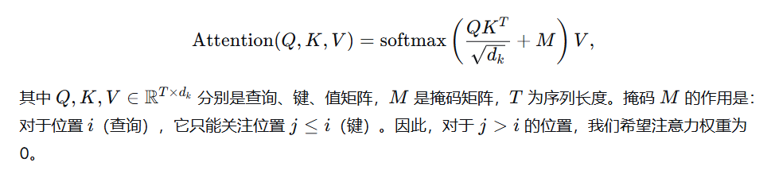{.ocr-src}

实现方式：构建一个上三角矩阵，其中上三角部分（不包括对角线）填充为 −∞（或一个非常大的负数），下三角部分为 0：

$$
M_{i,j} = \begin{cases} 0 & \text{if } j \le i, \\ -\infty & \text{if } j > i. \end{cases}
$$

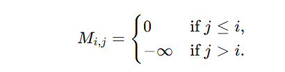{.ocr-src}

将 M 加到注意力分数上后，softmax 操作会对 −∞ 的指数输出接近 0 的权重，从而屏蔽未来 token。

代码实现示例（PyTorch）：

```python
import torch

def generate_causal_mask(seq_len):
    # 创建一个形状为 (seq_len, seq_len) 的上三角矩阵（对角线以上为 True）
    mask = torch.triu(torch.ones(seq_len, seq_len), diagonal=1).bool()
    # 将 True 的位置替换为 -inf，其余为 0
    causal_mask = torch.zeros(seq_len, seq_len).masked_fill(mask, float('-inf'))
    return causal_mask
```

在多头注意力中，掩码通常被广播到 batch 和 head 维度。这样，在训练时，即使输入整个序列，模型在预测位置 $t$ 时也无法看到 t 之后的 token，从而保持因果性。

为什么 Transformer 能够保证当前位置只关注历史 token？

- 因果掩码直接作用于注意力分数，使得未来位置的注意力权重被清零。

- 结合 Transformer 的自回归生成：推理时，每次生成一个 token，其 key 和 value 会被缓存（KV Cache），后续步骤的 query 只能与缓存的过去 key 交互，自然无法看到未来。

#### 与 MLM 相比，因果语言模型在生成任务上的天然优势和训练上的局限有哪些？

因果语言模型 (CLM) 和 掩码语言模型 (MLM) 是两种主流的预训练范式，代表了 Decoder-Only 和 Encoder-Only 架构的核心差异。

生成任务上的天然优势：

- 自回归生成的一致性：CLM 在训练和推理时使用完全相同的因果掩码，都是基于历史预测下一个 token。这种一致性使得 CLM 无需任何修改就能直接用于文本生成，生成质量高、逻辑连贯。

- 统一的下游任务框架：GPT 系列展示了 CLM 可以通过“上下文学习”（In-Context Learning）统一处理各种任务，只需将任务描述和示例作为 prompt 拼接，模型就能续写出答案。这省去了为每个任务设计专用头部的麻烦。

- 更好的长文本生成：由于生成过程是逐 token 的，模型可以根据已生成的内容动态调整，适合开放式结局的故事、对话等。

训练上的局限：

- 单向上下文：CLM 只能利用左侧的上下文信息，无法像 MLM 那样同时看到左右两侧的信息来理解整个句子。这可能导致对复杂语义（如指代消解、否定结构）的把握不如 MLM 精细。虽然深层网络可以通过隐式传递部分右向信息，但效率较低。

- 数据利用效率：在预训练时，MLM 通常只遮掩 15% 的 token 进行预测，而对每个 token 都进行预测的 CLM 看似利用了全部数据，但实际上每个 token 的预测难度更高（因为缺失未来信息），且损失噪声更大。某些研究表明，在相同计算量下，MLM 在语言理解任务上的收敛速度可能更快。

- 曝光偏差：训练时使用 teacher forcing（输入真实历史），推理时则依赖自己生成的、可能错误的历史，导致误差累积。

MLM 的优势（作为对比）：

- 双向上下文：MLM 同时利用左右信息，理解能力更强，在情感分析、命名实体识别、问答等理解型任务上表现优异。

- 训练效率：由于只预测被掩码的少量 token，每个 token 的预测任务相对“简单”（因为有丰富上下文），模型可能更快收敛到较好的表示。

#### 解释训练时的 teacher forcing 机制及其导致的曝光偏差（exposure bias）。

Teacher Forcing 是训练自回归模型时使用的一种标准技术。在训练过程中，模型在预测下一个 token 时，输入的历史 token 并不是模型自己在上一步生成的 token，而是真实数据中对应位置的标准 token。换句话说，教师（真实序列）强制指导模型下一步的输入。

例如，目标序列为 “I am a student”，在预测第三个 token 时，模型接收的前缀是真实的 “I am”，而不是它可能错误生成的 “I is”。这种做法确保了训练时每一步的输入都是正确的，避免了因前期预测错误而导致的连锁反应，从而极大加速收敛并稳定训练。

曝光偏差 (Exposure Bias)：

- 定义：由于训练时模型只见过“完美的”真实历史，从未见过自己生成时可能产生的“不完美的”历史，训练和推理时的输入分布不一致。这种分布偏移被称为曝光偏差。

- 后果：在推理时，模型一旦生成了一个错误的 token，这个错误会被作为历史输入到下一步，而模型从未被训练如何从这种错误中恢复。于是错误会不断累积，导致后续生成越来越偏离正轨（产生乱码、重复或逻辑断裂）。曝光偏差是导致自回归模型生成质量下降和错误传播的核心原因之一。

- 直观理解：就像学生平时练习时总是有老师直接给出正确答案作为下一步的提示，但考试时没有了提示，一旦做错第一步，后面全错。

缓解方法：

- 计划采样（Scheduled Sampling）：在训练过程中，以一定的概率 $ϵ$ 随机使用模型上一步的预测结果（而非真实 token）作为下一步的输入。$ϵ$ 通常从 0 逐渐增大。这让模型有机会学习如何纠正自己的错误。

- 序列级知识蒸馏：用一个大模型生成的完整序列训练小模型，小模型学习整个序列，减少对单步教师强制误差的敏感性。

- 强化学习：用序列级别的奖励（如 BLEU、人类偏好）来优化，不依赖单步教师强制。

- 对抗训练：训练一个判别器来区分真实序列和生成序列，迫使生成器产生更真实、更鲁棒的输出。

#### 如何从因果语言模型的 logits 计算困惑度？困惑度与损失函数的数学关系。

困惑度（Perplexity, PPL） 是衡量语言模型性能的常用指标。对于因果语言模型，给定一个序列 x=(x1,…,xT)，模型的困惑度定义为：

$$
\mathrm{PPL} = \exp\left(-\frac{1}{T}\sum_{t=1}^{T} \log P_\theta(x_t \mid x_{<t})\right) = \exp(\mathcal{L}),
$$

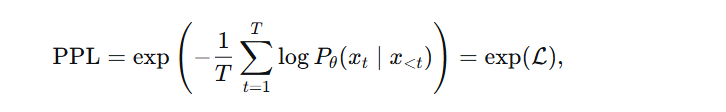{.ocr-src}

其中 L  是交叉熵损失（平均负对数似然）。困惑度可以理解为模型对序列中每个 token 的平均“惊讶程度”：困惑度越低，表示模型对数据的拟合越好，预测越确定。

从 logits 计算困惑度：

1. 将序列输入模型，得到每个时间步的 logits $\mathbf{z}_t \in \mathbb{R}^V$。
2. 使用 softmax 计算概率：$\hat{y}_t = \mathrm{softmax}(\mathbf{z}_t)$。
3. 提取目标 token $x_t$ 的概率 $p_t = \hat{y}_{t,x_t}$。
4. 计算平均负对数似然：$\mathcal{L} = -\frac{1}{T}\sum_{t=1}^{T} \log p_t$。
5. 困惑度 $\mathrm{PPL} = \exp(\mathcal{L})$。

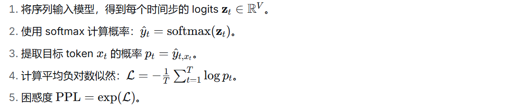{.ocr-src}

与损失函数的数学关系：

- 如果我们使用的是交叉熵损失函数，其值就是 L。

- 直接有：PPL=exp⁡(loss)。

- 例如，如果模型的交叉熵损失为 2.3，那么困惑度约为 $e^{2.3} \approx 9.97$。这意味着模型在预测下一个 token 时，其平均不确定性相当于从约 10 个等概率的选项中随机选择。如果模型完美预测（$p_t = 1$），损失为 0，困惑度为 1。

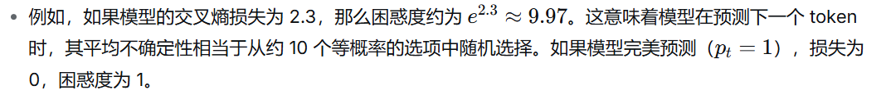{.ocr-src}

注意：在计算时通常忽略填充 token 的位置，仅对有效 token 计算损失和困惑度。

#### GPT 系列的位置编码演变：从可学习绝对位置到 RoPE、ALiBi，分别解决了什么问题？

GPT 系列模型的位置编码经历了三个阶段的演变：

1. 可学习的绝对位置嵌入（GPT-1, GPT-2）

- **原理**：为每个绝对位置 $pos$ 维护一个可学习的嵌入向量 $E_{pos} \in \mathbb{R}^d$，与 token 嵌入相加。位置索引范围固定（如 0-511）。

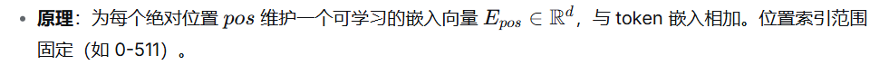{.ocr-src}

- 优点：简单灵活，由模型自行学习最优的位置表示。

- 问题：
  - 无法外推：一旦训练时设定的最大长度为 512，无法处理更长的序列，因为模型从未见过超出范围的位置嵌入。虽然有绝对位置的正弦编码，但 GPT 早期采用了可学习版本，外推性能极差。
  - 对位置敏感，缺乏平移不变性：模型很难学到相对位置关系，往往依赖绝对位置。

2. 旋转位置编码（RoPE, 应用于 LLaMA, GPT-NeoX, PaLM 等）

- **原理**：RoPE 通过旋转变换将绝对位置信息注入到 query 和 key 向量中，使得两个 token 的点积仅依赖于它们的相对位置。具体地，对于维度 $d$ 的向量，将维度分成对，每对旋转角度 $\theta_i = 10000^{-2i/d}$，位置 $m$ 的旋转角度为 $m\theta_i$。

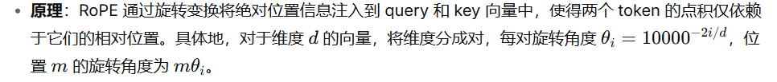{.ocr-src}

- 解决的问题：
  - 天然编码相对位置：使得注意力计算能够捕捉 token 之间的相对距离，而不再是绝对位置。
  - 外推能力显著增强：通过调整频率（如 NTK-aware 缩放），可以将上下文窗口平滑扩展到训练时未见的长度。
  - 与线性注意力兼容：RoPE 可以通过复数形式自然推广到线性注意力中。

- 劣势：对非常长的序列，低频分量的区分度可能下降，但可以通过 YaRN 等方法进一步解决。

3. ALiBi (Attention with Linear Biases, 如 BLOOM, 部分 MPT)

- **原理**：完全去除位置嵌入，在注意力分数上直接加上一个与距离成线性比例的负偏置：$B_{ij} = -m \cdot |i-j|$。其中 $m$ 是头特定的斜率。

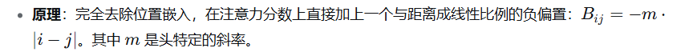{.ocr-src}

- 解决的问题：
  - 零成本外推：ALiBi 不需要任何可学习参数，天然支持比训练时长数倍的序列，且几乎不损失性能。它完美解决了绝对位置编码的外推难题。
  - 实现极其简单：无需修改模型结构，只需改变注意力分数的计算。

- 劣势：
  - 可能限制长程依赖：随着距离增大，偏置线性增加，可能导致注意力权重过于集中在局部，对某些需要全局信息的任务（如长文档检索）可能不利。
  - 缺乏内容依赖的位置交互：位置偏置是静态的，不像 RoPE 那样与 token 内容紧密耦合。

总结演变脉络：绝对位置编码解决了有无问题，但受限于外推；RoPE 引入了优雅的相对位置编码，并通过数学技巧改善了外推；ALiBi 则走向另一个极端，用极简的无参方法实现了强外推。当前主流是 RoPE 及其变体，因为它兼顾了表达能力和外推灵活性。

#### 介绍 top‑k 采样和 top‑p (nucleus) 采样的原理，并对比它们的生成多样性。

这两种采样策略都旨在解决贪心解码导致文本重复、缺乏多样性的问题，通过随机性引入创造力。

Top-k 采样：

- 原理：在生成每个 token 时，模型计算整个词表上的概率分布，然后只保留概率最高的 $k$ 个 token，将其余 token 的概率置零，并在这 $k$ 个 token 上重新进行归一化，最后从新的分布中随机采样下一个 token。

- 特点：$k$ 是一个固定整数，通常取 10 到 50。它保证了采样空间的大小恒定，不受分布形状影响。计算简单。

- 局限性：固定的 $k$ 可能不合理。当概率分布非常尖锐时（模型对某些 token 非常确定），$k$ 个候选可能包含了很多接近零概率的尾部 token，导致采样到不合适的内容；当分布非常平坦时，$k$ 个 token 可能只截取了一小部分概率质量，丢弃了可能合理的选择。

Top-p（Nucleus）采样：

- 原理：设定一个累积概率阈值 $p$∈(0,1)。对概率分布从高到低排序，然后累加概率，直到累积概率之和达到或超过 $p$。这个被选中的最小 token 集合称为“核心”（nucleus）。将其他 token 概率置零，在该核心上重新归一化并采样。

- 特点：$p$ 是动态的阈值，通常取值在 0.9 到 0.95 之间。当分布很尖锐（模型很确定）时，核心集很小，采样集中在少数高概率 token，保持安全性；当分布平坦（模型不确定，如创意写作）时，核心集自动变大，包含更多样的可能，增加多样性。

- 优势：自适应地调整采样空间的大小，避免了 top-k 固定大小的缺陷，是目前最主流、效果最好的采样策略之一。

生成多样性对比：

- Top-k：固定的 $k$ 提供了稳定的多样性控制，但在极端分布下表现不佳，容易产生奇怪输出（当 $k$ 过大且分布尖锐时）或限制多样性（当 k 过小且分布平坦时）。

- Top-p：通常能产生更自然、更丰富的文本，因为它根据模型的自信程度动态调整采样池。在高质量生成任务（如对话、故事）中，Top-p 往往比 Top-k 更受欢迎。

- 常用组合：实践中常同时使用 Top-k 和 Top-p，先过滤掉极低概率 token（设置 $k$>0），再应用 Top-p 进一步筛选，以兼顾效率和质量。

#### 束搜索与随机采样策略各适用于什么场景？什么情况下束搜索会导致退化问题？

束搜索（Beam Search）：

- 原理：在每个时间步，保留分数最高的 B 个（束宽）候选序列，并基于这 $B$ 个序列继续扩展，最终选择总分最高的序列。它是近似最大化序列概率的确定性策略。

- 适用场景：
  - 需要精确、最优的结果：如机器翻译、语音识别、代码生成等任务，期望输出与参考答案尽量一致，不允许太多的随机性和创造性。
  - 输出长度相对较短、结构化的文本，如数据提取、格式转换。

- 特点：生成结果质量稳定、流畅，但多样性极差，容易陷入局部最优。

随机采样策略（Random Sampling）：

- 原理：根据模型输出的概率分布，随机抽取下一个 token。常配合温度、Top-k、Top-p 使用。

- 适用场景：
  - 需要多样性和创造性的任务：如故事创作、诗歌、对话系统、头脑风暴。
  - 开放式生成，不希望模型给出千篇一律的答案。

- 特点：能产生令人惊喜的文本，避免重复，但可能引入逻辑错误或事实错误。

束搜索的退化问题：

- 重复与无意义生成：在开放式生成任务（如对话、故事）中，束搜索会严重偏向于产生短而常见的短语、循环的句子。因为它一味追求最大化整体概率，可能会陷入某些高频 token 组合（如 “I don't know”、“the same time”）的“概率陷阱”，不断重复这些高概率模式，导致生成文本极度退化、缺乏实际内容。

- 根源：开放式任务没有唯一标准答案，序列的概率分布非常平坦，束搜索强制选择高分路径，却忽视了文本的多样性和人类表达的随机性。因此，在需要创造力的场景，随机采样通常优于束搜索。

#### 解释 LLM 生成时出现重复循环输出的原因，并给出至少两种缓解方法。

LLM 生成重复循环的输出（如不断重复同一个词或短语）是自回归模型常见的问题，其深层原因是模型陷入了一个局部概率的“死循环”。

原因：

- 暴露偏差的累积：如前所述，模型训练时从未见过自己的错误输入。在生成中，一旦它“不小心”生成了一个不寻常但模型认为概率很高的 token，后续生成就会被带偏，为了维持连贯性，模型可能重复它认为安全的高频模式。

- 注意力机制的偏好：在长序列生成中，模型可能过度关注自己刚生成的 token，形成“回声”效应，不断强化同一个词或短语。

- 解码策略的缺陷：贪心解码（总是选最大概率 token）极容易陷入重复循环，因为最优概率路径可能正好是重复的。即使使用采样，如果温度太低或 top-k 太小，也会加剧重复。

- 模型自身的偏好：训练数据中可能包含了大量重复性文本，模型学到了这种模式。

缓解方法：

1. 重复惩罚（Repetition Penalty）：
  - 原理：在生成过程中，降低已经生成过的 token 的 logits（或概率），从而抑制它们被再次选中。具体做法是：对于已经出现在生成历史中的 token，其 logits 乘以一个小于 1 的因子（如 0.9），或者减去一个惩罚值。
  - 实现：可以设置 `repetition_penalty` 参数（常见值 1.0-1.2）。此方法直接、高效，是当前 LLM 推理的标配。

2. 增加解码的随机性和多样性：
  - 提高温度参数（如 1.0），使概率分布更平坦，给予其他 token 更多被采样的机会。
  - 使用 Top-p (nucleus) 采样，动态扩大采样池，避免模型总选那几个最高频的 token。
  - 使用 频率惩罚（Frequency Penalty） 或 存在惩罚（Presence Penalty）：根据 token 在生成历史中出现的次数按比例降低其概率，进一步抑制高频词。

其他方法：

- n-gram 屏蔽：强制禁止模型生成与已生成文本中某个 n-gram 完全相同的重复片段。

- 对比解码（Contrastive Decoding）：用一个较弱模型（如较小版本）作为参照，强化大模型输出中与弱模型不同的部分，抑制二者共同的高频、低信息量 token，从而提升多样性。

- 训练侧改进：在训练数据中去重，减少重复文本；使用如 Unlikelihood Training 的损失函数，直接惩罚生成重复 token。

通过结合这些方法，通常可以有效地抑制甚至消除循环重复问题。

#### 解码时温度参数如何影响生成质量？高温和低温各会带来什么后果？

温度参数（Temperature, $T$）是 softmax 函数中的一个超参数，用于控制生成概率分布的平滑程度。在生成下一个 token 时，模型先计算 logits **z**，然后应用温度：

$$
p_i = \frac{\exp(z_i/T)}{\sum_j \exp(z_j/T)}.
$$

{.ocr-src}

- 低温（$T$→0）：softmax 趋近于 argmax，概率分布极其尖锐，几乎总是选择最高概率的 token。生成结果非常确定、保守、高概率，但缺乏多样性和创造力。对于需要严格准确性、事实一致性的任务（如翻译、代码生成、数学计算），低温可以减少随机错误。但缺点是容易导致模型陷入重复循环，因为总是选择相同的安全路径。

- 高温（$T$>1）：概率分布被“拉平”，原本低概率的 token 获得相对更高的概率，模型更愿意“冒险”选择不常见的词。生成结果多样性增加，可能出现令人惊喜的创意，但也容易产生语法错误、逻辑混乱甚至幻觉。高温适用于创意写作、头脑风暴等需要发散思维的任务。过高的温度（$T$→∞）会使分布趋近均匀，生成内容完全随机化，不可用。

- 最佳实践：通常采用适中的温度（如 0.7~1.0）并结合 Top-p 采样，在保证流畅性的同时获得适当的多样性。

#### 训练因果语言模型时，输入序列和预测目标序列是如何错位对齐的？画出数据构造示意。

因果语言模型的训练目标是：给定历史 token 序列 $x$<$t$，预测下一个 token $x_t$。因此，输入序列和预测目标序列是同一个序列的“错位”版本：

- 输入序列：[x1,x2,x3,…,xT−1]

- 目标序列：[x2,x3,x4,…,xT]

也就是说，模型在位置 $t$ 的输入是 $x_t$，但其输出的预测目标是 xt+1。这可以通过将整个序列一次性传入模型，然后通过因果掩码保证每个位置只能看到其左侧的历史来实现。模型最后一层输出的 logits 在位置 $t$ 预测的是 xt+1，损失函数对比的就是这个 logits 和真实的目标 token。

示意图（假设序列长度为 5）：

```plain text
原始序列: [The, cat, sat, on, mat]
输入:      [The, cat, sat, on]   (去掉最后一个)
目标:      [cat, sat, on, mat]  (去掉第一个)
```

在实现上，我们并不显式地拆分，而是将完整序列 `[The, cat, sat, on, mat]` 输入模型，通过因果掩码，位置 0 预测位置 1，位置 1 预测位置 2，以此类推。最后将所有位置的预测损失求和即可。

#### 为什么训练时可以通过因果掩码实现全序列并行计算，而推理时只能逐 token 生成？

训练时的并行性：训练时，我们已经拥有完整的目标序列。通过因果掩码（下三角掩码），我们可以一次性输入整个序列，模型同时计算所有位置的输出。因为掩码保证每个位置只能看到它之前的 token，不会泄露未来信息。这样，所有位置的预测可以并行进行，极大提升了训练效率。

推理时的串行性：推理时，我们没有未来的 token。要生成长度为 $L$ 的序列，必须从第一个 token 开始，每一步生成一个 token，然后将其作为下一步的输入。因为第 $t$ 步的输入需要第 $t$−1 步的输出作为历史，这形成了一个串行依赖，无法并行。即使使用了 KV Cache 避免重复计算历史 token，生成过程依然是逐 token 的，只是每步的注意力计算可以并行（利用缓存的历史 K、V），但步骤本身不能跳过。

#### 什么是 KV cache？它如何加速自回归推理并影响显存占用？

KV Cache 是自回归推理中的一种优化技术，用于避免每步生成时重复计算历史 token 的 Key 和 Value 矩阵。

- 原理：在 Transformer 的自注意力层，每个 token 会产生 Query (Q)、Key (K)、Value (V) 向量。对于已生成的历史 token，它们的 K 和 V 在后续生成中是不变的。因此，在生成第 $t$+1 个 token 时，只需计算新 token 的 Q、K、V，然后让其 Q 去和所有历史 K 计算注意力分数，再对所有历史 V 加权求和。历史 K 和 V 无需重新计算，只需缓存下来即可。

- **加速效果**：将单步推理的复杂度从 $O(t^2 \cdot d)$ 降至 $O(t \cdot d)$（因为 QK^T 变成新 Q 与所有 K 的乘积，避免了重复的矩阵乘法）。这极大地提升了推理速度。

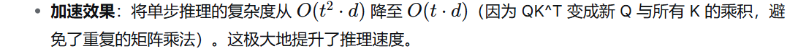{.ocr-src}

- 显存占用：KV Cache 需要存储每一层、每个头的历史 K 和 V，其大小为 2×层数×头数×序列长度×头维度。随着生成序列长度增加，缓存占用线性增长，成为长文本推理的主要显存瓶颈。为缓解这一问题，可采用分组查询注意力（GQA）、多查询注意力（MQA）、滑动窗口注意力或 KV Cache 量化等技术。

#### 如何用因果语言模型进行少样本分类？写出计算分类概率的常用方法。

利用因果语言模型（如 GPT）进行少样本分类，通常采用“提示词+续写”的方式，将分类任务转化为文本生成任务。

方法：

1. 构建提示词：将分类任务描述为自然语言，并给出少量示例（k-shot）。例如：“将以下电影评论分类为正面或负面。\n评论：这部电影太棒了！ 情感：正面\n评论：浪费时间。 情感：负面\n评论：{目标评论} 情感：”

2. 生成与评估：模型在“情感：”之后生成下一个 token。我们通常会预先定义标签词（如“正面”和“负面”），并计算模型在给定上下文后生成每个标签词的条件概率。

3. 计算分类概率：
  - 直接取模型在“情感：”位置对于标签词（如“正面”和“负面”）的 logits，然后进行 softmax 归一化，得到后验概率分布。
  - 如果标签由多个 token 组成（如“positive”可能被切分为多个子词），则需要计算整个标签序列的生成概率：$P(\text{label}\mid\text{prompt})=\prod_i P(\text{token}_i\mid\text{prompt},\text{token}_{<i})$，然后比较不同标签的序列概率。但通常为了简便，会选取一个能唯一代表该类的 token 作为标签词，并在词表中将其视为整体或使用其第一个 token 的概率。

#### 对比标准 CLM 与 prefix 语言模型的异同，举例说明其在预训练中的应用。

标准因果语言模型 (CLM)：整个序列都使用因果掩码，每个 token 只能看到其左侧的所有 token。预训练目标为从左到右预测下一个 token。典型代表：GPT 系列。

前缀语言模型 (Prefix LM)：将输入序列分为前缀（prefix）和生成部分。前缀部分使用双向注意力（全可见），可以互相看到对方；生成部分使用因果掩码（只能看到前缀和它之前的生成 token）。这相当于一个 Encoder-Decoder 的退化版，用同一个模型实现了对前缀的双向理解和自回归生成。典型应用：T5 的预训练目标之一（Span Corruption），以及 GLM 模型。

异同：

- 相同点：都基于 Transformer，最终都能进行自回归生成。

- 不同点：
  - CLM 在整个序列上都是单向的，限制了上下文理解的深度；Prefix LM 赋予前缀双向上下文，对前缀的理解能力更强，适合需要深入理解输入的任务（如摘要、翻译）。
  - CLM 的预训练数据构造简单（直接取文本流），Prefix LM 需要构造“输入-输出”对，并施加特殊的掩码。
  - 在推理时，CLM 无条件或基于前缀生成；Prefix LM 需要先对前缀进行双向编码（一次前向），然后生成。效率上 CLM 更简单统一。

应用示例：

- T5：使用 Prefix LM 作为其“去噪目标”的一部分，输入是被破坏的文本（前缀，双向可见），输出是修复后的文本（生成部分，单向）。

- GLM：提出了自回归空白填充，模型对输入中被遮盖的空白进行自回归生成，空白之间以及空白与上下文之间采用不同的掩码规则，本质上也是一种 Prefix LM。

- UniLM：在同一个模型中通过不同的掩码矩阵实现了 CLM、Prefix LM 和双向 LM 的统一预训练。

#### 多轮对话训练时，为什么只对助手回复部分计算损失？如何在代码中实现损失掩码？

原因：多轮对话的训练目标是让模型学会如何作为助手（assistant）进行回复。用户（user）的消息是给定的条件，我们不想让模型去学习“预测用户的提问”，因为那不是模型需要具备的能力。如果对用户部分也计算损失，模型会试图优化生成用户提问，这会导致训练目标混乱，且可能浪费模型容量。我们只希望模型在给定完整对话历史后，能准确地生成助手的回复。

代码实现（损失掩码）：\
在构造训练样本时，我们会为每个 token 生成一个 label 序列。对于属于用户消息或系统提示部分的 token，将其 label 设为 -100（PyTorch 的 CrossEntropyLoss 默认忽略 -100 的损失）。对于助手回复部分的 token，label 保持不变（即为该 token 的 ID）。然后计算交叉熵损失时，模型会自动忽略 label 为 -100 的位置。具体实现可以在 tokenization 阶段完成，也可以在 collator 中处理。例如 HuggingFace 的对话模板，使用 `assistant` 角色标识，通过设置 `train_on_assistant_only=True` 即可。

#### 为什么需要在训练数据中加入 EOS token？没有 EOS 对生成有何影响？

EOS (End of Sequence) token 是一个特殊标记，表示序列的终止。在训练数据中，每个完整文本（或对话）的结尾都需要添加 EOS token，让模型学习到“何时应该停下来”。

如果没有 EOS：

- 生成阶段模型将无法自行终止，只会一直生成下去，直到达到预设的最大长度限制。这会导致生成的文本冗长、偏离主题，并浪费大量计算资源。

- 模型可能学会生成一些无意义的填充内容来“假装”序列仍在继续。

- 在多轮对话中，模型无法区分不同轮次的边界，可能会将用户的下一轮提问也当成自己该生成的内容。

加入 EOS 的训练：模型在训练时学会了在看到 EOS 的位置（通常是对话的结尾）预测出 EOS token，从而学会在合适的时机停止生成。推理时，当模型生成 EOS 时，系统自动截断并结束本轮生成。

#### 分析长序列外推问题：预训练长度与推理长度不一致时，模型退化原因及应对方案。

长序列外推问题：当推理时的序列长度超过预训练时的最大长度时，模型性能（如困惑度、检索准确率）会出现严重退化，甚至无法正常工作。

退化原因：

- 位置编码失效：如果使用可学习的绝对位置嵌入，超出训练最大长度的位置没有对应的嵌入向量，导致模型遇到“未知位置”。即使使用正弦位置编码，模型在训练时也没有见过如此远距离的位置交互，注意力模式可能崩溃。

- 注意力分数的异常分布：预训练期间，模型只在有限长度内学习注意力模式。当序列变长，注意力矩阵中出现大量未见过的远距离 token 交互，softmax 分数可能变得异常极端（饱和或过于平坦），导致梯度/推理不稳定。

- 上下文窗口的稀释：模型可能依赖于将信息存储在特定的位置（如开头），但当序列极长时，早期信息被推到注意力范围的边缘或之外，无法被有效利用。

应对方案：

- 位置编码改进：使用 RoPE（可结合 NTK-aware 缩放、YaRN）、ALiBi 等具有良好外推能力的位置编码。

- 位置插值 (Position Interpolation)：将长序列的索引线性或非线性地压缩到训练窗口内，虽然损失一定分辨率，但可平滑扩展。

- 训练时引入长文本：在预训练后期或微调阶段，使用少量长序列数据对模型进行继续训练，让模型逐渐适应更长上下文。

- 稀疏注意力/窗口注意力：采用滑动窗口、全局 token 等机制，限制每个 token 的关注范围，使模型对长度不敏感。

- 记忆增强：使用 Transformer-XL 式的段循环或外部记忆库。

#### 解释为什么下一个 token 预测任务能涌现出上下文学习能力。

上下文学习（In-Context Learning）是指模型仅通过观察提示词中的几个示例（few-shot demonstrations），就能在没有任何参数更新的情况下，对新的输入执行相应任务。这种能力涌现自大规模因果语言模型的“下一个 token 预测”训练范式。

原理：

- 训练数据的结构：互联网文本中天然存在大量隐式的“输入-输出”对。例如，问答论坛中一个问题后跟一个答案；代码仓库中一段注释后跟一段代码；文章列表的标题和正文等。在预训练时，模型被反复训练根据“问题”预测“答案”，根据“指令”预测“回复”。模型学会了从上下文中推断出当前的“任务模式”。

- 模式匹配与归纳：Transformer 的注意力机制允许模型从上下文中快速提取重复的模式。当提示词中给出几个示例（“A→B, C→D”），模型能够识别出这种映射规律，并将其应用于新的输入（“E→?”）。本质上，它是在预测“在给定这些示例序列之后，下一个 token 应该是什么以延续这个模式”。

- 梯度下降的隐式模拟：有理论认为，Transformer 的前向传播过程可以隐式地进行类似于梯度下降的优化。模型内部的注意力头和平行路径能够从示例中“学习”出一个临时的工作规则，并将其编码在上下文的表示中，然后用于当前输入的生成。

- 涌现性：这种能力在小模型中几乎不存在，只有当模型参数和数据规模超过某个阈值时才会突然显现。这是因为足够的规模赋予了模型足够强的记忆能力和模式抽象能力，能够存储并灵活调用海量的潜在任务模式。

因此，“预测下一个 token”这个看似简单的目标，在超大规模数据和模型下，迫使模型内化了强大的上下文推理和模式归纳能力，从而使上下文学习作为一种涌现特性被释放出来。

