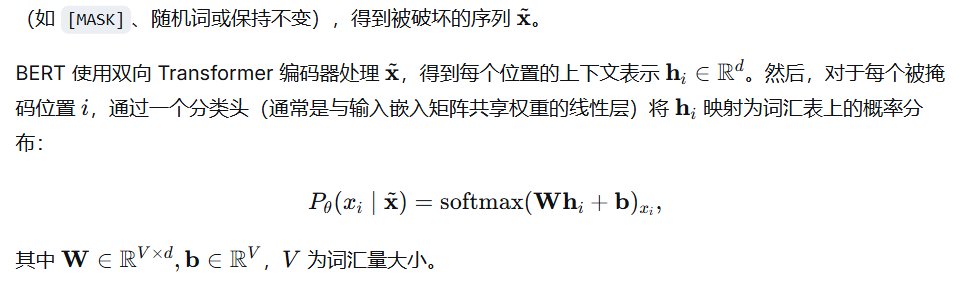
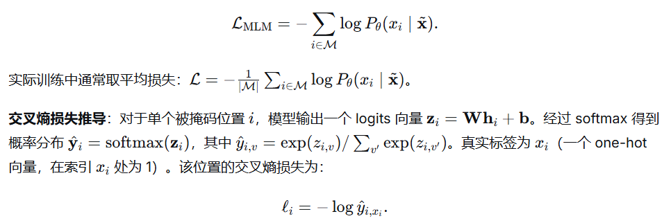
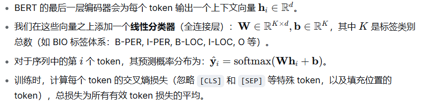
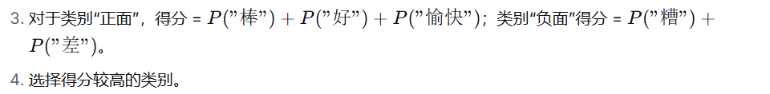

# 27.大模型（LLMs）掩码语言模型（MLM）

#### 写出 BERT 的 MLM 训练目标，并推导被掩码位置的交叉熵损失。

BERT 的掩码语言模型（Masked Language Model, MLM）训练目标是在给定被破坏的序列 **x**~ 的情况下，预测原始序列中被掩码掉的那些 token。具体来说，对于一个输入序列 x=(x1,x2,…,xT)，我们随机选择一部分位置构成掩码集合 M。对于每个被选中位置 i∈M，根据一定规则将其替换为特殊 token

（如 `[MASK]`、随机词或保持不变），得到被破坏的序列 $\tilde{\mathbf{x}}$。

BERT 使用双向 Transformer 编码器处理 $\tilde{\mathbf{x}}$，得到每个位置的上下文表示 $\mathbf{h}_i \in \mathbb{R}^d$。然后，对于每个被掩码位置 $i$，通过一个分类头（通常是与输入嵌入矩阵共享权重的线性层）将 $\mathbf{h}_i$ 映射为词汇表上的概率分布：

$$
P_\theta(x_i \mid \tilde{\mathbf{x}}) = \mathrm{softmax}(\mathbf{W}\mathbf{h}_i + \mathbf{b})_{x_i},
$$

其中 $\mathbf{W} \in \mathbb{R}^{V \times d}, \mathbf{b} \in \mathbb{R}^V$，$V$ 为词汇量大小。

{.ocr-src}

训练目标：最大化被掩码 token 的原始身份的对数似然，等价于最小化所有被掩码位置的交叉熵损失之和：

$$
\mathcal{L}_{\mathrm{MLM}} = -\sum_{i \in \mathcal{M}} \log P_\theta(x_i \mid \tilde{\mathbf{x}}).
$$

实际训练中通常取平均损失：$\mathcal{L} = -\frac{1}{|\mathcal{M}|}\sum_{i \in \mathcal{M}} \log P_\theta(x_i \mid \tilde{\mathbf{x}})$。

**交叉熵损失推导**：对于单个被掩码位置 $i$，模型输出一个 logits 向量 $\mathbf{z}_i = \mathbf{W}\mathbf{h}_i + \mathbf{b}$。经过 softmax 得到概率分布 $\hat{\mathbf{y}}_i = \mathrm{softmax}(\mathbf{z}_i)$，其中 $\hat{y}_{i,v} = \exp(z_{i,v}) / \sum_{v'} \exp(z_{i,v'})$。真实标签为 $x_i$（一个 one-hot 向量，在索引 $x_i$ 处为 1）。该位置的交叉熵损失为：

$$
\ell_i = -\log \hat{y}_{i,x_i}.
$$

{.ocr-src}

将所有掩码位置的损失求和/平均即可得到总体 MLM 损失。这就是 BERT 预训练的核心目标，通过重建被破坏的信息，强制模型学习深层的双向语言表示。

#### 解释 BERT 掩码策略：15% 位置被选中，其中 80% 替换为 [MASK]、10% 随机词、10% 不变，这样设计的动机。

BERT 的掩码策略不是简单地将所有选中 token 都替换为 `[MASK]`，而是采用了 80-10-10 的混合策略，其核心动机是弥合预训练与微调之间的不一致性，并增强模型的鲁棒性。

- 为什么不全用 [MASK]？ 如果预训练时模型只见过 `[MASK]` token，那么在下游微调任务中，输入文本将不再包含 `[MASK]`，导致模型学到的“掩码处理能力”无法迁移到实际任务。这种预训练和微调的输入分布偏移会严重损害下游性能。

- 80% 替换为 [MASK]：这是主要的训练信号来源。让模型学会在大多数情况下根据双向上下文预测被遮盖的原始词，从而学到丰富的上下文表示。

- 10% 替换为随机词：这种做法可以迫使模型不完全依赖 [MASK] 标记来触发“预测模式”。如果输入中一个 token 是随机噪声而非 [MASK]，模型无法通过简单的“看到 [MASK] 就预测”来作弊，而是必须真正理解上下文，判断该位置的词是否合理。这增强了模型对上下文的理解能力，并提高了对噪声的鲁棒性，因为在实际数据中可能存在错误或不一致的表达。

- 10% 保持不变：这部分设计是为了保持模型与真实文本的接触，使得模型在微调时面对无掩码的正常文本也不会感到陌生。同时，它也促使模型学会判断“当前词在上下文中是否合理”，如果不合理，也许它应该被预测出来（类似于 ELECTRA 的思想）。虽然原始 BERT 中保持不变的位置仍然参与预测（即让模型预测它自己），这在计算损失时是无效的（因为模型可能直接通过恒等映射学习而忽视上下文），但实际中模型通常会在这些位置输出正确的词，因为它们与上下文一致。

总结：这种混合策略巧妙地平衡了“从掩码中学习”和“适应真实数据分布”之间的矛盾，使得 BERT 不仅能从掩码任务中获取丰富的语言知识，还能在下游任务中平滑迁移。

#### Whole Word Masking 与标准 wordpiece 级别掩码有何不同？为什么能提升中文等语言性能？

标准 WordPiece 级别掩码：BERT 在 tokenization 后，对 WordPiece 子词 token 进行随机掩码。例如，单词 “playing” 被切分为 `["play", "##ing"]`，掩码时可能只覆盖 `"##ing"`，留下 `"play"`。模型需要根据 `"play"` 和上下文来预测 `"##ing"`。这种任务过于简单，因为子词往往可以被相邻的子词直接推断出来，模型没有学到真正的单词级别的语义理解。

Whole Word Masking (WWM)：在进行掩码之前，先识别出属于同一个原始单词的所有子词 token 的边界（通过预分词）。如果一个单词中的任何一个子词被随机选中，那么属于该单词的所有子词 token 都将被一起掩码。例如，对于 `["playing"]` 被切分为 `["play", "##ing"]`，如果它被选中，两个 token 会同时被 `[MASK]` 替换。模型需要根据整个单词缺失的上下文来预测整个单词，这迫使模型必须利用更深层的句法和语义线索，而不是局部的构词法。

为什么能提升中文等语言性能：

- 中文的特点：中文分词通常不需要子词切分（如果使用字符级或词级），一个词可能就是一个 token。如果采用标准掩码，掩码单个 token 就是掩码整个词，似乎与 WWM 效果相当。但许多中文模型使用子词或字符，或者使用词级分词。对于词级模型，WWM 确保了语义单元的完整性被掩码，防止模型通过局部偏旁部首或常见单字组合“猜”出答案。

- 提升任务难度与表示质量：WWM 让预训练任务更接近真实场景中理解一个完整词语或短语的需求。模型必须学习更丰富的上下文知识来恢复整个单词，而不是修复局部的构词法模式。这显著提升了模型在需要单词级理解的下游任务（如命名实体识别、问答、情感分析）上的表现。在 BERT 的中文版本（如 RoBERTa-wwm-ext）中，WWM 已被证明是简单且有效的提升。

#### T5 的 Span Corruption 目标如何工作？与 BERT MLM 的本质区别。

T5 的 Span Corruption 目标：T5 采用了一种序列到序列的去噪自编码目标。它将输入文本中随机选择多个连续的 token 片段（span），每个片段被整体替换为一个唯一的哨兵 token（如 `<extra_id_0>`）。然后，目标序列由这些哨兵 token 分隔，每个哨兵后接对应的被破坏片段的原始文本。例如：

- 原始文本：`"Thank you for inviting me to your party last week"`

- 破坏后输入：`"Thank you <extra_id_0> me to your party <extra_id_1> week"`

- 目标序列：`"<extra_id_0> for inviting <extra_id_1> last <extra_id_2>"` (假设有三个片段被掩码，实际可能不同)

模型（Encoder-Decoder 架构）需要生成目标序列。这种目标同时训练了模型对上下文的理解能力和连贯的文本生成能力。

与 BERT MLM 的本质区别：

1. 生成范式：BERT MLM 是一个分类任务，模型在每个掩码位置独立预测 token；T5 的 Span Corruption 是一个生成任务，模型需要自回归地生成被破坏片段的文本，是一个 seq2seq 问题。这使得 T5 天然适合文本生成和填空。

2. 掩码粒度：BERT 掩码独立的 token；T5 掩码连续的片段（span）。这迫使模型学习生成连贯的短语或句子，而不是独立的单词，更能捕捉语言的长程依赖和组合性。

3. 双向性利用：BERT 的 Encoder 双向处理被破坏的输入；T5 的 Encoder 同样双向处理输入，但 Decoder 自回归生成目标，在生成时不能看到未来的目标 token。BERT 则在预测时利用全部双向上下文（因为是分类）。

4. 下游任务统一性：T5 通过这种 Text-to-Text 框架，将所有 NLP 任务（翻译、摘要、分类等）都统一为生成任务，而 BERT 需要为不同任务添加分类头。

#### 为什么 MLM 属于去噪自编码器，而 CLM 属于自回归模型？对生成任务的影响。

MLM（去噪自编码器）：

- 原理：MLM 对输入数据进行人为破坏（添加噪声，如掩码、随机替换），然后训练一个模型（编码器）

从破坏后的输入中恢复出原始的干净数据。这类似于经典的降噪自编码器（Denoising Autoencoder），输入是 $\tilde{\mathbf{x}}$，目标是重建 $\mathbf{x}$。

{.ocr-src}

- 特点：它可以利用双向上下文（因为看到整个句子），在重建每个被破坏位置时，左右信息都可用。这使得 MLM 模型非常擅长“理解”任务。

- 对生成任务的影响：原始 BERT 无法直接进行自回归生成，因为它的预训练目标不是预测下一个 token，而是预测被掩码的 token。虽然有迭代式生成方法（如 Mask-Predict），但生成效率和质量不如自回归模型。BERT 是“写完再改”的思路。

CLM（自回归模型）：

- 原理：CLM 直接将序列的联合概率分解为条件概率的乘积，按顺序预测每个 token。它本身就是一个生成模型，训练目标是最大化序列的自然顺序概率。

- 特点：它是单向上下文（因果），不能看到未来的 token。这天然适合文本生成任务，因为生成过程就是从左到右的。

- 对生成任务的影响：GPT 等 CLM 可以直接用于高质量、灵活的文本生成，是目前 LLM 的主流范式。但其理解能力受限于单向性（不过在规模做大后，通过深层网络隐式地获得了一定的双向能力）。

本质区别与生成影响：MLM 学的是“根据上下文填空”，CLM 学的是“根据上文续写”。填空能力更适合理解和修正，续写能力更适合生成。因此，BERT 系列统治了 NLP 理解任务，而 GPT 系列统治了生成任务。

#### 如何用 MLM 模型完成文本生成？简述基于迭代式替换的生成方法。

虽然 BERT 类模型天生不适合自回归生成，但可以通过迭代式掩码-预测（Mask-Predict） 算法实现文本生成。这个方法利用了 MLM 模型强大的双向填空能力。

步骤：

1. 初始化：创建一个与目标生成长度 $L$ 相同长度的序列，全部填充为 `[MASK]` token（或部分为 `[MASK]`，部分为随机 token）。

2. 迭代预测：在一个循环中：
  - 将当前序列（包含 `[MASK]` 和已生成的 token）输入 BERT 编码器。
  - 模型为每个 `[MASK]` 位置输出一个概率分布。
  - 选择一部分 `[MASK]` 位置（例如，概率最高的一些位置，或所有 `[MASK]` 的某个比例），用模型预测的最高概率 token 替换这些 `[MASK]`。
  - 未被替换的 `[MASK]` 保留为 `[MASK]`。

3. 重复：经过多次迭代，逐渐将所有的 `[MASK]` 替换为具体的 token，最终得到一个完整的生成序列。

4. 提高质量：可以结合置信度阈值（只替换高置信度的预测）和并行解码（一次预测多个位置）来加速和提升质量。这种方法也被称为“非自回归生成”。

优点：生成速度可以很快，因为一次可以解码多个 token。缺点：生成的文本在流畅度和连贯性上通常不如自回归模型，因为 token 之间的依赖关系被忽略了。

#### 动态掩码（RoBERTa）与静态掩码（原始 BERT）的区别，为什么能提升训练效果？

静态掩码（原始 BERT）：

- 做法：在数据预处理阶段，对训练语料进行一次性掩码操作。例如，对于每个 epoch，相同的句子会被以相同的掩码模式处理。虽然 BERT 论文提到将每个句子复制 10 份并施加不同的掩码，但本质上在训练时，每个 epoch 看到的掩码模式是固定的。模型在整个训练过程中，对于同一个句子，总是试图预测那些被固定的位置，缺少变化。

动态掩码（RoBERTa）：

- 做法：在每次喂给模型一个句子时，才动态地、随机地生成掩码。这意味着同一个句子在不同 epoch（甚至同一 epoch 的不同批次中，如果数据有重复）会被掩掉不同的 token。模型每次看到相同的上下文时，需要预测不同的目标词。

- 为什么提升训练效果：
  - 增加数据多样性：动态掩码极大地增加了训练样本的“有效数量”。模型不是死记硬背某个固定位置的答案，而是必须学会从多种多样的上下文中预测各种各样的词，泛化能力更强。
  - 提供更丰富的学习信号：模型被迫学习句子中几乎每个位置的上下文表示，而不是只关注那 15% 的固定位置。这使得每个 token 的表示都得到了更充分的训练。
  - 消除数据偏见：静态掩码可能会引入一些数据偏见（例如，某些词总是被掩码），动态掩码则均匀地分布了掩码机会，使模型更鲁棒。
  - 实验结果证明，动态掩码是 RoBERTa 超越 BERT 的重要贡献之一。

#### ELECTRA 的替换令牌检测（RTD）任务和 MLM 有什么关系？训练效率上有何优势？

关系：ELECTRA 的预训练目标是替换令牌检测（Replaced Token Detection, RTD），它是在 MLM 思想上的一个优雅扩展。MLM 的问题是：只有 15% 的 token 参与训练损失计算，其余 85% 被忽略了，数据利用效率低。ELECTRA 的核心创新是：让模型对所有 token 进行预测，判断每个 token 是否被一个生成器替换过。

具体做法：

- 使用一个小型的生成器（通常就是一个小 MLM 模型）对输入进行掩码并预测被掩码位置的 token，然后用它生成的词替换掉原始位置的词，形成“假”输入。

- 训练一个判别器（主模型），输入这个“假”序列，对每个 token 进行二分类：它是否是被生成器替换过的（即是否是“假的”）。

与 MLM 的关系：MLM 是生成器，试图恢复原始 token；RTD 是判别器，试图鉴别每个 token 的真伪。两者结合，相当于一个 GAN 式的框架。RTD 使得模型必须学习每个 token 在上下文中的细微特征，因为所有 token 都参与了判别损失。

训练效率优势：

- 数据利用率极高：MLM 只在 15% 的 token 上计算损失，而 RTD 对所有输入 token 都计算损失。因此，在相同的计算量下，RTD 能从数据中提取更多的学习信号，收敛更快。

- 性能更好：实验证明，ELECTRA 用更少的计算资源就能达到或超越 BERT 的性能，尤其在小型模型上优势明显。因为模型被训练成一个更敏锐的上下文“警察”，对整个句子的理解更精细。

#### 解释 MLM 可实现双向上下文建模，这如何使它在自然语言理解任务上强于 CLM？

双向上下文建模：MLM 通过遮蔽部分 token，允许模型在预测时同时利用该 token 左侧和右侧的所有信息。Transformer 编码器的自注意力层没有因果掩码，每个 token 都可以直接关注到句子中所有其他 token。因此，每个 token 的最终表示都融合了全局上下文，这对于理解复杂的语义至关重要。

为什么在自然语言理解（NLU）任务上强于 CLM：

1. 更全面的语境信息：许多 NLU 任务（如情感分析、文本蕴含、指代消解）需要综合判断整个句子的含义，而关键线索可能出现在句子的任何位置。CLM 在理解一个词时，只能依赖其左侧的上下文，无法预知右侧的关键修饰语或否定词。MLM 的双向性则能完整捕捉所有方向的依赖关系，提供更精准的语义表示。例如，在句子“这部电影令人感到____，没有任何惊喜”中，预测“失望”需要看到右侧的“没有任何惊喜”，CLM 无法做到。

2. 更丰富的语义表示：双向上下文使得每个 token 的嵌入都充分混合了整个句子的信息，这种深度交互的表示质量远高于单向模型。因此，基于 MLM 预训练的 BERT、RoBERTa 等在 GLUE、SuperGLUE 等 NLU 基准上长期占据统治地位。

3. 任务适配性：BERT 等 Encoder-Only 模型的结构天然适合输入一个句子，输出一个标签或每个 token 的标签，与 NLU 任务的格式高度吻合。CLM 虽然也可以通过将 NLU 任务转化为生成任务（如 GPT-3 的上下文学习），但在无示例或少量示例的微调场景下，其理解和分类能力通常弱于专门为双向理解而设计的 MLM 模型。

#### 为什么原始 BERT 包含 Next Sentence Prediction 目标，但 RoBERTa 等后续工作去掉了它？

原始 BERT 引入 NSP 的动机：NSP（Next Sentence Prediction）设计初衷是帮助模型学习句子间的关系，提升对句子对任务（如问答、自然语言推理）的理解能力。具体做法是：输入为两个句子 A 和 B，50% 概率 B 是 A 的真实下一句（正例），50% 概率是随机抽取的无关句子（负例）。模型使用 `[CLS]` token 的输出进行二分类，预测 B 是否为 A 的下一句。直觉上，这能教会模型捕捉连贯性、主题一致性和逻辑顺序。

NSP 被质疑和移除的原因：

- 任务过于简单，学不到深层语义：随机选取的负例往往在主题、词汇和风格上与 A 句差异巨大，模型仅凭简单的词重叠或主题差异就能轻松判断，无法迫使模型学习复杂的句间逻辑关系。这导致 NSP 提供的训练信号质量很低。

- 损害长文本建模能力：NSP 要求将训练语料切割成孤立的句子对，破坏了原始文档的连续性和长程依赖。模型在预训练时几乎见不到连续的长文本，因此对段落级和文档级的理解能力受限。

- 实验证明其无效或有害：RoBERTa 的消融实验明确表明：移除 NSP、仅使用连续的长文档片段（即输入是连续的多个句子，不切割成句子对）进行 MLM 训练，在 GLUE、SQuAD 等下游任务上反而取得更好或持平的性能。ALBERT 等模型也尝试用句子顺序预测（SOP）替代 NSP，但 RoBERTa 直接证明 NSP 不是必要的。因此，后续工作普遍放弃了 NSP，转而采用更自然的全文档训练，让模型在真实的长文本上下文中学习。

#### 在中文预训练中，全词掩码需结合分词粒度，简述实现方式。

中文预训练中，“全词掩码（Whole Word Masking, WWM）”需要与中文特有的分词方式相结合，因为中文词之间没有天然的空格分隔，一个词可能由一个或多个汉字（token）构成。

实现方式：

1. 外部分词工具介入：在数据预处理阶段，使用一个独立的、高性能的中文分词工具（如 jieba、HanLP、LTP、或基于词典的最大匹配算法）对原始文本进行分词。

2. 词边界映射：分词后，我们知道了每个词由哪些汉字（以及可能的子词，如果使用 BPE 等）组成。然后，使用标准的 WordPiece 或 SentencePiece 分词器将每个词进一步切分成子词 token。通过跟踪，我们建立起“原始词 → 子词 token 序列”的映射关系。

3. 掩码策略调整：在进行掩码时，不再以子词 token 为最小随机选择单位，而是以词为单位。随机选出 15% 的词（而非 token）。如果一个词被选中，那么组成该词的所有子词 token 都将被整体掩码。例如，“语言模型”这个词被分词为 `["语言", "模型"]` 两个 token。如果它被选中，两个 token 都会被替换为 `[MASK]`。

4. 兼容各种分词器：这种方法与底层的 tokenization 算法无关，无论是字符级、词级还是子词级，只要能够进行预分词获得词边界，都可以应用 WWM。通常，在创建训练数据时就完成掩码（静态掩码），或者在线动态掩码时实时查询词边界。这是中文 BERT 系列（如 RoBERTa-wwm-ext）的标准做法。

#### 知识增强 MLM，如 ERNIE 中的实体掩码，是如何将知识图谱注入预训练的？

ERNIE（百度）系列通过实体级和短语级掩码，将知识图谱中的结构化知识融入到预训练表示中，使模型学习到实体概念及其关系的隐含表示。

核心做法：

1. 知识驱动的掩码：与随机掩码 token 或全词掩码不同，ERNIE 会识别出句子中的命名实体和短语。例如，“哈尔滨”是一个城市实体，“国际冰雕节”是一个活动短语。它通过预训练的知识库或命名实体识别工具来定位这些实体和短语的边界。在掩码时，它会把整个实体或短语的 token 全部遮蔽。

2. 为什么能注入知识：这种掩码策略强迫模型在预测这些实体时，必须利用上下文中的其他实体关系以及语义进行推理，而不是仅仅依赖简单的字词统计。例如，对于句子“哈尔滨举办了国际冰雕节”，如果掩码了“哈尔滨”，模型需要从“举办”、“国际冰雕节”等信息推断出这很可能是一个地点，而且是一个寒冷的地方。长期训练下来，模型学会了实体之间的语义关联，将知识图谱中的“城市-活动”这类关系内化到参数中。

3. 多阶段知识学习：ERNIE 的训练通常包括三个阶段：首先使用基础的字/词掩码；然后引入短语级掩码；最后引入实体级掩码。这种渐进式学习让模型逐步掌握词汇、短语、再到实体概念，将事实知识无缝融入语言表示。后续的 ERNIE 2.0 等进一步引入了更多的知识预训练任务（如关系分类、句子重排序），持续强化模型对知识的编码能力。

#### 如何将 MLM 与对比学习结合，如 SimCSE 的无监督句子表示学习方法。

SimCSE（Simple Contrastive Learning of Sentence Embeddings）巧妙地利用 MLM 模型内部的 Dropout 噪声，构建了无监督对比学习框架，生成高质量的句子嵌入。

核心原理：

1. 正例构造：无监督 SimCSE 的核心思想极其简单：将同一个句子输入模型两次，由于 Transformer 中 Dropout 层的随机性，两次前向传播会产生两个不同的嵌入向量。这两个向量被视为一对正例（语义相同，表示相似）。

2. 负例构造：同一个 mini-batch 内的其他句子的嵌入向量，被当作负例（语义不同）。

3. 对比损失：使用标准的对比损失（如 InfoNCE），训练模型拉近正例对在向量空间中的距离，推远负例对。具体为，对于句子 $s_i$，其两次通过模型得到的嵌入为 hi**h***i* 和 hi+**h***i*+，batch 中其他句子为 hj**h***j*，损失为：

4. $\mathcal{L}=-\log\dfrac{\exp(\mathrm{sim}(h_i,h_i^+)/\tau)}{\sum_{j=1}^{N}\exp(\mathrm{sim}(h_i,h_j)/\tau)}$

5. 其中 $\mathrm{sim}$ 是余弦相似度，$τ$ 是温度系数。

与 MLM 的结合：

SimCSE 通常使用预训练好的 BERT/RoBERTa 作为基础编码器，并在下游句子表示任务上进行微调（继续训练）。这种训练不需要任何标注数据，也不需要额外的辅助任务，仅仅依靠 MLM 模型自带的 Dropout 就能获得令人惊艳的句子表示效果。它的本质是利用 MLM 预训练得到的强大语言表示作为起点，通过对比学习进一步拉大句子间的语义鸿沟，使相似句子的表示更加紧凑，不相似句子的表示更加分散。有监督版本则利用自然语言推理数据中的蕴含对作为正例。

#### 分析掩码比例（如 15%、20%、40%）对 MLM 学习和下游性能的影响。

掩码比例直接影响预训练任务的难度和模型接收的有效信息量。

- 标准 15% 掩码率：原始 BERT 采用此值，是一个在“提供足够挑战”和“保留足够上下文”之间精心平衡的选择。15% 的 token 被掩码，使得大部分上下文得以保留，模型可以轻松学习语言模式；同时被掩码的 token 足够多，提供了充足的训练信号。这是一个很稳健的起点。

- 较低掩码率（如 10%）：任务变得更容易，因为更多的上下文可见。这可能导致模型学到的表示不够鲁棒，因为预训练任务太简单，模型不需要深度理解就能预测。下游性能通常略有下降，训练效率可能更高（因为每个 batch 的有效 token 更多）。

- 较高掩码率（如 20%、30%、40%）：
  - 优点：增加了任务难度，迫使模型在更有限的上下文中进行更抽象的推理和更丰富的语义建模。这有助于学习更强大的表示，因为模型必须成为“更好的语言理解者”才能在信息稀缺时做出正确预测。Wettig et al. (2022) 的研究表明，适当提高掩码率（如 30-40%）并结合更长的训练步数，可以显著提升模型在下游任务上的性能，甚至超越标准 15% 掩码率。
  - 代价：训练成本显著增加。更多的 token 被掩码，意味着每个 batch 中实际参与预测损失的 token 数量增加，但有效上下文减少可能导致收敛变慢，需要更多训练步数。此外，掩码率过高（如 50% 以上）会使上下文过于破碎，模型难以学到有意义的模式，性能反而可能骤降。

结论：掩码率是一个重要的超参数。15% 是安全的默认值；如果计算资源充足且追求最优性能，可以尝试提升到 30% 并延长训练，这通常会带来增益，尤其是在大规模模型上。

#### 多语言 MLM（如 XLM‑R）中，如何通过共享词表和联合训练学习跨语言表示？

多语言 MLM 的目标是让模型在多种语言上学到一个统一的、语言无关的表示空间，使得相似的语义在不同语言中具有相近的向量表示，从而实现零样本跨语言迁移。

核心机制：

1. 共享多语言词表：XLM-R 使用 SentencePiece 在 100 多种语言的联合语料上训练一个巨大的、共享的 BPE 词表（例如 25 万 token）。这个共享词表包含了各种语言的字符和子词。因为许多语言共享相同的字母、数字、标点，以及某些跨语言的同源词根，共享词表使得这些公共元素被直接映射到相同的 token ID，从根本上提供了跨语言的“硬对齐”基础。对于各语言特有的文字，它们虽然有不同的 token ID，但都在同一个词表空间中。

2. 联合多语言语料训练：训练时，模型混合接收来自所有目标语言的文本。MLM 任务（动态掩码）直接在这些文本上进行。模型看到不同语言的句子，被迫学习预测被掩码的 token。为了完成这个任务，模型必须理解当前语言的语义。由于词表是共享的、模型参数也是共享的（一个 Transformer 编码器），模型在内部会隐式地学习将不同语言中表达相同概念的表示拉近，以便更好地利用上下文信息。

3. 跨语言表示的涌现：共享词表和联合训练共同作用，使得跨语言表示自然地涌现出来。例如，当模型在英语句子“The [MASK] is barking”和中文句子“那只[MASK]在叫”中分别预测“dog”和“狗”时，这两个 token 虽然 ID 不同，但由于它们的上下文极为相似，模型会促使它们的编码向量趋近，从而在向量空间中形成紧密的语义簇。最终，即使模型从未接受过中英平行句对训练，也能将“狗”和“dog”理解为相近的概念，实现零样本跨语言理解。

#### 为什么 MLM 推理需要计算所有位置，包括未掩码部分？能否优化？

在标准的 MLM 推理中，模型会处理整个输入序列，并输出所有位置的预测 logits。即使下游任务只需要一个句子表示（如用 `[CLS]`）或特定几个位置的输出，模型仍必须计算整个序列的完整前向传播。

原因：Transformer 的自注意力机制是全连接的。为了计算出任意一个位置的最终表示，模型需要该位置与序列中所有其他位置的交互信息。即使 `[MASK]` 只出现在某些位置，未掩码位置的表示也通过自注意力层混合了整个序列的上下文，而被掩码位置的表示又依赖于这些未掩码位置的信息。换句话说，我们不能单独“抽出”某几层的计算，必须完整运行整个编码器，否则被掩码位置无法获得充分的、由全局上下文构成的表示来进行准确预测。

能否优化：

- 推理时无法避开全序列计算，因为双向注意力需要完整的上下文。与自回归模型可以利用 KV Cache 避免重复计算不同，MLM 编码器每次推理的输入是几乎完整的，无法缓存。

- 训练时，由于掩码是稀疏的，一个优化方向是选择性计算：只对被掩码的位置计算输出层（分类头）的损失，而对未掩码位置不计算损失。这已经是在训练时节省计算的标准做法（因为不需要为所有位置计算 logits 和 softmax）。

- 在模型部署时，如果下游任务只使用 `[CLS]` 向量（如分类），那么可以完全丢弃编码器输出层的其余部分，但整个编码器本身仍需要完整运行。无法进行实质性的推理加速。

#### 如何用 MLM 解决序列标注任务？写出微调时的输出层设计。

序列标注任务（如命名实体识别 NER、词性标注、中文分词）需要为输入序列中的每个 token 预测一个标签。BERT 类的 MLM 模型非常适合这类任务，其微调方法如下：

模型输入与输出：

- 使用原始的 BERT 编码器，不做任何改动（保留所有预训练权重）。

- 输入文本经过 tokenizer 处理，得到 token 序列（包括 `[CLS]` 和 `[SEP]`）。

输出层设计：

- BERT 的最后一层编码器会为每个 token 输出一个上下文向量 $\mathbf{h}_i \in \mathbb{R}^d$。
- 我们在这些向量之上添加一个**线性分类器**（全连接层）：$\mathbf{W} \in \mathbb{R}^{K \times d}, \mathbf{b} \in \mathbb{R}^K$，其中 $K$ 是标签类别总数（如 BIO 标签体系：B-PER, I-PER, B-LOC, I-LOC, O 等）。
- 对于序列中的第 $i$ 个 token，其预测概率分布为：$\hat{\mathbf{y}}_i = \mathrm{softmax}(\mathbf{W}\mathbf{h}_i + \mathbf{b})$。
- 训练时，计算每个 token 的交叉熵损失（忽略 `[CLS]` 和 `[SEP]` 等特殊 token，以及填充位置的 token），总损失为所有有效 token 损失的平均。

{.ocr-src}

微调细节：

- 整个 BERT 编码器和分类头一起联合训练，端到端微调。

- 输入数据需要对齐：由于 WordPiece 等分词可能将一个单词切成多个子词，而标注通常是在词级别给出的。常见的处理方法是：在 tokenize 后，只对每个单词的第一个子词进行标签预测，该单词的其余子词的标签被忽略（设置 label 为 -100）；或者将所有子词的标签设为同一个，但这样会产生不连续的实体。通常采用第一种。

#### 简述 XLNet 的置换语言模型，如何融合自回归与自编码的优势。

XLNet 提出了一种置换语言模型（Permutation Language Model, PLM），旨在结合自回归（AR）和自编码（AE）的优点，同时避免它们的局限。

核心思想：

- 不像 BERT 那样引入 `[MASK]` 标记破坏输入，也不像 GPT 那样固定从左到右的顺序。XLNet 对输入序列的 token 顺序进行随机排列组合，然后以自回归的方式预测排列中排在后面的 token，但始终利用原始序列的位置编码，因此模型知道真实的位置关系。

- 例如，对于序列 `[x1, x2, x3, x4]`，随机排列为 `[3, 1, 4, 2]`。在预测时，首先预测位置 3 的 token `x3`（此时它看到任何其他 token？并非，具体实现通过双流自注意力控制）。然后，预测位置 1 时，它能看见已被预测的 `x3`。这个过程是自回归的，但每一步预测的上下文是排列中前面的那些位置（可能是句子中任何位置的 token）。

融合优势：

1. 避免 BERT 的缺陷：BERT 引入 `[MASK]` 导致预训练-微调不一致（GAP）；且 BERT 假设被预测的 token 是彼此独立的，忽略了它们之间的依赖关系。XLNet 没有 `[MASK]`，预训练和微调完全一致；并且自回归分解天然捕获了 token 间的联合概率，不会做独立性假设。

2. 利用自回归的特性：XLNet 使用了自回归的目标，使得它天然是一个生成模型，能够胜任文本生成任务，而 BERT 难以直接生成。同时，它通过排列组合实现了在预测当前 token 时看到来自双向的上下文（取决于排列顺序），从而获得了 AE 模型那样的深度上下文理解能力。

3. 双流自注意力：为了实现排列语言模型，XLNet 设计了特殊的“内容流”和“查询流”注意力，确保在预测某个位置的 token 时，模型只能看到排列中在它之前的 token 的内容，但能看到所有 token 的位置信息，从而保证上下文信息不泄露且正确使用。

简言之，XLNet 通过排列操作，让自回归模型在所有可能的顺序上训练，间接获得了双向上下文，从而兼具 GPT 的生成能力和 BERT 的理解能力。

#### 讨论 MLM 预训练如何避免信息泄漏（如掩码 token 之间互相可见）。

在标准的 BERT MLM 预训练中，输入序列中的多个 `[MASK]` token 是互相可见的。这意味着，当模型预测一个 `[MASK]` 时，它可以通过自注意力机制“偷看”到其他 `[MASK]` 位置的上下文表示，而这些表示本身也包含了它们各自位置的语义信息。这可能导致一种信息泄漏：模型可能学会利用其他被掩码 token 的表示来猜测当前被掩码 token，而不是完全依赖未被掩码的上下文。这削弱了 MLM 任务的难度，使得模型学到的表示不够鲁棒。

为什么 BERT 没有完全避免这个问题：因为 BERT 使用标准的双向自注意力，所有 token（包括 `[MASK]`）都平等地参与互相注意。`[MASK]` 是一个特殊的嵌入向量，它本身没有携带语义，但当它经过第一层 Transformer 后，与其他 token 交互，其表示就获得了上下文信息。如果多个 `[MASK]` 互相可见，它们的表示会相互影响，形成一个“作弊圈”。

避免信息泄漏的方法：

1. XLNet 的方案：通过排列语言模型，完全不使用 `[MASK]` token，从根本上消除了 `[MASK]` 之间的信息泄漏问题。

2. MPNet：结合 MLM 和 PLM，对掩码 token 采用排列自回归预测，避免了它们之间的独立性假设和互相可见。

3. 严格的双向屏蔽：虽然理论上可以对注意力矩阵进行修改，使得 `[MASK]` token 之间不能互相注意（即加入一个掩码，让 `[MASK]` 只看到非 `[MASK]` 的 token），但 BERT 没有这样做。这主要是出于实现简单性的考虑。后来的某些模型尝试了这种策略，但通常会结合更复杂的掩码策略。

4. Span 掩码：通过掩码连续的片段，减少了 `[MASK]` token 的数量，从而间接降低了它们互相泄露信息的概率。T5 的 Span Corruption 也有类似效果，因为被破坏的片段被替换为单个哨兵 token，不同哨兵之间可互相看见，但它们各自代表的片段内部是连贯的，信息泄漏影响相对小。

总体而言，信息泄漏是原始 BERT MLM 的一个已知缺陷，后续大量工作通过改进掩码策略或预测范式来缓解这一问题，从而获得更强的上下文表示。

#### 在 MLM 训练过程中，怎样监测掩码语言模型准确率，并据此调整超参？

监测MLM准确率的核心是计算被掩码位置上的预测 token 与真实 token 的一致比例。具体做法：在每个训练或验证 batch 中，只取出标签为‑100（或被掩码）的位置，比较模型预测的 logits 经过 argmax 后是否等于原始 token id。通常报告掩码位置准确率和平均交叉熵损失。还可以计算加权准确率，即对高频词和低频词分别统计，以发现模型是否对罕见词预测较差。

利用准确率调整超参的实践经验：

- 掩码率：若验证准确率长时间 > 85–90%，说明任务过于简单，模型可能只学到表层统计。此时可以提高掩码率（例如从 15% 提升到 20–30%），或减少 `[MASK]` 替换比例、增加随机替换或保留原词的比例，加大任务难度。反之，若准确率极低（< 10%）且损失不下降，可能是掩码率过高导致上下文破坏严重，应当降低掩码率。

- 学习率与调度：准确率曲线震荡剧烈或收敛缓慢时，调整学习率或延长 warmup。若准确率停滞而训练损失仍在下降，可能已经过拟合，可增加 dropout 或数据增强。

- 模型容量：如果准确率在较长时间内接近饱和但下游性能仍不理想，说明模型表达能力不足，可考虑扩大模型维度或加深层数。

- 掩码策略：针对特定类型（如实体、数字）预测准确率低，可引入全词掩码或实体掩码，并在验证集上单独监控这些子集的准确率。

实践中，MLM 准确率是辅助诊断工具，最终仍需以下游任务表现为准。但它能快速帮助判断预训练是否健康。

---

#### 为什么 MLM 适合知识蒸馏？以 DistilBERT 为例说明。

MLM 预训练模型非常适合知识蒸馏，原因如下：

- 丰富的教师信号：教师模型（如 BERT）在 MLM 任务上为每个掩码位置输出完整的词表概率分布（软标签）。这些软标签包含了类别间的相似性（暗知识），例如预测“猫”时，教师可能对“狗”也给出较高概率。这种信息远比硬标签（one‑hot）丰富，能让学生模型学到更平滑的决策边界。

- 逐位置密集监督：MLM 在 15% 的 token 上提供监督信号，且是 token 级别的。学生模型可以在每个训练步获得大量梯度，有利于高效学习。

- 架构兼容性：BERT 类编码器结构统一，学生模型只需减少层数或隐藏维度，无需改变核心架构，蒸馏目标可以直接在 MLM 输出层上定义。

DistilBERT 的实现：

- 学生模型为 6 层 Transformer，每层维度与教师（BERT‑base）相同，但总参数量减少 40%。

- 蒸馏使用三种损失函数的组合：
  1. 蒸馏 MLM 损失：教师和学生均在相同掩码输入下预测被掩码 token。使用软化温度 $T$ 后的概率分布（soft labels）计算 KL 散度，鼓励学生匹配教师的输出分布。
  2. 监督 MLM 损失：学生同时利用真实 one‑hot 标签计算交叉熵，保留基础任务的学习。
  3. 余弦嵌入损失：强制学生模型 `[CLS]` 等位置的隐藏状态向教师对齐，传递整体表示。

- 结果：DistilBERT 保留了 BERT‑base 约 97% 的 GLUE 分数，推理速度提升 60%，模型体积缩小 40%。这充分证明 MLM 作为 token 级预测任务为蒸馏提供了密集且高质量的训练信号。

---

#### 简述一种利用 MLM 进行数据质量评估的方法（如通过掩码预测置信度）。

核心思路：预训练 MLM 模型已经内化了语言的统计规律。对于高质量、流畅的文本，被掩码的 token 应当能被模型以高置信度预测；而包含错误、噪声或不通顺的文本，其掩码位置的预测置信度会显著偏低。

具体方法：

1. 使用预训练好的 MLM 模型（如 BERT‑base）作为评估器。

2. 对于待评估的文本序列，以一定的掩码率（例如 15%）随机替换 token 为 `[MASK]`。

3. 记录每个掩码位置模型预测的 正确 token 的概率值（即 softmax 输出中真实 token 对应的概率）。

4. 将整段文本的质量得分定义为所有掩码位置概率的几何平均（或对数似然的平均），即 `score = exp(1/|M| Σ log p(x_i))`，这本质上就是该段文本在 MLM 下的困惑度。

5. 设置一个阈值，得分低于阈值的文本被认为质量低劣，可予以丢弃或降权。

应用场景：

- 预训练数据清洗：在海量语料上计算得分，过滤掉低质量、夹杂乱码或语言不流畅的文档。

- 主动学习：在标注任务中，挑选 MLM 得分最低的样本优先进行人工修正，因为这些样本可能包含更多错误或模型难以理解的语言现象。

- 评估数据生成质量：检验模型生成的文本是否流畅自然。

优点：无需任何标注数据，且评估粒度可以细致到每个句子甚至更短片段，实现自动化、可扩展的数据质量把关。

---

#### 如果下游任务是句子对分类，设计实验分析不同掩码策略的消融影响。

任务示例：MNLI（蕴含/矛盾/中立）、QQP（问题等价）、RTE（文本蕴含）等。需要模型理解两个句子间的关系。

消融实验设计：

保持模型架构、训练数据规模、其他超参完全一致，仅改变预训练阶段的掩码策略。每组策略预训练一个模型，然后在目标句子对任务上微调并评估。

对比策略：

1. 基线：标准 BERT 掩码（15% 独立 token，80‑10‑10 规则）。

2. 全词掩码（WWM）：整个词被一起掩码或保留。预期能提升单词级语义理解，对句子对中词语匹配和矛盾检测有益。

3. 实体掩码：对命名实体整体掩码，强化模型对实体关系和指代的理解。在 RTE 等需要实体推理的任务上可能提升。

4. Span 掩码：掩码连续的若干 token，用哨兵 token 替代，要求模型生成缺失的短语。这能训练连贯性推断能力，对 MNLI 等逻辑关系判断可能有助益。

5. 动态掩码 vs. 静态掩码：验证掩码多样性对泛化的影响。

6. 高掩码率（如 30%）vs 标准：观察加大难度能否迫使模型学到更抽象的关系。

评估指标：在句子对任务上的准确率 / F1 / 相关系数。同时记录预训练 MLM 验证准确率作为参考。

预期发现：

- WWM 几乎总是提升性能，因为保留词完整性有利于语义匹配。

- 实体掩码对需要背景知识的推理任务有正向影响。

- Span 掩码可能在需要理解句子间逻辑连贯性的任务上更优。

- 动态掩码通常优于静态掩码。

- 过高掩码率可能损害基础语言表示，需要更长时间训练才能受益。

通过此消融，可确定针对句子对任务最经济的掩码策略，并为后续预训练提供指导。

---

#### 大规模训练中，MLM 与因果语言模型在内存和计算方面的异同。

相同点：

- 两者核心都是 Transformer，自注意力计算的理论复杂度均为 $O(n^2d)$。
- 均可采用序列并行、流水线并行、张量并行等分布式策略。
- 都能利用梯度检查点（activation checkpointing）减少显存。

{.ocr-src}

主要差异：

| 维度 | MLM (BERT 风格) | 因果语言模型 (GPT 风格) |
| --- | --- | --- |
| 注意力掩码 | 双向全可见，无稀疏性。计算完整注意力矩阵，显存和计算量均无减免。 | 下三角因果掩码，上三角为 -inf。FlashAttention 等可利用因果掩码跳过一半的块计算，训练和推理的显存与时间节省约 1.5‑2 倍。 |
| 预测头计算 | 仅在被掩码的 15% 位置上计算 softmax 损失，输出层计算量相对较小。 | 对所有 token 均需计算输出（预测下一个），输出层计算量约为 MLM 的 6‑7 倍，但可通过共享输入输出嵌入权重减少参数。 |
| 有效训练信号密度 | 只有 15% 的 token 贡献损失，数据利用率低，但每个掩码位置有双向上下文，任务难度较高。 | 100% token 参与损失，数据利用率高，但单向上下文使每个预测任务相对简单（尤其在深层网络中可部分弥补）。 |
| 序列长度倾向 | 通常采用较短序列（如 512），因为双向注意力对长序列的显存压力大且缺乏长度外推的良好方案。 | 更易扩展到超长序列（如 128k），得益于因果掩码的稀疏性和 RoPE 等位置编码的外推能力。 |
| 推理生成 | 不能直接自回归生成，需特殊解码（如 Mask‑Predict）。 | 原生支持自回归生成，是目前 LLM 的主流架构。 |

总体而言，因果语言模型因其固有的稀疏注意力模式，在大规模训练中具有显著的效率和长文本扩展优势。MLM 在短文本理解任务上仍保持竞争力，但训练和推理成本在同等序列长度下更高。

---

#### 如何通过调换 [MASK] 比例和随机替换比例，适应代码或公式数据？

代码和公式具有严格的语法，与自然语言有根本区别。标准的 80‑10‑10 掩码策略可能导致语法破坏，影响模型对结构化数据的建模。

适应性调整策略：

- 大幅提高 `[MASK]` 比例，减少或取消随机替换：代码/公式中每个符号都具有特定语法功能。随机替换成无关 token 会引入非法语法，扭曲学习信号。建议将选中位置的 90‑100% 设为 `[MASK]`，仅保留极小比例用于上下文学习不变性（如 5% 保持不变，0‑5% 随机替换）。这能保持代码块的整体语法结构，让模型专注学习修复被遮掩的正确符号。

- 采用标识符级/实体级掩码：代码中的变量名、函数名、类名等标识符通常由多个子词组成。应该将整个标识符作为掩码单元（类似全词掩码），而不是只掩码部分子词。这能训练模型“复制”和使用上下文中其他位置出现的同一标识符。

- 引入 Span 掩码：对于代码块，掩码连续的几行或一个完整的语句（如循环体、条件分支）。这类似于 T5 的 span corruption，可以训练模型生成连贯的代码结构，尤其适合代码补全和重构任务。

- 提高掩码率：代码的逻辑约束强，即使缺失更多 token，模型仍可利用严格的上下文语法进行推断。可以尝试 20‑30% 的掩码率，甚至在部分数据上使用更高的掩码率，迫使模型学习代码的内在逻辑。

- 公式（LaTeX）的处理：将整个控制序列（如 `\frac{}{}`）视为一个语义单元。掩码时把 `\frac`、花括号、参数等作为整体处理，避免破坏命令结构。同样减少随机替换，以保持公式的可解析性。

通过上述调整，模型能更好地捕获代码和公式的语法规则、类型约束和结构性依赖，从而提升在相关下游任务上的表现。

---

#### 什么是 span masking 与 PMI masking？讨论其语言学动机。

Span masking（片段掩码）：

- 定义：随机选择文本中一段连续的 token，将其全部替换为 `[MASK]`（或哨兵 token）。长度可随机（如平均 3‑5 个 token）或服从几何分布。

- 语言学动机：自然语言中的语义经常由多词短语承载（如“New York”、“as a result”）。掩码整个短语迫使模型理解该短语的组合意义，而不仅仅是孤立词的填空。此外，连续片段的缺失更接近真实世界中信息丢失的模式（如口误、打字漏掉半句话）。这能训练模型预测连贯的多词表达，增强对句子结构和篇章连贯性的理解。T5 的 span corruption 就是这一思想的典型应用。

PMI masking（基于点互信息的掩码）：

- 定义：利用点互信息（PMI）衡量词与词之间的关联强度。在掩码时，倾向于选择与周围上下文 PMI 值较低的 token 进行掩码，因为这些词难以从局部共现推断，需要更全局的上下文；或者反向，优先掩码高 PMI 的固定搭配来破坏强搭配关系，迫使模型学习更抽象的语义组合，而不是依赖简单的 n‑gram 记忆。

- 语言学动机：语言中存在大量高频但信息量低的搭配（如功能词和其依附词），随机掩码可能集中在这些易预测的 token 上，导致训练信号价值低。PMI masking 可以有导向地掩码那些信息负载高、更依赖句子整体理解的词（如内容词、动词、形容词），从而提升预训练的难度和效率，让模型学到更本质的语义关系。

两者的共同目标是超越随机掩码，引入更符合人类语言生成和理解过程的归纳偏置，从而得到更高质量的语言表示。

---

#### 使用 MLM 进行提示学习时，怎么构造模板和标签词映射？

MLM 模型可以通过提示学习（Prompt Learning） 直接解决下游分类任务，无需微调。核心是将任务重构成一个完形填空，利用模型对 `[MASK]` 的预测来推断标签。

构造模板（Prompt Template）：

- 将输入文本嵌入一个自然语言句子中，留下一个 `[MASK]` 位置供模型预测。

- 模板可以手工编写，也可通过搜索得到。例如，对于情感分类：
  - `"{text} 总体上，这部电影很 [MASK]。"`
  - `"这个产品的评价是 [MASK]。"`

- 模板应尽量让 `[MASK]` 处自然被一个词填充，且这个词能明确表达类别。

标签词映射（Verbalizer）：

- 定义每个真实标签对应的一个或多个词汇（token）。这些词就是模型可能输出在 `[MASK]` 位置的“答案”。

- 例如，对于正/负面情感：
  - 正面：`"好"`, `"棒"`, `"优秀"`
  - 负面：`"差"`, `"烂"`, `"糟糕"`

- 预测时，计算 `[MASK]` 位置上所有映射词的概率之和（或均值），作为该类别的得分。然后使用 softmax 或直接取最高分类别。

示例流程：

1. 输入句子 `"我今天很开心。"`，应用模板得到 `"我今天很开心。总体感受是 [MASK]。"`

2. 模型在 `[MASK]` 位置输出每个词的概率。

3. 对于类别“正面”，得分 = $P$(”棒”) + $P$(”好”) + $P$(”愉快”)；类别“负面”得分 = $P$(”糟”) + $P$(”差”)。
4. 选择得分较高的类别。

{.ocr-src}

若追求更佳效果，可使用软提示（Soft Prompt），即将模板中的某些 token 替换为可学习的连续向量，直接在连续空间中优化，无需手工设计离散模板。

---

#### 预训练 MLM 模型中，位置编码对掩码位置信息的影响。

位置编码为 MLM 提供了序列的结构骨架，使得模型能够区分不同位置的相同 token，并将词序信息用于掩码预测。

- 绝对位置编码（如 BERT）：每个绝对位置有一个嵌入向量。对于掩码位置，模型能感知到“第 k 个位置是一个缺失的槽位”。配合上下文，模型可以利用位置 k 附近的典型语法模式（例如位置 k 经常是动词）来缩小预测范围。缺少位置编码时，MLM 会退化为词袋模型，难以处理词序依赖，预测准确率显著下降。

- 相对位置编码（如 T5 的相对偏置、RoPE）：更直接地编码 token 间的距离。当多个 token 被掩码（如 Span 掩码）时，相对位置能让模型理解缺失块内部以及块与上下文之间的顺序关系，有助于生成连贯的缺失文本。

- 对掩码策略的适应性：采用动态掩码时，同一位置在不同 epoch 可能被掩码或不被掩码。位置嵌入并不随掩码状态改变，因此模型必须学习基于内容而非仅靠位置线索进行预测，这增强了鲁棒性。

- 长序列外推：若推理长度超过预训练最大长度，绝对位置嵌入会失效，导致所有位置的掩码预测混乱。RoPE 等具有外推能力的位置编码能让 MLM 在更长序列上仍保持较好的位置感知，从而维持掩码预测性能。

- Span 掩码中的位置挑战：Span 掩码抹去连续 k 个 token 后，原序列的位置索引保持不变，但缺失块内的相对位置被破坏。此时模型需要借助相邻 token 的位置信息来推断缺失部分的长度和内容，这对位置编码的灵活性和外推能力要求更高。

综上，位置编码是 MLM 成功的关键组件，它赋予了模型对顺序的感知能力，直接影响掩码预测的准确度和泛化能力。

