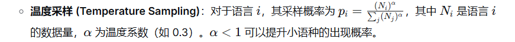
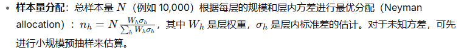
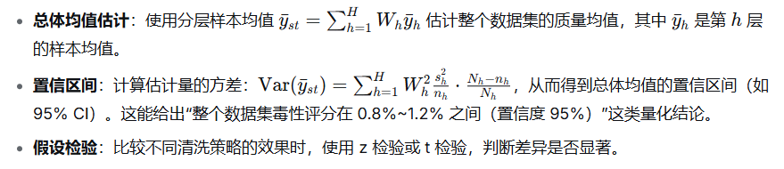

# 28.大模型（LLMs）预训练数据收集与清洗

#### 画出大规模预训练语料构建的端到端流水线，并标注各环节常见工具。

大规模预训练语料构建的端到端流水线通常包括以下几个关键环节，形成一个从原始网页抓取到最终高质量文本的漏斗形处理过程。以下以处理 Common Crawl 等网页数据为例说明各环节及其常见工具。

整体流水线示意图（文字描述）：

```plain text
[Web Crawl / WARC 文件]
        |
        v
① 数据获取与解压：从 WARC/WET 文件提取 HTML 及元数据
   工具：warcio, requests, Common Crawl Index (cdx)
        |
        v
② 正文提取与 HTML 去噪：从 HTML 中提取主体文本内容
   工具：trafilatura, readability-lxml, boilerpy3, jusText, dragnet
        |
        v
③ 语言识别与过滤：保留指定语言（如中文、英文）的文本
   工具：fastText (langdetect), langid.py, CLD3, pycld2
        |
        v
④ 启发式规则清洗：基于规则和统计过滤低质量文本
   工具：自定义脚本（正则、文本特征）、textstat, datasketch
        |
        v
⑤ 文档去重：去除完全重复或高度相似的文档
   工具：MinHash + LSH (datasketch, gaoya), SimHash, Onion
        |
        v
⑥ PII 及敏感信息过滤：移除邮箱、电话、身份证号等个人隐私
   工具：presidio, scrubadub, 正则表达式库, transformers NER
        |
        v
⑦ 毒性/偏见/违规内容过滤：筛除有害、歧视、违法内容
   工具：Perspective API, detoxify, hatexplain, 自定义分类器
        |
        v
⑧ 质量分级与采样：根据文本质量评分进行过滤或加权采样
   工具：KenLM 困惑度、fastText 质量分类器、CDL 模型
        |
        v
⑨ 数据混合与分片：将多个来源的数据按比例混合，切分为训练分片
   工具：HuggingFace Datasets, dask, spark, numpy
        |
        v
[最终训练语料]
```

各环节简要说明：

- ① 数据获取：从 Common Crawl 的 WARC（原始抓取）或 WET（纯文本）文件读取。`warcio` 库可高效解析 WARC 格式。利用 `cdx` 索引可提前筛选语言、域名等。

- ② 正文提取：移除 HTML 标签、导航、广告、评论区等非正文内容，提取页面主要内容。工具如 `trafilatura`（适用于多语言、新闻正文）、`readability-lxml`（基于浏览器可读性算法）、`boilerpy3`（轻量级，适合英文新闻）、`jusText`（去链接/导航效果好）。

- ③ 语言识别：识别文本主要语言，过滤掉非目标语言的文档。`fastText` 的语言识别模型（`lid.176.bin`）速度快且准确，适合大规模处理；`pycld2`（Compact Language Detector 2）基于 Chrome 的检测器，速度快；`langid.py` 适用于短文本。

- ④ 启发式清洗：一系列规则和统计量过滤垃圾内容。例如，文本长度、乱码比例、敏感词出现频次、重复 n-gram 比例、标点异常等。通常用 Python 脚本搭配正则和简单统计实现。

- ⑤ 文档去重：移除重复文档，降低记忆风险和提升数据效率。MinHash+LSH 是处理海量文档相似去重的经典方案（`datasketch`）；SimHash 适用于近似去重。

- ⑥ PII 过滤：移除个人身份信息，如邮箱、电话号码、身份证号、社会安全号码等。`presidio`（微软）提供可配置的 PII 识别和匿名化；`scrubadub` 适用于多种格式的 PII；也可用正则表达式或微调的 NER 模型。

- ⑦ 毒性/偏见过滤：筛除包含仇恨言论、暴力、色情、严重偏见的内容。可用 Google 的 `Perspective API`（在线）；离线工具如 `detoxify`（基于 BERT 的毒性分类器）或自训练的分类模型。通常也结合关键词黑名单。

- ⑧ 质量分级：进一步筛选高质量文本。利用语言模型（如 KenLM）计算困惑度，低困惑度更流畅；或者训练一个轻量的文本质量分类器（如 FineWeb-Edu 使用的）。对文本评分后，可设置阈值过滤或加权采样。

- ⑨ 数据混合：将经过清洗的多个领域（百科、书籍、新闻、论坛、代码等）的数据按预设比例混合，并打乱顺序，最终切分为训练所需的 shard（如 `jsonl` 文件）。

此流水线可根据具体需求定制，通常在大规模 Spark 或分布式计算框架（如 Ray、Dask）上运行，以保证效率。

---

#### **如何处理 Common Crawl 数据？描述从 WARC 文件到干净文本的关键步骤。**

**Common Crawl 是一个非营利组织，每月定期爬取数十亿网页并免费发布。处理 Common Crawl 数据是构建大规模预训练语料库的常用途径。以下是将其 WARC 文件转化为干净文本的详细流程：**

1. **获取数据与索引初筛**\
   **Common Crawl 提供 `crawl-data/CC-MAIN-<year>-<crawl>/` 路径，其中包含 WARC（原始 HTTP 响应）、WET（提取后的纯文本）和 WAT（元数据）。为减少处理量，通常先用 cdx 索引 快速过滤。cdx 是一个压缩的文本文件，记录了 URL、时间戳、MIME 类型、响应码、语言等。通过查询 `*.cdx.gz`，可以筛选出：**

- **返回码为 200 的成功请求；**

- **MIME 类型为 `text/html` 的网页；**

- **语言为 `en` 或 `zh` 等目标语言；**

- **特定域名（如教育、政府网站，或排除低质域名）。**

**使用工具如 `cdx_toolkit` 或直接解析 cdx 文件可高效定位所需 WARC 记录。**

2. **解析 WARC 记录提取 HTML**\
   **WARC 文件包含完整的 Web 请求和响应。使用 `warcio`（Python 库）逐条读取 WARC 记录，过滤出类型为 `response` 且状态码 200 的记录。从记录中获取原始 HTML 内容。注意处理压缩（gzip）和字符编码（从 Content-Type 或 HTML meta 标签推断）。解码时采用回退机制尝试 UTF-8、Latin-1 等。**

3. **HTML 正文抽取**\
   **这是关键步骤，目的是去除导航栏、页眉、页脚、广告、侧边栏、评论、JavaScript 代码等，仅保留页面主体文章内容。常用方法见下一题正文提取部分。这里推荐对多语言场景使用 trafilatura，对于英文新闻类可用 readability-lxml。这些工具基于规则和启发式算法识别主要内容区域。例如 trafilatura 会评估 HTML 元素的文本密度、链接密度等指标来提取核心文本。**

4. **后处理与初步清洗**\
   **从 HTML 提取的文本可能残留无用的空格、换行、特殊字符。需要进行：**

- **合并多个空白符为单一空格；**

- **移除不可见控制字符；**

- **处理 HTML 实体（如 `&amp;` 转为 `&`）；**

- **统一换行符（如 `\r\n` 转 `\n`）；**

- **按段落分割或保留原始结构。**

5. **语言过滤**\
   **使用语言检测器（如 `fastText`）对抽取后的文本进行语言分类。由于正文抽取可能残留其他语言的菜单项，检测整个文档的语言概率，如果置信度低或不是目标语言，则丢弃。**

6. **启发式规则去劣**\
   **制定一系列规则清除低质量页面：**

- **长度过滤：剔除字符数少于 100 或超过 10 万（避免过长但无意义的页面）的文档。**

- **乱码比例：计算非目标语言字符或不可打印字符的占比，超过阈值则丢弃。**

- **重复内容：计算文档内重复 n-gram 的比例，高重复可能是垃圾 SEO 页面。**

- **标点异常：例如，连续感叹号、问号占比过高。**

- **JavaScript/CSS 残留：检查是否包含 `function()`、`{}` 代码特征。**

7. **文档级去重**\
   **使用 MinHash + LSH 对整个语料进行近似去重。对每个文档计算 k 个 MinHash 值，通过 LSH 将相似文档哈希到同一桶，仅保留桶内一或少量代表性文档。**

8. **PII 和安全过滤**\
   **应用正则表达式和 NER 模型，检测并移除或掩码邮箱、电话、身份证号、社会安全号码等。筛除包含暴力、仇恨、色情等有害内容的文档。可调用 `detoxify` 等模型进行毒性评分。**

9. **质量分级与精选**\
   **对于需要更高质量的场景（如训练指令微调模型），可以使用语言模型计算文本困惑度，或训练一个二元分类器（高质量 vs. 低质量）对文本打分。选择分数高于阈值的文本保留。**

10. **输出最终文本**\
    **将处理后的干净文本保存为 `jsonl` 或 `txt` 格式，每条文本记录包含文本内容和可选的元数据（来源 URL、语言、质量分等）。随后可以并入整个预训练数据混合池。**

**整个流程可在 Apache Spark 或 Dask 上分布式运行，以应对数 PB 级别的 Common Crawl 数据。例如 The Pile、C4、RedPajama 等数据集均基于上述思路从 Common Crawl 加工而成。**

---

#### **正文提取常用哪些方法？比较 trafilatura、readability、boilerpy3 的优缺点。**

**正文提取的目标是从复杂的 HTML 结构中准确、高效地抽取出页面的主要内容。常见的库有：**

- **trafilatura：专注于网页文本提取，基于规则和机器学习，对新闻、博客、论坛等支持较好，多语言能力强。**

- **readability-lxml：基于 Mozilla 的 Readability.js 算法，提取主体内容，常用于浏览器阅读模式。**

- **boilerpy3：Python 版 boilerpipe 库，用浅层文本特征（如文本密度）分类文本块。**

**对比分析：**

| 维度 | trafilatura | readability-lxml | boilerpy3 |
| --- | --- | --- | --- |
| 提取质量 | 高，利用页面元数据和内容结构，能保留段落、标题、列表等格式。对多语言支持良好。 | 高，尤其在英文新闻/博客上，提取结果纯净。 | 中等，基于块分类，偶尔会保留残留噪声或误删内容。 |
| 处理速度 | 中等（纯 Python，有 C 扩展选项），比 boilerpy3 慢但比 readability 快。 | 较慢（Python 实现），复杂页面可能耗时较多。 | 非常快，纯 Python 且逻辑简单。 |
| 内存占用 | 中等。 | 较高（构建 DOM 树）。 | 低。 |
| 健壮性与容错 | 较好，能处理大量非标准 HTML。 | 较好，但偶尔会提取失败或空白结果。 | 一般，对某些页面模板可能失效。 |
| 输出格式 | 支持多种输出：纯文本、带格式的 Markdown/HTML、XML。 | 通常输出 HTML，可转为文本。 | 仅输出纯文本。 |
| 配置灵活性 | 丰富，可调整提取策略、保留元素等。 | 基本无需配置，算法固定。 | 有少许参数，但灵活性低。 |
| 多语言支持 | 优秀，明确支持多语言提取，对不同语言的内容结构有优化。 | 好，但算法偏向英文网页。 | 基本支持，无特殊优化。 |
| 社区与维护 | 活跃，更新频繁。 | 较活跃，但主要维护者偶有延滞。 | 较不活跃，已停止更新（boilerpy3 为分支）。 |
| 典型场景 | 大规模多语言网页数据构建预训练语料。 | 单页面阅读模式或对英文新闻批处理。 | 对速度要求极高、且文本密度特征明显的批量提取。 |

**优缺点总结：**

- **trafilatura 综合性最好，是构建高质量数据集的首选，尤其适合需要保留一定格式（如段落、列表）和多语言的场景。**

- **readability-lxml 提取质量较高，但速度慢，适合对少量页面进行高质量提取，不适合超大规模处理。**

- **boilerpy3 速度快但质量相对粗糙，适合作为初筛工具，或对质量要求不那么苛刻的快速预处理。**

**实践中常采用 trafilatura 作为主力，并辅以 readability 对特定域名进行优化，或使用 boilerpy3 进行第一遍快速过滤。**

---

#### **语言识别过滤中，fastText 等模型如何工作？准确度与效率如何平衡？**

**fastText 语言识别原理：**\
**fastText 的语言识别模型基于词袋 n‑gram 特征 + 层次 softmax 分类器。预训练模型 `lid.176.bin` 可检测 176 种语言。它首先将输入文本转换为字符 n‑gram（n=1~5）的特征向量（如 “the” 会拆成 “t”、“th”、“the” 等），然后对这些特征进行平均，输入到线性分类器中进行预测。这种设计使其在处理短文本时也相当鲁棒，且模型轻量（约 128 KB），推理速度极快。**

**工作流程：**

- **输入一段文本，进行小写、Unicode 规范化（NFKC）。**

- **提取字符 1‑grams 到 5‑grams，哈希为索引。**

- **通过量化的乘积量化矩阵快速计算得分，输出概率最高的语言标签及置信度。**

**准确度与效率平衡：**

- **准确度：在长文本（> 50 词）上准确率 > 99%；短文本（< 10 词）下降，但通过使用 n‑gram 特征仍保持较好性能（约 95%）。对不同语系的语言（如拉丁、西里尔、CJK）区分能力强。**

- **速度：单次推理仅需微秒级。在批量处理中，每秒钟可处理数万条文本，适合大规模过滤。**

- **平衡策略：可设定置信度阈值。例如，仅保留预测概率 > 0.7 的文档；对于低置信度样本，可回退到更重的检测器（如 CLD3）或直接丢弃。也可结合 URL 的语言前缀（如 `zh.wikipedia.org`）进行粗筛，再交由 fastText 精判。此外，使用多线程/异步加载模型，可以几乎线性扩展处理速度。**

**其他工具对比：**

- **pycld2 (CLD2)：基于 Chrome 浏览器，速度极快，但模型较老，对某些混合语言和短文本不敏感。**

- **langid.py：基于朴素贝叶斯，支持 97 种语言，准确率不错，但速度略慢于 fastText。**

- **CLD3 (Google)：神经网络模型，准确度高，但依赖 Protobuf，部署稍复杂。**

**在预训练数据构建中，fastText 是平衡准确度和速度的最佳选择之一，C4、The Pile 等数据集广泛使用。**

---

#### **启发式规则清洗：列出至少 5 种用于过滤低质量网页的规则，并说明原理。**

**低质量网页通常指垃圾 SEO 页面、广告页、内容农场、重复模板页、无意义文本等。以下列举 5 种常用启发式规则及其原理：**

1. **长度过滤**

- **规则：文档字符数（或词数）低于最小阈值（如 100 字符）或超过最大阈值（如 100 万字符）则丢弃。**

- **原理：过短文档几乎不含有效信息；过长文档通常是自动生成的垃圾内容或数据导出，对语言模型训练价值低。**

2. **乱码与非自然语言字符比例**

- **规则：计算文本中不可打印字符、控制字符、未知 Unicode 块的比例。若超过 10% 则滤除。**

- **原理：高质量文本主要由目标语言的字符构成。乱码比例高通常意味着编码错误或机器生成的噪音，不适宜训练。**

3. **重复 n‑gram 比例**

- **规则：统计文本中 3‑gram 或 5‑gram 的重复度（例如最高频 n‑gram 出现次数 / 总 n‑gram 数）。若某个 n‑gram 占比超过 30%，则很可能为重复模板（如“请登录查看更多”），丢弃该文档。**

- **原理：自然文本具有多样性，而垃圾页面往往充斥重复短语。**

4. **标点异常与大小写异常**

- **规则：检查全大写字母比例（> 30%）、连续感叹号/问号出现频次、缺少句号等标点的比例。若异常值过高，视为低质量。**

- **原理：正常文本标点分布有规律；大量连续符号、全大写往往是吵架帖、广告或程序输出，语言模型难以从中受益。**

5. **链接密度与词语多样性**

- **规则：计算文本中 URL 的比例（或链接锚文本比例）。若链接占比 > 20% 则丢弃。同时计算词汇唯一性（如 unique words / total words），若极低，说明内容贫乏。**

- **原理：大量链接通常出现在目录页或导航栏，并非正文。低词汇多样性意味着文本高度重复，无实质内容。**

**其他常见规则还包括：是否包含常见的菜单文字（“首页”、“关于我们”）、JavaScript 代码残留检查、情感极度负面且无信息量的文本等。这些规则可组合成规则流水线，快速剔除明显噪声。**

---

#### **如何移除 PII（个人可识别信息）？常见的正则模式和工具。**

**移除 PII 是预训练数据合规化的关键步骤，必须谨慎处理以保护个人隐私。PII 包括但不限于：姓名、电子邮件、电话号码、身份证号、社会安全号码 (SSN)、信用卡号、住址、IP 地址等。常见移除方法有三种层级：正则表达式、命名实体识别 (NER)、专用 PII 检测工具。**

1. **正则表达式模式（基础且高效）**\
   **正则适合匹配格式固定的 PII 类型：**

- **邮箱：`[a-zA-Z0-9._%+-]+@[a-zA-Z0-9.-]+\.[a-zA-Z]{2,}`**

- **电话号码（通用）：`(?:\+\d{1,3}[-.\s]?)?`**$?\d{2,4}$**`?[-.\s]?\d{2,4}[-.\s]?\d{2,4}`**\
  **中文手机号：`1[3-9]\d{9}`**

- **身份证号（中国）：`\d{17}[\dXx]` 或 `\d{15}`**

- **信用卡号：`\d{4}[-\s]?\d{4}[-\s]?\d{4}[-\s]?\d{4}`**

- **SSN (美国)：`\d{3}-\d{2}-\d{4}`**

- **IP 地址：`\d{1,3}\.\d{1,3}\.\d{1,3}\.\d{1,3}`**

**实现时，可用 Python 的 `re` 模块批量替换为 `[EMAIL]`, `[PHONE]` 等特殊 token，或直接删除。但正则容易漏报格式变体，且可能误杀非 PII 的类似字符串（如代码中的数字串），需谨慎调优。**

2. **命名实体识别 (NER)**\
   **用预训练的 NER 模型（如 `transformers` 库的 BERT‑NER，或 spaCy）检测 `PERSON`、`GPE` 等实体，并将人名、地名替换为实体标签 `[NAME]`。这种方法能捕捉非固定格式的信息，但推理成本高，不适用于海量文本。通常作为正则的补充，仅对高风险样本或采样应用。**

3. **专用 PII 检测工具**

- **Presidio（微软）：提供基于规则和 ML 的 PII 检测管道。支持多种实体类型（可自定义），能对文本进行脱敏（替换或哈希）。它结合了正则、校验和、上下文模型（基于 spaCy 或 Transformers），平衡了精度和速度。**

- **scrubadub：轻量级 Python 库，通过添加不同检测器（如 EmailDetector、PhoneDetector）来查找和替换 PII，适合简单快速的处理。**

- **AWS Comprehend PII 等云服务：效果佳，但依赖外部 API，不适合离线大规模语料。**

**实际应用策略：在大规模预训练数据中，通常先运行正则表达式进行高速粗筛；然后对包含可疑字符串的文档进行Presidio 的 ML 检测；最后抽样人工审核。替换后的文本可保留占位符，以便模型学习到该位置存在信息缺失，而不是完全删除。**

---

#### **预训练数据构建中如何过滤毒性、偏见和违规内容？给出系统设计方案。**

**过滤毒性、偏见和违规内容（Toxic Content）是确保模型安全、合规的重要一环。系统设计需兼顾召回、准确和处理效率，通常包含多层级过滤：关键词列表、轻量模型、重型模型，以及人工审核闭环。**

**系统架构方案：**

1. **关键词与正则匹配（第一道防线）**\
   **维护一个敏感词和黑名单正则库，覆盖常见的辱骂词、仇恨言论用语、极端政治词汇、暴力威胁用语等。任何文档命中黑名单，即标记为待审核或直接丢弃。此层处理极快，但容易产生误报（如正常讨论中引用词汇）。**

2. **轻量毒性分类器（第二层，高速）**\
   **使用在线性或离线性毒性分类模型对文本评分，例如：**
  - **detoxify：基于 BERT 的毒性检测模型，能预测 `toxicity`, `severe_toxicity`, `obscene`, `threat`, `insult`, `identity_attack` 等多个子维度。速度较快，适合 CPU 批处理。**
  - **Perspective API（在线）：由 Google 提供，精度高，但依赖网络且需 API Key，不适合离线海量数据。**\
    **设定阈值，例如 `toxicity > 0.5` 的文档被滤除或降权。**

3. **偏见与特定领域安全评估（第三层，精准）**\
   **对于偏见内容，使用特定的偏见分类器（如 `hatexplain`）或者基于上下文检测（如检测对某个种族的负面刻板印象）。可集成 NLI 模型判断陈述是否蕴含歧视。**\
   **对于违规内容（如儿童有害内容），通常需要专门训练的模型（例如 Microsoft 的 PhotoDNA 类技术，但文本领域多用自训练模型）。由于这类数据极敏感，通常需与法务团队合作制定严格的过滤规则。**

4. **多语言适应**\
   **毒性表达具有语言特异性。对每种主要语言微调或使用多语言毒性模型（如 `xlm-roberta` 微调的分类器），确保非英语内容也能被有效捕获。**

5. **降级策略与人工审核**\
   **对于高置信度毒性文档直接丢弃；对于边界样本（如概率 0.3–0.5），可添加元数据标记并降采样权重，同时定期抽检。设立红队反馈通道，对模型迭代中新发现的毒性模式，补充关键词和训练样本，更新分类器。**

6. **性能优化**\
   **采用批量推理、GPU 加速（对于 Transformer 模型），或蒸馏出更小的模型（如 DistilBERT）来提高处理吞吐。与去重、语言识别等步骤并行执行。**

**最终方案是一个平衡安全与数据可用性的工程体系，通常保留在 0.1% 以内的低毒性样本以保持数据多样性，但严格杜绝极端有害内容。**

---

#### **怎样筛除 HTML 中的代码、广告、导航栏等噪声？**

**HTML 中的代码、广告、导航栏、页脚、侧边栏等非正文内容会污染预训练数据，需要通过正文抽取和后处理协同去除。**

**正文抽取阶段（参见第3题工具）：**\
**这些工具内部利用多种特征来区分正文与噪声：**

- **文本密度与链接密度：正文区域通常文本密度高、链接密度低；导航和广告则是链接密度高、文本稀疏。Boilerpipe 系列算法（如 `boilerpy3`）通过对 HTML 元素划分块，计算每个块的文本长度、锚文本比例等特征，然后用浅层分类器判定内容块。**

- **HTML 标签与结构：利用 `article`, `main`, `section` 等语义标签，或者 `role="main"` 属性辅助识别主要内容。`readability-lxml` 和 `trafilatura` 会打分评估每个 DOM 节点，选择得分最高的内容树。**

- **视觉特征：`readability` 模拟浏览器渲染，结合 CSS 样式（如 `display`, `visibility`）排除隐藏元素。**

- **启发式删除规则：直接移除 `script`, `style`, `iframe`, `nav`, `footer`, `header` 标签及其内容（但注意某些正文可能嵌入 `header` 中，需谨慎）。**

**后处理阶段：**

- **代码片段清除：检测文本中高比例的特殊符号（`{`, `}`, `;`, `function` 等）和缩进特征。使用正则或自定义分类器识别代码块并移除。**

- **广告特征清除：通过正则匹配常见广告文本（如“Sponsored”、“Advertise”）、短重复短语、过多的外部链接 URL。**

- **行级过滤：对于提取后的文本，逐行分析：如果某行过短（如只有“Home”）、或全是标点，则删除。**

**在实践中，对于大规模 CC 数据，主要依赖正文提取库（trafilatura 对这些噪声的处理已比较完善），并辅以自定义的后处理规则去掉残留。对极高质量要求的数据集（如 FineWeb），还会训练一个专门的质量过滤模型，让模型学习区分正文和噪声。**

---

#### **讨论 RedPajama、The Pile、C4 等数据集的数据收集与清洗思路差异。**

**C4 (Colossal Clean Crawled Corpus)**

- **来源：从 Common Crawl 抽取的英文网页。**

- **清洗思路：以规则和启发式过滤为主。核心步骤包括：只保留英文文本；过滤包含“脏话列表”中任何词的文档（基于一个包含 500 多个“坏词”的名单）；丢弃文本长度小于 3 句或包含任何 ‘{’ 的页面（认为可能是代码或模板）；剔除任何包含 “lorem ipsum” 等占位文本的页面；以行级别去重和文档级近似去重。最终采用简单的流水线，牺牲一些召回以确保高精度。**

- **特点：清洗规则非常激进，导致损失了大量可能有益的文本（如代码、数学内容），但保证了最终数据的低噪声和高流畅度。C4 规模约 750 GB，主要用于 T5 等模型。**

**The Pile**

- **来源：专门收集的多个高质量文本子集（共 22 个），包括 PubMed、Books3、OpenWebText2、Stack Exchange、GitHub、Wikipedia、ArXiv、法律文书等，并非单一从 Common Crawl 提取。**

- **清洗思路：每个子集有专门的清洗流水线。例如，对 Common Crawl 部分使用 `justext` 和 `trafilatura` 提取；GitHub 代码过滤掉不含许可证的仓库；书籍、论文等保留原始格式。整体注重数据多样性和最小化过滤，尽量保留原始文本的完整性（包括代码、数学公式）。仅在最终阶段进行全局去重和 PII 清洗。**

- **特点：强调多样性和原始性，包含大量专业领域数据。规模约 825 GB，适用于训练 GPT‑Neo、GPT‑J 等模型。**

**RedPajama**

- **来源：以重现 LLaMA 训练数据为目标，收集了 Common Crawl (5 dumps)、C4、Wikipedia、Books、StackExchange、ArXiv、GitHub 等七大类别。**

- **清洗思路：对 Common Crawl 部分大量借鉴 C4 和 CCNet 的流程，但使用 fastText 进行语言识别（保留英文）；采用 `trafilatura` 提取文本；然后通过质量分类器（一个基于 miniLM 的线性模型）对文本进行质量打分，保留高质量文本；最后进行 MinHash 去重和 PII 过滤。对于其他来源（如 GitHub），则进行文件级去重、许可证过滤等。**

- **特点：结合了规则过滤和 ML 质量分类，质量比纯 C4 更高，且努力覆盖 LLaMA 的原始数据配比。规模约 5 TB 文本，用于训练 OpenLLaMA、MPT 等模型。**

**总结差异：**

- **C4：纯规则，激进清洗，简单可复现，牺牲多样性换取高流畅度。**

- **The Pile：多源精选，保留原始性，清洗程度因源而异，追求全面知识和能力覆盖。**

- **RedPajama：采用 ML 辅助质量分类，在规模和干净度之间取得更好的平衡，是新一代数据集的代表。**

---

#### 过滤“样板文本”（SEO 垃圾、邮件模板）有哪些有效技术？

样板文本（boilerplate text）是指大量重复出现、内容空洞、带有固定格式或商业目的的文本，例如 SEO 垃圾页面、邮件模板、自动生成的产品说明、论坛机器人回复等。这类文本会稀释模型的泛化能力。过滤技术可分为基于规则、基于统计、基于内容多样性和基于模型的方法。

1. 基于规则的启发式过滤

- 关键词和短语黑名单：收集样板文本的高频特征词，如“点击这里”、“免费领取”、“退订邮件”、“版权所有”、“自动生成的内容”等。命中即标记或丢弃。这种方法快速直接，但需要持续维护黑名单。

- 固定结构检测：许多样板文本具有固定的段落开头和结尾（如邮件头尾、法律声明）。通过正则表达式匹配这些模式（如 `^Dear\s.+` 或 `如果您不想再收到此邮件`）来判断是否为模板。

- HTML 结构特征：对于网页数据，若正文抽取后残留大量导航菜单项、页脚链接，可计算链接密度和文本重复度，若超过阈值则滤除。例如，一个页面的链接数超过 20 个且文本极少，基本是目录页。

2. 基于统计和重复度的检测

- n-gram 重复度：计算文档内 n-gram 的重叠率。样板文本常常是机器生成，相同的短语或句子重复出现。若最高频 5-gram 的占比超过某个阈值（如 20%），该文本很可能是模板。具体实现可统计去重后的 n-gram 数量与总 n-gram 数量之比。

- 语料级重复文档检测：某些样板文本在整个语料库中成百上千次重复出现（如邮件签名、SQL 错误日志格式）。使用 MinHash + LSH 进行近似去重时，这些高频重复的文档会聚集在同一个桶里，可以只保留一个副本或者完全移除该类簇。

3. 基于内容多样性的方法

- 词汇多样性 (TTR/MTLD)：计算 Type-Token Ratio (TTR) 或 Measure of Textual Lexical Diversity (MTLD)。样板文本词汇量极其有限，TTR 异常低。

- 句子长度分布：模板文本通常句子长度分布非常规整（如每个句子长度相近），而自然文本有长有短。通过计算句子长度的标准差，若极低，则可能是模板。

- 标点符号使用异常：样板文本可能包含大量无意义的标点（如连续星号、虚线分隔符）用于视觉布局，而自然文本中标点使用遵循语法。统计这类特殊标点的密度可辅助识别。

4. 基于模型的质量评分

- 语言模型困惑度 (Perplexity)：使用一个在高质量文本上训练的 n-gram 语言模型（如 KenLM）计算文本的困惑度。样板文本由于用词单一、结构重复，其困惑度通常异常低（过度流畅且简单），或异常高（语法破碎），可设定合理的困惑度区间进行过滤。

- 文本质量分类器：训练一个二分类模型（如 fastText 或轻量 BERT）专门识别样板/非样板文本。正样本为高质量人工撰写文本，负样本为收集的各类样板文本。这个分类器可以捕捉更复杂的模式，如垃圾邮件中常见的拼写错误变体、欺诈话术等。

5. 基于信息量和实体识别

- 信息量评估：样板文本往往缺乏具体信息，例如没有数字、日期、实体等。使用 NER 模型统计文本中命名实体的数量，若过少，可能为模板。

- 文本蕴涵和矛盾检测：对于 SEO 内容农场，经常出现大量堆砌的关键词，但语义不连贯。可通过计算句子间的语义相似度来判断：若大多数句子相互之间相似度极高（意味着反复说同一件事），则为低质量。

综合应用这些技术，可以在大规模语料中有效剔除绝大多数样板文本，同时保留自然、多样化的内容。

---

#### 对预训练数据进行文档级去重，适合在流水线哪一步执行？为什么？

文档级去重最适合在正文提取和基础清洗之后、质量过滤和最终混合之前执行。理想位置是在流水线的中后期。

原因分析：

- 必须在正文提取之后：原始 HTML 包含大量样式代码、导航、广告等，这些内容在不同网页间高度相似，但并非真正的文档内容重复。如果直接对 HTML 去重，会因为相同的网站模板、CSS、脚本而将大量不同内容的页面误判为重复，造成数据损失。只有提取出纯文本后，才能基于实质内容判断文档是否重复。

- 应在基础清洗之后、质量过滤之前：去重依赖于文档内容的相似度。基础清洗（如去除特殊字符、统一空格、小写等）可以使文档签名更纯粹，避免因标点、空格差异导致相同文本被判定为不重复。同时，去重应在质量过滤之前，因为如果先进行质量过滤，可能会错误地移除某些高质量版本的文档而保留低质量版本；先去重可以确保每个文档簇只保留一个或少数几个代表，然后对保留的文档进行质量评估，既能减少后续处理的文档数量，又能保证数据多样性。

- 不应在语言过滤之前：语言过滤应早于去重，因为多语言混合可能导致相似度计算复杂化（需要根据语言调整相似度阈值）。通常流水线顺序是：语言识别过滤 → 基础清洗 → 去重 → 质量过滤 → PII 清洗 → 最终混合。

- 不应在流水线的最早期：原始 WARC 文件体积庞大，如果立即进行全文档去重，计算开销巨大且大部分文档最终会被丢弃（非目标语言、低质量等），浪费资源。早期应先用轻量规则过滤掉明显无效的文档（如 HTTP 错误、空文档、非目标语言），再进行昂贵的去重计算。

因此，文档级去重的理想位置是：语言过滤和基础清洗之后，质量评分和过滤之前。这样既保证了去重的准确性，又降低了后续处理的数据规模，实现了效率和效果的平衡。

---

#### 如何处理多语言语料的平衡和代码切换问题？

多语言预训练模型需要在各种语言上均衡的性能，但原始语料中高资源语言（如英语）占比极大，低资源语言样本稀少。同时，文本中经常出现代码切换（code-switching），即同一句子内混用多种语言。处理策略如下：

一、多语言语料的平衡处理

1. 数据量统计与配比设定\
   统计每种语言的总 token 数或总文档数。为了避免高资源语言淹没低资源语言，人为设定一个采样权重。对于每种语言，计算其目标占比与原始占比的比值，作为采样概率。常用方法如：

- **温度采样 (Temperature Sampling)**：对于语言 $i$，其采样概率为 $p_i = \frac{(N_i)^\alpha}{\sum_j (N_j)^\alpha}$，其中 $N_i$ 是语言 $i$ 的数据量，$\alpha$ 为温度系数（如 0.3）。$\alpha < 1$ 可以提升小语种的出现概率。

{.ocr-src}

- 硬性上限/下限：设置每种语言的最大占比（如英语不超过 30%）和最小占比（如每种语言至少 0.1%）。

- 实践中，XLM-R 使用 $\alpha=0.3$ 对语言进行平滑采样。

2. 数据增强与扩展\
   对于极低资源语言，通过回译（将高资源语言句子翻译为低资源语言，再翻译回来）生成伪平行语料，增加训练数据。此外，利用Wikipedia等多语言来源进行定向爬取，并严格清洗。

3. 语言标签标记\
   在序列开头添加语言 ID token（如 `[en]`, `[zh]`），让模型显式地知道当前语言，帮助其在多语言混合训练时分离语言空间。这在多语言 MLM 中非常有效。

二、代码切换问题的处理

1. 代码切换的识别\
   使用 fastText 等语言检测器在句子级别进行识别。对于包含混合语言的句子，检测结果可能是低置信度或多标签。可以设置一个阈值：如果句子的主要语言概率 < 0.8，就将其标记为“代码切换”句子。

2. 处理策略
  - 保留（对多语言模型有益）：如果目标是训练一个包容代码切换的模型（如社交媒体模型），则保留这些混合句子，因为它们反映了真实的语言使用。此时可以不对语言做任何过滤。
  - 拆分或丢弃：对于某些只希望训练单语言干净文本的任务，可以将代码切换句子按语言边界分割（但往往很难精确切分），或者直接丢弃以保持单语言纯净度。
  - 利用语言标签：在多语言训练时，如果句子包含多种语言，可以不赋予单一的语言标签，或者赋予一个特殊的标签（如 `[mix]`），并让模型自行学习切换模式。
  - 注意：大幅丢弃代码切换数据可能损失数据多样性，且对低资源语言尤其不友好（因为这些语言常常以代码切换形式出现）。因此，在预训练基座模型时，建议保留一定比例的代码切换数据，帮助模型理解语言混合现象。

三、整体流程

- 在语言识别步骤后，根据每个句子或文档的语言标签，按配比进行加权采样。

- 代码切换句子作为特殊类别，保留但不纳入平衡计算（或赋予较低的采样权重）。

- 对于生成式模型，保留代码切换可以提升其在真实对话中的流畅性和自然度。

---

#### 时间范围选择：如何确定数据截止日期，以及模型“知识截止”对应用的影响？

数据截止日期的确定方法：

- 训练稳定性与数据新鲜度权衡：通常选择在预训练开始前的一个固定时间点（如“2023年12月31日”）作为截止日，此后产生的数据全部排除。这样做可以确保模型不会接触到训练期间无法获取的“未来”信息，保证评估的公平性（如不会在测试基准上因为见过题目而作弊）。

- 分阶段预训练：有时会先使用截止日前的旧数据训练基座模型，然后用截止日后的一段新数据做继续训练（Continual Pretraining）。这样可以明确模型的“旧知识”和“新知识”边界。

- 数据来源的时效性：Common Crawl 每月爬取，可以自由选择爬取月份。若想构建截止至2023年6月的模型，就只使用2023年6月及之前的 CC dumps。Wikipedia 等有编辑历史，可直接使用特定时间的 dump。

模型“知识截止”对应用的影响：

- 知识过时：模型不知道截止日期后发生的事件（如最新体育赛事、政治变动、科技突破）。当被问及时，它可能产生幻觉或给出错误信息。这在需要实时信息的领域（新闻、金融）是严重缺陷。

- 事实性错误风险：模型对截止日期前的事实也可能记错，但对截止后的事实是几乎必然出错（除非新知识恰好与旧知识一致）。因此需要在应用中明确告知用户模型的知识截止日期。

- 缓解方案：
  - 检索增强生成（RAG）：给模型接入搜索引擎或实时知识库，从外部获取最新信息。
  - 继续预训练/微调：定期用新数据更新模型。
  - 动态评估：使用如 RealTimeQA 这样的动态基准，检验模型对最新知识的掌握情况。
  - 知识编辑：通过直接修改模型参数来纠正或补充特定事实。

- 评估基准的污染问题：知识截止日期后的数据不会出现在训练中，但截止日期前的基准可能已被模型记忆。因此，评估模型真实能力时必须使用截止日期后的新基准或动态基准，避免虚高分数。

最佳实践：在发布模型时明确声明知识截止日期，并建议用户对需要实时信息的任务使用 RAG 或工具调用。同时，研发团队应根据模型应用的时效性需求，设定合适的继续训练频率。

---

#### 如何避免基准数据集污染？叙述基于 n‑gram 重叠和嵌入的去污染方法。

基准数据集污染（Benchmark Contamination）指预训练语料中意外包含了测试或验证数据，导致模型在基准上性能虚高，无法反映真实泛化能力。去污染（Decontamination）旨在检测并移除这些重叠内容。

基于 n‑gram 重叠的方法：

- 原理：将基准数据集中的每个样本切分为 n‑gram（通常 n=8 或 13），建立一个 n‑gram 索引。然后对于预训练语料中的每个文档，同样提取 n‑gram，查询索引，若匹配的 n‑gram 数量超过阈值，则认为该文档被污染。

- 具体步骤：
  1. 收集所有基准测试样本（包括选项、提示等），构建文本集合。
  2. 对每个基准文本，生成其所有 n‑gram（n=8）的集合，并存入一个哈希表或布隆过滤器，用于快速查找。为减少内存，可以只存储“最小哈希值”（类似 MinHash）。
  3. 遍历预训练语料的每个文档，生成 n‑gram，查询在基准集合中是否存在。若一个文档内匹配的 n‑gram 数量超过文档总 n‑gram 的一定比例（如 10%），或绝对数量超过阈值，则标记为污染。
  4. 可将污染的文档直接从训练集中移除，或者在训练时对这些文档降权。

- 优缺点：简单高效，能捕获完全匹配和少量编辑的复制；但无法识别同义改写、翻译、总结等非字面重叠的泄漏。

基于嵌入相似度的方法：

- 原理：将基准样本和训练文档都编码为向量，计算语义相似度。若相似度超过阈值，视为污染。这种方法能识别近义、改写和翻译污染。

- 具体步骤：
  1. 选择一个预训练的文本编码模型（如 BERT、Sentence-BERT、或通用 LLM），将所有基准样本编码为向量。
  2. 对预训练语料中的文档，同样编码为向量（可分段编码后取平均或最大相似度）。
  3. 使用向量数据库（如 FAISS）构建基准样本向量的索引，对于每个训练文档向量，检索最相似的基准样本，计算余弦相似度。若相似度超过阈值（如 0.9），则标记。

- 挑战：计算成本高，需要处理海量文档。通常采用分批次处理、近似最近邻搜索（如 HNSW）和分布式计算。

- 混合策略：先用 n‑gram 快速粗筛出候选污染文档，再对候选文档进行嵌入相似度精确判断，以节省资源。

其他策略：

- 反事实数据生成：将基准题目进行反事实改写（如将答案设为错误）放入训练集中作为“诱饵”，测试时如果模型在这些反事实题目上仍给出原正确答案，可推断出训练污染。

- 训练集去隐私：保持基准的保密性，采用动态生成或仅在受控环境中发布基准。

- 持续监测：训练过程中定期对最新基准进行去污染检查，因为模型可能通过网络文本间接接触基准。

去污染是确保基准评测可信度的关键步骤，GPT-4、LLaMA 等技术报告均强调了其重要性并实施了相应的去污染措施。

---

#### 使用 KenLM 训练 n‑gram 模型进行困惑度过滤的完整流程。

KenLM 是一个高效的语言模型工具包，可以训练 5‑gram 或更长的 n‑gram 模型，并使用它计算文本的困惑度（Perplexity），用于评估文本的流畅性和自然度，从而过滤低质量内容。

完整流程：

1. 准备高质量训练文本

- 收集一个干净、高质量的文本数据集作为正例。可以选取 Wikipedia、书籍、精选新闻等经过严格清洗的数据。这将是 n‑gram 模型学习的“好文本”分布。

- 对文本进行预处理：小写（可选）、去除标点、统一空格、进行 tokenization（按空格分词）。KenLM 通常基于词级别建模，需准备好词序列。

2. 编译 KenLM 库

- 从 GitHub 下载 KenLM，编译得到 `lmplz` 和 `query` 等命令行工具。Python 接口可使用 `pip install kenlm`。

3. 训练 n‑gram 模型

- 使用 `lmplz` 工具训练。例如，训练一个 5‑gram 模型：

```plain text
lmplz -o 5 < cleaned_corpus.txt > model.arpa
```

- `-o 5` 指定最高 n‑gram 阶数。`model.arpa` 是输出的 ARPA 格式语言模型文件。

- 为了加快查询速度，将 ARPA 文件转为二进制格式：

```plain text
build_binary model.arpa model.binary
```

- 训练时需注意内存：KenLM 通过为 n‑gram 构建 Trie 树进行计频和剪枝，对内存要求较高，但处理几十 GB 文本通常可行。可使用 `--limit_vocab_file` 限制词汇量。

4. 计算文本困惑度

- 对于待过滤的每段文本，同样进行预处理（与训练时保持一致）。

- 使用 `query` 工具或 Python 接口：

```python
import kenlm
model = kenlm.Model('model.binary')
ppl = model.perplexity('this is a sentence .')
```

- `perplexity` 返回浮点数。困惑度越低，表示文本与训练语料的语言模式越接近，质量越高。

5. 设定阈值进行过滤

- 在高质量验证集和低质量文本（如 Common Crawl 随机样本）上分别计算困惑度分布。

- 根据分布选择一个阈值：例如，保留困惑度在 [10, 1000] 之间的文本。过低困惑度（如 <10）可能是简单重复或模板；过高困惑度（如 >10000）可能是乱码或无意义字符。

- 也可以对不同领域分别建模和评估，使用多个专用 LM。

6. 注意事项

- KenLM 不能处理 OOV 词，可能会返回 `inf` 困惑度。应设置合适的词汇表，或使用 `-unk` 选项将低频词替换为 `<unk>`。

- n‑gram 模型缺乏语义理解，对于逻辑不通但表面流畅的文本区分力弱。因此常作为初筛，结合其他质量分类器使用。

- 对于代码、数学等特殊数据，KenLM 的过滤效果不佳，因为这些数据的 token 分布与自然语言差异大，需要定制化模型或跳过此步。

KenLM 困惑度过滤已被 C4、RedPajama 等数据集广泛使用，是高效、可解释的轻量级质量评估手段。

---

#### 解释基于分类器的质量过滤：正负样本构造、特征选择、模型训练。

基于分类器的质量过滤核心是训练一个二分类模型，自动区分“高质量文本”和“低质量文本”，并以此对海量无标签数据进行评分。

1. 正负样本构造

- 正样本（高质量）：通常从公认的高质量源中选取，如 Wikipedia、精选书籍、学术论文、技术文档等。这些文本经过严格的人工撰写和审核，语言规范、信息丰富。

- 负样本（低质量）：来源多样，包括：
  - Common Crawl 中经过简单过滤但仍含噪声的随机样本。
  - 明确的垃圾文本：SEO 垃圾、广告页、论坛灌水帖、机器生成文本。
  - 被启发式规则判定为低质量的文本（如短文本、高重复度）。

- 样本平衡与标注：通常将正负样本分别采样至相当数量（如各 100 万条），以训练稳定。也可利用已有的低质量文本黑名单自动生成负样本，无需人工标注。

- 半自动构造：用正样本训练一个初始分类器，对未标注数据进行预测，将低分样本中随机抽取一部分人工复核后作为新负样本，迭代提升。

2. 特征选择

- 文本表面特征：文本长度、平均句子长度、词数、特殊字符比例、大写比例、URL 数量、重复 n‑gram 比例等。这些特征计算快速，能捕捉明显的垃圾。

- 语言模型特征：使用预训练语言模型（如 KenLM、GPT‑2 small）计算文本的困惑度作为特征，或者直接使用其输出概率的统计量。

- 嵌入特征：使用轻量句子编码器（如 Sentence‑BERT 或 fastText）将文本编码为向量，作为分类器的输入特征。

- 词法/句法特征：词性标注分布、词汇多样性（TTR）、依存树深度等。这些特征能反映文本的语言学复杂度。

3. 模型选择与训练

- 轻量模型：对于效率敏感的大规模过滤，常用 fastText（线性分类器 + n‑gram 特征）或 Logistic Regression 结合上述手工特征。fastText 训练快、推理快，是工业界首选。

- 中等模型：采用轻量 BERT 变体（如 DistilBERT、TinyBERT）或 RoBERTa‑base 做序列分类，在精校过的正负样本上微调。它能够捕捉深层语义，区分更细微的低质量内容（如逻辑不通）。

- 训练技巧：使用类别平衡的 batch 采样，或对损失函数加权；早停防止过拟合；对文本进行适当截断（如取前 512 token）。

- 评估：在人工标注的高/低质量测试集上计算准确率、召回率、F1。重点确保对高质量文本的误杀率（False Positive）足够低（<5%），以保证数据利用率。

4. 推理与过滤

- 对待评估的每个文档，提取同样特征或直接输入分类器，获得一个“质量分”（概率）。

- 根据下游任务需求设定阈值。例如，保留质量分 > 0.5 的文档。可以动态调整阈值以控制最终数据量。

- 分类器模型可部署在 CPU 集群上进行大规模并行推理。

基于分类器的质量过滤方法被 RedPajama、FineWeb 等现代数据集广泛采用，相较于纯规则过滤，能够发现更隐蔽的低质量文本。

---

#### 在数据清洗中，如何处理表情符号、Emoji、特殊 Unicode 字符？

表情符号（Emoji）、特殊 Unicode 字符在预训练数据中的处理需平衡“保留语义”与“避免噪声”。策略取决于模型的使用场景。

1. 评估保留价值

- 用于多语言或社交媒体模型：应保留 Emoji，因为它们是用户表达情绪、语气的重要组成部分，有时甚至承载语义（如 “I love it 😍”）。保留 Emoji 能提升模型对真实对话的理解和生成能力。

- 用于严肃专业领域模型（如法律、金融）：Emoji 和特殊符号极少出现，可视为噪声直接移除，以提高数据纯度。

2. 处理方法

- 规范化 Emoji：将 Emoji 统一为文本描述或特殊占位符。例如，利用 `emoji` Python 库，将 `"😊"` 替换为 `:smile:` 或 `<emoji:smile>`。这样做既保留了情感信息，又避免了 Unicode 编码的碎片问题（一个 Emoji 可能由多个码点组成）。

- 移除或替换为通用 token：用正则 `[\U0001F600-\U0001F64F\U0001F300-\U0001F5FF...]` 匹配 Emoji 范围，直接删除或替换为一个特殊 token `[EMOJI]`。这种简单方法适用于大部分 Emoji 不重要的场景。

- 保留原始 Unicode：对于字节级 BPE 分词器（如 GPT 系列），直接保留原始 Unicode 字符，让分词器自己学习将常见的 Emoji 作为独立 token。这是当前主流 LLM 的做法，因为它能保留最完整的信息，且无需额外处理。

- 特殊 Unicode 字符（控制字符、不可见字符、私用区字符等）：这类字符通常没有语义，且可能来自 PDF/网页格式转换。应该被过滤或转换：删除 ASCII 控制字符（0x00-0x1F 除 0x09, 0x0A, 0x0D 外），将“零宽空格”、“双向文本控制符”等移除，因为它们会破坏文本显示和模型序列化。

3. 注意事项

- Emoji 在不同平台显示不同，但底层 Unicode 码点相同。训练时保留码点即可，模型能学到其语义。

- 避免过度清洗：例如，数学符号、货币符号、箭头等虽然属于特殊字符，但有时包含关键信息（如数学推理）。应制定白名单，对这些符号放行。

4. 实现示例

```python
import re
import emoji
def clean_text(text):
    # 将 emoji 转化为文本描述
    text = emoji.demojize(text, delimiters=(" :", ": "))
    # 移除控制字符但保留换行符和制表符
    text = re.sub(r'[\x00-\x08\x0b\x0c\x0e-\x1f\x7f]', '', text)
    return text
```

总之，现代大模型倾向于保留原始 Emoji Unicode，依赖分词器处理；但在某些特定清洗流水线中，规范化或移除仍有应用。

---

#### 对代码数据进行清洗，需要额外处理哪些元素？如注释、字符串、错误语法

代码数据与自然语言文本有显著差异，清洗不当会破坏代码的结构和语义。清洗代码时需额外处理以下元素：

1. 注释 (Comments)

- 处理方式：通常保留。注释包含了自然语言描述，是连接代码与人类意图的桥梁。许多代码 LLM（如 Codex、StarCoder）都在训练数据中保留注释，以便模型学习代码的意图和文档生成能力。

- 选择性保留：可对注释进行质量过滤，如去除仅包含 TODO 或自动生成标记的注释。

- 格式处理：将不同语言的注释风格（`//`, `#`, `/* */`, `<!-- -->`）识别出来，不破坏其与代码行的关联。

2. 字符串和文档字符串

- 保留：字符串包含重要的文本信息（如错误提示、用户界面文本、示例数据），与程序逻辑相关。应该保留，但可以对其进行一些规范化，例如将所有字符串内容替换为占位符 `<STR>`，以保护隐私和避免记忆；或者保留原样，让模型学习字符串模式。通常保留原样更有利于生成任务。

- 文档字符串：Python 的 docstring 等非常有价值，必须保留。

3. 错误语法和编译错误

- 过滤或保留：训练数据中的代码并非全部正确编译。许多从 GitHub 抓取的代码可能存在错误。StarCoder 等研究发现，保留一定比例的语法错误代码有助于模型学习修复 bug（如代码纠错任务）。但过高的错误率会降低生成质量。

- 处理策略：可使用启发式规则（如括号不匹配、缺少分号）或实际编译来评估代码的语法正确性。对于严重错误（如完全无法解析的代码），可丢弃；对于轻微错误（如缺少类型注解），可保留。通常采用一个评分机制，语法正确性只是质量评分的一个维度，与其他指标结合决定是否保留。

4. 重复代码和自动生成代码

- 自动生成代码：许多 GitHub 仓库包含由工具自动生成的代码（如 `parser.java` 由 ANTLR 生成）。这些代码体积大、模式化，通常价值低且容易记忆。可通过文件头注释、特定标记（如 `auto-generated`）进行识别并移除。

- 重复代码：同一项目内的多个文件可能因复制粘贴而产生重复代码。对代码文件进行 MinHash 去重，移除高度相似的副本，减少记忆和过拟合。

5. 特殊符号和空格

- 保留缩进和换行：代码的缩进（Python）和换行是其语法的一部分，必须保留。不能像处理自然语言那样合并多余空格。

- 统一换行符：将 `\r\n` 统一为 `\n`，避免不同操作系统带来的差异。

- 移除不可见控制字符：与自然语言清洗一样，移除无效的控制字符，但不删除代码中有效的 Unicode 字符。

6. 文件类型和大型文件过滤

- 二进制文件：通过魔数检测排除非文本文件（如图片、`pickle` 文件）。

- 超长文件：单文件超过 1MB 的代码（可能是压缩后的 bundle 或数据文件）可直接丢弃。

- 许可信息：只在希望训练无版权顾虑的模型时，过滤掉无开源许可证的代码。

7. 个人信息和敏感数据

- 代码中可能包含 API 密钥、密码、用户令牌等，需要用正则移除或用 `[REDACTED]` 替换，防止模型泄露敏感信息。

总之，代码清洗的目标是：保留有利于学习代码生成、理解、修复的所有有价值信息；剔除自动生成、高度重复、无意义的噪声；同时保护安全与隐私。StarCoder、CodeLlama 等工作均遵循类似的原则。

---

#### 文档分割：长文档如何进行分块，既满足最大长度限制又保持语义连贯？

在预训练数据准备中，文档常常超过模型的最大上下文长度（如 4096、8192 token），需要被分割成较短的块（chunks）。关键挑战在于平衡长度限制与语义连贯性：既要保证每个块不超过最大 token 数，又要尽量让每个块包含完整的语义单元（句子、段落），避免在句子中间生硬切断，从而破坏语言模型的上下文学习。

常用分块策略：

1. 基于句子的滑动窗口分割\
   首先利用标点（句号、问号、感叹号、换行）将文档拆分成句子序列。然后设定一个目标长度 $L$（如 2048 token）和一个重叠长度 $O$（如 256 token）。从文档开头开始，依次累积句子，直到当前块的总 token 数接近 $L$。当添加下一个句子会使块超过 $L$ 时，将该块存储并开始新块，新块可以从当前句子的开头开始，也可以根据重叠策略向前回溯 $O$ 个 token（即包含前一块的最后部分内容），以保证上下文连贯性。这种方法确保块边界落在句子边界上，保持了句子的完整性。

2. 基于自然边界的段落/章节分割\
   如果文档有清晰的 Markdown 标题、段落分隔等结构标记，优先按这些层级边界进行切分。例如，在一个 Markdown 文档中，可以尽量将整段或整节放在一个块内，只有在段落自身超过最大长度时才进一步按句子切分。这样能保留最天然的语义连贯性，尤其适用于教程、技术文档等。

3. 递归字符分割\
   首先尝试用最粗粒度的分隔符（如 `\n\n`, `\n`, 句号）进行分割，如果分出的段落仍太长，再逐步用更细粒度的分隔符（空格、字符）进行递归拆分，直到满足长度要求。LangChain 的 `RecursiveCharacterTextSplitter` 就采用这种方法。它能够自动适应不同文体的层次结构，既保证不超长，又尽量保持语义完整性。

4. 基于语言模型的语义分割\
   使用一个小的语言模型计算相邻句子的“语义相似度”或“主题连贯性”。当相似度骤降时，标记为一个自然的主题边界，优先在这些边界处切分。这种方法计算代价高，但可以得到质量极高的语义块，通常用于精细的指令数据或对话数据构造。

5. 重叠分块与元数据传递\
   为了让模型在训练中能够学习跨越块边界的依赖，通常让相邻块之间有 10%~20% 的重叠。此外，在块的文本前附加全局元数据（如文档标题、章节名、URL）作为前缀，可以帮助模型在没有完整上下文的情况下仍保持一定的背景认知。

6. 长度控制与 tokenization\
   分块时，长度计算应以模型实际使用的 tokenizer 的 token 数为准，而不是简单的字符数或词数。可以在分块过程中模拟 tokenization，确保每块的 token 数严格不超限。

实践建议：在预训练数据流水线中，通常采用“基于句子分割 + 滑动窗口 + 轻度重叠”作为标准方案，并辅以“元数据前缀”来维持全局连贯性。对于特定来源（如书籍），可利用章节信息进行更高层次的分割。

---

#### 如何通过域名黑名单和白名单机制快速提高数据质量？

域名黑白名单是一种低成本、高收益的数据筛选手段，利用互联网域名的声誉信息快速判断网页质量。

一、域名黑名单

收集并维护一个已知低质量域名列表。这些域名的来源包括：

- 公开的垃圾网站列表：如 adblock 过滤规则、Spamhaus、PhishTank 等提供的恶意或广告域名。

- 内部分析：对训练数据抽样分析，识别出大量出产低质内容（如内容农场、SEO 垃圾站、机器生成文本的网站）的域名，将其加入黑名单。Common Crawl 的 URL 统计可以帮助找出文本质量极差但出现频率高的域名。

- 自动挖掘：如果一个域名下的网页经过正文提取和基本清洗后，有超过一定比例（如 30%）被其他规则（如困惑度、重复度）判定为低质量，则可将该域名整体拉黑。

使用黑名单时，匹配 URL 的顶级域名和二级域名（如 `example.com`）。任何属于黑名单域名的页面在流水线早期就被丢弃，节省后续昂贵的处理。黑名单需要定期更新，因为低质域名会变化。

二、域名白名单

精心挑选一组公认高质量域名，只保留这些域名下的内容。例如：

- 教育机构：`*.edu`

- 政府网站：`*.gov`

- 权威知识源：`wikipedia.org`, `wikibooks.org`

- 知名媒体和出版机构：`bbc.co.uk`, `nytimes.com`, `springer.com`

- 开源技术社区：`github.com`, `stackoverflow.com`

白名单能极大提升数据集的基准质量，但代价是会损失大量多样性和覆盖面。因此，白名单通常与高质量分类器结合使用：先通过白名单保留顶级内容，再从非白名单域名中利用分类器精选出高质量的“黑马”网页，以维持领域多样性。

三、工程实现

- 在数据流水线的最前端（HTML 提取之后、正文抽取之前或同时）进行 URL 域名解析，根据黑白名单快速决策。

- 使用布隆过滤器或内存高效的集合库（如 `pybloom`）存储数百万级域名，以实现极低延迟的查询。

- 对子域名和泛域名进行处理：通常匹配 `registered_domain`（例如 `spam.example.com` → `example.com`），除非特定子域名需要单独列入（如 `mail.example.com` 属于白名单）。

- 记录过滤统计，便于审查名单效果和误杀率。

域名黑白名单是 C4、The Pile、RedPajama 等数据集中提高起始数据质量的标准手段，尤其适用于 Common Crawl 这类夹杂大量低质域名的语料。

---

#### 怎样评估清洗后数据集的总体质量？设计一套包含自动指标和人工评估的方案。

评估预训练数据集质量需要多维度混合，自动指标提供可扩展性，人工评估保证可信度。以下是一套系统化方案。

一、自动评估指标（大规模、低成本）

1. 语言流畅度指标
  - 困惑度：使用在高质量文本上训练的 n‑gram 模型（如 KenLM）或小型 GPT 模型计算整个数据集的平均困惑度。困惑度越低，文本越符合“好”分布，但需警惕过拟合（过于简单的重复文本也会给出低 PPL）。
  - 语法错误率：用语法检查工具（如 LanguageTool）采样分析，统计语法错误比例。

2. 内容多样性指标
  - 词汇多样性（TTR/MTLD）：衡量文本用词的丰富程度。
  - 主题覆盖率：使用话题模型（如 LDA）或文本分类器，统计数据集中覆盖的主题类别数。绘制主题分布图，观察是否存在严重偏斜。
  - n‑gram 唯一比例：统计语料中唯一 n‑gram 占总 n‑gram 的比例，越高表示重复越少。

3. 去重效果
  - 重复文档残留率：对清洗后数据再次运行 MinHash 去重，计算发现的重复文档比例，理想值应接近 0。
  - 跨文档重复度：计算任意两个文档的平均 Jaccard 相似度，或统计高频 n‑gram 的覆盖率。

4. 安全与合规
  - 毒性评分：使用 `detoxify` 或 Perspective API 批处理评分，统计毒性超过阈值的文本比例。
  - PII 泄漏率：用 PII 检测器扫描，计算包含邮箱、电话、身份证号的文档比例，理想值应为 0%。

5. 数据平衡性
  - 领域分布：通过分类模型（如基于 URL 或文本内容）统计各领域（新闻、百科、论坛、代码等）的占比，与目标配比对比。
  - 语言分布：多语言数据集统计各语言 token 占比。

二、人工评估方案（小规模、高深度）

1. 随机抽样：从最终数据集中按比例分层抽样（如领域、语言），抽取总计约 1000~2000 个样本。

2. 标注维度与量表：标注员对每个样本进行 1‑5 分评分，覆盖：
  - 流畅度：是否语法正确、可读；
  - 信息量：是否包含有价值的事实、论述或知识；
  - 连贯性：是否语义通顺、不自相矛盾；
  - 适当性：是否适合作为语言模型训练材料（无严重冒犯、骚扰内容）。

3. 标准与校准：制定详细的标注指南和锚定示例；先用 100 个样本进行双人预标注，计算评分者信度（如 Cohen's Kappa），达标后才正式标注；争议样本交由专家裁定。

4. 结果分析：统计各维度的均分和分布，找出质量最差的类别；结合自动指标进行相关性分析，校准自动指标阈值。

三、下游任务验证（最终标准）

利用清洗后的数据训练一个小规模的基座模型（如 ~100M 参数），在标准的语言理解基准（GLUE 或 MMLU 子集）和生成多样性测试上评估，间接反映数据质量。对比不同清洗方案训练出的模型性能，选择最优数据策略。

这套方案将自动化、大规模评估与精细人工审查相结合，既能快速迭代，又能确保数据集满足最终应用的质量要求。

---

#### 对于极大规模数据（千亿 token），如何高效采样评估质量，同时保证统计置信度？

在千亿 token 规模下，全量评估不现实，必须通过科学的分层抽样和统计推断来高效、可靠地评估质量。

1. 分层抽样设计

- 分层维度：将数据按已知的、可能与质量相关的维度划分为互斥的“层”。典型维度包括：
  - 数据来源/域名类别（新闻、百科、论坛、代码等）
  - 语言
  - 文档长度（短、中、长）
  - 通过启发式规则得到的初步质量分（高、中、低）
- **样本量分配**：总样本量 $N$（例如 10,000）根据每层的规模和层内方差进行最优分配（Neyman allocation）：$n_h = N \frac{W_h \sigma_h}{\sum_h W_h \sigma_h}$，其中 $W_h$ 是层权重，$\sigma_h$ 是层内标准差的估计。对于未知方差，可先进行小规模预抽样来估算。

{.ocr-src}

  - 或采用比例分层：每层随机抽取固定比例（如 0.0001%）的样本，简单易行，但可能对低方差层抽样过多、高方差层抽样不足。
  2. 抽样执行与评估
  - 对每个抽取的文档，运行所需的自动质量指标（困惑度、多样性、毒性等），并记录得分。
  - 对于需要人工评估的指标，从上述样本中再二次抽样（如 500 篇），分配给标注员。
  3. 统计推断
- **总体均值估计**：使用分层样本均值 $\bar{y}_{st} = \sum_{h=1}^{H} W_h \bar{y}_h$ 估计整个数据集的质量均值，其中 $\bar{y}_h$ 是第 $h$ 层的样本均值。
- **置信区间**：计算估计量的方差：$\mathrm{Var}(\bar{y}_{st}) = \sum_{h=1}^{H} W_h^2 \frac{s_h^2}{n_h} \cdot \frac{N_h - n_h}{N_h}$，从而得到总体均值的置信区间（如 95% CI）。这能给出“整个数据集毒性评分在 0.8%~1.2% 之间（置信度 95%）”这类量化结论。
- **假设检验**：比较不同清洗策略的效果时，使用 z 检验或 t 检验，判断差异是否显著。

{.ocr-src}

  4. 高效实现
  - 使用分布式计算框架（如 Spark）对千亿 token 数据构建分层索引，通过 MapReduce 或 SQL 进行高效抽样。
  - 对于文本内容，可以直接利用数据文件的行号进行伪随机抽样，避免全文扫描。
  - 建立“指标缓存”：一旦计算了某个样本的指标，将其存储，用于后续的多次分析，避免重复计算。\
  分层抽样能够在严格控制成本（如仅需分析万分之一的数据）的前提下，提供可靠的全局质量评估和清晰的误差边界，是大规模数据质量管控的科学基础。

---

#### 讨论合成数据在预训练中的角色，以及其清洗的特殊要求。

  合成数据在预训练中的角色

  合成数据正从“补充”走向“核心”，尤其是在逻辑推理、代码生成、安全对齐等特定能力上，其价值已经被诸多最新研究证实。

  1. 提升推理能力：用大模型生成链式思维（CoT）推理过程、逐步解题步骤，再将这些数据用于训练小模型，可以显著提升小模型的推理能力。典型如数学领域的 MetaMath、WizardMath 等。
  2. 代码和结构化数据：生成正确、高质量的代码范例，或反向填充代码注释，用于增强代码基座模型。
  3. 安全对齐：生成红队攻击样本和相应的安全拒绝回复，用于偏好优化（DPO），提升模型的安全性。
  4. 数据扩展与均衡：在低资源领域（如小众语言、罕见专业）生成平行语料或问答对，弥补真实数据的不足。
  5. 预训练混入：部分前沿工作（如 Phi 系列）将合成教科书、合成维基百科等与真实数据混合预训练，展现了强大的性能。\
  合成数据清洗的特殊要求

  合成数据并非天然纯净，其生成源头（教师模型）的缺陷会被蒸馏到学生模型中，因此需要独特的清洗与评估。

  1. 幻觉过滤：合成数据最大的风险是“幻觉”（事实性错误）。需要利用外部知识库或搜索引擎对生成内容中的事实声明进行验证，自动标记并移除含有虚假信息的样本。可采用 NLI 模型判断生成陈述与检索到的证据是否一致。
  2. 多样性检测：教师模型在生成长序列时容易陷入循环或重复模板。必须检查生成文本的重复度（如 self‑BLEU、n‑gram 重复度），丢弃千篇一律的模板化数据。
  3. 去除“模型味”：合成数据常带有教师模型的特定语言风格或过度的礼貌用语（如“当然，我很乐意帮你”）。可通过风格迁移、改写或混入真实人类数据来降低这种偏差。
  4. 质量评估与重排序：生成多条候选，利用奖励模型或质量分类器进行评分，只保留高分样本。这就是“拒绝采样”或“best‑of‑n”策略。
  5. 去污染：合成数据容易复述或泄漏教师模型预训练时见过的基准测试题（污染）。必须同样进行 n‑gram 和嵌入去污染检查。
  6. 任务一致性校验：对于要求特定格式（如 JSON 输出）的合成数据，必须进行严格的格式解析和校验，剔除不合规样本。
  7. 来源标注与混合比例控制：区分合成数据和真实数据，为其分配不同的数据标签。在训练时，控制合成数据的比例，避免模型过度学习合成分布的统计特征而丧失对真实世界的理解。\
  总之，合成数据是提升 LLM 特定能力的有力工具，但其清洗必须聚焦于事实准确性、多样性、无害性，并结合人工抽检，否则会放大教师模型的错误和偏见。

---

#### 如何构建面向对话的预训练数据集？清洗系统提示、无效轮次等。

  对话预训练数据不同于普通网页文本，它具有多轮、角色分明、交互性强等特点。构建过程需特别关注数据格式、连贯性和无效内容的清洗。

  构建流程：

  1. 数据源收集：
    - 公开对话语料：如 Reddit 讨论、Stack Exchange 问答、OpenSubtitles 字幕。
    - 客服日志（脱敏后）：企业内部的多轮对话数据，极其宝贵。
    - 众包生成：雇佣人员按照特定场景进行对话，或使用大模型生成模拟对话（合成数据）。
  2. 格式标准化：
    - 将不同格式的对话统一为角色化模板，例如：

```plain text
<|user|> 你好，请问... 
<|assistant|> 您好，需要帮助吗？
```

- 确保每轮对话明确标记说话者，便于模型学习角色区分和轮次转换。

3. 清洗无效轮次：
  - 不完整对话：只有用户提问而没有回应的对话，直接丢弃。
  - 过短轮次：单轮回复过短（如“嗯”、“哦”）且没有后续实质性内容的轮次，可删除，但注意保留自然的礼貌确认。
  - 包含占位符或系统消息：如“正在输入...”、“系统提示：...”，这些并非真实对话内容，应移除。
  - 重复与死循环：检测对话中是否有连续重复的相同语句（如客服机器人循环回复），予以滤除。
  - 角色混乱：检查是否有发言者身份错乱（如助手突然说出用户的话），可通过文本模式或长度进行异常检测。

4. 清洗系统提示：
  - 在多轮对话中，初始的 system prompt 定义了模型的角色和行为规则。这些提示应被保留但进行统一化，避免出现风格迥异的指令。
  - 去除包含敏感或个人身份信息的系统提示（如某公司的内部测试指令）。
  - 对于公开数据集中的 prompt，可对其进行去重和模板化，统一为一组标准的角色描述，增强模型泛化。

5. 上下文连贯性维护：
  - 避免从多轮对话中间随意截断。应以会话为单位进行切分，确保训练数据包含完整的对话弧光。
  - 对于极长对话，可采用滑动窗口切片，但窗口必须在轮次边界上滑动，不能切断单轮发言。

6. 安全与隐私清洗：
  - 对话数据极易包含人名、地址、电话等 PII，必须用与正文相同的方式彻底清除。
  - 过滤掉含有仇恨言论、骚扰、色情内容的整段对话。

7. 数据增强：对于稀缺的对话类型，可让教师模型根据指定角色和场景生成高质量对话，然后进行上述的合成数据清洗，扩充数据集。

高质量对话预训练数据的关键是保持对话的自然性、逻辑连贯性和角色一致性，清洗重点在于去除中断、冗余和泄露隐私的片段。

---

#### 预训练数据收集时如何保证领域多样性，防止单一领域主导？

领域多样性直接影响模型的泛化能力和知识边界。如果预训练数据被单一领域（如新闻）主导，模型在其他领域（如医学、法律）的表现会显著退化。

保证领域多样性的方法：

1. 多源数据混合规划
  - 定义领域分类：在数据收集之初就划分目标领域，例如：百科、新闻、书籍、学术论文、论坛、代码、对话、财经、法律、医学等。
  - 设定目标配比：根据模型的预期用途，为每个领域设定一个目标占比（以 token 数计）。例如，通用助手模型可能设置为 20% 百科、15% 新闻、15% 代码、15% 学术、15% 论坛、10% 书籍、10% 其他。
  - 加权采样与限制：在流水线的最终混合阶段，通过加权采样确保每个领域的占比符合目标。如果某个领域的数据量天然过大（如 Common Crawl 中的新闻），则在预处理时对该领域的来源进行降采样或硬性截断（每个域名保留不超过 N 篇文档）；对稀缺领域进行上采样或重复利用（可轻微数据增强）。

2. 域名和来源精细化管控
  - 避免过度依赖单一来源：即使是百科领域，也不应只使用 Wikipedia，还可加入百度百科、特定主题的 Wikia 等。
  - 对每个领域的来源进行质量审查，排除内容农场，确保多样性不只是数量上的，更是质量上的。

3. 内容主题自动分类与反馈
  - 训练一个轻量级文本分类器（如基于 fastText），能够快速将文档归类到目标领域。在数据处理过程中，统计每个领域的实际 token 数，并与目标配比对比，实时调整后续数据的采样概率。
  - 对未分类或置信度低的文档，归入“通用”池，按比例混合。

4. 使用重采样和继续训练策略
  - 如果发现预训练模型在某个领域能力显著不足，可在预训练后期针对该领域进行领域适应性继续训练（DAPT），即加大该领域数据的混合比例，弥补之前的不足。
  - 利用主动学习：动态评估模型在不同领域基准上的表现，对表现差的领域优先采样更多数据。

5. 避免“主流文化”偏差
  - 在多语言数据中，确保每种语言内部的领域也保持多样。不能英语是百科+代码，而阿拉伯语全是新闻。
  - 引入专门针对低资源领域的合成数据生成，作为补充。

监控工具：在训练过程中周期性抽样，绘制“领域分布图”，观察是否偏离预定配比，并及时调整。通过上述策略，可以构建一个广而深、不偏科的预训练数据集，为全能型基础模型奠定基础。

---

#### 解释使用 CCNet 流水线进行去重、语言识别、困惑度过滤的工程细节。

CCNet 是一个专为从 Common Crawl 提取高质量多语言文本而设计的处理流水线，其核心工程思想是在分布式环境下，以最小化 I/O 和计算资源，完成数据清洗和过滤。CCNet 主要被用于训练 XLM‑R、mBART 等跨语言模型。

整体架构：CCNet 处理 Common Crawl 的 WET 文件（已提取纯文本），包含以下关键步骤：

1. 数据分片与并行

- 将 Common Crawl 的 WET 文件列表切分为大量分片（shards）。每个分片包含数百到数千个 WET 文件。将这些分片分配给计算集群中的多个 worker（进程或节点），独立并行处理。

2. 语言识别（fastText）

- 每个 worker 读取分片中的 WET 记录，对每条文本提取前 1000 字符（或指定长度），使用预训练的 fastText 语言识别模型（`lid.176.bin`）进行快速分类。

- 仅当文本的预测语言概率高于阈值（例如 0.5），且为目标语言时，才保留。非目标语言直接丢弃。

- 由于 fastText 是基于 n‑gram 的轻量模型，速度极快，是整个流水线中最早、最粗的过滤器。

3. 基于困惑度的质量过滤（KenLM）

- CCNet 为每种目标语言单独训练了一个5‑gram KenLM 语言模型，训练数据来自该语言的 Wikipedia。

- 对通过语言识别的文本，使用对应语言的 KenLM 模型计算整个文档的困惑度。

- 设定困惑度阈值（由在高质量和低质量数据集上的分布决定）。例如，对于英语，保留困惑度 < 1000 的文档。过高的困惑度表示文本不符合 Wikipedia 风格，可能是乱码或低质量。

- 困惑度过滤在每一份文档上独立进行，可与语言识别共享 worker。

4. 文档级去重（MinHash + LSH）

- CCNet 采用全局去重。它不是在每个分片内去重，而是对所有分片处理完毕后，再对全量数据运行一次去重。

- 具体实现：每个 worker 对文档计算 k 个 MinHash 值，写入中间文件。所有 worker 的结果汇总后，通过 LSH 将相似的 MinHash 签名映射到同一个桶。对每个桶内的文档，保留一个（或几个）代表，丢弃其余。

- 由于文档数量极大（数百亿级），CCNet 会先对文档进行分桶（例如，按域名或文档 ID 哈希到 10000 个桶），再对每个桶独立运行 LSH 去重，以避免全局网络通信爆炸。这利用了“重复文档极有可能来自同一域名”的先验知识。

5. 压缩存储

- 过滤并去重后的文本被序列化为二进制格式（如 `json.gz`），节省磁盘空间，便于下游模型训练直接读取。

关键工程优化：

- 流式处理：每个 worker 以流方式读取 WET，处理一条写出一条，不将整个分片加载进内存。

- 多级并行：在节点内使用多线程处理 I/O 和 CPU 计算，节点间使用任务分发。

- 内存控制：KenLM 查询需要加载语言模型（约几 GB），通过共享内存或为每个 worker 预加载模型来避免重复加载。

- 分阶段去重：在困惑度过滤前后均可去重。CCNet 选择在最后去重，因为先过滤能减少需要比较的文档数量。

CCNet 流水线的成功在于将语言识别、困惑度过滤、去重这三个最有效的手段串联，并通过巧妙的工程实现让它们能在合理时间内处理百亿级别的文档，为多语言预训练提供了坚实的数据基础。

---

#### 低资源语言场景下，如何利用半监督或主动学习方法提升数据清洗质量？

低资源语言面临的数据清洗核心痛点是：缺乏高质量的语言模型（用于困惑度过滤）和标注数据（用于训练质量分类器）。半监督和主动学习方法可以在稀缺标注下最大化清洗效果。

一、半监督学习的应用

1. 自训练（Self‑Training）与伪标签
  - 初始种子：利用少量人工标注的高质量/低质量文档（例如各 1000 篇）训练一个初始的轻量分类器（如 fastText 或 TF‑IDF + 逻辑回归）。
  - 生成伪标签：用该分类器对大规模未标注的低资源语言文本进行预测。选择高置信度的预测结果（如概率 > 0.9 或 < 0.1）作为伪标签，加入训练集。
  - 迭代：用扩充后的训练集重新训练分类器，重复若干次。注意控制伪标签噪声，常用技巧是：每次只添加置信度最高的一小部分，或使用一致性正则化（对同一样本的轻微扰动版本分类结果应一致）。

2. 利用跨语言迁移\
   如果有高资源语言的强大质量分类器（如英语训练的分类器），可以借助多语言嵌入模型（如 XLM‑R）将低资源语言文本编码为跨语言向量，直接在高资源语言分类器上进行预测。这无需任何低资源语言的标注数据，实现零样本迁移。但效果依赖于语言的类型相似度。

3. 无监督异常检测\
   将清洗视为异常检测问题：高质量文本是“正常样本”，低质量文本是“异常样本”。在低资源语言的无标注数据上，使用隔离森林、局部异常因子（LOF） 或基于 AutoEncoder 的重构误差来识别异常点。特征可以选用语言无关的统计特征（文本长度、重复度、特殊字符比例、字节熵等），这些不依赖于具体语言，但效果有限，适合粗筛。

二、主动学习（Active Learning）的应用

主动学习的目标是用最少的人工标注代价，获得最大的分类器性能提升。

1. 不确定度采样：\
   使用当前分类器对未标注数据预测，选择分类器最不确定的样本（如预测概率接近 0.5，熵最大）交给人工标注。这些样本是决策边界附近的难例，标注后能有效提升模型判别力。

2. 多样性采样：\
   避免重复标注相似样本。将未标注数据聚类（如基于跨语言句子嵌入），从每个簇中选取最具代表性的样本（如离簇中心最近的）或离群点，提交人工标注。这确保了标注覆盖低资源语言的各种文本模式（如不同来源、主题）。

3. 委员会投票（Query‑by‑Committee）：\
   训练多个不同的分类器（如不同架构、不同初始化），对同一样本进行预测。选择各分类器分歧最大的样本（如投票熵高）进行标注。这能发现当前模型群最不擅长的样本类型。

4. 与半监督结合：\
   主动学习挑选出的高质量人工标注数据，可以作为半监督学习的新“种子”，启动下一轮伪标签生成，形成闭环：“主动标注→训练→伪标签扩充→再训练→再主动标注”。

通过上述方法，即使只有极少的人工标注预算（例如仅标注 2000 条），也能训练出针对低资源语言的、可用的质量过滤模型，显著提升最终训练语料的纯净度。

