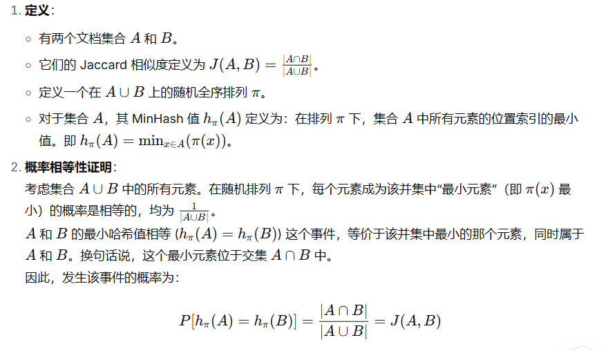
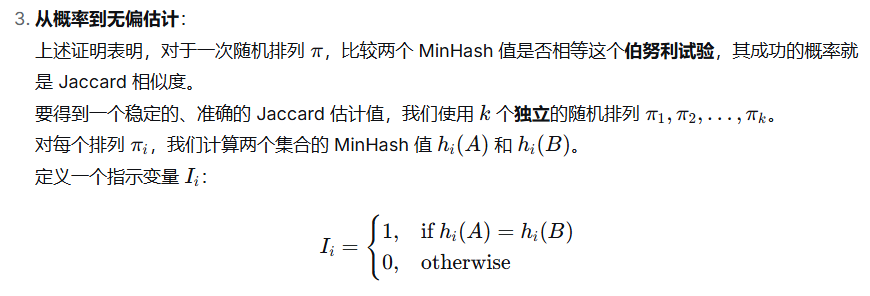
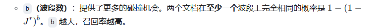
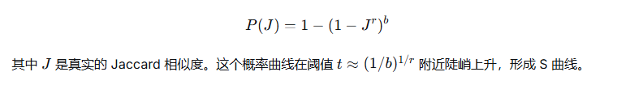
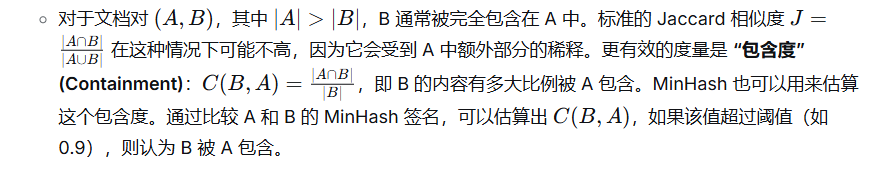

# 29.大模型（LLMs）数据去重（句子级、文档级、近似去重）

#### 句子级去重、文档级去重和近似去重的定义与应用场景

在大规模文本数据清洗中，去重可分为三个层次，其目标和技术复杂度递增：

句子级去重

- 定义：在语料库中，识别并移除（或标记）那些在多个文档中重复出现的完全相同的句子。其操作对象是单个句子，而非整篇文档。

- 实现方式：通常通过计算每个句子的哈希值（如 MD5, SHA-256），然后在全语料范围内统计每个哈希值出现的频次。若频次超过预设阈值（如在 1000 个不同文档中出现），则将该句子及其所在的所有实例删除。

- 应用场景：
  - 去除样板文本：这是句子级去重最核心的应用。互联网上充斥着大量重复的声明、引用、网站页脚、开源许可证文本、名言警句等。这些句子不携带新的信息，且高频出现会浪费模型容量，使模型偏执地学习这些固定模式。
  - 防止记忆和泄露：如果某个带有隐私信息的句子（如某人的电话号码）在数据集中重复出现，模型极有可能将其死记硬背下来，并在后续生成中泄露。句子级去重可以有效降低这种风险。
  - 作为文档级/近似去重的前序步骤：移除高频句子后，文档的特征变得更集中于其独特内容，这能提升后续文档级和近似去重算法的准确性。

文档级去重

- 定义：识别并移除语料库中内容完全相同的多个文档（或它们互为子集/超集）。输出通常是为每个唯一内容保留一份副本。

- 实现方式：最直接的方法是计算整个文档内容的完整哈希值（如 SHA-256）。若两份文档的哈希值相同，则它们是精确重复的。为了处理文档间微小的格式差异（如空格、换行符），通常先对文本进行规范化（统一小写、移除多余空白符、去除标点）再计算哈希。

- 应用场景：
  - 移除抓取冗余：Common Crawl 等网络存档中，同一个网页可能被多次抓取，或同一篇文章被多个新闻站点转载。文档级去重是消除这些完全冗余数据的第一步，能极大缩减数据集体积，节省训练成本。
  - 版权与合规：在发布预训练数据集时，文档级去重可以确保不包含多份相同的受版权保护内容，降低法律风险。
  - 训练数据去偏：避免因某份文档被大量重复而导致模型过度关注其内容，从而引起偏差。

近似去重

- 定义：识别并移除内容高度相似，但不完全相同的文档对或文档簇。例如，两篇文章中 80% 的句子相同，但插入了几段不同的评论或广告。

- 实现方式：通常基于局部敏感哈希（MinHash + LSH）或 SimHash 等算法。它们能够将文档压缩成定长的“指纹”，并保证相似文档的指纹以高概率碰撞。通过比较指纹，可以高效地在海量数据中发现近似重复对。

- 应用场景：
  - 处理转载与洗稿：这是近重复网页最常见的形式。一篇原始报道被数百个地方新闻网转载，每个站点可能修改了标题、插入了本地广告或推荐阅读，导致文档不完全相同。近似去重是清除这些“内容农场”内容的核心手段。
  - 模板化页面去重：许多网站（如电商产品页、论坛帖）由固定的模板动态生成，其核心内容可能是一条短小的评论，但页面 90% 是重复的页眉、页脚、侧边栏。近似去重可以识别并滤除这些模板内容。
  - 构建高质量数据集：对于像 The Pile、C4、RedPajama 这样的大规模高质量数据集，近似去重是确保其质量的决定性步骤。它能显著降低模型记忆训练文本的风险，并提升数据的整体信息密度。

---

#### 精确文档去重：如何使用哈希签名和 Bloom Filter 高效实现？

精确文档去重用于找出内容完全一致的文档。在海量语料（如数千亿 Token）中，直接比较所有文档对是不现实的（O(N²) 复杂度）。高效的实现方法是哈希签名结合布隆过滤器。

核心思想：

将文档内容映射为一个固定长度的、唯一的“指纹”（哈希值）。因为加密哈希算法（如 SHA-256）的抗碰撞性，内容相同的文档其指纹必然相同；而指纹相同的文档，其内容也极大概率相同。这样，文档去重问题就转化为了在海量哈希值集合中寻找重复值的问题。

实现步骤：

1. 预处理与规范化：为了消除因空格、大小写、标点等造成的假象差异，先对文档内容进行规范化处理。常见步骤包括：将文本转换为小写、使用 Unicode 规范化（如 NFKC）、将连续空白符替换为单个空格、移除或统一特定的标点符号。这一步对于精确去重至关重要。

2. 生成文档哈希签名：对规范化后的文档内容，使用一个强加密哈希算法（如 SHA-256、Blake2）生成一个 256 位的哈希值。这个哈希值就是该文档的唯一标识符（ID）。

3. 使用布隆过滤器过滤重复：
  - 布隆过滤器 (Bloom Filter) 是一个高空间效率的概率性数据结构，用于测试一个元素是否在一个集合中。它可以 100% 确定一个元素“绝对不在”集合中，但有一定误判概率（false positive）判断一个元素“可能在”集合中。
  - 流程：
    - 初始化一个足够大的布隆过滤器。
    - 遍历所有文档。对于每一个文档的哈希值：
      - 查询该哈希值是否已经存在于布隆过滤器中。
      - 如果存在，说明该文档极大概率是一个重复文档，将其丢弃或标记。
      - 如果不存在，说明这是一个新的、唯一的文档。将其内容写入最终数据集，并将它的哈希值插入到布隆过滤器中。
  - 通过调节布隆过滤器的位数组大小和哈希函数个数，可以将误判率（把新文档误判为重复）控制在可接受的范围内（如 <0.1%）。

4. 大规模环境下的扩展：当单台机器的内存无法容纳整个布隆过滤器时，可以采用分桶策略。例如，按文档内容的 MD5 哈希值的前缀，将文档分配到不同的桶（文件夹或数据库表）中。每个桶里的文档集合足够小，可以在单机内存中独立完成上述的精确去重流程。

优点：这种方法只需要对每个文档进行一次哈希计算和一次布隆过滤器查询，时间复杂度为 O(N)，且内存占用极小，非常适合 TB 甚至 PB 级别的数据处理。

---

#### MinHash 算法如何估算 Jaccard 相似度？推导其无偏估计性质。

MinHash 是一种用于快速估计两个集合相似度的算法。在文本去重中，一个文档可以被视为其包含的所有 n-gram（如 3-gram 或 5-gram）的集合。

核心原理：

MinHash 基于这样一个关键洞察：两个集合的 Jaccard 相似度，等于它们经过同一个随机全序排列后，各自的最小哈希值相等的概率。

理论推导：

1. **定义**：
    - 有两个文档集合 $A$ 和 $B$。
    - 它们的 Jaccard 相似度定义为 $J(A,B) = \frac{|A \cap B|}{|A \cup B|}$。
    - 定义一个在 $A \cup B$ 上的随机全序排列 $\pi$。
    - 对于集合 $A$，其 MinHash 值 $h_\pi(A)$ 定义为：在排列 $\pi$ 下，集合 $A$ 中所有元素的位置索引的最小值。即 $h_\pi(A) = \min_{x \in A}(\pi(x))$。
2. **概率相等性证明**：

考虑集合 $A \cup B$ 中的所有元素。在随机排列 $\pi$ 下，每个元素成为该并集中“最小元素”（即 $\pi(x)$ 最小）的概率是相等的，均为 $\frac{1}{|A \cup B|}$。

$A$ 和 $B$ 的最小哈希值相等（$h_\pi(A) = h_\pi(B)$）这个事件，等价于该并集中最小的那个元素，同时属于 $A$ 和 $B$。换句话说，这个最小元素位于交集 $A \cap B$ 中。

因此，发生该事件的概率为：

$$
P[h_\pi(A) = h_\pi(B)] = \frac{|A \cap B|}{|A \cup B|} = J(A,B)
$$

{.ocr-src}

3. **从概率到无偏估计**：

上述证明表明，对于一次随机排列 $\pi$，比较两个 MinHash 值是否相等这个**伯努利试验**，其成功的概率就是 Jaccard 相似度。

要得到一个稳定的、准确的 Jaccard 估计值，我们使用 $k$ 个**独立**的随机排列 $\pi_1, \pi_2, ..., \pi_k$。

对每个排列 $\pi_i$，我们计算两个集合的 MinHash 值 $h_i(A)$ 和 $h_i(B)$。

定义一个指示变量 $I_i$：

$$
I_i = \begin{cases} 1, & \text{if } h_i(A) = h_i(B) \\ 0, & \text{otherwise} \end{cases}
$$

{.ocr-src}

那么，$I_i$ 是一个概率为 $J$ 的伯努利随机变量。\
我们取这 $k$ 个指示变量的平均值作为 Jaccard 相似度的估计值 $J$^：

$$
\hat{J} = \frac{1}{k}\sum_{i=1}^{k} I_i
$$

{.ocr-src}

由于期望的线性性质：

$$
\mathbb{E}[\hat{J}] = \frac{1}{k}\sum_{i=1}^{k} \mathbb{E}[I_i] = \frac{1}{k}\sum_{i=1}^{k} J(A,B) = J(A,B)
$$

这证明了估计值 $\hat{J}$ 是真实 Jaccard 相似度 $J$ 的无偏估计。

{.ocr-src}

实践中的近似：在代码实现中，真随机全序排列的计算代价高昂。因此，我们使用一个足够强且均匀的哈希函数（如 MurmurHash3）来模拟随机排列的效果。我们将集合中的每个元素输入哈希函数，得到的一个整数值，并取其中的最小值作为该集合的 MinHash 签名。使用 $k$ 个不同的哈希函数（或相同的哈希函数配合 $k$ 个不同的种子），即可生成 $k$ 维的 MinHash 签名向量。

---

#### 画出 MinHash + LSH 的大规模近似文档去重流程图，并解释关键参数。

MinHash + LSH（局部敏感哈希）是大规模近似文档去重的工业标准方案。它将文档压缩为紧凑的签名，然后利用 LSH 高效地将相似签名分入同一个“桶”中，避免了对所有文档对进行穷举比较。

MinHash + LSH 流程图（文字描述）：

```plain text
原始文档集合 (N 个文档)
       |
       v
① 文档预处理与 Shingling
   将每个文档转为 n-gram 集合，并进行规范化（小写、去停用词等）。
       |
       v
② 生成 MinHash 签名
   使用 k 个不同的哈希函数，将每个文档的 n-gram 集合映射为一个 k 维整数向量（即签名）。
       |
       v
③ 应用 LSH 分桶
   将每个文档的 k 维签名切分为 b 个波段 (bands)，每个波段包含 r 行 (rows) (k = b * r)。
   对每个文档的每个波段，使用一个哈希函数将该波段的 r 个整数值映射到一个桶 (bucket) 中。
   拥有完全相同波段哈希值的文档，会被分到同一个桶里。
       |
       v
④ 生成候选对
   对于同一个桶内的任意两个文档，将它们视为一对“相似候选对”。
   只要两个文档的签名在任意一个波段上碰撞，它们就会成为候选对。
       |
       v
⑤ 精确相似度计算与过滤
   对每一对候选文档，重新计算它们原始的 Jaccard 相似度（或直接比较完整的 MinHash 签名）。
   如果相似度大于预设阈值（如 0.8），则将这一对文档标记为近似重复。
       |
       v
⑥ 连通分量与去重
   将所有标记为近似重复的文档对构建成一个图。
   找出图中的所有连通分量，每个连通分量内的文档互为近似重复。
   通常从每个连通分量中保留一份文档（如最长的那份，或来自最可信源的那份），删除其余。
       |
       v
最终去重后的文档集合
```

关键参数解释：

- n-gram 的大小 (n)：决定了文档特征的粒度。`n` 越大，能捕捉到的上下文就越长，但也会降低对局部微小修改的鲁棒性。对于文本去重，`n=3` (tri-gram) 或 `n=5` 是常见选择，能很好地平衡精确度和鲁棒性。

- 签名长度 (k)：即使用的哈希函数数量。`k` 越大，MinHash 估计的 Jaccard 相似度方差就越小，结果越精确。但也会增加计算和存储开销。通常取值在 128 到 256 之间。

- 波段数 (b) 和每个波段的行数 (r)：这是 LSH 算法的核心参数，且 `k = b * r`。
  - `r`（行数）：它决定了将两个文档视为候选对的“门槛”。两个文档在一个波段内所有 `r` 个 MinHash 值都相等的概率是 $J_r$。`r` 越小，门槛越低，更多文档对会被召回（高召回率），但误报也可能增多。
- `b`（**波段数**）：提供了更多的碰撞机会。两个文档在**至少一个**波段上完全相同的概率是 $1 - (1 - J^r)^b$。`b` 越大，召回率越高。

{.ocr-src}

  - 通过调整 `b` 和 `r`，可以精确地控制阈值曲线，实现对特定相似度（如 0.8）以上的文档对进行“高概率召回”，而忽略相似度低于此的文档对。这被称为“S 曲线”特性。

- 相似度阈值 (Similarity Threshold)：最终决定哪些文档被删除的标准。这是根据最终需求设定的，如 0.8 或 0.9。它决定了去重的“严格程度”。

---

#### SimHash 与 MinHash 在文本去重上的原理和适用区别。

SimHash 和 MinHash 都是用于降维和相似性搜索的哈希技术，但它们的原理和适用场景有本质不同。

| 特性 | MinHash | SimHash |
| --- | --- | --- |
| 核心原理 | 基于集合的 Jaccard 相似度。通过多次随机排列，取最小哈希值来模拟集合的交并比。 | 基于向量的余弦相似度。将文档特征向量投影到超平面上，根据投影结果产生一个二进制指纹（01 串）。 |
| 输入数据 | 文档的词或 n‑gram 的集合（无序）。 | 文档的特征向量（通常有权重，如 TF-IDF），是有序的。 |
| 相似度度量 | 估计 Jaccard 相似度。\|A ∩ B\| / \|A ∪ B\| | 估计 余弦相似度。两个指纹的汉明距离越小，余弦相似度越高。 |
| 输出 | 一个整数向量（长度为 k）。 | 一个固定长度的二进制指纹（如 64 位或 128 位）。 |
| 主要优势 | 对文档的局部修改、顺序调换、子集/超集关系非常鲁棒。Jaccard 相似度本身非常适合衡量文本的内容重叠度。 | 生成的指纹极其紧凑（仅需 8 字节），计算和存储成本极低。搜索相似文档时，只需比较指纹的汉明距离，速度极快。 |
| 典型应用 | 大规模、严格内容级别的近似去重，如新闻转载、论文查重、代码克隆检测。 | 网页海量去重（Google 索引去重）、判断一篇新文章是否已在索引中、快速聚类相似文本。 |
| 去重精度 | 通过调整签名长度 k 和 LSH 参数，可以非常精确地控制相似度阈值。 | 在处理短文本时容易失真，因为短文本的特征向量可能过于稀疏，导致指纹不稳定。更适合长文本。 |

适用区别总结：

- 选 MinHash：如果你需要高精度的内容级去重，例如找出所有转载并小幅修改的文章，确保最终数据集不包含任何实质性重复的内容。这通常需要更复杂的预处理和 LSH 流程，但去重效果更彻底。

- 选 SimHash：如果你的目标是超大规模网页的快速海量去重，对去重精度要求不那么严格，但要求极高的处理速度和极低的存储成本。Google 搜索引擎就用它来检测近重复网页。

---

#### 句子级去重的实现：哈希映射并过滤高频句子，会破坏文档连贯性吗？

句子级去重，如果实施得当，不会显著破坏文档的连贯性。关键在于区分“结构性的高频句子”和“内容性的句子”。

实现方法：

1. 分句：将语料库中的所有文档按标点（句号、问号、感叹号）分割成单个句子。

2. 规范化：对每个句子进行轻量级规范化，如转小写、统一空白符。

3. 计算哈希与计数：计算每个规范化句子的哈希值（如 SHA-256 的前 16 字节），并统计每个哈希值在整个语料库中的出现次数。

4. 过滤高频句子：设定一个绝对阈值（如 > 1000 次）或一个相对阈值（如 > 0.1% 的文档）。如果一个句子的出现频次超过此阈值，就将该句子从它出现的所有文档中删除。

5. 重建文档：将剩余的低频句子按它们在原文中的顺序拼接起来，形成新的、去重后的文档。

对连贯性的影响分析：

- 删除的是“噪音句子”：真正会被高频阈值过滤掉的，绝大多数是“样板文本”（如网站声明、导航菜单、广告词、法律条款）。这些句子本身与文章主题无关，是横亘在文章中的“硬渣”。移除它们，相当于去掉了视觉上的水印或背景噪音，文章的核心论述内容依然完整，读起来反而更连贯。

- 删除的是“复用结构”：有些句子是新闻写作的常用结构（如“据XX社报道”），它们虽然在单个文档内是连贯的，但在整个语料库中属于冗余信息。删除它们会轻微影响原文的通顺度，但这对语言模型的影响是积极的——它迫使模型关注真正的内容，而不是学习写作套路。

- 不会出现“鬼畜”效应：因为我们是删除整个句子实例，而不是删除句子中的某些词。文档剩余部分都是完整的句子，因此读起来依然是通顺的。

风险与缓解：

唯一的风险在于阈值设定不当，导致将一些常见的、但有实质语义的句子（如“我爱你”）误删。缓解方法包括：

- 设定一个相对保守的、较高的阈值。

- 将阈值与文档总长度或领域关联起来。

- 只删除那些在同一网站模板或同一域名下大量重复的句子，而不是全局删除。

- 在评估阶段进行抽样人工检查，确保没有大量有意义的句子被误杀。

---

#### 什么是 Exact Substring Deduplication？Gopher 项目中如何去除长重复子串？

Exact Substring Deduplication（精确子串去重） 是一种更细粒度的去重技术，它旨在识别并移除文档中长距离的、完全相同的字符序列，即使这些重复序列嵌在不同的上下文中。

目标：解决精确文档去重无法处理的“长段落抄袭”问题。例如，一篇新闻报道可能直接复制了另一篇报道中的几个大段，而文档的其余部分是全新的。精确文档去重会漏掉这种部分重复。

Gopher 项目中的实现方法：

DeepMind 在训练 Gopher 模型时，实施了一套严格的去重管道，其中包括了精确子串去重。其主要步骤思想如下：

1. 构建后缀数组 (Suffix Array)：这是实现精确子串去重的核心技术。将整个（或部分）语料库视为一个巨大的文本字符串 $T$。为 T 构建一个后缀数组 $S_A$。后缀数组是一个整数数组，存储了 $T$ 的所有后缀按字典序排序后的起始索引。构建后缀数组的时间复杂度为 O(N log N) 或 O(N)。

2. 计算最长公共前缀 (LCP)：利用后缀数组，计算相邻后缀之间的最长公共前缀 (LCP) 长度，得到 LCP 数组。这个数组记录了排序后相邻后缀的公共前缀长度。

3. 识别长重复序列：通过扫描 LCP 数组，可以找出所有长度超过预设阈值（例如 50 个字节或 100 个字符）的公共前缀。每一个这样的 LCP 值都对应了一个在语料库中至少出现了两次的精确重复子串。

4. 构建重复区间：对于每一个识别出的长重复子串，确定它在原始文本中出现的所有位置。将这些位置信息记录下来，形成一个“重复区间”的列表。

5. 执行删除（模糊处理）：
  - 为了避免破坏文本的完全可读性，Gopher 没有简单地删除整个重复段落。而是采取了一种“模糊处理”策略。
  - 它定义了更复杂的规则：如果某个重复区间在另一份文档中同样出现，并且满足特定条件（如跨越了句子边界），则会将其中一个区间内的内容用特殊标记替换，或者直接删除其中一个实例。
  - 关键原则是：只删除“额外的”副本，至少保留一份原始内容，确保所有独特信息都不丢失。

6. 处理重叠和包含关系：这是一个复杂的步骤。算法需要高效地处理检测到的大量重叠、嵌套的重复区间，并决定最终的删除边界，以实现最大化去重同时最小化信息损失。

通过这种方法，Gopher 能够成功移除训练数据中大规模存在的、被反复引用的长段落，如法律条文、开源许可证文本、著名的诗歌段落等，极大地降低了模型记忆特定文本串的风险。

---

#### 如何用后缀数组或后缀自动机检测并删除大规模语料中的重复片段？

后缀数组 (Suffix Array, SA)、后缀自动机 (Suffix Automaton, SAM) 和广义后缀树 (Generalized Suffix Tree, GST) 是解决精确子串重复问题的标准数据结构。

方法一：基于后缀数组 (SA) + 最长公共前缀 (LCP)

这是处理超大规模语料最常用、理论最成熟的方法。

1. 语料连接与索引构建：
  - 将需要去重的多份文档连接成一个巨大的字符串 $T$。为了区分不同文档，在文档连接处插入唯一的、不会在正文中出现的分隔符（如 `\x01`, `\x02` 等）。
  - 为这个巨大的字符串 $T$ 构建后缀数组 $S_A$ 和 LCP 数组。考虑到内存限制，通常采用分治增量式构建或外部排序算法，逐块构建 SA 再合并。

2. 基于 LCP 的重复序列挖掘：
  - 扫描 LCP 数组。任何大于预设阈值 $τ$（如 100 字符）的 `LCP[i]` 值，都指示了一个在 SA[i]$S_A$[$i$] 和 SA[i−1]$S_A$[$i$−1] 这两个后缀起始位置处开始的、长度为 `LCP[i]` 的精确重复子串。
  - 根据 SA 的值，可以将这些重复子串映射回它们在原始各文档中的具体位置（通过分隔符判定）。

3. 过滤与决策：
  - 跨文档过滤：我们通常只关心跨越了不同文档的重复子串（即抄袭、转载），而忽略同一文档内部的自然重复。通过检查 LCP 对应的两个后缀是否属于同一个原始文档，可以轻松过滤掉内部重复。
  - 区间合并：大量 LCP 值会指示出重叠的重复片段。算法需要将这些片段合并成最长的、无冗余的重复区间。

4. 删除策略：
  - 保留一份原则：对于每一组跨文档重复的区间，保留其第一次出现的实例，删除（或用特殊 token 替换）所有后续出现的实例。
  - 边界对齐：为了不破坏文本可读性，通常会将对齐到最近的句子边界或自然段落边界。

方法二：基于后缀自动机 (SAM)

SAM 是处理单个字符串或少量字符串的强大工具，但对超大规模语料，其内存占用通常是瓶颈。其原理是：SAM 的每个状态代表了一个等价类（Endpos 集合相同的一组子串）。通过遍历 SAM 的状态，可以轻松找到所有在原串中出现次数超过一次的路径（子串）。在大规模数据下，通常使用 广义后缀自动机 或在多个文档上联合构建。但由于其复杂的内存开销，在实际的超大语料（如 PB 级）去重中，SA+LCP 方案由于其可扩展性（可利用磁盘）而更受青睐。

执行删除：无论用哪种数据结构，最终都是生成一个“待删除区间列表”。然后对原始文档集进行一遍顺序扫描，根据列表动态地跳过或替换掉重复内容，输出最终干净的数据集。

---

#### 近重复网页（镜像站点、转载）有哪些特征？如何高效检测？

近重复网页是网页级去重的主要处理对象。它们不完全相同，但内容高度重叠。

主要特征：

1. 核心文本高度相似：正文的主要内容（句子、段落）几乎完全一致，Jaccard 相似度或余弦相似度很高。

2. 模板/噪音部分不同：差异主要体现在“装饰性”内容上，这些内容通常不是页面的核心信息。
  - 网站模板：不同的页眉、页脚、导航栏、侧边栏（相关文章、广告位、友情链接）。
  - 交互式元素：评论区、点赞数、分享按钮等用户生成内容或动态脚本。
  - 内链与广告：插入的站内链接、广告图片/文字。
  - 时间戳与作者署名：发布日期、记者姓名等微小差异。

3. URL 模式相似：镜像站点或转载文章通常具有相似的 URL 结构，例如 `siteA.com/article/123` 和 `siteB.com/2024/05/15/123`。域名可能完全不同，但路径的尾部常常一致。

4. 标题高度一致：尽管全文可能有删改，但新闻、论文的标题往往完全相同或仅有微小标点差异。

高效检测方法——SimHash + 汉明距离搜索：

对于海量网页，MinHash+LSH 计算和存储成本较高，而 SimHash 因其指纹极其紧凑且搜索速度极快，成为检测近重复网页的首选。

1. 预处理与正文提取：这是最关键的一步。使用 `trafilatura` 或 `jusText` 等工具，将正文内容从 HTML 网页中提取出来。这能直接排除掉大量模板和广告噪音，使得后续的相似度比较聚焦于真正的文章内容。

2. 特征提取：将提取出的正文进行分词，计算每个词的权重（例如 TF-IDF）。高频的、有区分度的词被赋予高权重。

3. 生成 SimHash 指纹：使用 SimHash 算法，将文档的特征向量映射为一个 64 位或 128 位的二进制指纹。这个过程确保了内容相似的文档会生成汉明距离很小的指纹。

4. 海量指纹搜索与聚类：
  - 为了从海量指纹库中快速找到与一个新文档指纹汉明距离 `<= K`（如 K=3）的所有指纹，最有效的方法是分块索引。例如，对于一个 64 位的指纹，如果我们要找汉明距离 `<= 3` 的文档，可以将 64 位分成 4 块，每块 16 位。根据抽屉原理，两份相似文档的指纹，至少有一块（16 位）是完全相同的。因此，我们可以为每一块建立一个倒排索引。搜索时，只需在每个块的索引中查找完全匹配的指纹，然后再对候选集精确计算汉明距离。

5. 去重与保留策略：将汉明距离小于阈值的网页归为一个簇。在每个簇中，根据页面的权威性、质量评分、内容长度等规则，保留一个“最佳”版本，删除其余镜像和转载。

这种基于 SimHash 的方案极其高效，能够以极低的计算成本处理每天数十亿级别的网页，是 Google 等搜索引擎保持索引清洁的核心技术。

---

#### MinHash 的排列数 num_perm 和 LSH 的 band 参数如何选择？权衡计算成本与召回。

MinHash 的排列数（`num_perm`，即签名长度 k）和 LSH 的波段数（`bands`，记为 $b$）、每个波段的行数（`rows`，记为 $r$，满足 k=b×r）共同决定了近似去重的精度、召回率和计算成本。它们控制着一个经典的“S 曲线”权衡。

1. 签名长度 $k$ (num_perm)

- 作用：$k$ 越大，MinHash 估计 Jaccard 相似度的方差越小，估计越精确。这直接提升了相似度判定的可靠性。

- 对计算的影响：$k$ 增大，计算每个文档的 k 个哈希值的时间、存储签名所需的内存和外存空间都会线性增长。对于百亿级文档，这是一个显著的开销。

- 典型取值：实践中，$k$ 通常取 128 或 256。对于文本去重，128 已能提供足够小的方差；256 则更为保守，适用于对精度要求极高的场景。超过 256 的收益递减明显，且开销骤增。

2. LSH 参数 b (bands) 和 $r$ (rows)\
   LSH 利用分桶策略避免了对所有文档对的穷举比较。两个文档被判定为候选对（即至少在一个桶中碰撞）的概率为：

$$
P(J) = 1 - (1 - J^r)^b
$$

其中 $J$ 是真实的 Jaccard 相似度。这个概率曲线在阈值 $t \approx (1/b)^{1/r}$ 附近陡峭上升，形成 S 曲线。

{.ocr-src}

- 选择原则：
  - 确定目标相似度阈值 $t$（如 0.8）：我们希望相似度 ≥$t$ 的文档对高概率被召回（高召回率），而相似度 <$t$ 的文档对低概率被召回（高精确率）。
  - 固定 $k$ 后，寻找最优 (b,r) 组合，使得 S 曲线在 $t$ 处尽可能陡峭。通常 r 较小（如 5-10），$b$ 较大。例如，$k$=128，目标阈值 0.8，常用 b=16,r=8或 b=32,r=4。

- 权衡：
  - r 较大：门槛高，只有高相似度的文档才能碰撞，精确率高但可能漏掉一些真正的近重复文档（低召回）。
  - $b$ 较大：给文档对提供了更多碰撞机会，召回率提升，但也会引入更多误报（低精确率），增加候选对数量，加重后续精确比对的负担。
  - 计算成本：$b$ 决定了分桶和存储的桶的数量。$b$ 越大，需要维护的哈希表越多，内存和写入开销越大。同时，候选对增多也意味着后续的精确 Jaccard 计算成本更高。

最佳实践：通过网格搜索（离线实验）在一组标注的重复文档对上评估不同 ($b$,$r$) 下的召回率和候选对数量，找到满足资源预算的配置。通常，在保持 r 不低于 5 的情况下，通过增加 $b$ 来逼近目标召回率。

---

#### 去重后数据集通常减少多少比例？以 Common Crawl 为例给出数量级。

Common Crawl（CC）是典型的低质量互联网文本，其重复率非常高。去重通常分为多个阶段，每一阶段都能显著缩减数据量：

- 精确文档去重（字节/哈希级别）：移除完全相同的网页（如多次抓取的同一 URL、完全相同的转载页）。在 CC 中，这一步骤通常可以移除 15% ~ 30% 的文档。因为 CC 每月抓取，大量页面在连续几个月的抓取中保持完全不变，造成大量精确冗余。

- 句子级去重（高频样板句子）：在精确文档去重之后，再移除那些在整个语料中反复出现的高频句子（如页脚、导航文本）。这一步骤移除了大量无意义的“文本碎片”，会使剩余的 token 总量减少约 5% ~ 10%。

- 近似文档去重（MinHash + LSH）：这是最关键的去重阶段，用于处理转载、洗稿、模板化页面。根据阈值的严格程度（如 Jaccard > 0.8），近似去重通常会进一步移除 20% ~ 40% 的文档。许多内容农场的文章几乎一模一样，只是替换了地名或关键词，都会被此阶段清除。

综合效果：经过完整的去重管道后，Common Crawl 数据集的文档总数通常会减少 45% ~ 65%。但请注意，由于被删除的多是低质量、重复的长尾内容，其包含的 token 数占比可能略低于文档数占比，但仍然是巨大的缩减。例如，C4 数据集在去重和过滤后，其体积大约是原始 CC 提取文本的几十分之一。RedPajama 在去重后也减少了约 50% 的文档。这些数字直观地证明了去重对于控制数据规模、提升数据信息密度的绝对必要性。

---

#### 文档级去重时，如何识别不同文档间的大段引用，以及是否应保留？

文档级去重通常依赖全文哈希或 MinHash，它对整个文档的相似度敏感。但对于大段引用（如一篇长文引用了另一篇文章的几个段落），整体 Jaccard 相似度可能并不高，因此可能逃过文档级去重。这就需要专门处理。

识别方法：

1. 子串/片段级去重（Exact Substring Dedup）：如 Gopher 项目使用后缀数组检测出所有超过一定长度（如 50 字节）的、跨文档重复的精确子串。这能直接抓出大段引用。

2. MinHash 的“包含”变体：我们可以预先计算每个文档的 MinHash 签名，然后对于较短的文档，检查其是否与某个较长文档的签名高度相似（即使长文档只有一小部分与短文档重叠）。通过设定一个较低的相似度阈值（如 0.5），并结合文档长度比，可以过滤掉那种“短文档 B 是长文档 A 的一部分”的包含关系。

应否保留的决策：

对于大段引用，不能简单地“一刀切”删除，需要根据引用的性质来决策：

- 应删除的情况：无意义的重复和抄袭。例如，内容农场的文章直接拷贝了维基百科的段落作为自己的主体；或者一个新闻聚合站，其文章的主体就是其他新闻的片段拼凑。这种情况下，后续出现的副本应当被移除，因为它们没有提供新的信息，并且可能会侵犯版权。

- 应保留的情况：有意义的引用和评论。例如，一篇学术论文引用了另一篇论文的结论，并进行了深入讨论；或者一篇新闻评论中引用了某官员的一段话。这种引用是创作新内容的基础，必须保留。这里的边界在于：引用部分必须是被明确标记（如引号）的，并且它周围有足够的独创性评论或分析。如果被引用部分占据了文档的绝大部分（如超过 50%），且周围没有实质性的新内容，则可视为抄袭。

实现策略：在实现上，通常会先运行子串去重，并设定一个长度下限（如 200 字符）以避免误杀短小的常见短语。然后，结合上下文质量评分：如果围绕引用的原创文本质量很低（如短小、重复），则倾向于删除；如果原创部分信息密度高，则保留。

---

#### 多语言数据去重：同一内容的不同语言翻译是否算重复？如何处理？

翻译内容一般不应被视为重复。从多语言模型训练的角度看，同一内容的不同语言翻译是极其宝贵的平行语料。它们天然地实现了跨语言的对齐信号，有助于模型学习语言无关的语义表示，并提升在机器翻译、跨语言问答等任务上的零样本能力。如果将这些翻译对去除了，会严重损害模型的多语言性能。

然而，这也会引入两个问题：1) 过强的“翻译记忆”可能导致模型在生成时直接输出另一种语言。2) 多语言数据中的真正“抄袭翻译”可能占据主导，导致数据多样性降低。

处理策略：

1. 保留翻译，但标记语言：在多语言预训练数据集中，保留翻译文本。同时，为每个文档或句子显式地添加语言标识符（Language ID token），让模型清楚知道当前处理的是何种语言。

2. 对翻译进行去重，但限制在极高质量情况下：仅当两个翻译文本属于完全相同的源语言和目标语言，并且在内容上是完全对应的精确翻译（如多语言网站、官方文档的镜像）时，可以考虑只保留一份。但这通常不是通过全局去重完成，而是依靠文档级/近似去重自然发现它们（因为它们高度相似），然后人工检查。在实践中，大多数通用流程不会对跨语言文本进行专门去重。

3. 使用跨语言去重（Cross-lingual Deduplication）：如果需要严格去重，可使用多语言句子嵌入模型（如 LaBSE）将不同语言的句子映射到统一向量空间。通过计算句子间的余弦相似度，识别出语义上完全相同但语言不同的句子对，并根据策略决定保留与否。例如，如果一个英文维基百科页面的中文翻译完全由机器生成且质量低下，就可能被移除。

4. 借助 URL 和来源结构：多语言网站常使用类似 `en.example.com/artice1` 和 `fr.example.com/artice1` 的 URL 结构。可以利用这种结构化信息来识别翻译对，并保留源语言或保留所有语言（大多数情况）。

结论：对于多语言基础模型，默认策略是保留跨语言翻译，这是宝贵的多语言对齐资源。仅在对数据安全、版权、翻译质量有特别要求时，才会用跨语言相似度检测进行有限度的清洗。

---

#### 模糊去重中，针对近似重复的“段落包含”关系如何设计算法？

“段落包含”指的是一个长文档（A）包含了另一个短文档（B）的大部分内容（B 是 A 的子集），但 A 还有额外的原创内容。这在新闻转载（转载全文后又加一段记者评论）、博客聚合中很常见。我们需要识别并移除 B（短文档），同时保留 A（长文档）。

算法设计：

1. 利用 MinHash 判断“包含相似度”：

- 对于文档对 $(A, B)$，其中 $|A| > |B|$，B 通常被完全包含在 A 中。标准的 Jaccard 相似度 $J = \frac{|A \cap B|}{|A \cup B|}$ 在这种情况下可能不高，因为它会受到 A 中额外部分的稀释。更有效的度量是**“包含度”(Containment)**：$C(B, A) = \frac{|A \cap B|}{|B|}$，即 B 的内容有多大比例被 A 包含。MinHash 也可以用来估算这个包含度。通过比较 A 和 B 的 MinHash 签名，可以估算出 $C(B, A)$，如果该值超过阈值（如 0.9），则认为 B 被 A 包含。

{.ocr-src}

2. 分块索引与包含检测：
  - 对于每个长文档 A，将其分成大小相等的块（chunk），并为每个块计算 MinHash 签名。
  - 对于短文档 B，同样计算其 MinHash 签名。
  - 通过 LSH 分桶，查询 B 的签名是否与 A 的某个块的签名高度碰撞。如果 B 的绝大部分（如 90%）的 MinHash 值都能在 A 的块中找到高相似度匹配，则可判定 B 是 A 的一部分。

3. 精确比对与决策：
  - 对候选包含对，在文本级别进行确认。可以计算 B 中每个句子在 A 中的出现情况（如使用哈希查找），统计 B 被覆盖的比例。
  - 保留策略：如果 B 的内容 100% 被包含在 A 中，且 A 有显著的额外信息（如超过 20% 的新内容），则删除 B，保留 A。如果 A 几乎就是 B 的副本，只有极小差异（如标题不同），则保留较长的或质量更高的那一个。

这种“包含去重”能够有效剔除那些被大量转载和聚合的短小内容，同时保留有附加价值的长篇分析。

---

#### 去重粒度（段落、文档、句子）如何根据下游任务和数据源特点选择？

去重粒度的选择取决于我们希望模型学到什么以及数据的特点。

1. 句子级去重

- 适用场景：清洗预训练数据中的“背景噪音”。最常用于从 Common Crawl 中移除页眉、页脚、广告、声明等样板文本。对于对话数据集，它可移除高频的、无信息量的口头禅。

- 下游任务影响：对生成模型，它降低了模型记忆并反复输出模板句子的风险；对理解模型，它使模型更关注内容而非结构。

- 数据源特点：非常适用于网页、论坛等包含大量重复模板的数据源。但对于书籍、论文等结构性强的数据，应谨慎使用，以免破坏引用和章节格式。

2. 文档级去重

- 适用场景：移除数据集中完全或高度重复的整个网页、文章、代码文件等。这是预训练数据清洗的标配，确保模型不会在同一份文档上反复训练。

- 下游任务影响：对任何下游任务都是正面的，它提升了数据多样性，降低了记忆风险，节省了训练计算。

- 数据源特点：对所有数据源都必需。对于 Common Crawl，它是第一步；对于像 Wikipedia 这样已经内部去重的数据集，可跳过。

3. 近似段落/子串去重

- 适用场景：处理“转载聚合”、“洗稿”。例如，一篇新闻的核心部分被数百个站点转载，每个站点只修改了标题和首段。文档级去重无法处理这种情况，需要子串去重来识别并移除重复的核心内容。

- 下游任务影响：对于事实类知识密集型任务（如问答），它至关重要，能防止模型记忆多个相矛盾或完全相同的知识碎片。对于创意写作，它可能不必要。

- 数据源特点：新闻类数据源必须执行；书籍和学术论文通常不需要。

选择策略总结：

- 构建通用基础模型：采用多层去重。先用句子级去重去除样板，再用文档级去重去除完整副本，最后用近似去重（MinHash+LSH）处理转载。子串去重用于极高要求的模型（如 Gopher）。

- 构建对话模型：文档级去重避免相同对话多次出现；句子级去重可移除高频但无意义的回复（如“好的”）。

- 构建代码模型：文档级（文件级）去重是核心，并要结合近似去重处理代码克隆。但对函数内部的自然文档字符串，可保留重复。

---

#### 使用倒排索引加速近似重复文档的检索，阐述其流程。

除了 MinHash + LSH，另一种经典的近似去重方案是基于 TF-IDF 特征词的倒排索引 (Inverted Index) 加速候选对检索。它对中等规模数据或需要精确词匹配的场景特别有效。

核心思想：如果两个文档是近似重复的，它们一定共享了大量不常见的、有区分度的特征词（如专业术语、人名、特定名词）。通过为这些特征词建立倒排索引，可以快速聚合出共享这些词的文档。

实现流程：

1. 特征提取与加权：对每个文档，提取其核心特征词（通常是名词、动词，过滤停用词），并计算它们的 TF-IDF 权重。选择每个文档中权重最高、最具代表性的词作为其“指纹词”。

2. 构建倒排索引：为整个语料库构建一个倒排索引。键是“特征词”，值是一个 posting list，记录了包含该词的所有文档 ID 以及该词在该文档中的 TF-IDF 权重。

3. 生成候选对：顺序扫描所有文档。对于文档 D，取其所有高权重的特征词，从倒排索引中查询这些词对应的 posting list。将所有出现在这些列表中的文档 ID 聚合起来，并累加它们的“共享特征词分数”（例如，将 TF-IDF 权重之和作为相似度预估值）。设定一个分数阈值，分数高于阈值的文档对成为候选对。

4. 精确比对与过滤：对候选对，使用更精确的算法（如计算完整的 TF-IDF 向量余弦相似度、或 Jaccard 相似度）进行最终判断。超过最终阈值的被标记为近似重复。

5. 优化技巧：
  - 只取低频高区分度的词：如果一个词出现在超过 50% 的文档中，它几乎没有区分度，其 posting list 也过于庞大。直接忽略这些高频词。
  - 分段 (Blocking)：先按文档的领域、来源、语言等元数据进行分块，在每个块内独立构建索引，可以极大地缩小搜索空间。

倒排索引的优势在于它可以精确地反映出“因为共享了某个特定实体所以相似”的情况，而 MinHash 更偏向于整体内容重叠。两者可以互补。

---

#### 去重过程如何并行化？描述在 Spark 或 Ray 上的实现要点。

大规模去重必须在分布式计算框架上并行执行，以处理 TB/PB 级别的数据。以下是基于 Spark 的经典实现要点（Ray 的核心思想类似）。

1. 精确文档去重

- 实现：使用 MapReduce。Map 阶段，对每条文档计算其内容哈希值（如 SHA-256）作为 Key，文档本身作为 Value。Shuffle 阶段，所有相同 Key 的数据被发送到同一个 reducer。Reduce 阶段，每个 reducer 对接收到的每个 Key（即一组重复文档），只输出第一条文档。这天然适合 Spark 的 `groupByKey` 或 `reduceByKey`。为平衡负载，可先用 MD5 对 Key 进行二次哈希以消除数据倾斜。

2. MinHash + LSH

这是最复杂的步骤，需要多阶段并行。

- 阶段一：签名计算 (Map)。每个 worker 读取一个数据分片，独立为每条文档计算 MinHash 签名向量（长度为 k）。这一步是完全并行且无通信的。

- 阶段二：分桶与分组 (Shuffle)。这是 LSH 并行化的核心。对于每个文档的签名，按波段 (band) 切分。对每个波段，计算其波段哈希值 `band_hash`，然后输出 `(band_id, band_hash)` 作为组合键，文档 ID 作为值。Spark 会将这些键值对进行 Shuffle，将相同组合键的数据发送到同一 reducer。这样，每个 reducer 获得的就是“在某个波段上碰撞的”所有文档 ID。这是一个典型的 “自连接” (self-join) 问题。

- 阶段三：候选对生成 (Reduce)。每个 reducer 对自己接收到的文档 ID 列表，输出所有两两配对作为候选对。

- 阶段四：精确去重 (Map/Filter)。候选对数量可能很大。将候选对与原始文档数据进行连接（Join），重新计算它们完整的 MinHash 签名相似度或原始 Jaccard 相似度，根据最终阈值过滤，输出最终的重复文档对。

3. 实现要点

- 数据倾斜：某些波段哈希值可能因为高频文档而极端热门，导致个别 reducer 成为性能瓶颈。解决方案：a) 对文档 ID 进行二次采样或使用盐值（salting）打散热点。b) 对于极高频的波段，直接丢弃该波段的所有碰撞（因为太常见，无法提供有效区分）。

- 内存控制：reducer 需要将同一桶内所有文档 ID 保存在内存中以生成配对。如果桶过大，会导致 OOM。可以通过设定桶大小阈值，若超过阈值，则对该桶进行二次分桶（如使用下一级哈希），或者直接丢弃该桶。

- 使用 Ray 的优势：Ray 的 Actor 模型和共享内存使得处理状态性任务（如维护一个巨大的布隆过滤器）更高效。对于去重，可以使用 Ray Datasets 进行类似的 Map-Shuffle-Reduce 操作，并通过 `ray.data.Dataset` 的函数式 API 简洁地表达上述逻辑。

---

#### 为什么在数据清洗流水线中，去重应尽早执行？结合计算开销说明。

在数据处理流水线中，去重应被置于相对靠前的位置，尤其是在进行昂贵的质量过滤、PII 清洗和模型训练之前。核心原因是去重能极大地减少需要处理的数据总量，从而节省下游所有步骤的计算和存储资源。

结合开销说明：

1. 后续步骤是“按文档/按Token”计费的：质量分类器（如 KenLM 困惑度计算）、毒性检测、命名实体识别（NER）等操作的计算成本都与输入文本的长度或文档数量呈正比。如果一个数据集有 20% 的文档是重复的，那么在这些步骤上我们就会浪费 20% 的计算资源。如果先去重，我们就可以避免对这 20% 的重复数据进行昂贵分析。

2. 去重本身的开销相对可控：文档级去重基于哈希，计算成本极低（O(文档长度)）。近似去重（MinHash+LSH）虽然更复杂，但它的计算成本（主要为签名计算和哈希分桶）也远低于运行一个 Transformer 模型去评估文本质量。因此，用去重作为“粗筛”的投入产出比极高。

3. 质量评估的分布偏差：大量的重复文本会扭曲质量评估模型的统计。例如，一篇低质量的样板文本重复出现 1000 次，如果不去重，它在训练一个基于统计的质量分类器时会被过度强调，导致分类器错误地将这种样板文本模式误判为高质量。先去重可以保证质量分类器在更多样、更均衡的数据上训练。

4. 数据混合与配比的准确性：在流水线末端，我们需要按特定比例混合不同来源的数据。如果某个来源包含大量内部重复，它的有效信息密度会远低于预期。即使其文档数很多，模型学到的也只是重复模式。先去重可以确保每个来源的配比是基于信息量而非文档拷贝数，从而实现更准确的预训练数据配方。

典型顺序：理想情况下，去重应在语言过滤之后、正文提取之后，但在质量过滤、PII 过滤之前执行。即：`语言过滤 -> 正文提取 -> 基础清洗 -> 文档级去重 -> 近似去重 -> 质量过滤 -> PII 清洗`。这样可以在数据量最大的时候砍掉冗余，为后续质量门槛减压。

---

#### 如何评估去重流水线的召回率和精确率？有没有标准基准或人工标注方法？

评估去重效果需要构造一个金标准测试集，然后在该测试集上计算召回率和精确率。由于去重的目标是移除“真正的重复”，因此评估的核心在于判断流水线找出的重复对是否真的构成重复。

1. 构造金标准（人工标注）

- 抽样策略：从完整数据集中进行分层抽样，确保覆盖各种重复类型（精确重复、模板重复、转载洗稿、翻译重复、无重复）。同时，分层时要覆盖不同的文档长度和来源领域。

- 标注过程：
  - 候选池构建：从整个数据集中，随机选取一批“锚定文档”（anchor documents）。对于每个锚定文档，人工（或使用多种不同的去重算法）从数据集中找出高相似度的候选文档。
  - 人工评判：由至少两位标注者独立判断每个锚定文档与候选文档是否构成“应被去除的重复”。制定明确的标注指南，界定“应去重复”的边界（例如，主体内容 >80% 雷同、无实质性信息增量）。
  - 计算标注一致性：通过 Cohen's Kappa 系数衡量标注者信度。对不一致的样本，由第三位专家仲裁。最终得到一份高置信度的“重复/非重复”标签数据集。

2. 评估指标

- 召回率 (Recall)：金标准中所有标记为“真正重复”的文档对，有多少被我们的去重流水线成功找出并标记为候选对且最终判定为重复？高召回意味着我们漏掉的重复文档少。

- 精确率 (Precision)：去重流水线最终判定为“重复”并移除的文档对中，有多少是金标准中的真正重复？高精确率意味着我们误删的独特文档少。

- F1 分数：召回率和精确率的调和平均，用于综合评价。

3. 标准基准与学术评估

遗憾的是，目前还没有一个公认的、覆盖多领域的去重标准基准。大多数论文和项目（如 The Pile、RedPajama、C4）会报告其去重参数和统计信息（如移除文档比例），并通过下游模型性能（如降低的困惑度、减少的记忆量）间接评估。然而，一些研究资源可供参考：

- The Pile 和 C4 的公开去重流程：可以作为对比基线。

- D4 (Deduplication Dataset) 等学术数据集：一些研究构造了专门用于评估去重算法的小规模标注数据集。

- 人工评估范式：像 GPT-4 这样强大的模型可以被用作评估器。将其与人工评估结合，可以在一定程度上自动化金标准的构建，尽管仍需人工监督。

在实际工程中，由于全量标注成本过高，通常采用基于抽样的统计推断：从去重后保留的文档中随机采样，评估误删率；从被去重的文档中随机采样，评估漏网率。结合这些局部指标，可以对整个去重管道的质量建立信心。

