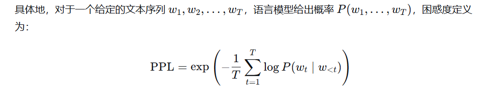
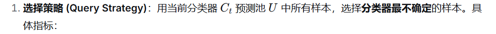

# 30.大模型（LLMs）数据质量过滤（困惑度筛选、分类器过滤）

#### 解释基于困惑度的数据质量过滤原理，并说明其可能偏好简单重复文本的缺点。

原理

基于困惑度（Perplexity, PPL）的质量过滤，本质上是用一个预训练的统计语言模型（通常是 n-gram 模型）来评估一段文本的“自然度”或“流畅性”。其核心假设是：高质量、人类撰写的文本应该符合该语言模型的概率分布，因此困惑度较低；而低质量文本（如乱码、机器生成的无意义内容、严重语法错误）会令模型“惊讶”，困惑度较高。

具体地，对于一个给定的文本序列 $w_1, w_2, ..., w_T$，语言模型给出概率 $P(w_1, ..., w_T)$，困惑度定义为：

$$
\mathrm{PPL} = \exp\left(-\frac{1}{T}\sum_{t=1}^{T} \log P(w_t \mid w_{<t})\right)
$$

{.ocr-src}

它衡量模型对文本预测的确定性：困惑度越低，表示模型认为该文本出现的可能性越大，也就越“流畅”。过滤时，设定一个阈值（如 PPL < 1000），保留困惑度在该阈值以下的文本。

缺点：偏好简单重复文本

基于 n-gram 的困惑度过滤存在一个著名缺陷：它对“简单重复”的文本反而会给出极低的困惑度（即高分）。例如，一段文本反复重复同一个短句（如“你好你好你好…”），或者只是由非常高频的词汇组成的模板化内容。由于 n-gram 模型是基于频率统计的，这些重复模式正是训练数据中的高频模式，模型对它们的预测会非常自信，从而产生很低的困惑度。结果，这类低信息量、无意义的垃圾文本反而会被保留下来。

另外，困惑度过滤倾向于奖励“平均化”的语言，对包含罕见词、复杂句式或专业术语的技术性、创造性文本可能给出较高的困惑度，从而误删这些高质量但统计上“不典型”的内容。因此，单纯依赖困惑度会导致过滤偏差，偏向枯燥、重复的文本。

---

#### 如何利用 KenLM 训练 5‑gram 语言模型并计算文本困惑度？给出关键步骤。

KenLM 是一个高效的 C++ 库，支持训练和查询 n-gram 语言模型（默认支持 5-gram）。以下是完整流程：

步骤 1：准备训练语料

收集一个大规模、高质量、与目标语言匹配的“干净”文本语料。通常使用 Wikipedia、书籍等作为正例。对语料进行预处理：统一小写、去除多余空白、将标点符号与词分离（tokenization）以适应词级建模。将处理后的文本按行存储，每行一个句子或一段。

步骤 2：训练语言模型\
使用 KenLM 的 `lmplz` 工具。命令示例：

```bash
lmplz -o 5 < cleaned_corpus.txt > model.arpa
```

- `-o 5` 指定最高 n-gram 阶数为 5。

- 输入文件为预处理后的文本（词序列）。

- 输出为 ARPA 格式的模型文件，包含 n-gram 及其对数概率和回退权重。

步骤 3：二值化模型（可选但推荐）

为了加快加载和查询速度，将 ARPA 模型转换为二进制格式：

```bash
build_binary model.arpa model.binary
```

二进制模型体积更小，查询更快。

步骤 4：计算文本困惑度\
使用 KenLM 的 Python 接口（`pip install kenlm`）。

```bash
import kenlm
model = kenlm.Model('model.binary')
# 文本同样需要经过与训练时一致的预处理
text = "This is a test sentence ."
ppl = model.perplexity(text)
print(ppl)
```

`perplexity` 方法返回浮点数。还可以通过 `model.score(text)` 获取对数概率，手动计算。

关键注意事项

- 训练数据应与待过滤数据使用相同的分词和预处理方式。

- 如果词汇表过大，可以限制词汇量（`--limit_vocab_file`）或使用 `-unk` 选项处理未登录词，避免困惑度无限大。

- KenLM 模型基于词，对于中文等无空格语言，需要先进行分词。

---

#### 困惑度阈值如何确定？动态分位数和固定阈值的优劣比较。

阈值确定方法

困惑度阈值需要根据实际数据分布和任务目标来设定。常用两种策略：固定阈值和动态分位数。

- 固定阈值：选择一个绝对 PPL 值（如 1000），所有 PPL > 1000 的文本被过滤。阈值通常通过在小规模标注集上平衡精确率和召回率获得，或者基于高质量文本的 PPL 分布（如 Wikipedia 的 PPL 均值 + 3 标准差）。

- 动态分位数：根据整个待过滤数据集的 PPL 分布，选择某个分位数（如 90% 分位数）作为阈值，仅保留 PPL 最低的 90% 文本。阈值随数据集而变。

优劣比较

| 维度 | 固定阈值 | 动态分位数 |
| --- | --- | --- |
| 稳定性 | 高，在不同数据集上标准统一。 | 随数据集分布漂移，同一模型可能保留不同比例的文本。 |
| 对数据源变化的适应性 | 如果新数据源整体 PPL 偏高（如代码、数学），固定阈值可能误删大量有效内容。 | 能自动适应数据整体特性，保留固定比例的数据，但可能让低质量文本混入（如果整体数据质量很差）。 |
| 可解释性 | 直观，阈值有绝对意义。 | 依赖于分位数的选择，需事先确定保留比例。 |
| 调优难度 | 需要根据验证集调整绝对值。 | 需要设定分位数（如 95%），同样需要验证，但调整更粗放。 |
| 典型应用 | C4, RedPajama 使用固定阈值（PPL < 1000），但基于特定语言模型。 | 在数据源变化频繁或无法预知全局分布时有用。 |

在实践中，常采用固定阈值结合分位数的混合方法：先设定一个硬性的上界（如 PPL < 2000 绝对保留），再结合分位数对中低质量进行细分。但固定阈值仍是主流，因为它更可复现。

---

#### 训练一个文本质量二分类器的正负样本如何构造？特征可以包含哪些？

正负样本构造

目标是训练一个分类器区分“高质量”与“低质量”文本。

- 正样本（高质量）：从公认的高质量来源选取，如 Wikipedia 正文、书籍、学术论文、技术文档等。这些文本经过人工撰写和校对，语言规范、信息丰富。可以随机抽取段落或句子。

- 负样本（低质量）：来源多样，包括：
  - Common Crawl 中经规则初筛仍显杂乱的文本（如短小、乱码、高广告密度的页面）。
  - 明确的垃圾：SEO 内容农场、机器生成文本、论坛灌水帖。
  - 构造的伪样本：通过重复、随机替换、删除等方式破坏正样本来模拟噪声。

- 样本平衡与清洗：正负样本数量通常设为 1:1 或接近。需人工或自动过滤掉标注错误的样本。

可选特征

特征可大致分为三类：表面统计特征、语言模型特征和预训练嵌入特征。

- 表面统计特征（快速计算，适用于轻量分类器）
  - 文本长度（字符数、词数）
  - 平均词长、句子长度
  - 大写字母比例
  - 标点符号比例
  - 停用词比例
  - 唯一词比例（词汇多样性）
  - 数字占比、特殊字符占比
  - 重复 n-gram 频率
  - 行数、平均行长度

- 语言模型特征
  - 使用 KenLM 或 GPT-2 等模型计算的困惑度（或对数似然）
  - 不同上下文下的概率得分（如一至多个 token 的条件概率）

- 预训练嵌入特征
  - 使用轻量 Sentence-BERT 或 fastText 提取文档向量，作为分类器的输入。这种方式能捕捉更深层的语义，但计算成本更高。

通常在资源有限时，用表面特征 + 线性分类器（如 fastText）就能达到不错的效果；更高质量则用轻量 Transformer 做端到端分类。

---

#### 启发式质量规则举例：字母/数字比率、停用词比例、行平均长度等，并讨论组合方式。

常见启发式规则

以下规则常用于快速筛除明显低质量文本：

1. 字母/数字比率：文本中字母（或汉字）占所有字符的比例。正常文本应高于某个阈值（如 > 70%）；乱码或二进制数据通常包含大量非字母字符。

2. 停用词比例：停用词（如“the”、“is”、“的”）在自然语言中占比稳定（约 40%-60%）。如果比例过低，可能是关键词堆砌或公式；过高可能是无意义虚词重复。

3. 平均行长度：过滤掉过短（< 10 字符）或过长（> 2000 字符）的行，可去除菜单、导航条或未格式化的长代码。

4. 重复 n-gram 比例：高频 n-gram 重复出现（如同一 5-gram 占比 > 20%）指示模板或垃圾。

5. 大写字比例：全大写字母占比过高（> 30%）可能为吼叫评论或无意义字符。

6. 句子长度分布：正常文本句子长度呈近似正态分布；若方差极小（全是短句）或极大，可能为噪声。

7. 标点符号异常：缺少句号等结束标点，或连续感叹号/问号数量异常。

8. 链接/URL 密度：网页文本中链接文本比例过高（> 20%）可能为导航页。

9. 特殊 Unicode 字符比例：出现大量控制字符、私用区字符，往往是格式转换错误。

组合方式

单一规则容易误杀，需组合为“规则流水线”。通常采用投票或级联策略：先对所有规则打分（每满足一条加一分或减一分），总分低于阈值的文本被丢弃。更精细的做法是使用决策树或逻辑回归自动学习各规则的最佳阈值和权重。

此外，还可以对每个规则设置“软阈值”，仅当多个规则同时触发才执行过滤，降低误杀率。例如，当文本“停用词比例低”且“标点异常”且“URL 密度高”时，才标记为低质量。

---

#### 为什么只用困惑度可能误删技术性、创造性文本？如何结合分类器弥补？

困惑度误删的原因

n-gram 模型基于高频模式，对于包含大量罕见词汇、复杂句式、领域术语的技术性文本（如数学论文、法律文件），模型预测概率会很低，从而产生高困惑度。同样，创造性文本（如诗歌、实验性文学）常常打破常规语言统计规律，也会被赋予高困惑度。如果仅用困惑度一刀切，这些原本高质量但“不典型”的文本就会被错误丢弃。相反，简单重复的垃圾文本却因低困惑度而保留。

结合分类器弥补

引入一个基于内容质量的二分类器可以有效纠正困惑度的偏差。该分类器以困惑度为特征之一，同时融入其他表面和语义特征，学习更复杂的“高质量”定义。例如：

- 训练分类器：用前面所述方法构造正负样本，其中正样本特意包含技术性、创造性文本（如 arXiv 论文、诗歌选集），负样本包括垃圾、乱码。分类器会学到“高困惑度但语法正确的技术文本”是好的，与“高困惑度的乱码”区分开。

- 特征组合：分类器的输入不仅包括 PPL，还包括词汇多样性、句子长度波动、特有术语密度等。这样，即使 PPL 较高，如果文本具有丰富的专业词汇和合理的句子结构，分类器也能给出高质量分数。

- 两阶段过滤：第一阶段用困惑度粗筛（保留 PPL < 极高阈值，如 5000），避免大量噪声进入；第二阶段用分类器精细评分，只在低分时丢弃。这样既节省了分类器在所有数据上的运行成本，又保护了高价值内容。

通过分类器学习“什么是好的高质量”，可以显著降低误杀率，尤其是对专业和创意内容。

---

#### 基于模型（如 BERT 轻量分类器）的质量打分流程，与 n‑gram 困惑度方法的对比。

基于轻量 BERT 分类器的流程

1. 数据准备：构建如上所述的正负样本集。

2. 模型选择：选用轻量预训练模型（如 DistilBERT、BERT-tiny、或 DeBERTa-small），在顶端添加分类头。

3. 微调：在标注的质量分类数据上进行二分类微调，类别为“高质量/低质量”。使用标准交叉熵损失，训练至收敛。

4. 推理打分：对待评估文本，截取前 512 token（或分段处理），输入模型得到“高质量”的概率作为质量得分。可设定阈值（如 >0.5）保留。

对比 n‑gram 困惑度方法

| 维度 | n‑gram 困惑度 | 轻量 BERT 分类器 |
| --- | --- | --- |
| 语义理解 | 仅捕捉局部词频模式，无法理解语义、逻辑，难以区分“乱码”和“专业但高困惑度的文本”。 | 具备深层语义和句法理解，可区分技术文本与噪声。 |
| 计算开销 | 极低，纯 CPU 即可快速处理，内存占用小。 | 较高，需 GPU 推理，处理速度慢于 KenLM 数倍至数十倍。 |
| 数据依赖性 | 需要目标语言的高质量语料训练语言模型，但对标注数据零依赖。 | 需要精心构造的正负标注样本进行微调，有一定数据标注成本。 |
| 泛化能力 | 对新领域文本敏感，易误判，但训练稳定。 | 通过微调可适应特定领域，泛化性好，但可能过拟合训练数据的偏见。 |
| 可解释性 | 可直接解释为“语言模型认为这段文本有多自然”。 | 分类器是黑盒，但可通过注意力可视化等分析。 |
| 典型用途 | 大规模预训练数据初筛，成本敏感场景。 | 精细过滤，对质量要求极高的数据集（如微调数据）。 |

实践中，两者结合效果最佳：先用 n‑gram 进行高效初筛，再用轻量 BERT 分类器对边缘或高价值领域进行精筛。

---

#### 混合过滤策略：如何融合困惑度分数、分类器分数和启发式规则做出最终决策？

混合过滤策略的目标是综合不同维度的信号，取长补短，以达到更精准、更鲁棒的质量评估。

融合架构

典型的混合策略采用级联 + 加权的方式，分为三阶段：

1. 第一阶段：启发式规则快速拦截\
   用计算成本极低的规则（如长度、乱码比例、URL 密度）过滤掉明显无效的文本。这一阶段通常直接丢弃，不进入后续流程，节省大量计算资源。

2. 第二阶段：困惑度粗筛\
   对通过规则筛选的文本，用 n-gram 困惑度进行评分。设定一个宽松的阈值（如 PPL < 5000），保留几乎肯定高质量及“中等”文本，丢弃极端低质量（PPL > 10000）。这一阶段的目标是剔除最恶劣的噪声，同时保留不确定性文本给下一级。

3. 第三阶段：分类器精筛\
   对于困惑度处于中间地带（如 1000-5000）或来自重点领域的文本，运行轻量 BERT 质量分类器，得到“高质量概率”。最后，结合所有分数做出最终决策。

分数融合方法\
最终决策时，如何综合 PPL 分数 $S_{ppl}$（归一化为 0-1，越高越好）、分类器分数 $S_{cls}$ 和启发式规则计数 $S_{rule}$（如规则违规次数）？

- 加权线性组合：`FinalScore = α*S_ppl + β*S_cls + γ*S_rule`，其中权重可以通过在验证集上最大化保留目标数据比例来学习。

- 投票机制：如果某文本满足以下任一“淘汰条件”则丢弃：PPL > 极高阈值 且 分类器分数 < 0.2；或 规则违规数 > 2 且 PPL > 3000。

- 学习排序：将这三个分数作为特征，用逻辑回归或小型决策树在人工标注集上训练一个最终的二分类器，让模型自动学习最佳融合方式。

实施要点

- 所有分数需经过归一化（如 Min-Max 或 Z-score），以消除量纲差异。

- 需维护一个验证集来持续监控融合效果，调整权重和阈值。

- 对不同领域（如新闻、代码、诗歌）可以设定不同的融合权重，因为其质量判断标准不同。

这种混合策略在实践中被证明非常有效，既保留了困惑度的高效和分类器的精准，又通过规则兜底，显著提升了数据纯度。

---

#### 如何利用高质量参照语料（维基百科、书籍）训练质量分类器？域迁移问题如何缓解？

训练流程

1. 构建正样本集：从维基百科（通常只取正文）、精选书籍（如 Gutenberg）、学术论文（arXiv）中提取段落。可进行轻量清洗，确保样本质量极高。

2. 构建负样本集：从目标待清洗语料（如 Common Crawl）中随机抽取大量文本，或者从这些语料中人工/半自动挖掘的低质量文本（如经困惑度极高或规则标记的）。也可通过破坏正样本来生成（如随机插入、删除、重复），以学习对抗噪声。

3. 特征与模型：选择轻量文本分类器（如 fastText、DistilBERT），使用上述正负样本进行微调。训练时可采用带噪声标签的学习策略，因为负样本可能包含少量误标。

4. 评估：在人工标注的领域内和领域外测试集上评估，确保泛化。

域迁移问题

使用维基百科/书籍训练的模型直接应用于完全不同的领域（如法律文书、社交媒体）时，性能会下降。缓解措施：

- 目标域数据增强：收集少量目标域的标注数据（正负样本），以少量样本微调模型（或使用 adapter）。即使只有几百条，也能显著提升。

- 多源域混合训练：在正样本中加入多样化的其他高质量源（如 GitHub 文档、新闻），拓宽模型对“高质量”的认知。

- 域对抗训练：在分类器训练中加入域判别器，促使特征提取器学习域不变的表征。

- 主动学习：对目标域数据进行预测，选择分类器最不确定的样本进行人工标注，迭代改进。

- 迁移学习中的特征解耦：使用预训练语言模型作为基座，其本身已见过大量通用文本，域迁移能力相对较强。再结合少量目标域微调，效果往往已足够。

关键在于，用高质量参照语料训练的模型提供了一个强大的“质量基础”，再通过目标域少量标注数据快速适应，是性价比最高的方案。

---

#### 低资源语言缺乏标注时，如何设计无监督或弱监督的质量过滤方法？

低资源语言（如斯瓦希里语、缅甸语）缺乏现成的质量标注数据，无法直接训练分类器。此时需借助无需标注的无监督或弱监督方法：

一、无监督方法

1. 困惑度（PPL）过滤：用低资源语言本身的未标注文本训练一个 n‑gram 语言模型（或轻量级 Transformer）。该语言模型只需原始语料，无需标注。虽然可能混入噪声，但语言模型仍能捕捉该语言的统计规律，对严重偏离分布的文本（乱码、其他语言、噪声）给出高困惑度。此法要求语料足够大，且需手工确定阈值。

2. 跨语言迁移：利用高资源语言（如英语）训练的多语言质量分类器。例如，使用 XLM‑RoBERTa 等模型在英语质量数据上微调，然后直接对低资源语言文本进行预测。由于多语言模型的跨语言对齐能力，可以零样本迁移。对低资源语言可结合未标注数据的自训练：用多语言分类器预测伪标签，保留高置信度样本，反复训练，逐步适应该语言。

3. 自编码器/异常检测：基于高资源语言训练的质量模型，视低资源语言为“目标域”，利用深度异常检测（如自编码器重构误差）。在高质量文本上训练的自编码器，对低质量文本会有高重构误差，可用作质量得分。

4. 语言无特定的统计特征：利用与语言无关的表面特征（文本长度、重复度、字符类型比例、压缩率等）进行无监督聚类或离群点检测。这类特征不依赖任何语言知识，对低资源语言完全通用。可用 PCA 或 One‑Class SVM 找出正常文本的流形，偏离则视为低质量。

二、弱监督方法

- 基于领域专家的规则：请一位母语者编写少量的启发式规则（如过滤掉包含过多外来语词汇的文本、明显拼写错误比例过高的文本）。规则虽简单，但针对性强。

- 主动学习+低成本标注：先用上述无监督方法生成初始得分，然后只挑选少量最不确定的样本请母语者标注，训练一个小分类器。如此迭代，仅需极少标注即快速提升。

示例：对于低资源语言，先用 n‑gram PPL 过滤掉明显的垃圾，再用多语言 BERT 分类器预测分数，对分数中等的样本进行人工抽检，动态调整阈值。

---

#### 代码数据质量过滤：如何利用解析器或编译结果判定完整性？

代码数据（来自 GitHub、StackOverflow 等）的过滤与自然语言不同，核心在于可解析性和功能性。

1. 基于解析器的过滤

- 语法检查：对每种编程语言使用对应的解析器（Python: `ast.parse`, JavaScript: `esprima`, Java: `javax.tools.JavaCompiler`），将代码片段尝试解析为抽象语法树（AST）。如果解析失败，说明存在语法错误，可直接丢弃或标记为低质量。

- 结构化特征：即使代码可以解析，也可从 AST 中提取特征：函数/类的数量、平均函数长度、嵌套深度、注释密度、异常处理比例等。过于平坦或过度嵌套的代码可能质量不高。

- 代码克隆检测：使用 MinHash 或 AST 级相似度检测高度重复的代码片段，滤除大规模重复的模板代码。

2. 基于编译结果的过滤

- 编译通过率：如果代码的上下文包含完整的构建信息（如 Maven、Gradle），可以自动编译。编译成功且测试通过的代码显然质量更高。可以将“编译成功”作为正样本标签，用于训练质量分类器。

- 单元测试覆盖率：对于完整的项目，运行单元测试，计算覆盖率。高覆盖率通常意味着代码更健壮。

- Linter 和静态分析：使用 `eslint`, `pylint`, `clippy` 等 linter 对代码进行检查，统计违规数。违规密度高的代码被视作低质量。

3. 完整性判定

- 上下文完整性：一个代码片段可能是一个大函数的一部分，缺少上下文。可以通过检测未定义的变量、不完整的括号/缩进等判断它是否是一个独立完整的代码块。不完整的片段在作为训练数据时可能引入噪声，但有时也可保留用于训练补全模型。

- 文档与注释：良好注释的代码通常质量更高。统计注释比例，过低可能为自动生成或无文档的废弃代码。

实践：训练代码模型（如 StarCoder）时，会先过滤掉无法解析的代码，去除重复，保留包含一定比例注释、且通过 linter 的代码，从而提升生成质量。

---

#### C4 数据集使用了哪些过滤启发式规则？评估其优缺点。

C4（Colossal Clean Crawled Corpus）是从 Common Crawl 提取的英文数据集，用于训练 T5。它采用了一套激进规则：

过滤规则：

1. 保留以句号、问号、感叹号结尾的行。移除任何不以标点结尾的行（认为是代码、列表、导航菜单）。

2. 丢弃包含任何“坏词”的页面。使用一个包含 500 多个英文脏话的名单，任何页面若包含名单内词汇则整页丢弃。

3. 丢弃包含 `lorem ipsum` 等占位文本的页面。

4. 丢弃包含 `{` 的页面（为了防止大量 JavaScript/CSS 代码混入）。

5. 丢弃长度不足 3 句的页面。

6. 去重：对文档进行行级去重，以及文档级近似去重（MinHash）。

7. 语言识别：仅保留被 fastText 识别为英语且概率 > 0.99 的文本。

优点：

- 简单高效，无需复杂模型，可在海量数据上快速执行。

- 能极大幅度地去除噪声、代码和低质量文本，使得最终数据集极其“干净”，困惑度很低。

- 适合训练文本到文本的生成模型（T5），其输入输出格式明确，对代码和脏话敏感。

缺点：

- 过于激进：丢弃包含 `{` 的页面直接消灭了大量包含代码示例的技术文档、教程、论坛讨论，而这些对训练代码能力至关重要。丢弃含有脏话的页面则剔除了许多有价值的评论、社交媒体文本，降低了模型对自然语言的覆盖范围。

- 信息损失：行级过滤可能破坏文档的结构完整性（如删除引用列表、图表标题）。同时，许多多语言、非标准但真实的文本（如创意写作、俚语）被排除。

- 偏见引入：脏话列表带有文化偏见，可能导致删除特定群体常用的表达方式。丢弃所有不含标点结尾的行则可能误删诗歌、清单等正常格式。

- 无法捕捉深层质量：对于语法正确但逻辑不通或重复的文本（如内容农场），规则无力。

总结：C4 是一个高效但极端的过滤方案，牺牲了大量覆盖率和多样性换取高流畅度。

---

#### 在对话数据中，“质量”的定义有何不同？如何过滤简短的无效回复？

对话数据的质量评估不同于网页文本，其核心在于交互性、信息增益和角色一致性。

“质量”的定义维度：

- 信息量：回复是否推进了对话，提供了有价值的信息？简短敷衍回复（如“嗯”、“好的”）通常视为低质量。

- 连贯性：是否与对话历史逻辑连贯？答非所问的回复是低质量的。

- 角色一致性：在多轮对话中，助手是否保持了一致的人设和语气？

- 安全性：是否包含不当、冒犯内容？

- 无重复：是否机械重复前文或自身？

过滤简短无效回复的方法：

1. 基于长度的绝对过滤：移除字符数或词数少于阈值（如 < 5 个词）的回复。但需注意，有些场景下简短回复是合理的（如“不客气”），因此通常结合上下文。

2. 信息增益过滤：利用语言模型计算在给定对话历史下，回复带来的概率增益。敷衍回复（如“好的”）是任何上下文下的高概率 token，其信息量极低。通过计算 `P(reply | context)` 与 `P(reply)` 的差异，可以滤除那些“在任何情况下都常见”的回复。

3. 语义相似度过滤：如果助手回复与用户上一轮消息的语义相似度极高（如只是鹦鹉学舌式复述），则视为无效。

4. 规则与关键词黑名单：过滤掉仅由感叹词、单个 emoji、纯标点构成的回复。

5. 基于模型的分类器：人工标注一批对话样本，标注“有意义回复/无效回复”，训练一个二分类器（如基于对话历史的 BERT），来自动识别敷衍行为。

对于多轮对话，还需评估整个对话线程的质量：如果连续几轮都是无效回复，应整体丢弃或截断。此外，将对话数据构造为预训练语料时，通常只对助手回复部分计算损失，用户部分的质量问题影响稍小。

---

#### 设计一种主动学习循环，用少量人工标注迭代改进质量分类器。

主动学习可以最大化人工标注的收益，用最少标签达到最佳分类器性能。以下是专门为质量过滤设计的循环：

**初始化：**

- 准备一个未标注的大规模文本池 $U$。
- 用启发式规则和现成的质量分数（如 PPL）为 $U$ 中的每个样本生成一个“弱标签”或粗分数。
- 据此训练一个初始的轻量分类器 $C_0$。

{.ocr-src}

**循环迭代**（重复以下步骤直到满足预算或性能要求）：

1. **选择策略 (Query Strategy)**：用当前分类器 $C_t$ 预测池 $U$ 中所有样本，选择**分类器最不确定**的样本。具体指标：

{.ocr-src}

- 置信度最低：预测概率最接近 0.5（二分类）。

- 熵最大：预测概率分布的熵最高。

- 多样性采样：为避免所选样本过于雷同，先对不确定样本进行聚类（如基于文本嵌入），从每个簇中选取代表性样本。

2. 人工标注：将选出的样本（如 100 条）交给标注员，根据预先定义的质量指南进行“高质量/低质量”标注。

3. **增量训练**：将新标注的样本加入训练集，重新训练（或继续微调）分类器 $C_t$，得到 $C_{t+1}$。

{.ocr-src}

4. 评估与停止：在预留的固定测试集上评估新分类器的准确率、召回率。如果性能提升低于阈值或达到标注预算上限，则停止。

优化技巧：

- 预标注辅助：对于低资源场景，可先用一个高资源语言训练的零样本分类器进行预标注，主动学习只需修正其错误，进一步提高效率。

- 使用模型委员会：训练多个分类器（如不同架构、不同初始化），选择它们预测分歧最大的样本进行标注，能发现单一模型的盲区。

- 半监督结合：将高置信度的预测作为伪标签加入训练集，扩大训练数据量。

此循环能迅速将分类器的决策边界调整到目标数据分布的“质量边界”上，特别适合纠正初始分类器在特定领域的偏差。

---

#### 为什么数据质量是任务相关的？举例说明不同下游任务对质量的衡量差异。

数据质量不是一个绝对概念，它取决于最终的应用任务。一段文本对一个任务是“高质量”，对另一个可能完全无用或有害。

任务相关性原理：

- 语言模型预训练：追求流畅、多样、信息丰富的文本，以学习通用的语言知识。对于生成式模型，代码、数学、多语言混合文本都非常宝贵。低质量（如重复、语法错误）会降低泛化能力。

- 对话助手：要求对话历史连贯、符合安全规范、角色一致。即便是流畅的独白，若无交互性也视为低质量。简短但切题的回复（如“是的”）在对话中是高质量的。

- 代码生成：核心质量是可解析、可执行、逻辑正确。一篇详尽但无法编译的代码教程（文字描述多，代码片段错误）在代码任务上是低质量的，但对语言模型可能仍有用。

- 事实问答/知识库：注重事实准确性。一段文笔优美但包含错误事实的文本，在此任务上是极低质量的（幻觉源）。

- 文本分类：希望标注数据标签准确、类别平衡。文本自身的流畅度并非最关键，标签的正确性才是质量。

- 翻译：需要平行语料的对齐质量。即使源语言和目标语言单看都很流畅，如果语义不对齐，它就是低质量翻译数据。

例子：

- 维基百科文本在所有任务上都普遍被认为是高质量，因为其流畅、事实相对准确、格式规范。

- Twitter 数据对预训练模型很有价值（涵盖口语、新词），但对训练正式文档生成器可能带来风格污染；而对话助手则需要这种口语化数据。

- Reddit 评论对情感分析是高质量标签源，但对需要中立事实的新闻摘要任务，充满了偏见和低质量信息。

因此，构建数据集时必须明确下游任务，才能定义合适的质量过滤标准。

---

#### 质量过滤过激可能导致多样性丧失，如何在过滤率和保留率之间取舍？

质量过滤是一把双刃剑：过滤太松，噪声污染模型；过滤太紧，数据多样性（词汇、风格、观点）受损，模型泛化能力下降，甚至产生社会偏见。

多样性丧失的表现：

- 文本风格单一化（全是新闻体，缺乏对话、叙述）。

- 特定群体或少数观点被系统性移除（因与其相关文本常被模型判为低质量）。

- 词汇和句式变得单调，生成文本缺乏创造力。

取舍策略：

1. 设定目标多样性指标：在过滤的同时监控数据集的词汇多样性（TTR, distinct-n）、主题覆盖率、来源域名分布等。为这些指标设定最低容忍度。

2. 分层过滤：对不同来源/领域的数据设定不同的质量阈值。对于稀缺但重要的领域（如小众文化、方言），放宽阈值以保留更多样本；对于丰富领域（如新闻），可严格过滤。

3. 基于比例的过滤（分位数）：不固定绝对质量分数，而是按来源或领域分别取前 P% 的文本。这样能保证每个领域都有代表性文本被保留，不至于某个领域被完全“灭绝”。

4. 将多样性作为训练目标：训练分类器时，正样本不仅包含高质量文本，也特意加入多样化的“边缘案例”，告诉模型这些不是低质量。或者，在损失函数中加入多样性正则项。

5. 后过滤重采样：过滤后，对过少的类别进行上采样，或对过多的类别进行下采样，以重新平衡数据集。

6. A/B 测试与下游评估：最根本的取舍依据是下游任务表现。训练多个模型，分别使用不同过滤强度的数据，在下游基准上评估生成质量、多样性和安全性，找到帕累托最优点。不能只看困惑度。

实践：RedPajama 在过滤时，使用了质量分类器，但通过分位数保留策略确保每个 Common Crawl 快照都保留一部分，避免完全丢失某个时间段的数据。

---

#### 如何使用困惑度分布的双峰特性辅助选取分界阈值？

当待过滤语料混合了高质量与低质量文本时，其困惑度分布常常呈现出双峰（或多峰）形态：一个峰位于较低困惑度区域（高质量文本），另一个峰位于较高困惑度区域（噪声、乱码）。利用此特性可以更科学地选择阈值。

步骤：

1. 计算全局困惑度：在随机大样本上计算每个文档的 PPL，绘制直方图。

2. 双峰检测与拟合：如果直方图呈现双峰，使用高斯混合模型（GMM）进行拟合，估计两个分量的均值 μ1,μ2(μ1<μ2)、方差和权重。

3. 确定阈值：理想的分界点位于两个分量交叠最低的“谷底”，即两个概率密度函数的交点。该点由贝叶斯决策规则给出：

$$
P(\text{high-quality} \mid PPL = x) = P(\text{low-quality} \mid PPL = x)
$$

{.ocr-src}

1. 解得阈值 $x$。如果谷底不明显，可选择一个介于两均值之间、偏向高质量一侧的安全阈值。

2. 调整：如果双峰特性不明显（例如数据整体质量极差），可分领域、分语言重新绘制，因为不同子集可能有各自的分布。也可结合其他统计量（如文本长度）进行多维双峰检测。

优点：此方法为数据驱动的自动阈值选择，减少了手动调参的工作量，并且能适应不同批次数据的统计变化。但也需警惕，双峰假设并非总成立，有时分布是单峰长尾的，需改用分位数方法。

---

#### 介绍以“教科书质量”为目标的过滤策略（如 phi 系列），如何选择种子语料？

Phi 系列模型（如 Phi-1, Phi-2）以“教科书质量”数据著称，其核心思想是用极高质量、风格统一、富含推理过程的文本训练小模型，达到大模型效果。其过滤策略围绕“教科书”特性展开。

种子语料的选择：

- 来源：优先选用经过人工编审的高质量源，如：
  - 教科书和教材：公开的大学讲义、K-12 教育材料、技术书籍。
  - 维基百科（特别是经过精选的版本）。
  - 学术论文（如 arXiv）。
  - 高质量代码库（如经过筛选的 GitHub 仓库）。
  - 由强大模型（如 GPT-4）生成的“合成教科书”：让大模型根据指定主题生成教育性、逐步推理的内容。

- 过滤标准：
  - 教育价值：文本是否清晰解释概念、提供例子、展示逐步推理过程？使用分类器或提示大模型来评估。
  - 语言风格：要求客观、准确、无网络用语、无广告。使用风格分类器。
  - 事实准确性：与已知知识库比对，或由大模型评判其事实正确性。
  - 连贯性：句子和段落逻辑连贯，无突兀跳转。

- 构建流程：
  1. 从种子源收集文本。
  2. 使用大模型（如 GPT-4）作为裁判，对文本进行评分，筛选出“教科书级”的高分样本。
  3. 人工抽检确保质量。
  4. 将筛选出的数据与合成的教科书数据混合，形成最终训练集。

这种策略下，数据量通常较小（几十亿 token），但信息密度极高，使得小模型在推理基准上表现优异。其代价是可能过拟合于教科书风格，缺乏对话等交互能力。

---

#### 质量过滤如何融入偏见和毒性控制？构建安全过滤器的技术路线。

质量过滤不仅要保证流畅和信息量，还必须控制有害内容（毒性、仇恨言论、暴力）和社会偏见。这需专门设计安全过滤器，并将其整合到质量流水线中。

技术路线：

1. 多层级安全过滤架构
  - 规则层：维护关键词黑名单（已知的种族歧视词、极端用语）、正则匹配模式（如威胁性句式）。任何命中文本被直接删除或严格降权。
  - 毒性分类器层：使用预训练的毒性检测模型。例如 `detoxify`（基于 BERT）、Perspective API。为每种目标语言微调一个分类器。输出多个维度的分数：毒性、严重毒性、侮辱、威胁、身份攻击等。设定阈值过滤。
  - 偏见分类器层：除了毒性，需检测对特定群体的刻板印象。可训练专门分类器识别 biased 语言，或使用 NLI 模型检测陈述是否蕴含歧视。

2. 安全与质量的权衡与融合
  - 不能将安全过滤独立于质量过滤。一篇完全安全但质量低下的文本可能通过安全过滤；反之，一篇高质量的辩论文章可能因包含引用的攻击性词汇被误杀。因此，需要联合评分：`Final_Score = w1*Quality_Score + w2*Safety_Score`。对于高毒性，`Safety_Score` 设为极低，直接否决。
  - 对于边缘案例，引入人工审核机制（Human-in-the-Loop），持续反馈并修正分类器。

3. 动态红队测试与迭代
  - 定期组织红队（内外部安全专家）攻击模型，发现新类型的攻击和偏见。将发现的对抗性样本加入训练数据，更新分类器。

4. 偏差缓解与公平性
  - 监控不同人口统计群体相关的文本通过率，确保过滤不会对某个群体产生系统性不利影响。
  - 对分类器进行偏见审计：使用反事实数据（如交换性别/种族标识词）测试分类器预测是否公平。

5. 落地部署
  - 安全分类器需要作为流水线的一个标准步骤，在文档级过滤时运行。由于毒性检测通常基于句子级，对于长文档可先分句，若任一短句毒性超限，则标记整文档。

通过这种多层级、可审计的安全过滤方案，可以在保证数据多样性的同时，最大程度地降低模型学习有害内容的风险。

---

#### 大规模质量过滤的工程优化：如何批量应用模型并利用多核/GPU 加速？

处理数 TB 乃至 PB 级数据时，必须充分利用集群计算资源。

1. 并行框架与数据分片

- 使用 Spark / Ray / Dask：这些分布式计算框架天然支持数据分片（partition）和并行 map/filter 操作。将语料切分为大量小文件，每个 worker 处理一个分片。

- 数据流水线化：将过滤步骤设计成有向无环图（DAG），一个步骤的输出直接流向下一个步骤，避免频繁的磁盘 I/O。

2. 模型推理加速

- n‑gram 模型（KenLM）：纯 CPU 操作，速度很快。可在单个 worker 内使用多线程（如 `OpenMP`）并行计算多个文档的困惑度。KenLM 支持批处理，但通常直接逐文档调用即可。

- Transformer 分类器（如 BERT）：
  - GPU 批处理：使用 `torch.utils.data.DataLoader` 将多个文档的文本 tokenization 后组建成 batch，送到 GPU 进行批量前向推理。这是最大化 GPU 利用率的关键。
  - 混合精度 (FP16/BF16)：降低显存，提高吞吐。
  - ONNX Runtime / TensorRT：将训练好的分类器转换为优化过的推理图，进一步提速。
  - 动态 batching：对于不同长度的文本，使用填充（padding）到相同长度，或使用 `pack_padded_sequence` 避免浪费计算。

- 负载均衡：使用 Ray 的 `Actor` 模型，可以将 GPU 模型封装为 Actor，所有 CPU worker 将文本发送给 Actor 进行推理，实现 GPU 的共享和复用。

3. 流水线优化

- 预取与缓存：在模型推理前，使用多线程进行数据读取和预处理（tokenization），使 GPU 始终保持忙碌。

- 分层过滤顺序：将计算成本最低的过滤（如规则、长度）放在最前面，过滤掉大部分垃圾，使得昂贵的模型只需处理剩余数据。

- 特征复用：对于多个过滤模型需要共享底层特征（如预训练嵌入）的情况，可以先统一提取特征，供各分类器使用，避免重复计算。

4. 增量与热加载

- 增量去重：不必等全量数据收集完毕再运行。可以按天/周处理数据，新数据只与历史指纹库（如布隆过滤器）对比去重。

- 模型热更新：当质量分类器更新时，通过动态加载新模型文件，无需重启长时间运行的服务。

通过上述工程优化，一个包含规则、n‑gram 和 BERT 分类器的复杂过滤管道，可以在数十个节点的集群上，以每天处理数 TB 的吞吐量稳定运行。

